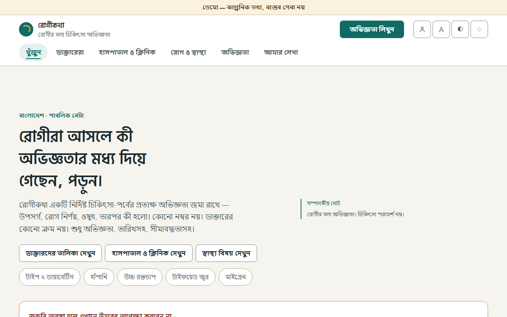
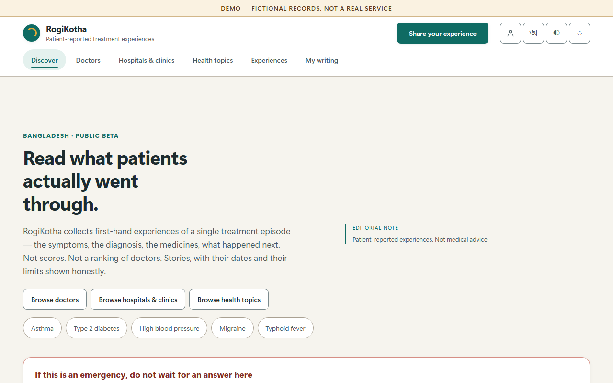
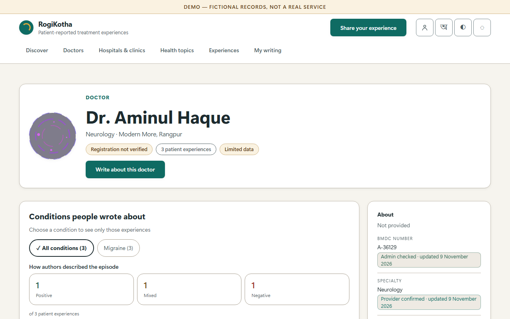
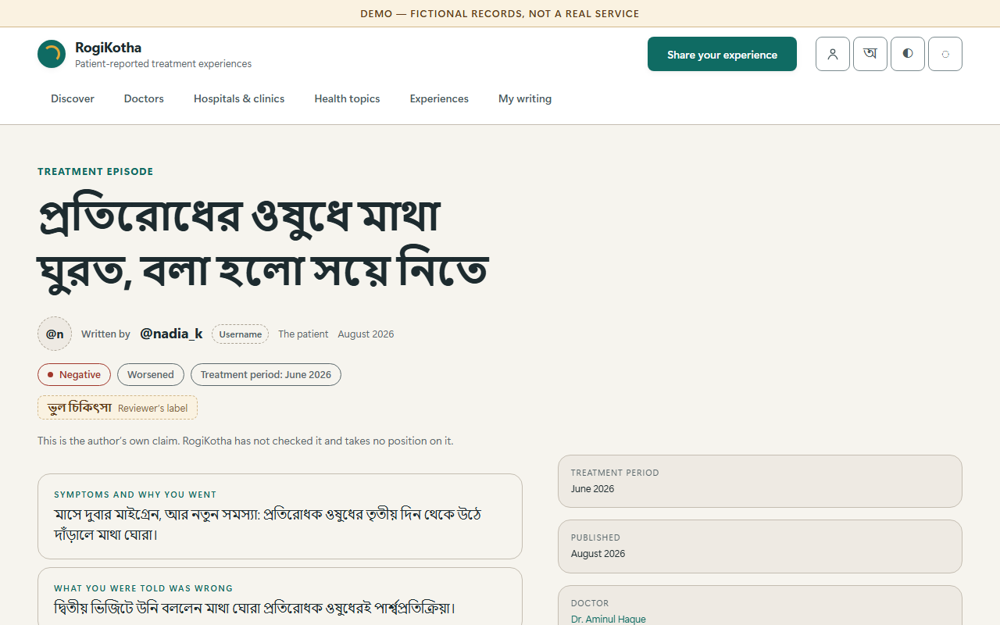
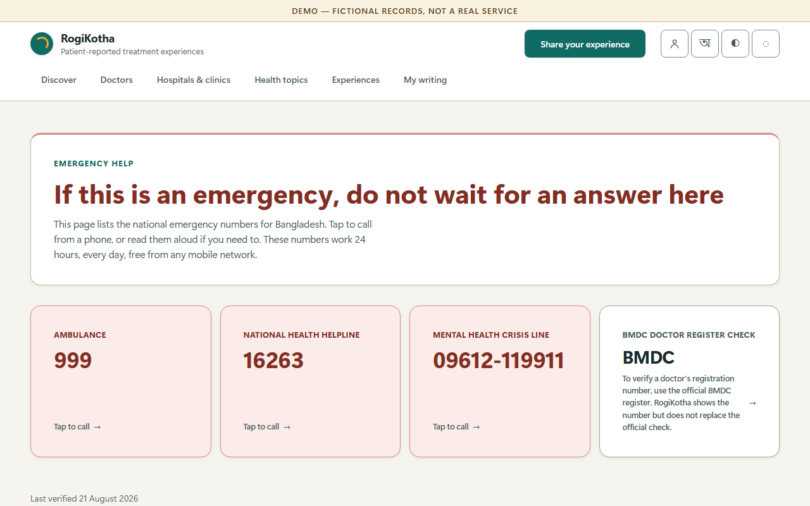
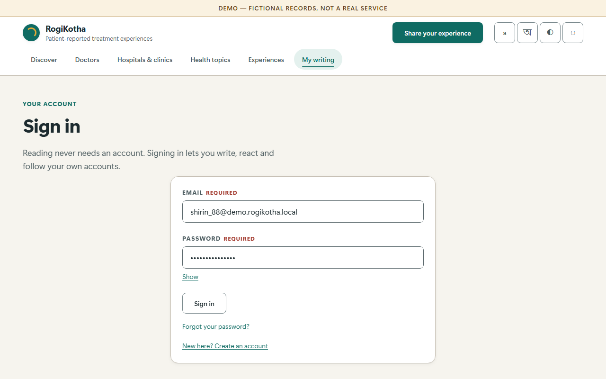
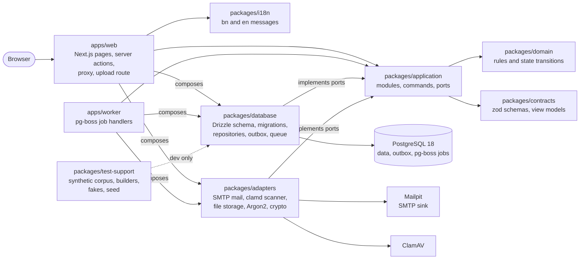

# RogiKotha

RogiKotha (রোগীকথা, "the patient's account") is a public, bilingual (Bengali and English) health
platform. It publishes structured patient accounts of doctors and facilities, with the documents
the author attached, where each claim came from, and distributions with exact counts and their
denominators. It shows no star ratings and no single quality score. Nothing in it is medical
advice. This repository holds release 1: a working web app and background worker that run
locally on synthetic data with one command.

**Status: Release 1 complete.** The ten release-1 Units are built, reviewed and merged on `main`.
Build and Test was approved on 2026-11-09 under the owner's delegation, and the AWS AI-DLC 2.11.0 workflow for this
intent is complete. Release 1 is a local demo, not a public launch (moderation is release 2,
FD-105).

## Screenshots

Taken from the running demo (`pnpm demo`) on 2026-11-09. Every record shown is synthetic.

| Home in Bengali | Home in English |
|---|---|
|  |  |
| **Doctor profile** | **Experience page** |
|  |  |
| **Emergency guidance** | **Signed in: my writing** |
|  |  |

The Bengali home at 360 px: [docs/images/home-bn-360.png](docs/images/home-bn-360.png).

## Quality gates

Figures come from the Build and Test record: the full run on 2026-11-08 at `e09b558`, and the re-run
of `pnpm check` and `pnpm smoke` on `main` on 2026-11-09 after the last fixes (marked "11-09"):
[build-and-test-summary.md](aidlc/spaces/default/intents/261011-aidlc-adoption/construction/build-and-test/build-and-test-summary.md)
and [test-results.md](aidlc/spaces/default/intents/261011-aidlc-adoption/construction/build-and-test/test-results.md).

| Gate | Command | Result |
|---|---|---|
| Strict typecheck | `pnpm typecheck` (in `pnpm check`) | pass, all packages and `apps/web/e2e` |
| Lint | `pnpm lint` | 0 errors, 1 known warning (an unused `eslint-disable`) |
| Import boundaries | `pnpm lint` and `pnpm lint:boundaries` | rules enforced; the fixture shows its 18 expected violations |
| Formatting | `pnpm format:check` | clean |
| No tool attribution | `pnpm check:identity` | no markers |
| Unit and integration tests | `pnpm test:coverage` (in `pnpm check`) | 366 files, 4513 passed, 1 skipped (11-09) |
| Line coverage (floor 80% per package) | same | 96.13% overall (11-09); every package at or above the floor |
| Integration tests only | `pnpm test:int` | 65 files, 446 passed on the fix branch (437 on `main` at `e09b558`) |
| Cumulative smoke suite | `pnpm smoke` | 31 files, 60 tests passed (11-09) |
| Browser suite (Playwright, Chromium) | `pnpm e2e` | 231 of 231, 0 flaky, 0 skipped: 360 px 72, desktop 1280 px 121, reduced motion 32, log scan 6 (2026-11-08, `e09b558`; not re-run after the 2026-11-09 fixes) |
| Performance (LCP, INP, CLS) | `pnpm e2e:perf` | 9 of 9; median LCP 891 to 1206 ms (limit 2.5 s), INP 32 to 34 ms (limit 200 ms), CLS 0 to 0.019 (limit 0.1) (2026-11-08, `e09b558`; not re-run after the 2026-11-09 fixes) |
| Security specs | Playwright security and header specs | 15 of 15 (nonce CSP, foreign Origin and Host refused, upload cap) (2026-11-08, `e09b558`; not re-run after the 2026-11-09 fixes) |
| Bengali and English parity | `pnpm i18n:check` | 993 keys in both locales |
| Colour contrast | `pnpm contrast`, `pnpm contrast:patient` | 150 and 70 pairs pass, 0 fail |
| Rollback drill | revert, `pnpm db:reset && pnpm db:seed` | demo back up, `pnpm check` and `pnpm smoke` green |
| Requirement traceability | `cross-unit-traceability.md` | 0 requirements uncovered; release-2 items named as deferred |
| Manual demo checks | M1 to M6 and the clean-clone rehearsal | M1 and M2 probed at Build and Test; M3 to M6 and the rehearsal walked on 2026-11-09 by an agent under the owner's delegation; clean clone to the start banner in 2 min 26 s (target under 6 minutes) |

The verdict matrix in the summary has 47 targets: 42 were Met by the automated run on 2026-11-08
and the five manual ones by the walk on 2026-11-09. The walk-through is recorded in
[docs/validation/U50-walkthrough.md](docs/validation/U50-walkthrough.md).

## What release 1 does

Patient side, in Bengali and English:

- **Accounts.** Sign up with email and password, confirm the email, sign in and out, reset the
  password, and see active sessions with "sign out everywhere". Writing needs a confirmed account.
- **Doctor directory.** Doctors, hospitals and clinics, and health topics, each with an index and
  a profile page. Profiles show distributions with exact counts and denominators, "Limited data"
  when the sample is small, and "Registration not verified" on every doctor. A member can add a
  missing doctor; it shows "Added by a member — not confirmed".
- **Write an experience.** A four-step composer at `/write` with autosave and safety checks, for
  a doctor or a facility. Experience pages, an experiences index and author pages.
- **Anonymity.** Post under your name, under a pseudonym, or anonymously with a random alias that
  is new in each thread. The link between a persona and its account is private and never shown.
- **Evidence upload.** Files go to private quarantine first. The worker checks type, structure
  and hash and scans with ClamAV. If the scanner cannot run, the item stays "scanning" and never
  advances. Public pages show only the note "Documents attached — not medically validated" and
  the count.
- **Comments.** Comments with one level of replies; authors delete their own.
- **Corrections with history.** Authors correct a published account. Changes are shown as dated
  corrections, and the earlier wording stays readable under "Show original".
- **Emergency guidance.** A persistent "not medical advice" disclaimer, non-blocking emergency
  guidance (999 for an ambulance, 16263 for health advice, a mental health crisis line), an
  emergency page, and About, Terms and Privacy pages.
- **Two equal languages.** Every string exists in `bn` and `en`; numerals follow the language;
  Bengali drops the capital-letter transform.
- **Hardening.** Host and Origin checks on every request, nonce-based CSP and security headers,
  request size caps before the body is read, essential cookies only, and scrubbed, allowlisted
  logs.

Not in release 1 (planned for release 2, FD-105): the staff console and moderation, reports and
thresholds, notifications, admin configuration, search, provider claims and merges, retention and
legal holds, data export and account deletion, saved items and other workspace extras, the PWA,
evidence redaction and the document viewer, mentions, reactions and blocks, and tombstones and
restore. The routes `/search`, `/saved`, `/notifications` and `/admin/*` exist only as placeholder
pages that say they are not built yet.

## Product hard rules

These come from the PRD, the BRD and the founder decisions ([PRODUCT.md](PRODUCT.md)). Tests
enforce several of them in the data layer.

- No number stands for quality: no star rating, no combined score, no "highest rated" sort.
- Distributions show exact counts and denominators. A missing value reads "Not provided" or "No
  documents", never `0`.
- Evidence reads "Documents attached — not medically validated", never "verified" or "approved".
- An author's claim is shown as "Reviewer's label", never as a platform finding.
- Facility feedback never enters a doctor's summaries.
- Original evidence is a separate, audited permission, and scanning that cannot run fails closed.
- Lists are ordered neutrally: relevance, most accounts or most recent.
- All data is synthetic, and the "Demo — fictional records, not a real service" marker stays
  visible.

## Architecture

A ports-and-adapters modular monolith (ADR 0001) with two runtimes, the web app and the worker,
sharing seven packages. Lint rules enforce the import direction (`eslint.boundaries.mjs`).



Text version of the diagram:

- `apps/web` (Next.js) renders the pages and runs server actions. It calls commands and queries
  in `packages/application`, and builds the real adapters only in `apps/web/src/server/container.ts`.
- `apps/worker` runs pg-boss jobs: the outbox relay, evidence processing and scanning, and
  sending mail. It connects as its own database role with narrower grants.
- `packages/application` holds the modules (account, identity, directory, taxonomy, review,
  evidence, community, notification) and their ports. It imports only `packages/domain` and
  `packages/contracts`.
- `packages/database` (PostgreSQL through Drizzle) and `packages/adapters` (SMTP to Mailpit,
  ClamAV, file storage, Argon2 password hashing, encryption) implement those ports.
- A command writes its outbox event in the same transaction as its data; the worker relays it
  to a pg-boss job stored in the same PostgreSQL database.
- `packages/i18n` holds the Bengali and English messages. `packages/test-support` holds the
  synthetic corpus, builders, fakes and the seed; nothing in `apps/*` imports it.

The design decisions are in [docs/architecture/decisions/](docs/architecture/decisions/)
(13 ADRs) and the founder decisions in [docs/status/decision-log.md](docs/status/decision-log.md)
(FD-001 to FD-123).

## Tech stack

| Area | Choice and version |
|---|---|
| Runtime and package manager | Node 24, pnpm 11.20.0, TypeScript 6.0 (strict, ESM) |
| Web | Next.js 16.3.4 (App Router, `[locale]` routes), React 19.3.0, next-intl 4.14 |
| Auth | Better Auth 1.7.18 behind application-owned policy (ADR 0003), Argon2 via `@node-rs/argon2` 2.2 |
| Validation | zod 4.6 |
| Database | PostgreSQL 18, Drizzle ORM 0.45.2, drizzle-kit 0.31.10, `pg` 8.23 |
| Jobs | pg-boss 12.31 (ADR 0007) |
| Mail and scanning | nodemailer 10.2.1 to Mailpit 1.31.1; ClamAV 1.5.4 |
| Styling | Plain CSS with design tokens (no CSS framework, FD-032); Hind Siliguri SemiBold for Bengali headings (OFL) |
| Tests | Vitest 4.1 with V8 coverage, Testing Library, Playwright 1.64.1, axe-core 4.14.0, Lighthouse 13.6.0 |
| Lint and format | ESLint 10, typescript-eslint 8.70, eslint-plugin-boundaries 7.3.0, Prettier 3.9 |
| Local infrastructure | Docker Compose: `postgres:18`, `axllent/mailpit:v1.31.1`, `clamav/clamav:1.5.4` |

## Quick start

You need Docker Desktop running, Node 24, pnpm 11 and about 6 GB of free disk.

```sh
git config --global core.longpaths true   # Windows only, before cloning
git clone https://github.com/Md-Alamin-BS/RogiKotha.git
cd RogiKotha
pnpm install
pnpm demo
```

`pnpm demo` checks the prerequisites, creates `.env` from `infra/compose/.env.example` with fresh
keys, starts PostgreSQL (host port 5433), Mailpit and ClamAV, migrates and seeds an empty
database, builds, and starts the web app and the worker. When it prints the banner, open:

- <http://localhost:3000/bn> (Bengali) and <http://localhost:3000/en> (English)
- <http://localhost:8025> (Mailpit, for confirmation and reset emails)

The demo accounts, the shared password, the stop and reset commands and what to do if something
fails are in [DEMO.md](DEMO.md). The demo steps are in
[docs/implementation/05-demo-storyboard.md](docs/implementation/05-demo-storyboard.md). On the
first start ClamAV downloads its signatures for several minutes; uploads stay "scanning" until
it is ready.

## Scripts

Run from the repository root. Tests that touch the database need the compose PostgreSQL running
(`pnpm infra:up`).

| Script | What it does |
|---|---|
| `pnpm check` | The full local gate: typecheck, lint, boundary fixture, format check, identity check, all tests with the coverage floor, i18n parity, contrast, motion check, build |
| `pnpm smoke` | The cumulative smoke suite |
| `pnpm test` | All Vitest projects, without coverage |
| `pnpm test:int` | The database and integration projects, on the separate `rogikotha_test` database |
| `pnpm e2e` | Builds web and worker, then runs the Playwright suite at 360 px, desktop, reduced motion and the log scan |
| `pnpm e2e:perf` | Builds, then measures LCP, INP and CLS with Lighthouse |
| `pnpm demo` | Starts the whole local demo (see above) |
| `pnpm demo --no-build` | Starts again with the last build and the kept data |
| `pnpm demo:reset --yes` | Back to the seeded state |
| `pnpm demo:down`, `pnpm demo:logs` | Stop the containers (data kept); follow the container logs |
| `pnpm infra:up`, `infra:down`, `infra:logs`, `infra:reset` | Start, stop, follow or wipe (`down -v`) the three containers |
| `pnpm db:migrate`, `db:reset`, `db:seed` | Apply migrations; rebuild the schema from empty; load the synthetic corpus |

## Repository map

| Path | Contents |
|---|---|
| `apps/web` | Next.js web app: pages, server actions, proxy, upload route, Playwright suite in `e2e/` |
| `apps/worker` | pg-boss worker: outbox relay, evidence processing, mail |
| `packages/` | `domain`, `contracts`, `application`, `database`, `adapters`, `i18n`, `test-support` |
| `infra/compose` | Docker Compose file, `.env.example`, database init scripts, ClamAV test signature |
| `scripts/` | Demo, reset, identity, boundary and motion checks, with their tests |
| `lint-fixtures/` | The boundary-violation fixture that `pnpm lint:boundaries` must refuse |
| `tools/contrast.mjs` | The contrast checker used by `pnpm contrast` |
| `ui-design-prototype/` | The static design prototype: source for content, data and behaviour |
| `docs/` | Requirements, architecture, conventions, decisions, security notes; index in [docs/README.md](docs/README.md) |
| `aidlc/` | The AWS AI-DLC record: state, stage artifacts, reviews, audit log, team rules |
| `.claude/` | The AWS AI-DLC 2.11.0 harness: agents, stage skills, hooks, sensors, tools |
| `PRODUCT.md`, `DESIGN.md`, `DEMO.md` | Product truth and hard rules; design system; demo guide |
| `AGENTS.md` | Rules for any agent working in this repository |

## How it was built with AWS AI-DLC

Release 1 was built under AWS AI-DLC 2.11.0 (AI-Driven Development Life Cycle, version pinned in
`.aidlc-version`). One human owner directed the work and approved the early gates in person
(for example the practices on 2026-10-15 and the batch 1 Code Generation plans on 2026-11-05). From 2026-11-04 the owner delegated approvals and open
decisions to the agents, and Construction ran in autonomous mode, so most later gates were approved
under that delegation. AI agents did the analysis, design, building, reviewing and testing. The intent `261011-aidlc-adoption` used the
`classic` scope with a tailored plan of 14 stages: Initialization, eight Inception stages, and
Functional Design, Code Generation and Build and Test in Construction. Ideation and Operation
were skipped. Every Unit went through Functional Design, a Code Generation plan, the build, an
independent reviewer pass (READY) and the review fixes (a separate commit from batch 2 on; in
batch 1 inside the Unit commit). High-risk Units also got 3 to 5 adversarial test angles from a
separate agent.

- The story, stage diagram and Unit list: [docs/how-it-was-built.md](docs/how-it-was-built.md)
- Workflow state: [aidlc-state.md](aidlc/spaces/default/intents/261011-aidlc-adoption/aidlc-state.md)
- Units of work: [unit-of-work.md](aidlc/spaces/default/intents/261011-aidlc-adoption/inception/units-generation/unit-of-work.md)
- Team rules the agents followed: [aidlc/spaces/default/memory/](aidlc/spaces/default/memory/)

The records cite some files that were removed from `main` before submission (the defect register,
task files, migration notes). They are kept on branch `archive/full-project-2026-11-09`.

## Known limitations

See [docs/known-limitations.md](docs/known-limitations.md).

## License

Copyright (c) 2026 Md. Al-Amin. All rights reserved. Submitted for academic assessment; see
[LICENSE](LICENSE).
