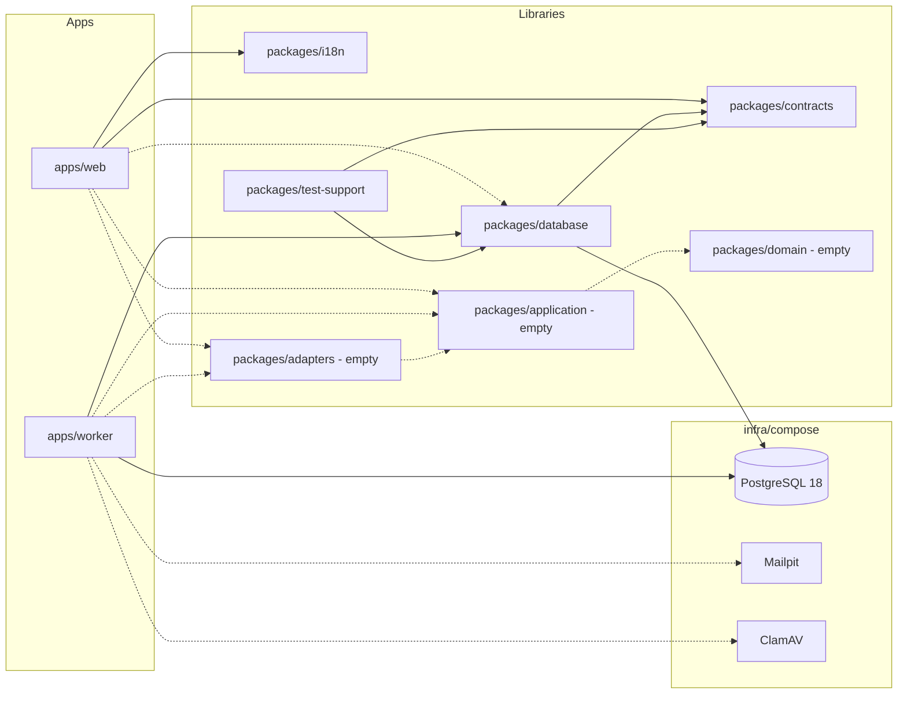
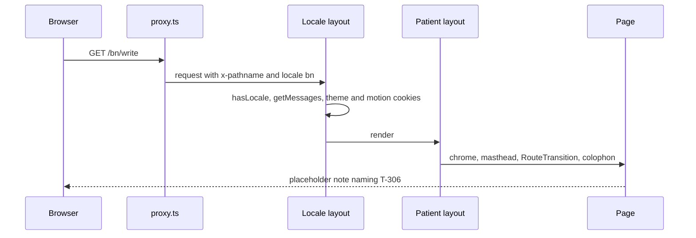
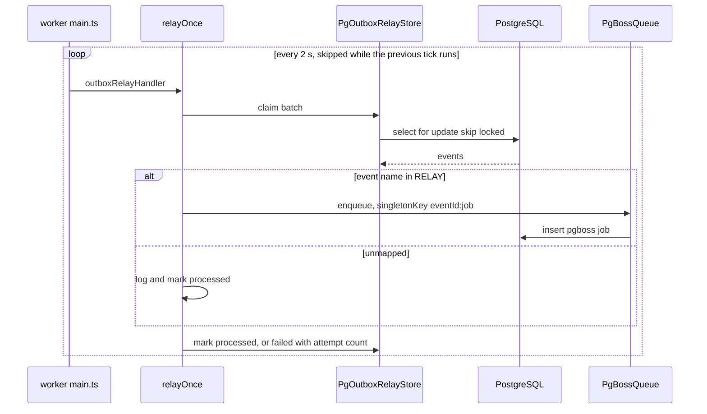
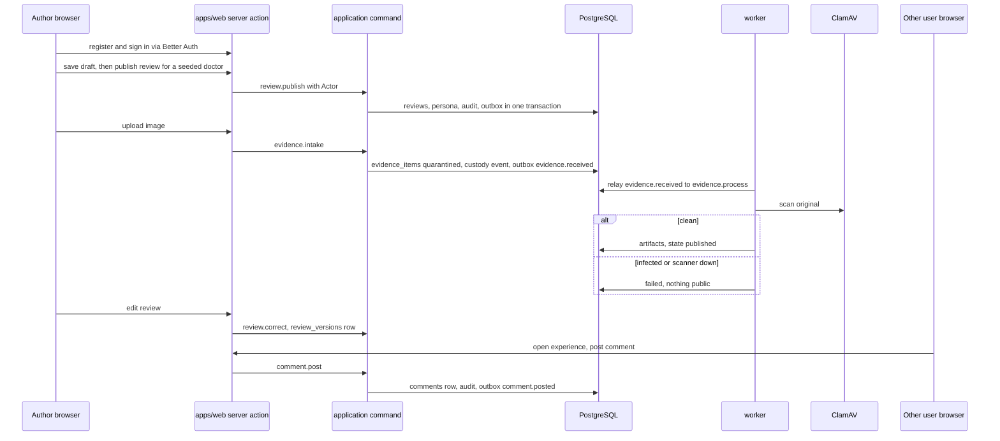

# Architecture: rogikotha

## Architecture Analysis

### System Overview

A TypeScript pnpm monorepo with two runnable processes (`apps/web`, `apps/worker`) and seven libraries, backed by three local containers (`infra/compose`: PostgreSQL 18, Mailpit, ClamAV). Component details are in `component-inventory.md`.

### Architectural Style

The declared target is a **ports-and-adapters modular monolith with an isolated worker** (`docs/architecture/ARCHITECTURE-SPINE.md`; package layout per FD-033). In code it is a **layered monorepo whose core layers are still empty**:

- The persistence adapter side exists: `packages/database` holds the full schema, migrations, grants, triggers and real `PgOutbox`, `PgAuditWriter`, `PgBossQueue` and `PgOutboxRelayStore`. Every other repository is a stub.
- The core does not exist: `domain`, `application` and `adapters` export nothing, so there are no ports, no commands, no `Actor` resolution and no web composition root (`apps/web/src/server/container.ts` is absent).
- Boundaries are now enforced: `eslint-plugin-boundaries` rules in `eslint.boundaries.mjs` (T-010) encode the dependency direction of `01-conventions.md` §2. `lint-fixtures/boundary-violation/` proves each rule fails.
- Process isolation is real: the worker connects as `rk_worker`, which has no privilege on `auth_users` (`0007`) or `reports` and cannot insert into `review_versions` (`0008`).

### Component Relationships

Text fallback: solid edges are real imports (web to contracts and i18n; worker to database; database to contracts; test-support to database and contracts) and real connections (database and worker to PostgreSQL). Dashed edges are declared in `package.json` or configured in env but not used in source. The full edge table is in `dependencies.md`.

### Data Flow

1. **Page request (built)**: browser, then `proxy.ts` (next-intl locale negotiation, `x-pathname` header), then `[locale]/layout.tsx` (locale check, messages, theme and motion cookies), then the `(patient)` or `admin` layout (chrome, stylesheet, `RouteTransition`), then the page. No page reads the database.
2. **Preference change (built)**: client control, then a server action in `server/actions/preferences.ts`, which sets a cookie and calls `revalidatePath`.
3. **State-changing command (designed only)**: a server action parses input with a `contracts` zod schema, authorizes the `Actor`, asks the domain to decide, then writes domain rows, an `audit_events` row and an `outbox_events` row in one transaction and returns a `Result` (`01-conventions.md` §3, §5). Only `withTx`, `PgAuditWriter` and `PgOutbox` exist.
4. **Outbox relay (built)**: a worker poller every 2 s claims a batch with `FOR UPDATE SKIP LOCKED`, maps each event through `RELAY` to job names and enqueues them with `singletonKey = eventId:job`. Only `outbox.relay` is registered, so the jobs it enqueues have no consumer.
5. **Bootstrap (built)**: `db:migrate` installs the `pgboss` schema and applies `0000` to `0008`; `db:seed` runs seven idempotent Drizzle steps.

### Key Design Decisions

Observed in code; each is already recorded in the decision log or a task.

| Decision | Evidence | Source |
|---|---|---|
| Trimmed package set (spine's `auth`, `evidence`, `search`, `ui` folded) | workspace layout | FD-033 |
| Plain CSS; patient side on FD-091 tokens and motion, staff console a verbatim prototype port | `styles/tokens.css`, `patient.css`, `motion.css`, `admin.css` | FD-032, FD-091 |
| Least-privilege roles, worker default-deny, later revocations | `0001`, `0005`, `0006`, `0007`, `0008` | AD-6, FD-041, FD-092 |
| Append-only custody and audit by trigger | `0003_triggers.sql` | AD-7 |
| Transactional outbox plus pg-boss, no Redis | `repositories/outbox.ts`, `queue/` | master plan §3 |
| UUIDv7 keys and 10-character public ids | `schema/_common.ts`, `contracts/src/ids.ts` | `01-conventions.md` §4 |
| Better Auth owns four `auth_*` tables with text ids; mapping documented for T-101 | `schema/auth.ts` header | AD-4 |
| Phase 1 evidence is JPEG and PNG only | CHECK constraints in `schema/evidence.ts` | FD-036 |
| Boundary lint with a fixture proof in the gate | `eslint.boundaries.mjs`, `scripts/check-boundaries-fixture.mjs` | T-010 |

### Improvement Opportunities

- Build the T-101 core (ports, `Actor`, `defineCommand`, adapters, Better Auth, `server/container.ts`) first. Every demo capability depends on it, and its Functional Design is already approved (intent `261011-aidlc-adoption`).
- Let the stub repositories `implements` their ports as they are filled, so the `test-support` fakes and the Pg classes are checked against one contract.
- Replace the static `/api/health` probes once the database and queue adapters are wired.

## Interaction Diagrams

### 1. Reader opens a localized page (built)

Text fallback: the proxy stamps `x-pathname` and lets next-intl pick the locale (cookie `rk.lang`, then Accept-Language). The locale layout validates the locale and loads messages and cookies. The patient layout adds chrome and styles. The page renders its placeholder note.

### 2. Outbox event relayed to a job (built)

Text fallback: the worker polls every two seconds, claims unprocessed outbox rows with `SKIP LOCKED`, enqueues one idempotent job per mapped job name, and marks each row processed or failed. After the maximum number of attempts the row is dead-lettered.

### 3. Demo slice: write an experience with a document, then comment (designed, not built)

Orientation only. It shows the commands the demo needs, in the shape `01-conventions.md` §3 prescribes. None of these steps exists in code.

Text fallback: the author registers and signs in through Better Auth, publishes a review about a seeded doctor, and uploads an image. The intake command records it as `quarantined`. The worker relays `evidence.received` to `evidence.process`, scans the original and publishes derivatives only on a clean scan, failing closed otherwise. Edits go through `review.correct` in the web tier, which writes a `review_versions` row. A second signed-in user opens the experience and posts a comment through `comment.post`.
