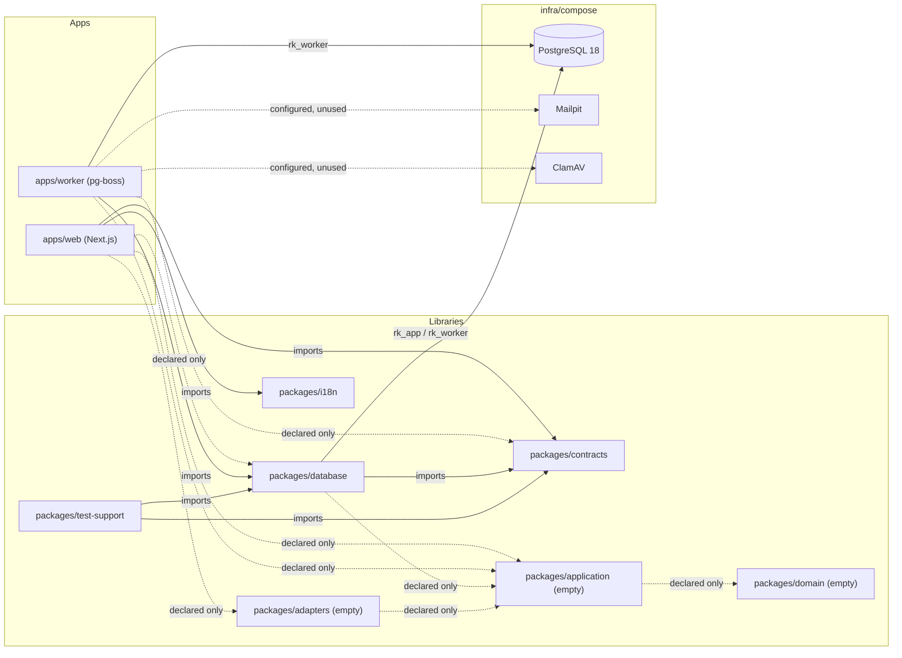
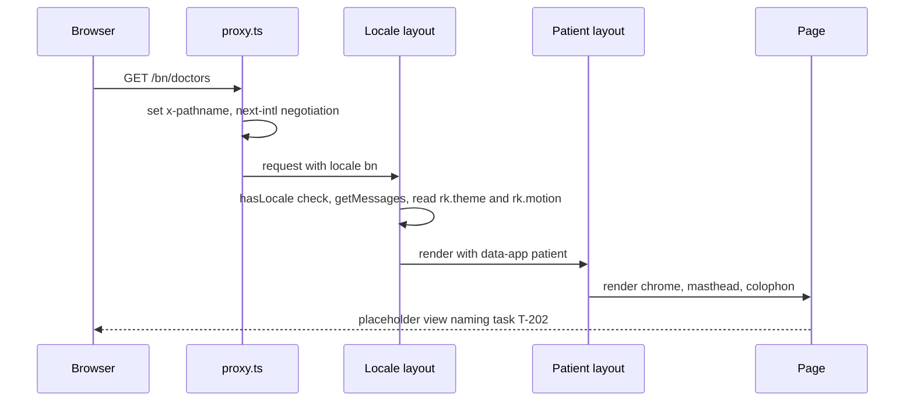
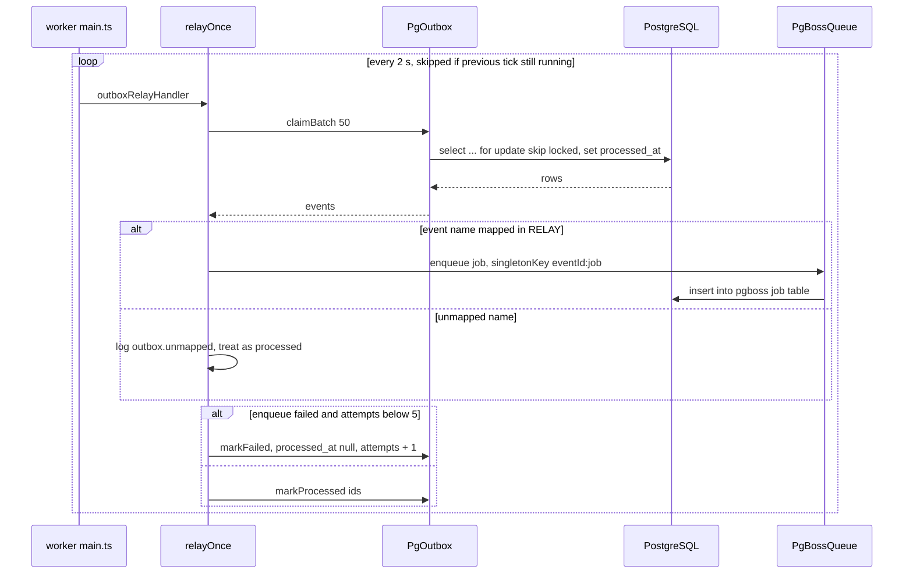
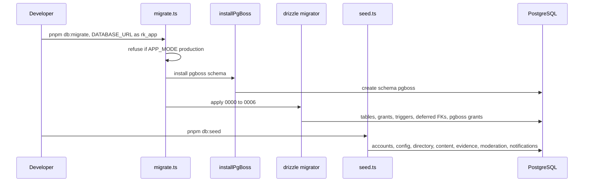
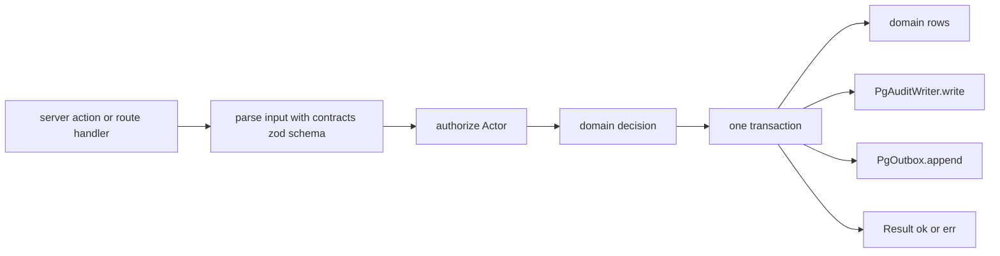

# Architecture — rogikotha

## Architecture Analysis

### System Overview

A TypeScript pnpm monorepo with two runnable processes and seven libraries, backed by three local containers:

- **`apps/web`** — Next.js 16 App Router app serving the patient UI and the staff console under `/{locale}/…`.
- **`apps/worker`** — Node process that starts pg-boss, relays the transactional outbox into jobs and logs a heartbeat.
- **Libraries** — `contracts` (shared vocabulary), `database` (Drizzle schema, migrations, PostgreSQL adapters), `i18n` (dictionaries and formatters), `test-support` (corpus, fakes, seed), and three placeholders: `domain`, `application`, `adapters`.
- **Infrastructure** (`infra/compose`) — PostgreSQL 18, Mailpit (SMTP sink), ClamAV (clamd).

### Architectural Style

**Ports-and-adapters modular monolith with an isolated worker** — that is the declared target (`docs/architecture/ARCHITECTURE-SPINE.md`, "Design Paradigm"). In code today it is a **layered monorepo whose core layers are not yet built**:

- The adapter side exists: `packages/database` holds real PostgreSQL adapters (`PgOutbox`, `PgAuditWriter`, `PgBossQueue`) and stub repository classes.
- The core does not: `packages/domain`, `packages/application` and `packages/adapters` each export nothing (`src/index.ts` is `export {}`). No port interfaces exist, so adapters carry no `implements` clause (header comments in every `packages/database/src/repositories/*.ts`).
- Process isolation is real: the worker runs under a separate least-privilege database role (`rk_worker`) and its composition root imports no auth or identity code (`apps/worker/src/container.ts`, guarded by `container.test.ts`).

### Component Relationships

Text fallback: `apps/web` imports `contracts` and `i18n`; `apps/worker` imports `database`; `database` and `test-support` import `contracts`; `test-support` imports `database`. Dashed edges are dependencies declared in `package.json` but not yet imported in source. The worker and the database package talk to PostgreSQL; the worker's environment names Mailpit and ClamAV hosts, but no code calls them yet. Full edge list: `dependencies.md`.

### Data Flow

1. **Page request** — browser → `proxy.ts` (next-intl locale negotiation, `x-pathname` header) → `[locale]/layout.tsx` (locale check, messages, theme/motion cookies, `data-app`) → nested `(patient)` or `admin` layout (chrome, stylesheet) → page (placeholder or static component). No page reads the database yet.
2. **Preference change** — client control → server action in `server/actions/preferences.ts` → cookie set → `revalidatePath('/', 'layout')`.
3. **Domain change (designed)** — an application command will write domain rows, an `audit_events` row (`PgAuditWriter`) and an `outbox_events` row (`PgOutbox.append`) in one transaction (`01-conventions.md` §3, §5). The writers exist; no command calls them yet.
4. **Outbox relay (implemented)** — worker poller every 2 s → `PgOutbox.claimBatch` (`FOR UPDATE SKIP LOCKED`) → `RELAY` map event → job names → `PgBossQueue.enqueue` with `singletonKey = eventId:job` → `markProcessed`, or `markFailed` / dead-letter after 5 attempts.
5. **Bootstrap** — `pnpm db:migrate` installs the `pgboss` schema as `rk_app`, then applies SQL migrations `0000`–`0006`; `pnpm db:seed` inserts the synthetic corpus through Drizzle.

### Key Design Decisions

Decisions observed in code, with their source. None is new; each is already recorded in the project's own decision trail.

| Decision | Evidence in code | Source |
|---|---|---|
| Trimmed monorepo: spine's `auth`, `evidence`, `search`, `ui` packages folded into `adapters` / `database` / `apps/web` | Workspace contains exactly `apps/{web,worker}` and `packages/{adapters,application,contracts,database,domain,i18n,test-support}`; `PgSearchIndex` lives in `packages/database/src/search/` | FD-033 (master plan §2, §4) |
| Plain CSS ported from the prototype; no Tailwind/shadcn/Radix | `apps/web/src/styles/{tokens,patient,admin,globals}.css`; no CSS framework dependency | FD-032 |
| Least-privilege roles; worker default-deny | `0001_grants_part1.sql`, `0005_grants_part2.sql` (default-privilege flip), `0006_pgboss_grants.sql` | AD-6, FD-037 |
| Append-only custody/audit with one SECURITY DEFINER expiry path | `0003_triggers.sql` (`fn_block_mutation`, `fn_expire_audit`) | AD-7 |
| Transactional outbox + pg-boss, no Redis | `packages/database/src/repositories/outbox.ts`, `queue/pg-boss-queue.ts` | Master plan §3 |
| Outbox relay as a plain `setInterval` poller, not a pg-boss job | `apps/worker/src/registry.ts` (`intervalMs: 2000`), `main.ts` `startPoller` | ASSUMPTION(T-009) |
| `pgboss` schema installed by `migrate.ts` as `rk_app`; worker never migrates it | `installPgBoss` in `migrate.ts`; `PgBossQueue` defaults `migrate: false` | T-009 |
| UUIDv7 primary keys (database `uuidv7()` default and app `newId()`), 10-char public ids in URLs | `schema/_common.ts`, `contracts/src/ids.ts` | Spine conventions, `01-conventions.md` §4 |
| `data-view` attribute set client-side by `ViewShell`; `data-app` derived server-side | `apps/web/src/lib/cookies.ts` comment block, `components/patient/ViewShell.tsx` | ASSUMPTION(T-008) (differs from `01-conventions.md` §7.3) |

### Code vs. Architecture Spine

Cross-check of the code against `docs/architecture/ARCHITECTURE-SPINE.md`. These are observations, not new decisions.

| Spine element | Code today | Assessment |
|---|---|---|
| Structural seed lists `packages/{auth,evidence,search,ui}` | Not present | Consistent with FD-033 (folded); the spine file itself was not updated |
| AD-2 commands own mutations | No command layer; `application` is empty; seed writes rows directly | Not yet implemented (Phase 1+) |
| AD-4 Better Auth adapter | `auth_*` tables exist (`schema/auth.ts`); Better Auth is not a dependency; no `server/auth.ts` | Not yet implemented (T-101) |
| AD-6 worker has no session / reveal / delete / general DB credentials | `rk_worker` role, narrow grants, grep test in `container.test.ts` | Implemented for the current surface; lint enforcement pending (T-010) |
| AD-7 append-only custody and audit | Triggers on six tables | Implemented |
| AD-8 PostgreSQL search | `search_documents`, `search_aliases` tables, `pg_trgm`; `PgSearchIndex` stub | Schema only (T-205) |
| AD-9 equal languages | Parity script, en/bn dictionaries, locale routes | Implemented for shell |
| AD-11 mock and production adapters share contracts | Fakes in `test-support` mirror stub method names; no shared port interface yet | Partially (no interfaces) |
| AD-14 demo vs production modes | `APP_MODE` enum validated in worker; migrate/reset/seed refuse `production`; `DemoMarker` rendered | Implemented for current surface |
| Stack table (Next 16.3.3, React 19.2.7, pg-boss 12.26.0, Tailwind, shadcn, Lucide, PDF.js, Playwright, axe, MSW) | Next 16.3.4, React 19.3.0, pg-boss 12.31.0; none of Tailwind/shadcn/Lucide/PDF.js/Playwright/axe/MSW installed | Spine table is older than the master plan pins and FD-032/FD-036; code follows the master plan |
| Dependency direction "domain/application never import framework or DB" | Trivially true (both empty); not lint-enforced | Pending T-010 |

### Improvement Opportunities

- Introduce the application port interfaces so the existing `Pg*` classes and `test-support` fakes can declare `implements` and be checked against one contract (planned T-101).
- Add the boundary lint (`eslint-plugin-boundaries`) and a CI workflow (planned T-010) so the dependency direction above is enforced rather than conventional.
- Update the spine's structural seed and stack table, or annotate them with FD-032/FD-033/FD-036, so the two documents stop disagreeing with the code.

## Interaction Diagrams

### 1. Reader opens a localized page (implemented)

Text fallback: the browser request passes through `proxy.ts`, which stamps `x-pathname` and lets next-intl redirect or rewrite by locale (cookie `rk.lang`, then Accept-Language). The `[locale]` layout validates the locale, loads messages and theme/motion cookies and sets `lang`/`data-app` on `<html>`/`<body>`. The `(patient)` layout adds chrome and `patient.css`. The page renders; for most routes this is a placeholder.

### 2. Outbox event relayed to a job (implemented)

Text fallback: the worker polls every two seconds. `claimBatch` locks up to 50 unprocessed rows with `SKIP LOCKED` and marks them processed in the same transaction. Each event is mapped through `RELAY` to zero or more job names and enqueued idempotently by `eventId:job`. A failed enqueue resets the row for retry until five attempts, then logs `outbox.dead` and gives up. No job handler consumes these queues yet.

### 3. Local bootstrap: migrate and seed (implemented)

Text fallback: `db:migrate` refuses production mode, installs pg-boss's schema as `rk_app`, then applies the seven SQL migrations into `public` with the bookkeeping table `drizzle_migrations`. `db:seed` runs seven idempotent steps in order, each in its own transaction, skipping rows that already exist by natural key.

### 4. State-changing command (designed, not implemented)

Shown for orientation only; this is the contract in `01-conventions.md` §3 and §5, not code that exists.

Text fallback: a server action parses input with a `contracts` schema, authorizes the `Actor`, asks the domain to decide, then writes domain rows, an audit row and an outbox row in one transaction and returns a `Result`. Only the last three building blocks (`withTx`, `PgAuditWriter`, `PgOutbox`) exist today.
