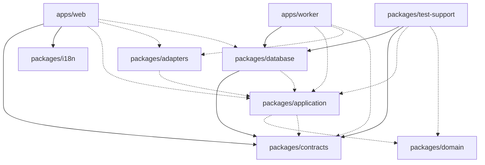

# Dependencies — rogikotha

Versions are listed once, in `technology-stack.md`. This file records the edges.

## Internal Cross-Package Dependencies

"Imported" means at least one non-test source file imports the package. "Declared only" means the edge is in `package.json` and no source file imports it yet.

| From | To | Kind | Evidence |
|---|---|---|---|
| apps/web | packages/contracts | imported | `app/[locale]/(patient)/emergency/page.tsx` (`DEFAULT_CONFIG_VALUES`) |
| apps/web | packages/i18n | imported | `src/i18n/routing.ts`, `src/i18n/request.ts`, `components/patient/{Masthead,Emergency}.tsx`, `components/admin/Masthead.tsx`, `components/shared/ThemeControls.tsx` |
| apps/web | packages/application | declared only | `apps/web/package.json` |
| apps/web | packages/adapters | declared only | `apps/web/package.json` |
| apps/web | packages/database | declared only | `apps/web/package.json` |
| apps/web | packages/test-support | dev, declared only | `apps/web/package.json` devDependencies |
| apps/worker | packages/database | imported | `src/container.ts` (`PgOutbox`, `PgBossQueue`, `createDb`, `closeDb`, `Db`), `src/registry.ts` (`WorkOptions`) |
| apps/worker | packages/contracts | declared only | `apps/worker/package.json` |
| apps/worker | packages/application | declared only | `apps/worker/package.json` |
| apps/worker | packages/adapters | declared only | `apps/worker/package.json` |
| packages/database | packages/contracts | imported | `schema/{enums,review,directory,data-requests,administration}.ts`, `audit-writer.ts` |
| packages/database | packages/application | declared only | `packages/database/package.json` |
| packages/adapters | packages/application, packages/contracts | declared only | `packages/adapters/package.json` |
| packages/application | packages/domain, packages/contracts | declared only | `packages/application/package.json` |
| packages/test-support | packages/database | imported | `src/seed/*.ts` (`createDb`, tables) |
| packages/test-support | packages/contracts | imported | `src/builders/*.ts`, `src/corpus/types.ts`, `src/fakes/{mailer,config-provider}.ts`, `src/seed/*.ts` |
| packages/test-support | packages/application, packages/domain | declared only | `packages/test-support/package.json` |
| packages/contracts | — | none | depends only on zod and uuid |
| packages/domain | — | none | — |
| packages/i18n | — | none | next-intl as peer |

Text fallback: solid arrows are real imports. web uses contracts and i18n. worker uses database. database and test-support use contracts, and test-support also uses database. Dashed arrows are edges declared in `package.json` but not yet imported. There are no cycles.

### Against the documented dependency direction

`01-conventions.md` §2 defines the allowed direction. Observed differences:

| Rule | Code | Status |
|---|---|---|
| `contracts → zod only` | contracts also depends on `uuid` | Deviation, recorded as ISS-073 in `ids.ts` |
| `test-support → application, contracts, domain` | test-support also imports `database` and depends on `pg`, `drizzle-orm`, `sharp`, `@node-rs/argon2` | Deviation; the seed needs direct database access until commands exist |
| `database → application (ports), contracts, drizzle, pg` | Also `pg-boss`, `dotenv`; the application edge is unused | Consistent in spirit (master plan puts the pg-boss adapter in database) |
| `apps/web → database, adapters only in server/container.ts` | Declared, no `server/container.ts` yet, no imports | Consistent (unused) |
| `worker` must not import Better Auth or reveal/delete commands | No such import; enforced by a grep test (`apps/worker/src/container.test.ts`) | Consistent; lint rule pending (T-010) |
| Next `transpilePackages` | Lists contracts, i18n, application, domain; web does not depend on domain | Harmless mismatch |

## External Dependencies

Grouped by purpose. Every package listed here appears in a `package.json`.

| Purpose | Packages |
|---|---|
| Web runtime | next, react, react-dom, next-intl |
| Validation and ids | zod, uuid |
| Persistence | drizzle-orm, pg, pg-boss |
| Configuration | dotenv |
| Seed and fixtures | sharp, @node-rs/argon2 |
| Build and scripts | typescript, tsx, drizzle-kit |
| Quality | eslint, @eslint/js, typescript-eslint, eslint-config-prettier, globals, prettier |
| Tests | vitest, @vitest/coverage-v8, @testing-library/{react,jest-dom,user-event}, @vitejs/plugin-react, jsdom |
| Prototype tooling | puppeteer-core |
| Types | @types/node, @types/pg, @types/react, @types/react-dom |

Native or postinstall builds pre-approved in `pnpm-workspace.yaml` `allowBuilds`: `@parcel/watcher`, `@swc/core`, `esbuild`. `sharp` and `@node-rs/argon2` ship prebuilt binaries.

## Runtime Service Dependencies

| Consumer | Service | How | Credential (env var, value never stored in code) |
|---|---|---|---|
| database scripts (`migrate`, `reset`, `seed`), drizzle-kit | PostgreSQL `rogikotha` | `pg` Pool | `DATABASE_URL` (role `rk_app`) |
| database integration tests | PostgreSQL `rogikotha_test` | `pg` Pool, reset per run | `DATABASE_URL_TEST` (`rk_app`); worker-role tests derive an `rk_worker` URL |
| apps/worker | PostgreSQL `rogikotha` incl. `pgboss` schema | Drizzle + pg-boss | `DATABASE_URL_WORKER` (`rk_worker`) |
| apps/worker (configured, not yet called) | Mailpit, ClamAV, filesystem storage | — | `SMTP_HOST/PORT`, `CLAMD_HOST/PORT`, `STORAGE_ROOT` |
| retention (planned) | PostgreSQL | `fn_expire_audit` | `DATABASE_URL_MAINTENANCE` (`rk_maintenance`) |

`.env.example` also lists `APP_ENCRYPTION_KEY`, `BETTER_AUTH_SECRET`, `APP_URL`, `MAILPIT_URL`. No code reads these yet.

## Database Role Privileges

| Role | Privileges (from `postgres-init/01-roles.sql` and migrations 0001, 0003, 0005, 0006) |
|---|---|
| `rk_app` | Owns both databases; full DML on all `public` tables; runs migrations; installs `pgboss` |
| `rk_worker` | Default-deny since `0005`. SELECT on directory, taxonomy, personas and config tables. INSERT on `audit_events`. Full DML on evidence, notification, email, outbox, search, retention-policy, bulk-action and data-request tables. SELECT on `legal_holds`. SELECT plus `UPDATE(state, deleted_at)` on `reviews`. INSERT on `review_versions`. SELECT/UPDATE on `comments`. Column SELECT on `reports` without `reporter_account_id`, on `account_profiles`, and on `auth_users(id, email)`. USAGE and DML on `pgboss`. Explicitly no access to other `auth_*` tables, `persona_links`, `identity_reveals`, `blocks` or `bookmarks`. EXECUTE `fn_expire_audit` |
| `rk_maintenance` | CONNECT; DELETE on `notifications` and `email_deliveries`; EXECUTE `fn_expire_audit` |
