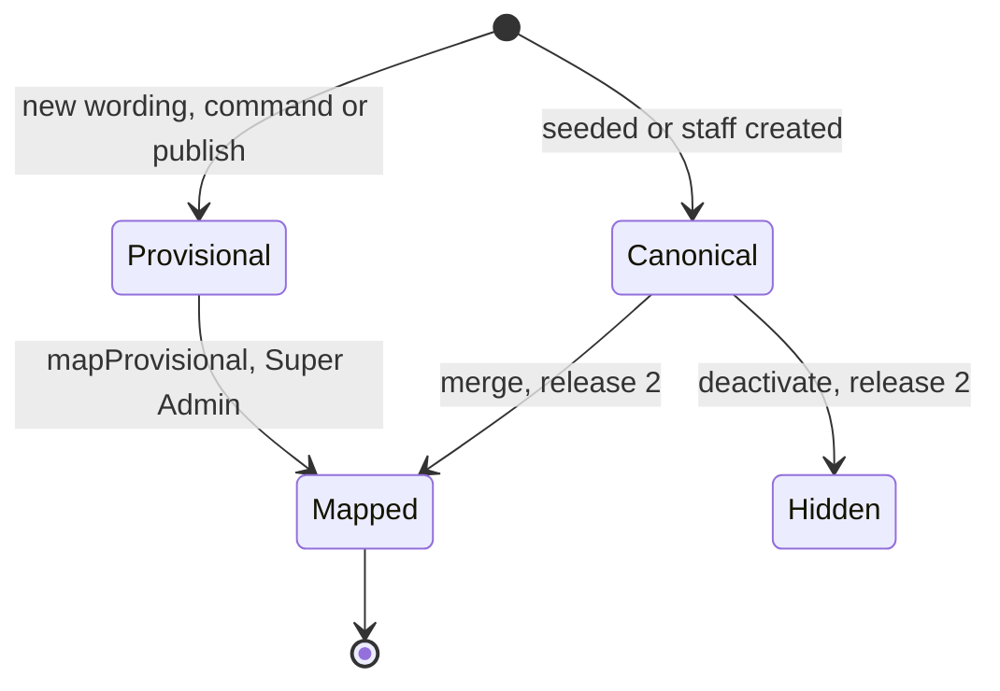
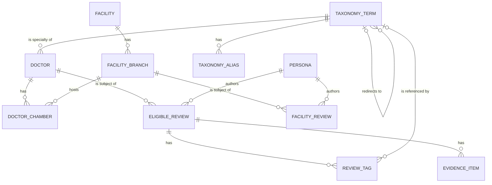

# Functional specification — U14 `t-201-directory-and-taxonomy-modules`

Unit U14 (kind `library`, size M in `unit-of-work.md` and L after this refresh (§ 16), not high risk) delivers T-201 for US4.1, US4.3, US5.3 and US6.4. Lead perspective: architect. Support perspective: developer (repository reads, query mechanics, view-model mapping and the tests against the real database), written into §§ 8, 10 and 11 and synthesised in § 13. Draft written ahead of the stage on the owner's instruction to overlap work; the lead finalises it and the reviewer checks it when the workflow reaches this Unit.

**Refreshed 2026-10-29.** Re-checked against T-010 as built on `bolt/t-010-boundary-lint-and-ci`, CR-012 as merged on `main` (`7cce9bd`) and the owner's answers in `docs/aidlc-migration/OWNER-REVIEW-QUEUE.md`. What changed:
1. **Seed condition links are built here** (Question 11 B, the plan of record since CR-012 merged without them): one condition term tag per seeded review, before its free-text tags (WF1 step 11, BR7.7); a card's condition prefers that term tag (BR3.9).
2. **Each branch stores its own hospital name** (the owner's answer to T-203 F2, Question 9 C): `facility_branches.name_*` holds the hospital name, new `branch_label_en/bn` the label; view models carry `name`, `branchName?`, `parentName?` (BR3.11). Branch hues are stored too (new Question 12).
3. **"Not provided" shows on a doctor page from the seed** (T-202 F1, new Question 13): doctor d11 without fee and languages and review r25 without sentiment, outcome or documents, added to the prototype and ported (FD-039).
4. **Owner answers applied:** `FacilityCardVM.feedbackVisible` (T-203 F8, BR2.12); no percentage anywhere (T-202 Q1); facility feedback is the nine criteria only (T-203 Q1); `await config.current()` (T-105 Q2) with the threshold range 2–50 (T-105 R2); ISS-271's name kept.
5. **T-010 applied:** placement under the boundary matrix (BR6.6: `database` never imports `domain`, so keys are computed before the repository; `application` imports no external package); the test pins this Unit must update in the same commit (`not-implemented.test.ts`, the two migration-count pins, the fake tests; BR7.6); seed-based acceptance rows in `seed.int.test.ts`, which runs after the database project; the nine-step gate, coverage with untested files counted, and CI.
6. **Corrections to the first draft:** the provisional-term race had no unique key to settle it (now a partial unique index, F10); the suggestion "Hypothyroidism" would have added an eleventh condition (explicit mapping, F11); a provisional term must not record its creating account (F12); the migration takes the next free number; `createProvisional` gets a rate limit and a transaction-taking form for U21 (BR5.6, WF11).
7. **Decided under the owner's no-questions instruction of 2026-10-29:** Questions 11–14, R1 (FR38 management moves to release 2) and R3 (rate limit). § 17 lists the three FD entries the build appends before code.

Inputs: `unit-of-work.md` (U14 and the open points carried to it), `unit-of-work-story-map.md`, `requirements.md`, `stories.md`, `components.md` (Directory, Taxonomy, Review), `contract-summary.md` (C1, C6, C7, C9, C15 and the common rules), `docs/status/decision-log.md` (FD-024, FD-039, FD-040, FD-067, FD-088, FD-089, FD-093), T-201 with its amendments and addendum, `01-conventions.md` §1–§5, §10 and §13 (as built by T-010), `02-data-model.md` §0, §3–§7 and §17, `03-routes-and-contracts.md` §1–§4, the code listed in `functional-design-questions.md`, the prototype data file and renderers, the drafts of U15 T-202, U16 T-203, U20 T-207, U12 T-105 and U21 T-301 for what they need from this Unit, and ISS-091, ISS-157, ISS-168, ISS-179, ISS-222, ISS-266, ISS-268, ISS-271 and ISS-294.

This file is the source of truth for the workflows and state transitions. The data shape is in `entities.md`; the decision logic is in `rules.md`. The design follows the answers in `functional-design-questions.md`: Questions 1–8 and 10 A (on the owner's standing instruction of 2026-10-27), Question 9 C (the owner's answer of 2026-10-28), Question 11 B and Questions 12–14 A (under the owner's no-questions instruction of 2026-10-29).

## 1. What changes, in one paragraph

Doctors, facility branches and conditions become readable from PostgreSQL through typed queries that return the view models the prototype's renderers need. Directory serves `getDoctor`, `listDoctors`, `getFacility`, `listFacilities`, `doctorsAtBranch`, `facilitiesForDoctor` and `resolvePublicId`; Taxonomy serves `getCondition`, `listConditions`, `resolve`, `listSuggested` and `resolvePublicId`, plus the two commands C6 assigns here, `createProvisional` (whose work is one operation U21's publish also calls on its own transaction) and `mapProvisional`. Every review-derived figure (accounts, distributions, document counts, condition counts) reaches Directory through its `ProviderExperience` port and Taxonomy through its `ConditionStats` port, which U14 implements inside a ports-only Review stub on top of new `ReviewRepository` read methods (FD-067); the ports are extended additively so Review returns display-ready data (Question 2). Pure policies land in `packages/domain`: `distribution` and `isLimitedData` for Review, `omitEmptyFields` and `registrationNotVerified` for Directory, `normalizeAliasKey` for Taxonomy. One forward-only migration adds `taxonomy_terms.suggested`, `suggested_order` and a partial unique key for open provisional terms, and `facility_branches.branch_label_en/bn` and `avatar_hue`, so each branch keeps its own hospital name, label and colour (Questions 4, 9 C, 12). The seed gains what the pages need on demo data: a condition term tag per review (Question 11), the branch names, labels and hues, the composer suggestions (closes ISS-157), and one doctor and one review with empty fields so "Not provided" shows on a doctor page (Question 13, through the prototype). The test fakes are aligned with the real eligibility rule (closes ISS-222). No hard rule changes; three FD entries record the owner's hospital-name answer, the two demo records against FD-089, and release 1's narrowing of FR38 (§ 17).

## 2. As is (baseline 2026-10-29) and what Bolt 13 can count on

Baseline: `main` at `f91c9de` (CR-012 merged as `7cce9bd`) and T-010 as built on `bolt/t-010-boundary-lint-and-ci`, which merges before Bolt 13.

- **Application and domain are empty.** `packages/application/src/index.ts` ("Filled by T-101") and `packages/domain/src/index.ts` export nothing. There is no `defineQuery`, no `ports/` folder and no module folder. U8 T-101 (Bolt 8) creates the first module, the `ConfigProvider` port (asynchronous, T-105 Question 2), the `RateLimiter` port and, implicitly, the command helper; no task file names `defineQuery`, `defineCommand`, `application/src/index.ts` or `ports/repositories/*` as owned (finding F5).
- **Repository stubs** in `packages/database/src/repositories/{directory,taxonomy,review}.ts` throw `NotImplemented('T-201', …)` for `getDoctor`, `listDoctors`, `getFacility`, `listFacilities`, `doctorsAtBranch`, `facilitiesForDoctor`, `getCondition`, `listConditions`, `resolve`, `listSuggested`, `createProvisional`, `mapProvisional`, `sentimentDistribution`, `outcomeDistribution`, `criteriaDistribution`. Their names were the T-004 implementer's guess (ISS-091). Stubs owned by T-204 and T-407 (directory) and T-301 and T-302 (review) sit in the same files; every taxonomy stub is T-201's. **T-010's `not-implemented.test.ts`** constructs each stub class without arguments, lists all three in `STUB_REPOSITORIES`, calls every method and expects `NotImplemented` naming its owner; its trace test calls `new PgReviewRepository().getDraft(…)` (ISS-294).
- **Fakes** in `packages/test-support/src/fakes/repositories.ts` mirror the stub names; `repositories-superset.test.ts` reads each stub's method names from its source text and fails when a fake is not a superset. `FakeReviewRepository`'s three distribution methods count every row regardless of `state` or `deletedAt` (ISS-222), and T-010's `repositories.test.ts` tests them under those names.
- **View-model stubs** in `packages/contracts/src/view-models/{doctor,facility,condition}.ts` carry `TODO(T-202)`/`TODO(T-203)` markers and are re-exported from `contracts/src/index.ts`; `discover.ts` and `search.ts` import `DoctorCardVM`, `FacilityCardVM`, `ConditionCardVM` and `ExperienceCardVM` by name only. `ExperienceCardVM` lives in `experience.ts` (T-307's file) with engagement counts; `experience-card.ts`, which T-201's owned paths name, does not exist. The existing `DistributionVM` is `{counts, total, limitedData}`.
- **Input schemas** in `contracts/src/schemas/directory.ts` (`GetDoctorInput` with `condition`, `outcome`, `relationship`, `docs`; `ListDoctorsInput` with an untyped `filters` and a `TODO(T-201)`), `taxonomy.ts` (all six inputs present) and `review.ts` (`SentimentDistributionInput {doctorId}`, `OutcomeDistributionInput {doctorId}`, `CriteriaDistributionInput {branchId}`).
- **Schema**: `taxonomy_terms` has no `suggested` column (ISS-157), no order column and no unique key on its name keys (only `taxonomy_aliases (term_id, alias_key)` is unique); `tag_group` is a fixed enum of four groups; `facility_branches` has one name pair, no label and no `avatar_hue`; `reviews` has `doctor_id` and an optional `branch_id` and no condition column; facility feedback is in its own table `facility_reviews`. The soft-delete state "deleted" in `02-data-model.md` §17 is not an enum value: a soft-deleted review keeps its state and gets `deleted_at` (hence BR1.3's two conditions).
- **Seed after CR-012** (`test-support/src/seed/`, from the corpus the port generates from the prototype): 10 conditions with 33 aliases, 9 specialties derived from the doctors, 10 doctors (every rendered fact filled; d1–d6 have no `languages` provenance entry; d7–d10 no `about`) with `avatar_hue`, 7 organisations and 10 branches. The corpus carries three names per branch (`name` "Shefa General Hospital", `branchLabel` "Dhanmondi branch", the organisation "Shefa Health Group") and a hue, but the seed stores the label as the branch name (or the hospital name when there is no label) and drops the hue. 13 chambers link to branches by name; d3's "Uttara Skin Care" links to none, although the prototype lists d3 on f4 (ISS-266). 24 reviews, each with sentiment and outcome, carry their free-text tags only (stored in Bengali, ISS-161): **no review is linked to its condition term** although every corpus review has `conditionSeedRef` (finding F1; T-203 F1, T-207 F2). 19 facility reviews (1–3 per branch). Keys use a local `keyify` that strips whitespace but not punctuation, so `name_key_en` of c2 is `thyroid(hypothyroidism)` (finding F2). `seed.int.test.ts` pins the counts (DC1–DC22) and the FD-089 completeness of d7–d10; `05-demo-storyboard.md` line 22 states them.
- **Configuration**: `DEFAULT_CONFIG_VALUES.limitedDataThreshold = 5`; `featureVisibility.facilityAccounts = true`. U12 T-105 (Bolt 12) serves it through `ConfigProvider.current(): Promise<ConfigValues>` with a 5-second cache; the threshold's range becomes 2–50 (owner, T-105 R2).
- **Migrations** `0000`–`0008` are on `main`; P8 in `validator-probes.int.test.ts` and `migrations.int.test.ts` both pin 9 applied migrations. U11 T-104 and U12 T-105 plan migrations before Bolt 13, so this Unit takes the next free number at build time. `rk_worker` holds table-level SELECT on `taxonomy_terms` and `facility_branches` (`0001_grants_part1.sql`), which covers new columns.
- **T-010 (FD-093, D10)**: `eslint.boundaries.mjs` enforces `01-conventions.md` §2: `domain` imports nothing; `contracts` only `zod`, `uuid`; `application` only `domain`, `contracts`, no external package; `database` only `application`, `contracts`; `test-support-seed` also `domain`, `test-support`, `database`; test files in `packages/*` may import `test-support`, `vitest` and Node built-ins. Edges inside one element are not checked. `pnpm check` runs nine steps (typecheck, lint, lint:boundaries, format:check, check:identity, test:coverage, i18n:check, contrast, build); coverage includes every source file, so an untested file counts at 0%, with an 80% line threshold per package. The seed integration test is its own project, `test-support-seed`, in `sequence.groupOrder` 2, after the database project (group 1); `pnpm test:int` runs the database project only.

## 3. Settled before this stage

FD-067 (ports and the Review stub), the 03 §4 ownership note (U14 creates the review read queries and policies), the configured limited-data threshold read with `await` (T-105 Question 2) in the range 2–50 (owner, T-105 R2), D-003 (Registration not verified), FR50 with the U33 schema gaps for ineligibility and freeze, no percentages (owner, T-202 Question 1), the nine-criteria facility model (owner, T-203 Question 1), storing each branch's own hospital name (owner, T-203 F2), keeping "Shefa General Hospital" (owner, ISS-271), T-010's boundaries and coverage (FD-093, D10), and no new dependency. See `functional-design-questions.md` § "Settled before this stage". The decisions this design makes without a question are listed there too and explained in § 13.

## 4. Workflows

Every query below follows the same frame: parse the input with its contracts schema (application never imports `zod` itself, BR6.6) → read through repository ports and declared ports → map rows to the view model in `actor.locale` → return `ok(vm)`. A failed lookup returns `err('not_found')`; a schema failure returns `err('validation')`; a thrown database error is a programmer or infrastructure error and is converted to `internal` by the caller (01-conventions §3). Queries never write (BR6.5). Configuration is read with `await config.current()`, once per call.

### WF1 — Code Generation order (the Unit end to end)

1. **Baseline.** T-010 is on `main`. `pnpm infra:up`; `pnpm check` and `pnpm smoke` green on the Bolt branch; read the open `ISSUES.md` rows in directory, taxonomy, review and test-support (ISS-091, ISS-157, ISS-168, ISS-179, ISS-222, ISS-266, ISS-268, ISS-271, ISS-294 and the rows proposed in § 9).
2. **FD entries.** Append the three entries of § 17 to `docs/status/decision-log.md` before any code (`project.md` Mandated).
3. **Prerequisites present.** Confirm `defineQuery` (or the shared helper T-101 created), the asynchronous `ConfigProvider` port, the `RateLimiter` port, the Actor shape and the `AuditWriter`/`Outbox` ports exist. If `defineQuery` is missing, add it beside `defineCommand` as a recorded owned-path addition (finding F5).
4. **Domain policies** (`packages/domain/src/{review,directory,taxonomy}/`): `distribution`, `isLimitedData`, `omitEmptyFields`, `registrationNotVerified`, `normalizeAliasKey`, with their tests; plain values and structural types only, no `contracts` import (BR6.6). `stableHue` in `contracts/ids.ts` (Question 8).
5. **Migration** `<n>_taxonomy_suggestions_and_branch_names.sql`, `<n>` the next free number (custom drizzle-kit migration so the journal timestamp is later than the previous one): `taxonomy_terms.suggested` (`boolean not null default false`), `suggested_order` (`smallint`, check `>= 0`), the partial unique index `taxonomy_terms_open_provisional_key_unique` on `(kind, name_key_en) where provisional and canonical_id is null`; `facility_branches.branch_label_en`, `branch_label_bn` (`text`, check both or neither) and `avatar_hue` (`smallint`, check 0–359). The columns in `schema/{taxonomy,directory}.ts`. Raise both migration-count pins by one (BR7.6).
6. **Ports** (`packages/application/src/ports/repositories/{directory,taxonomy,review}.ts`; `modules/directory/ports.ts`, `modules/taxonomy/ports.ts`) as in § 6 and § 8.
7. **Repositories** (`packages/database/src/repositories/{directory,taxonomy,review}.ts`): replace the T-201 stubs with the read methods and the taxonomy writes; leave the other Units' stubs untouched. Update `not-implemented.test.ts` in the same commit (BR7.6).
8. **View models** (`contracts/src/view-models/{doctor,facility,condition,experience-card}.ts`; the re-export in `experience.ts`) and the additive input changes (§ 7).
9. **Review stub, then Directory and Taxonomy queries, the provisional-term operation and the two commands**, with application tests on fakes.
10. **Prototype and corpus** (Question 13): add d11 and r25 to `ui-design-prototype/shared/rogikotha-data.js` under a comment naming this Unit; make the prototype's profile facts omit an empty value and its account and experience flags show `label.notProvided` for a missing sentiment or outcome (`concept-04b-quiet-clinic-minimal/app.js`); let `corpus/types.ts` and `scripts/port-corpus.mjs` carry an empty `fee`, `languages`, `sentiment` and `outcome`; run `pnpm --filter @rogikotha/test-support port` and commit the regenerated `doctors.ts` and `reviews.ts` (never hand-edited). d11's name and chamber pass CR-012's real-name check (a search finds no real doctor or facility of that name in that city), recorded in the hand-off; its Bengali copy is flagged for the owner's review (FD-042).
11. **Seed and fakes.** `seed-directory.ts`: taxonomy keys through `normalizeAliasKey` (F2); branches with `name` = corpus `name`, `branch_label` = corpus `branchLabel`, `avatar_hue` = corpus `avatarHue` (Questions 9 C, 12); the suggestions through the explicit `TAG_GROUPS` mapping of BR4.5 (Question 4). `seed-content.ts`: one condition term tag per review before its free-text tags (Question 11); empty sentiment and outcome passed through. Both write new rows only when their parent row is new, so a re-run stays a no-op (ISS-179); an existing local demo database needs `pnpm demo:reset` once. `seed.int.test.ts`: the counts that change (DC1 doctors 11, DC7 chambers 14, DC8 reviews 25) and the assertions of § 11. `fakes/repositories.ts` mirrors the renamed methods and applies BR1.3 (ISS-222); new fakes for `ProviderExperience` and `ConditionStats`; `repositories.test.ts` and `port-fakes.test.ts` follow.
12. **Integration and smoke tests** (§ 11).
13. **Documents**: `02-data-model.md` §4 (`facility_branches` name meaning, label, hue; chambers as the only doctor–branch link) and §5 (the two columns, the open-provisional key, `created_by_account_id` left null); 03 §4 (directory, taxonomy and review entries, the `createProvisional` rate); a dated note on C6 and C7 in `contract-summary.md` for the additive port and view-model fields (BR6.4); `05-demo-storyboard.md` line 22 (11 doctors, 25 accounts).
14. **Issue register**: ISS-222 and ISS-157 fixed in U14 T-201; ISS-266 won't fix (Question 14); ISS-268 updated (mapping and seed data done here); add the § 9 rows.
15. **Gate**: the nine steps of `pnpm check` and `pnpm smoke` exit 0, and CI is green on the Bolt branch head (BR7.4); fill the T-201 hand-off, including every owned-path addition of § 12 and its reason, the real-name check, and the `pnpm demo:reset` note.

### WF2 — `directory.getDoctor({publicId, condition?, outcome?, relationship?, docs?})`

1. `findDoctorByPublicId(publicId)` → the doctor with its specialty term name and chambers (each with its branch's public id when linked and visible), or nothing. Not visible under BR1.1 → `not_found`.
2. If `condition` is given, `taxonomy`'s term lookup by public id gives the term id (Directory may read Taxonomy); an unknown id gives no term (BR3.5: zero scoped accounts, not an error).
3. `providerExperience.forDoctor({doctorId, termId?, outcome?, relationship?, docs?, locale})` → cards, sentiment and outcome (scoped by condition), conditions with their per-condition sentiment, `documentCount`, `total`, `scopedTotal`, `showing`, `limitedData` (§ 6).
4. `branchesForDoctor(doctorId)` → the visible branches where the doctor has a chamber (BR1.2), each with its own name, label, organisation name, type and hue (BR3.11).
5. Map: card fields, `facts` (bmdc, specialty, qualifications, languages, fee) through `omitEmptyFields` with provenance per BR2.11, chambers in `sort_order` with optional hours, `registrationNotVerified: true`, `claimed` boolean, `avatarHue` (BR3.8), the experience figures from step 3.

Unhappy paths: unknown or invisible public id → `not_found`; a merged id → the page calls `resolvePublicId` first (WF10) and answers 301; invalid filter values → `validation`.

### WF3 — `directory.listDoctors({page, pageSize?})`

1. `listDoctors({page, pageSize = 20, locale})` → visible doctors ordered by name in `actor.locale`, tie public id (BR2.8), plus `total` for the page metadata.
2. `providerExperience.summariesForDoctors(doctorIds, locale)` → per doctor: eligible total, sentiment distribution, document count, top three conditions (BR3.2, BR3.10).
3. Map to `DoctorCardVM` and return a `BoundedPage<DoctorCardVM>`.

### WF4 — `directory.getFacility({publicId})` (a branch page)

1. `findBranchByPublicId(publicId)` → the branch (own name, label, hue, area, city, address, provenance) with its organisation (name, type, claimed). Not visible under BR1.2 → `not_found`.
2. `feedbackVisible = (await config.current()).featureVisibility.facilityAccounts`. If true: `providerExperience.forBranch({branchId, locale})` → facility accounts, the nine criteria distributions in enum order, `total`, `limitedData` (BR2.7). If false: `forBranch` is not called; no count, criteria or accounts (BR2.12).
3. `doctorsAtBranch(branchId)` → visible doctors with a chamber at this branch; `branchesOfFacility(facilityId)` → the visible sibling branches.
4. Map to `FacilityProfileVM` with `notVerified: true` (BR2.5) and names per BR3.11.

### WF5 — `directory.listFacilities({page})`, `doctorsAtBranch`, `facilitiesForDoctor`

`listBranches({page, pageSize = 20, locale})` → visible branches by name (the branch's own name, then its label, tie public id); when feedback is visible, `providerExperience.summariesForBranches(branchIds)` → eligible total and the `overall` criterion distribution per branch; map to `FacilityCardVM` with `feedbackVisible` (BR2.12). `doctorsAtBranch({branchPublicId})` and `facilitiesForDoctor({doctorPublicId})` return the reference lists of WF2 step 4 and WF4 step 3.

### WF6 — `taxonomy.getCondition({publicId})`

1. `findTermByPublicId(publicId)` → the term; not a condition term, hidden or missing → `not_found`; has a `canonical_id` → the page has already redirected through WF10 (if called directly, `not_found`).
2. `aliasesOf(termId)` → the aliases as written, for "Also called".
3. `conditionStats.forCondition(termId, locale)` → `total`, `limitedData`, sentiment, outcome, `doctors`, `facilities`, `places`, `specialties`, `mentioned` (by group), `cards`, `doctorsTotal` (§ 6).
4. Map to `ConditionPageVM` with `provisional` from the term (BR4.6).

### WF7 — `taxonomy.listConditions()`

`listTerms('condition', {canonicalOnly: true, locale})` → every active canonical condition, by name; `conditionStats.totalsForConditions(termIds)` → eligible-account totals, with 0 for terms nobody wrote about (BR4.4; c8 on the seed). Map to `ConditionCardVM[]` (the topic index).

### WF8 — `taxonomy.resolve({text, kind?})`

`key = normalizeAliasKey(text)` in the query; an empty key → `validation`. `findByKey(key, kind?)` → candidate terms whose alias key or name key matches, each mapped to its effective term and filtered to active ones. One distinct effective term → `{termId, publicId, name, matchedAlias, provisional}`; none → `{}`; several → `{ambiguous: true}` (BR4.3). Fuzzy and Banglish transliteration are T-205's.

### WF9 — `taxonomy.listSuggested({group})`

`listSuggested(kindOf(group), locale)` → active canonical terms with `suggested = true`, by `suggested_order` then name (BR4.5); map to `[{publicId, name}]`. On the seed the condition group returns Type 2 diabetes, High blood pressure and Thyroid (hypothyroidism), the term's own name for the prototype's "Hypothyroidism" chip.

### WF10 — `directory.resolvePublicId({kind, publicId})` and `taxonomy.resolvePublicId({publicId})`

Directory: a visible doctor or branch with that id → `{publicId, redirected: false}`; else `findRedirect(publicId)` and follow `to_public_id`, at most five hops, until a visible profile → `{publicId: target, redirected: true}`; a cycle, a dead end or an invisible target → `not_found` (BR1.7). Taxonomy: an active term → itself; a term with `canonical_id` → its canonical root, `redirected: true`; a hidden term → `not_found`. The pages (U15, U16) answer 301 on `redirected`.

### WF11 — the provisional-term operation and `taxonomy.createProvisional({kind, text, lang})` (command)

The operation `ensureProvisionalTerm(tx, {kind, text, lang}, actor)` lives in `modules/taxonomy/provisional-term.ts` and is exported for U21's `review.publish`, which calls it on its own transaction with its persona actor (T-301 draft):

1. `key = normalizeAliasKey(text)`; an empty key → `validation`.
2. Look for an active term of `kind` with that name or alias key; found → return its effective term id, write nothing (idempotent, BR5.2).
3. Not found → insert the provisional term (original wording in both name columns, keys = `key`, `provisional true`, `state published`, no `created_by_account_id`) with `on conflict` on the open-provisional key `do nothing`.
4. Inserted → insert its alias, write the audit row with the caller's actor (stream `taxonomy`, action `term.provisional_created`, details `{termId, kind, lang}`), append `term.changed {id}` (BR5.5). Not inserted (a concurrent call won) → re-read and return the winner's term, writing nothing else; the caller's transaction is never aborted.

The command wraps it:

1. Authorize (BR5.1): account, verified email, not restricted; else `forbidden`, nothing written.
2. Rate limit (BR5.6): `RateLimiter.hit('taxonomy.createProvisional:' + accountId, 30, 3600)`; refused → `rate_limited` with `retryAfterSec`, nothing written.
3. Parse; run the operation in one transaction with the account actor; return `{termId}`.

The publish path runs no second authorization or rate limit: publish has done both (verified, not restricted, 5 per day). The composer (U26) creates terms at publish through this path, not through the command, so a wording on an anonymous review is never tied to an account (finding F12).

### WF12 — `taxonomy.mapProvisional({termId, canonicalId})` (command)

1. Authorize (BR5.3): `actor.staffRole = super_admin`; else `forbidden`, nothing written.
2. Load both terms; missing → `not_found`. Validate (BR5.4): the term is provisional, unmapped and active; the target is canonical, unmapped, active, of the same kind and not the same term; else `conflict`.
3. In one transaction: set `canonical_id`; copy the term's aliases to the target, skipping keys the target already has; audit (stream `taxonomy`, action `term.mapped`, details `{termId, canonicalId}`); append `term.changed {id}` for both terms.
4. Return `{}`. Reviews keep their tags and their wording; every read now counts them for the target (BR1.6).

### WF13 — Review read queries (`modules/review/queries/`)

- `review.sentimentDistribution({doctorId, termId?})` and `review.outcomeDistribution({doctorId, termId?})` → `DistributionVM` over the doctor's eligible reviews, scoped to the effective term when given.
- `review.criteriaDistribution({branchId, key?})` → one criterion's `DistributionVM`, or all nine in enum order when `key` is absent, over the branch's eligible facility reviews.
- `review.listExperienceCards({limit = 20, cursor?, doctorPublicId?, conditionPublicId?})` → newest first, keyset cursor on (`published_at`, `public_id`) encoded with `contracts/page.ts`; `CursorPage<ExperienceCardVM>`.

These four are internal queries for other modules and later Units (T-301 extends them); the pages use WF2–WF6.

## 5. State transitions

### What each publication state means to this Unit's reads

| Entity | `published` | any other state | extra condition |
|---|---|---|---|
| Doctor | visible | `not_found`, left out of lists | `merged_into_id` set → redirect (BR1.1, BR1.7) |
| Facility (organisation) | its branches may be visible | its branches are not visible | — |
| Facility branch | visible | `not_found` | organisation must be published (BR1.2) |
| Review | counts and shows | excluded | `deleted_at` set → excluded (BR1.3) |
| Facility review | counts and shows | excluded | `deleted_at` set → excluded (BR1.4) |
| Evidence item | counts as a document | not a document | its review must be eligible (BR1.5) |
| Taxonomy term | active | `hidden` = deactivated; others not used | `canonical_id` set → redirect (BR1.6) |

A review that is hidden, then restored, simply re-enters every figure on the next read: figures are queries, not stored totals (AC6.4.4 restore case).

### Taxonomy term lifecycle (this Unit's part)

| From | Event | To | Rule |
|---|---|---|---|
| (none) | provisional-term operation with a new wording | provisional, unmapped, published | BR5.2 |
| (none) | provisional-term operation with a known wording, or losing a concurrent race | (no change; existing term returned) | BR5.2 |
| provisional, unmapped | `mapProvisional` by a Super Admin | mapped (redirect to canonical) | BR5.3, BR5.4 |
| provisional, unmapped | `mapProvisional` by anyone else | (no change) | BR5.3 |
| canonical, published | deactivate (no command in release 1, R1) | hidden | BR1.6, R1 |
| canonical | merge into another canonical (no command in release 1) | mapped | BR1.6, R1 |



Text fallback: a provisional term starts when a reviewer's new wording is created as a term, through the command or inside a publish, and stays provisional until a Super Admin maps it to a canonical term; a mapped term is a permanent redirect. Canonical terms come from the seed or staff; merging or deactivating them is read here (redirect, hidden), and their commands move to release 2 (R1, § 17).

### ISS-157 and ISS-222

ISS-157: `open (owner T-201)` → (migration merged, seed flags suggestions, `listSuggested` tested) `fixed in U14 T-201`. ISS-222: `open (owner T-201)` → (fakes apply BR1.3, a fake-level test proves a hidden and a soft-deleted review are not counted) `fixed in U14 T-201`.

## 6. Ports (FD-067, C6, C7, extended additively under Question 2)

Interface-level only; Code Generation writes the TypeScript. `Distribution` is the `DistributionVM` shape of § 7. `CardSummary` is `{total, limitedData, sentiment, documentCount, topConditions: [{publicId, name, count}]}`.

```text
ProviderExperience (declared in modules/directory/ports.ts, implemented in modules/review/provider-experience.ts)
  forDoctor({doctorId, termId?, outcome?, relationship?, docs?, locale})
    -> {cards, sentiment, outcome, documentCount, total, limitedData,
        scopedTotal, showing, conditions: [{publicId, name, count, sentiment}]}
  forBranch({branchId, locale}) -> {cards: FacilityAccountVM[], criteria: [{key, dist}], total, limitedData}
  summariesForDoctors(doctorIds, locale) -> Map<doctorId, CardSummary>
  summariesForBranches(branchIds) -> Map<branchId, {total, limitedData, overall: Distribution}>

ConditionStats (declared in modules/taxonomy/ports.ts, implemented in modules/review/condition-stats.ts)
  forCondition(termId, locale)
    -> {total, limitedData, doctorsTotal, sentiment, outcome, cards,
        mentioned: {medicine, treatment, symptom}: [{label, count}],
        doctors: [{publicId, name, specialty?, count, primaryChamber?, area?, city?, avatarHue}],
        facilities: [{publicId, name, branchName?, type, avatarHue}],
        places: [{hospital?, area?, city?, count}], specialties: [{name, count}]}
  totalsForConditions(termIds) -> Map<termId, number>
```

What changed against the pinned C6/C7 and why: `forDoctor` adds `limitedData`, `scopedTotal`, `showing` and `conditions` (the profile's condition pills and breakdown); the two `summaries*` methods serve the index cards without N+1 (BR3.10); `forCondition` takes the locale and returns names, because Taxonomy may not read Directory (Directory → Taxonomy already exists); `mentioned` carries labels so free-text tags count (BR3.4); `places` delivers the C6 `districts` at the level the prototype shows (hospital, area, city); `totalsForConditions` serves the topic index. Review's implementation reads Directory, Taxonomy, Identity and Evidence tables through their repository ports, which its position above them in the component graph allows; Directory and Taxonomy read none of Review's (BR6.1, BR6.2). Facility figures are the nine criteria only; no port returns a facility sentiment (owner, T-203 Question 1).

The implementations read `(await config.current()).limitedDataThreshold` once per call and pass it to `distribution` (BR2.4); Directory's facility queries read `featureVisibility.facilityAccounts` the same way and call `forBranch` and `summariesForBranches` only when it is on (BR2.12). The implementations are constructed in the web composition root (`apps/web/src/server/container.ts`), outside this Unit's owned paths; U15 T-202 wires them with the first page (finding F6). Tests construct them directly.

## 7. View models (`packages/contracts/src/view-models/`)

All fields are serialisable; strings are already in `actor.locale`; optional fields are absent when the data is missing (never 0 or ""); ids are public ids (BR2.9, BR2.10).

| View model | Fields |
|---|---|
| `DistributionVM` (`doctor.ts`) | `keys` (render order), `counts` (every key), `total`, `notProvided`, `empty`, `limitedData` |
| `ProvenanceVM` | `source` (`community`/`provider`/`admin`), `updatedAt` (ISO 8601) |
| `DoctorCardVM` | `publicId`, `name`, `specialty?`, `area?`, `city?`, `avatarHue`, `topConditions` [{`publicId`, `name`, `count`}] (≤ 3), `documentsCount`, `accountsTotal`, `accountsLimitedData`, `sentiment`, `claimed`, `registrationNotVerified: true` |
| `DoctorProfileVM` | card fields + `facts` [{`key`: `bmdc`/`specialty`/`qualifications`/`languages`/`fee`, `value`, `provenance`}] (populated only), `chambers` [{`name`, `hours?`, `provenance`, `branchPublicId?`}], `conditions` [{`publicId`, `name`, `count`}], `breakdown` [{`condition` {`publicId`, `name`}, `sentiment`}], `facilities` [{`publicId`, `name`, `branchName?`, `type`, `avatarHue`}], `accounts` (`ExperienceCardVM[]`), `scopedSentiment`, `scopedOutcome`, `scopedTotal`, `showing`, `selectedCondition?` |
| `FacilityCardVM` (`facility.ts`) | `publicId` (branch), `name` (the branch's own name), `branchName?` (its label), `parentName?` (the organisation, only when it differs from `name`), `type`, `area?`, `city`, `avatarHue`, `feedbackVisible`, `accountsTotal?`, `accountsLimitedData?`, `overall?` (the three present exactly when `feedbackVisible`), `claimed`, `notVerified: true` |
| `FacilityProfileVM` | card fields + `address?`, `provenance` {`name`, `branch?`, `address?`} as `ProvenanceVM` (the corpus's `branch` entry now describes the stored label), `criteria` [{`key`, `dist`}] (nine, enum order; empty when feedback is hidden), `accounts` (`FacilityAccountVM[]`; empty when hidden), `doctorsHere` [{`publicId`, `name`, `specialty?`, `avatarHue`}], `siblings` [{`publicId`, `name`, `branchName?`, `area?`, `avatarHue`}] |
| `FacilityAccountVM` | `publicId`, `author` (`BylineVM`), `period` {`year`, `month`}, `posted` (ISO date), `body`, `overall?`, `criteria` [{`key`, `value`}] (answered ones only) |
| `ConditionCardVM` (`condition.ts`, the topic index item) | `publicId`, `name`, `accountsTotal` |
| `ConditionPageVM` | `publicId`, `name`, `provisional`, `aliases` (as written), `accountsTotal`, `accountsLimitedData`, `doctorsTotal`, `specialties` [{`name`, `count`}] (≤ 3), `places` [{`hospital?`, `area?`, `city?`, `count`}], `sentiment`, `outcome`, `medicines`/`treatments`/`symptoms` [{`label`, `count`}], `accounts`, `doctors` [{`publicId`, `name`, `specialty?`, `count`, `primaryChamber?`, `area?`, `city?`, `avatarHue`}], `facilities` [{`publicId`, `name`, `branchName?`, `type`, `avatarHue`}] |
| `ExperienceCardVM` (`experience-card.ts`) | `publicId`, `title`, `excerpt`, `truncated`, `sentiment?`, `outcome?`, `condition?` {`publicId?`, `name`}, `documentsCount`, `author` (`BylineVM`), `relationship`, `period` {`year`, `month`}, `doctor` {`publicId`, `name`} |
| `BylineVM` | `personaKind`; `displayName` (named only); `username` (pseudonymous only); `initials` (named and pseudonymous only) |

Names follow the task where it is explicit (`accountsTotal`, `documentsCount`, `scopedTotal`, `showing`, `name`, `branchName`, `parentName`) and the contract where they differ (`limitedData`, § 13). **No percentage is in any VM and none is rendered** (the owner's answer to T-202 Question 1): the pages show each count with its denominator from `counts` and `total`.

Input changes (additive, `contracts/src/schemas/`): `ListDoctorsInput` loses the untyped `filters` and its `TODO(T-201)` (search filters are T-205's); `ResolveInput` gains optional `kind`; new `DirectoryResolvePublicIdInput {kind: doctor|facility, publicId}` and `TaxonomyResolvePublicIdInput {publicId}`; `SentimentDistributionInput` and `OutcomeDistributionInput` gain optional `termId`; `CriteriaDistributionInput` gains optional `key`; new `ListExperienceCardsInput {limit?, cursor?, doctorPublicId?, conditionPublicId?}`.

## 8. Developer view — repository read methods

All live in `packages/database/src/repositories/` behind the port interfaces in `packages/application/src/ports/repositories/`. Every review read applies BR1.3 or BR1.4 in SQL; every directory and taxonomy read applies BR1.1, BR1.2 or BR1.6 in SQL. Locale columns are picked in the mapper. Keys and thresholds arrive as arguments: the database package never imports `domain` (BR6.6).

| Port | Method | Returns |
|---|---|---|
| Directory | `findDoctorByPublicId(publicId)` | doctor row + specialty term names + chambers (with branch public id when the branch is visible) |
| Directory | `listDoctors({page, pageSize, locale})` | visible doctors ordered by locale name, and `total` |
| Directory | `findBranchByPublicId(publicId)` | branch (own name, label, hue) + organisation |
| Directory | `listBranches({page, pageSize, locale})` | visible branches + organisation, ordered, and `total` |
| Directory | `branchesOfFacility(facilityId)`, `doctorsAtBranch(branchId)`, `branchesForDoctor(doctorId)` | visible reference rows (via `doctor_chambers.branch_id` only, Question 14) |
| Directory | `findRedirect(fromPublicId)` | the redirect row, read only (T-204 writes) |
| Taxonomy | `findTermByPublicId(publicId)`, `findTermsByIds(ids)` | term rows |
| Taxonomy | `listTerms(kind, {canonicalOnly, locale})` | active terms ordered by locale name |
| Taxonomy | `aliasesOf(termId)` | alias rows as written |
| Taxonomy | `findByKey(key, kind?)` | terms whose alias key or name key equals the given (already normalised) key, with their effective term |
| Taxonomy | `listSuggested(kind, locale)` | flagged active canonical terms in order |
| Taxonomy | `insertProvisional(tx, {...})` → `{termId} | null`, `insertAlias(tx, {...})`, `setCanonical(tx, termId, canonicalId)`, `copyAliases(tx, fromTermId, toTermId)` | the writes of WF11 and WF12; `insertProvisional` uses `on conflict do nothing` on the open-provisional key and returns null when it lost a race |
| Review | `publishedForDoctor(doctorId, {termId?})` | eligible reviews with persona byline fields, card condition (BR3.9), published document count |
| Review | `publishedForBranch(branchId)` | eligible facility reviews with persona byline fields |
| Review | `publishedForTerm(termId)` | eligible reviews carrying the effective term, with doctor and document fields |
| Review | `conditionCountsForDoctor(doctorId)`, `conditionCountsForDoctors(doctorIds)` | distinct reviews per effective condition term |
| Review | `doctorCountsForTerm(termId)` | distinct reviews per doctor for the term |
| Review | `tagFrequencyForTerm(termId, group, locale)` | distinct reviews per label |
| Review | `readyEvidenceCountForDoctor(doctorId)`, `summariesForDoctors(doctorIds)`, `summariesForBranches(branchIds)`, `totalsForTerms(termIds)` | grouped counts in one query each |
| Review | `listRecentCards({limit, cursor?, doctorId?, termId?})` | keyset page of eligible reviews |

The repository classes take the database handle in their constructor, so `not-implemented.test.ts` (which constructs stubs without a database) is updated in the same commit: `PgTaxonomyRepository` leaves `STUB_REPOSITORIES`; `PgDirectoryRepository` and `PgReviewRepository` are checked by the list of their remaining stub methods, built with a handle that is never used; the trace test keeps a class that stays a stub (BR7.6).

Query mechanics, in outline (Code Generation writes the Drizzle):

- **Effective term** is computed in SQL as "the term's `canonical_id` when set, else the term's id", joined once from `review_tags` to `taxonomy_terms`; mapping is one level deep because `mapProvisional` refuses to map onto a mapped term (BR5.4).
- **Count once**: every count is `count(distinct review id)` grouped by the key, so a review tagged twice for one term counts once (BR3.2, BR3.3).
- **Document count**: a correlated count of `evidence_items` with `state = published` per review, or a grouped join; never per row in application code.
- **Card condition**: the first condition tag with a term per review by (`created_at`, `id`) (a lateral or window selection), else the first free-text condition tag (BR3.9).
- **Ordering by name**: `order by` the locale name column with the ICU root collation where available, then `public_id`; Code Generation checks the compose PostgreSQL 18 image has `und-x-icu` and otherwise uses the default collation (risk § 16).
- **Bengali numerals and month names** are not formatted here; `period` is `{year, month}` and the UI formats it (01-conventions §6).
- **`exact_date_enc`**, `claimed_by_account_id`, `created_by_account_id`, `persona_links` and every account column are never selected into a view-model path (BR2.10).

Placement under T-010's matrix (BR6.6): domain policies take plain values (`distribution(values, keys, threshold)`, `omitEmptyFields(facts, provenance)` over structural types), so `domain` imports nothing; the queries, the operation and the Review stub import `domain` and `contracts` only; `stableHue` is in `contracts`; the database mappers may use `contracts`; the seed imports `normalizeAliasKey` from `@rogikotha/domain` (already a dependency of `test-support`). The lint does not check edges inside `application`, so BR6.1's static import test is the only guard between `modules/directory`, `modules/taxonomy` and `modules/review`.

## 9. Findings and proposed ISS rows

Each is proposed with `Found in U14 T-201 (Functional Design draft)`; the caller adds them with the next free numbers (the register on the T-010 branch ends at ISS-299).

- **F1 (S2, fixed in U14 T-201)** — The seed never links a review to its condition term: `seed-content.ts` writes only the free-text tags, so on the seed every doctor's condition list, every condition page, the topic index counts and Discover's chips and grid are 0 although each corpus review has `conditionSeedRef`. CR-012 merged (`7cce9bd`) without the fix and no row was opened (T-203 F1, T-207 F2). Fixed here by Question 11 B; one row records it.
- **F2 (S3, fixed in U14 T-201)** — The seed's `keyify` strips only whitespace while `normalizeAliasKey` also strips punctuation: c2's `name_key_en` is `thyroid(hypothyroidism)`, so an exact `resolve` of its English name misses. Fixed by making the seed use `normalizeAliasKey` for taxonomy keys (BR4.2); doctors' `name_key` and `bmdc_key` stay `keyify` until T-204 defines its own key.
- **F3 (S3, resolved)** — Branch display data was lost in the seed (the hospital name of labelled branches and every branch hue). Resolved by the owner's answer (Question 9 C) and Question 12 A; no row.
- **F4 (S3, decided R1)** — FR38 term management beyond `mapProvisional` (rename, merge of two canonical terms, deactivate, reorder) has no command and no owning Unit; tag groups stay a fixed enum (Question 5). Decided: release 2, by the FD entry of § 17 (c).
- **F5 (S4, U8 T-101 / founder)** — No task file owns `defineQuery`, `defineCommand`, `packages/application/src/index.ts` or `ports/repositories/*`. U14 assumes T-101 creates the helper and adds `defineQuery` itself if missing (WF1 step 3).
- **F6 (S4, U15 T-202)** — The Review implementations of `ProviderExperience` and `ConditionStats` must be constructed in `apps/web/src/server/container.ts`, outside U14's owned paths; the first page Unit wires them.
- **F7 (S4, the next Units revision)** — `unit-of-work.md` lists U14 as depending only on U3, but U14 also needs U8 T-101 (application skeleton, Actor, `ConfigProvider` and `RateLimiter` ports), U10 T-103 (`staffRole` for `mapProvisional`) and U12 T-105 (the live configuration); the Bolt order already respects this. Its size grows from M to L (§ 16).
- **F8 (S4, decided R3)** — `taxonomy.createProvisional` had no rate limit in 03 or C6. Decided: 30 per hour per account (BR5.6); 03 §4 gains it.
- **F9 (S4, U14 T-201, this Unit)** — Task-text drift: `experience-card.ts` did not exist (the stub `ExperienceCardVM` was in `experience.ts`); `limited` versus the contract's `limitedData`; step 4 (`hash(publicId)`) versus the addendum (`avatar_hue` columns); "8 seed conditions, two with zero" is now 10 with one (c8, FD-089); C6 assigns `createProvisional` and `mapProvisional` to U14 while the task says no commands; `TODO(T-201)` markers in `contracts/schemas/directory.ts` sit outside the listed owned paths; `parentName` returns (Question 9 C); migration "0009" becomes the next free number. Each is settled in this design and recorded in the hand-off.
- **F10 (S3, designed out)** — The first draft settled a race between two identical `createProvisional` calls "by a re-read after a unique-key conflict on the alias insert", but the only unique key is `(term_id, alias_key)`, which two new terms never share: two provisional terms for one wording would be created. Designed out by the partial unique index and `on conflict do nothing` (BR5.2), which also keeps U21's publish transaction from aborting.
- **F11 (S1 if built as first drafted; designed out)** — Question 4 A as first written flagged condition terms "that match a suggestion" by key; the prototype's "Hypothyroidism" matches neither c2's name key nor its aliases, so the seed would have added an eleventh condition with no accounts to the topic index and turned DC4 (10 conditions) red. Designed out by BR4.5's explicit mapping.
- **F12 (S2, designed out; U21 T-301 and U26 T-306 follow it)** — A provisional term created with the account as `created_by_account_id` or as audit actor would tie that account to a wording that may appear only on an anonymous review, so anyone reading the taxonomy table or audit could link the two without the logged identity-reveal capability (FD-015, FD-022). Designed out: the column is never written, publish passes its persona actor, and the composer creates terms at publish, not through the command (WF11, BR5.2, BR5.5).
- **F13 (S1 if missed; designed out)** — T-010's tests pin what this Unit changes: `not-implemented.test.ts` calls every method of the three stub classes and expects `NotImplemented`; P8 and `migrations.int.test.ts` expect exactly 9 migrations; `repositories.test.ts` calls the fake distribution methods by their current names. Each turns `pnpm check` red unless updated in the same commit (BR7.6, ISS-294).
- **F14 (S2, fixed in U14 T-201)** — The seed cannot show "Not provided" on any doctor page (T-202 F1). Fixed by Question 13 A.
- **F15 (S3, fixed in U14 T-201)** — `FacilityCardVM` had no `feedbackVisible`, so index cards would show facility figures with facility feedback turned off (T-203 F8). Fixed by BR2.12.
- **F16 (S4, U18 T-205)** — With three names per branch, facility search should index the branch's own name, its label and the organisation's name, so "Shefa Health Group", "Shefa General Hospital" and "Dhanmondi branch" all find f1.
- **F17 (S4, this Unit's hand-off)** — The seed writes rows only for new parents, so a local demo database seeded before this Unit keeps the old branch names and has no condition links until `pnpm demo:reset`.
- **Existing rows, no new row**: ISS-168 (`claimed` doctors have no `claimed_by_account_id`, so d1 and d4 show as unclaimed: `claimed` is derived from the column, which is the honest reading); ISS-179 (seed guards at term granularity: the suggestion seeding guards per term); ISS-266 (closed as designed, Question 14); ISS-268 (its mapping half is done here; the rendering check stays with U15 and U16, now on seed data); ISS-271 (storing the hospital name makes the accepted "Shefa General Hospital" the title of f1 and f4, not only d1's chamber; the owner's acceptance covers it, and the risk stays noted for any public showing).

## 10. Developer view — mapping details

- **`omitEmptyFields(fields)`** drops `null`, `undefined`, strings that are empty after trimming, empty lists, and any field whose provenance entry has `hidden: true` (BR2.2). It returns the remaining facts in the prototype's order: bmdc, specialty, qualifications, languages, fee. On the seed, d11's facts omit languages and fee.
- **`registrationNotVerified()`** returns the literal `true`; the doctor mapper calls it so the reason is one named place (D-003). The facility mapper sets `notVerified: true` the same way.
- **Facility names** (BR3.11): `name` from `facility_branches.name`, `branchName` from `branch_label` when present, `parentName` from `facilities.name` when it differs from `name`. f1 reads "Shefa General Hospital", "Dhanmondi branch", "Shefa Health Group"; f2 "Bandar Diagnostic Centre" alone.
- **Byline**: named → `displayName` and its initials; pseudonymous → `username` and its initials; anonymous → `{personaKind: 'anonymous'}` only (BR2.10). Initials take the first grapheme of up to two words, by `Intl.Segmenter`.
- **Excerpt**: `Intl.Segmenter(locale, {granularity: 'grapheme'})` over the text of BR3.7; `truncated` tells the UI to add its ellipsis.
- **`stableHue(seed)`**: FNV-1a 32-bit (offset 2166136261, prime 16777619, unsigned), modulo 360, matching the prototype's `hash()`; its test pins the prototype's values for three ids. Used only when the stored `avatar_hue` is null (BR3.8).
- **`normalizeAliasKey`**: NFC, `toLowerCase()`, then keep only `\p{L}`, `\p{M}`, `\p{N}`. Bengali vowel signs and the hasanta are marks and stay; the danda, spaces, brackets, hyphens, full stops and zero-width joiners go. U+09DF (য়) is a composition exclusion, so its precomposed and decomposed spellings both normalise to U+09AF U+09BC and give the same key; the domain test proves it for য়, ড় and ঢ়.
- **Facility criteria**: the nine keys of `CRITERIA` in enum order, each a `DistributionVM` with keys `good`, `mixed`, `poor`; `notProvided` counts the branch's eligible facility reviews that left the criterion empty (AC4.3.5). `reportTrust` is labelled patient-perceived by the page (FR27).

## 11. Developer view — tests

Test names read as sentences; builders, not hand-written fixtures; no assertion on internals (01-conventions §10). Database tests run as `*.int.test.ts` against `rogikotha_test`, which is reset once per run, so each test inserts its own doctor, branch, terms and reviews and asserts only on them. Seed-based rows extend `packages/test-support/src/seed/seed.int.test.ts`, the one file of the `test-support-seed` project (it may import `database` and `application`, runs after the database project and is part of `pnpm test` and `pnpm check`, not `pnpm test:int`), and take expected counts from the corpus (BR7.3).

| Level | Test | Proves |
|---|---|---|
| domain | `distribution` table: all keys zero, unknown values ignored, absent values counted as not provided | BR3.1, BR2.3 |
| domain | limited boundary: total 4, threshold 5 → `limitedData` true; 5 → false; 0 → `empty` true and `limitedData` false (task row "limited"); threshold 2 (the configured minimum): 1 → true, 2 → false | BR2.4, BR3.1 |
| domain | `omitEmptyFields` drops null, blank, empty list and hidden; keeps the prototype's fact order | BR2.2 |
| domain | `normalizeAliasKey`: Bengali composed and decomposed give one key; Banglish lowercased; punctuation and spaces removed; vowel signs kept | BR4.1 |
| domain | `registrationNotVerified` is true for a doctor with and without a BMDC number | BR2.5 |
| contracts | `stableHue` matches the prototype `hash` for fixed ids | BR3.8 |
| application | each query's happy path in `en` and `bn` with fake ports, the configuration fake answering through a promise | WF2–WF10, BR2.9, BR2.4 |
| application | "doctor profile": facts omit empty fields, provenance matches, `registrationNotVerified` true; with a fake `ProviderExperience` returning sentiment {2, 1, 1} the VM shows exactly 2, 1, 1 of 4 | BR2.2, BR2.11, BR6.1 |
| application | `getDoctor` filters applied cumulatively; `showing` and `scopedTotal` correct; an unknown condition gives zero | BR3.5 |
| application | facility names: label present and absent; `parentName` omitted when equal to `name` | BR3.11 |
| application | facility feedback off: cards and profile carry `feedbackVisible` false and no figures, and the fake `ProviderExperience` records no `forBranch` or `summariesForBranches` call | BR2.12 |
| application | `getCondition` shows a fake `ConditionStats`'s counts unchanged | BR6.1 |
| application | "locale": deep scan of every VM finds no key ending `En`, `Bn`, `_en`, `_bn` | BR2.9 |
| application | "projection": JSON of every VM has no `accountId`, `email`, `reporter`, `originalFilename`, `claimedByAccountId`, `createdByAccountId`, `personaId`, `seedRef`, and no percentage field; anonymous byline has only `personaKind` | BR2.10, BR2.1 |
| application | static import scan: no file under `modules/directory` or `modules/taxonomy` imports `modules/review` or the review repository port | BR6.1 |
| application | `createProvisional`: happy path with audit and outbox assertions; refused for anonymous, unverified and restricted actors with nothing written; the 31st call in an hour → `rate_limited` with nothing written; second identical call returns the same term | BR5.1, BR5.2, BR5.5, BR5.6 |
| application | provisional-term operation on a caller's transaction with a persona actor: the audit row names the persona, no account id is written, and a lost race returns the winner | BR5.2, BR5.5 |
| application | `mapProvisional`: happy path with audit and two `term.changed`; refused for Admin and Moderator with nothing written; conflict for a canonical source, a mapped target, a kind mismatch | BR5.3, BR5.4, BR5.5 |
| test-support | fakes: a hidden and a soft-deleted review are not counted by the fake read methods (ISS-222); `repositories.test.ts` uses the renamed methods | BR1.3, BR7.5, BR7.6 |
| database | each repository read method on builder rows | BR7.1 |
| database | "never enters doctor": 20 published `facility_reviews` at a branch where the doctor practises leave `review.sentimentDistribution`, `forDoctor` and `summariesForDoctors` unchanged | BR2.6 |
| database | reverse isolation: a doctor review with `branch_id` set to the branch leaves `forBranch` and `criteriaDistribution` unchanged | BR2.7 |
| database | "hidden": a review set to `hidden_pending_review`, and one with `deleted_at`, disappear from `publishedForDoctor`, every count and `listRecentCards`; restored, they return | BR1.3 |
| database | `doctorCountsForTerm` counts a review tagged twice once; `tagFrequencyForTerm` groups by label across a term tag and a free-text tag | BR3.3, BR3.4 |
| database | a card with a free-text condition tag written before a term tag still names the term | BR3.9 |
| database | a review tagged with a provisional term mapped to a canonical one counts on the canonical page | BR1.6 |
| database | `resolve` finds a seeded alias, a Bengali alias in decomposed form and a name with punctuation | BR4.2, BR4.3 |
| database | two connections inserting the same open provisional key: one row; the loser's insert returns null without aborting its transaction | BR5.2 |
| database | `resolvePublicId` follows a two-hop redirect and stops on a cycle | BR1.7 |
| database | the migration applies from empty; the label pair and hue checks refuse bad rows; both migration-count pins hold the new count | BR4.5, BR7.6 |
| database | `not-implemented.test.ts`: every remaining stub of `PgDirectoryRepository` (T-204, T-407) and `PgReviewRepository` (T-301, T-302) still throws `NotImplemented` naming its owner | BR7.6 |
| seed | every seeded review has exactly one condition term tag, and the eligible-account count per condition equals the corpus count (c8 at 0) | BR7.7, BR4.4, BR7.3 |
| seed | f1 has name "Shefa General Hospital", label "Dhanmondi branch" and hue 205; f2 has no label; every branch hue equals the corpus | BR7.7, BR3.11 |
| seed | `listSuggested` per group returns the `TAG_GROUPS` items in order, and the condition count stays 10 | BR4.5 |
| seed | d11 has no fee and no languages; r25 has no sentiment, outcome or document; d11's profile through `getDoctor` omits both facts and shows two empty distributions | BR7.7, BR2.2, BR2.3 |
| seed | d1's profile through `getDoctor`: facts, provenance, `registrationNotVerified` true; `listConditions` lists every seeded condition with c8 at 0; `forCondition` for c1 matches the corpus counts | T-201 acceptance rows, BR7.3 |
| smoke | `facility-isolation.smoke.test.ts` (database) and `directory.smoke.test.ts` (application): every doctor has `registrationNotVerified` true | BR7.2 |

Commands: `pnpm infra:up`, then `pnpm test:int` while building, and at the gate `pnpm check` (nine steps, coverage included) and `pnpm smoke`. The 80% line floor applies to every package with source, counting untested files (BR7.4): every new file in `domain`, `application`, `contracts` (functions), `database` and `test-support` arrives with its tests.

## 12. Owned paths and recorded additions

Owned by the task: the domain, application, contracts view-model, database repository and test files listed in T-201 "Owned paths", the Review stub files, and the port declarations. Additions this design needs, each to be named in the hand-off with its reason:

| Path | Why | Decision |
|---|---|---|
| `packages/database/src/schema/{taxonomy,directory}.ts`, `migrations/<n>_taxonomy_suggestions_and_branch_names.sql` and `meta/` | suggestion columns, open-provisional key, branch label and hue | Questions 4, 9 C, 12; BR5.2 |
| `packages/database/src/validator-probes.int.test.ts` (P8), `migrations.int.test.ts` | migration-count pins | BR7.6 |
| `packages/database/src/repositories/not-implemented.test.ts` | stubs that remain; ISS-294 | BR7.6 |
| `packages/test-support/src/seed/seed-directory.ts` | `normalizeAliasKey`, suggestions, branch name, label and hue | Questions 4, 9 C, 12; F2 |
| `packages/test-support/src/seed/seed-content.ts` | condition term tags; empty sentiment and outcome | Questions 11, 13 |
| `packages/test-support/src/seed/seed.int.test.ts` | seed-based acceptance rows; changed counts | BR7.3, BR7.7 |
| `packages/test-support/src/fakes/repositories.ts`, `repositories.test.ts`, `port-fakes.test.ts` (+ new port fakes) | renamed methods; eligibility filter | ISS-222, superset test, BR7.6 |
| `packages/test-support/src/corpus/types.ts`, `scripts/port-corpus.mjs`; regenerated `corpus/doctors.ts`, `corpus/reviews.ts` | d11 and r25, empty fields | Question 13 |
| `ui-design-prototype/shared/rogikotha-data.js`, `ui-design-prototype/concepts/concept-04b-quiet-clinic-minimal/app.js` | d11 and r25; empty-fact and missing-value guards | Question 13 |
| `packages/application/src/modules/taxonomy/{provisional-term.ts,commands/create-provisional.ts,commands/map-provisional.ts,authorization.ts}` | the operation and the C6 commands | Question 1, BR5.2 |
| `packages/contracts/src/schemas/{directory,taxonomy,review}.ts` | additive input changes of § 7 | Question 2 |
| `packages/contracts/src/view-models/experience.ts` | drop the stub `ExperienceCardVM`, re-export from `experience-card.ts` | § 13 |
| `packages/contracts/src/ids.ts` | `stableHue` | Question 8 |
| `packages/application/src/define-query.ts` | only if T-101 did not create it | F5 |
| `docs/status/decision-log.md` | the three FD entries of § 17 | § 17 |
| `docs/implementation/02-data-model.md` §4, §5; `03-routes-and-contracts.md` §4; `contract-summary.md` C6 and C7 note; `05-demo-storyboard.md` line 22 | new columns and key; additive port, view-model and input changes; the rate; the counts | BR6.4, Question 13 |

No file of `apps/web`, `apps/worker`, `packages/i18n` or any other module is touched. No new i18n key is needed: view models carry data, and the copy ("Registration not verified", "Not provided", "Limited data", "No documents") belongs to the page Units, already in both dictionaries from T-006. The prototype edits reuse its existing `label.notProvided` string.

## 13. Synthesis — decisions and why

- **Ports carry display-ready data (Question 2).** The cycle break forces it: Taxonomy cannot read Directory, so whatever the condition page shows about doctors must come back through `ConditionStats`, and Review is the one component allowed to read both sides. Additive fields keep C6/C7 valid; nothing consumes the ports yet. Alternative rejected: page-level composition, which spreads one view model across three Units.
- **Commands per C6 (Question 1), with one operation underneath.** The contract summary is the later, binding document and names U14. U21's publish needs the same creation inside its own transaction (T-301 draft), so the work is one operation that takes the caller's transaction and actor, and the command wraps it. `notRestricted` is added to the command because a restricted account may sign in but not post content (01-conventions §5), and a term is content.
- **Provisional terms carry no account (F12).** The wording of a provisional term is public on the review; recording the account that created it, in the term or as the audit actor of a publish, would let anyone with table or audit access link the account to an anonymous review. Publish passes its persona actor, as its own audit row does. Alternative rejected: keep `created_by_account_id`, which nothing reads and which only adds that risk.
- **Races settled by a key, not a lock (F10).** A partial unique index on open provisional terms makes the database refuse the duplicate, and `on conflict do nothing` keeps the caller's transaction alive, which matters inside a publish. Alternative rejected: an advisory lock per key, which is invisible in the schema and easy to forget in a second caller.
- **Distribution shape (Question 3).** `notProvided` lets the page show "Not provided" beside a partial distribution without arithmetic, and two `limitedData` levels satisfy the hard rule's "eligible accounts" wording while keeping the prototype's per-distribution mark. The name `limitedData` follows C6, C7, 03 and the existing stub over the task's `limited`. No percentage anywhere, per the owner.
- **Suggestions in U14 (Question 4), mapped explicitly.** The column is needed by U14's own query and nobody else can add it in time; the seed edit is the same file that must switch to `normalizeAliasKey`. Matching by key would have turned "Hypothyroidism" into a new condition (F11).
- **Taxonomy management stays narrow (Question 5, R1).** Groups are a schema enum today; FD-018 would allow making them configuration, but that is a data-model change no Unit is planned to build. Reading redirects and deactivated terms makes the later commands cheap to add without touching this Unit's queries. The management commands move to release 2 by an FD entry, as FD-088 does for the rest of the staff side.
- **Provenance default and hidden flag (Questions 6, 7).** Both are read-only conventions over existing JSON, reversible, and make AC4.1.3 and AC4.1.4 testable now; the writer (T-204) decides who sets them.
- **Branch names and hues as the prototype has them (Questions 8, 9 C, 12).** The owner chose to store each branch's own hospital name; the existing column takes it and a label column joins it, which matches the corpus's own `name` and `branch` provenance keys, so no provenance entry changes meaning. The hue goes into the same migration because the corpus has it and the branch row is changed anyway. Alternative rejected: a separate `hospital_name` column beside the label in `name`, which duplicates the name of every single-branch facility.
- **Provisional pages (Question 10).** Each keeps what the database actually holds and stays stable for the same term.
- **Seed condition links (Question 11 B).** CR-012 is merged without them, so this Unit adds them. The free-text tags stay, because they are the author's wording the prototype shows under "Tags"; the term tag gives the link the prototype's `conditionId` gives, and the card prefers it (BR3.9).
- **"Not provided" on seed data (Question 13).** FD-039 makes the prototype the source of demo data, so the two records go there first and reach the seed through the port, with the smallest renderer guards so the prototype still renders its own data. One new doctor and one new review show all four missing-value renderings on one profile and a partial distribution on c6, without touching any record the storyboard or CR-012's completeness test names. Alternatives rejected: emptying fields of d9 (breaks FD-089's "every field filled on the new records" and CR-012's test) and a seed-only supplement (the seed would stop mirroring the prototype).
- **Chambers as the only doctor–branch link (Question 14).** The prototype's own data disagree (d3's chamber is not f4); keeping one link avoids an invented chamber and a second source of "doctors here".
- **Placement under T-010's matrix.** Keys and thresholds are computed in `application` and handed to `database`; `domain` stays import-free; application tests use the `test-support` fakes, which package test files may import.
- **Contract names over task names where they differ; task names elsewhere.** The contract is binding; the task's field names (`accountsTotal`, `documentsCount`, `showing`, `parentName`) are used wherever the contract is silent.
- **`ExperienceCardVM` in its own file.** The task's owned path names `experience-card.ts`; the stub in `experience.ts` would otherwise clash through the package index. T-307 keeps `experience.ts` for the page VM.
- **Neutral ordering.** Alphabetical indexes reproduce the prototype's `byName`; account lists default to newest (AC5.2.3); counted lists use "most accounts", which the hard rule names as neutral.
- **Developer view adopted.** One eligibility predicate in SQL; `count(distinct review)` everywhere; batched summaries for index pages; integration tests that build their own rows; seed counts from the corpus; the ICU collation verified before use; the test pins updated with the change they pin.

## 14. If the owner changes an answer

- **Question 1 to B or C:** drop `mapProvisional` (B) or the command `createProvisional` (C; the operation stays for U21) from the owned paths; AC5.3.3 and AC5.3.5 (B), and AC5.3.2's direct path (C) become gaps with ISS rows; C6 is amended.
- **Question 2 to B:** the ports stay as pinned; `ConditionPageVM` is assembled by the page Units, and U16's task file gains the composition; this Unit returns only ids from `forCondition`.
- **Question 3 to B or C:** remove `notProvided` and the summary-level flag (B) or the distribution-level flag (C); AC6.4.2's "Not provided" rendering moves to the page.
- **Question 4 to B:** no suggestion columns and no suggestion seeding; `listSuggested` returns `[]` and ISS-157 stays open; F2 stays here.
- **Question 5 to B (or R1 reversed):** add the five value-management commands with Super Admin checks and audit, no FD entry (c); the Unit grows to XL. **To C:** a data-model change: `02-data-model.md` §0 and every `tag_group` column change first, and a Unit is assigned for the screens.
- **Question 6 to B:** fields without an entry are omitted; seeded profiles lose languages. **Question 7 to B:** `omitEmptyFields` ignores `hidden`; AC4.1.3 is partly a gap.
- **Question 8 to B or C:** change the hue mapper only. **Question 9 to A or B:** no label column and no change to what `name` holds; the FD entry (a) and BR3.11 change; facility titles read the organisation (A) or the label (B). **Question 10 to B:** `getCondition` returns `not_found` for provisional terms.
- **Question 11 to C:** rewrite the seed acceptance rows on builder data; T-203 and T-207 verify their condition pages on builder data only.
- **Question 12 to B:** no hue column; branches use `stableHue(publicId)`. **Question 13 to B:** a seed supplement in `test-support` instead of the prototype edits, with its own FD entry; **to C:** no demo records, FD entry (b) is dropped and T-202 F1 stays an open S2 row. **Question 14 to B:** the seed adds d3's chamber at f4; **to C:** an affiliation table, a migration and a new BR.
- **R3 reversed:** no rate limit in the command; U41 T-502 owns it.

## 15. Acceptance mapping (T-201 acceptance checks)

| T-201 check | Where it is met |
|---|---|
| Seeded doctor d1 profile: facts omit empty fields, `registrationNotVerified === true`, provenance matches the seed | WF2, § 10, § 11 (seed row); BR2.2, BR2.5, BR2.11 |
| Facility feedback isolation: 20 `facility_reviews` leave `review.sentimentDistribution(d1)` unchanged | WF13, § 11; BR2.6 |
| Limited data threshold: 4 of 5 limited, 5 not, 0 empty and not limited | § 11 domain; BR2.4, BR3.1 (read "limited" as `limitedData`) |
| Hidden content excluded from `publishedForDoctor`, counts and `listRecentCards` | § 8, § 11; BR1.3 |
| Zero-count topics listed: every seeded condition, the zero-count one (c8) at 0 | WF7, § 11 (seed row); BR4.4, BR7.3 (needs Question 11, built here) |
| Locale mapping: `bn` names, no `_en` keys anywhere | § 11; BR2.9 |
| No private data in VMs | § 11; BR2.10 |
| FD-067: review figures only through ports; fake `ProviderExperience` and `ConditionStats` shown unchanged | § 6, § 11; BR6.1, BR6.2 |
| FD-067/C6/C7: Review stub is ports-only; `forCondition` and `forDoctor` return exact counts with a total for the seed | § 6, § 11 (seed row); BR6.3 (needs Question 11, built here) |
| Full check | WF1 step 15; BR7.4 |

## 16. Risks to verify in Code Generation and Build and Test

- T-010 merges as built before Bolt 13; if its matrix or the seed project changes, adapt the placement and the test homes, not the rules (BR6.6, BR7.3).
- `defineQuery`, the asynchronous `ConfigProvider` port, the `RateLimiter` port and the Actor's `locale` exist as described after T-101, T-103 and T-105; adapt the frame, not the rules, if their shapes differ. Application tests import the fakes from `test-support`; if T-101 has not declared that devDependency, declare it.
- The migration takes the next free number after T-104's and T-105's; its journal timestamp is later than the previous one; both migration-count pins rise by one.
- The compose PostgreSQL 18 image has the `und-x-icu` collation; otherwise alphabetical order falls back to the default collation, and the hand-off records how Bengali names sort.
- The superset test still matches after the stub renames (only T-201's stubs change); `not-implemented.test.ts` still proves the stubs that remain.
- The prototype edits keep `cr-012-corpus.test.ts` green (corpus and prototype stay one to one) and the prototype still renders every view; d11's name and chamber pass the real-name check.
- A doctor with many accounts: `forDoctor` returns every card (the demo has 1–5 per doctor); paging is added by the page Unit if needed.
- The Unit grows from M to L (the hospital-name data change, the explicit suggestions, the condition links, the demo records through the prototype, the test pins); `unit-of-work.md` is corrected at the next Units revision (F7).
- An existing local demo database keeps the old branch names and has no condition links until `pnpm demo:reset` (F17).

## 17. FD entries the build appends before code

The next free FD numbers at build time (FD-093 is T-010's; T-101, T-102, T-104, T-105, T-202, T-203 and T-207 may append theirs first). Text, with the decision-log columns:

- **(a) Branch display data (T-203 finding F2; T-201 Questions 9 and 12)**: each facility branch stores its own name, the hospital as the prototype names it ("Shefa General Hospital"), in `facility_branches.name_en/bn`; an optional branch label ("Dhanmondi branch") in new `branch_label_en/bn` (both or neither); and its avatar hue in new `avatar_hue` (0–359); all seeded from the prototype through the corpus. The organisation (`facilities.name`) stays the parent. View models carry `name` (the branch's own name), `branchName?` (the label) and `parentName?` (the organisation, only when it differs from `name`), so facility pages, cards, doctor chambers and condition pages show one name. Changes `02-data-model.md` §4; no data boundary changes (public display data; `rk_worker`'s table-level SELECT covers the columns). | The owner's answer, 2026-10-28 (store each branch's own hospital name); the hue column decided by the agent under the owner's no-questions instruction of 2026-10-29
- **(b) Two demo records keep "Not provided" demonstrable on a doctor page (T-202 finding F1; T-201 Question 13)**: the prototype data gains doctor d11, with no consultation fee and no languages, and review r25 on d11, published without sentiment, outcome or documents; the seed follows through the corpus port (FD-039). This adds to FD-089, whose new records have every field filled: these two leave those fields empty on purpose. The storyboard counts become 11 doctors and 25 accounts. | Decided by the agent under the owner's no-questions instruction of 2026-10-29
- **(c) Taxonomy management in release 1 is the provisional-term mapping only (T-201 Question 5, R1)**: `taxonomy.mapProvisional` (Super Admin, audited) is built in release 1; creating, renaming, merging two canonical terms, redirecting, deactivating and reordering tag groups and values (the rest of FR38, AC5.3.4 and AC11.1.5 beyond the mapping) move to release 2. Tag groups stay the fixed `tag_group` enum, and every read already honours redirects and deactivated (hidden) terms. Narrows FR38 for release 1, as FD-088 does for the staff side. | Decided by the agent under the owner's no-questions instruction of 2026-10-29

## Entity-relationship view (derived from `entities.md`)



Text fallback: an organisation has branches, each with its own name, an optional label and a hue; a doctor has chambers, each optionally at a branch, which is the only link between a doctor and a branch; a doctor has one specialty term; terms have aliases and may redirect to a canonical term. Doctors are the subject of reviews, which have tags (each optionally pointing at a term) and evidence items; branches are the subject of facility reviews. Personas author both kinds. There is no edge between facility reviews and doctors.

## Rules summary (derived from `rules.md`)

BR1 visibility and eligibility; BR2 hard rules in the projection (no quality number or percentage, omissions, distributions, limited data, not verified, the two feedback kinds kept apart, neutral order, locale, public data, provenance, facility feedback off); BR3 calculations (distributions, distinct counts, filters, places, excerpts, hues, card conditions, batching, branch names); BR4 taxonomy keys and lookups; BR5 taxonomy commands and the provisional-term operation; BR6 boundaries (FD-067, T-010); BR7 verification and records. The one-line table of all 55 rules is at the end of `rules.md`.

## Sources

- `docs/implementation/tasks/T-201-directory-and-taxonomy-modules.md` (goal, steps 1–7, acceptance checks, hard-rule checklist, amendments FD-067 and C6/C7, addendum).
- `docs/status/decision-log.md` FD-015, FD-018, FD-022, FD-024, FD-039, FD-040, FD-067, FD-088, FD-089 and, on `bolt/t-010-boundary-lint-and-ci`, FD-093; `aidlc/spaces/default/memory/project.md` (hard rules) and `team.md` (Testing Posture, Way of Working).
- `docs/aidlc-migration/OWNER-REVIEW-QUEUE.md` (the owner's answers to T-203 F2, T-202 Q1, T-203 Q1, ISS-271, T-105 R2; the instruction of 2026-10-29).
- `aidlc/spaces/default/intents/261011-aidlc-adoption/inception/units-generation/unit-of-work.md` (U14, decision changes, open points), `unit-of-work-story-map.md`, `unit-of-work-dependency.md`; `inception/delivery-planning/bolt-plan.md` (Bolt 13).
- `inception/requirements-analysis/requirements.md` FR15–FR18, FR24–FR27, FR36–FR38, FR48–FR52 and Assumptions; `inception/user-stories/stories.md` US4.1, US4.3, US5.3, US6.4, AC5.2.2, AC5.2.3, AC5.2.6, AC11.1.5.
- `inception/domain-design/components.md` (Directory, Taxonomy, Review); `inception/contract-design/contract-summary.md` C1, C6, C7, C9, C15 and the common rules.
- `docs/implementation/01-conventions.md` §1–§6, §10 and (on the T-010 branch) §2 and §13; `02-data-model.md` §0, §3–§7, §16, §17; `03-routes-and-contracts.md` §1–§4; `05-demo-storyboard.md` (seeded counts, step 11).
- Code on `main` at `f91c9de` and on `bolt/t-010-boundary-lint-and-ci`, as listed in `functional-design-questions.md` (Context), and `docs/implementation/ISSUES.md` ISS-272–ISS-299 on the T-010 branch.
- `ui-design-prototype/shared/rogikotha-data.js` (doctors, facilities with `name`, `branch`, `parent`, `accent`, `doctors`; reviews with `conditionId`; selectors) and `ui-design-prototype/concepts/concept-04b-quiet-clinic-minimal/app.js` (renderers, `facts`, `accountRow`, `byName`, `byline`, `TAG_GROUPS`).
- Design drafts read for their needs from this Unit: `t-202-doctor-index-and-profile` (F1), `t-203-facility-and-condition-pages` (F1, F2, F8, Question 3), `t-207-discover-emergency-about` (F2, Question 2), `t-105-runtime-configuration` (Question 2, R2), `t-301-review-module-core` (the provisional-term operation, the migration pins).
- `docs/implementation/ISSUES.md` ISS-091, ISS-157, ISS-161, ISS-168, ISS-179, ISS-222, ISS-266, ISS-268, ISS-271, ISS-294.
- Unicode Standard Annex #15 (normalisation; composition exclusions for U+09DC, U+09DD, U+09DF).
