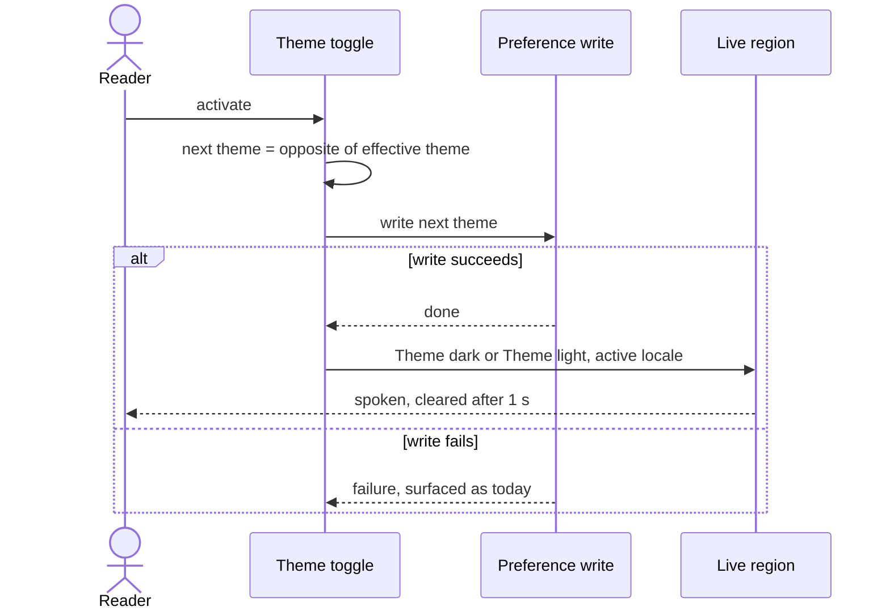
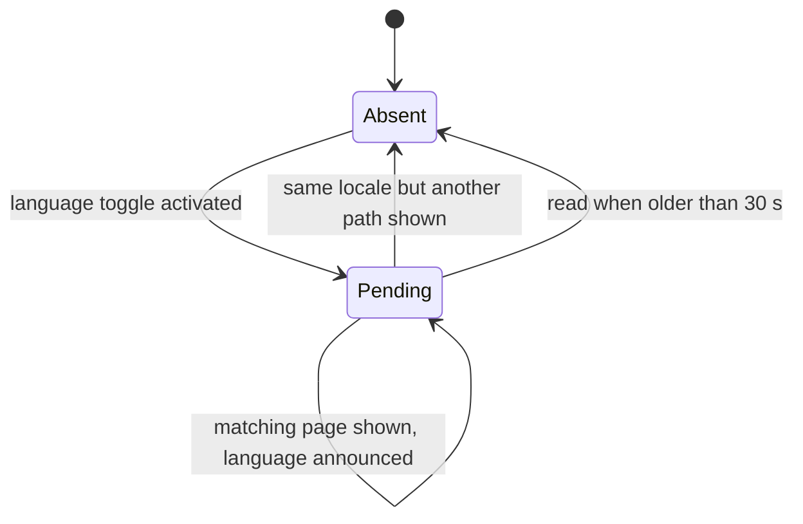

# Functional specification — U7 `cr-004-live-region-announcements`

| Field | Value |
|---|---|
| Unit | U7 `cr-004-live-region-announcements` (kind `ui`, size S, not high risk) |
| Source | CR-004 (`docs/implementation/tasks/CR-004-live-region-announcements.md`), closes `ISS-122` |
| Story | US12.1 (`unit-of-work-story-map.md`: US12.1 → U7, U20, U40, U42) |
| Requirements | FR91 (persistent Bangla \| English switch), FR95 (screen-reader-friendly controls), NFR6 (accessibility), NFR7 (localization) — `requirements.md` |
| Decisions | FD-042 (announcements localized; Bengali copy reviewed with `ISS-050`), FD-024 / ADR 0011 (equal language), FD-091 (patient redesign; does not change this behaviour) |
| Upstream design | `unit-of-work.md` U7; `components.md` names no domain component for the web shell (presentation lives in `apps/web`); `contract-summary.md` lists U7's edges as build-order only, with no runtime contract |
| Question 1 | Answered A in `functional-design-questions.md` (on the owner's standing instruction of 2026-10-27; listed in `docs/aidlc-migration/OWNER-REVIEW-QUEUE.md` for the owner to confirm or change). This specification follows A; § 9 lists what changes if the owner switches to B |

This is a UI-only Unit. It has no entities and no data model, so this file is self-contained: it is the source of truth for the interaction workflows and state transitions below. `rules.md` holds the numbered decision rules these workflows apply; § Rules summary is derived from it.

## 1. What changes, in one paragraph

Three things in the shell speak to the screen-reader live region (`#sr-live`): the theme toggle, the language toggle and the view shown. Today only the view speaks, and it speaks hard-coded English with a raw identifier (`View: signin`) in both locales; the two toggles say nothing (`ISS-122`). After this Unit, all three speak, always in the page's own language, from message keys present in both dictionaries. The motion toggle stays silent.

## 2. As is (baseline on `main`)

| Element | Where | Behaviour today |
|---|---|---|
| Live region | `LiveRegion.tsx`, rendered once in `[locale]/layout.tsx` | `role="status"`, `aria-live="polite"`, visually hidden |
| Announce hook | `lib/announce.ts` `useAnnounce()` | Replaces the region's text, clears it after 1 s if unchanged; no-op when the region is absent |
| View announcement | `ViewShell.tsx` effect on `[view]` | `View: ${view}`, English, raw identifier, in both locales |
| Theme toggle `#theme` | `ThemeControls.tsx` | Computes the opposite of the effective theme, starts the preference write; announces nothing |
| Language toggle `#lang` | `ThemeControls.tsx` | A link to the same path in the other locale, plus the language preference write; announces nothing |
| Motion toggle `#motion` | `ThemeControls.tsx` (patient masthead only) | Writes the motion preference; announces nothing |

`ThemeControls` is shared by the patient masthead and the staff console masthead, so every rule here applies to both.

## 3. Workflows

### WF1 — Theme toggle

1. The reader activates `#theme`.
2. The current effective theme is the explicit theme, or the system colour-scheme preference when none is set (BR1.2).
3. The new theme is its opposite. That value is written as the preference (unchanged behaviour) and remembered as the value to announce (BR1.2).
4. The announcement message is chosen in the active locale: `a11y.announce.themeDark` or `a11y.announce.themeLight`.
5. When the write completes successfully, the message is announced (BR1.1). The page re-renders with the new theme as it does today.
6. If the write fails, nothing is announced and the failure surfaces exactly as it does today (BR1.3).



Text fallback: activate → compute the opposite theme → write it → on success announce it in the active locale; on failure announce nothing.

### WF2 — Language toggle (option A)

1. The reader activates `#lang` on page P in locale L1.
2. Before the page changes, a note is stored for this browser tab: target locale L2, the locale-free path of P, and the time (BR2.1). Any earlier note is replaced. Nothing is announced at the click.
3. The toggle does what it does today: it navigates to P in L2 and the language preference is stored (BR2.5).
4. P renders in L2. Its view announcement point runs (WF3, step 2) and finds the note: target L2 equals the active locale, the path equals P, and the note is at most 30 s old (BR2.2).
5. It announces `a11y.announce.language` in L2 (`Language: English` on `/en`, `ভাষা: বাংলা` on `/bn`) instead of the view message. The note is kept, so a repeated run for the same page repeats the same message instead of replacing it with the view (BR2.2).
6. The note is later discarded the first time a view in L2 is shown on another path, or on any read once it is older than 30 s (BR2.3).
7. If the note cannot be written or read (storage blocked), steps 2, 4 and 5 are skipped silently; the switch works, and P announces its view in L2 (BR2.4).

```mermaid
sequenceDiagram
  actor Reader
  participant Toggle as Language toggle
  participant Note as Per-tab note
  participant Page as Page in new locale
  participant Region as Live region
  Reader->>Toggle: activate on page P in L1
  Toggle->>Note: store target L2, path P, time
  Toggle->>Page: navigate to P in L2, store override
  Page->>Note: read
  alt note matches L2 and P and is fresh
    Page->>Region: Language message in L2
  else no matching note
    Page->>Region: View message in L2
  end
  Region-->>Reader: spoken, cleared after 1 s
```

Text fallback: activate → store the note → navigate and persist as today → the new page reads the note → matching and fresh: announce the language in the new language; otherwise announce the view.

### WF3 — View announcement

1. A view is shown, or its view identifier or the active locale changes (BR3.1).
2. The view announcement point first applies WF2's note check (BR2.2, BR2.3).
3. Without a matching note, it builds the view name from the page title mapping in the active locale; the home view `discover`, whose title is empty, uses `nav.discover` (BR3.2).
4. It announces `a11y.announce.view` with that name (`View: Doctors`, `পাতা: ডাক্তারেরা`). The raw identifier is never spoken (BR3.3); it stays in `data-view` and the section `id`, as today.

### WF4 — Motion toggle

The reader activates `#motion`. The motion preference is written as today. Nothing is announced (BR4.4).

## 4. State transitions

### Pending language-change note (per browser tab)



Text fallback:

| From | Event | To | Effect |
|---|---|---|---|
| Absent | Language toggle activated | Pending | Note holds target locale, path, time (BR2.1) |
| Pending | Toggle activated again | Pending | Note replaced by the new target (BR2.1) |
| Pending | A view shown in the other locale, note fresh | Pending | Left alone; view announced (BR2.3) |
| Pending | A view shown in the target locale on the note's path, note ≤ 30 s | Pending | Language announced; note kept for idempotent re-runs (BR2.2) |
| Pending | A view shown in the target locale on another path | Absent | Note deleted; view announced (BR2.3) |
| Pending | Read when older than 30 s | Absent | Note deleted; view announced (BR2.3) |
| any | Storage unavailable | unchanged | No note written or read; no error (BR2.4) |

### Live region text

| From | Event | To |
|---|---|---|
| Empty | A message is announced | Holding the message |
| Holding message M | Another message is announced | Holding the new message (M is replaced) |
| Holding message M | 1 s passes and the text is still M | Empty |

This is the existing hook's behaviour (BR4.3); the Unit does not change it.

### Effective theme

`light` ↔ `dark`. The first activation from "follow the system" goes to the opposite of the system preference, and the toggle never returns to "follow the system" (ported two-state handler, `ASSUMPTION(T-008)`). Each transition announces its target state (BR1.1, BR1.2).

## 5. Message catalogue

| Key | Placeholder | `en` | `bn` (draft, owner review with `ISS-050`) | Spoken when |
|---|---|---|---|---|
| `a11y.announce.themeLight` | — | Theme: light | থিম: আলো | Theme toggled to light (WF1) |
| `a11y.announce.themeDark` | — | Theme: dark | থিম: অন্ধকার | Theme toggled to dark (WF1) |
| `a11y.announce.language` | — | Language: English | ভাষা: বাংলা | A page arrives in a new locale after the toggle (WF2) |
| `a11y.announce.view` | `{view}` | View: {view} | পাতা: {view} | A view is shown or its view or locale changes (WF3) |

Notes:
- The English values keep the prototype's wording (`app.js:151`, `:173`, `:313`); only the view name is now localized.
- Under option A, `a11y.announce.language` always names the language the page is in, so each locale carries the name of its own language. Every value differs between the two dictionaries, as the parity check requires.
- The Bengali theme names follow the existing `a11y.theme` copy (`আলো বা অন্ধকার মোড বদলান`); `পাতা` ("page") is proposed for "View" because a view is a page in the port.
- The `{view}` value comes from existing keys (`nav.*`, `auth.*.title`, `policy.*.title`, `mine.*`, `person.kicker`, `admin.tab.*`, `staff.*.title`) through the title mapping, so no other new copy is needed.

## 6. What is not announced

- The motion toggle (CR-004 "Not in scope"; the prototype does not announce it either).
- Nothing is announced at the language-toggle click itself (option A); the arrival announces instead.
- A failed theme write (BR1.3).
- Sheets and other shell parts: nothing else in the port calls the hook today, and this Unit adds no new announcement points.

## 7. Edge cases and failure behaviour

| Case | Behaviour | Rule |
|---|---|---|
| Theme set to "follow the system", reader in dark OS mode | Toggles to light, announces `Theme: light` / `থিম: আলো` | BR1.2 |
| Theme toggled twice quickly | Each successful write announces its own target; the later message replaces the earlier one in the region | BR1.1, BR4.3 |
| Theme write fails | No announcement; failure as today | BR1.3 |
| Language toggled twice before the first page arrives | The note holds the last target; only the final locale's page announces | BR2.1, BR2.2 |
| Navigation after the click never completes (offline) | Note stays pending, is ignored on pages of the old locale, expires after 30 s | BR2.3 |
| Back or forward across locales, or a reload, without the toggle | No matching note; the view is announced in the page's language | BR2.3, BR3.1 |
| Reader moves to another page within 30 s of a switch | That page announces its view; the note is discarded | BR2.3 |
| Storage blocked or full | Switch works; arrival announces the view | BR2.4 |
| Scripts disabled | The link still switches locale and stores the override; nothing is announced (no live-region updates without scripts) | BR2.5 |
| Development double-run of effects | The matching note is kept, so the repeat announces the same language message, not the view | BR2.2 |
| Component rendered without the live region (isolated test) | Announcing does nothing; nothing fails | BR4.3 |
| Staff console | Same behaviour for `#theme` and `#lang`; no motion toggle there | BR1.1, BR2.1 |

## 8. Decisions

**D1 — How the language change is announced (Question 1, answered A, awaiting the owner's confirmation).** Chosen: a per-tab note read by the arriving page (option A). Alternatives considered: (B) announce at the click in the language being left, which is simplest but likely cut off when the page changes; (C) detect a locale change by remembering the last locale in the running script, which needs no storage but announces on back and forward too and loses its memory on a full page load; (D) let the masthead toggle itself announce on arrival, which races with the view announcement because both fire when the page appears. A note read only at the view announcement point gives one deterministic speaker per page arrival.

**D2 — Full-sentence keys.** Chosen: one key per whole message, with `{view}` as the only placeholder. Alternatives rejected: composing `Theme: ` + a theme-name key (word order and punctuation then live in code, not copy); an ICU `select` inside one key (the parity check reads the branch words as placeholders and fails it).

**D3 — View name source.** Chosen: the page title mapping (`lib/titles.ts`), with `nav.discover` for the home view. Alternatives rejected: the raw identifier (English inside Bengali, BR3.3); the `title` prop (several pages pass an empty title on purpose because their content brings its own heading, and some tests pass literal English).

**D4 — Theme timing.** Chosen: announce after the write succeeds. Alternative rejected: announce at the click (could announce a change that then fails). The visual change also waits for the write, so the announcement and the change arrive together.

## 9. Option B delta (if the owner changes the answer to Question 1 to B)

- WF2 becomes: on activation, announce the target language in the current locale at the click, then navigate. No note; BR2.1–BR2.4 are replaced by one rule "the click announces the target language in the language being left"; BR2.5 stays.
- Keys: `a11y.announce.language` is replaced by `a11y.announce.languageBn` (`Language: Bengali` / `ভাষা: বাংলা`) and `a11y.announce.languageEn` (`Language: English` / `ভাষা: ইংরেজি`).
- The view announcement point needs no note check; WF3 and the theme flow are unchanged.
- Risk accepted with B: in the running app the click-time message is likely replaced before it is read.

## 10. Acceptance mapping

| CR-004 acceptance check | Expected under this design | Rules |
|---|---|---|
| Theme toggle announces | Non-empty text naming the new theme, in the page's locale | BR1.1, BR1.2, BR4.2 |
| Language toggle announces | Non-empty text naming the new language, spoken by the arriving page | BR2.1, BR2.2 |
| Bengali | Under `/bn`, the theme announces in Bengali, and switching to `/bn` announces `ভাষা: বাংলা`; switching from `/bn` announces `Language: English` on `/en` (option A reading of the row) | BR2.2, BR4.2 |
| i18n parity | `pnpm check` passes; both dictionaries carry the four keys | BR4.1 |
| No regression | `pnpm check` and `pnpm smoke` green, nothing skipped | BR2.5, BR3.1, BR4.3 |
| Motion toggle untouched | No announcement added for motion | BR4.4 |

US12.1 acceptance criteria and their coverage are in `traceability.json`. No US12.1 criterion states that the toggles announce; this Unit's core behaviour traces to FR95, NFR6 and CR-004's acceptance table instead.

## 11. Risks to verify in Code Generation and Build and Test

- **Region replacement on locale change.** The design assumes the page under the new locale may replace the live region. Option A works either way; Build and Test confirms in the running app (`/en` → `/bn` and back) that the language message is spoken once.
- **Freshly inserted live region.** Some screen readers ignore text written into a live region in the same moment the region appears. If the arrival message is not spoken in the running app, the fix belongs in the hook (`lib/announce.ts`, outside CR-004's owned paths) and needs the owner's approval; it is logged as an `ISS-` row, not patched silently.
- **Paths beyond CR-004's list.** Regenerating `packages/i18n/src/keys.ts`, and the component and smoke tests, are needed; the Code Generation plan lists them for approval.
- **Test fixtures.** `ViewShell.test.tsx` renders without the translation provider and must be wrapped; tests that pass partial message sets must include the keys they render.

## Rules summary (derived from `rules.md`)

| ID | Rule in one line |
|---|---|
| BR1.1 | Theme toggle announces the new theme in the active language once the write succeeds |
| BR1.2 | The announced theme is the written theme: the opposite of the current effective theme |
| BR1.3 | A failed theme write announces nothing; today's failure path is unchanged |
| BR2.1 | Language toggle leaves a per-tab note; nothing announced at the click |
| BR2.2 | Matching page within 30 s announces the language change in its own language |
| BR2.3 | Stale or superseded notes are discarded; a fresh note for the other locale is left alone |
| BR2.4 | Storage unavailable: the toggle works; only the language announcement is skipped |
| BR2.5 | Toggle navigation, pressed state, glyph and stored override are unchanged |
| BR3.1 | Every view announces itself when shown and when its view or locale changes |
| BR3.2 | View name = localized page name; the home view uses `nav.discover` |
| BR3.3 | The raw view identifier is never spoken |
| BR4.1 | Every announced string is a key in both dictionaries, same change, same placeholders |
| BR4.2 | Announcement text is in the page's active locale |
| BR4.3 | Only through the existing live region: one message, cleared after 1 s |
| BR4.4 | The motion toggle stays silent |
| BR4.5 | Bengali copy flagged for review with ISS-050; ISS-122 closed naming the option |
