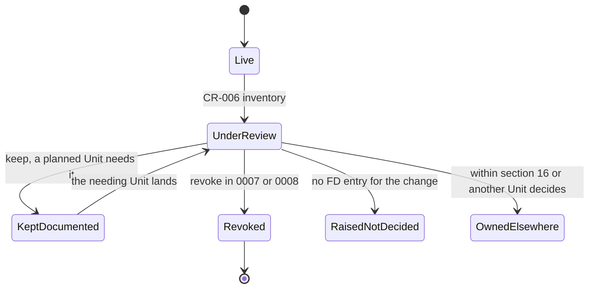
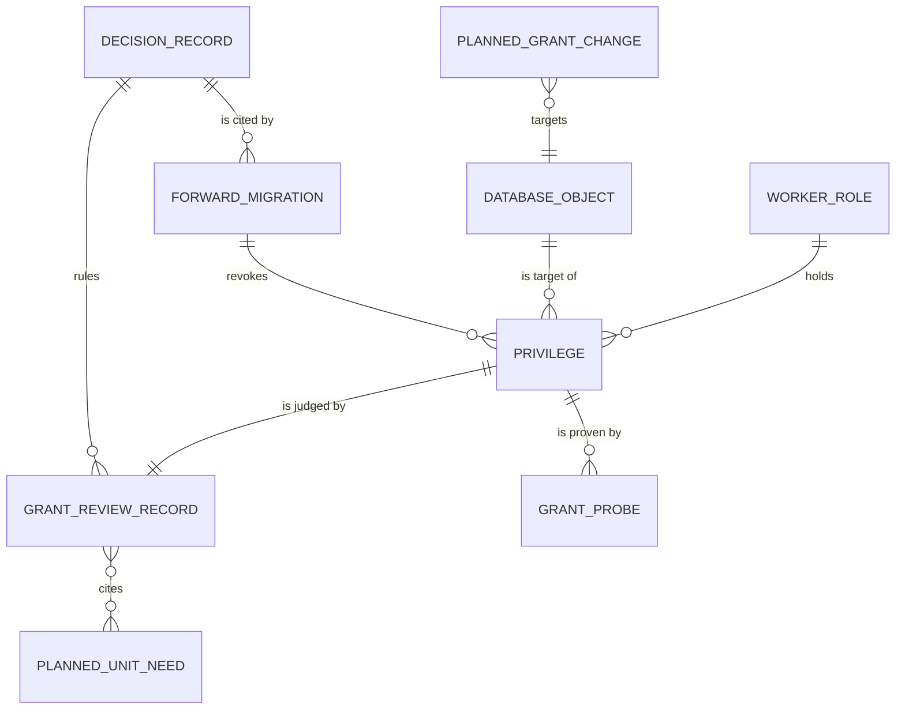

# Functional specification — U5 `cr-006-worker-auth-users-grant`

Unit U5 (kind `library`, size S, **high risk**: privilege boundary around account email) delivers CR-006 for US1.1 (NFR11). Lead perspective: architect. Support perspective: developer (migration mechanics, privilege statements, the test approach against the real role), written into §§ 10–12 and synthesised in § 13.

Inputs: `unit-of-work.md` (U5; open point at line 512), `unit-of-work-story-map.md` (US1.1), `requirements.md` (NFR11), `components.md`, `contract-summary.md` (C2, C3, C9–C13, C15 and the ownership rules), `docs/status/decision-log.md` (FD-041, FD-050, FD-071, FD-077, FD-079, FD-080, FD-090), `docs/implementation/02-data-model.md` §16, `01-conventions.md` §11–§12, the migrations and tests on `main`, `apps/worker/src/`, the task files of the later Units that use the worker (T-101, T-205, T-301, T-302, T-303, T-304, T-309, T-401, T-403, T-404, T-405, T-410), and ISS-139, ISS-140, ISS-141, ISS-148.

This file is the source of truth for the workflows and state transitions. The data shape is in `entities.md`; the decision logic is in `rules.md`. The rulings in § 6 follow the answers in `functional-design-questions.md` (all A), decided on the owner's standing instruction of 2026-10-27 and awaiting the owner's confirmation.

## 1. What changes, in one paragraph

Two forward-only migrations land after `0006_pgboss_grants.sql`. `0007_revoke_worker_auth_users.sql` removes every privilege `rk_worker` has on `auth_users` (FD-041), so the worker can no longer read any account's plaintext email; it reads mail recipients only from `email_deliveries.to_email_enc` (FD-071). `0008_worker_grant_review.sql` applies the FD-050 review: it revokes the two worker grants no planned Unit needs (`review_versions` INSERT and the column SELECT on `reports`) and keeps the five that planned Units need (`reviews` UPDATE on two columns, `comments` SELECT and UPDATE, the column SELECT on `account_profiles`, `legal_holds` SELECT, `account_preferences` SELECT). A new FD entry records every ruling before either migration is written. `02-data-model.md` §16 is rewritten as the complete list of the worker's privileges, with each kept grant's reason and Units, the planned additions and removals other Units own, and the real migration file names. Integration probes, each a real `rk_worker` session, prove every decided state, and one smoke assertion pins the FD-041 denial. ISS-140 closes.

## 2. As is (baseline on `main`)

- **The worker today** runs one job, `outbox.relay` (`apps/worker/src/registry.ts`), which reads and updates `outbox_events` and writes pg-boss jobs. No other table is touched by worker code on `main`, so none of the FD-050 grants and not the `auth_users` read is used today. `mail.send` does not exist yet (T-101 builds it, FD-071); the relay still maps `account.registered → mail.send`, which U8 removes (C15).
- **The role.** `rk_worker` is a login role, not superuser, no row-security bypass, member of no role (catalogue, 2026-10-27). It holds no CREATE on `public`.
- **Live privileges of `rk_worker`** in a freshly migrated `rogikotha_test` (catalogue read, 2026-10-27). `§16` means `02-data-model.md` §16.

| Id | Object | Privilege | Granted by | §16 says | FD-050 lists it |
|---|---|---|---|---|---|
| WG1 | `auth_users` | SELECT (`id`, `email`) | `0005_grants_part2.sql:98` | **contradicts** (bullet 2, note 3) | — (FD-041) |
| WG2 | `reviews` | UPDATE (`state`, `deleted_at`) | `0005:70` | not named | yes |
| WG3 | `review_versions` | INSERT | `0005:75` | not named | yes |
| WG4 | `comments` | SELECT, UPDATE | `0005:80` | not named | yes |
| WG5 | `reports` | SELECT (`id`, `target_kind`, `target_id`, `review_id`, `reason`, `created_at`) | `0005:85` | not named (only the `reporter_account_id` revoke) | yes |
| WG6 | `account_profiles` | SELECT (`id`, `username`, `display_name`, `locale`, `status`) | `0005:94` | not named | yes |
| WG7 | `legal_holds` | SELECT | `0005:63` | "DML on ... retention" (wider in text) | yes |
| WG8 | `account_preferences` | SELECT | `0005:96` | not named | no (Units Generation open point) |
| WG9 | `personas`, `doctors`, `facilities`, `facility_branches`, `taxonomy_terms`, `taxonomy_aliases` | SELECT | `0001_grants_part1.sql:15` | not named | no |
| WG10 | `config_versions` | SELECT | `0001:15` | not named | no |
| WG11 | `audit_events` | INSERT | `0001:17` | not named | no |
| WG12 | `reviews` | SELECT (whole table, including `exact_date_enc`) | `0005:68` | not named | no |
| WG13 | `drizzle_migrations_id_seq` | USAGE | `0001:19` (`ON ALL SEQUENCES`) | not named | no |
| WG14 | `evidence_items` | SELECT, INSERT, UPDATE, DELETE (whole table) | `0005:52` | named, but §16 also requires a column revoke of `original_filename_enc` (ISS-139) | no |
| WG15 | `evidence_artifacts`, `evidence_custody_events`, `evidence_redactions`, `notifications`, `staff_notifications`, `email_deliveries`, `outbox_events`, `search_documents`, `search_aliases`, `retention_policies`, `retention_bulk_actions`, `data_requests` | SELECT, INSERT, UPDATE, DELETE | `0005:52` | named | no |
| WG16 | `fn_expire_audit(timestamptz)` | EXECUTE | `0003_triggers.sql:61` | named | no |
| WG17 | schema `pgboss`, its tables, sequences and default privileges | USAGE, DML | `0006_pgboss_grants.sql` | named (note 2) | no |
| WG18 | schema `public` | USAGE | `0001:6` | implied | no |

Not held (correct): `auth_sessions`, `auth_accounts`, `auth_verifications`, `persona_links`, `identity_reveals`, `blocks`, `bookmarks`, `reactions`, `review_tags`, `review_drafts`, `review_follow_ups`, `facility_reviews`, `doctor_chambers`, `comment_mentions`, `moderation_cases`, `moderation_case_reasons`, `moderation_decisions`, `appeals`, `moderation_case_seq`, every directory submission table, `staff_devices`, `enforcements`, `feedback`, `config_changes`, `demo_clock`. The `public` schema has no default privileges left for `rk_worker` (FD-037 flip).

- **Verified behaviour of zero-row statements.** As a real `rk_worker` session on `rogikotha_test` (2026-10-27): `update reviews set state = state, deleted_at = deleted_at where false` → `UPDATE 0`; `update reviews set title = title where false` → `permission denied for table reviews`; `update legal_holds set released_at = released_at where false` → `permission denied`; `select auth_user_id from account_profiles where false` → `permission denied`; `select id, email from auth_users where false` → 0 rows (allowed today). PostgreSQL checks privileges when the statement starts, whether or not a row is touched, so zero-row probes can fail and need no fixture rows.
- **Tests on `main`** that touch the worker role: `grants.smoke.test.ts` (FD-037 default-deny on `review_tags`), `constraints.int.test.ts` ("FD-037 (ISS-107)" block: `review_tags`, `reports.reporter_account_id` denied but `select id, reason from reports` allowed, `appeals`, `moderation_cases`, a future table), `migrations.int.test.ts` (`persona_links` denied), `outbox.int.test.ts` (outbox insert allowed, `reporter_account_id` denied), `pg-boss-queue*.int.test.ts` (pgboss USAGE and DML, no CREATE), `validator-probes.int.test.ts` (`it.fails` tripwires for ISS-139 and ISS-141 only; **there is no ISS-140 tripwire**, although CR-006 step 5 assumes one).
- **The four sources disagree** (ISS-140): the database grants WG1; §16 bullet 2, §16 note 3 and `01-conventions.md` §11 say the worker has no access to `auth_*`. The `0005` comment calls WG1 "the one, deliberate, documented exception".

## 3. Settled before this stage

FD-041 (revoke WG1, option (a)), FD-071 (`mail.send` reads `to_email_enc`, T-101 builds it), FD-050 with review R-17 (keep what a planned Unit needs), FD-077 (the deletion split), FD-079, FD-080 and FD-090 (three planned additions, known not findings), and the Units Generation open point that brings WG8 into this review and moves the file name off `0006`. See `functional-design-questions.md` § "Settled before this stage".

## 4. Workflows

### WF1 — Code Generation order (the Unit end to end)

1. **Baseline.** `pnpm infra:up`; `pnpm check` and `pnpm smoke` green on the Bolt branch; read the open `ISSUES.md` rows in `database/grants` (ISS-139, ISS-140, ISS-141, ISS-148). Record the counts.
2. **Decision entry first (BR2.3).** Append the next free FD row to `docs/status/decision-log.md` (FD-092 at the time of writing): the ruling on each privilege WG2–WG8 with its one-line reason (§ 6), the §16 completeness ruling (Question 8), the four raised items left undecided (§ 9), and "decided by the agent on the owner's standing instruction of 2026-10-27; awaiting the owner's confirmation". FD-041 needs no new row.
3. **Migration 0007 (WF2).** Generate, write, apply locally.
4. **Migration 0008 (WF3).** Generate, write, apply locally.
5. **Comment-only edits in `0005_grants_part2.sql` (BR2.2).** The comments above the `review_versions` (line ~73), `reports` (~83) and `auth_users` (~88–93) grants say the grant is revoked and by which migration and FD entry. No statement changes.
6. **Tests (WF4, § 11).**
7. **Documents (WF5).** §16 rewrite; confirm `01-conventions.md` §11 now holds as written.
8. **Issue register.** Close ISS-140; add the rows of § 9 and § 10.
9. **Gate.** `pnpm check`, `pnpm smoke`, `pnpm test:int` exit 0 (BR5.5); fill the CR-006 hand-off with the § 6 table, the FD-077 split (§ 7), the planned additions (§ 8), the owned-path addition (`constraints.int.test.ts`) and its reason.

### WF2 — Revoke the `auth_users` grant (FD-041)

1. Create migration `0007_revoke_worker_auth_users` as a custom migration through drizzle-kit, so `meta/_journal.json` gets entry `idx 7` with a timestamp later than `0006_pgboss_grants` and `meta/0007_snapshot.json` repeats the 0006 schema (§ 10).
2. The file revokes all privileges of `rk_worker` on `auth_users`. A table-level revoke also removes the column privileges on every column of that table (PostgreSQL 18, REVOKE), so the column grant of WG1 goes with it. A header comment cites FD-041, ISS-140, §16 note 3 and the probes that prove it.
3. Apply with `pnpm db:migrate` against the development database and with the integration reset against `rogikotha_test`.
4. Probes P1–P9 (§ 11) prove: no privilege on `auth_users` by a real session and by the catalogue; the other `auth_*` tables still denied; `email_deliveries.to_email_enc` readable; no role membership; no function or view that exposes `auth_users`; migrations applied from empty; the smoke assertion.

### WF3 — Apply the FD-050 rulings

1. Create migration `0008_worker_grant_review` the same way (`idx 8`).
2. It revokes the `reports` privileges of `rk_worker` (table-level, which removes the six column privileges of WG5) and the INSERT on `review_versions` (WG3). It changes nothing else. Its header comment cites FD-050 and the new FD entry, and lists the five grants kept and why, so a reader of the migrations sees the whole ruling in one place.
3. Rewrite the one `constraints.int.test.ts` assertion whose premise this changes (BR5.4, § 11).
4. Probes P10–P20 prove each ruling and the limit of each kept narrow grant.

### WF4 — Prove the decided state

Each probe opens its own connection pool on the `rk_worker` URL (`workerUrlForTestDb()`), runs one statement, and ends the pool in `finally`, following the existing tests. Denied probes expect a rejection matching `/permission denied/i`; allowed probes expect resolution. Catalogue probes run through the same session (`has_table_privilege`, `has_column_privilege`, `pg_has_role`) and never replace a real statement (BR5.1). Details in § 11.

### WF5 — Bring the documents into line

1. Rewrite `02-data-model.md` §16's `rk_worker` bullet as the complete list (§ 12): the §16-named DML set, then each kept grant with its columns, its reason and its Units, then the explicit denials, then the planned additions (PA1–PA3) and planned removals (PR1–PR3) with their Units and decisions.
2. Correct §16's file names: the heading's `0004_roles.sql` becomes `0001_grants_part1.sql`, `0005_grants_part2.sql`, `0007_revoke_worker_auth_users.sql` and `0008_worker_grant_review.sql`; note 2's `0007_pgboss.sql` becomes `0006_pgboss_grants.sql`.
3. Keep note 3 ("`rk_worker` has no privilege on `auth_users`") as it is; it is now true.
4. `01-conventions.md` §11 needs no edit: "a role without access to `auth_*`, `persona_links`, `identity_reveals`" now holds. CR-006 owns §11 only for option (b), which is not taken.

## 5. State transitions

### Privilege (each of WG1–WG18)

| From | Event | To | Rule |
|---|---|---|---|
| live | inventory taken in this design | under_review | BR3.1 |
| under_review | ruling keep (planned Unit needs it) | kept_documented | BR3.2, BR3.4 |
| under_review | ruling revoke (no planned Unit needs it), forward migration applied | revoked | BR3.2, BR3.4, BR2.1 |
| under_review | settled by FD-041 | revoked (0007) | BR1.1 |
| under_review | change needs an FD entry that does not exist | raised_not_decided (live, unchanged) | BR3.6 |
| under_review | already named in §16, or owned by another Unit's decision | owned_elsewhere (live, unchanged) | BR3.3 |
| kept_documented | the needing Unit lands and no longer needs it | under_review (that Unit's own FD entry) | BR3.2 |



Text fallback: every privilege starts live and goes under review; it ends kept and documented, revoked by a forward migration, raised to the owner without a change, or left to the Unit or §16 entry that already governs it. A kept privilege is reviewed again when the Unit that needed it lands.

### ISS-140

`open` → (FD-041 recorded 2026-10-11) `decided` → (0007 merged, P1–P3 green) `fixed in CR-006 — option (a), FD-041`.

## 6. FD-050 grant-by-grant review

"Today" is the code on `main`. "Planned" names the Unit and the task-file step. "Split" is the side of C13's deletion split (FD-077): **W** worker deletion step, **web** web deletion step, **export** the worker's `data.export` (not part of the deletion split), **—** none.

| Id | Grant | Today | Planned Unit and step that needs it | Split | Compared with §16 and AD-6 | Ruling | Reason |
|---|---|---|---|---|---|---|---|
| WG1 | `auth_users` SELECT (`id`, `email`) | none | **none**: `mail.send` (U8 T-101 step 6, FD-071; U34 T-405 step 5) reads `email_deliveries.to_email_enc`; the auth user is removed by the web account step (T-410 FD-041 and FD-077 amendments) | — (account step is web) | contradicts §16 bullet 2 and note 3 and `01-conventions.md` §11; AD-6 (no general database credentials) | **revoke** (0007) | settled, FD-041 |
| WG2 | `reviews` UPDATE (`state`, `deleted_at`) | none | U39 T-410 step 3 and step 7 (`data.delete`, review worker entry built by U22 T-302, FD-077 amendment and its acceptance row "deletion step skips held rows"); U29 T-309 step 6(e) (held deletion when a hold ends, FD-079) | W | not named in §16; FD-050: "sits uneasily with AD-6" (no public-delete credentials). FD-077 has since put review tombstones on the worker side by the owner's decision; the grant is two columns, no text | **keep** (Q1) | two planned worker steps need exactly these columns (R-17) |
| WG3 | `review_versions` INSERT | none | **none**: writers are `review.correct` (author) and `review.redact` (moderator), both web, T-302 step 5; T-410's tombstone keeps versions and writes none; T-309 writes none; `change_kind` has no worker value | — | not named in §16; an unused write on an append-only history table | **revoke** (0008, Q2) | no job and no planned Unit uses it |
| WG4 | `comments` SELECT, UPDATE | none | U39 T-410 step 3 and step 7 (`data.delete`, comment worker entry built by U30 T-401, FD-077 amendment: `tombstone`, empty `body`, `state`, `deleted_at` per T-401 step 4); U29 T-309 step 6(e); U34 T-405 step 1 (`comment.posted` params carry `commentPublicId`) | W | not named in §16; no DELETE, so no hard removal from the worker | **keep** (Q3) | planned worker steps need both; column narrowing waits for T-410 |
| WG5 | `reports` SELECT on six columns | none | **none**: `report.filed` carries `caseCode`, `caseOpened`, `hidden`, `affectedAccountId` (C15, T-405 step 1); `moderation.openRepetitionCase` reads "nothing on reports or appeals" and T-403's FD-080 acceptance row expects `select` on `reports` denied; moderation de-identify is web (FD-077) | — (moderation step is web) | not named in §16 beyond the `reporter_account_id` revoke; reports are restricted moderation records (hard rule on reporter identity) | **revoke** (0008, Q4) | no job and no planned Unit uses it; removes any path that could later widen into `reporter_account_id` |
| WG6 | `account_profiles` SELECT (`id`, `username`, `display_name`, `locale`, `status`) | none | U39 T-410 step 4 (`data.export`: `profile.json`, `README.txt` in the account's locale) | export | not named in §16; `auth_user_id` is not granted, so no join path to `auth_users` | **keep** (Q5) | a planned worker job needs it; re-judged in T-410's Functional Design (finding F2) |
| WG7 | `legal_holds` SELECT | none | U29 T-309 step 6 (`retention.expire` skips held originals, finds ended holds, FD-079); U39 T-410 `data.delete` keeps held items (C13); both through Retention's `activeHold` queries in the worker process | W | §16's "DML on ... retention" reads wider; read-only is the narrower, correct form; staff write holds in the web tier | **keep** (Q6), SELECT only | the worker must see holds to respect them (FD-021, FD-079) |
| WG8 | `account_preferences` SELECT | none | U34 T-405 step 5 (`mail.send` send-time preference check, `suppressed`, `interface_locale`; FD-071 acceptance row); U39 T-410 step 4 (`preferences.json`) | export (and mail, not deletion) | not named in §16; locale and four email switches only | **keep** (Q7) | T-405's send-time check needs it |
| WG9 | catalogue reads: `personas`, `doctors`, `facilities`, `facility_branches`, `taxonomy_terms`, `taxonomy_aliases` | none | U18 T-205 steps 3 and 7 (`search.refresh` builds doctor, facility, branch and condition documents and their aliases); U39 T-410 step 4 (export: persona snapshots, provider names) | export (and search, not deletion) | public data; not named in §16 | **keep, named in §16** (Q8) | planned jobs need them; no live change |
| WG10 | `config_versions` SELECT | none | the worker's configuration reads (`ConfigProvider`, C1), for example the case SLA for U32 T-403's repetition case | — | not named in §16; configuration holds no personal data | **keep, named in §16** (Q8) | planned jobs need it |
| WG11 | `audit_events` INSERT | none | U32 T-403 (`repetitionFlag` audit row), U29 T-309 (retention audit), worker steps of U39 T-410 that audit | W | not named in §16; append-only, insert only | **keep, named in §16** (Q8) | planned jobs write audit rows |
| WG12 | `reviews` SELECT (whole table) | none | U18 T-205 (`search.refresh`), U34 T-405 (`reviewPublicId` params), U32 T-403, U39 T-410 (`data.delete` state and discussion check, `data.export`) | W and export | not named in §16; includes the private `exact_date_enc` | **keep, named in §16** (Q8); column narrowing **raised, not decided** (R1) | planned jobs need it; narrowing needs an FD entry |
| WG13 | `drizzle_migrations_id_seq` USAGE | none | none | — | incidental, from `GRANT ... ON ALL SEQUENCES` in 0001 | **raised, not decided** (R2) | revoking is a worker-grant change with no FD entry |
| WG14 | `evidence_items` DML, including `original_filename_enc` and `uploaded_by_account_id` | none | U24 T-304 (`evidence.process`), U29 T-309, U39 T-410 evidence step | W | §16 requires the `original_filename_enc` column revoke (ISS-139, S2, owner T-304); T-303 step 8 also revokes `uploaded_by_account_id`, which §16 bullet 2 says is granted (finding F7) | **owned elsewhere** (PR2, PR3) | ISS-139's owner and T-303 decide |
| WG15 | the §16 DML set | none (`outbox_events`: `outbox.relay`) | evidence, notification, search, retention and data-request jobs | W (evidence, notifications and `email_deliveries`, search) | named in §16 | **within §16**, unchanged | covers the worker deletion steps (§ 7) |
| WG16 | `fn_expire_audit` EXECUTE | none | U29 T-309 removes it: `audit.expire` runs under `rk_maintenance` (C1) and T-309's acceptance row expects `rk_worker` cannot execute it | — | named in §16 | **owned elsewhere** (PR1) | T-309 changes it |
| WG17 | `pgboss` USAGE and DML | `outbox.relay`, every job | every job | — | §16 note 2 | **within §16**, unchanged | — |
| WG18 | `public` USAGE | every query | every job | — | implied by §16 | **within §16**, unchanged | — |

Result against FD-050's list: of the six, two are revoked (WG3, WG5) and four are kept (WG2, WG4, WG6, WG7); the extra grant WG8 is kept. No grant is offered for revocation while a planned Unit needs it (R-17), and no grant is revoked because of a planned addition (BR3.3).

## 7. The deletion split check (FD-077, C13)

| Worker step of `data.delete` | Tables it writes or reads | Covered by |
|---|---|---|
| evidence files (originals now, derivatives with the review, held items kept) | `evidence_items`, `evidence_artifacts`, `evidence_custody_events`, `legal_holds` (read) | WG14, WG15, WG7 |
| notifications and `email_deliveries` | `notifications`, `email_deliveries` | WG15 |
| search documents (`search.removeAccountContent {reviewIds}`) | `search_documents`, `search_aliases` | WG15 |
| review tombstones (worker entry of `review.deletionStep`) | `reviews` (read; `state`, `deleted_at`), `legal_holds` (read) | WG12, WG2, WG7 |
| comment tombstones (worker entry of `community.deletionStep`) | `comments`, `legal_holds` (read) | WG4, WG7 |
| step results and `dataRequest.completed` | `data_requests`, `outbox_events` | WG15 |

Every worker step is covered by a kept grant. The web steps (account, identity, directory, moderation, review drafts and facility reviews, reactions) run inside `dataRequest.delete` as `rk_app` and rely on no worker grant; the two grants revoked here (WG3, WG5) are used by no step on either side. Target ids come from the plan, so no worker step needs `persona_links` (T-410 acceptance row "worker steps stay inside its grants"). Two related gaps belong to other Units: the notification participant's deletion of `account_preferences` sits on neither side (F3), and the review step must write only `state` and `deleted_at` (F5).

## 8. Planned additions and removals (known, not applied here)

| Id | Change | Owning Unit | Decision |
|---|---|---|---|
| PA1 | add SELECT, INSERT, UPDATE on `moderation_cases`; USAGE on `moderation_case_seq` | U32 T-403 (`*_moderation_case_origin_and_worker_grant.sql`) | FD-080 |
| PA2 | add EXECUTE on the narrow `SECURITY DEFINER` persona-link deletion function, nothing on `persona_links` | U29 T-309 (`*_fn_delete_held_persona_links.sql`), used by T-410's held deletion | FD-079, FD-090 (2) |
| PA3 | add SELECT (`id`, `account_id`, `expires_at`) and DELETE on `review_drafts`, nothing on `payload_enc` | U21 T-301 (`*_review_drafts_worker_grant.sql`), used by T-309 | FD-090 (1) |
| PR1 | remove EXECUTE on `fn_expire_audit` (runs under `rk_maintenance`) | U29 T-309 | C1, T-309 acceptance row |
| PR2 | remove SELECT and UPDATE on `evidence_items.original_filename_enc` | U24 T-304 (ISS-139), also T-303 step 8 | §16, ISS-139 |
| PR3 | remove SELECT on `evidence_items.uploaded_by_account_id` | U23 T-303 step 8 (the author id travels in `evidence.stateChanged`, C15) | T-303, finding F7 |

This Unit writes none of these. Existing tests that pin the current state of these objects (for example the `moderation_cases` denial in `constraints.int.test.ts`) are updated by the owning Unit, and this Unit adds no probe that pins them.

## 9. Raised for the owner, not decided

Each would change a worker grant without an FD entry, so BR3.6 applies: the live grant stays, and an ISS row is proposed.

- **R1 — `reviews.exact_date_enc` is readable by the worker (WG12).** The exact treatment date is private (§6) and encrypted. Narrowing WG12 to the columns the jobs use would close it, but T-410's export may need the date for the account's own file, and the column list belongs with T-205's and T-410's designs. Suggested: decide in T-410's Functional Design, with an FD entry.
- **R2 — USAGE on `drizzle_migrations_id_seq` (WG13).** Lets the worker draw numbers from the migration bookkeeping sequence; it cannot read or write the table. Suggested: revoke in a later grant change that has an FD entry (for example T-502's hardening).
- **R3 — `search.refresh` needs reads the worker lacks.** T-205 step 3 builds doctor documents from chamber names (`doctor_chambers`) and review documents from tag labels (`review_tags`), and step 7 refreshes tagged conditions; `rk_worker` can read neither table (`review_tags` was revoked in 0005; `doctor_chambers` was never granted), and no FD names a grant. As written, the job fails with `permission denied` at its first refresh. Suggested: an FD entry and a C12 and §16 change before T-205's Code Generation, or a document build that reads only granted tables.
- **R4 — `data.export` needs reads the worker lacks.** T-410 step 4 has the worker export decrypted drafts (`review_drafts.payload_enc`, which FD-090 keeps from the worker), reactions, bookmarks and facility reviews, and find the account's own reviews and comments, which needs `persona_links`. Suggested: T-410's Functional Design gathers the export in the web tier or passes target ids, and re-judges WG6 and WG8 then.

## 10. Developer view — migration mechanics

- **Numbering and journal.** The migrator applies a journal entry only when its timestamp is later than the newest applied one, so a hand-written entry with a smaller timestamp would be skipped without error. Generate both files as custom migrations with drizzle-kit 0.31.10 from `packages/database`, one per name (`revoke_worker_auth_users`, then `worker_grant_review`); the tool writes the empty SQL file, the journal entry (`idx 7`, `idx 8`, `breakpoints: true`) and a snapshot identical to 0006's. Then fill in the SQL. Check `meta/_journal.json` afterwards: the two new `when` values must be greater than `1789331720026`.
- **Statement shape** (illustrative, the whole content of each file apart from comments):

```sql
-- 0007_revoke_worker_auth_users.sql (FD-041, ISS-140)
REVOKE ALL ON auth_users FROM rk_worker;

-- 0008_worker_grant_review.sql (FD-050, FD-092)
REVOKE ALL ON reports FROM rk_worker;
--> statement-breakpoint
REVOKE INSERT ON review_versions FROM rk_worker;
```

- **Why a table-level revoke is enough.** Revoking privileges on a table also revokes the matching column privileges on each of its columns (PostgreSQL 18 documentation, REVOKE). So `REVOKE ALL ON auth_users` removes the `SELECT (id, email)` column grant, and `REVOKE ALL ON reports` removes the six-column grant; the `reporter_account_id` denial stays because nothing on `reports` is left. P3 checks the catalogue to confirm that no column privilege remains.
- **Idempotent and safe on any database.** Revoking a privilege the role does not hold is a no-op without error, so the files apply from empty (the normal path), and on a development database migrated before them.
- **Comment-only edits in 0005.** The migrator does not re-check the content of migrations it has already applied; it only compares timestamps. A comment edit therefore changes no behaviour on an existing database, and `pnpm db:reset` rebuilds from empty anyway. Verify once in Code Generation that `pnpm db:migrate` on an already-migrated development database reports nothing to do for 0000–0006.
- **Ownership.** `rk_app` owns every table and runs the migrations, so it can revoke the grants it gave. No `GRANT OPTION` is involved.
- **Rollback.** Forward-only. Undoing a revocation means a new migration that grants again, with its own FD entry. Locally: revert the Bolt's squash commit and run `pnpm db:reset && pnpm db:seed` (team practice, Deployment).
- **Nothing else moves.** No schema change, so `schema/*.ts` and the drizzle snapshot content stay as they are; the web role `rk_app` and `rk_maintenance` are untouched; the pg-boss default privileges are untouched.

## 11. Developer view — test design against the real role

All probes run against `rogikotha_test` after the integration reset, as a real `rk_worker` session (`workerUrlForTestDb()`), with zero-row statements (§ 2). New probes go into `validator-probes.int.test.ts` in a block named for CR-006 (owned path); the smoke assertion goes into `grants.smoke.test.ts` (owned path); one assertion in `constraints.int.test.ts` is rewritten (owned-path addition, recorded in the hand-off). Test names read as sentences.

| Probe | Statement (shape) | Expected | Proves |
|---|---|---|---|
| P1 | `select id, email from auth_users limit 1` | permission denied | BR1.1, CR-006 acceptance row 1 |
| P2 | `select id from auth_users limit 1` | permission denied | BR1.1: no column privilege survives, not only `email` |
| P3 | catalogue: `has_table_privilege('rk_worker', 'auth_users', p)` for SELECT, INSERT, UPDATE, DELETE; `has_column_privilege` on `id` and `email`; `information_schema.column_privileges` rows for `rk_worker` on `auth_users` | all false; zero rows | BR1.1 (T-410's FD-041 row uses the same check) |
| P4 | `select 1 from auth_sessions limit 1`, same for `auth_accounts`, `auth_verifications` | permission denied, each | BR1.2, acceptance row 2 |
| P5 | `select id, to_email_enc from email_deliveries limit 1` | succeeds | BR1.3, FD-071 acceptance row |
| P6 | `pg_has_role('rk_worker', r, 'MEMBER')` for `rk_app`, `rk_maintenance`; then `set role rk_app` | false; permission denied | BR1.4 |
| P7 | catalogue: views in `public` whose definition reads `auth_users` and that `rk_worker` can select; `SECURITY DEFINER` functions `rk_worker` can execute whose body mentions `auth_users` | none; none | BR1.4 (stays true when T-309 adds PA2) |
| P8 | `drizzle_migrations` row count against the journal entries | equal (9 after this Unit) | BR2.4: 0007 and 0008 were not skipped |
| P9 (smoke) | `select email from auth_users limit 1` | permission denied | BR5.3 |
| P10 | `update reviews set state = state, deleted_at = deleted_at where false` | succeeds | BR4.1 |
| P11 | `update reviews set title = title where false` | permission denied | BR4.1, BR5.2 (negative control) |
| P12 | `insert into review_versions (...) select ... where false` | permission denied | BR4.2 |
| P13 | `select id from comments limit 1`; `update comments set state = state where false` | both succeed | BR4.3 |
| P14 | `delete from comments where false` | permission denied | BR4.3, BR5.2 |
| P15 | `select id, reason from reports limit 1`; `select reporter_account_id from reports limit 1` | permission denied, both | BR4.4 |
| P16 | `select id, username, display_name, locale, status from account_profiles limit 1` | succeeds | BR4.5 |
| P17 | `select auth_user_id from account_profiles limit 1` | permission denied | BR4.5, BR5.2, BR1.4 |
| P18 | `select id from legal_holds limit 1` | succeeds | BR4.6 |
| P19 | `update legal_holds set released_at = released_at where false` | permission denied | BR4.6, BR5.2 |
| P20 | `select account_id, interface_locale, email_moderation from account_preferences limit 1` | succeeds | BR4.7 |

- **The rewritten assertion.** `constraints.int.test.ts` "is denied on reports.reporter_account_id even though other reports columns are readable" becomes "is denied on every reports column, reporter_account_id included": both `select reporter_account_id` and `select id, reason` expect `permission denied`. Reason recorded in the hand-off: Question 4 (FD-050 ruling) revokes the column allowlist the old assertion used as its positive control; the column-allowlist mechanism stays proven by P16 and P17 on `account_profiles`.
- **Every test can fail.** Each denial probe would resolve if the privilege were still there (P1 resolves on `main` today), and each allowed probe would reject if the grant were missing; P8 fails if a migration is skipped. The ISS-139 and ISS-141 `it.fails` tripwires stay untouched.
- **Existing assertions that must stay green**: FD-037 default-deny (`review_tags`, future table), `appeals`, `moderation_cases`, `persona_links`, the outbox insert, the pg-boss tests.
- **Adversarial angles for the separate agent** (high-risk step 5; 3–5 tests, written by another agent): (1) a role-membership or `SET ROLE` escalation from `rk_worker`; (2) a column grant on `auth_users` reached through `PUBLIC`; (3) a join path from worker-readable tables to an email (`account_profiles` without `auth_user_id`, `email_deliveries.account_id` to ciphertext only); (4) a function or view created later that reads `auth_users` and is executable by `rk_worker`; (5) a migration replayed on an already-migrated database leaving WG1 in place.
- **Commands.** `pnpm test:int` (the database project), `pnpm smoke`, `pnpm check`, with `pnpm infra:up` first.

## 12. Developer view — document and record changes

- **`02-data-model.md` §16, `rk_worker` bullet (target text, in outline).** (a) DML on the evidence tables, notifications, `staff_notifications`, `email_deliveries`, `outbox_events`, search tables, `retention_policies`, `retention_bulk_actions`, `data_requests`; (b) SELECT only on `legal_holds`; (c) SELECT on `reviews` and UPDATE on `reviews (state, deleted_at)`; SELECT and UPDATE on `comments`; (d) SELECT on `account_profiles (id, username, display_name, locale, status)` and on `account_preferences`; (e) SELECT on `personas`, `doctors`, `facilities`, `facility_branches`, `taxonomy_terms`, `taxonomy_aliases`, `config_versions`; INSERT on `audit_events`; EXECUTE on `fn_expire_audit` until T-309; USAGE and DML on `pgboss`; each with its jobs and Units from § 6; (f) no privilege on `auth_*`, `persona_links`, `identity_reveals`, `blocks`, `bookmarks`, `reports`, `review_versions` writes, `review_drafts` (until PA3), `moderation_*` (until PA1), `appeals`, `reactions`, `review_tags`, `doctor_chambers`, `facility_reviews`; (g) planned additions PA1–PA3 and removals PR1–PR3 with their Units and decisions; (h) the FD entries: FD-037, FD-041, FD-050, FD-092. §16 note 3 stays.
- **`docs/status/decision-log.md`.** One new row (WF1 step 2).
- **`docs/implementation/ISSUES.md`.** ISS-140 → `fixed in CR-006 — option (a), FD-041`; new rows for the findings below, each `Found in U5 CR-006`.
- **CR-006 hand-off.** The § 6 table, the § 7 split, the § 8 list, the owned-path addition and its reason, the ISS ids found and fixed.

Findings for other Units (proposed ISS rows; none blocks this Unit):

- **F1 (S2, U18 T-205)** — R3 above.
- **F2 (S2, U39 T-410)** — R4 above.
- **F3 (S3, U39 T-410)** — T-410 step 3's notification participant deletes the account's `account_preferences`, but FD-077's split lists it on neither side and `rk_worker` holds only SELECT on it. Suggested: the web transaction's account step deletes it.
- **F4 (S3, U29 T-309)** — T-309 step 6(a) "auto-releases" holds whose `expires_at` passed. `rk_worker` holds only SELECT on `legal_holds`, so the job must not write `legal_holds`; C3's active-hold rule (`expires_at` passed means inactive) already makes the write unnecessary. Otherwise it needs an FD-backed grant.
- **F5 (S4, U22 T-302, U39 T-410)** — The worker entry of `review.deletionStep` may write only `reviews.state` and `deleted_at`. A repository method that also sets `updated_at` or `restore_until` is refused for `rk_worker`; a worker soft delete leaves `restore_until` null, which matches T-410's "not restorable".
- **F6 (S4, U5 CR-006, this Unit)** — The CR-006 task text drifted: the planned `0006_` file name is taken (`0007` and `0008` are used); there is no ISS-140 `it.fails` tripwire to replace; Question 4's ruling changes an assertion in `constraints.int.test.ts`, outside the owned paths; step 2 ("do not edit 0005") and step 4 ("update the comment") are read together as comment-only edits.
- **F7 (S4, U23 T-303)** — §16 bullet 2 says SELECT on `evidence_items.uploaded_by_account_id` is granted to the worker, while T-303 step 8 revokes it (consistent with C15, which carries `uploaderAccountId`). The §16 rewrite records it as planned removal PR3; T-303 confirms it.
- **R1, R2** — raised items, each a proposed S4 row (owner).

## 13. Synthesis — decisions and why

- **Revoke WG1 with a table-level revoke in its own migration 0007.** FD-041. The narrowest statement that removes every privilege, column ones included; a separate file keeps the FD-041 change readable on its own and matches the task's planned name.
- **Two revocations, five keeps (Questions 1–7).** The R-17 rule decides each: WG3 and WG5 have no job and no planned Unit; WG2, WG4, WG6, WG7 and WG8 each have a planned Unit and task step. The keeps are already narrow (two columns, five columns, read-only) or wait on the needing Unit for their column list (WG4).
- **§16 becomes the complete list (Question 8).** C15's ownership rule treats §16 as the worker's grant list; a list that leaves out live grants recreates ISS-140's contradiction one table over. Documentation only, no live change.
- **What this design does not decide.** R1–R4: each needs an FD entry for a worker-grant change, which this Unit has no authority to create on its own. They are raised, with suggestions, and the live state is left as is.
- **Developer view adopted.** Custom drizzle migrations (journal timestamps), table-level revokes (column privileges go with them), zero-row probes as a real role (no fixtures, still able to fail), one rewritten assertion with a recorded reason, the FD entry before any SQL.
- **AD-6 tension on WG2 resolved by FD-077**, not by this Unit: the owner put review and comment tombstones on the worker side, and the grant gives no access to review text.

## 14. If the owner changes an answer

- **Question 1 or 3 to B or C (revoke `reviews` UPDATE or `comments`):** add the revoke to 0008 and a denial probe; T-410 and T-309 then need FD entries for the grants back (FD-077 and FD-079 assumed them).
- **Question 2 or 4 to B (keep):** drop the statement from 0008 and turn P12 or P15 into allowed probes; for Question 4 the `constraints.int.test.ts` assertion stays as it is, and T-403's FD-080 acceptance row must be reworded.
- **Question 5 or 7 to B (revoke):** add the revoke to 0008; T-410's export (and for Question 7, T-405's send-time check) is redesigned.
- **Question 6 to B:** add the revoke; T-309 and T-410 cannot honour holds in the worker, so FD-079 needs a new design.
- **Question 8 to B:** §16 lists only the FD-050 grants kept; the § 6 table stays in the hand-off.

## 15. Acceptance mapping (CR-006 acceptance checks)

| CR-006 check | Where it is met |
|---|---|
| `select id, email from auth_users limit 1` as `rk_worker` → permission denied | WF2, P1, P2, P3, P9; BR1.1 |
| `auth_sessions`, `auth_accounts`, `auth_verifications` → permission denied | P4; BR1.2 |
| §16 and `01-conventions.md` §11 agree with the live database | WF5, § 12; BR6.1 |
| the decision log carries the FD entry the SQL comment cites | WF1 step 2, WF1 step 5; BR2.2, BR2.3 |
| FD-071: `select id, to_email_enc from email_deliveries limit 1` succeeds | P5; BR1.3 |
| FD-050: every listed grant reviewed, one ruling each, today's job and planned Unit named, none revoked while needed | § 6, Questions 1–7, the FD entry; BR3.1, BR3.2 |
| FD-050: live database matches the rulings | 0008, P10–P20, § 12 §16 text; BR3.4, BR4.1–BR4.7 |
| FD-077: grants judged against the deletion split | § 6 "Split" column, § 7; BR3.5 |
| FD-079/FD-080/FD-090: planned additions recorded | § 8; BR3.3 |
| `pnpm check`, `pnpm test:int` exit 0 | WF1 step 9; BR5.5 |

## 16. Risks to verify in Code Generation and Build and Test

- The generated journal timestamps are later than 0006's (P8 also catches a skip).
- `pnpm db:migrate` on an already-migrated development database applies 0007 and 0008 and leaves 0000–0006 alone after the comment edit.
- No code on `main` or in a merged Unit reads `reports` or inserts `review_versions` as `rk_worker` (a search of `apps/worker` and `packages/*` repositories before 0008 lands).
- The FD number is still free when the entry is written; if another Unit took FD-092, use the next free one and update the migration comments.
- T-101 (U8), which depends on this Unit, runs its `mail-send.int.test.ts` as `rk_worker` after this revoke (its FD-071 row).

## Entity-relationship view (derived from `entities.md`)



Text fallback: the worker role holds many privileges; each privilege targets one database object and is judged by one review record, which cites the planned Unit needs and is ruled by a decision record (an FD entry). A forward migration revokes privileges and cites its decision record. Each privilege is proven by one or more probes. Planned grant changes owned by other Units target database objects.

## Rules summary (derived from `rules.md`)

- **Boundary (BR1.1–BR1.4):** no privilege on `auth_users` and the other `auth_*` tables; recipients only through `email_deliveries.to_email_enc`; no indirect path (role membership, `auth_user_id`, functions, views).
- **Migrations (BR2.1–BR2.4):** forward-only 0007 and 0008; comment-only edits in 0005; the FD entry first; applies from empty.
- **Review (BR3.1–BR3.6):** a complete record per grant beyond §16; keep what a planned Unit needs; planned additions recorded, not added; kept grants named in §16; deletion split covered; changes without an FD entry raised, not decided.
- **Rulings (BR4.1–BR4.8):** keep `reviews (state, deleted_at)`, `comments`, `account_profiles` five columns, `legal_holds` read, `account_preferences`; revoke `review_versions` INSERT and `reports`; name the other needed grants in §16.
- **Verification (BR5.1–BR5.5):** real-role probes with negative controls; one new smoke assertion; one assertion rewritten with its reason; all checks green.
- **Records (BR6.1–BR6.2):** §16 and §11 agree with the database; ISS-140 closed; findings recorded.

## Sources

- `docs/implementation/tasks/CR-006-worker-auth-users-grant.md` (steps 1–7, acceptance checks, amendments FD-041, FD-050, FD-071, FD-077, FD-079, FD-080, FD-090).
- `docs/status/decision-log.md` FD-037, FD-041, FD-050, FD-064, FD-070, FD-071, FD-077, FD-079, FD-080, FD-086, FD-090.
- `aidlc/spaces/default/intents/261011-aidlc-adoption/inception/contract-design/contract-summary.md` C1, C2, C3, C9, C10, C11, C12, C13, C15 and "Contract ownership rules".
- `aidlc/spaces/default/intents/261011-aidlc-adoption/inception/units-generation/unit-of-work.md` U5 and the open point at line 512.
- `docs/implementation/02-data-model.md` §6, §8, §12, §16; `docs/implementation/01-conventions.md` §11, §12.
- `packages/database/src/migrations/0001_grants_part1.sql`, `0003_triggers.sql`, `0005_grants_part2.sql`, `0006_pgboss_grants.sql`, `meta/_journal.json`; `packages/database/src/migrate.ts`; the tests listed in § 2.
- Task files T-101, T-205, T-301, T-302, T-303, T-304, T-309, T-401, T-403, T-404, T-405, T-410 (steps and amendments cited per row).
- Live catalogue of `rogikotha_test` and zero-row statements as `rk_worker`, 2026-10-27.
- PostgreSQL 18 documentation, REVOKE (table-level revokes also revoke column privileges): https://www.postgresql.org/docs/18/sql-revoke.html
