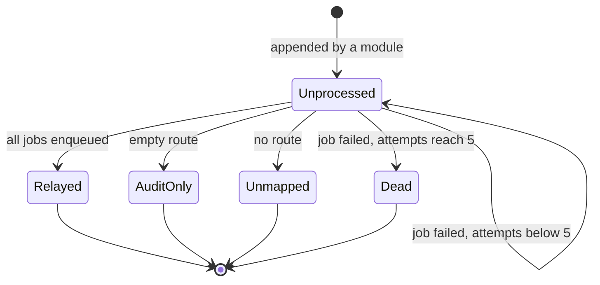
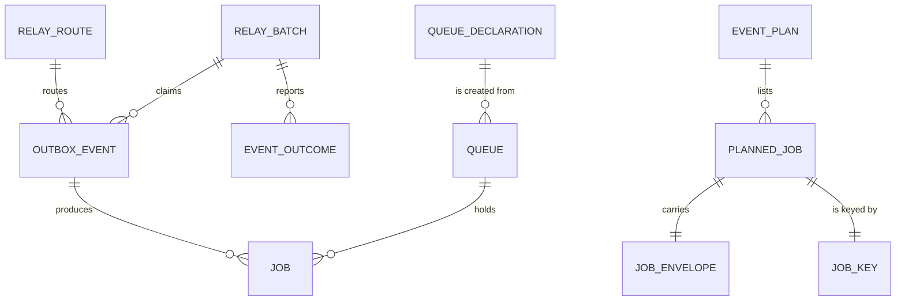

# Functional specification — U4 `cr-011-queue-dedup-reset-and-quiet-env`

The behavioural specification of this Unit and the artifact under review. It is the source of truth for the workflows and state transitions; `entities.md` holds the data shape and `rules.md` the decision logic (rule ids `BR1.1`–`BR7.2`). The answers to Questions 1–5 in `functional-design-questions.md` were decided by the agent on the owner's standing instruction of 2026-10-27 and are listed for the owner's confirmation.

## 1. What changes, in one paragraph

The outbox relay becomes one short database transaction per tick (FD-038): it locks unprocessed events without marking them, enqueues each event's jobs on its own connection through pg-boss `send(..., { db })`, and marks each event processed in that same transaction, with a savepoint per event so one failing event cannot undo or block the others. That closes ISS-201's duplicate window and ISS-144's at-most-once gap together. On top, every application queue is created with pg-boss's `exclusive` policy from one declaration shared by the worker and the web process, so at most one job per key is in flight whoever sends it, and the ISS-201 probe passes as written. A `null` from pg-boss is confirmed before it counts as a de-duplication, because pg-boss also returns `null` when a queue row is missing. Relayed jobs carry C15's key `<job>:<eventId>` and envelope `{eventId, name, payload}` and FD-076's 5 retries. `db:reset` and `demo:reset` drop `pgboss` together with `public` in one transaction under CR-007's lock limits, and both env loaders pass `quiet: true` to dotenv.

## 2. As is (baseline on `main`, 2026-10-28)

| Area | Code on `main` | Consequence |
|---|---|---|
| Claim | `PgOutbox.claimBatch` (`repositories/outbox.ts:32-59`) locks rows with `FOR UPDATE SKIP LOCKED` and sets `processed_at` in its own transaction, which commits before any job is sent. `markProcessed` is then a no-op; `markFailed` sets `processed_at` back to null and adds one attempt. | A crash between claim and send loses the event (ISS-144, ISS-185). A fan-out event whose second job fails is re-relayed in full next tick, so its first job is sent twice (ISS-201). |
| Send | `PgBossQueue.enqueue` (`queue/pg-boss-queue.ts:103-113`) sends through pg-boss's own pool with `singletonKey` and `retryLimit: 3`. | Each send commits on its own, outside any outbox transaction. |
| Queues | `ensureQueue` (`:95-101`) calls `createQueue(name)` with no options, so every queue is `standard`. | `singleton_key` has no unique index under `standard`; the key de-duplicates nothing. |
| Relay | `relayOnce` (`apps/worker/src/handlers/outbox-relay.ts:94-146`) sends key `${event.id}:${job}` and the bare `event.payload`; the comment at `:115-116` says "never a duplicate job". | Differs from C15's key and envelope; the comment is false. |
| Reset | `runReset` (`reset.ts:149-188`) drops `public` only (with CR-007's `lock_timeout`, `statement_timeout`, blocker report and sweep), then migrates. | `pgboss` and every job survive a reset (ISS-202). |
| Env | `apps/worker/src/env.ts:17` and `packages/database/src/env.ts:12` call `config({ path })`. | dotenv 17 prints its banner as the first stdout line (ISS-203). |

**Live evidence, read on 2026-10-28.** `rogikotha_test` (both schemas owned by `rk_app`) held 173 pg-boss queues, all `standard`, and 215 jobs left by earlier runs, although every `pnpm test:int` run starts with `runReset`: ISS-202 in practice. Each of the 43 `t009.validator.dedupe.*` queues held **2** queued jobs with one key: ISS-201 reproduced once per run. The development database `rogikotha` held no queue and no job.

**Live check of the chosen mechanism, 2026-10-28** (a scratch queue in `rogikotha_test`, connected as `rk_worker`, deleted afterwards), pg-boss 12.31.0:

| Check | Observed |
|---|---|
| `createQueue(name, { policy: 'exclusive' })` as `rk_worker` | created, policy `exclusive` (DML only; no partition table) |
| `createQueue` again with `policy: 'standard'` | silently kept `exclusive` (`ON CONFLICT DO NOTHING`) |
| `send` key `k1`, then `k1` again, then `k2` | id, `null`, id |
| `send` without a key, twice | id, `null` (key-less sends collapse to one in flight) |
| `send(..., { db })` on a transaction that rolls back | no job left |
| `send(..., { db })` on a transaction that commits, then a duplicate key in the same transaction | the first job committed; the duplicate returned `null` without aborting the transaction |

Code read in pg-boss 12.31.0: the `exclusive` index `job_i6` is unique on `(name, COALESCE(singleton_key, ''))` where `state <= 'active'` (`dist/plans.js:752`); `insertJobs` joins `pgboss.queue` and ends in `ON CONFLICT DO NOTHING` (`:1936-1937`), so a missing queue row also yields `null`; `createJob` runs the insert on `options.db` when given (`dist/manager.js:788-798`); `updateQueue` refuses a policy change (`:1484-1485`); cron sends forward the schedule's options with no key (`dist/timekeeper.js:521-529`).

## 3. Settled before this stage

- **FD-038**: transactional relay with `send(..., { db })` in the transaction that sets `processed_at`; `singletonKey` stays; handlers stay idempotent.
- **FD-076 and C15 common rules**: jobs retry 5 times with backoff (`evidence.process` 3); the relay is transactional.
- **FD-065 and C15 ownership**: modules write outbox rows in their own transaction; Notification owns `outbox_events`; the relay is U4's, the envelope and notification routes U34's, each route its job owner's.
- **CR-011 steps 2–4 and FD-043**: `pgboss` is cleared by the reset under CR-007's guarantees; dotenv is quiet; the two probes become plain tests.
- **Not in scope**: real handlers, a pg-boss version change, any new `rk_worker` privilege (`02-data-model.md` §16, FD-092).

## 4. The de-duplication design (ISS-201)

### 4.1 The problem

A job is duplicated when two sends with the same meaning both commit. On `main` that happens in two ways. (1) **Relay re-sends**: the claim commits before the sends, and `markFailed` re-opens an event whose earlier jobs already committed, so the next tick sends them again; T-009's validator reproduced it live with `doctor.changed` → `search.refresh`. (2) **Any producer that sends twice**: `standard` queues ignore the key, so a retried web-tier send, or an operator who resets `processed_at`, duplicates too. The relay is the only producer today; the web tier's `mail.send` (U8, U34) is the next one.

### 4.2 Alternatives

| | A1. Transactional relay + `exclusive` queues (chosen) | A2. Transactional relay only, `standard` queues | A3. Transactional relay + `stately` queues | A4. `singletonSeconds` on relay sends |
|---|---|---|---|---|
| Relay re-send (1) | impossible: jobs and `processed_at` commit or roll back together | impossible (same) | impossible (same) | only within one time slot; two sends across a slot boundary both commit |
| Second producer send (2) | stopped while a job with that key is queued, retrying or active | not stopped | stopped per state: a second job can sit beside an active one | only within one slot |
| ISS-201 probe as written | passes | stays red; the probe would have to be rewritten | passes | passes only if the slot holds |
| Sends without a key | one in flight per queue (cron non-overlap) | not collapsed | one per state | not affected |
| Retry of a job | same row moves to `retry`; no conflict | no conflict | a retry can conflict with another `retry` job of the key and be failed instead (pg-boss note at `manager.js:1344`) | no conflict |
| Cost | one declaration; a policy check on existing queues; confirm a `null` | none beyond FD-038 | as A1 | a window size to choose; blocks a legitimate later job in the slot |

**Decision: A1** (Question 1). FD-038 is the guarantee for the relay; `exclusive` makes the key promise of `EnqueueOptions.key`, `components.md` ("singletonKey idempotency") and C15 ("jobs are idempotent by `singletonKey`") true for every producer, at the price of one table and one check. A2 leaves the promise false outside the relay and cannot satisfy acceptance check 1 without rewriting a validator probe, which the probe file forbids. A3 is the right tool for an entity-keyed coalescing job, not for per-event keys (BR3.4 keeps it available). A4 narrows the window instead of removing it, the reason FD-038 gave for the transactional relay. Handler idempotency (T-009 validator option c) stays required under every option (BR3.7), because no policy covers a job that runs again after it completed.

### 4.3 The design

- **Relay transaction** (BR1.1–BR1.12): § 5 WF2.
- **Queue declaration** (BR3.1, BR3.8): one table in `packages/database/src/queue/`, read by `ensureQueue` and `enqueue` in every process. Every C15 job is listed with `exclusive`; any other name (test queues) falls back to `exclusive`; `evidence.process` has 3 retries, every other job 5.
- **Policy check** (BR3.5): `ensureQueue` creates the queue from the declaration, reads it back, and fails closed on a different stored policy (Question 3).
- **Confirmed `null`** (BR3.6): `null` is "de-duplicated" only when a queued, retrying or active job with that queue and key exists on the same transaction; otherwise it is the failure `job_not_enqueued`, and the queue loses its "ensured" mark so the next tick re-creates it.
- **Transaction-bound enqueue** (BR3.9): `enqueue` accepts an executor for the caller's transaction; the relay passes its own, and the web tier's `queueEmail` (C2) can pass its command transaction later.

## 5. Workflows

### WF1 — Code Generation order (the Unit end to end)

1. Baseline: `pnpm check`, `pnpm smoke`, `pnpm test:int` green on the Bolt branch with the compose PostgreSQL running; read open `ISSUES.md` rows in `database/queue`, `database/outbox`, `database/reset`, `worker/*`.
2. Redo the dependency check for pg-boss and dotenv and append a dated entry (BR7.2); the pin stays 12.31.0.
3. Queue module: the declaration, `ensureQueue` with the policy check, `enqueue` with declaration defaults, an optional executor and the `null` confirmation; correct the `EnqueueOptions.key` comment (BR3.1–BR3.9, BR6.6).
4. Outbox repository: transaction-scoped claim without marking, mark processed, record a failed attempt, mark dead; remove the at-most-once `claimBatch` (BR1.2, BR7.1).
5. Relay store in `packages/database/src/queue/`: one transaction per call, bounded, savepoint per event, outcomes returned after commit (§ 10).
6. Worker: routes stay; plan function (key, envelope), failure decision (retry or dead), logging of outcomes after commit; startup ensures every routed queue; correct the comment at `outbox-relay.ts:115-116` (BR1.11, BR1.12, BR2.1–BR2.5).
7. Reset: drop `pgboss` and `public` in one transaction; widen the blocker lookup (BR4.1–BR4.3).
8. Env: `quiet: true` in both loaders (BR5.1).
9. Tests of § 11, the two probes flipped, the smoke assertion; then `pnpm check`, `pnpm smoke`, `pnpm test:int` green (BR6.1–BR6.5).

### WF2 — One relay tick

1. The poller fires (every 2 s; a tick still running makes the next one skip, as on `main`).
2. Outside any transaction: ensure every routed queue not marked ensured (BR1.9, BR3.6).
3. Check out one connection; begin; set the statement timeout (5 s) and the idle-in-transaction timeout (10 s) for this transaction only.
4. Claim up to 50 events with `processed_at` null, oldest first, locking them and skipping locked rows (BR1.2, BR1.10).
5. For each claimed event, in order:
   1. Savepoint.
   2. Plan it (worker, pure): no route → `unmapped`; an empty route → `audit_only`; otherwise one planned job per route entry with key `<job>:<eventId>` (or the route's own key) and the envelope as data (BR2.1–BR2.3).
   3. For each planned job: send on this transaction; a `null` result is confirmed or turned into `job_not_enqueued` (BR3.6).
   4. All jobs succeeded (or none were needed): mark the event processed; release the savepoint; outcome `relayed`, `audit_only` or `unmapped` (BR1.4, BR1.7).
   5. A job failed: roll back to the savepoint; attempts + 1; if attempts reach 5, mark the event processed with no job (outcome `dead`), else leave it unprocessed (outcome `retry`) (BR1.5, BR1.6).
6. Commit. On any error outside an event's savepoint, or a failed commit: roll back everything, report no outcome, and let the poller log `job.failed` for `outbox.relay` (BR1.8).
7. After the commit only: log `outbox.unmapped` (warn), `outbox.relay_failed` (warn), `outbox.dead` (error) and `outbox.job_deduplicated` (info) with event name, event id, job, attempts and error code; never the payload (BR1.11, BR2.4).

### WF3 — Ensure a queue

1. Already marked ensured in this process → done.
2. Look up the job's declaration entry (or the default).
3. Create the queue with the declared policy and retry settings (pg-boss keeps an existing queue unchanged).
4. Read the stored queue. Its policy differs → raise the configuration error naming the queue, the expected and actual policy and `pnpm db:reset`; do not mark it ensured (BR3.5).
5. Mark it ensured.

### WF4 — Enqueue a job

1. Ensure the queue (WF3).
2. Build the send options from the caller's values, falling back to the declaration's retry settings (BR3.8).
3. Send, on the caller's executor if given, else on pg-boss's pool (BR3.9).
4. An id → `enqueued`. A `null` → look for a queued, retrying or active job with the same queue and key (or no key) on the same executor: found → `deduplicated`; not found → clear the ensured mark and return the failure `job_not_enqueued` (BR3.6).

### WF5 — Reset a database

1. `APP_MODE=production` → refuse. Sweep requested → the CR-007 sweep, test databases only (BR4.5).
2. Open a connection from the reset URL with `lock_timeout` 10 s.
3. Begin; `statement_timeout` 60 s for the transaction; drop `pgboss` if it exists; drop `public` if it exists; commit (BR4.1, BR4.2).
4. Lock or statement timeout → roll back; look up the granted locks on both namespaces and on relations in them, by schema name; fail with CR-007's message naming every blocker (BR4.3). Both schemas are exactly as before.
5. Create `public` and the three extensions; drop a stray `drizzle` schema; migrate: `installPgBoss` as `rk_app`, then every SQL migration from empty, `0006_pgboss_grants.sql` included (BR4.4).
6. A worker that was running is restarted by the operator (BR4.6).

### WF6 — Load the environment

1. Resolve the repository-root `.env` path as today.
2. Call dotenv with that path and `quiet: true`; nothing is written to stdout; variables already set win; a missing file is not fatal (BR5.1, BR5.3).
3. The worker validates as today and its first stdout line is a JSON log line (BR5.2).

### WF7 — Worker start

1. Load and validate the environment (WF6).
2. Build the container; start pg-boss with `migrate: false`.
3. Ensure every distinct job name the relay routes name (WF3); any failure → log the error and exit 1 (BR1.12).
4. Register handlers present in `JOBS` (none besides the relay today), start the relay poller and the heartbeat; log `worker.started`.

## 6. State transitions

### OutboxEvent

| From | Event (inside a committed relay transaction) | To |
|---|---|---|
| unprocessed (attempts n) | every planned job enqueued or confirmed de-duplicated | processed (relayed) |
| unprocessed (attempts n) | route empty | processed (audit only) |
| unprocessed (attempts n) | no route | processed (unmapped) |
| unprocessed (attempts n) | a job failed and n + 1 < 5 | unprocessed (attempts n + 1) |
| unprocessed (attempts n) | a job failed and n + 1 = 5 | processed (dead, attempts 5) |
| any | the relay transaction rolls back | unchanged |



Text fallback: an event starts unprocessed. A committed relay transaction moves it to relayed (all jobs enqueued), audit only (empty route), unmapped (no route) or dead (fifth failure), or keeps it unprocessed with one more attempt. A rolled-back transaction changes nothing. The four end states are all stored as `processed_at` set; dead is told apart by `attempts` = 5 and the `outbox.dead` log.

### Job under `exclusive` (pg-boss lifecycle; the policy adds one constraint)

| From | Event | To | Constraint |
|---|---|---|---|
| — | send with key K | created | refused (`null`, de-duplicated) while another job of the queue with K is created, retry or active |
| created | fetched by a worker | active | — |
| active | handler succeeds | completed | K is free again |
| active | handler throws, retries left | retry | still holds K |
| retry | due again and fetched | active | — |
| active | handler throws, no retries left | failed | K is free again |
| created or retry | cancelled | cancelled | K is free again |

### Queue policy

`(absent)` → created with the declared policy (WF3). Once created, the policy never changes; a stored policy that differs from the declaration stops the process (BR3.5) until `pnpm db:reset` removes the queue with the `pgboss` schema.

## 7. Effect on each planned job in C15

Under A1 every job queue is `exclusive`; the key column is what limits in-flight jobs. No planned job needs two in-flight jobs with one key; every job can run again with the same key after the first finished, so every handler stays idempotent (BR3.7).

| Job | Owner | Producer | Key | In flight per key | Notes for the owner |
|---|---|---|---|---|---|
| `outbox.relay` | U4 | interval poller in the worker | — | not a pg-boss queue | Runs every 2 s, never overlapping (WF2). |
| `evidence.process` | U24 | relay (`evidence.received`) | `evidence.process:<eventId>` | one per event | 3 retries in the declaration (FD-076); its 120 s per-item bound is U24's. A re-scan after a scanner outage needs a new event or its own key. |
| `search.refresh` | U18 | relay (`review.*`, `doctor.changed`, `facility.changed`, `term.changed`, `evidence.stateChanged` once U25 adds it) | `search.refresh:<eventId>` | one per event; several per document over time | Not coalesced: ten events for one doctor give ten jobs. If U18 keys by document to coalesce, its entry must become `stately` (BR3.4), or a change during a running refresh is dropped. |
| `notification.deliver` | U34 | relay (many events) | `notification.deliver:<eventId>` | one per event | Also de-duplicated per recipient by `notifications.dedupe_key` (AC10.1.2). U34 removes the review routes (C15). |
| `mail.send` | U8, extended by U34 | web tier `notification.queueEmail`, on the command's transaction (C2) | to be fixed by U8, for example `mail.send:<deliveryId>` | one per delivery | Must pass a key: key-less sends would collapse to one mail in flight (BR3.3). U8 removes the `account.*` → `mail.send` routes. Uses the transaction-bound enqueue (BR3.9). |
| `retention.expire` | U29 | pg-boss cron schedule, hourly | none (cron sends carry no key) | one run in flight | An occurrence while the previous run is still active or retrying is dropped by pg-boss, which is the non-overlap an hourly sweep wants. |
| `data.export` | U39 | relay (`dataRequest.created`, routed by kind, FD-052) | `data.export:<eventId>` | one per request | U39 replaces today's fan-out to both jobs (ISS-188). |
| `data.delete` | U39 | relay (as above) | `data.delete:<eventId>` | one per request | Each deletion step is idempotent and recorded (C13). |
| `moderation.openRepetitionCase` | U32 | relay (`review.published` with `repeatEpisode`) | `repetition:<reviewId>` (C11, a route key rule) | one per review | U32 adds the route and its key rule; the handler still checks for an existing case, because a second job can run after the first completed. |

## 8. Reset design and CR-007's guarantees

| CR-007 guarantee (FD-043, ISS-143, ISS-244) | How it is kept |
|---|---|
| `lock_timeout` 10 s for every session opened from the reset URL, migrate included | unchanged; the `pgboss` drop runs on the same guarded connection (BR4.2) |
| `statement_timeout` 60 s on the drop | the single drop transaction holds both statements under it (BR4.2) |
| A blocked drop fails fast and names the backend holding the lock | the lookup covers both namespaces and their relations, by name, so it works when `pgboss` is absent; the message tail `lock_timeout 10s; blocked by backend pid <n> (role <r>` is unchanged, so `reset-guard.int.test.ts` still matches (BR4.3) |
| A failed drop leaves the database as it was | one transaction: both schemas or neither (BR4.1) |
| `DROP SCHEMA IF EXISTS` after a killed run (ISS-244) | both drops use `IF EXISTS` |
| The stale-backend sweep only on `_test`/`_test_b` | unchanged (BR4.5) |
| One reset per test run (global setup) | unchanged; the run now starts with an empty `pgboss` as well |
| `APP_MODE=production` refused | unchanged (BR4.5) |

Alternatives considered for the `pgboss` part: (a) **drop both schemas in one transaction** (chosen); (b) drop `pgboss` in a second step after `public`: a failure between the steps leaves `public` gone and old jobs kept, and the order of grant re-application then depends on which step failed; (c) `DELETE FROM pgboss.job` and keep the schema: old queues keep their old policies, so a reset would not fix a policy mismatch (BR3.5's documented fix), and pg-boss's own bookkeeping tables (schedules, versions) survive. After (a) the migrate step reinstalls `pgboss` as `rk_app` and re-runs `0006_pgboss_grants.sql`, because its bookkeeping row lived in `public` and was dropped with it (BR4.4); the grants `rk_worker` holds afterwards are exactly the ones before (BR4.7).

The ISS-202 probe calls `runReset` in the middle of a test run, as it does on `main`; with this change that reset also clears `pgboss`. Test files run one at a time (`fileParallelism: false`), and the probe stops its queue before the reset, so no other file is affected.

## 9. The dotenv change (ISS-203)

`config({ path, quiet: true })` in `apps/worker/src/env.ts` and `packages/database/src/env.ts` (BR5.1). dotenv 17.4.2 logs unless `quiet` is set (`lib/main.js:222-224, 292-294`); a debug setting (`DOTENV_CONFIG_DEBUG`) still prints, which is intended. Alternatives: setting `DOTENV_CONFIG_QUIET` in `.env` does not work, because the variable is read before the file is loaded; Node's `--env-file` would change how and when variables load in four scripts. The seed script (`packages/test-support/src/seed/seed.ts:27`) has the same banner but is outside this Unit's paths; it is proposed as an `ISS-` row.

## 10. Developer view — where each part lives

| Part | Place | Why |
|---|---|---|
| Routes, key rule, envelope, retry-or-dead decision, outcome logging | `apps/worker/src/handlers/outbox-relay.ts` | C15: the route table lives in the worker composition root; these are pure functions, unit-tested with fakes. |
| Relay transaction (claim, savepoints, send, mark, confirm, outcomes) | new module in `packages/database/src/queue/` | The worker runs no SQL (ISS-205, `01-conventions.md` §2); the worker's Vitest project collects no `*.int.test.ts`, so the real-database tests must live in the `database` project. |
| Transaction-scoped outbox operations | `packages/database/src/repositories/outbox.ts` | One outbox access path (Question 2). |
| Declaration, ensure, enqueue, confirmation | `packages/database/src/queue/pg-boss-queue.ts` (and a declaration file beside it) | One place for every process. |
| Reset | `packages/database/src/reset.ts` | Owned path. |

The relay store's contract, at interface level:

```ts
export type OutboxEventRow = { id: string; name: string; payload: object; attempts: number };
export type PlannedJob = { name: string; key: string; data: object };
export type EventPlan = { kind: 'unmapped' } | { kind: 'jobs'; jobs: PlannedJob[] };
export type EventOutcome = { eventId: string; result: 'relayed' | 'audit_only' | 'unmapped' | 'retry' | 'dead' };
export interface SqlExecutor { executeSql(text: string, values?: unknown[]): Promise<{ rows: unknown[] }> }
export interface RelayStore {
  // Resolves only after COMMIT; a batch failure rejects and changes nothing.
  relayBatch(opts: {
    limit: number;
    plan: (event: OutboxEventRow) => EventPlan;
    onFailure: (attempts: number) => 'retry' | 'dead';
  }): Promise<EventOutcome[]>;
}
export type EnqueueOutcome = 'enqueued' | 'deduplicated';
```

`PgBossQueue.enqueue(name, data, { key, retryLimit, executor })` returns the project's `Result` (`packages/contracts/src/result.ts`): `ok('enqueued')`, `ok('deduplicated')`, or `err('job_not_enqueued')` for an unconfirmed `null`, because that is an expected failure, not a programmer error (`01-conventions.md` §3). Database errors from the send still reject and become the event's `enqueue_error` inside its savepoint. `executor` is a `SqlExecutor` over the caller's transaction (the relay's own connection here, a web command's transaction later).

Mechanism notes for Code Generation: the relay store checks out one connection from the worker pool, runs `BEGIN`/`COMMIT` and `SAVEPOINT` on it, and builds both the outbox statements and pg-boss's executor over that same connection; it does not reach into drizzle's internal transaction session. `SqlExecutor` is a local interface with pg-boss's `executeSql(text, values)` shape, so no pg-boss type is exported. The worker container passes the pool to the store; `relayOnce` keeps its name and its "never throws per event" behaviour, and a batch failure still surfaces to the poller.

## 11. Test design

Every database test runs in the `database` project against `DATABASE_URL_TEST`, as `rk_worker` unless stated, uses its own queue names or event names, and asserts only on its own ids (a relay tick may also process rows other files left behind). Each test can fail.

### 11.1 The two validator probes (CR-011 step 4)

| Probe | Change | Why it now passes |
|---|---|---|
| "ISS-201: a second enqueue with the same key while the first job is still queued creates no second job" | delete `.fails`; body unchanged | its queue name is undeclared, so it falls back to `exclusive`; the second send is a confirmed de-duplication (BR3.1–BR3.2, BR3.6) |
| "ISS-202: db:reset leaves no pg-boss job behind" | delete `.fails`; body unchanged | `runReset` drops `pgboss` with `public` and the migrate reinstalls an empty schema (BR4.1, BR4.4) |

The file's header comment is updated so it no longer describes the two as open probes (BR6.1).

### 11.2 Integration tests

| Id | File | Test (sentence) | Rules |
|---|---|---|---|
| T1 | `queue/pg-boss-queue.int.test.ts` | ensuring a declared job's queue, and an undeclared one, creates them with the exclusive policy | BR3.1 |
| T2 | same | ensuring a queue that already exists as standard fails with a message naming the queue, both policies and `pnpm db:reset` (the queue is pre-created as `rk_app`) | BR3.5 |
| T3 | same | two sends without a key give one job, and two sends with different keys give two jobs | BR3.3, acceptance 4 |
| T4 | same | a send whose queue row was removed behind the process is reported as `job_not_enqueued`, not de-duplicated, and the next ensure re-creates the queue | BR3.6 |
| T5 | same | a send on a transaction that rolls back leaves no job, and on one that commits leaves exactly one | BR1.3, BR3.9 |
| T6 | `queue/outbox-relay-store.int.test.ts` | a committed batch marks each event processed and leaves one job per routed job, with key `<job>:<eventId>` and the envelope as data | BR1.1, BR1.4, BR2.1, BR2.3 |
| T7 | same | an event set back to unprocessed while its job is still queued is relayed again without a second job (the ISS-201 live scenario) | BR3.2, BR3.6, acceptance 1 |
| T8 | same | when the second job of a two-job event fails, that event keeps no job, has one more attempt and stays unprocessed, while the other events of the batch commit | BR1.5 |
| T9 | same | an event that fails its fifth attempt is marked processed with no job and reported dead | BR1.6 |
| T10 | same | an unmapped event and an audit-only event are marked processed with no job | BR1.7 |
| T11 | same | a batch that fails outside an event's savepoint changes no event and leaves no job | BR1.8 |
| T12 | same | two batches started at the same time never claim the same event, and each event gets one job per routed job | BR1.10 |
| T13 | `outbox.int.test.ts` (rewritten) | a claim locks rows without marking them, a rolled-back claim leaves them claimable, and recording a failure adds one attempt | BR1.2, BR6.4 |
| T14 | `reset-guard.int.test.ts` | a reset blocked by a `rk_worker` lock on `pgboss.job` rejects within 15 s naming that backend, and leaves both schemas as they were | BR4.1–BR4.3 |
| T15 | `queue/pg-boss-queue.int.test.ts` | after a reset `rk_worker` can create a queue and send a job, and cannot create a table in `pgboss` | BR4.4, BR4.7 |
| T16 | `env.int.test.ts` (new, `database` project) | loading `packages/database/src/env.ts` writes nothing to stdout | BR5.1 |

T8 makes the second job fail by removing its queue row after it was ensured, so the failure path is the real `null` → `job_not_enqueued` path, not a fake. T12 runs the two batches on two connections and starts them together. T15, like the ISS-202 probe, resets the test database in the middle of the run; files run one at a time, so this is safe. T16 re-imports `env.ts` after resetting the module registry, because the setup file has already loaded it. T13, T14 and T16 sit outside `queue/` with the files they test (BR7.1).

### 11.3 Worker unit tests (`apps/worker`, fakes, no database)

| Id | Test (sentence) | Rules |
|---|---|---|
| W1 | every route's planned jobs carry the key `<job>:<eventId>` and the envelope with the payload unchanged | BR2.1–BR2.3 |
| W2 | no route in `RELAY` can produce a planned job without a key | BR2.2 |
| W3 | outcomes are logged only after the batch commits, and a rolled-back batch logs none of them | BR1.11 |
| W4 | `outbox.dead`, `outbox.relay_failed`, `outbox.unmapped` and `outbox.job_deduplicated` lines carry only the event name, event id, job, attempts and error code | BR2.4 |
| W5 | the set of queues ensured at start is exactly the distinct job names in `RELAY` | BR1.12 |
| W6 | loading `apps/worker/src/env.ts` writes nothing to stdout | BR5.1 |

The existing T-009 tests are kept with their assertions; the ones that encode the old claim, the old key form or the bare payload ("singleton keys are stable across retries", the two retry tests, `worker.smoke.test.ts`) are rewritten against the new store fake with the reason recorded in the Build and Test record (BR6.4).

### 11.4 Smoke

One new assertion, `packages/database/src/queue/pg-boss-queue.smoke.test.ts`: "the same key sent twice to a fresh queue gives one job", against the real database as `rk_worker` (BR6.3), following the precedent of `grants.smoke.test.ts`. `worker.smoke.test.ts` keeps its assertion (`review.published` → `search.refresh` and `notification.deliver`, event processed) on the new fake.

### 11.5 Manual check at Build and Test

Acceptance check 3: `pnpm --filter @rogikotha/worker exec tsx src/main.ts` (not `tsx watch`, ISS-204), under an outer timeout; the first stdout line parses as a JSON object.

## 12. Synthesis — decisions and why

- **Transactional relay (FD-038), with a savepoint per event.** The relay's duplicate and loss windows exist because the claim and the sends commit separately; one transaction removes both. The savepoint keeps one bad event from aborting or duplicating the rest.
- **`exclusive` queues from one declaration (Question 1).** Makes the key promise true for every producer and lets the validator probe pass unchanged; cron non-overlap comes with it.
- **Fail closed on a stored policy mismatch (Question 3).** A local demo can afford `pnpm db:reset`; it cannot afford a queue that silently de-duplicates nothing.
- **Confirm every `null`.** pg-boss's `null` means two different things; only one of them is safe to treat as success.
- **Owned paths widened by four files (Question 2, BR7.1).** The outbox repository and its test give one outbox access path, so ISS-144 and ISS-185 close with ISS-201; the other two are tests of the Unit's own sources (`reset-guard.int.test.ts`, `env.int.test.ts`).
- **C15 key and envelope, FD-076 retries (Questions 4 and 5).** Cheap now, before any handler reads them.
- **Reset in one transaction.** Keeps CR-007's atomicity and makes the worker grants come back with the schema.
- **Logs after commit, ids and codes only.** The log never reports a change that rolled back and never carries content.

## 13. If the owner changes an answer

- **Question 1 to B (standard queues):** drop the declaration's policy column and the policy check (Question 3 falls away); the ISS-201 probe has to be rewritten to test the relay, and its new body needs the owner's sign-off because the probe file forbids weakening; T1–T4, T7's second half and the smoke assertion change; the confirmation of `null` stays (missing queues still return `null`).
- **Question 1 to C (stately):** change the declaration's default; T1, T3 and T7 assert the `stately` behaviour; record that a retry can fail a job when another job of the key is in `retry`.
- **Question 2 to B:** the relay store carries its own outbox SQL inside `queue/`; `repositories/outbox.ts` and `outbox.int.test.ts` stay as they are; ISS-144 stays open against an unused method.
- **Question 3 to B:** the mismatch becomes a `queue.policy_mismatch` warning and the queue is marked ensured; T2 asserts the warning.
- **Question 4 to B or C:** keep the old key form and/or the bare payload; W1 and T6 change; C15's conformance moves to U34.
- **Question 5 to B:** keep `retryLimit: 3` in the declaration; FD-076 is applied by each job's owner.

## 14. Acceptance mapping (CR-011 acceptance checks)

| CR-011 check | Where it is met |
|---|---|
| 1. Probe "ISS-201: …" as a normal `it` → exactly 1 job per `singleton_key` after a re-relay | § 11.1, T7, smoke; BR1.1, BR3.2, BR3.6, BR6.1 |
| 2. Probe "ISS-202: …" as a normal `it` → 0 `pgboss.job` rows after `runReset` + migrate | § 11.1, T14, T15; BR4.1, BR4.4, BR6.1 |
| 3. Worker's first stdout line is a JSON object, no dotenv banner | § 11.5, W6, T16; BR5.1, BR5.2 |
| 4. Relay of a key-less job kind is not collapsed | No relayed job is key-less (BR2.2, W2); distinct keys are not collapsed (T3, T6); the only key-less sends are cron's, collapsed on purpose (BR3.3, § 7) |
| 5. `pnpm check`, `pnpm smoke`, `pnpm test:int` green, no assertion removed | WF1 step 9; BR6.4, BR6.5 |
| Hard rule: `rk_worker` gains no new privilege | T15, § 2 live check (queue creation is DML); BR4.7 |
| Hard rule: no private data in logs | W4; BR2.4 |
| Hard rule: no tool or model identity | Review step G4 (team practice); nothing in this design writes one |

## 15. Risks to verify in Code Generation and Build and Test

- The dependency-check entries for pg-boss (2026-09-14) and dotenv (2026-09-13) are older than 3 days; redo the check before relying on `send({ db })`, `exclusive` and `quiet` (BR7.2). The 2026-09-14 entry calls 12.31.1 current, while the lockfile installs 12.31.0; confirm what is installed and keep the pin.
- pg-boss looks up its queue cache on its own pool before the insert; with every routed queue ensured before the transaction (BR1.9) that read never waits inside the relay transaction. Verify no other pg-boss call inside `send` uses its own pool.
- The relay transaction's statement timeout must not cut a normal 50-event batch; time a full batch in T6 and record it.
- Removing a queue row in T4 and T8 must run as `rk_app` and must not disturb other tests' queues.
- A running development worker during `pnpm db:reset` can hold a lock past 10 s only if a relay transaction stalls; the 10 s idle-in-transaction timeout bounds that. Check once by hand at Build and Test.
- `retention.expire`'s cron send passes through pg-boss's own `send`; check at U29 that a dropped occurrence (`null`) is what U29 wants, as § 7 assumes.

## 16. Assumptions recorded for Code Generation

Each becomes an `ASSUMPTION(CR-011): …` marker in the code and an `ISS-` row (S4), per the project rule.

- The relay transaction's statement timeout is 5 s and its idle-in-transaction timeout 10 s (BR1.9).
- Batch size 50 and 5 relay attempts stay as T-009 set them.
- `expireInSeconds` stays 300 for every job until each owner sets its own (U24 for `evidence.process`).

## 17. Proposed `ISS-` rows

Collected from § 9, § 16 and BR7.1. Each is written to `docs/implementation/ISSUES.md` at Code Generation with `Found in` U4 (CR-011); ids are assigned when written. Severities follow `team.md` (S4: debt, `ASSUMPTION` markers, deferrals) and the precedents ISS-190 and ISS-203.

| Row | Severity | Area | Owner and status |
|---|---|---|---|
| Owned paths extended by four files: `repositories/outbox.ts`, `outbox.int.test.ts`, one case in `reset-guard.int.test.ts`, new `env.int.test.ts` (Question 2, BR7.1) | S4 | database/outbox | U4; fixed in U4 (ISS-190 precedent) |
| `ASSUMPTION(CR-011)`: relay statement timeout 5 s and idle-in-transaction timeout 10 s (BR1.9) | S4 | database/queue | U4; open, timed at Build and Test (§ 15) |
| `ASSUMPTION(CR-011)`: batch size 50 and 5 relay attempts kept from T-009 | S4 | worker/relay | U4; open until a later decision changes them |
| `ASSUMPTION(CR-011)`: `expireInSeconds` 300 for every job | S4 | database/queue | each job's owning Unit (U24 first, for `evidence.process`) |
| `packages/test-support/src/seed/seed.ts:27` still prints the dotenv banner (§ 9), outside U4's paths | S4 | test-support/seed | queued; suggested U6 (CR-012), which edits `packages/test-support/src/seed/`; the owner confirms |

U4 closes the existing rows ISS-144, ISS-185, ISS-201, ISS-202 and ISS-203.

## Entity-relationship view (derived from `entities.md`)



Text fallback: a relay route routes many outbox events by name. A relay batch claims many events and reports one outcome per event after its commit. Each event produces one job per routed job name. A queue is created from its declaration entry (or the default) and holds many jobs. The worker's plan for an event lists planned jobs, each carrying one envelope and one key. Reset runs and environment loads stand alone (`entities.md`).

## Rules summary (derived from `rules.md`)

- **Relay transaction (BR1.1–BR1.12):** one bounded transaction per tick; claim without marking; send on the same connection; mark per event; savepoint per event; dead at 5 attempts; unmapped and audit-only processed; batch failure changes nothing; no claim state in memory; logs after commit; queues ensured at start.
- **Job identity (BR2.1–BR2.5):** key `<job>:<eventId>`, always present; envelope data; ids and codes in logs; routes stay with their owners.
- **Queue policy (BR3.1–BR3.9):** one declaration, `exclusive`; one in-flight job per key; key-less sends for cron only; `stately` for coalescing keys; mismatch fails closed; `null` confirmed; handlers idempotent; 5 retries (3 for `evidence.process`); transaction-bound enqueue.
- **Reset (BR4.1–BR4.7):** both schemas in one transaction; CR-007 limits and blocker report; migrate from empty with grants; production refusal and sweep unchanged; restart a stale worker; no new privilege.
- **Environment (BR5.1–BR5.3):** quiet loads; JSON first line; load otherwise unchanged.
- **Verification (BR6.1–BR6.6) and scope (BR7.1–BR7.2):** probes flipped unchanged, real-database tests, smoke assertion, recorded rewrites, green checks, truthful comments; four files added to the owned paths; dependency check redone.

## Sources

- `docs/implementation/tasks/CR-011-queue-dedup-reset-and-quiet-env.md` (why, design choice, steps, acceptance checks, hard-rule checklist).
- `docs/validation/T-009.md` (ISS-201, ISS-202, ISS-203 evidence; residual risks 1 and 3).
- `docs/status/decision-log.md` FD-038, FD-041, FD-043, FD-052, FD-065, FD-076, FD-092.
- `docs/implementation/ISSUES.md` ISS-143, ISS-144, ISS-145, ISS-185, ISS-188, ISS-190, ISS-201, ISS-202, ISS-203, ISS-204, ISS-205, ISS-206, ISS-244.
- `aidlc/spaces/default/intents/261011-aidlc-adoption/inception/units-generation/unit-of-work.md` (U4) and `unit-of-work-story-map.md` (US1.1).
- `aidlc/spaces/default/intents/261011-aidlc-adoption/inception/requirements-analysis/requirements.md` (NFR9, NFR10, NFR11).
- `aidlc/spaces/default/intents/261011-aidlc-adoption/inception/domain-design/components.md` (Notification).
- `aidlc/spaces/default/intents/261011-aidlc-adoption/inception/contract-design/contract-summary.md` (common rules, C2, C11, C13, C15, ownership rules).
- `aidlc/spaces/default/intents/261011-aidlc-adoption/inception/user-stories/stories.md` (US1.1, AC1.1.1–AC1.1.5).
- `docs/implementation/01-conventions.md` §2, §11; `02-data-model.md` §5, §16; `03-routes-and-contracts.md` §5.
- Code on `main`: `packages/database/src/queue/*`, `reset.ts`, `migrate.ts`, `global-setup.ts`, `test-setup.ts`, `reset-guard.int.test.ts`, `env.ts`, `client.ts`, `repositories/outbox.ts`, `outbox.int.test.ts`, `migrations/0006_pgboss_grants.sql`, `vitest.config.ts`; `apps/worker/src/*`, `apps/worker/vitest.config.ts`; `packages/test-support/src/seed/seed.ts`.
- pg-boss 12.31.0 in `node_modules`: `dist/plans.js`, `dist/manager.js`, `dist/timekeeper.js`, `dist/types.d.ts`. dotenv 17.4.2 in `node_modules`: `lib/main.js`, `lib/main.d.ts`.
- Live reads and checks against `rogikotha_test` and `rogikotha`, 2026-10-28 (§ 2).
