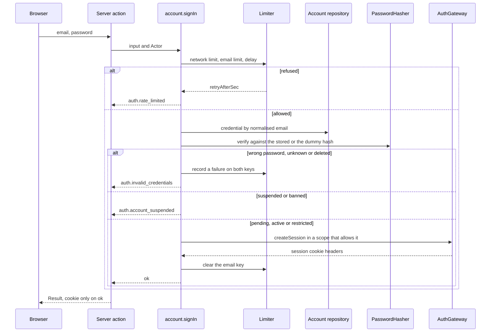
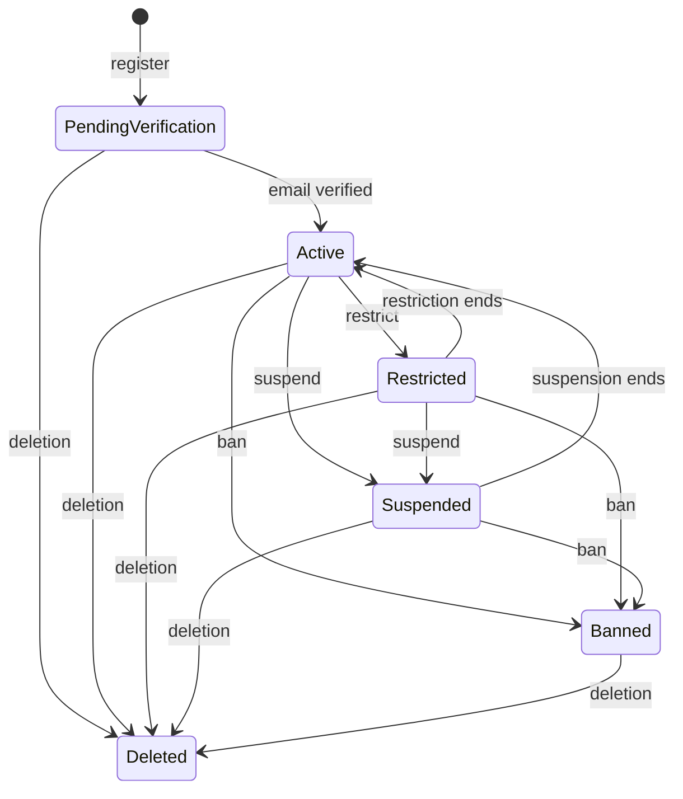
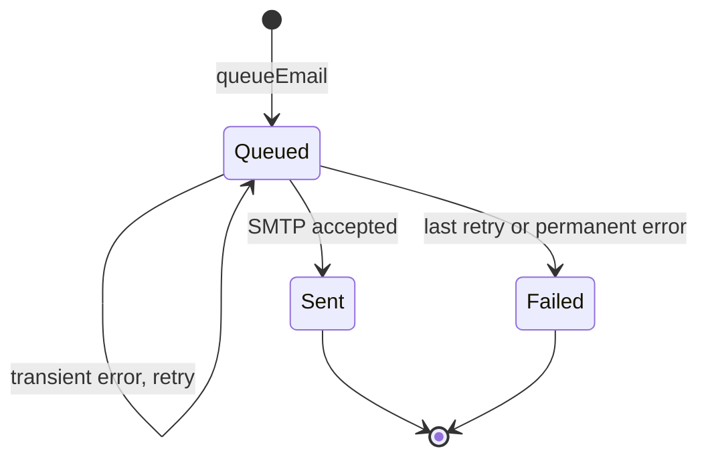
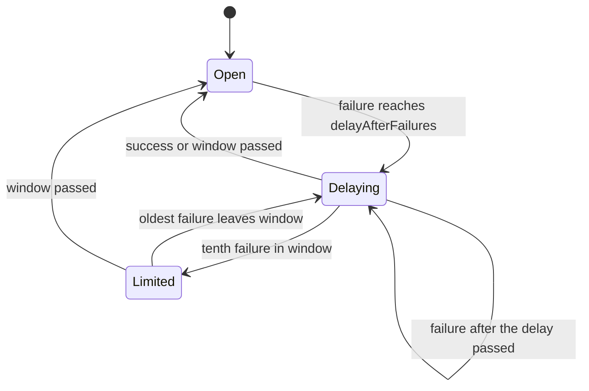
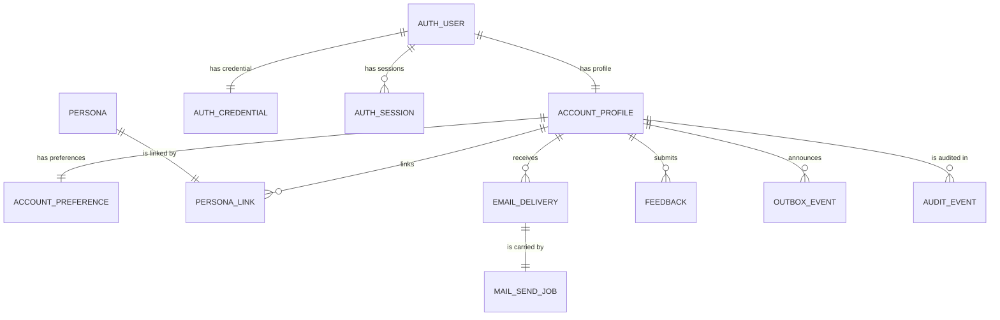

# Functional specification — U8 `t-101-better-auth-adapter`

Draft written ahead of the stage. The lead finalises it when the workflow reaches this Unit; then it moves to `<record>/construction/t-101-better-auth-adapter/functional-design/`.

Unit U8 (kind `library`, size XL, **high risk**: authentication, identity, sessions) delivers T-101 for US3.1 and US3.2. It is built right after U45 T-011, on `main` with U3 T-010 merged. Lead perspective: architect. Support perspectives written into this file: developer (library mechanics, transactions, timing, test approach: §§ 10–11) and security engineer (threat cases, session handling, enumeration resistance, rate limits: § 12), synthesised in § 13.

Inputs: listed in `functional-design-questions.md` (Context). This file is the source of truth for the workflows and state transitions. The data shape is in `entities.md`; the decision logic is in `rules.md`. Questions 1–7 and 9–11 (all A) were decided on the owner's standing instruction of 2026-10-27; Question 8 (now C) and Questions 12–14 (A) were decided by the agent under the owner's no-questions instruction of 2026-10-29. All await the owner's confirmation.

## Refreshed 2026-10-29

Re-checked against T-010 as built (`bolt/t-010-boundary-lint-and-ci`), the owner's answers in `docs/aidlc-migration/OWNER-REVIEW-QUEUE.md` and the T-102 to T-105 drafts. What changed:

- **Boundaries (FD-093).** Library calls go through a new `AuthGateway` port, implemented in `apps/web/src/server/better-auth/` (Q12). Every file sits where the matrix allows (§ 6.4). The worker takes `mail.send` from `@rogikotha/application/worker` and the copy from the message files (Q13, FD-098).
- **Gate and CI.** Nine-step `pnpm check` and the 80% floor in every package. New `web-int` and `worker-int` projects. CI gains Mailpit and the new variables. No secret is read at module load (BR7.2, BR9.6).
- **Owner's answers.** Mail-only worker key (FD-095); text-only feedback (FD-097); masked own email (FD-096), with `account.getOwnAccount` and `account.resendOwnVerification`. The FD row texts are in § 9.1.
- **Sibling findings.**
  - From T-102: session items carry `browser` and `os`; field errors use the ENT-004 keys.
  - From T-103 and T-104: the Actor carries no staff powers (T-103 F2) and no persona (T-104 F9). `defineCommand` gets the full `requires` order, `onRefused` and `recorded`. ISS-108 is fixed here.
  - Question 14: the password is checked through the port first.
  - From T-105: `ConfigProvider` is asynchronous; the sign-in ranges are narrowed (Q8 C).
- **Corrections.** Verification signs in through the library's auto sign-in, guarded by the session hook, and runs only from a server action.
- **New findings** F19–F32 (§ 9.2): every S1 or S2 among them is designed out. The adversarial candidates are updated (§ 12.2).

## 1. What changes, in one paragraph

Better Auth 1.7.x is wired behind the application boundary. The commands in `packages/application/src/modules/account/` own every flow: register, verify, resend (anonymous and own), sign-in, sign-out, sign out everywhere, reset request, reset, change password, session list, own-account view, preferences and feedback. They reach the library only through the `AuthGateway` port. The web tier implements that port in `apps/web/src/server/better-auth/`, where each call runs inside a library-call scope that the library's hooks and email callbacks read. The `/api/auth/*` route answers only an allowlist (Q1). Registration creates the library credential, then the profile, preferences, two personas, audit row, `account.registered` and the verification email in one application transaction. An email that already exists gets the same success shape and the same cost. Unconfirmed accounts sign in but cannot contribute (Q2). Sign-in first applies three refusals before any database read or password check: the network limit, the per-email limit and the FD-063 progressive delay. Then it checks the password once through `PasswordHasher` (a dummy hash for unknown addresses, Q14). Only an allowed account gets a session. A real account that reaches the severe threshold gets one security email and one `account.securityEvent` per window, written after the response (Q9). Sessions last 30 days from creation, absolutely, and store no IP (Q5). Every email is queued by the first version of C2's `notification.queueEmail` on the caller's transaction (Q3). The recipient is encrypted with the mail-only key `MAIL_RECIPIENT_KEY` (FD-095). The worker's new `mail.send` handler calls a use case exported through `@rogikotha/application/worker`. It decrypts with that key, the only one the worker holds, renders the email from the `packages/i18n` message files (FD-098), sends it through SMTP and clears the link. The relay no longer routes any account event to `mail.send`. `ConfigValues` gains the `signIn` block, and the web composition root gets a defaults-only, asynchronous `ConfigProvider`. Signed-in holders see their own address masked (FD-096). The application layer's foundations are created here because no earlier Unit built them: `defineCommand` with the `UnitOfWork` port, the ports, the `Crypto` adapter, the audit allowlist that closes ISS-108, and the account state table.

## 2. As is (baseline: `main` with T-010 merged, read 2026-10-29)

- **Application layer: empty.** `packages/application/src/index.ts` is `// Filled by T-101`; there is no `defineCommand`, no port interface and no module. `packages/application/package.json` exports only `.`; there is no `./worker` subpath yet. `packages/adapters/src/index.ts` and `packages/domain` are empty too. All three report 0 of 0 lines, which passes the coverage floor until this Unit gives them code. `test-support` already has fakes shaped like the 03 §3 ports (`FakeCrypto` with AES-256-GCM `iv | tag | ciphertext`, `FastHasher`, `RecordingMailer`, `AlwaysAllowRateLimiter`, `StaticConfigProvider` with a **synchronous** `current()`, `FakeClock`, `MemoryJobQueue`). T-010's `fakes/port-fakes.test.ts` pins that synchronous shape.
- **Boundaries (T-010, FD-093).** `eslint.boundaries.mjs` has a default-deny matrix; § 6.4 lists what it allows for each file this Unit creates. In short:
  - `application` has no external and no Node built-in edge;
  - only `server/container.ts` imports `adapters`;
  - `app/` cannot import `database`;
  - components import server actions only;
  - the worker reaches application code only through the future `@rogikotha/application/worker` subpath, never `better-auth`, `drizzle-orm`, `pg` or `modules/{account,identity}`, and has no `i18n` edge.
  
  `pnpm lint:boundaries` proves 10 violations and 5 controls.
- **Gate and CI (T-010).** `pnpm check` = `typecheck`, `lint`, `lint:boundaries`, `format:check`, `check:identity`, `test:coverage` (every project, the database one included; 80% lines per package), `i18n:check`, `contrast`, `build`. `.github/workflows/check.yml` runs on `main` and `bolt/**`. It has a `postgres:18` service, generates job-only `APP_ENCRYPTION_KEY` and `BETTER_AUTH_SECRET`, and has no Mailpit and no `MAIL_RECIPIENT_KEY`, `APP_URL` or `TERMS_VERSION`. Vitest: `database` runs in `groupOrder` 1, `test-support-seed` in 2; the `web` and `worker` projects exclude `**/*.int.test.ts`.
- **Auth schema.** `schema/auth.ts` has the four tables with the right columns for 1.7.3 (no `account.issuer`). But its comment block gives a `modelName`/`fields` mapping that makes the adapter throw (ISS-112, S2), and three library indexes are missing (ISS-113). `account_profiles`, `account_preferences`, `personas`, `persona_links`, `feedback` and `email_deliveries` exist; `email_deliveries` has no `dedupe_key`.
- **Repository.** `PgAccountRepository` and `PgNotificationRepository` are stubs that throw `NotImplemented`. `insertFeedback` names T-409, but T-101 builds `account.submitFeedback`. `NotImplemented` still embeds caller arguments in its message (ISS-111 item 1). T-010's `not-implemented.test.ts` lists every stub repository. `PgAuditWriter` (with the shallow `assertAllowlisted` of ISS-108) and `PgOutbox.append(tx, …)` / `countPending(db)` are real.
- **Queue.** `PgBossQueue.enqueue(name, payload, {key, executor})` runs on the caller's transaction when given an executor and then does not create the queue (the caller ensures it first, ISS-253). `mail.send` is declared `exclusive`, 5 retries with backoff; a send without a key counts as the empty key.
- **Worker.** One job, `outbox.relay`. Its `RELAY` map still routes `account.registered → mail.send` and `account.securityEvent → notification.deliver, mail.send`. `env.ts` loads the repo-root `.env` (which also holds the web's secrets) and validates `SMTP_HOST`, `SMTP_PORT`, `MAIL_FROM` with defaults; it reads no encryption key. `apps/worker/package.json` has no `@rogikotha/i18n`. The logger redacts keys matching `email|token|body|filename|password`. `rk_worker` cannot read `auth_users` (CR-006, `0007`).
- **Contracts.** `actor.ts` (anonymous | account), `errors.ts` (no `auth.password_equals_email`), `config-values.ts` (strict, no `signIn` block), `schemas/account.ts` (no password maximum, no display-name maximum, no sign-in input), `view-models/security.ts` (`SessionVM.label`, `TODO(T-102)`).
- **Web.** No `server/auth.ts`, no `server/container.ts`, no `/api/auth` route; `/api/health` (element `web`) reports every probe as `unknown`. T-010's hand-off: nothing in `apps/web` reads a `.env` at build time.
- **i18n.** `email.verify`, `email.reset`, `email.existing`, `email.security.passwordChanged` and the `errors.auth.*` keys that exist today are in both files. `email.security.severeSignInActivity`, `errors.auth.passwordEqualsEmail`, `errors.auth.emailInvalid`, `errors.auth.passwordTooLong` and `errors.auth.displayNameRequired` do not. The package exports `.`, `./format`, `./routing`, `./request`, not the message files; `next-intl` is a peer dependency.

## 3. Settled before this stage

FD-056, FD-057, FD-058, FD-059, FD-063, FD-071, FD-072, the C5 and C15 amendments, review R-14, FD-041 and FD-092 (worker grants), the CR-011 queue rules, FD-093 (import boundaries, T-010), and the owner's answers of 2026-10-28 and 2026-10-29 (R1, R2, T-102 Q4, T-104 Q15, T-105 R1 and R2). See `functional-design-questions.md` § "Settled before this stage". The four decision-log rows this Unit appends before its code are in § 9.1.

## 4. Workflows

Every command runs `parse → authorize → load → decide → persist`, with its audit and outbox rows in one `UnitOfWork` transaction (01-conventions §3, BR7.11). The handler receives the explicit command context `{input, actor, ports, tx}` (§ 10.1). "Gateway" means the `AuthGateway` port. Only commands call it, and each of its methods runs the library inside a library-call scope (§ 10.2).

### WF0 — Code Generation order (the Unit end to end)

1. **Baseline.** T-010 and T-011 merged on `main`; `pnpm infra:up`; `pnpm check` (nine steps) and `pnpm smoke` green on the Bolt branch; record the counts and the per-package coverage table; read the open rows of § 2 and `functional-design-questions.md` Context.
2. **Decision log first (BR10.4).** Append the four rows of § 9.1 (FD-095 to FD-098, renumbered in order if another Unit appended entries since). No source file changes before this commit.
3. **Dependency check (BR7.8).** Better Auth, nodemailer, `@node-rs/argon2`: current stable, advisories, Next 16.3.4 peers; append the entry.
4. **Spike, time-boxed 45 minutes (T-101 step 1).** Install, build, one `signUpEmail` from a script. Confirm on the pinned version the capabilities in § 16: server API calls without HTTP, `returnHeaders`, callbacks with `token`, before-hooks returning `false`, the hooks seeing an AsyncLocalStorage scope opened around the call, the auto sign-in after verification with a refused session, the IP tracking switch, adapter transactions. Record the results in the hand-off.
5. **Contracts first.** First the documents: 03 §2 gains `auth.password_equals_email` and FD-096's sentence, then `errors.ts`. Then the code:
   - `config-values.ts` gains `signIn` with the narrowed ranges (Q8 C);
   - `schemas/account.ts` gains the password and display-name maximums, `SignInInput`, `ResendOwnVerificationInput` and `GetOwnAccountInput`;
   - `actor.ts` gains `refusal?`;
   - `view-models/security.ts` gets `SessionVM {browser, os}`, `SecurityVM.emailVerified`, `SecurityVM.ownEmailMasked` and `OwnAccountVM`.
6. **Domain.** `domain/account/account-state.ts`, `domain/account/mask-email.ts`.
7. **Application.**
   - `ports/*.ts` (the asynchronous `ConfigProvider` included), `command.ts` (BR7.11) and `audit/*` (the allowlist builders that close ISS-108);
   - `authorization/capabilities.ts` (stub `[]`) and `modules/account/**` (commands, queries, `resolve-actor.ts`, `sign-in-delay.ts`, `recipient-directory.ts`, the dummy credential);
   - `modules/notification/internal/queue-email.ts`, `modules/notification/send-email-delivery.ts`;
   - `src/worker.ts` and the `./worker` export in `package.json`.
8. **Adapters.** `crypto`, `password-argon2` (bench script in `packages/adapters/scripts/`), `rate-limit-memory`, `mail-smtp`.
9. **Database.** Migration (three auth indexes, `email_deliveries.dedupe_key`), `unit-of-work.ts`, `PgAccountRepository`, the email-delivery methods of `PgNotificationRepository`, `audit-writer.ts` (recursive check), the `schema/auth.ts` comment, `not-implemented.ts` and its test, schema test.
10. **test-support.** Async `StaticConfigProvider`, `FakeCrypto.hmac`, a windowed limiter, `FakeAuthGateway`, the account and email-delivery repository fakes, a transport fake, an in-memory unit of work; `port-fakes.test.ts` and `repositories-superset.test.ts` (ISS-223) updated.
11. **Web.** `server/env.ts`, `src/instrumentation.ts`, `server/better-auth/{instance,gateway,library-scope,user-agent}.ts`, `server/container.ts`, `server/auth.ts` (`getActor`), `server/after-response.ts`, `server/client-address.ts`, `server/health.ts` and the health route's `db` probe, `server/actions/account.ts`, `app/api/auth/[...all]/route.ts`.
12. **Worker.** `env.ts` (`MAIL_RECIPIENT_KEY`, the scrub), `container.ts`, `handlers/mail-send.ts`, registry entry, relay map change, `package.json` (`@rogikotha/i18n`), `tsconfig` JSON imports.
13. **i18n.** The new keys in both files (Bengali flagged); `package.json` exports `./messages/*.json`, `next-intl` becomes an optional peer.
14. **Boundary rules (FD-098).** In `eslint.boundaries.mjs`, the `i18n-messages` element and the `worker → i18n-messages` and `i18n → i18n-messages` edges. The fixture and its manifest gain one violation (worker → the `@rogikotha/i18n` root) and one control (worker → messages). `01-conventions.md` §2 gains the row.
15. **Test projects and CI (BR9.6).** `vitest.workspace.ts` gets `web-int` and `worker-int`. The two app configs also exclude `**/*.int.smoke.test.ts`. `test:int` names the three projects. `check.yml` gets Mailpit, the third secret and the job env. `infra/compose/.env.example` gains the new variables.
16. **Tests (§ 11)**, then `pnpm check`, `pnpm smoke`, `pnpm test:int`, the CI run on the pushed Bolt head.
17. **Records.** Reference-document corrections (BR10.2), `ISSUES.md` (BR10.3), and the hand-off, which records the Argon2 median, the timing floors, the spike results and the coverage table before and after.

### WF1 — Register (`account.register`)

1. Network rate check, 5 per hour (BR1.2). Over → `auth.rate_limited`.
2. Parse and validate the whole input (BR1.1); field errors use T-102's ENT-004 keys. Normalise the email.
3. Username check against `account_profiles` (case-insensitive, deleted profiles included), whatever the email (BR1.3). Taken → `auth.username_taken`.
4. Look up the normalised email through the account repository.
5. **Existing email** (BR1.4): hash the submitted password once and discard it (cost parity, BR1.6); if a non-deleted profile exists, one transaction: `queueEmail(email.existing, {link: APP_URL/<locale>/sign-in})`, `account.securityEvent {kind: existingEmailRegister}`, audit `existing_email_register`. Result `ok({accountId: newId()})`, never persisted.
6. **New email** (BR1.5):
   - `AuthGateway.createCredentialUser({email, password})` creates the user and credential inside the gateway's register scope: the hash goes through the port, there is no session and no library email, and `user.create.before` allows it because the scope's purpose is `register`.
   - Then one transaction writes the profile, the preferences, the two personas and their links (`TODO(T-104)`), audit `registered`, outbox `account.registered {accountId}`, and the verification email (WF2 step 1 for the token, then `queueEmail(email.verify)`).
   - If the transaction fails: `AuthGateway.deleteUser`, log `auth.register_rolled_back`, return `internal`.
7. Wait until the register floor has passed (BR1.6). Return `ok({accountId})`.

### WF2 — Verification email and confirmation

1. **Token** (inside a command). `AuthGateway.issueVerificationToken(email)` asks the library for a verification token inside the `issueVerification` scope. The library calls `sendVerificationEmail({user, url, token})`; the callback stores `token` in the scope and returns (BR7.9). The gateway returns the token to the command, which builds `APP_URL/<locale>/verify-email?token=<token>` and queues `email.verify` on its own transaction (BR2.1, BR6.1).
2. **Confirm** (`account.verifyEmail {token}`). It runs from T-102's confirm-button server action (a POST), never during a page render (T-102 F1). `AuthGateway.verifyEmailToken(token)` runs inside the `verify` scope with the library's auto sign-in on. Expired → `auth.token_expired`; invalid or used → `auth.token_invalid` (BR2.3).
3. The `session.create.before` hook allows that session only for a pending, active or restricted profile (read through the account repository). For a suspended, banned or deleted profile no session is created.
4. Load the profile:
   - Pending → one transaction: status `active`, audit `email_verified` (retried up to 3 times; a final failure logs `auth.verify_record_failed`, account id only). The gateway's session headers go back to the action, which sets the cookie.
   - Active or restricted → no change, `ok`, cookie set.
   - Suspended, banned or deleted → no change, no session, `auth.token_invalid` (BR2.2).

### WF3 — Resend verification (`account.resendVerification {email}`, anonymous)

1. Email-key rate check, 3 per hour, for every address (BR2.4).
2. Look up the address. Pending profile → WF2 step 1. Anything else (unknown, active, deleted) → nothing.
3. Wait until the resend floor has passed; return `ok({})`.

### WF4 — Sign in (`account.signIn {email, password}`)



Text fallback: the browser posts to the server action, and the command asks the limiter first. A refusal returns `auth.rate_limited` with no database read and no password check. Otherwise the command reads the credential by the normalised email and verifies the password once through the port, against a dummy hash when the address is unknown or deleted. A failure is recorded on both keys and returns `auth.invalid_credentials`. A suspended or banned account with the right password gets `auth.account_suspended` and no session. Only a pending, active or restricted account reaches the gateway, which mints the session through the library's email sign-in. Only a success sets the cookie.

1. Normalise the email; compute the email key and the network key (BR3.1, BR4.9, BR3.12).
2. `await ConfigProvider.current()`; read `signIn` (BR3.4).
3. Refusals, in order, before any read (BR3.2): network 30 failures / 15 min; email 10 failures / 15 min; progressive delay (BR3.3). Each → `auth.rate_limited {retryAfterSec}`; nothing recorded.
4. Credential check (BR3.5, Q14): `AccountRepository.findCredentialByEmail(email)` gives `{accountId, passwordHash, status}` or nothing. `PasswordHasher.verify` runs exactly once, against the stored hash or against the dummy PHC hashed once at start-up.
5. Decide:
   - unknown email, wrong password, deleted account → record a failure on both keys, `auth.invalid_credentials` (BR3.5, BR3.7); if the email key's count now equals `severeFailures` and the address has a non-deleted account → schedule WF5 after the response (BR3.9);
   - suspended or banned with the right password → `auth.account_suspended`, no gateway call, no session row, no failure (BR3.6);
   - pending, active or restricted with the right password → `AuthGateway.createSession({email, password})` (scope `signIn`, `sessionAllowed`), clear the email key, return the cookie headers, `ok({})` (BR3.8).
6. No challenge field in any result (BR3.10); every refusal has the same shape (BR3.11).

Delay policy (illustrative; the pure function in `modules/account/sign-in-delay.ts`):

```ts
interface SignInSettings { delayAfterFailures: number; windowMinutes: number; firstDelaySeconds: number; maxDelaySeconds: number }

export function signInRefusal(failures: Date[], now: Date, s: SignInSettings): number | null {
  const recent = failures.filter((t) => now.getTime() - t.getTime() < s.windowMinutes * 60_000);
  const n = recent.length;
  if (n < s.delayAfterFailures) return null;
  const delay = Math.min(s.firstDelaySeconds * 2 ** (n - s.delayAfterFailures), s.maxDelaySeconds);
  const last = Math.max(...recent.map((t) => t.getTime()));
  const waitMs = last + delay * 1000 - now.getTime();
  return waitMs > 0 ? Math.max(1, Math.ceil(waitMs / 1000)) : null;
}
```

With the defaults, after failures 3, 4, 5, 6, 7, 8 and 9 the next early attempt is refused with 1, 2, 4, 8, 16, 30 and 30 seconds (the FD-063 row).

### WF5 — Severe-activity notice (after the response, Q9)

1. Runs through the `AfterResponse` port with the account id found in WF4 step 4.
2. No account for the address, or a deleted one → stop (nothing written).
3. An `email_deliveries` row with message key `email.security.severeSignInActivity` for this account newer than `windowMinutes` → stop (once per window).
4. One transaction: `queueEmail(security, email.security.severeSignInActivity, {link: APP_URL/<locale>/reset-password})`, outbox `account.securityEvent {accountId, kind: severeSignInActivity}`, audit `severe_sign_in_activity {failures}`.
5. Failure → log `auth.severe_notice_failed {accountId}`; nothing is retried (the next window can send again).

### WF6 — Sign out and sign out everywhere

- `account.signOut` (authenticated): `AuthGateway.revokeSession(current)`, audit `signed_out`, clear the cookie; the staff device cookie stays (BR4.5).
- `account.signOutEverywhere` (authenticated, no step-up, Q10): `AuthGateway.revokeSessions(account)`, audit `signed_out_everywhere {revoked}`, outbox `account.securityEvent {kind: signOutAll}`, clear the cookie (BR4.6).

### WF7 — Request a reset (`account.requestPasswordReset {email}`)

1. Email-key rate check, 3 per hour, every address alike (BR5.1).
2. Non-deleted profile for the address → `AuthGateway.issueResetToken(email)`: the library issues a token (1 h) inside the `issueReset` scope and calls `sendResetPassword({user, url, token})`; the callback stores the token; the command queues `email.reset` with `{link: APP_URL/<locale>/reset-password?token=<token>}`.
3. Wait until the reset floor has passed; return `ok({})`.

### WF8 — Reset (`account.resetPassword {token, newPassword}`)

1. Validate the new password (BR1.1 password rules, keys on `newPassword`; "equals email" against the token's account, checked after the token resolves).
2. `AuthGateway.resetPassword(token, newPassword)` consumes the token and rotates the password inside the `reset` scope, revoking sessions. Expired → `auth.token_expired`; invalid or used → `auth.token_invalid` (BR2.3).
3. One transaction (retried up to 3 times, Q4): revoke any remaining session, audit `password_reset`, outbox `account.securityEvent {kind: passwordChanged}`, `queueEmail(email.security.passwordChanged)`; a pending profile also becomes `active` with audit `email_verified {via: reset}` (BR5.4).
4. Return `ok({})`; the page sends the holder to `/sign-in` with `auth.reset.done`.

### WF9 — Change password (`account.changePassword {currentPassword, newPassword}`)

1. Account rate check, 5 failures per 15 minutes on `action:account:<id>` (BR5.3).
2. Verify the current password through the port (credential read through the account repository). Wrong → record a failure, `auth.invalid_credentials` on `currentPassword`.
3. Validate the new password (BR1.1).
4. `AuthGateway.changePassword` rotates it and revokes the other sessions; then one transaction: audit `password_changed`, outbox `passwordChanged`, `queueEmail(email.security.passwordChanged)`.

### WF10 — Session list (`account.listSessions`)

Authenticated. `AuthGateway.listSessions(account)`; drop expired ones and those past the 30-day cap; map each to `{id, current, browser, os, firstSeen, lastSeen}` with the user-agent helper (BR4.7). T-102 builds the visible label from `auth.security.deviceLabel`.

### WF11 — `getActor()` (every request)

1. `cache()` per request, never inside a `'use cache'` scope (BR4.4). `AuthGateway.getSession(headers)`.
2. No session → anonymous. Session older than 30 days from `created_at` → revoke it, anonymous (BR4.1).
3. Load the profile by `auth_user_id`. Map with the pure `resolveActor` (BR4.3): status → kind, `emailVerified`, `refusal`. There is no persona read (`personaId` unset until T-104). There are no staff powers (`staffRole` unset, `capabilities: []` for everyone until T-103's device gate). Set the locale and the correlation id.

### WF12 — `queueEmail(tx, input)` (web tier, C2 first version)

1. Precondition: the caller ensured the `mail.send` queue before opening `tx` (container start-up, and `defineCommand` before each transaction of a command flagged `sendsMail`).
2. `RecipientDirectory.contactFor(tx, accountId)`: read the address through the account repository, encrypt it with `ports.mailCrypto` (`MAIL_RECIPIENT_KEY`, FD-095), read `interface_locale` and the preferences. Null (deleted) → return `ok({suppressed: true})`, write nothing.
3. Check the params allowlist for the message key (BR6.2).
4. `dedupeKey` already present → return the existing delivery id, write nothing.
5. Insert the `EmailDelivery` (queued) and enqueue `mail.send {deliveryId}` with key `mail.send:<deliveryId>` on `tx` (BR6.1). `deduplicated` from the queue is impossible with a fresh key; `job_not_enqueued` → `err('internal')`, so the caller's transaction rolls back.

### WF13 — `mail.send` (worker, use case in `@rogikotha/application/worker`)

The worker handler parses the job and calls `sendEmailDelivery({deliveryId}, deps)`, which holds the logic (BR6.3). The dependencies come from the worker container: the email-delivery repository, the mail-key `Crypto`, `MailTransport`, the `EmailCatalog` imported from `@rogikotha/i18n/messages/{en,bn}.json` (FD-098), `Clock` and `Logger`.

1. Parse `{deliveryId}`; unknown payload shape → log `mail.payload_invalid`, finish (no retry).
2. Load the row. Missing or not `queued` → finish without sending (idempotent).
3. Decrypt `to_email_enc` with the mail key. Failure → `failed`, `decrypt_failed`, params cleared, no retry.
4. Render `<message_key>.subject` and `.body` from the catalogue in `row.locale`, replacing `{link}`; missing key → `failed`, `template_missing`; params outside the allowlist → `failed`, `params_invalid`.
5. Send through `MailTransport` (nodemailer, `SMTP_HOST:SMTP_PORT`, 30 s timeout, `MAIL_FROM`).
6. Success → `sent`, `sent_at`, `attempts + 1`, params cleared (BR6.8). Error → `attempts + 1`, `last_error_code`; if `attempts < 6` rethrow for pg-boss's retry, else `failed` with params cleared.
7. Log `mail.sent` or `mail.failed` with `deliveryId`, `messageKey`, `status`, `errorCode` only.

### WF14 — Preferences and feedback

- `account.updatePreferences` (authenticated, pending allowed): partial update; audit `preferences_updated {fields}` (BR11.1).
- `account.submitFeedback {body}` (authenticated): 5 per day per account; insert `{body, locale}`; audit `feedback_submitted` (no body) (BR11.2). Text only in release 1 (FD-097).

### WF15 — Resend to one's own address (`account.resendOwnVerification {}`, authenticated)

1. Not `pending_verification` → `ok({})`, nothing queued.
2. `resend:account:<id>` 3 per hour → over: `auth.rate_limited {retryAfterSec}`.
3. `AccountRepository.findOwnEmail(accountId)` → WF2 step 1 for that address. No address enters or leaves the command (BR2.7). T-102's pending banner calls it, because the masked address it shows cannot be posted back (FD-096).

### WF16 — Own account view (`account.getOwnAccount`, query)

Authenticated. Read the actor's own profile (`username`, `display_name`, status) and `findOwnEmail(accountId)`. Return `OwnAccountVM {username, displayName, emailVerified, emailMasked}`, where `emailMasked = maskEmail(address)` (domain function: first grapheme of the local part, `****`, `@`, the domain). The full address is dropped inside the query. The query is never cached; no log line carries any of the fields (BR4.10). T-102 maps it into `SecurityVM`, the pending banner and the account menu title.

## 5. State transitions

### 5.1 Account status (`domain/account/account-state.ts`)

The full table follows 02 §17; T-101 performs the first two rows and reads the others.

| From | Event | To | Performed by | Rule |
|---|---|---|---|---|
| (none) | register, new email | pending_verification | U8 | BR1.5 |
| pending_verification | email verified (link, or a completed reset) | active | U8 | BR2.2, BR5.4 |
| active | enforcement restrict | restricted | U33 | — |
| restricted | enforcement ends | active | U33 | — |
| active, restricted | enforcement suspend | suspended | U33 | — |
| suspended | enforcement ends | active | U33 | — |
| any but deleted | enforcement ban | banned | U33 | — |
| any | deletion plan completes | deleted | U39 | — |



Text fallback: registration creates a pending account; confirming the email (by link or by a completed reset) makes it active. Moderation moves active accounts to restricted, suspended or banned and back when an enforcement ends; a completed deletion plan makes any account deleted. What each status allows:
- pending signs in and edits settings, but never contributes;
- active does everything;
- restricted signs in, and commands check `notRestricted`;
- suspended and banned get no session;
- deleted is treated as unknown.

### 5.2 Email delivery (`email_deliveries.status`)

| From | Event | To | Rule |
|---|---|---|---|
| (none) | queueEmail | queued | BR6.1 |
| queued | SMTP accepted | sent (params cleared) | BR6.3, BR6.8 |
| queued | transient error, attempts < 6 | queued (attempts + 1, retried) | BR6.3 |
| queued | transient error, attempts = 6 | failed (params cleared) | BR6.3, BR6.8 |
| queued | decrypt, template or params error | failed (params cleared) | BR6.3 |

`suppressed` is never written by U8 (U34 adds the send-time preference check).



Text fallback: a delivery starts queued, stays queued while retries remain, and ends sent or failed; both final states clear the link.

### 5.3 Sign-in email key (per normalised address, in memory)

| State | Condition (failures in window = n) | Next attempt |
|---|---|---|
| open | n < delayAfterFailures | checked normally |
| delaying | delayAfterFailures ≤ n < 10, delay not passed | refused with `retryAfterSec` |
| delaying, delay passed | same, delay passed | checked normally |
| limited | n ≥ 10 | refused until the oldest counted failure leaves the window |
| (any) | a successful sign-in | back to open |
| (any) | every failure older than windowMinutes | back to open |



Text fallback: an address is open until its third failure in the window; then each further attempt waits for the growing delay; at ten failures it is limited until old failures leave the window; a success or an empty window opens it again. The severe notice fires on the transition into the `severeFailures`-th failure (10 by default, never more than 10, Q8 C) for real accounts only.

### 5.4 Session

| From | Event | To | Rule |
|---|---|---|---|
| (none) | sign-in decided by the command, or verify for an allowed status | live | BR3.8, BR2.2, BR7.9 |
| live | sign-out, sign out everywhere, reset, change password (other sessions) | revoked | BR4.5, BR4.6, BR5.2, BR5.3 |
| live | created_at + 30 days reached | revoked on next request | BR4.1 |
| live | profile becomes suspended, banned or deleted | refused on next request (anonymous Actor) | BR4.8 |

### 5.5 Reset token

`issued` (1 h) → `used` (row deleted, password rotated) or `expired`. A used or expired token is refused and changes nothing (BR2.3).

## 6. Interfaces

### 6.1 Commands and queries (all in `modules/account`)

| Name | Input | Requires | Limit (RateLimiter port) | Audit (`account:<id>`) | Outbox | Expected errors |
|---|---|---|---|---|---|---|
| `account.register` | `RegisterInput` | anonymous | 5 / h / network | `registered` or `existing_email_register` | `account.registered` or `securityEvent existingEmailRegister` | `auth.password_too_short`, `auth.password_equals_email`, `auth.username_invalid`, `auth.username_taken`, `auth.age_required`, `auth.terms_required`, `auth.rate_limited`, `validation` |
| `account.verifyEmail` | `VerifyEmailInput` (server action only, POST) | anonymous or authenticated | — | `email_verified` | — | `auth.token_invalid`, `auth.token_expired` |
| `account.resendVerification` | `ResendVerificationInput` | anonymous | 3 / h / email | — | — | `auth.rate_limited` |
| `account.resendOwnVerification` | `ResendOwnVerificationInput` (`{}`, new) | authenticated | 3 / h / account | — | — | `auth.rate_limited` |
| `account.signIn` | `SignInInput {email, password}` (new, `.strict()`) | anonymous | 30 failures / 15 min / network, 10 / 15 min / email, delay | `severe_sign_in_activity` (WF5 only) | `securityEvent severeSignInActivity` (WF5 only) | `auth.invalid_credentials`, `auth.account_suspended`, `auth.rate_limited` |
| `account.signOut` | `SignOutInput` | authenticated | — | `signed_out` | — | — |
| `account.signOutEverywhere` | `SignOutEverywhereInput` | authenticated | — | `signed_out_everywhere` | `securityEvent signOutAll` | — |
| `account.requestPasswordReset` | `RequestPasswordResetInput` | anonymous | 3 / h / email | — | — | `auth.rate_limited` |
| `account.resetPassword` | `ResetPasswordInput` | anonymous | — | `password_reset` (+ `email_verified`) | `securityEvent passwordChanged` | `auth.token_invalid`, `auth.token_expired`, `auth.password_too_short`, `auth.password_equals_email`, `validation` |
| `account.changePassword` | `ChangePasswordInput` | authenticated | 5 failures / 15 min / account | `password_changed` | `securityEvent passwordChanged` | `auth.invalid_credentials`, `auth.rate_limited`, password codes |
| `account.listSessions` (query) | `ListSessionsInput` | authenticated | — | — | — | — |
| `account.getOwnAccount` (query, new) | `GetOwnAccountInput` (`{}`) | authenticated | — | — | — | — |
| `account.updatePreferences` | `UpdatePreferencesInput` | authenticated | — | `preferences_updated` | — | — |
| `account.submitFeedback` | `SubmitFeedbackInput` (body max 2000) | authenticated | 5 / day / account | `feedback_submitted` | — | `rate_limited` |

`validation`, `forbidden` and `internal` apply to every command (C-rules). `account.stepUp` and the `staff.*` commands are U10's.

### 6.2 Ports created or used

| Port | Methods (T-101's shape) | Real adapter | Test fake |
|---|---|---|---|
| `UnitOfWork` | `run(fn: (tx: Tx) => Promise<Result>) → Result`: commits on `ok` or on an `err` marked `recorded`, rolls back otherwise | `database/unit-of-work.ts` | in-memory, records commit or rollback |
| `AuthGateway` | `createCredentialUser({email, password}) → {authUserId}`, `deleteUser`, `issueVerificationToken(email) → token`, `verifyEmailToken(token) → {authUserId, cookieHeaders?}`, `issueResetToken(email) → token \| null`, `resetPassword(token, pw) → {authUserId}`, `changePassword(headers, current, next)`, `createSession({email, password}) → {cookieHeaders}`, `getSession(headers) → SessionInfo \| null`, `listSessions(authUserId)`, `revokeSession(id)`, `revokeSessions(authUserId)`; errors as `Result` codes | `apps/web/src/server/better-auth/gateway.ts` | `FakeAuthGateway` (test-support) |
| `PasswordHasher` | `hash(pw)`, `verify(pw, phc)` (NFC applied by the caller) | `adapters/password-argon2` | `FastHasher` |
| `RateLimiter` | `hit(key, limit, windowSec) → {allowed, retryAfter?}`; `failures(key, windowSec) → Date[]`; `recordFailure(key)`; `clear(key)` | `adapters/rate-limit-memory` (Clock-driven) | a windowed fake, `AlwaysAllowRateLimiter` kept |
| `ConfigProvider` | `current(): Promise<ConfigValues>` (T-105 Q2 A) | defaults-only provider in `container.ts` (T-105 replaces) | `StaticConfigProvider` (now async) |
| `Crypto` | `encrypt(bytes)`, `decrypt(bytes)`, `hash(bytes)`, `randomToken()`, `hmac(purpose, bytes)` (`Uint8Array` in and out; per-purpose MAC key derived by HKDF from `BETTER_AUTH_SECRET`); two instances in the web tier: `crypto` (`APP_ENCRYPTION_KEY`), `mailCrypto` (`MAIL_RECIPIENT_KEY`); one in the worker: `mailCrypto` | `adapters/crypto` | `FakeCrypto` (gains `hmac`) |
| `Clock`, `IdGenerator` | `now()`; `newId()`, `newPublicId()` | system clock, `contracts/ids` | `FakeClock`, deterministic ids |
| `JobQueue` | `ensure(name)`, `enqueue(tx, name, payload, {key}) → Result<'enqueued' \| 'deduplicated'>` | `database/queue` | `MemoryJobQueue` |
| `Outbox`, `AuditWriter` | `append(tx, name, payload)`; `write(tx, event)` (details from the `audit/` builders) | `database` | list fakes |
| `MailTransport` | `send({to, subject, text}) → Result<{messageId}>` | `adapters/mail-smtp` (worker only) | a recording transport |
| `AfterResponse` | `run(task)` | `apps/web/src/server/after-response.ts` (Next `after()`) | runs at once and records |
| `AccountRepository` | `findProfileByAuthUserId`, `findByEmail`, `findCredentialByEmail → {accountId, authUserId, passwordHash, status} \| null`, `findOwnEmail(accountId)`, `usernameTaken`, `createProfile`, `insertDefaultPersonas` (`TODO(T-104)`), `updateStatus`, `savePreferences`, `insertFeedback`; no method reads `personas` or `persona_links` | `database/repositories/account.ts` | `test-support` fake |
| `EmailDeliveryRepository` | `insert(tx, row)`, `findById`, `findByDedupeKey(tx, key)`, `findRecent(accountId, messageKey, since)`, `recordAttempt`, `markSent(id, at)`, `markFailed(id, code)` (both final methods clear `params`) | the email-delivery methods of `database/repositories/notification.ts` | `test-support` fake |
| `RecipientDirectory` (C2) | `contactFor(tx, accountId)` | `modules/account` over the repository and `mailCrypto` | — |
| `Logger` | allowlisted fields only | web and worker loggers | recording fake |

`Tx` is an opaque type in `application`; `database` casts it to its Drizzle transaction.

### 6.3 Server actions (`apps/web/src/server/actions/account.ts`)

One exported async function per command and query, each `parse → getActor → command → Result`, with no rendering (T-102 wraps them as form actions). Sign-in, verify and reset set or clear the session cookie from the `Set-Cookie` values the gateway returns, through `cookies()` from `next/headers`. Components import these actions and nothing else under `server/` (FD-093 (1)).

### 6.4 Placement under the T-010 boundaries (BR7.12)

| Files | Element | May import | Note |
|---|---|---|---|
| `packages/domain/src/account/{account-state,mask-email}.ts` | domain | nothing | pure |
| `packages/application/src/{command.ts, ports/**, audit/**, authorization/capabilities.ts, modules/account/**, modules/notification/**}` | application | domain, contracts | no external, no Node built-in: no `better-auth`, no `node:async_hooks`, no `node:crypto` |
| `packages/application/src/worker.ts` (`@rogikotha/application/worker`) | application | — | the worker's only value entry (FD-093 (2)); exports `sendEmailDelivery` and its types only |
| `packages/adapters/src/{crypto,password-argon2,rate-limit-memory,mail-smtp}/**` | adapters | application ports, contracts, `node:crypto`, `@node-rs/argon2`, `nodemailer` | built only by the two containers |
| `packages/adapters/scripts/bench-argon2.ts` | outside every element | — | outside `src`: not linted as source, not measured |
| `packages/database/src/{unit-of-work.ts, audit-writer.ts, repositories/{account,notification}.ts, migrations/**}` | database | application ports, contracts, drizzle, pg | |
| `apps/web/src/server/better-auth/{instance,gateway,library-scope,user-agent}.ts` | web-server | application, contracts, database, `better-auth`, `node:async_hooks` | gets the hasher from the container; never imports `adapters` |
| `apps/web/src/server/container.ts` | web-server (container) | the above plus adapters | the only file that builds adapters; builds lazily, on first use |
| `apps/web/src/server/{auth,env,health,after-response,client-address}.ts` | web-server | application, contracts, database, i18n | `getActor`; no import cycle: `auth.ts` reads the container, the container imports the gateway factory |
| `apps/web/src/server/actions/account.ts` | web-actions | application, contracts, i18n, web-server, web-shared | |
| `apps/web/src/app/api/auth/[...all]/route.ts`, `app/api/health/route.ts`, `src/instrumentation.ts` | web | web-server, contracts, … (no database, no adapters) | the auth route takes the handler from the container per request |
| `apps/worker/src/{env,container,registry}.ts`, `handlers/mail-send.ts` | worker | `@rogikotha/application/worker` (values), `@rogikotha/application` (types), contracts, database, adapters, `@rogikotha/i18n/messages/*.json` (FD-098) | no `better-auth`, `drizzle-orm`, `pg`, `packages/i18n/src` |

## 7. Library configuration (target values)

| Option | Value | Rule |
|---|---|---|
| construction | inside `createAuthGateway(deps)` in `server/better-auth/instance.ts`, called by the container on first use, never at module load | BR7.2 |
| database | Drizzle adapter, schema aliased under the model names, no `fields` block | BR7.3 |
| `emailAndPassword` | enabled, `requireEmailVerification: false`, `autoSignIn: false`, `minPasswordLength: 10`, `maxPasswordLength: 256`, `resetPasswordTokenExpiresIn: 3600`, `revokeSessionsOnPasswordReset: true`, `password.hash/verify` → the port, `sendResetPassword` → store the token in the scope | BR1.8, BR2.6, BR5.2, Q2 |
| `emailVerification` | `expiresIn: 86400`, `sendOnSignUp: false`, `sendOnSignIn: false`, `autoSignInAfterVerification: true` (guarded by the session hook), `sendVerificationEmail` → store the token in the scope | BR2.1, BR2.2, BR2.6 |
| `session` | `expiresIn: 30 days`, `updateAge: 24 h`, cookie cache off | BR4.1 |
| `advanced` | cookies HttpOnly, SameSite Lax, Secure iff https; IP tracking off | BR4.2, BR4.9 |
| `trustedOrigins` | `[APP_URL]` | BR4.2 |
| `rateLimit` | enabled in every mode, memory, rules no stricter than the port | BR7.5 |
| `disabledPaths` | every path the commands own (BR7.1) | BR7.1 |
| `databaseHooks` | `user.create.before`: only in the `register` scope; `session.create.before`: only with `sessionAllowed` or in the `verify` scope, never for suspended, banned or deleted | BR1.7, BR3.6, BR7.9 |
| `plugins` | none | BR7.7 |
| `secret` | `BETTER_AUTH_SECRET`, ≥ 32 characters, checked at server start and when the container is built | BR7.2 |

## 8. Email catalogue and new keys

| Message key | Category | Trigger | `{link}` target | New copy |
|---|---|---|---|---|
| `email.verify` | verification | register (new), resend, resend own | `/<locale>/verify-email?token=` (24 h) | no |
| `email.existing` | security | register (existing) | `/<locale>/sign-in` | no |
| `email.reset` | reset | reset request | `/<locale>/reset-password?token=` (1 h) | no |
| `email.security.passwordChanged` | security | reset, change password | `/<locale>/reset-password` | no |
| `email.security.severeSignInActivity` | security | WF5 | `/<locale>/reset-password` | **yes** |

Proposed copy for the new keys (Bengali flagged for the owner's review, like FD-042; the field-error copy is T-102's draft text):

| Key | en | bn |
|---|---|---|
| `email.security.severeSignInActivity.subject` | Many failed sign-in attempts on your RogiKotha account | আপনার রোগীকথা অ্যাকাউন্টে অনেকবার ব্যর্থ সাইন-ইন চেষ্টা |
| `email.security.severeSignInActivity.body` | We noticed many failed attempts to sign in to your account. If this was not you, you can reset your password here: {link}. No action is needed if it was you. | আপনার অ্যাকাউন্টে সাইন ইন করার অনেকগুলো ব্যর্থ চেষ্টা দেখা গেছে। আপনি না হলে এখানে পাসওয়ার্ড রিসেট করতে পারেন: {link}। আপনি হলে কিছু করার দরকার নেই। |
| `errors.auth.passwordEqualsEmail` | Password: it can't be the same as your email. | পাসওয়ার্ড: এটি আপনার ইমেইলের মতো হতে পারবে না। |
| `errors.auth.emailInvalid` | Email: enter an address like name@example.com. | ইমেইল: name@example.com-এর মতো একটি ঠিকানা দিন। |
| `errors.auth.passwordTooLong` | Password: use 256 characters or fewer. | পাসওয়ার্ড: ২৫৬ অক্ষর বা তার কম দিন। |
| `errors.auth.displayNameRequired` | Display name: enter the name you want to show, up to 60 characters. | প্রদর্শিত নাম: যে নাম দেখাতে চান তা দিন, সর্বোচ্চ ৬০ অক্ষর। |

The in-app notice key `notif.security.severeSignInActivity` is U34's (C5). `auth.security.deviceLabel` and `auth.security.deviceUnknown` are T-102's.

## 9. Decisions to record and findings

### 9.1 Proposed decision-log rows (appended verbatim before any code, BR10.4)

FD-093 is the last entry on the T-010 branch, and no other draft has claimed a later number. If another Unit appends entries first, renumber these four in order and keep their text.

```
| FD-095 | **Mail-only recipient key (U8 T-101 draft R1)**: `email_deliveries.to_email_enc` is encrypted with its own key, `MAIL_RECIPIENT_KEY` (32 random bytes, base64), and that key encrypts nothing else. The web tier holds `APP_ENCRYPTION_KEY` and `MAIL_RECIPIENT_KEY` and encrypts recipients only through the mail-key `Crypto` instance built in `apps/web/src/server/container.ts`; the two keys must differ. The worker holds `MAIL_RECIPIENT_KEY` only: it never reads `APP_ENCRYPTION_KEY` or `BETTER_AUTH_SECRET` and deletes both from its process environment right after loading `.env`. Both processes refuse to start when `MAIL_RECIPIENT_KEY` is missing or does not decode to 32 bytes, naming the variable and never its value. The worker therefore cannot decrypt `reviews.exact_date_enc` (ISS-240) or `evidence_items.original_filename_enc` (ISS-139), although `rk_worker` can read both columns. Changing the key makes queued deliveries fail `decrypt_failed` (accepted for the demo; rotation in production is T-502's). Amends FD-071 and T-101's FD-071 amendment and acceptance row ("decrypted with `APP_ENCRYPTION_KEY`"), the encryption sentence of `02-data-model.md` and `01-conventions.md` §11; `infra/compose/.env.example`, the CI job secrets and T-504's preflight gain the variable. | Least privilege: the worker needs recipients only. The owner chose a separate, mail-only key over sharing the app key (2026-10-28, `docs/aidlc-migration/OWNER-REVIEW-QUEUE.md`). Text from the T-101 Functional Design (draft refreshed 2026-10-29); appended by U8 T-101 before its code |
| FD-096 | **The holder's own email, masked (U9 T-102 draft Q4)**: the rule of `03-routes-and-contracts.md` §2 that view models never contain emails gains one exception. A signed-in account sees its own address only masked: the first character of the local part, then `****`, then `@` and the domain (`s****@example.test`); the length of the local part is never shown. The masked address appears only in `SecurityVM` (`/me/security`) and in the pending-confirmation banner (`/me`, `/write`), for that account, on `noindex` pages rendered per request and never cached. The mask is made in the application layer (`account.getOwnAccount`, U8 T-101) from the address the account repository reads in the web tier; the full address never enters a result, a view model, a log line, an audit row, a job or an outbox payload, and no public, staff or worker projection carries even the masked form. A signed-in, unconfirmed holder resends the confirmation with `account.resendOwnVerification`, which takes no address. | Lets people recognise the address their account uses, with less exposure than the full address. Owner, 2026-10-28 (`docs/aidlc-migration/OWNER-REVIEW-QUEUE.md`, T-102 draft Q4 = B). Appended by U8 T-101, whose query and command carry it, before its code |
| FD-097 | **Feedback is text only in release 1 (U8 T-101 draft R2)**: FR90 and AC10.3.6 are narrowed for release 1 to a free-text body of 1–2000 characters stored with the writer's locale, at most 5 per account per day (`account.submitFeedback`, U8 T-101; the panel, U38 T-409). The admin-configured category list, the optional screenshot with its sensitive-data warning and the contact-permission choice move to release 2; release 1 adds no column, runtime setting or upload path for them, and `feedback` keeps `body` and `locale`. | No Unit built the three fields, and a screenshot needs a new private upload path. Owner, 2026-10-28 (`docs/aidlc-migration/OWNER-REVIEW-QUEUE.md`). Appended by U8 T-101 before its code |
| FD-098 | **The worker reads the email message files (U8 T-101 draft Q13)**, amending FD-093 and `01-conventions.md` §2: a data-only element `i18n-messages` covers `packages/i18n/messages/*.json`, exported by `@rogikotha/i18n` as `./messages/<locale>.json`; `worker` and `i18n` may import it, and it imports nothing. The worker imports the two files with `with { type: 'json' }` and hands their `email.*` entries to the `mail.send` use case in `@rogikotha/application/worker`; it still imports nothing from `packages/i18n/src`, and `next-intl` becomes an optional peer dependency of `@rogikotha/i18n`, so the worker neither installs nor loads it. `pnpm lint:boundaries` gains one allowed control (worker → message file) and one violation (worker → `@rogikotha/i18n` root). | The worker renders every email (FD-071), and all copy lives in `packages/i18n` (01-conventions §6); reading the files through `node:fs` would hide that dependency from the rules that exist to show it. Decided by the agent under the owner's no-questions instruction of 2026-10-29; awaiting the owner's confirmation |
```

Not this Unit's to append: the FD entries for T-104 Q15 ("Former member", T-104), T-105 R1 and R2 (T-105), T-202 Q1, T-203 Q1 and T-207 Q1.

### 9.2 Findings (proposed ISS rows, each `Found in U8 T-101`)

| Id | Sev | Finding | Owner (suggested) / status |
|---|---|---|---|
| F1 | S4 | Was S2: the worker's `APP_ENCRYPTION_KEY` would also decrypt `reviews.exact_date_enc` and `evidence_items.original_filename_enc`. Resolved by the owner's R1 answer and FD-095; recorded for ISS-139 and ISS-240 | U8 T-101 (closed by FD-095) |
| F2 | S4 | Was S2: AC10.3.6 / FR90 feedback fields had no builder. Moved to release 2 by the owner's R2 answer and FD-097 | U38 T-409 (release 2 note) |
| F3 | — | Closed here: `severeFailures` up to 100 could never fire under the fixed limit of 10; the ranges are narrowed (Q8 C, T-105 Q1 A) | U8 T-101 (closed) |
| F4 | S3 | `errors.auth.rateLimited` says "{minutes} minutes"; the progressive delay is 1–30 seconds | U9 T-102 (its Q5) |
| F5 | — | Resolved: the owner chose the masked address (T-102 Q4 B); FD-096; this Unit builds `account.getOwnAccount` | U8 T-101, U9 T-102 |
| F6 | S3 | A reset or verification link sits in `email_deliveries.params`, readable by `rk_worker`, from queueing until the delivery is final; BR6.8 clears it then | U34 T-405 keeps BR6.8 |
| F7 | S4 | T-101's owned paths omit files this design must change (§ 15) | U8 T-101 |
| F8 | S4 | Task step 4's `requireEmailVerification: true` contradicts FR4 and AC3.1.4 (Q2) | U8 T-101 |
| F9 | S4 | C14's "the progressive delay answers 429" no longer applies: the library sign-in endpoint is closed and the delay is an `AppError` (Q1) | Contract Design note |
| F10 | S4 | C5's `actor_shape` line differs from `actor.ts` (Q6) | Contract Design note |
| F11 | S4 | 02 §1 calls sessions "rolling"; AC3.2.4 needs an absolute 30 days | U8 T-101 (02 §1 corrected) |
| F12 | S4 | `01-conventions.md` §11's environment lists name no mail key; FD-095 needs `MAIL_RECIPIENT_KEY` for web and worker and keeps `APP_ENCRYPTION_KEY` web-only | U8 T-101 (§11 corrected) |
| F13 | S4 | Spec §3.6 asks for a password before Sign out everywhere; T-101 adds no step-up (Q10) | U9 T-102, U10 T-103 |
| F14 | S4 | `ASSUMPTION(T-101)`: counters and limits are per process and lost on restart | U41 T-502 |
| F15 | S4 | `ASSUMPTION(T-101)`: the client address comes from `x-forwarded-for` outside production; the production proxy trust rule is not set | U41 T-502 |
| F16 | S4 | `mail.send` is at-least-once: a crash after SMTP accepted and before the status update sends the email again | U34 T-405 (informational) |
| F17 | S4 | Dependency re-check due: Better Auth entry 49 days old, `@node-rs/argon2` 46 days, nodemailer none | U8 T-101 (Code Generation) |
| F18 | S4 | `ASSUMPTION(T-101)`: the register, resend and reset timing floors are measured constants | U8 T-101 |
| F19 | S1 → designed out | Under FD-093, `application` may import no external package and no Node built-in; the first draft's AsyncLocalStorage `CommandContext` in `defineCommand` and its direct `auth.api.*` calls from commands would turn `pnpm lint` red | U8 T-101 (Q12 A) |
| F20 | S1 → designed out | The first draft's `server/auth.ts` would import the Argon2 adapter (only `server/container.ts` may import `adapters`), and its health route would import `database` from `app/` (element `web` may not) | U8 T-101 (§ 6.4) |
| F21 | S1 → designed out | The worker has no `i18n` edge: the first draft's handler "reads i18n messages" either fails lint or reads files around the rules | U8 T-101 (Q13 A, FD-098) |
| F22 | S2 → designed out | The `web` and `worker` Vitest projects exclude `*.int.test.ts`, and CI has no Mailpit and no `MAIL_RECIPIENT_KEY`: the first draft's integration tests (Mailpit cycle, delivery as `rk_worker`, timing) would never run while the gate stays green | U8 T-101 (BR9.6) |
| F23 | S2 → designed out | The first draft's capability stub gave `super_admin` every capability from the role alone: between this Unit's merge and T-103's, a super_admin password on the patient sign-in, with no approved device, would carry full staff powers (T-103 F2) | U8 T-101 (BR4.3) |
| F24 | S2 → designed out | With the masked address of FD-096, T-102's pending banner could not post the holder's address back; `account.resendVerification` would get the mask, answer the neutral `ok` and send nothing | U8 T-101 (BR2.7), U9 T-102 |
| F25 | S2 → designed out | The first draft set `autoSignInAfterVerification: false` and let the command sign in, but no public library call creates a session without the password: verification would never sign the holder in | U8 T-101 (BR2.2) |
| F26 | S2 → designed out | The first draft's `getActor` loaded "the named persona" through the account repository, a second reader of `persona_links` (AD-3, T-104 F9) | U8 T-101 (BR4.3), U11 T-104 |
| F27 | S1 → designed out | A secret read at module load (for example a top-level `toNextJsHandler(auth)` with start-up checks) would make `next build` need a `.env`; T-010's gate and CI rely on it not doing so | U8 T-101 (BR7.2) |
| F28 | S3 | C1's `signIn` range line (1–20, 2–100) differs from the schema (1–9, 2–10) after Q8 C | Contract Design note (next revision) |
| F29 | S4 | T-504's preflight generates `APP_ENCRYPTION_KEY` and `BETTER_AUTH_SECRET` only; it must also generate `MAIL_RECIPIENT_KEY` (FD-095) | U42 T-504 |
| F30 | S4 | `ASSUMPTION(T-101)`: the worker reads the shared root `.env` and deletes the web's secrets from its environment after loading; separate environment files per process in production are T-502's | U41 T-502 |
| F31 | S4 | `StaticConfigProvider` and T-010's `port-fakes.test.ts` pin a synchronous `current()`; changed with the port (T-105 F5) | U8 T-101 |
| F32 | S4 | `PgAccountRepository.insertFeedback` names T-409, and T-010's `not-implemented.test.ts` lists the account and notification repositories as stubs; this Unit implements the methods it needs and the test's list shrinks | U8 T-101 |

ISS-108 (S2, audit details are a shallow denylist) is fixed and closed in this Unit (BR8.2), so U11 T-104's Question 12 finds it done.

## 10. Developer view — mechanics

### 10.1 `defineCommand`, the unit of work and the context

- `defineCommand({name, input, requires, sendsMail?, onRefused?, handle})` does these steps in order:
  - parses with the contracts schema; a failure gives `validation` with ENT-004 keys;
  - authorizes in the order `authenticated → verifiedEmail → notRestricted → staffRole → capability → stepUp → owner` (T-103 BR7.4);
  - ensures `mail.send` (memoised) when `sendsMail` is set;
  - runs `handle({input, actor, ports, tx})` inside `UnitOfWork.run`.
- A refusal after `authenticated` runs `onRefused({actor, input, refusal})` in its own committed transaction when the command declares it. The command still returns the refusal (T-104 F12). A handler `err` marked `recorded: true` commits; any other `err` rolls back (T-104 § 10.2). The flag is stripped before the result leaves the application.
- The application holds no async-local state. Library callbacks reach the command through the gateway (§ 10.2), not through the command context.
- The register compensation (WF1 step 6) deletes the library user through `AuthGateway.deleteUser` (`auth_users` cascade), never through a library HTTP path.
- `queueEmail` requires the caller's `tx` and the queue ensured beforehand: the web container calls `JobQueue.ensure('mail.send')` at start, and `defineCommand` does it again before the transaction of a command flagged `sendsMail`.

### 10.2 The gateway and its library-call scope

- `server/better-auth/library-scope.ts` holds one `AsyncLocalStorage<{purpose, sessionAllowed, token?}>`. Each gateway method runs the library call in `scope.run({...}, …)`, and the hooks and callbacks read `scope.getStore()`.
- The token a callback stores is returned by the method that opened the scope, so the command gets it as a return value.
- `createSession` is the only method that sets `sessionAllowed`, and only commands that already decided call it (`account.signIn`; T-103's staff commands).
- The `verify` purpose allows the library's auto sign-in only for an allowed status (BR2.2).
- Spike check: a scope opened around `auth.api.*` is visible inside `databaseHooks` and the email callbacks on the pinned version (§ 16). If it is not, the gateway passes the purpose through the library's request context instead and records why.

### 10.3 Timing floors

Floors for register, resend and reset request are measured in Code Generation: the median of the slower branch over 20 runs on the dev machine, plus 20 %. They are kept as named constants with `ASSUMPTION(T-101)` and recorded in the hand-off. Sign-in needs no floor:
- every failure path costs exactly one `PasswordHasher.verify` (the dummy PHC for unknown or deleted addresses, Q14);
- refusals touch nothing;
- WF5 runs after the response;
- only a correct password pays the library's second verify, and the result already tells that.

### 10.4 Client address

One helper (`server/client-address.ts`) reads the address for a request. For the local demo it takes the first value of `x-forwarded-for` only when `APP_MODE` is not `production`, else the platform address; with none it uses the shared key `signin:net:unknown`. T-502 owns the production trust rule (proxy chain). Raw addresses are never stored or logged.

### 10.5 Migration

The migration takes the next free number at Code Generation (after `0008`, unless T-011 added one). It adds three indexes (`auth_sessions(user_id)`, `auth_accounts(user_id)`, `auth_verifications(identifier)`) and `email_deliveries.dedupe_key text unique null`. It is forward-only and generated as a drizzle custom migration, so the journal timestamp is later than 0008's (the CR-006 lesson). `migrations.int.test.ts`'s exact count (9 today) goes up by one, with a comment (ISS-242 precedent). No grant changes: `rk_worker` already holds DML on `email_deliveries`, which covers the new column.

### 10.6 Worker

- **Environment.** `env.ts` requires `MAIL_RECIPIENT_KEY` (32 bytes after base64 decode; exit 1 naming the variable). Right after `dotenv` loads the shared `.env`, it deletes `APP_ENCRYPTION_KEY` and `BETTER_AUTH_SECRET` from `process.env` (BR6.5, FD-095).
- **Container.** `container.ts` wires the mail-key `Crypto`, `MailTransport`, the email-delivery repository and `sendEmailDelivery` from `@rogikotha/application/worker`. It also loads the `EmailCatalog` from `@rogikotha/i18n/messages/en.json` and `bn.json` (FD-098).
- **Registry.** `registry.ts` gains `mail.send` (queue-driven, not an interval). `main.ts` already ensures each registered queue before `work()`.
- **Package and build.** `apps/worker/package.json` gains `@rogikotha/i18n`; the worker `tsconfig` allows JSON imports. A worker test asserts that no worker file reads `APP_ENCRYPTION_KEY`. Another walks the import graph of `packages/application/src/worker.ts` and finds no `modules/account`, `modules/identity` or `modules/data-requests/commands` file.

### 10.7 Test projects, CI and coverage

- **New projects.** `vitest.workspace.ts` gains `web-int` (root `apps/web`, node environment, the `@` alias, `src/**/*.int.test.ts` and `src/**/*.int.smoke.test.ts`) and `worker-int` (root `apps/worker`, the same globs). Each has `fileParallelism: false` and `sequence.groupOrder: 3`, so they start after `database` (1) has reset and used `DATABASE_URL_TEST` and after `test-support-seed` (2) has seeded it.
- **Synthetic addresses.** They carry a per-run suffix (`shirin.demo+<run>@example.test`), so the seeded corpus never collides.
- **Acting as `rk_worker`.** The worker integration test derives its connection the way `packages/database/src/test-setup.ts` does (`workerUrlForTestDb`), without importing `test-support`.
- **CI.** `.github/workflows/check.yml` adds a `mailpit` service (`axllent/mailpit:v1.31.1`, the compose tag; ports 1025 and 8025; `MP_SMTP_AUTH_ACCEPT_ANY`, `MP_SMTP_AUTH_ALLOW_INSECURE`), `MAIL_RECIPIENT_KEY` in the job-only secret loop, and `APP_URL`, `TERMS_VERSION`, `SMTP_HOST`, `SMTP_PORT` and `MAILPIT_URL` in the job env.
- **Coverage.** `test:coverage` runs every project, so the integration projects count toward the 80% floor of `apps/web` and `apps/worker` (99.5% and 100% after T-010). `domain`, `application` and `adapters` are measured for the first time in this Bolt.

### 10.8 Library fallback

If the Drizzle adapter or Next 16.3.4 peer resolution fails inside the spike box, switch to the library's built-in `pg` adapter on the same tables and record why (T-101 step 1). No `--legacy-peer-deps`.

## 11. Developer view — test design

Builders and synthetic addresses only (`shirin.demo@example.test`, `nobody.demo@example.test`); names read as sentences; each test can fail. Package tests use the `test-support` fakes; `apps/*` tests never import `test-support` (FD-040).

| Level | File | What it proves |
|---|---|---|
| domain | `packages/domain/src/account/account-state.test.ts` | every allowed and refused transition of § 5.1 |
| domain | `packages/domain/src/account/mask-email.test.ts` | `shirin.demo@example.test` → `s****@example.test`; a one-character local part; a plus address; a multi-code-point first grapheme; the local part's length never shown |
| application | `command.test.ts` | parse failure gives ENT-004 keys; the `requires` order (each refusal wins in turn); `onRefused` called for every refusal after `authenticated`, not for anonymous, and committed; an `err` rolls back; a `recorded` err commits and the flag never reaches the result; a throw becomes `internal` |
| application | `audit/*.test.ts` | each builder accepts only its fields; the five ISS-108 cases are refused at any depth |
| application | `modules/account/sign-in-delay.test.ts` | schedule 1, 2, 4, 8, 16, 30, 30; window expiry; cap; settings from the async `StaticConfigProvider` (threshold 5, cap 10 s) and defaults; same behaviour for an unknown address; severe at 10 writes one delivery and one event in one transaction, once per window; nothing for an unknown address (BR3.1–BR3.9) |
| application | `modules/account/sign-in.test.ts` | exactly one hasher verify for unknown, wrong and deleted (no gateway call); suspended gets `auth.account_suspended` with no `createSession` call; pending, active and restricted call `createSession` once; a refused attempt calls neither the repository nor the hasher |
| application | `modules/account/resolve-actor.test.ts` | each status mapping; `super_admin` and `admin` profiles get `capabilities: []` and no `staffRole`; `personaId` never set; `refusal` only on anonymous |
| application | `modules/account/*.test.ts` | each command's happy path, each refusal, one audit assertion each; register existing email returns the same shape and queues `email.existing`; username taken regardless of email; password 9 chars, equals email, 257 chars, each with its ENT-004 key; age, terms; resend and reset neutral for unknown; resend own: pending queues, active does nothing, fourth in an hour refused; get own account returns only the mask; change with a wrong current password; sign out everywhere; sixth feedback in a day |
| application | `modules/notification/internal/queue-email.test.ts` | delivery and job on one transaction; key per delivery; dedupe; deleted account suppressed; params allowlist; recipient encrypted with `mailCrypto`, not `crypto` |
| application | `modules/notification/send-email-delivery.test.ts` | status transitions with a failing transport; retries end in `failed` at 6; decrypt failure fails without sending; params cleared on final states; no resend of a `sent` row; missing template and bad params fail |
| application | `worker-subpath.test.ts` | the import graph of `src/worker.ts` holds no account, identity or data-requests command file |
| adapters | `password-argon2/*.test.ts`, `rate-limit-memory/*.test.ts`, `crypto/*.test.ts`, `mail-smtp/*.test.ts` | PHC format and parameters, verify true/false; window semantics, `retryAfter`, clear; round trip, tamper detected, a value encrypted under one key fails under the other, `hmac` per purpose differs; timeout mapped to `smtp_timeout` |
| contracts | `config-values.test.ts`, `schemas.test.ts` | `signIn` defaults and the narrowed ranges (each bound ±1), the two cross-field refusals; password and display-name bounds; the new inputs are strict |
| database | `repositories/account.int.test.ts`, `unit-of-work.int.test.ts`, `audit-writer` cases | each repository method; citext username conflict (`Shirin_88` vs `shirin_88`); no account-repository method touches `personas` reads; the library's expected columns exist; the new migration applies from empty; commit and rollback rules |
| web | `server/better-auth/*.test.ts`, `server/actions/account.test.ts`, `app/api/auth/route.smoke.test.ts` | the hooks refuse outside a scope; callbacks outside a scope store nothing; the user-agent helper's families; actions forward cookies only on ok; the allowlisted route answers 404 for `/api/auth/sign-up/email` with the handler stubbed (smoke) |
| web-int | `server/auth.int.test.ts` | register → Mailpit → verify (POST) → sign-in → `getActor` → sign-out against compose; timing medians (register, delay real vs unknown, reset); cookie attributes; network limit (31st); allowlisted route 404s on the real handler; session older than 30 days refused; suspended Actor; a verify for a suspended account leaves no session row; log capture finds no address, token, link or password |
| web-int | `server/register-verify.int.smoke.test.ts` | register then verify gives an account Actor (smoke) |
| worker | `handlers/mail-send.test.ts`, `env.test.ts`, `container.test.ts` (existing, extended) | the handler hands the payload to the use case and rethrows its retry signal; the env refuses a missing or short `MAIL_RECIPIENT_KEY` and deletes the two web secrets; no worker file reads `APP_ENCRYPTION_KEY`; the grep test stays green |
| worker-int | `handlers/mail-send.int.test.ts` | as `rk_worker` against compose and Mailpit, a queued row is delivered with no read of `auth_users`, and the message renders in `bn` and `en` |
| worker | `handlers/outbox-relay.test.ts` (existing, extended) | no `account.*` event maps to `mail.send` |
| tooling | `pnpm lint:boundaries` fixture | worker → `@rogikotha/i18n` root refused; worker → message file allowed |

Every T-101 acceptance row maps to one of these (§ 17).

## 12. Security view — threat cases and adversarial angles

### 12.1 Threat cases

| # | Threat | Defence | Rules |
|---|---|---|---|
| T1 | Enumeration through register, resend, reset, sign-in or their timing | same shape, equal work (one verify on every sign-in failure path), floors, refusals before reads, username check independent of email, severe notice after the response | BR1.3, BR1.4, BR1.6, BR2.4, BR3.2, BR3.5, BR3.11, BR5.1 |
| T2 | Credential stuffing and brute force | network and per-email limits, progressive delay as refusal, severe notice, generic error, no lockout message | BR3.2–BR3.9 |
| T3 | Counter bypass with address variants | one key per normalised address (NFC, trim, lowercase) | BR3.1 |
| T4 | Bypassing the commands through library endpoints or direct library calls | route allowlist, `disabledPaths`, user-create and session-create hooks bound to gateway scopes, callbacks only inside a scope | BR7.1, BR1.7, BR3.6, BR7.9 |
| T5 | Token replay, expiry, reactivation | single-use reset tokens, expiry codes, verify never changes or signs in a suspended or deleted account | BR2.2, BR2.3, BR5.2 |
| T6 | Session survives a reset, a password change, a suspension or 30 days | revocation on reset and change, status read every request, absolute cap, no cookie cache | BR4.1, BR4.8, BR5.2, BR5.3 |
| T7 | Pre-registration of someone else's address | no contribution before confirmation; a reset proves the inbox, confirms it and revokes every session | BR2.5, BR5.2, BR5.4 |
| T8 | CSRF on auth actions | POST-only server actions with Next's origin check, `trustedOrigins`, SameSite Lax | BR4.2 |
| T9 | Private data in logs, payloads, audit, view models | allowlists (audit recursive, ISS-108), payload scan, params cleared after send, no IP stored | BR6.6, BR6.8, BR8.1–BR8.3, BR4.9 |
| T10 | Worker reaches plaintext data it does not need | no `auth_users` grant (FD-041), recipient only as ciphertext under the mail-only key, the worker holds no other key (FD-095) | BR6.3, BR6.5 |
| T11 | Hash-cost denial of service | 256-character cap, sign-up limit, refusals before hashing | BR1.1, BR1.2, BR3.2 |
| T12 | Secrets missing, defaulted or needed at build | start checks, `.env.example` empty values, nothing read at module load | BR7.2, BR6.5 |
| T13 | Staff powers from a password alone | T-101's Actor never carries a staff role or a capability; T-103 adds them behind the approved device | BR4.3 |
| T14 | Boundary erosion (account code or the library reaching the worker, the library reaching the application) | the T-010 matrix, the worker subpath with an import-graph test, no re-export of account code | BR7.12, BR8.6 |
| T15 | Exposure of one's own address | masked form only, own account only, never cached or logged, no projection elsewhere | BR4.10, BR8.3 |

### 12.2 Adversarial angles for the separate agent (3–5 tests, defensive regression checks)

Each is written as a regression test that must stay green; it fails if the defence regresses.

1. **Enumeration oracle sweep.** For one existing, one pending, one suspended, one deleted and one unknown synthetic address, run register, resend, reset request and ten wrong sign-ins.
   - Assert byte-identical result bodies apart from the correlation id and the random `accountId`, the same status, the same `retryAfterSec` sequence, and timing medians within 15 %.
   - Assert exactly one hasher verify per failed sign-in for every address.
   - Include a register with a taken username for an existing and an unknown email: both must answer `auth.username_taken`.
2. **Limit and delay bypass.**
   - Send the same address as upper case, with surrounding spaces and in NFD form: one counter.
   - Send the correct password while a delay is pending: refused, with no repository read and no hasher call recorded.
   - Rotate addresses from one network until the 31st failure: refused.
   - Probe every library path under `/api/auth/` (sign-up, sign-in, request-password-reset, reset-password, verify-email, send-verification-email, change-password, update-user, delete-user, revoke-sessions, list-sessions): each answers 404.
3. **Token and session abuse.**
   - Reuse a reset token; use one after 1 h (FakeClock or database time): refused.
   - Replay a verify token after the account was suspended: status unchanged, and no `auth_sessions` row created.
   - Keep an old session across reset, password change and sign out everywhere: refused.
   - Present a session older than 30 days that the library refreshed: refused.
   - After suspension, the next request with the old cookie gives an anonymous Actor with `refusal`.
4. **Policy and boundary bypass.**
   - Call `auth.api.signUpEmail` and `auth.api.signInEmail` directly, outside any gateway scope: no `auth_users` row and no session.
   - Trigger the library's email callbacks outside a scope: no `email_deliveries` row.
   - Sign the seeded super_admin in on the patient route with the right password and no device: `capabilities` is `[]` and `staffRole` is undefined.
   - `account.getOwnAccount` for one account never returns another account's data or the full address.
   - The import graph of `@rogikotha/application/worker` holds no account, identity or data-requests command file.
5. **Private-data and key-scope leak scan.**
   - After the full cycle, scan `pgboss.job.data`, `outbox_events.payload`, `audit_events.details`, final `email_deliveries.params`, `auth_sessions.ip_address` and captured logs for the address, the password, any token and any IP: none found.
   - Tamper with one `to_email_enc` byte: the delivery fails `decrypt_failed` and nothing is sent.
   - The worker's `Crypto`, built from `MAIL_RECIPIENT_KEY`, fails on a value encrypted with `APP_ENCRYPTION_KEY` (a `reviews.exact_date_enc` written through the web's app-key `Crypto`).
   - The started worker's `process.env` holds neither `APP_ENCRYPTION_KEY` nor `BETTER_AUTH_SECRET`.

## 13. Synthesis — decisions and why

- **Commands own every flow; the library is an adapter behind a port (Q1, Q12, AD-4).** The policy that makes this Unit safe (limits, delay, timing, domain rows, audit) lives in one tested place in the pure application layer. The library and its async-local scope stay in the web tier, where the boundary matrix allows them, and the catch-all route is reduced to an allowlist that stays closed when an upgrade adds endpoints.
- **Unconfirmed accounts sign in (Q2).** FR4 and AC3.1.4 require settings before confirmation; the application gates contributions on the verified status. The pre-registration risk is closed by a reset proving the inbox and revoking every session.
- **C2's `queueEmail` from the first version (Q3).** One queueing path with its contract signature and de-duplication, so U34 extends instead of replacing; the worker-side transport is a separate, narrow port.
- **Library first, then one application transaction (Q4).** Atomic where the application owns the rows; explicit compensation or retry where the library committed first; the spike may remove the gap.
- **The password is checked by the application first (Q14).** One verify on every failure path regardless of library internals, no session row ever for a suspended account, and one credential path shared with T-103's staff sign-in.
- **No IP stored (Q5), Actor shape kept (Q6), equals-email error and length cap (Q7), severe notice after the response (Q9), no step-up for sign out everywhere (Q10), feedback body only (Q11, FD-097).** Each takes the narrower, reversible option that meets the acceptance rows.
- **Sign-in ranges where every value works (Q8 C).** This Unit writes the block first; narrowing now avoids a later schema change and a setting that silently does nothing.
- **The worker gets the email copy as data (Q13, FD-098) and a mail-only key (FD-095).** It renders from the same files the web uses, without `next-intl`, and can decrypt recipients and nothing else.
- **Absolute 30-day sessions.** AC3.2.4 says "since it was created"; a rolling session would outlive it. The daily refresh is kept only for "last seen".
- **Username check before the email branch, refusals before reads, equal work plus floors.** Each closes a concrete enumeration channel the task's literal steps leave open.
- **Links cleared after send.** FD-071 puts live links in a table the worker can read; clearing them at the final status keeps them at rest only while they are needed.
- **Foundations built for the next Units.** `defineCommand` with the full `requires` order, `onRefused` and `recorded`; the ports; `Crypto` with per-purpose MACs; the audit allowlist (ISS-108); an Actor with no staff powers and no persona. T-102, T-103, T-104 and T-105 build on these shapes without reopening `command.ts`, and none of the later security work depends on a stub staying narrow.
- **What this design does not decide:** nothing is left open; every point was decided by recommendation under the owner's 2026-10-29 instruction and awaits the owner's confirmation.

## 14. If the owner changes an answer

- **Q1 → B:** library endpoints stay open with the policy in `hooks.before/after`; the allowlist route and the own-page links go; C14's 429 line stays; adversarial angle 2's 404 probes become hook tests.
- **Q2 → B:** `requireEmailVerification: true`; sign-in of a pending account returns `auth.email_unverified` (after the password check); BR2.5's settings part, BR2.7 and BR5.4 go; FR4 and AC3.1.4 are recorded as partly unmet.
- **Q3 → B:** a web `Mailer` adapter writes the row; U34 later rewrites every caller. **→ C:** no `dedupe_key` column; the migration has the indexes only.
- **Q4 → B:** the repository writes credential rows in the command transaction; the compensation and retry code goes; a schema test pins the library's token formats.
- **Q5 → B:** IP tracking on; `SessionListItem` still omits the IP.
- **Q6 → B:** `actor.ts` takes C5's shape; `actor.test.ts` and later Units' expectations change.
- **Q7 → B:** no new error code; ISS-033 stays open; `errors.auth.passwordEqualsEmail` is not added.
- **Q8 → A:** C1's ranges (1–20, 2–100) stay; F3 reopens as an S3 row for T-105. **→ B:** the per-email fixed limit becomes `max(10, severeFailures)`; C5 is revised.
- **Q9 → B:** WF5 runs inside the request; the timing test for the 10th failure is relaxed to shape only.
- **Q10 → B:** `SignOutEverywhereInput` gains `password`; the command verifies it.
- **Q11 → B or C:** reverses FD-097; a migration adds the columns (and, for C, an upload path); U38 T-409's panel changes.
- **Q12 → B:** the gateway moves to `packages/adapters/src/better-auth/` and receives the Drizzle adapter from the container. **→ C:** an FD-093 amendment opens `application → better-auth, node:async_hooks`; the scope returns to `defineCommand`.
- **Q13 → B:** no FD-098; the worker reads the JSON through `node:fs` and records the hidden dependency as an ISS row. **→ C:** two new columns hold the rendered text; the worker sends what it finds.
- **Q14 → B:** the library decides; the dummy-hash behaviour becomes a spike item, and the command revokes any session the library returned for a suspended account.
- **FD-095 reversed (shared key):** the worker reads `APP_ENCRYPTION_KEY`; one `Crypto` instance; F1 reopens as S2.
- **FD-096 → no address (T-102 Q4 C):** `OwnAccountVM.emailMasked` and the matching `SecurityVM` field go; `resendOwnVerification` stays, because the banner still needs a resend without an address.

## 15. Owned paths and recorded additions

T-101's owned paths are as listed in its task file (`ports/mailer.ts` becomes `ports/mail-transport.ts`; the bench moves to `packages/adapters/scripts/`). These additions follow from this design and are recorded in the hand-off and one ISS row (BR10.1):

- `docs/status/decision-log.md` (FD-095 to FD-098).
- `packages/application/{package.json (./worker export), src/index.ts, src/worker.ts, src/command.ts, src/ports/*.ts (beyond the three the task names), src/audit/**, src/authorization/capabilities.ts, src/modules/notification/**}`.
- `packages/domain/src/account/{account-state,mask-email}.ts`.
- `packages/adapters/src/crypto/**`, `packages/adapters/scripts/bench-argon2.ts`, `packages/adapters/package.json`.
- `packages/contracts/src/errors.ts` (Q7), `view-models/security.ts` (with T-102, Q10), and `docs/implementation/03-routes-and-contracts.md` §2–§5 corrections.
- `packages/database/src/{unit-of-work.ts, audit-writer.ts (ISS-108), migrations/**, migrations.int.test.ts (count), repositories/notification.ts (email-delivery methods), repositories/not-implemented.ts and not-implemented.test.ts (ISS-111 item 1, F32)}`.
- `apps/web/src/{instrumentation.ts, server/env.ts, server/better-auth/**, server/after-response.ts, server/client-address.ts, server/health.ts, app/api/health/route.ts}`, `apps/web/vitest.config.ts`.
- `apps/worker/{package.json, tsconfig.json, vitest.config.ts, src/env.ts, src/container.ts, src/registry.ts, src/handlers/outbox-relay.ts, src/handlers/index.ts}` and their tests.
- `packages/i18n/package.json` (message exports, optional peer).
- `packages/test-support/src/fakes/{config-provider.ts, rate-limiter.ts, crypto.ts, mailer.ts, auth-gateway.ts, unit-of-work.ts, repositories.ts, port-fakes.test.ts, repositories-superset.test.ts}` (async provider, windowed limiter, `hmac`, transport fake, gateway fake, unit of work, account and email-delivery fakes, ISS-223).
- `eslint.boundaries.mjs`, `lint-fixtures/boundary-violation/**` and its manifest (FD-098), `docs/implementation/01-conventions.md` §2 and §11.
- `vitest.workspace.ts` (`web-int`, `worker-int`), root `package.json` (`test:int`), `.github/workflows/check.yml`, `infra/compose/.env.example`.
- `docs/implementation/02-data-model.md` (the encryption sentence, §1), `docs/implementation/tasks/T-101-better-auth-adapter.md` (the FD-071 amendment and acceptance row read `MAIL_RECIPIENT_KEY`).

## 16. Risks to verify in Code Generation

- **Library behaviour on the pinned 1.7.x:**
  - the `disabledPaths` names, and callbacks that receive `token`;
  - `user.create.before` and `session.create.before` returning `false` abort cleanly, including inside `verifyEmail` with auto sign-in (what remains: `email_verified` set, no session);
  - an AsyncLocalStorage scope opened around `auth.api.*` is visible in hooks and callbacks;
  - `signInEmail` with `returnHeaders` gives the `Set-Cookie` values for a server action;
  - the IP tracking switch name;
  - whether the Drizzle adapter can run on a caller's transaction (Q4);
  - whether email-verification tokens are rows or signed tokens (affects replay, and BR2.2 covers both);
  - `requestPasswordReset` and `sendVerificationEmail` can be called server-side for a given address without HTTP.
- The library's own rate limiter does not answer before the port (BR7.5).
- Next 16.3.4: `after()` runs in server actions in `next dev` and `next start` (Q9); `instrumentation.ts` `register()` runs at server start and not during `next build`; `next build` succeeds with no `.env`.
- Node 24 and `tsc`: the worker's JSON import with `with { type: 'json' }` through the package export works in `tsx` (dev) and in the built `dist` (start); pnpm accepts `next-intl` as an optional peer without installing it for the worker.
- `eslint-plugin-boundaries` 7.3.0 classifies a `.json` file under `packages/i18n/messages` as the new element (BR7.12), and the fixture proves the edge both ways.
- Vitest 4.1: `web-int` and `worker-int` at `groupOrder: 3` start only after the seed group ends; the `@` alias resolves in `web-int`.
- GitHub Actions: the Mailpit service starts and answers on 1025 and 8025 before the tests; the run stays inside the 20-minute job timeout.
- The register, resend and reset floors keep the medians within 15 % on the dev machine; record the numbers.
- The Argon2 median (bench) and whether it exceeds 500 ms; the success path's second verify stays acceptable.
- The migration's journal timestamp is later than the previous one's, and no other Unit took the next migration number or touched `email_deliveries` meanwhile.
- `domain`, `application` and `adapters` each reach 80 % lines in this Bolt.

## 17. Acceptance mapping (T-101 acceptance checks)

| T-101 check | Where it is met |
|---|---|
| Build with Better Auth on Next 16.3.4 | WF0 step 4; BR7.8 |
| Register creates domain rows | WF1; BR1.5, BR1.10, BR1.8 |
| Verification mail | WF2, WF13; BR2.1, BR6.3, BR6.7 |
| Verify link | WF2; BR2.2 |
| Existing email | WF1 step 5; BR1.4 |
| Timing | § 10.3; BR1.6 |
| Reset | WF7, WF8; BR5.1, BR5.2 |
| Sessions 30 d, cookies | § 7; BR4.1, BR4.2 |
| Rate limit (31st from one network) | WF4 step 3; BR3.2 |
| Argon2 bench | BR7.6 |
| Suspended cannot act | WF4, WF11; BR3.6, BR4.3, BR4.8 |
| FD-071 recipient encrypted, payload has only the id (decrypts with `MAIL_RECIPIENT_KEY`, FD-095; the task row is corrected) | WF12; BR6.1, BR6.6 |
| FD-071 worker never reads `auth_users` | WF13; BR6.3 |
| FD-063 delay schedule, window expiry | WF4, § 5.3; BR3.3 |
| FD-058 no enumeration through the delay | BR3.1, BR3.11 |
| FD-063 settings through `ConfigProvider` | BR3.4, BR7.4 |
| FD-058 severe email and event, once per window, none for unknown | WF5; BR3.9 |
| FD-058 no CAPTCHA | BR3.10 |
| FD-059 every reset audited, reopened link refused | WF8; BR5.2, BR2.3 |
| FD-057 sign out everywhere, list without history | WF6, WF10; BR4.6, BR4.7 |
| FD-056 no automatic deletion | BR1.9 |
| FD-063 C5 settings block and ranges | BR7.4 |
| FD-063 refusal, not wait | BR3.2 |
| FD-063 deleted account refused | BR3.7 |
| FD-071/C15 no relay route to `mail.send` | BR6.4 |
| `pnpm check` | BR9.3 |

## Entity-relationship view (derived from `entities.md`)



Text fallback: each auth user has one profile, one credential and many sessions. Each profile has one preference row, two persona links made at registration (each to one persona), many email deliveries (each carried by one `mail.send` job), feedback rows, outbox events and audit rows. Some entities are not persisted and have no table: the in-memory counters and the value objects `SignInSettings`, `Actor`, `SessionListItem`, `OwnAccountVM`, `EmailCatalog`, `CommandContext` and `LibraryCallScope`.

## Rules summary (derived from `rules.md`)

- **Registration (BR1.1–BR1.10):** full validation first with ENT-004 keys; sign-up limit; username check independent of email; neutral existing-email branch; gateway credential then one app transaction; equal cost and floor; the library creates users only in the register scope; NFC + Argon2id; no automatic deletion; two personas, never read back.
- **Verification (BR2.1–BR2.7):** 24 h own-page link; verify from a server action activates only pending accounts and signs in only allowed ones; token codes; neutral rate-limited resend; unconfirmed accounts edit settings, never contribute; the library sends no mail; resend to one's own address without typing it.
- **Sign-in (BR3.1–BR3.12):** one key per normalised address; network, email and delay refusals before any read; the delay formula; settings through the asynchronous port; one port verify with a dummy for unknown; suspended only after the password and never a session; deleted as wrong password; pending signs in through the gateway; one severe notice per account per window; no CAPTCHA; identical refusals; hashed in-memory keys.
- **Sessions and Actor (BR4.1–BR4.10):** absolute 30 days; cookies; status mapping per request with no staff powers and no persona; no cached session reads; sign-out; sign out everywhere; session list with browser and os; no IP; the masked own account view.
- **Reset and change (BR5.1–BR5.4):** neutral limited request; completed reset revokes, audits and emails; change needs the current password; a reset confirms a pending email.
- **Email (BR6.1–BR6.8):** `queueEmail` on the caller's transaction with the mail-key recipient; one-link allowlist; the use case behind the worker subpath; no account route to `mail.send`; the worker holds the mail-only key and scrubs the web's secrets; no address in payloads; bilingual content-free mail; links cleared after send.
- **Library and composition (BR7.1–BR7.12):** allowlisted HTTP; start-up secrets, none at build; model mapping and indexes; `signIn` config with working ranges; library limiter as backup; hasher port and bench; no plugins; dependency re-check; hooks and callbacks only inside a gateway scope; public reading untouched; `defineCommand` semantics; placement under the boundary matrix.
- **Privacy and boundaries (BR8.1–BR8.6), verification (BR9.1–BR9.6), records (BR10.1–BR10.4), settings and feedback (BR11.1–BR11.2).**

## Sources

- `docs/implementation/tasks/T-101-better-auth-adapter.md` (steps 1–12, acceptance checks, tests, threat notes, owned paths, amendments FD-056..FD-059, FD-063, FD-071, FD-072, C5, C15, review R-14).
- `docs/status/decision-log.md` FD-013, FD-019, FD-041, FD-056..FD-059, FD-063, FD-070..FD-072, FD-076, FD-077, FD-092; FD-093 on `bolt/t-010-boundary-lint-and-ci`.
- T-010 as built, read on `bolt/t-010-boundary-lint-and-ci` with `git show` and `git diff main …` (2026-10-29): `eslint.boundaries.mjs`, `docs/implementation/01-conventions.md` §2 and §13, `vitest.workspace.ts`, `apps/web/vitest.config.ts`, `apps/worker/vitest.config.ts`, `packages/database/vitest.config.ts`, root `package.json`, `.github/workflows/check.yml`, `scripts/check-identity.mjs`, `docs/implementation/handoffs/T-010.md`, `packages/test-support/src/fakes/{config-provider,crypto,mailer,port-fakes.test}.ts`, `packages/database/src/repositories/{account,not-implemented.test}.ts`, `apps/worker/src/env.ts`, `apps/web/src/app/api/health/route.ts`, `packages/{application,adapters,domain,i18n}/package.json`, `apps/worker/package.json`, `docs/implementation/ISSUES.md` (to ISS-299).
- `docs/aidlc-migration/OWNER-REVIEW-QUEUE.md` (owner's answers: U8 R1 and R2, T-102 Q4, T-104 Q15, T-105 R1 and R2; the 2026-10-29 no-questions instruction comes with the dispatch).
- Sibling drafts in `docs/aidlc-migration/design-drafts/`: `t-102-patient-auth-screens/` (Q4, Q10, ENT-004, F1, `frontend-components.md` copy table), `t-103-staff-access-and-devices/` (F2, Q1, Q2, Q3, BR7.4, § 10), `t-104-identity-module/` (F9, F12, § 10.2, Q12, Q15, BR3.5), `t-105-runtime-configuration/` (Q1, Q2, F1, F5, BR1.9).
- `aidlc/spaces/default/intents/261011-aidlc-adoption/inception/contract-design/contract-summary.md` C1, C2, C5, C14, C15 and "Contract ownership rules".
- `aidlc/spaces/default/intents/261011-aidlc-adoption/inception/units-generation/unit-of-work.md` U8 and the open points; `unit-of-work-story-map.md`.
- `aidlc/spaces/default/intents/261011-aidlc-adoption/inception/requirements-analysis/requirements.md` FR1–FR9, NFR3, NFR10, NFR11; `inception/user-stories/stories.md` US3.1, US3.2, AC10.1.4, AC10.3.6; `inception/domain-design/components.md` Account.
- `docs/implementation/01-conventions.md` §1–§5, §10, §11; `02-data-model.md` header, §1–§3, §12, §16, §17; `03-routes-and-contracts.md` §1–§5; `docs/design/auth-screens-spec.md` §1, §3, §5.
- Code on `main` listed in § 2; `docs/implementation/ISSUES.md` rows in `functional-design-questions.md` Context and ISS-108, ISS-139, ISS-240; `docs/status/dependency-check-log.md` entries 2026-09-10, 2026-09-13, 2026-10-28.
- Better Auth documentation, read 2026-10-28: options reference (https://www.better-auth.com/docs/reference/options), database hooks (https://www.better-auth.com/docs/concepts/database), email and password (https://www.better-auth.com/docs/authentication/email-password).
