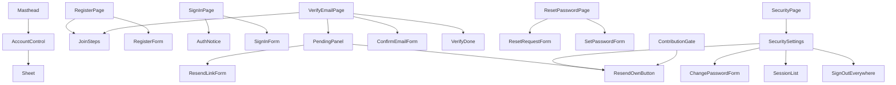

# Frontend components — U9 `t-102-patient-auth-screens`

This file lists the components, props, state, message keys and tests of the Unit. The workflows are in `functional-spec.md` and the rules in `rules.md`. Every path below is in U9's owned paths. Components import server actions and `@/server/actions/auth-form`, and nothing else under `server/` (FD-093).

## 1. Hierarchy



Text fallback, one line per parent:
- Masthead → AccountControl → Sheet.
- `/register` → JoinSteps and RegisterForm.
- `/sign-in` → AuthNotice and SignInForm.
- `/verify-email` → JoinSteps plus one of four panels:
  - PendingPanel, holding ResendLinkForm or ResendOwnButton;
  - ConfirmEmailForm;
  - VerifyDone;
  - the expired panel, which is PendingPanel with the `expired` flag.
- `/reset-password` → ResetRequestForm or SetPasswordForm.
- `/me/security` → SecuritySettings → ResendOwnButton, ChangePasswordForm, SessionList and SignOutEverywhere.
- ContributionGate → ResendOwnButton. It is mounted by U47 and U49.

## 2. Components

Kind: S = async server component, C = client component (`'use client'`). The client components use `useAuthForm` (on `main`) over `useActionState`.

| Component (file in `components/patient/auth/`) | Kind | Props | State and behaviour | Action |
|---|---|---|---|---|
| `AuthFields.tsx` (on `main`, extended) | C | as on `main`, plus `PasswordField {name, label, hint?, autoComplete}` | The Show control renders only after hydration. It reads Show or Hide, its name is `auth.showPasswordLabel` or `auth.hidePasswordLabel`, and it has `aria-controls`. It announces `auth.passwordShown` or `auth.passwordHidden` and resets to hidden on submit (Q8) | — |
| `RegisterForm.tsx` (on `main`) | C | `{next}` | unchanged | `register` (changed, WF1) |
| `SignInForm.tsx` (on `main`) | C | `{next}` | unchanged; uses `PasswordField` | `signIn` (changed, WF4) |
| `JoinSteps.tsx` | S | `{current: 1 \| 2 \| 3}` | `<ol>` of `auth.steps.create`, `auth.steps.confirm`, `auth.steps.write`, `aria-current="step"` and a hidden `auth.steps.position`. Static (BR9.3) | — |
| `PendingPanel.tsx` | S | `{address: string \| null, signedIn: boolean, expired: boolean, next: string \| null}` | `auth.verify.expired` when `expired`. Then `auth.verify.body {email}` when `address` is set, otherwise `bodyNoEmail`. Then `auth.verify.expires`, the resend control, and a sign-in link with `next` (signed out only) | — |
| `ResendLinkForm.tsx` | C | `{defaultEmail: string}` | email field, then the `auth.verify.resent` notice or an error | `resendLink` |
| `ResendOwnButton.tsx` | C | `{}` | one button `auth.verify.resend`, then the notice | `resendOwnLink` |
| `ConfirmEmailForm.tsx` | C | `{token: string}` | `auth.verify.confirmLede`, a hidden `token` and the **`auth.verify.confirm`** button. After hydration, `history.replaceState` removes `?token=` from the URL | `confirmEmail` |
| `VerifyDone.tsx` | S | `{next: string \| null}` (already passed through `safeAuthNext`) | `auth.verify.done` with `PublishTick`. Links: `auth.verify.continue` → `next`, shown only when `next` is set; `auth.verify.startWriting` → `/write`; `nav.mine` → `/me`. The `h1` takes focus | — |
| `ResetRequestForm.tsx` | C | `{}` | email field; replaced by `auth.reset.sent` | `requestReset` |
| `SetPasswordForm.tsx` | C | `{token: string}` | new and confirm password fields, hidden `token`; token errors show `auth.reset.requestAgain` → `/reset-password` | `setNewPassword` |
| `SecuritySettings.tsx` | S | `{account: OwnAccountVM \| null, sessions: SessionVM[] \| null, locale}` | the email row (masked, status, resend while unconfirmed, `emailNote`), the password section, the sessions section and sign out everywhere. A `null` section shows `errors.common.internal` | — |
| `ChangePasswordForm.tsx` | C | `{}` | current and new password; replaced by `auth.security.passwordChanged` with `PublishTick` | `changePasswordForm` |
| `SessionList.tsx` | S | `{sessions: SessionVM[], locale}` | table: device (`auth.security.deviceLabel {browser, os}` or `deviceUnknown`), `firstSeen` and `lastSeen` through `formatDate`, and `thisDevice` | — |
| `SignOutEverywhere.tsx` | S | `{}` | `<details><summary>auth.security.signOutAll</summary>`, then `signOutAllNote` and a form with `confirm=yes` and the button `auth.security.signOutAllConfirm` (Q7) | `signOutEverywhereForm` |
| `AuthNotice.tsx` | S | `{messageKey: string, tone: 'info' \| 'done'}` | a `.callout` (no `role="status"`, CR-004), with `PublishTick` when `done` | — |
| `AccountControl.tsx` (on `main`, extended) | C | `{account: {displayName: string; unconfirmed: boolean} \| null}` | initials by grapheme cluster (`Intl.Segmenter`) and `data-verified`. The name is `auth.accountMenu` or `auth.accountMenuUnconfirmed`. The Sheet links are My writing, Security, Confirm your email (while unconfirmed) and Sign out | `signOut` |
| **`ContributionGate.tsx`** | S | **`{purpose: 'write' \| 'comment', returnTo: string}`** (C16, frozen) | WF9 table. Fail closed on error | `getContributionAccess` |

Outside the folder:
- **`Masthead.tsx`** changes only the account entry. Its `account` prop type becomes `{displayName: string; status?: AccountStatus} | null`, which the layouts' `DemoCurrentAccount` already satisfies, and it passes `unconfirmed: status === 'pending_verification'`.
- **`profile/ProfileWorkspace.tsx`** gets one `Link` to `/me/security` with the text `auth.security.nav`.

## 3. Server actions (`server/actions/auth.ts`, `'use server'`)

### 3.1 Form state (`auth-form.ts`)

This type replaces `main`'s `AuthFormState {fieldErrors, formError}`. Inside U9, `use-auth-form.ts`, `RegisterForm`, `SignInForm`, `registerRefusal`, `signInRefusal`, `parseRegistration`, `parseSignIn` and their tests all move to it. No other Unit uses the type.

```ts
export interface AuthMessage {
  key: string; // i18n key
  params?: Record<string, number>; // raw numbers only, e.g. {count: 5, seconds: 5}
}
export interface AuthFormState<F extends string = string> {
  status: 'idle' | 'refused' | 'done';
  formError: AuthMessage | null; // the summary's form-level message
  fieldErrors: Partial<Record<F, AuthMessage>>;
  notice?: AuthMessage; // a confirmation that replaces the form (status 'done')
  expired?: true; // confirmEmail: show the expired panel
}
export const INITIAL_AUTH_STATE = { status: 'idle', formError: null, fieldErrors: {} } as const;
```

- **Numbers.** `params` carries raw numbers. The form, not the action, formats them: `t(key, {count, seconds: formatNumber(seconds, locale)})`. That keeps Bengali digits in `bn` and the raw count for the English plural.
- **What the state never holds.** It has no strings other than keys and never echoes a submitted value (BR1.2, BR10.1).

### 3.2 Actions

Each action takes `(previous, form)` and returns `AuthFormState`. Each action parses the form with an `auth-form.ts` parser, calls the raw command through `runCommand` or `runSessionCommand`, and maps the result:

| Action | Command | `ok` | Refusal mapping |
|---|---|---|---|
| `register` (changed) | `registerCommand` | set `rk.pending` as `{email, next?}`, then redirect to `/{locale}/verify-email[?next]` | `registerRefusal` (on `main`) and BR4.2 |
| `signIn` (changed) | `signInCommand` | apply the session, delete `rk.pending`, redirect (on `main`) | `signInRefusal`, with BR4.2 and BR4.3 |
| `confirmEmail` | `verifyEmailCommand` | read `next` from `rk.pending`, apply the session, delete `rk.pending`, redirect to `?confirmed=1[&next=]` | token errors → `{status: 'refused', expired: true}` |
| `resendLink` | `resendVerificationCommand` | notice `auth.verify.resent` | BR2.4 |
| `resendOwnLink` | `resendOwnVerificationCommand` | notice `auth.verify.resent` | BR4.2; `internal` → `errors.common.internal` |
| `requestReset` | `requestPasswordResetCommand` | notice `auth.reset.sent` | BR5.1 |
| `setNewPassword` | `resetPasswordCommand` | apply the clear effect, redirect to `/sign-in?reset=done` | BR5.2, BR5.3 |
| `changePasswordForm` | `changePasswordCommand` | apply the session, notice `auth.security.passwordChanged` | `invalid_credentials` → `errors.auth.invalidCredentials`; schema keys; BR4.2 |
| `signOutEverywhereForm` | `signOutEverywhereCommand` | apply the clear effect, delete `rk.pending`, redirect to `/sign-in?signedOut=all` | without `confirm=yes`, no call |
| `signOut` (on `main`, extended) | `signOutCommand` | as on `main`, plus deleting `rk.pending` (BR2.2) | unchanged |

`server/actions/account.ts` adds `getContributionAccess()`, which maps `getActor()` by BR8.1.

`auth-form.ts` adds:
- the cookie and access constants: `PENDING_EMAIL_COOKIE = 'rk.pending'`, `PENDING_EMAIL_MAX_AGE_SEC = 1800` and `type ContributionAccess`;
- `safeAuthNext(raw)`, exactly as BR1.5 defines it: decode once, compare in lower case, require a locale prefix, and refuse the auth pages, `/api` and `/admin`;
- `readPendingCookie(value)`: parses the JSON and checks `email` against the account email schema and `next` with `safeAuthNext`. An invalid email makes the whole cookie count as absent, and an invalid `next` is dropped (BR2.2);
- the parsers `parseEmailOnly`, `parseSetPassword` and `parseChangePassword`;
- `rateLimitMessage(retryAfterSec)` (BR4.2).

## 4. Validation on the client

The client sets `type`, `autocomplete` (`email`, `username`, `current-password`, `new-password`) and `maxlength` on non-password fields only. It adds no `required` attribute and does no validation on blur. The server is the authority (BR1.2).

## 5. Message keys

This table lists the new and changed keys. All of them are added to `en.json` and `bn.json` in the same commit. The Bengali text is flagged for the owner's copy review (FD-042), and every other key the Unit uses already exists on `main`.

| Key | en | bn |
|---|---|---|
| `auth.verify.bodyNoEmail` | We sent a confirmation link to the address you registered with. Open it to finish creating your account. | আপনি যে ঠিকানা দিয়ে নিবন্ধন করেছেন, সেখানে একটি নিশ্চিতকরণ লিংক পাঠানো হয়েছে। অ্যাকাউন্ট খোলা শেষ করতে লিংকটি খুলুন। |
| `auth.verify.confirmLede` | Press the button to confirm this email address. | এই ইমেইল ঠিকানা নিশ্চিত করতে বোতামটি চাপুন। |
| `auth.verify.confirm` | Confirm my email | আমার ইমেইল নিশ্চিত করুন |
| `auth.verify.startWriting` | Write about a doctor | একজন ডাক্তার সম্পর্কে লিখুন |
| `auth.verify.continue` | Continue where you were | যেখানে ছিলেন সেখান থেকে চালিয়ে যান |
| `auth.steps.label` | Joining steps | যোগ দেওয়ার ধাপ |
| `auth.steps.create` | Create account | অ্যাকাউন্ট খুলুন |
| `auth.steps.confirm` | Confirm email | ইমেইল নিশ্চিত করুন |
| `auth.steps.write` | Start writing | লেখা শুরু করুন |
| `auth.steps.position` | Step {step} of {total} | {total}টির মধ্যে {step} নম্বর ধাপ |
| `auth.showPasswordLabel` | Show password | পাসওয়ার্ড দেখান |
| `auth.hidePasswordLabel` | Hide password | পাসওয়ার্ড লুকান |
| `auth.passwordShown` | Your password is shown. | আপনার পাসওয়ার্ড দেখা যাচ্ছে। |
| `auth.passwordHidden` | Your password is hidden. | আপনার পাসওয়ার্ড লুকানো আছে। |
| `auth.accountMenuUnconfirmed` | Your account: {name}, email not confirmed | আপনার অ্যাকাউন্ট: {name}, ইমেইল নিশ্চিত হয়নি |
| `auth.security.deviceLabel` | {browser} on {os} | {os}-এ {browser} |
| `auth.security.deviceUnknown` | Unknown device | অজানা ডিভাইস |
| `auth.security.signOutAllConfirm` | Yes, sign out everywhere | হ্যাঁ, সব জায়গা থেকে সাইন আউট করুন |
| `auth.security.signedOutAll` | You have been signed out everywhere. | সব জায়গা থেকে আপনাকে সাইন আউট করা হয়েছে। |
| `auth.reset.requestAgain` | Ask for a new reset link | নতুন রিসেট লিংক চান |
| `auth.gate.commentBody` | Comments need a confirmed account so they stay accountable. Reading does not. | মন্তব্য দায়বদ্ধ রাখতে নিশ্চিত অ্যাকাউন্ট লাগে। পড়তে লাগে না। |
| `auth.gate.unavailable` | Your account can't take part right now. | আপনার অ্যাকাউন্ট এখন অংশ নিতে পারবে না। |
| `errors.auth.rateLimitedSeconds` (new) | Too many attempts. Try again in {count, plural, one {{seconds} second} other {{seconds} seconds}}. | অনেকবার চেষ্টা হয়েছে। {count, plural, other {{seconds} সেকেন্ড}} পর আবার চেষ্টা করুন। |
| `errors.auth.rateLimited` (changed) | Too many attempts. Try again in {count, plural, one {{minutes} minute} other {{minutes} minutes}}. | অনেকবার চেষ্টা হয়েছে। {count, plural, other {{minutes} মিনিট}} পর আবার চেষ্টা করুন। |
| `errors.auth.accountSuspended` (changed) | This account is suspended, so it can't sign in right now. | এই অ্যাকাউন্টটি স্থগিত, তাই এখন সাইন ইন করা যাবে না। |

In the rate-limit keys, `count` is the raw number that picks the plural form, and `seconds` and `minutes` are the same number formatted for the active locale.

The two value changes (`errors.auth.rateLimited` and `errors.auth.accountSuspended`) are U9's own: on `main` only `server/actions/auth.ts` uses them. `packages/i18n/src/keys.ts` is generated, so it is regenerated after every rebase rather than merged by hand; `messages.test.ts` checks that it is in sync.

## 6. Styles

- **Existing classes first:** `.a-head`, `.panel`, `.callout`, `.note`, `.field-error`, `.link-btn`, `.check`, `.opt-row`, `.kv`, and `.ctl.account`, including its `data-verified` styling.
- **New classes:** only `.join-steps` and `.session-table`, in U9's section of `patient.css`. Each is marked `/* added: U9 T-102 reason */`, built on T-011 tokens and formatted with Prettier.
- **Motion:** none of the Unit's own (BR9.2).

## 7. Tests (test-after, `team.md` Testing Posture)

- **Component tests**, each rendered in `en` and `bn`: every new component, plus `AccountControl` in its unconfirmed state, with grapheme-safe initials for a Bengali name. `ContributionGate` is tested in all four access states and both purposes, with `returnTo` sanitised, and fails closed when the query throws.
- **Action tests:** every action's `ok` and each refusal mapping. Register sets the identical cookie and redirect for a new and an existing address. Mismatched passwords skip the command. Sign out everywhere does nothing without `confirm=yes`. `rateLimitMessage` is tested at 1, 59, 60 and 61 seconds.
- **Page tests:** in U9's own files, not in the shared `app/pages.test.tsx` (which U9 leaves untouched):
  - `app/[locale]/(patient)/register/page.test.tsx`;
  - `sign-in/auth-pages.test.tsx` (on `main`, extended);
  - `verify-email/page.test.tsx`;
  - `reset-password/page.test.tsx`;
  - `me/security/page.test.tsx`.

  They assert noindex, the referrer on the token pages, one `h1` and that `/me/security` redirects when signed out. If a row in `pages.test.tsx` asserts a placeholder that U9 replaces, it fails; U9 then changes only that row and records the edit in the Code Generation plan.
- **`safeAuthNext` and `readPendingCookie`:** the BR1.5 refusal list (`/sign-in`, `/admin`, `/en/Admin`, `/en/%61dmin`, `/bn/SIGN-IN`, `//x`, `https://evil.example`) and the one kept path; a malformed cookie, a cookie with a bad address and a cookie with a bad `next`.
- **Integration and smoke:** `register → Mailpit token → confirmEmail → getContributionAccess() === 'allowed'` against the test database. At least one `*.smoke.test.tsx` covers the pending screen and the gate.
- **Adversarial (separate agent):** the five angles of `functional-spec.md` § 7.
- **Checks:** `pnpm check`, `pnpm smoke`, `npx impeccable detect apps/web/src --no-advisory` and `pnpm contrast` must all pass.

## Sources

`functional-spec.md`, `rules.md` and `functional-design-questions.md` (this folder); `contract-summary.md` C16; `main` at `bc63889` (`components/patient/auth/*`, `Masthead.tsx`, `server/actions/*`, `packages/i18n/messages/*.json`, `packages/contracts/src/view-models/security.ts`).
