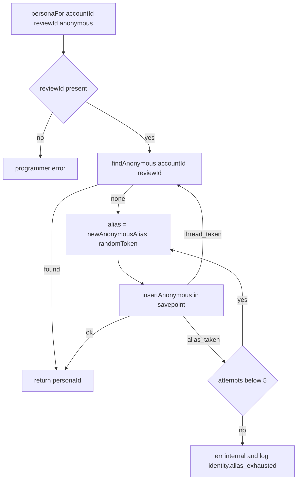
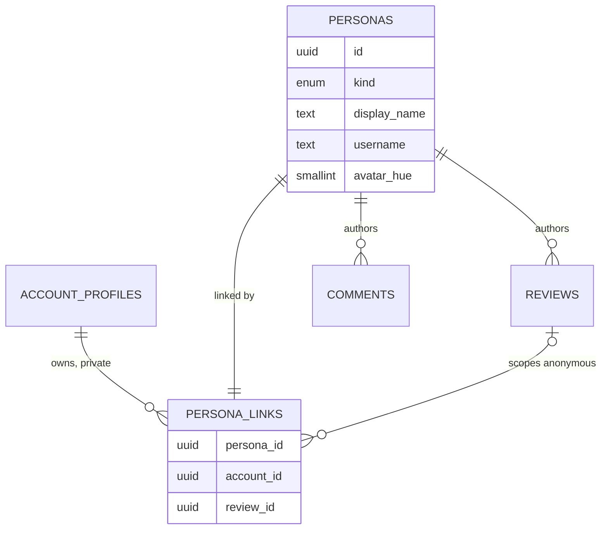

# Functional specification — U11 `t-104-identity-module` (release 1)

This file is the source of truth for the workflows of the identity module. Data shapes are in `entities.md` and decision logic in `rules.md`; the ER diagram and the rules summary below are derived from them. Release 1 scope (FD-105): named and pseudonymous personas, the thread-scoped anonymous alias, private linkage, and the ownership check. The audited reveal and `deidentify` are deferred to release 2.

## 1. Module surface (C4 release 1, C19)

`packages/application/src/modules/identity/` defines its own ports (`ports.ts`) and a factory. `container.ts` wires it in the identity block and passes the results on. `CommandPorts` is not changed.

```text
IdentityModulePorts { identities: IdentityRepository; privateIdentities: PrivateIdentityRepository (branded);
                      crypto: Pick<Crypto, 'randomToken'> }
IdentityModule {
  createDefaultPersonas(tx, { accountId, username, displayName }): Promise<{ namedPersonaId; pseudonymousPersonaId }>;
  personaFor(tx, { accountId, reviewId?, mode }): Promise<Result<{ personaId }>>;
  publicProjection(tx, { personaId }): Promise<PersonaPublicVM | null>;
  publicProjections(tx, { personaIds }): Promise<PersonaPublicVM[]>;
  publicPersonaIdsByUsername(tx, { username }): Promise<string[]>;
  renameNamedCommand: Command<RenameNamedInput, { changed: boolean }>;
  ownership: IdentityOwnership   -- { ownsPersona, ownPersonaIds }, review and community only
}
createIdentityModule(ports: IdentityModulePorts): IdentityModule
```

| Operation | Kind | Called by | Transaction | Rules |
|---|---|---|---|---|
| `createDefaultPersonas` | internal | tests now; `account.register` reaches the same private method through `AccountRepository.insertDefaultPersonas` (Q2) | caller's | BR1.2 |
| `personaFor` | internal query that may insert | U47 `review.publish`, the composer; U49 `comment.post` | caller's | BR2.1–BR2.10 |
| `publicProjection(s)` | query | U47, U49 bylines | caller's read | BR1.4, BR1.5, BR2.7 |
| `publicPersonaIdsByUsername` | internal query | U47 author page | caller's read | BR1.6 |
| `identity.renameNamed` | command (`defineCommand`) | no release-1 caller beyond tests; the profile flow comes with U38 | own | BR4.1 |
| `ownership.ownsPersona` | private check | U47 `isReviewAuthor`; U49 comment authorship | caller's | BR3.3, BR3.5 |
| `ownership.ownPersonaIds` | private query | U47 own-review list on `/me` | caller's read | BR3.4, BR3.5 |

The internal operations take the caller's `Tx` and are plain functions, not `defineCommand`s, because `defineCommand` opens its own transaction and `personaFor` must commit or roll back with the review or comment it is for.

**Repositories.** `IdentityRepository` (`packages/database/src/repositories/identity.ts`, replacing the stub): `byIds(tx, ids)`, `publicIdsByUsername(tx, username)`. `PrivateIdentityRepository` (`identity-private.ts`): `createDefault`, `createMissingDefault`, `currentOf(tx, accountId, kind)`, `findAnonymous(tx, accountId, reviewId)`, `insertAnonymous(tx, {accountId, reviewId, alias})` → `ok | alias_taken | thread_taken` in its own savepoint, `insertNamed`, `owns(tx, accountId, personaId)`, `personaIdsOf(tx, accountId)`.

## 2. The ownership decision (`isReviewAuthor`)

The contract summary left open how `isReviewAuthor` checks ownership while `persona_links` stays Identity's. **Decided (Q1):** a narrow private check, `IdentityOwnership.ownsPersona(tx, {accountId, personaId}) → boolean`, that only the review and community module factories receive.

```text
U47, modules/review/queries/is-review-author.ts (illustrative)
isReviewAuthor(tx, {reviewId, actor}):
  if actor.kind != account or no actor.accountId → false
  personaId = reviews.authorPersonaIdOf(tx, reviewId)      -- review's own table
  if none → false
  return ownership.ownsPersona(tx, {accountId: actor.accountId, personaId})
```

- One boolean, the same for every persona kind. No staff bypass. Unknown ids give `false`, never an error (BR3.3).
- The account id always comes from the `Actor`, never from the request.
- The review module never sees `persona_links` and never gets an account id for a persona.
- U49 uses the same check for "the author of a comment deletes it". U48 and U22 go through `isReviewAuthor` and never receive `IdentityOwnership` (BR3.5).
- `ownPersonaIds` sits on the same object for the one case a boolean cannot serve: the account's own private review list on `/me`, which includes its anonymous reviews (BR3.4).

## 3. Workflows

### WF1 — Register creates the default personas

1. `account.register` (U8, unchanged call) writes the profile and preferences, then calls `ports.accounts.insertDefaultPersonas(tx, {accountId, username, displayName, namedPersonaId, pseudonymousPersonaId})`.
2. `PgAccountRepository.insertDefaultPersonas` delegates to `PgPrivateIdentityRepository.createDefault` with the same values. No persona SQL stays in `account.ts` (Q2).
3. `createDefault` checks for existing default personas of the account and returns them; otherwise it inserts the named persona `{display_name = displayName, username}` and the pseudonymous persona `{display_name = username, username}`, both with `avatar_hue` null, and one link each with `review_id` null.
4. The register transaction commits or rolls back as a whole. The `TODO(T-104)` comment in `register.ts` is replaced with a pointer to BR1.2.

### WF2 — `personaFor` named or pseudonymous

1. Parse `{accountId, reviewId?, mode}` with `PersonaForInput`.
2. `currentOf(tx, accountId, mode)` returns the newest persona of that kind with an unscoped link (BR2.1).
3. If there is none, `createMissingDefault` inserts it from `account_profiles` in one statement and links it (BR2.2).
4. Return `{personaId}`. `reviewId` is ignored.

### WF3 — `personaFor` anonymous (the thread alias)



Text version: without a `reviewId` it is a programmer error. Otherwise look up the link for `(accountId, reviewId)` and return its persona. If there is none, draw a new alias and insert the persona (`kind` anonymous, hue 0, username null) and its link (`review_id` set) in one savepoint. A concurrent first use (`thread_taken`) re-reads the winner. An alias clash (`alias_taken`) draws again, up to 5 attempts, then the call answers `internal` with nothing written. The review row may not exist yet: the key is deferred (BR2.9).

### WF4 — Anonymous publish inside U47's transaction (consumer view)

1. `review.publish` generates `reviewId`.
2. It calls `personaFor(tx, {accountId: actor.accountId, reviewId, mode})`.
3. It inserts the review with `author_persona_id`.
4. The deferred key is checked at commit. A rollback removes the persona, its link and the review together.

U49's `comment.post` calls `personaFor` with the review's `reviewId`. The review's anonymous author commenting in that thread gets the same alias.

### WF5 — Public projection

1. `publicProjections(tx, {personaIds})`: de-duplicate, refuse more than 200 as a programmer error, read `personas` once.
2. Build each `PersonaPublicVM` with the domain function `publicProjection(persona)` (BR1.4, BR2.7). Return them in input order and omit unknown ids.

### WF6 — `identity.renameNamed`

1. `defineCommand` with `requires: { authenticated: true }`; `RenameNamedInput` is new in `schemas/identity.ts`, `{displayName}` NFC-normalized, trimmed, 1–60 characters, key `errors.auth.displayNameRequired`.
2. Load the current named persona (BR2.1), creating it first if it is missing (BR2.2).
3. If the name is unchanged, return `{changed: false}`.
4. Otherwise insert a new named persona with the current username and hue, link it, write audit `account:<accountId>` `named_persona_created {}`, and return `{changed: true}`.

The demo slice's `updateDisplayName` on `/me` stays as it is in release 1. No release-1 Unit switches it.

## 4. Lifecycle

Personas have no state machine. A persona is inserted once and never updated (BR1.3). The current named persona is simply the newest one. A link is inserted once and never updated (BR2.8). Deleting either is release 2 (`deidentify`, FD-105).

## 5. ER diagram (derived from `entities.md`)



Text version: an account owns many links; each persona has exactly one link; an anonymous link points at one review; reviews and comments point at personas, never at accounts.

## 6. Rules summary (derived from `rules.md`)

- **Projection:** BR1.1, BR1.3–BR1.7. No account data in `personas`, immutable snapshots, one id-free view model, batch reads, no anonymous username lookup.
- **Thread alias:** BR2.1–BR2.10. Newest default persona, created on first use if missing; one anonymous persona per account per review; random unique alias; legacy rows without an alias; deferred key.
- **Boundary:** BR3.1–BR3.8. One file touches `persona_links`; the private repository goes only to identity; `IdentityOwnership` goes only to review and community; no public path and no worker access; no account-persona pairs in logs.
- **Rename:** BR4.1. **Scope and records:** BR5.1–BR5.4. **Verification:** BR6.1–BR6.2.

## 7. Files and the release-1 contract amendment

**Inside owned paths:** `packages/domain/src/identity/{persona,alias,projection}.ts` and their tests; `packages/application/src/modules/identity/{ports,index,ownership,persona-for,default-personas,projection,audit}.ts` and `commands/rename-named.ts`; `packages/database/src/repositories/{identity,identity-private}.ts` and their `*.int.test.ts`; `packages/contracts/src/view-models/persona.ts`; `packages/contracts/src/schemas/identity.ts` (adds `RenameNamedInput`, `PublicProjectionsInput`); `register.ts` (comment only, WF1).

**Schema file added to the Unit's list:** `packages/database/src/schema/identity.ts` declares both partial unique indexes (`personas_anonymous_alias_uq`, `persona_links_account_review_uq`) with Drizzle's `uniqueIndex().on(...).where(...)`, so a later generated migration keeps them. The migration and the schema snapshot agree.

**Outside owned paths (each gets one `ISS-` row, Q4):**
- `packages/database/src/repositories/account.ts` and `account.int.test.ts`: `insertDefaultPersonas` delegates (WF1).
- `packages/database/src/migrations/<next>_identity_constraints.sql` with its journal and snapshot, plus the two migration-count tests (BR5.4).
- `packages/database/src/repositories/not-implemented.test.ts`: drops the identity stub (BR5.3).
- `packages/test-support/src/fakes/`: identity fakes, and the account fake keeps `insertDefaultPersonas`.
- `packages/test-support/src/seed/seed-content.ts`, U11's block only: the anonymous link is inserted with its `review_id` directly instead of being back-filled by an update (BR2.8, BR2.9).
- `apps/web/src/server/container.ts` (identity block only, append-only) and `container.test.ts` (BR3.2, BR3.5).
- `packages/application/src/index.ts`: exports the identity module.

`ports/repositories/identity.ts` from the owned-path list is not created; the ports live in `modules/identity/ports.ts` as C19 says (Q4).

**C4 amendment, additive (for U47 and U49 to build against):** `publicProjections` (batch); `publicPersonaIdsByUsername`; `IdentityOwnership {ownsPersona, ownPersonaIds}` handed to the review and community factories; `PersonaPublicVM.displayName` may be null for an anonymous legacy row; and `account.register` is routed, not switched. It keeps calling `AccountRepository.insertDefaultPersonas`, whose `PgAccountRepository` implementation calls `PgPrivateIdentityRepository.createDefault` (Q2). For release 1 this replaces C4's "U11 switches `account.register` to `createDefaultPersonas`", and it is the one allowed exception in BR3.2. The C4 operations `personaFor`, `publicProjection` and `renameNamed` keep their release-1 text. The contract-summary block is updated in this Unit's Code Generation (the provider owns its block).

## 8. Adversarial angles (high-risk Unit, BR6.1)

A separate agent writes 3–5 tests that try to break these:

1. **Cross-thread correlation.** One account publishes anonymously in two threads and comments in both. Compare every public field of both projections (alias, hue, key order, any id or timestamp in rendered JSON or HTML). Expected: two different aliases, hue 0 on both, no shared value except `kind`.
2. **Linkage leak.** Fuzz `publicProjection(s)` with every persona kind, the legacy "Anonymous" rows and unknown ids, and capture logs and audit rows of every identity operation. Also search every non-test source file for the string `persona_links` in raw SQL or `sql` template strings outside the BR3.1 allowlist. Expected: no denylisted key, no username on anonymous, no line or row that holds an account id together with a persona id, an alias or a username, and no unlisted file that names `persona_links`.
3. **Ownership oracle.** As account B, ask through U47's `isReviewAuthor` and U49's comment delete about A's anonymous review and comment, with forged persona ids and public ids. Expected: `false` or `not_found`, identical to an unknown id. Also check at type level that the directory and evidence factories cannot receive `IdentityOwnership`, and that `rk_worker` gets `permission denied` on `persona_links`.
4. **Race and exhaustion.** Ten concurrent `personaFor(A, r1, anonymous)` calls give exactly one persona. A fixed random source that always draws a taken alias gives `internal` after 5 attempts, writes nothing, and leaves the caller's transaction usable.
5. **Reaching an alias by name.** `publicPersonaIdsByUsername` with an alias, with "Anonymous" and with an empty string returns nothing. `renameNamed` leaves earlier personas byte-identical and refuses an anonymous actor.

## 9. Tests (team.md Testing Posture, test-after)

- **Domain:** the alias alphabet, length, rejection sampling and a uniformity bound over 10 000 draws; the projection property test (BR1.4); the legacy-alias rule (BR2.7).
- **Application** (with `test-support` fakes): every `personaFor` branch, retry and exhaustion; rename happy path, unchanged name, validation and refusal, with one audit assertion; `ownsPersona` and `ownPersonaIds`; the log-capture test (BR3.8).
- **Database** (`*.int.test.ts`): both partial unique indexes exist after migrating from empty (read from `pg_indexes`, with their `WHERE` clauses) and are enforced; the exact `personas` column list (BR1.1); the deferred key (persona and link first, review later, one transaction); the savepoint keeps the outer transaction usable; `rk_worker` denied; register still creates both personas through the delegation; the `persona_links` allowlist test, by import and by raw string (BR3.1).
- **Web:** `container.test.ts` type assertions (BR3.2, BR3.5); no action or route imports identity internals (BR3.6).
- **Smoke:** `identity.smoke.test.ts` (BR6.2).
- Gate: `pnpm check` and `pnpm smoke` green with the compose PostgreSQL running; the 80% line floor per touched package. There is no CI run (FD-102).
