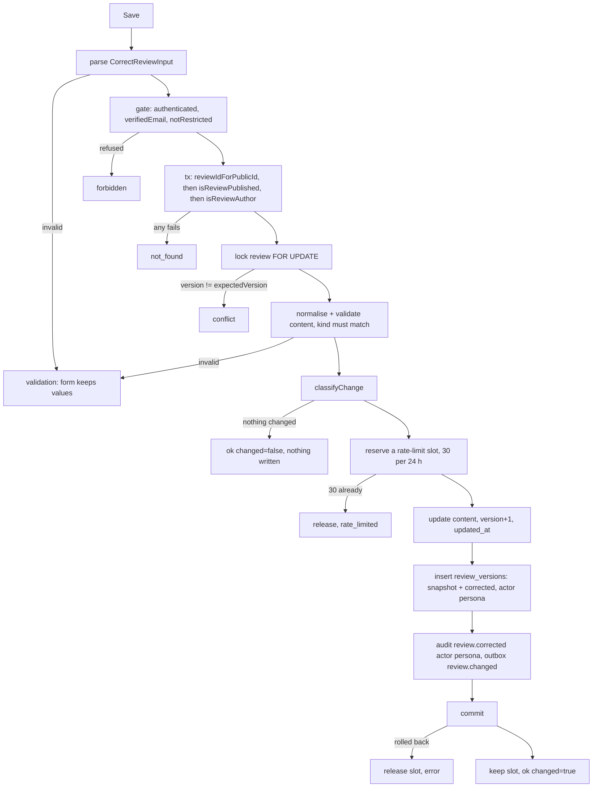
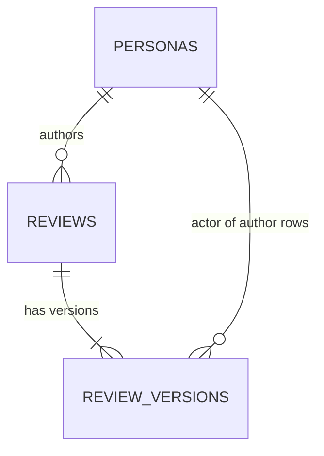

# Functional specification — U22 `t-302-review-changes-and-tombstones` (release 1)

This file is the source of truth for U22's workflows and state transitions. Data shapes are in `entities.md` and decision logic in `rules.md`; the ER view and the rules summary at the end are derived from them. Release-1 scope (FD-105): the author corrects their own published review (FR69), each accepted correction writes a `review_versions` row, and the history appears through the `<ReviewHistory reviewPublicId>` slot. Corrections send no email. Deferred to release 2: follow-ups, delete, tombstones and restore, `setState`, `redact` and the deletion step.

## 1. What changes

U22 extends U47's review module with one command and two queries, replaces the demo edit route and form with versions that work for quick and detailed reviews, and replaces the internals of U47's `ReviewHistory` slot. Every correction is checked through U47's `isReviewAuthor` and writes the author persona (never the account) as the version actor. Readers see an "Edited" date. After a material correction they also see a dated correction line with a "Show original" disclosure that keeps the earlier account readable (AC6.3.2). The demo's `updateOwnReview` and `saveReviewEdit` are deleted in the same Bolt (§ 8). U22 adds no table, column, migration, worker code or dependency.

## 2. Module surface (C9 release 1, extending U47 § 2.1)

U47's `ReviewModule` interface in `modules/review/module.ts` gains three members, built by `createReviewModule(deps)` from the same `ReviewModulePorts` (U22 adds methods to the repository port only, § 5). The calling convention is U47's: commands and queries through `runCommand(getContainer().review.<op>, raw)`; seams with `Tx` first; U22 never receives `IdentityOwnership`.

| Operation | File | Kind | Input → result | Rules |
|---|---|---|---|---|
| `review.correct` | `commands/correct.ts` | command (`defineCommand`) | `CorrectReviewInput` → `{publicId, version, changed}` | BR1.1–BR1.4, BR2.*, BR3.* |
| `review.getOwnForEdit` | `queries/get-own-for-edit.ts` | query | `{publicId}` → `EditReviewVM` or `not_found` | BR1.1, BR5.1 |
| `review.getHistory` | `queries/get-history.ts` | query | `{reviewPublicId}` → `ReviewHistoryVM` or `not_found` | BR4.1–BR4.4 |

`review.correct` errors: `validation` (field errors), `not_found`, `conflict`, `rate_limited`, `forbidden` (gate). The web keys for each are in BR5.4. `getOwnForEdit` is not named in C9; it is a recorded additive operation (§ 6).

```text
// domain/review/versioning.ts (pure, imports nothing)
type CorrectionField = 'story'|'symptoms'|'diagnosis'|'treatment'|'after'|'sentiment'|'outcome'|'claims';
normaliseContent(input): ReviewContent                   // trim, drop empty sections, derive title (BR2)
classifyChange(current: ReviewContent, next: ReviewContent): { changed: string[]; corrected: CorrectionField[] }  // BR3.1
toVersionSnapshot(next: ReviewContent, corrected): VersionSnapshot                                                  // BR3.4
toHistory(rows, isAuthor): ReviewHistoryVM                                                                         // BR4.1–BR4.3
```

## 3. Workflows

### WF1 — Open the edit form `/{locale}/experiences/{id}/edit` (BR5.1, BR1.1)

1. `publicId = stripSlug(id)`; null → `notFound()`.
2. `requireAccount({returnTo: '/experiences/{id}/edit'})` sends a signed-out visitor to sign in.
3. `runCommand(c.review.getOwnForEdit, {publicId})`. In one read, in the order of BR1.1: `reviewIdForPublicId`, where null gives `not_found`; then `isReviewPublished`, where false gives `not_found`; then `isReviewAuthor`, where false gives `not_found`. Otherwise the repository reads the current content, version and doctor display name into `EditReviewVM`.
4. `not_found` → `notFound()`, the localised 404 (`errors.common.notFound`). Another account's review, an unknown id and a hidden one look the same.
5. Render `EditForm` with `vm` (quick: title, story; detailed: title and the four sections; both: sentiment, outcome, labels). Metadata `noindex`.

### WF2 — Save a correction (`correctReviewAction` → `review.correct`)



Text version: the command parses the input strictly and applies the publish gate. Inside one transaction it resolves the id, then checks that the review is published, then that the actor is its author; any failure is one `not_found`. It locks the row and compares the version, validates the new content against the stored kind, and classifies the change. A no-op returns at once and writes nothing. Otherwise it reserves a rate-limit slot (`reserveFailure`; refused when 30 are already used). It then updates the content, appends the version row with the persona as actor, writes the audit row `review.corrected` and the `review.changed` event, and commits. A refusal or rollback releases the slot, so only a committed correction counts (BR1.4).

The action (`server/actions/review-edit.ts`) maps each result to one key (BR5.4):

- ok → `revalidatePath`, then redirect to `/{locale}/experiences/{publicId}`.
- `validation` → field errors and `errors.common.validation`.
- `conflict` → `errors.review.editConflict`, with a reload link.
- `rate_limited` → `errors.review.correctionsLimit`.
- `forbidden` → `errors.common.forbidden`.
- `not_found` → `errors.common.notFound`.
- unexpected → `errors.common.internal`, logged.

The action never reads the account's personas itself.

### WF3 — History slot `<ReviewHistory reviewPublicId>` (BR4)

1. `runCommand(c.review.getHistory, {reviewPublicId})`. The query resolves the id once and checks `isReviewPublished` (else `not_found`). It reads `listVersions(tx, reviewId)`: version, change kind, created_at and `snapshot.corrected` for every row, plus the content snapshot of each version directly followed by a material correction. It then asks `isReviewAuthor` and calls `toHistory`. A missing `corrected` key reads as `[]`.
2. `not_found` or no correction → the slot renders nothing (U47's empty state).
3. Otherwise the slot shows "Edited {month year}" (`label.edited`). Below it comes one line per material correction, oldest first: "Corrected: {fields} — {month year}" (`history.corrected`). Each line has a closed `details` disclosure, "Show original" (`history.showOriginal`). Inside it is the original, the version just before that correction (`history.originalHeading`): its title, its story or sections, and the sentiment, outcome and Reviewer's labels its snapshot holds. The original carries `lang` when its language differs from the locale, and a key the snapshot lacks is left out. A title-only edit adds no line and no original. Months are in Asia/Dhaka and digits follow the locale.
4. For the author only: a disclosure "Your versions" (`history.yourVersions`) lists each version newest first with its number, date and kind (`history.kind.published | edited | corrected`). The list holds no text.
5. An unexpected failure renders `history.unavailable` and logs `review.history` with allowlisted fields; the rest of the page renders.

## 4. State transitions

| From | Event | To | Writes |
|---|---|---|---|
| `published`, version n | accepted correction, only title changed | `published`, version n+1 | version row with `corrected: []` → "Edited" |
| `published`, version n | accepted correction, material change | `published`, version n+1 | version row with `corrected` → "Edited" and a correction line |
| `published`, version n | save with no change | unchanged | nothing |
| `published`, version n | stale `expectedVersion` | unchanged | nothing (`conflict`) |
| any other state | correction | unchanged | nothing (`not_found`) |

The publication state never changes in U22; delete, hide and restore are release 2.

Edit form states: `editing` → `saving` (Save disabled, `aria-busy`) → `redirect` (ok) or `refused` (summary and field errors, values kept) → `editing`.

## 5. Repository (extends U47's `ReviewModuleRepository` and `PgReviewModuleRepository`)

| Method | Purpose | Rules |
|---|---|---|
| `lockForCorrection(tx, reviewId)` | `SELECT … FOR UPDATE` of kind, title, body, sections, sentiment, outcome, claims, version, author_persona_id, doctor_id, branch_id | BR3.3 |
| `updateContent(tx, reviewId, content, newVersion)` | sets only the ENT-101 changeable columns, `version`, `updated_at` | BR1.3, BR3.3 |
| `insertVersion` (U47's) | reused with `change_kind correction`, `actor_kind author`, `actor_id` persona | BR3.4 |
| `findOwnForEdit(tx, reviewId, locale)` | current content, version, doctor display name | BR5.1 |
| `listVersions(tx, reviewId)` | version, change_kind, created_at, `snapshot->'corrected'` for every row, and the content snapshot only of a version directly followed by a material correction; never `actor_id` or `reason` | BR4.2, BR4.4 |

The fake in `test-support/src/fakes/review-repository.ts` gains the same methods. `database` never imports `domain`: every decision is made in the command, and the repository writes what it is given.

## 6. Contract changes

- `schemas/review.ts`: `CorrectReviewInput` (ENT-104) replaces the T-003 stub; `GetOwnForEditInput {publicId}`, `GetHistoryInput {reviewPublicId}`; `CORRECTION_FIELDS` as `as const`.
- `view-models/experience.ts`: `EditReviewVM`, `ReviewHistoryVM` (ENT-105, ENT-106).
- Dated note in `contract-summary.md` C9:
  - `review.getOwnForEdit` is added.
  - `getHistory` returns `corrections: [{at, fields, original}]`, grouping the fields of one version under one date. `original` is the content of the version before each material correction, and it is public, so the original stays readable (AC6.3.2).
  - `correct` has no reason in release 1 and sends no email.
  - The audit action is `review.corrected`.
  - C16: the `ReviewHistory` internals are now U22's.
- `schema/review.ts`: the `actor_id` comment reads "the author persona id for `author`" (no migration, Question 8).

## 7. i18n keys (en and bn, same commit)

New: `history.corrected` ("Corrected: {fields} — {date}"), `history.showOriginal` ("Show original"), `history.originalHeading` ("As first written, before this correction"), `errors.review.correctionsLimit` ("You have made many corrections today. Please try again tomorrow.", no minutes), `errors.review.editConflict` ("This review changed in another tab — reload to see the latest"), `history.yourVersions`, `history.version` ("Version {n}"), `history.kind.published`, `history.kind.edited`, `history.kind.corrected`, `history.field.{story,symptoms,diagnosis,treatment,after,sentiment,outcome,claims}`, `history.unavailable`, `compose.edit.reload`, `compose.edit.correctionNote` ("Changes to your story, sentiment, outcome or labels are shown as dated corrections, and the earlier wording stays readable under Show original."). Changed: `compose.edit.intro` (both kinds), `compose.edit.versionNote`. Reused: `label.edited`, `compose.edit.title`, `compose.edit.save`, `experience.cancelEdit`, `compose.{symptoms,diagnosis,treatment,after,claims,claimsNote}`, `claim.*`, `sentiment.*`, `outcome.*`, `label.notProvided`, `label.reviewerLabel`, `errors.common.{validation,forbidden,notFound,internal}`, U47's `errors.review.missingStory`. `errors.common.rateLimited` and `errors.common.conflict` are not used (review R-04). Bengali entries are written with the English ones and marked for the owner's review (FD-042).

## 8. Owned paths, recorded additions and demo deletions

- **Owned:** `packages/domain/src/review/versioning.ts`; `modules/review/commands/correct.ts`, `queries/get-history.ts`, `queries/get-own-for-edit.ts` (recorded addition); the U22 extensions of `modules/review/module.ts`, `ports/repositories/review.ts`, `repositories/review-module.ts`, the review fake, `schemas/review.ts` and `view-models/experience.ts`; `apps/web/src/app/[locale]/(patient)/experiences/[id]/edit/`; `components/patient/compose/EditForm.tsx`; `components/patient/review-history/`; the new `server/actions/review-edit.ts`.
- **Recorded additions:** `ExperiencePage.tsx`/`AuthorTools.tsx` (remove the `ASSUMPTION(U47)` quick-only condition, BR5.2); `schema/review.ts` (one comment); `i18n/messages/{en,bn}.json`; `contract-summary.md` notes; the demo deletions below.
- **Demo code — deleted in U22's Bolt:** `saveReviewEdit`, `EditInput`, `EditField`, `EditValues`, `EditFormState` and any of `refused`, `readFields`, `fieldErrorsOf` that U47's merged actions no longer import, from `server/actions/review.ts`; `updateOwnReview` and `snapshotOf` from `demo/reviews.ts` (U22 is their only caller once U47 removed `insertQuickReview`); the `reviews.updateOwnReview` binding in `server/data`; `DemoUpdateReviewFields` if unused; their rows in `review.test.ts`, `reviews.int.test.ts`, `ownership.adversarial.test.ts`, `signed-out.adversarial.test.ts`, `EditForm.test.tsx` and the edit `page.test.tsx`, moved to the module path with every protective expectation kept (another account's review is `not_found`, signed-out saves write nothing).
- **Demo code — shared with U48 and U49:** U22 stops calling `getOwnReviewForEdit` from the edit page. U48's `actions/evidence.ts` (`findOwnReview`) still calls it, and U49's `actions/comments.ts` still calls `getReviewByPublicId`. No Unit can know its merge position while it is being built. So at merge time, after rebasing on `main`, the merging Unit greps `apps/` and `packages/` for each shared item and deletes an item only when no caller is left. The deletion goes in a separate commit, followed by `pnpm check`. Otherwise the item stays for the next Unit, and U50 removes any leftovers. This covers `getOwnReviewForEdit`, `personasOf`, `getReviewByPublicId`, the `server/data` reviews binding, `DemoReviewEditRow`, `DemoUpdateReviewFields`, the header of `demo/reviews.ts` and the file itself.
- **Shared files (a known overlap, corrected after review R-02):** U22, U48 and U49 all edit these demo files: `packages/database/src/demo/reviews.ts` (with its tests and header), the `server/data` reviews binding, `packages/contracts/src/view-models/demo.ts`, `server/actions/ownership.adversarial.test.ts` and `(patient)/signed-out.adversarial.test.ts`. Each Unit removes or moves only its own functions and test rows, and each change is a separate hunk. At merge the Unit rebases on `main` and resolves these files hunk by hunk, keeping the other Units' changes, then runs `pnpm check`. Apart from these files, U22 alone edits the review module, its repository and contracts at level 3. U48 and U49 only import U47's seams, and U22 does not touch `actions/evidence.ts` or `actions/comments.ts`.
- **Owned-path note (2026-11-05, review R-08):** `unit-of-work.md` U22 lists `modules/review/projection.ts` and `packages/database/src/repositories/review.ts` as extensions, plus "the projection's `editedAt` and corrections". This design does not extend the projection: all history reaches the page through the `<ReviewHistory>` slot and `review.getHistory`. The repository extension is U47's `packages/database/src/repositories/review-module.ts` (`PgReviewModuleRepository`). The T-302 stubs in `repositories/review.ts` stay for U50, as U47 recorded. The same note goes into the C9 note of § 6 at Code Generation.

## 9. Tests

- **Domain:** `classifyChange` for each field and kind, title-only (empty `corrected`), claims compared as sets, no-op; `normaliseContent` drops empty sections and derives the title; `toHistory` for author and non-author; `toHistory` attaches as `original` the version before each material correction and none for a title-only edit; a correction row without a `corrected` key reads as `[]` ("Edited", no correction line, no original); a partial seed snapshot gives an original without the missing keys, never "Not provided" or 0.
- **Application (fakes):** `correct` happy path for quick and detailed with one audit assertion (`persona:` actor, no account id); each refusal: another account's review (named and anonymous) and an unknown id give the identical `not_found`, an ineligible review, a kind mismatch, an extra key (identity mode, doctor), short story, empty sections, a new free-text label, stale version (`conflict`), the 31st correction (`rate_limited`), unconfirmed and restricted (`forbidden`); a no-op writes nothing and reserves no slot; a correction whose transaction fails after the update releases its slot, so 30 committed corrections still fit; the audit action is `review.corrected`. `getHistory`: versions present only for the author; the non-author result is equal for anonymous and named reviews; after a material correction every reader (signed out included) gets the original text; after a title-only edit no reader gets one.
- **Database (`*.int.test.ts`):** each new repository method; a correction writes one version row whose `actor_id` equals `reviews.author_persona_id` and never an `account_profiles.id`; a failure after the update leaves no version row and no change; `listVersions` never returns `actor_id` or `reason`, and returns content only for versions followed by a material correction; two concurrent corrections with the same `expectedVersion` give one success and one `conflict`.
- **Component (en and bn):** `EditForm` for each kind with errors; `ReviewHistory` empty, edited only, with corrections and their Show original disclosure (closed by default, `lang` on the original), and with the author's version list.
- **Smoke (at least one):** correct the outcome of a seeded detailed review through the module and read back, through `getHistory`, the Edited mark, its correction line and the original text.
- **Anonymity checks:** account B asks `getOwnForEdit`, `correct` and `getHistory` about A's anonymous review with its real public id and with a forged one; the answers are identical.

## 10. Risks and S4 rows for `ISSUES.md`

| Row | Severity |
|---|---|
| Local demo databases keep demo correction rows with `actor_id` = account id; rebuilt by `pnpm demo:reset`; never read by the history (Question 8) | S4 |
| Tags cannot be corrected in release 1 (Question 1); release 2 | S4 |
| The author's private version list shows no texts; only the originals before material corrections are readable (Question 9); release 2 | S4 |
| A material correction keeps the earlier wording public, so an author cannot remove their own earlier text by correcting it; delete is release 2 (Question 3) | S4 |
| Bengali strings of § 7 await the owner's review (FD-042) | S4 |

## 11. ER view (derived from `entities.md`)



Text version: a review has one or more versions; a persona authors many reviews and is the actor of the author version rows of its own reviews. No account appears in either table.

## 12. Rules summary (derived from `rules.md`)

| Group | Rules | In short |
|---|---|---|
| BR1 | BR1.1–BR1.4 | Author only with one `not_found`; publish gate; fixed changeable fields; 30 committed corrections a day. |
| BR2 | BR2.1–BR2.4 | Publish minimum for quick and detailed; title, language and text rules reused; labels stay claims. |
| BR3 | BR3.1–BR3.6 | Title is presentation, the rest material; no-op writes nothing; one transaction with a version check; persona as actor; append-only; no email. |
| BR4 | BR4.1–BR4.5 | Edited date, correction lines and Show original for all; version list for the author; no identity; the slot never breaks the page. |
| BR5 | BR5.1–BR5.4 | Edit route for both kinds, `noindex`; edit link for every kind; en and bn; redirects and refusals. |
| BR6 | BR6.1 | Demo edit code: own items during the build, shared items at merge after a caller grep. |

## Sources

- `inception/units-generation/unit-of-work.md` U22, U47; `unit-of-work-story-map.md` (US6.2, US6.3).
- `inception/user-stories/stories.md` AC6.2.1–AC6.2.5, AC6.3.1–AC6.3.5; `requirements.md` FR69.
- `inception/contract-design/contract-summary.md` C9 release 1, C15, C16, C19.
- `construction/u47-reviews/functional-design/` (§ 2.1, § 7, § 9, BR4.7, BR6.2–BR6.8, the S4 rows); `construction/t-104-identity-module/functional-design/` (BR3.3–BR3.5).
- `docs/status/decision-log.md` FD-004, FD-099–FD-105; the demo edit code on `main` (`demo/reviews.ts`, `server/actions/review.ts`, the edit page, `EditForm.tsx`, `actions/evidence.ts`); `schema/review.ts`; `seed-content.ts`.
- The earlier draft in `docs/aidlc-migration/design-drafts/t-302-review-changes-and-tombstones/`.

## Assumptions & Open Questions

None.
