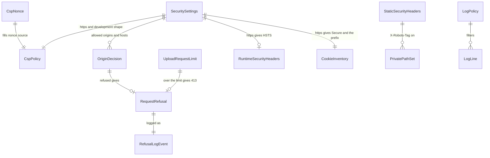

# Entities — U41 `t-502-security-hardening` (release 1, narrowed by FD-105)

The YAML block is the source of truth. U41 is a `library` Unit: it adds no table, column, enum value, migration or i18n key. Its entities are the settings, policies and value objects that the proxy, the route guard, the loggers and the tests share. Entity IDs are frozen once this design is approved (`project.md` Corrections). Review 01 changed ENT-012 (the worker names, R-08) and added ENT-016 (the proxy's unmatched set, R-01).

Release-1 scope (FD-105): security headers and a nonce CSP, Host and Origin checks, the upload request cap, the session cookie posture and `trustedOrigins`, log scrubbing in the web and worker loggers, and the threat notes. Deferred to release 2 and not modelled here: the rate-limit table and `network-key.ts`, `assertAppMode()`, the FD-072 sign-in-delay adversarial test, and the CSP for `sw.js` and the manifest.

Checked on `main` at `b1c68ad` before writing: Next.js 16.3.4 (`node_modules/next/package.json`), Better Auth 1.7.14 (`node_modules/better-auth/package.json`), `proxy.ts` as the Next 16 file convention (`node_modules/next/dist/docs/01-app/03-api-reference/03-file-conventions/proxy.md`: "The `middleware` file convention is deprecated and has been renamed to `proxy`"; "Proxy defaults to using the Node.js runtime").

```yaml
entities:
  - id: ENT-001
    name: SecuritySettings
    description: "The validated security settings of one web process, read from the environment once at first use and never at module load."
    attributes:
      - { name: appOrigin, type: string, required: true, notes: "origin of APP_URL, e.g. http://localhost:3000; always trusted" }
      - { name: allowedOrigins, type: "string[]", required: true, constraints: "appOrigin first, then each APP_ALLOWED_ORIGINS entry not already present; 1 to 11 entries; each an http(s) origin with no path, query, fragment, credentials or wildcard; ASCII lower-case host; default port removed" }
      - { name: allowedHosts, type: "string[]", required: true, notes: "URL.host of each allowed origin (host plus port when not the default), used for the Host, X-Forwarded-Host and serverActions.allowedOrigins checks" }
      - { name: https, type: boolean, required: true, notes: "APP_URL starts with https://; turns on HSTS, upgrade-insecure-requests and the __Secure- cookie prefix" }
      - { name: development, type: boolean, required: true, notes: "NODE_ENV is exactly development; the only switch that adds 'unsafe-eval'" }
    sources:
      - { variable: APP_URL, required: true, example: "http://localhost:3000" }
      - { variable: APP_ALLOWED_ORIGINS, required: false, example: "http://localhost:3000,http://127.0.0.1:3000", notes: "comma-separated full origins; at most 10 entries; empty or missing means APP_URL's origin only" }
      - { variable: NODE_ENV, required: false, notes: "set by next dev / next build / next start" }
    constraints:
      - "an invalid value throws one error that names the variable, never its value (same rule as T-101 BR7.2)"
      - "parsed by the pure lib/security/settings.ts; read and memoised by server/security-settings.ts"

  - id: ENT-002
    name: CspNonce
    description: "A per-request random value that lets Next.js's own scripts run under script-src."
    attributes:
      - { name: value, type: string, required: true, constraints: "base64 of 16 bytes from crypto.getRandomValues (128 bits), 24 characters; generated in proxy.ts for every matched page request" }
    constraints:
      - "never reused, never read from the incoming request, never logged"
      - "forwarded on the request as x-nonce and inside the request's Content-Security-Policy header, from which Next.js extracts it and stamps its framework scripts (Next 16 CSP guide, 'How nonces work in Next.js')"

  - id: ENT-003
    name: CspPolicy
    description: "The typed directive object that lib/security/csp.ts turns into the Content-Security-Policy header of every page response."
    attributes:
      - { name: default-src, type: "source[]", required: true, default: "['self']" }
      - { name: script-src, type: "source[]", required: true, default: "['self', 'nonce-<n>', 'strict-dynamic']", notes: "plus 'unsafe-eval' only when development is true" }
      - { name: style-src, type: "source[]", required: true, default: "['self', 'unsafe-inline']", notes: "no nonce: a nonce in style-src makes browsers ignore 'unsafe-inline', and the ported markup uses style attributes" }
      - { name: img-src, type: "source[]", required: true, default: "['self', 'blob:', 'data:']" }
      - { name: font-src, type: "source[]", required: true, default: "['self']" }
      - { name: connect-src, type: "source[]", required: true, default: "['self']" }
      - { name: frame-src, type: "source[]", required: true, default: "['none']" }
      - { name: object-src, type: "source[]", required: true, default: "['none']" }
      - { name: base-uri, type: "source[]", required: true, default: "['self']" }
      - { name: form-action, type: "source[]", required: true, default: "['self']" }
      - { name: frame-ancestors, type: "source[]", required: true, default: "['none']" }
      - { name: upgrade-insecure-requests, type: flag, required: false, notes: "present only when https is true" }
    constraints:
      - "allowed source tokens: 'self', 'none', 'nonce-<n>', 'strict-dynamic', 'unsafe-inline' (style-src only), 'unsafe-eval' (script-src, development only), blob: and data: (img-src only); no host source, no https: scheme source and no * anywhere (FR99 guard, US12.4)"
      - "worker-src and manifest-src are not written in release 1; default-src 'self' covers them until T-501's PWA work (FD-105)"

  - id: ENT-004
    name: ApiCsp
    description: "The static policy for /api responses, which carry JSON or bytes and never run script."
    attributes:
      - { name: value, type: string, required: true, default: "default-src 'none'; frame-ancestors 'none'" }
    constraints:
      - "set by next.config.ts headers() on /api/:path*, so it also reaches /api/evidence/upload, which the proxy does not match"

  - id: ENT-005
    name: StaticSecurityHeaders
    description: "Headers that do not depend on the environment, set by next.config.ts headers() from the list in lib/security/headers.ts."
    attributes:
      - { name: X-Content-Type-Options, type: string, required: true, default: "nosniff", notes: "every path" }
      - { name: Referrer-Policy, type: string, required: true, default: "strict-origin-when-cross-origin", notes: "every path" }
      - { name: Permissions-Policy, type: string, required: true, default: "camera=(), microphone=(), geolocation=(), payment=(), usb=(), browsing-topics=()", notes: "every path; a file input's camera capture is the operating system's picker and is not affected" }
      - { name: X-Frame-Options, type: string, required: true, default: "DENY", notes: "every path; belt and braces with frame-ancestors 'none'" }
      - { name: Cross-Origin-Opener-Policy, type: string, required: true, default: "same-origin", notes: "every path" }
      - { name: Cross-Origin-Resource-Policy, type: string, required: true, default: "same-origin", notes: "every path" }
      - { name: X-Robots-Tag, type: string, required: false, default: "noindex, nofollow", notes: "only on PrivatePathSet (ENT-006)" }
    constraints:
      - "poweredByHeader stays false (already on main); X-Powered-By is never sent"
      - "Strict-Transport-Security is not in this list: it depends on APP_URL and is set at runtime by the proxy (ENT-007)"

  - id: ENT-006
    name: PrivatePathSet
    description: "Paths that carry X-Robots-Tag noindex, nofollow in addition to the page's own noindex metadata."
    attributes:
      - { name: patterns, type: "string[]", required: true, default: "['/:locale(en|bn)/admin/:path*', '/:locale(en|bn)/admin', '/:locale(en|bn)/me/:path*', '/:locale(en|bn)/me', '/:locale(en|bn)/:page(register|sign-in|verify-email|reset-password|notifications|saved|write)', '/:locale(en|bn)/experiences/:id/edit', '/:locale(en|bn)/authors/:path*', '/api/:path*']" }
    constraints:
      - "the set matches every page that already exports noindex() on main, plus the staff console and /api"

  - id: ENT-007
    name: RuntimeSecurityHeaders
    description: "Headers the proxy adds to every response it lets through, because they depend on the request or the environment."
    attributes:
      - { name: Content-Security-Policy, type: string, required: true, notes: "pages only; the CspPolicy with this request's nonce; also set on the forwarded request" }
      - { name: Strict-Transport-Security, type: string, required: false, default: "max-age=31536000", notes: "only when https; no includeSubDomains and no preload, so a mistake expires instead of locking a domain family" }

  - id: ENT-008
    name: OriginDecision
    description: "The pure verdict of lib/security/origin.ts for one request."
    attributes:
      - { name: outcome, type: "enum", required: true, allowed: "allowed, refused" }
      - { name: kind, type: enum RefusalKind, required: false, allowed: "host, forwarded_host, origin, origin_null, origin_missing, length_invalid, too_large", notes: "set only when refused; the only detail that is logged" }
    inputs:
      - "method, Host, X-Forwarded-Host (first comma-separated value), Origin, Sec-Fetch-Site, and SecuritySettings"
    constraints:
      - "safe methods (GET, HEAD, OPTIONS) are checked for Host only; POST, PUT, PATCH and DELETE are also checked for Origin"

  - id: ENT-009
    name: RequestRefusal
    description: "What the client receives when U41 refuses a request."
    attributes:
      - { name: status, type: integer, required: true, allowed: "400, 403, 413, 500" }
      - { name: body, type: "empty | AppError", required: true, notes: "empty from the proxy; AppError JSON from a route handler (C14 error body)" }
      - { name: headers, type: object, required: true, default: "{ Cache-Control: no-store }" }
    variants:
      - { case: "proxy, any refused kind", status: 403, body: empty }
      - { case: "proxy, settings invalid", status: 500, body: empty }
      - { case: "route handler, host or origin", status: 403, body: "{code: forbidden, messageKey: errors.common.forbidden, correlationId}" }
      - { case: "route handler, Content-Length not a decimal integer", status: 400, body: "{code: validation, messageKey: errors.common.validation, correlationId}" }
      - { case: "route handler, request larger than UploadRequestLimit", status: 413, body: "{code: evidence.too_large, messageKey: <the key U48 maps evidence.too_large to; errors.evidence.tooLarge on main>, correlationId}" }
    constraints:
      - "no attacker-supplied value (Host, Origin, header text) is echoed in the body or the log"
      - "every message key already exists in en.json and bn.json; U41 adds none"

  - id: ENT-010
    name: UploadRequestLimit
    description: "The ceiling on one upload request's body, checked before the body is read and again while it is read."
    attributes:
      - { name: UPLOAD_OVERHEAD_BYTES, type: integer, required: true, default: 65536, notes: "multipart boundaries, part headers and the reviewPublicId and idempotencyKey fields; Next.js's own guidance for multipart overhead is 10-20 KB" }
      - { name: maxRequestBytes, type: integer, required: true, default: 15794176, notes: "EVIDENCE_MAX_FILE_BYTES (15 728 640, U48 ENT-006, C18) + UPLOAD_OVERHEAD_BYTES; U48 sends one file per request (U48 Q7)" }
      - { name: declaredLength, type: "integer | absent", required: false, notes: "Content-Length; absent for a chunked body" }
      - { name: countedBytes, type: integer, required: true, notes: "bytes pulled from request.body so far by the counting stream" }
    constraints:
      - "UPLOAD_OVERHEAD_BYTES lives in lib/security/request-limits.ts; maxRequestBytes is computed in the route from the EVIDENCE_MAX_FILE_BYTES export U48's route already imports, because lib/ may import only contracts and i18n (FD-093 (6))"

  - id: ENT-011
    name: CookieInventory
    description: "Every cookie release 1 sets, with the attributes U41 asserts."
    rows:
      - { name: "rk.session_token (http) / __Secure-rk.session_token (https)", setBy: "Better Auth 1.7.14 through the gateway and applySetCookies", httpOnly: true, sameSite: Lax, path: "/", secure: "only when https", domain: none, maxAge: "30 days (SESSION_MAX_AGE_SECONDS)", sensitive: true }
      - { name: "rk.dont_remember / __Secure-rk.dont_remember", setBy: "Better Auth, only if a sign-in passes rememberMe false", httpOnly: true, sameSite: Lax, path: "/", secure: "only when https", domain: none, maxAge: session, sensitive: true }
      - { name: rk.lang, setBy: "next-intl localeCookie and server/actions/preferences.ts", httpOnly: false, sameSite: Lax, path: "/", secure: false, maxAge: "1 year", sensitive: false }
      - { name: rk.theme, setBy: "server/actions/preferences.ts", httpOnly: false, sameSite: Lax, path: "/", secure: false, maxAge: "1 year", sensitive: false }
      - { name: rk.motion, setBy: "server/actions/preferences.ts", httpOnly: false, sameSite: Lax, path: "/", secure: false, maxAge: "1 year", sensitive: false }
    constraints:
      - "rk.session_data is never set: cookieCache is disabled in server/better-auth/instance.ts"
      - "the staff device, step-up and purge cookies of T-502 step 6 do not exist in release 1 (the staff console is release 2, FD-105)"
      - "no other cookie is set on any page (AC12.4.2)"

  - id: ENT-012
    name: LogPolicy
    description: "The one rule set both loggers apply to every line, in packages/application/src/ports/log-policy.ts, beside the LogFields type it guards."
    attributes:
      - { name: LOG_FIELD_NAMES, type: "readonly string[]", required: true, notes: "exactly the keys of the application LogFields type; a compile-time check fails when a Unit adds a LogFields key without adding it here" }
      - { name: WORKER_LOG_FIELD_NAMES, type: "readonly string[]", required: true, notes: "worker-only names, in apps/worker/src/logger.ts: eventName, eventId, job, queue, queues, outboxPending, code, expectedPolicy, actualPolicy, fix, errorName, sqlState, mode, jobs, signal, message, variables, plus any names U48's worker handlers log that are not in LogFields; fix holds the code db.reset_required (BR6.8), expectedPolicy and actualPolicy hold pg-boss policy names, variables holds environment variable names (BR6.7); message stays listed but is nearly always written as [scrubbed]" }
      - { name: SCRUBBED, type: string, required: true, default: "[scrubbed]" }
      - { name: INVALID_EVENT, type: string, required: true, default: "log.invalid_event" }
      - { name: valueShape, type: regex, required: true, default: "^[A-Za-z0-9._:-]{1,120}$" }
      - { name: tokenRun, type: regex, required: true, default: "[A-Za-z0-9]{32,}", notes: "a value containing such a run is scrubbed; UUIDs pass because their hyphen-separated groups are at most 12 characters" }
      - { name: fileExtension, type: regex, required: true, default: "\\.(jpe?g|png|gif|webp|heic|heif|bmp|tiff?|pdf|docx?|xlsx?|pptx?|txt|rtf|zip|rar|7z|exe|msi|js|html?)$ (case-insensitive)" }
      - { name: eventShape, type: regex, required: true, default: "^[A-Za-z][A-Za-z0-9_]*(\\.[A-Za-z0-9_]+){0,4}$, at most 80 characters" }
      - { name: maxArrayItems, type: integer, required: true, default: 20 }

  - id: ENT-013
    name: LogLine
    description: "One JSON line on stdout or stderr."
    attributes:
      - { name: level, type: enum, required: true, allowed: "info, warn, error" }
      - { name: event, type: string, required: true, notes: "the caller's event when it matches eventShape, else log.invalid_event" }
      - { name: fields, type: object, required: false, notes: "only allowlisted keys, values after the value rule" }
      - { name: "at (web) / ts (worker)", type: "ISO timestamp", required: true, notes: "the envelope keys keep their current names; written last so a field can never overwrite level, event or the timestamp" }

  - id: ENT-014
    name: RefusalLogEvent
    description: "The single log line for a refused request."
    attributes:
      - { name: event, type: string, required: true, default: "security.request_refused" }
      - { name: kind, type: enum RefusalKind, required: true, notes: "LogFields.kind" }
      - { name: status, type: string, required: true, notes: "LogFields.status, e.g. '403'" }
      - { name: correlationId, type: uuid, required: false, notes: "route handlers only; the same id as the AppError body" }
    constraints:
      - "never the Host, Origin, path, query, user agent or address"

  - id: ENT-015
    name: ThreatNote
    description: "One row of docs/security/local-demo-threat-notes.md."
    attributes:
      - { name: threat, type: string, required: true }
      - { name: control, type: string, required: true }
      - { name: test, type: string, required: true, notes: "a test file and case name, or 'deferred (FD-105)' with the release-2 owner" }
      - { name: status, type: enum, required: true, allowed: "covered, residual, deferred" }

  - id: ENT-016
    name: ProxyUnmatchedSet
    description: "The only request paths the proxy does not see; every other path, with or without a dot, is matched (BR3.4)."
    attributes:
      - { name: routes, type: "string[]", required: true, default: "['/api/evidence/upload']", notes: "body-carrying route handlers; each runs guardRouteRequest itself" }
      - { name: frameworkAssets, type: "string[]", required: true, default: "['/_next/static/', '/_next/image']" }
      - { name: rootFiles, type: "string[]", required: true, default: "['/favicon.ico', '/robots.txt', '/sitemap.xml', '/manifest.webmanifest']", notes: "named one by one, never by extension; apps/web/public does not exist on main; a Unit adding a public file adds its exact name here in the same commit" }
    constraints:
      - "no extension pattern: a slugged public id accepts any suffix (SLUGGED_PUBLIC_ID_RE), so /en/experiences/<id>-a.b is a page"
      - "matched Next.js internals (/_next/* other than static and image, /__nextjs*) get the Host check only and skip next-intl"
```

## Entity relationships



Text fallback: SecuritySettings shapes the CspPolicy (https, development), the OriginDecision (allowed origins and hosts), the HSTS header and the cookie prefix. Each request gets a fresh CspNonce. A refused OriginDecision or an oversized upload becomes a RequestRefusal, which is logged once as a RefusalLogEvent. The LogPolicy filters every LogLine of both loggers.
