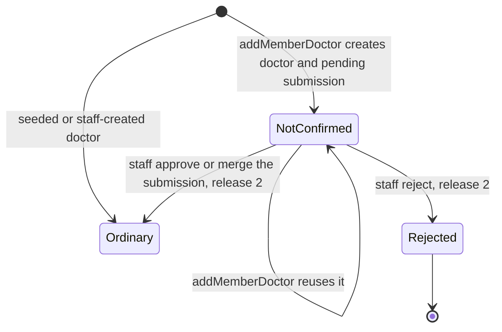
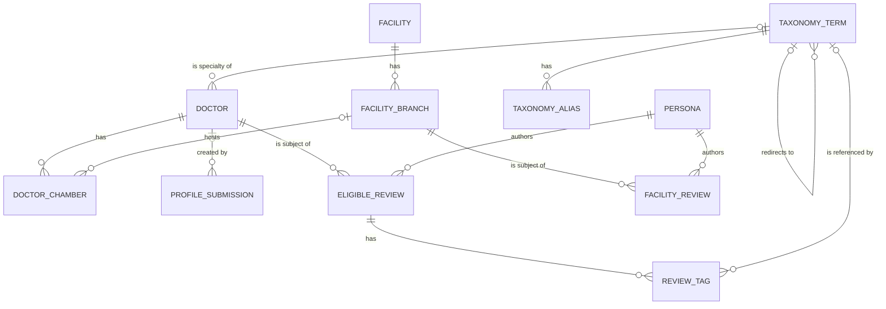

# Functional specification — U46 `u46-directory`

Unit U46 (untagged: module and pages, size XL, not high risk) delivers T-201, T-202 and T-203 for US4.1, US4.2 (FD-100's member-added doctor only), US4.3, US5.3, US6.4 and US2.4 (FD-105). Lead perspective: architect; support perspective: developer (repository reads, SQL mechanics, tests against the real database), written into §§ 8 and 10 and folded into § 12. It starts from the reviewed T-201 design (READY with two Major and two Minor findings) and the T-202 and T-203 drafts, rebased on `main` at `bc63889`, with the demo slice (FD-099..FD-101), T-101 (`87a87c5`), FD-102 and FD-105 in place.

This file is the source of truth for workflows and state transitions. Data shape: `entities.md`. Decision logic: `rules.md`. Screens: `frontend-components.md`. Answers: `functional-design-questions.md` (Questions 1–14, all decided by the agent under the owner's delegation of 2026-11-04).

## 1. What changes, in one paragraph

Doctors, facility branches and health topics become readable through typed module queries that return the view models the prototype's renderers need, and the merged `/doctors`, `/facilities` and `/topics` pages switch onto them in the same Bolt, so `main` keeps one directory predicate and one topic-counting rule. Directory serves `getDoctor`, `listDoctors`, `getFacility`, `listFacilities`, `doctorsAtBranch`, `facilitiesForDoctor` and the internal `addMemberDoctor` (FD-100) that U47's publish will call. Taxonomy serves `getCondition`, `listConditions`, `resolve`, `listSuggested`, the provisional-term operation and the `createProvisional` command. Review figures reach Directory through `ProviderExperience` and Taxonomy through `ConditionStats`, both implemented in a ports-only Review stub (FD-067); document counts come only through the `PublicEvidenceCount` port this Unit declares and binds to today's behaviour (C17). FD-101's free-text topic match becomes the one "about a condition" rule (BR1.7). Member-added doctors keep "Added by a member — not confirmed" through a SQL-derived `memberAddedNotConfirmed` (BR2.13). One migration adds the taxonomy suggestion columns, the open-provisional key, and a branch's own name and hue as new nullable columns, without changing what `facility_branches.name_*` means (BR7.3). The pages gain the prototype's distributions, breakdown, filters, provenance, criteria, places and mentions, with the hard rules held in the data layer.

## 2. Baseline (`main` at `bc63889`)

- **Application** has `command.ts` with `defineCommand`, `defineQuery` and the closed `CommandPorts` (C19); modules `account` and `notification`; ports for `RateLimiter` (key shape `` `${scope}:${'email'|'net'|'account'}:${subject}` ``, in memory per process), `ConfigProvider` (defaults-only, `current(): Promise<ConfigValues>`), `UnitOfWork`, `AuditWriter`, `Outbox`, `Clock`. There is no `ports/repositories/` folder and no directory, taxonomy or review module. `defineQuery` already exists, so T-201's finding F5 is settled.
- **Domain** holds `account/` only.
- **Repository stubs** `packages/database/src/repositories/{directory,taxonomy,review}.ts` throw `NotImplemented('T-201', …)` for T-201's methods, beside T-204, T-407, T-301 and T-302 stubs; `not-implemented.test.ts` pins them; `fakes/repositories-superset.test.ts` checks each fake is a superset of its stub; `FakeReviewRepository` counts every row (ISS-222).
- **Contracts** view-model stubs `doctor.ts`, `facility.ts`, `condition.ts` carry `TODO(T-202)`/`TODO(T-203)`; a stub `ExperienceCardVM` with engagement counts sits in `experience.ts` (U47's file); `discover.ts` and `search.ts` import the card types by name. `doctor-name.ts` has `doctorNameKey`, `doctorNameLetterCount`, `hasControlOrFormat` and `DOCTOR_TITLE_PATTERN` (FD-100).
- **Demo slice** serves the directory pages from `packages/database/src/demo/doctors.ts` (doctor list and profile, the doctor's experiences, topics, plus functions other pages use) and `demo/facilities.ts`, bound in `apps/web/src/server/data.ts`; components in `components/patient/{doctors,facilities,topics}/`. § 3 lists each function and its fate.
- **Schema**: `taxonomy_terms` has no `suggested` column (ISS-157) and no unique key on name keys; `facility_branches.name_*` holds the label when there is one, else the full name; no branch hue. Migrations `0000`–`0009` are applied and `migrations.int.test.ts` pins 10.
- **Seed**: 10 conditions with their aliases, 10 doctors (d7–d10 without `about`), 7 organisations, 10 branches (f6–f10 without address), 24 reviews whose condition tags are Bengali free text only (ISS-161); 21 of them match their topic by FD-101's rule (r2, r21 and r8 do not, Question 12).
- **Gate**: `pnpm check` runs eleven steps (typecheck, lint, lint:boundaries, format:check, check:identity, test:coverage, i18n:check, contrast, contrast:patient, check:motion, build); `pnpm smoke` runs the cumulative smoke suite. No CI runs (FD-102).

## 3. The demo slice: what U46 replaces, absorbs and keeps (T-201 review, Major 1)

| Demo code on `main` | Called by | Fate in U46 | When |
|---|---|---|---|
| `demo/doctors.ts` `listDoctors` | `/doctors` | replaced by `directory.listDoctors`; deleted | U46's Bolt, same commit as the page switch |
| `demo/doctors.ts` `listPublishedReviewsForDoctor` | `/doctors/[id]` | replaced by `ProviderExperience.forDoctor` cards; deleted | same |
| `demo/doctors.ts` `listTopics`, `getTopic`, `taggedWithTopic`, `topicExperienceCount`, `isPublishedTopic` | `/topics`, `/topics/[id]` | absorbed: FD-101's match becomes BR1.7 in the review repository; replaced by `taxonomy.listConditions`, `getCondition`; deleted | same |
| `demo/facilities.ts` (whole file) | `/facilities`, `/facilities/[id]` | replaced by `directory.listFacilities`, `getFacility`; file deleted with `facilities.int.test.ts`; `data.ts` binding line and `demo/index.ts` export line removed | same |
| `demo/doctors.ts` `getDoctor` | `/doctors/[id]` and U22's `experiences/[id]/edit` (by uuid) | U46's profile stops calling it; kept unchanged for the edit page | goes when U22 switches its page, or U50 |
| `demo/doctors.ts` `listRecentPublishedReviews` | U20's home, U47's `/experiences` | kept unchanged | goes when U20 and U47 switch to `review.listExperienceCards` / U47's queries |
| `demo/doctors.ts` `listDoctorOptions`, `listSpecialtyOptions` | U47's `/write` and `server/actions/review.ts` | kept unchanged | goes when U47 switches the composer |
| `demo/reviews.ts` `createQuickReviewWithNewDoctor` | U47's `server/actions/review.ts` | not edited; U46 builds `directory.addMemberDoctor` beside it | U47 switches its call site and deletes it |
| `demo/evidence.ts` `countReadyEvidence` | demo pages; U46's interim binding | not edited (U48's file); wrapped by the interim `PublicEvidenceCount` binding in `container.ts` | U48 swaps the binding and deletes it |
| `demo/demo-slice.smoke.test.ts` | smoke | its `listDoctors`, `listFacilities`, `listTopics` calls move to the directory and taxonomy repository reads with the same assertions; its other assertions stay | U46's Bolt |
| `demo/evidence.adversarial.test.ts` (imports `listPublishedReviewsForDoctor`) | FD-035 fail-closed check: quarantined, infected and scan-error files are never counted on the doctor page | only its `doctorPage` read changes: it reads the doctor page's count through U46's path, `PgReviewReadRepository.publishedForDoctor` for the review ids and the interim `PublicEvidenceCount` adapter for the count (§ 6); every expected value stays (`doctorPage: 1` with one clean file, uncounted through repeated outages); the `detail` and `home` reads (kept functions) stay | U46's Bolt |
| `demo/reviews.int.test.ts` (imports `listDoctors`) | FD-100 rollback check: a failed member-added creation leaves no doctor listed | only its `listDoctors` call changes, to `PgDirectoryModuleRepository.listDoctors({page: 1, pageSize: 100, locale: 'en'})`; the assertion that the name is absent and that no chamber was written stays; its `getDoctor` calls use the kept function and stay | U46's Bolt |
| `contracts/view-models/demo.ts` `DemoDoctorListRow`-only, `DemoFacility*`, `DemoTopic*` types | the deleted functions | each type used only by deleted functions is removed; types the kept functions use stay | U46's Bolt |
| `components/patient/doctors/directory-test-support.ts` builders | home, pages and experience tests | kept and extended; its existing exports (`buildReviewCard`, `loadMessages`, …) stay for those tests | — |

After the Bolt, only the kept functions use the demo predicates, and they apply the same review predicate as BR1.3. No merged page reads `facility_branches.name_*` with a new meaning, because the meaning does not change (BR7.3): on a database seeded before this Unit, f1 still reads "Shefa Health Group — Dhanmondi branch"; after `pnpm demo:reset` it reads "Shefa General Hospital — Dhanmondi branch", "Part of Shefa Health Group".

FD-101's free-text match is kept, not dropped (Question 2), so no FD row is needed for it; the counts on the merged topic pages do not change when they switch.

## 4. Workflows

Every query follows one frame: parse the input with its contracts schema → read through repository ports and declared ports → map rows to the view model in `actor.locale` → `ok(vm)`. A missing or invisible row returns `err('not_found')`, a schema failure `err('validation')`; a thrown database error is an infrastructure error, logged and converted to `internal` by the caller (01-conventions §3). Queries never write (BR6.5). Configuration is read once per call with `await config.current()`.

### WF1 — Code Generation order

1. **Baseline.** `pnpm infra:up`; `pnpm check` and `pnpm smoke` green on the Bolt branch; read the open `ISSUES.md` rows in directory, taxonomy, review, seed and fakes (ISS-157, ISS-161, ISS-222, ISS-266, ISS-268, ISS-294, ISS-398). Check `docs/status/dependency-check-log.md`: the Unit adds no dependency, so no new entry is needed.
2. **FD rows.** Append FD-106, FD-107 and FD-108 of § 17 to `docs/status/decision-log.md` before any code (project.md Mandated).
3. **Domain** `packages/domain/src/{review/policies.ts,directory/,taxonomy/}`: `distribution`, `isLimitedData`, `registrationNotVerified`, `omitEmptyFields`, `branchNames`, `normalizeAliasKey`, with tests (plain values only, BR6.6).
4. **Contracts**: `stableHue` in `ids.ts`; view models in `view-models/{doctor,facility,condition,experience-card}.ts` (§ 7); the stub `ExperienceCardVM` in `experience.ts` replaced by a re-export from `experience-card.ts`; schemas `schemas/{directory,taxonomy}.ts` (`GetDoctorInput` filters typed, `ListDoctorsInput` without the untyped `filters`, `AddMemberDoctorInput`, `ResolveInput` with optional `kind`).
5. **Migration** `<n>_directory_suggestions_and_branch_names.sql` under a working name; number taken at merge (unit-of-work-dependency.md): `taxonomy_terms.suggested boolean not null default false`, `suggested_order smallint check (>= 0)`, partial unique index `taxonomy_terms_open_provisional_key_unique (kind, name_key_en) where provisional and canonical_id is null`; `facility_branches.own_name_en text`, `own_name_bn text` with check "both or neither", `avatar_hue smallint check (0–359)`. Schema files follow; the migration-count pins rise by one (BR8.4). `rk_worker`'s table-level SELECT covers the new columns; no grant changes.
6. **Ports**: `ports/public-evidence-count.ts` (C17 plus the batched form); `ports/repositories/{directory,taxonomy}.ts` and the read methods of `ports/repositories/review.ts`; `modules/directory/ports.ts` (declares `ProviderExperience`), `modules/taxonomy/ports.ts` (declares `ConditionStats`).
7. **Repositories** in new files beside the stubs (BR8.4): `repositories/directory-module.ts` (`PgDirectoryModuleRepository`, with the member-added writes), `taxonomy-module.ts` (`PgTaxonomyModuleRepository`, with the provisional-term writes), `review-reads.ts` (`PgReviewReadRepository`), `public-evidence-count-interim.ts` (§ 6), each with its `*.int.test.ts`. The stub files, `not-implemented.test.ts`, `fakes/repositories.ts` and the superset test are not edited; the T-201 stubs stay as dead code (§ 9 F9).
8. **Review stub**: `provider-experience.ts`, `condition-stats.ts`, the four queries.
9. **Directory and Taxonomy modules**: queries, `internal/add-member-doctor.ts`, `provisional-term.ts`, `commands/create-provisional.ts`, factories `createDirectoryModule(ports)` and `createTaxonomyModule(ports)`.
10. **Fakes** (test-support), in new files: `fakes/directory-repositories.ts` (the directory, taxonomy and review-read repository fakes, implementing the new port interfaces and applying BR1.3, ISS-222) and `fakes/directory-ports.ts` (`ProviderExperience`, `ConditionStats`, `PublicEvidenceCount`), with `directory-repositories.test.ts` (eligibility, and a superset check against the three new repository files); one export line in `fakes/index.ts`.
11. **Seed** `seed-directory.ts`: taxonomy keys through `normalizeAliasKey`; the TAG_GROUPS suggestions (BR4.5); branches with `own_name` = corpus `name` when the corpus has a `branchLabel`, `avatar_hue` = corpus `avatarHue`, `name_*` unchanged (BR7.3). New rows only for new parents, so a re-run stays a no-op.
12. **Wiring** in `apps/web/src/server/container.ts` (append-only block): directory, taxonomy and review-read repositories, the two port implementations, and the interim `PublicEvidenceCount` binding (§ 6).
13. **Pages and components** (`frontend-components.md`); the demo code of § 3 deleted in the same commit as the switch; new i18n keys in both files.
14. **Tests and smoke** (§ 10).
15. **Documents**: `02-data-model.md` §4 (own name, hue, chambers as the only link) and §5 (suggestion columns, open-provisional key, `created_by_account_id` never written); `03-routes-and-contracts.md` §4 (directory, taxonomy, review read entries, the `createProvisional` rate, `addMemberDoctor`); a dated note on C6, C7 and C17 in `contract-summary.md` (BR6.4); the `## Amendments — release 1 (FD-105)` section in T-201, T-202 and T-203.
16. **Issue register** (BR8.5) and the hand-off: every owned-path addition of § 11 with its reason.
17. **Gate**: `pnpm check` (eleven steps), `pnpm smoke`, `npx impeccable detect apps/web/src --no-advisory` exit 0 (BR8.3).

### WF2 — `directory.getDoctor({publicId, condition?, outcome?, relationship?, docs?})`

1. `findDoctorByPublicId(publicId)` → the visible doctor (BR1.1) with specialty name, chambers in `sort_order` (each with its branch's public id when that branch is visible), and `memberAddedNotConfirmed` from the same query (BR2.13); nothing → `not_found`.
2. `providerExperience.forDoctor({doctorId, conditionPublicId?, outcome?, relationship?, docs?, locale})` → cards, scoped sentiment and outcome, conditions, breakdown, `documentCount`, `total`, `scopedTotal`, `showing`, `limitedData`, `selectedCondition?` (BR3.2, BR3.5).
3. `branchesForDoctor(doctorId)` → the visible branches where the doctor has a chamber, named by BR3.11.
4. Map: facts through `omitEmptyFields` with provenance (BR2.2, BR2.11); `about?`; `registrationNotVerified: true` (BR2.5); `claimed`; `avatarHue` (BR3.8).

Unhappy paths: an invalid filter value → `validation` (the page drops it, BR9.3); a condition the doctor has no account for → `selectedCondition` absent (the page redirects without it).

### WF3 — `directory.listDoctors({page = 1, pageSize = 100})`

`listDoctors({page, pageSize, locale})` → visible doctors by locale name, tie public id (BR2.8), each with `memberAddedNotConfirmed`, and `total`; `providerExperience.summariesForDoctors(ids, locale)` → per doctor total, limited flag, sentiment, document count, top three conditions (BR3.2, BR3.10); map to `BoundedPage<DoctorCardVM>`.

### WF4 — `directory.getFacility({publicId})`

1. `findBranchByPublicId(publicId)` → the visible branch (BR1.2) with `name_*`, `own_name_*`, hue, area, city, address, provenance, and its organisation's name, type and claimed flag; nothing → `not_found`.
2. `feedbackVisible = (await config.current()).featureVisibility.facilityAccounts` (BR2.12). If true: `providerExperience.forBranch({branchId, locale})` → visits, nine criteria in enum order, `total`, `limitedData` (BR2.7). If false: not called.
3. `doctorsAtBranch(branchId)` and `branchesOfFacility(facilityId)` (siblings, the branch itself excluded).
4. Map with `notVerified: true` and names by BR3.11.

### WF5 — `directory.listFacilities({page = 1, pageSize = 100})`, `doctorsAtBranch`, `facilitiesForDoctor`

`listBranches({page, pageSize, locale})` → visible branches by title, then label, tie public id, and `total`; when feedback is visible, `providerExperience.summariesForBranches(ids)` → total, limited flag and the `overall` criterion distribution; map to `FacilityCardVM` with `feedbackVisible`. `doctorsAtBranch({branchPublicId})` and `facilitiesForDoctor({doctorPublicId})` return the reference lists of WF4 step 3 and WF2 step 3 (C7; U20 may use them).

### WF6 — `taxonomy.getCondition({publicId})`

1. `findTermByPublicId(publicId)` → the term; not a condition, not published, or mapped → `not_found` (BR4.6).
2. `aliasesOf(termId)` → aliases as written, those equal to the active name left out.
3. `conditionStats.forCondition(termId, locale)` → total, limited flag, doctors total, sentiment, outcome, cards, mentions, doctors, facilities, places, specialties (BR1.7, BR3.3, BR3.4, BR3.6).
4. Map to `ConditionPageVM` with `provisional`.

### WF7 — `taxonomy.listConditions()`

`listTerms('condition', {canonicalOnly: true, locale})` → active canonical conditions by name; `conditionStats.totalsForConditions(ids)` → totals by BR1.7, 0 included (BR4.4); map to `ConditionCardVM[]`.

### WF8 — `taxonomy.resolve({text, kind?})` and WF9 — `taxonomy.listSuggested({group})`

As T-201 WF8 and WF9 (BR4.3, BR4.5). Consumers: U47's composer. On the seed the condition group returns Type 2 diabetes, High blood pressure and Thyroid (hypothyroidism).

### WF10 — the provisional-term operation and `taxonomy.createProvisional({kind, text, lang})`

The operation `ensureProvisionalTerm(tx, {kind, text, lang}, actor)` in `modules/taxonomy/provisional-term.ts` is exported for U47's publish, which calls it on its own transaction with its persona actor:

1. `key = normalizeAliasKey(text)`; empty → `validation`.
2. An active term of `kind` with that name or alias key → return its effective term, write nothing (BR5.2).
3. Else insert the provisional term `on conflict do nothing` on the open-provisional key. Inserted → insert its alias, audit with the caller's actor, outbox `term.changed {id}` (BR5.3). Not inserted → re-read and return the winner.

The command: authorize (BR5.1) → rate limit `taxonomy.createProvisional:account:<accountId>`, 30 per 3600 s, per process (BR5.4) → parse → run the operation in one transaction with the account actor → `{termId}`. No release-1 screen calls the command (Question 14).

### WF11 — `directory.addMemberDoctor(tx, input, actor)` (internal, FD-100)

Called by U47's `review.publish` inside its transaction after publish has checked verified and not restricted. U46 builds and tests it; nothing in U46 calls it.

1. Validate (BR5.5): trim and collapse spaces; letters ≥ 3 after the title; no control or format character; length limits; an optional `specialtyId` must be a published specialty term → else `validation`.
2. `key = doctorNameKey(name)`; take the transaction-scoped lock `doctor-name:<key>` (BR5.6).
3. Find visible doctors whose name key of either language equals `key`, oldest first; the first whose specialty equals the given one, or where either is blank → `{doctorId, reused: true}`; nothing written.
4. Else create (BR5.7): the doctor (published, community provenance, the name in both columns, no `bmdc_number`, no hue); a chamber when `practiceArea` is given; the pending `profile_submissions` row with the BMDC number in its payload and the caller's account as submitter; audit `memberAdded` with the caller's actor; outbox `doctor.changed {id}` (BR5.8) → `{doctorId, reused: false}`.

From that moment the doctor's card and profile show the not-confirmed mark (BR2.13).

### WF12 — Review read queries (`modules/review/queries/`)

`review.sentimentDistribution({doctorId, conditionPublicId?})`, `review.outcomeDistribution({doctorId, conditionPublicId?})`, `review.criteriaDistribution({branchId, key?})` and `review.listExperienceCards({limit = 20, cursor?, doctorPublicId?, conditionPublicId?})` (newest first, keyset cursor on `published_at`, `public_id`). Internal queries for U20 (home latest accounts) and U47, which extends the stub (C9).

### WF13 — Page requests

| Route | Steps |
|---|---|
| `/{locale}/doctors` | `getActor()` → `directory.listDoctors` → threshold from config → `DoctorIndex` |
| `/{locale}/doctors/{id}` | segment not a public id → 404; parse filters (invalid dropped); `getDoctor`; `not_found` → 404; a given condition without `selectedCondition` → 307 to the URL without it; `DoctorProfile` |
| `/{locale}/facilities` | `listFacilities` → `FacilityIndex` |
| `/{locale}/facilities/{id}` | segment check → `getFacility` → 404 or `FacilityProfile` |
| `/{locale}/topics` | `listConditions` → `TopicIndex` |
| `/{locale}/topics/{id}` | segment check → `getCondition` → 404 or `ConditionPage` with the emergency config |

The route segment stays `[id]` (the merged name); it now accepts a public id only. Every link on `main` already uses public ids. Metadata loads through the same `cache()`d call as the page.

## 5. State transitions

### What each state means to this Unit's reads

| Entity | Visible / counts | Otherwise | Extra condition |
|---|---|---|---|
| Doctor | `published` | 404, left out of lists | `merged_into_id` set → 404 (no redirect in release 1) |
| Branch | `published` and organisation `published` | 404, left out | — |
| Review | `published`, no `deleted_at`, `published_at` set | excluded from every figure and list | restored → counts again on the next read |
| Facility review | the same | excluded | — |
| Taxonomy term | `published` | `hidden` = deactivated, never listed or linked | `canonical_id` set → counted for its target, page 404 |
| Document | counted by `PublicEvidenceCount` | not a document | its review must be eligible |

### Member-added mark (FD-100)



Text fallback: a doctor created by `addMemberDoctor` is visible at once and marked "not confirmed" while its submission is pending; a later member typing the same name reuses it and the mark stays. Staff decisions (approve, merge, reject) are release 2 (T-204); approval clears the mark because the submission is no longer pending; what a rejected doctor shows is T-204's decision (FD-100).

| From | Event | To | Rule |
|---|---|---|---|
| none | `addMemberDoctor`, no matching doctor | published, not confirmed | BR5.7, BR2.13 |
| none | `addMemberDoctor`, matching doctor | (no change; doctor reused) | BR5.6 |
| published, not confirmed | submission no longer pending (release 2) | published, ordinary | BR2.13 |

### Provisional term

| From | Event | To | Rule |
|---|---|---|---|
| none | the operation with a new wording (command or publish) | provisional, unmapped, published | BR5.2 |
| none | the operation with a known wording, or losing a race | (no change; existing term returned) | BR5.2 |
| provisional | `mapProvisional` | mapped | release 2 (C6, FD-105) |

### Page request outcome

| Request | Outcome |
|---|---|
| malformed id | 404 without a query |
| unknown, hidden, unpublished, merged or mapped id | 404 |
| visible id, valid filters | 200 |
| invalid filter value | 200 without that filter |
| `condition` the doctor has no account for | 307 to the URL without it |

## 6. Ports

Interface level only; Code Generation writes the TypeScript. `Distribution` = `DistributionVM` (§ 7).

```text
ProviderExperience (declared in modules/directory/ports.ts, implemented in modules/review/provider-experience.ts)
  forDoctor({doctorId, conditionPublicId?, outcome?, relationship?, docs?, locale})
    -> {cards: ExperienceCardVM[], sentiment, outcome, documentCount, total, scopedTotal, showing,
        limitedData, conditions: [{publicId, name, count}], breakdown: [{condition, sentiment}],
        selectedCondition?: {publicId, name}}
  forBranch({branchId, locale}) -> {cards: FacilityAccountVM[], criteria: [{key, dist}], total, limitedData}
  summariesForDoctors(doctorIds, locale) -> Map<doctorId, {total, limitedData, sentiment, documentCount, topConditions}>
  summariesForBranches(branchIds) -> Map<branchId, {total, limitedData, overall: Distribution}>

ConditionStats (declared in modules/taxonomy/ports.ts, implemented in modules/review/condition-stats.ts)
  forCondition(termId, locale) -> {total, limitedData, doctorsTotal, sentiment, outcome, cards,
        mentioned: {medicine, treatment, symptom}: [{label, count}],
        doctors: [{publicId, name, specialty?, count, primaryChamber?, area?, city?, avatarHue}],
        facilities: [{publicId, name, branchName?, type, avatarHue}],
        places: [{hospital?, area?, city?, count}], specialties: [{name, count}]}
  totalsForConditions(termIds) -> Map<termId, number>

PublicEvidenceCount (packages/application/src/ports/public-evidence-count.ts; signature frozen at U46's merge)
  countPublicEvidence(reviewId) -> number                                   (C17)
  countPublicEvidenceByReview(reviewIds) -> ReadonlyMap<reviewId, number>   (added, Question 8; absent = 0)
```

Against the pinned C6 and C7, the dated note on `contract-summary.md` (BR6.4) records two kinds of change:

- **Amendment of C6's `ConditionStats`** (U46 is its provider and its only consumer, so nothing breaks): `forCondition(termId)` becomes `forCondition(termId, locale)`, and its result replaces C6's `doctors: [{doctorId, count}]` with `doctors: [{publicId, name, specialty?, count, primaryChamber?, area?, city?, avatarHue}]`, `facilities: [{branchId, count}]` with `facilities: [{publicId, name, branchName?, type, avatarHue}]`, `districts: [{districtKey, count}]` with `places: [{hospital?, area?, city?, count}]`, and `mentioned: [{kind, termId, count}]` with `mentioned: {medicine, treatment, symptom}: [{label, count}]` (so free-text mentions count, BR3.4); it adds `doctorsTotal`, `cards` and `specialties`. Reason: Taxonomy may not read Directory, so Review returns names. Also an amendment of C7's `ProviderExperience.forDoctor`: its `condition` parameter is taken as `conditionPublicId` (Review resolves it, so Directory never calls Taxonomy), again with U46 as provider and sole consumer.
- **Additions**: `forDoctor`'s extra result fields (condition pills, breakdown, `scopedTotal`, `showing`, `limitedData`, `selectedCondition`), `forBranch`'s `limitedData`, the two `summaries*` methods (index cards without N+1), `totalsForConditions` (topic index), and C17's `countPublicEvidenceByReview`.

Facility figures are the nine criteria only. The implementations read the threshold once per call (BR2.4); Directory's facility queries read `featureVisibility.facilityAccounts` and call the facility methods only when it is on (BR2.12).

**Interim binding**: a U46 file, `packages/database/src/repositories/public-evidence-count-interim.ts`, exports `createInterimPublicEvidenceCount(db)`: `countPublicEvidence(id)` = the demo's `countReadyEvidence(db, id)`; `countPublicEvidenceByReview(ids)` = that call for each distinct id, gathered into a map. It keeps today's meaning (`DEMO_READY_EVIDENCE_STATES`). `container.ts` binds it (U46's block), and `evidence.adversarial.test.ts` uses the same adapter, so the FD-035 check runs through the binding the pages use. U48 swaps the binding for Evidence's implementation, deletes the adapter with `demo/evidence.ts`, and points that test's doctor-page read at its own implementation; the pages pick up the new meaning without edits (C17).

## 7. View models (`packages/contracts/src/view-models/`)

All fields are serialisable; strings are already in `actor.locale`; a missing value is an absent field, never `0` or `""`; ids are public ids (BR2.2, BR2.9, BR2.10). No field is a percentage (BR2.1).

| View model | Fields |
|---|---|
| `DistributionVM` (`doctor.ts`) | `keys`, `counts` (every key), `total`, `notProvided`, `empty`, `limitedData` |
| `ProvenanceVM` | `source` (`community`/`provider`/`admin`), `updatedAt` (ISO 8601) |
| `DoctorCardVM` | `publicId`, `name`, `specialty?`, `area?`, `city?`, `avatarHue`, `topConditions` [{`publicId`, `name`, `count`}] (≤ 3), `documentsCount`, `accountsTotal`, `accountsLimitedData`, `sentiment`, `claimed`, `registrationNotVerified: true`, `memberAddedNotConfirmed` |
| `DoctorProfileVM` | card fields + `about?`, `facts` [{`key`: `bmdc`/`specialty`/`qualifications`/`languages`/`fee`, `value`, `provenance`}] (populated only), `chambers` [{`name`, `hours?`, `provenance`, `branchPublicId?`}], `conditions` [{`publicId`, `name`, `count`}], `breakdown` [{`condition` {`publicId`, `name`}, `sentiment`}], `facilities` [{`publicId`, `name`, `branchName?`, `type`, `avatarHue`}], `accounts` (`ExperienceCardVM[]`), `scopedSentiment`, `scopedOutcome`, `scopedTotal`, `showing`, `selectedCondition?` |
| `FacilityCardVM` (`facility.ts`) | `publicId` (branch), `name` (title), `branchName?`, `parentName?`, `type`, `area?`, `city`, `avatarHue`, `feedbackVisible`, `accountsTotal?`, `accountsLimitedData?`, `overall?` (the three present exactly when `feedbackVisible`), `claimed`, `notVerified: true` |
| `FacilityProfileVM` | card fields + `address?`, `provenance` {`name`, `address?`} (`ProvenanceVM`), `criteria` [{`key`, `dist`}] (nine in enum order; empty when hidden), `accounts` (`FacilityAccountVM[]`; empty when hidden), `doctorsHere` [{`publicId`, `name`, `specialty?`, `avatarHue`}], `siblings` [{`publicId`, `name`, `branchName?`, `area?`, `avatarHue`}] |
| `FacilityAccountVM` | `publicId`, `author` (`BylineVM`), `period` {`year`, `month`}, `posted` (ISO date), `body`, `overall?`, `criteria` [{`key`, `value`}] (answered ones only) |
| `ConditionCardVM` (`condition.ts`) | `publicId`, `name`, `accountsTotal` |
| `ConditionPageVM` | `publicId`, `name`, `provisional`, `aliases`, `accountsTotal`, `accountsLimitedData`, `doctorsTotal`, `specialties` [{`name`, `count`}] (≤ 3), `places` [{`hospital?`, `area?`, `city?`, `count`}], `sentiment`, `outcome`, `medicines`/`treatments`/`symptoms` [{`label`, `count`}], `accounts`, `doctors` [{`publicId`, `name`, `specialty?`, `count`, `primaryChamber?`, `area?`, `city?`, `avatarHue`}], `facilities` [{`publicId`, `name`, `branchName?`, `type`, `avatarHue`}] |
| `ExperienceCardVM` (`experience-card.ts`; `experience.ts` re-exports it) | `publicId`, `title`, `excerpt`, `truncated`, `sentiment?`, `outcome?`, `condition?` {`publicId?`, `name`}, `documentsCount`, `author` (`BylineVM`), `relationship`, `period` {`year`, `month`}, `doctor` {`publicId`, `name`} |
| `BylineVM` | `personaKind`; `displayName` (named only); `username` (pseudonymous only); `initials` (named and pseudonymous only) |

`discover.ts` and `search.ts` keep compiling against the new shapes (they import by name; the search VMs are release 2). `ExperienceCardVM` carries no likes, dislikes or comment count (Question 9); U47 may add optional fields beside it under the additive rule.

## 8. Developer view — repository read methods

All live in new files in `packages/database/src/repositories/` (`directory-module.ts`, `taxonomy-module.ts`, `review-reads.ts`; BR8.4) behind the interfaces in `packages/application/src/ports/repositories/`. Keys, thresholds and locale arrive as arguments (BR6.6).

| Port | Method | Returns |
|---|---|---|
| Directory | `findDoctorByPublicId(publicId)` | visible doctor + specialty names + chambers (branch public id when visible) + `memberAddedNotConfirmed` |
| Directory | `listDoctors({page, pageSize, locale})` | visible doctors by locale name with `memberAddedNotConfirmed`, and `total` |
| Directory | `findBranchByPublicId(publicId)`, `listBranches({page, pageSize, locale})` | branch rows with own name, label, hue, organisation |
| Directory | `branchesOfFacility(facilityId)`, `doctorsAtBranch(branchId)`, `branchesForDoctor(doctorId)` | visible reference rows, via chambers only |
| Directory | `findVisibleDoctorsByNameKey(tx, key)`, `lockDoctorNameKey(tx, key)`, `insertMemberDoctor(tx, …)`, `isPublishedSpecialty(specialtyId)` | the reads and writes of WF11 |
| Taxonomy | `findTermByPublicId`, `listTerms(kind, {canonicalOnly, locale})`, `aliasesOf`, `findByKey(key, kind?)`, `listSuggested(kind, locale)` | term and alias rows |
| Taxonomy | `insertProvisional(tx, …)` → `{termId} \| null`, `insertAlias(tx, …)` | WF10 writes; `null` when a race was lost |
| Review | `publishedForDoctor(doctorId, {conditionTermId?})`, `publishedForBranch(branchId)`, `publishedForTerm(termId)` | eligible rows with byline fields and card condition (BR3.9), no document count |
| Review | `conditionCountsForDoctor(s)`, `breakdownForDoctor`, `doctorCountsForTerm`, `tagFrequencyForTerm(termId, group, locale)`, `placesForTerm`, `branchesForTerm`, `totalsForTerms(termIds)`, `summariesForDoctors(ids)`, `summariesForBranches(ids)` | grouped counts, one query each |
| Review | `listRecentCards({limit, cursor?, doctorId?, termId?})` | keyset page |

Query mechanics, in outline:

- **The member-added mark** is an `exists` sub-select on `profile_submissions` (kind `doctor`, `created_doctor_id` = the doctor, status `pending`) in the doctor row's select list, as the demo computes `memberAdded` today.
- **The review predicate (BR1.3)** joins the subject doctor in every review read and requires it published and not merged, as the demo's `topicExperienceCount` and `selectReviewCards` do; topic totals, condition pages, doctor figures and `listRecentCards` all use it.
- **"About a condition" (BR1.7)** is one SQL fragment in the review repository, shared by every method that relates a review to a term: an `exists` over `review_tags` (group `condition`) with `coalesce(t.canonical_id, t.id) = :term` for term tags, or `lower(btrim(normalize(free_text, NFC)))` in the term's lower NFC names and aliases. The fragment uses explicit table aliases, as the demo's does, so a correlated sub-query never reads an ambiguous column. Grouped forms (per doctor, per term) join the same predicate once and `count(distinct review id)`.
- **Card condition (BR3.9)**: a lateral selection of the first condition tag by (`created_at`, `id`) that resolves to an active term, else the first free-text condition tag.
- **Document counts** are not selected in SQL; the stub calls `countPublicEvidenceByReview` with the page's review ids (BR1.5).
- **Bylines** select only `personas.kind`, `display_name`, `username` (public columns); the mapper drops the name for anonymous personas. `exact_date_enc`, `claimed_by_account_id`, `created_by_account_id`, `submitted_by_account_id`, the submission payload and every account column are never selected into a view-model path (BR2.10).
- **Ordering by name** uses the locale column with the ICU root collation when the compose PostgreSQL 18 image has `und-x-icu`, else the default collation (risk § 15).
- **The name lock** for `addMemberDoctor` is `pg_advisory_xact_lock(hashtext('doctor-name:' || key))`, as the demo uses, so it releases with the caller's transaction.

## 9. Findings and proposed ISS rows

Each is proposed with `Found in U46 (Functional Design)`; the build adds them with the next free numbers (the register ends at ISS-455).

- **F1 (S4, open, release 2)** — Seeded r2 and r21 ("হাইপোথাইরয়েড") and r8 ("ছত্রাক সংক্রমণ") match no topic under FD-101's rule, so c2 and c4 count fewer accounts than the prototype's `conditionId` gives. Counts follow what authors wrote (Question 12); an alias in the prototype data would add r2 and r21 to c2.
- **F2 (S4, interim until U48)** — The interim `PublicEvidenceCount` binding answers the batched form with one query per review (BR3.10's exception). U48's implementation answers it with one grouped query.
- **F3 (S4, release 2)** — Indexes return one page of up to 100 with no paging UI (Question 10); paging comes with search (T-205, T-206).
- **F4 (S4, release 2)** — No redirect for merged profiles or mapped terms (Question 11); T-202's "Redirect" acceptance row is recorded as deferred to release 2 (FD-105).
- **F5 (S4, C18)** — Constants read by U46: `limitedDataThreshold` 5, `emergency.*`, `featureVisibility.facilityAccounts` (through the defaults-only `ConfigProvider`) and the provisional-term limit 30 per account per hour per process (taxonomy constant). Release 2 moves them into T-105.
- **F6 (S4, U50)** — Demo functions kept for other Units' pages (§ 3): `getDoctor`, `listRecentPublishedReviews`, `listDoctorOptions`, `listSpecialtyOptions`. Each goes when its last caller switches; U50 removes leftovers.
- **F7 (S3, this Unit's hand-off)** — A local demo database seeded before this Unit has no branch own names or hues and no suggestion flags until `pnpm demo:reset`; it stays correct (BR7.3) but shows the organisation as the title.
- **F9 (S4, release 2 or U50)** — The T-201 stubs in `repositories/{directory,taxonomy,review}.ts` and their mirrors in `fakes/repositories.ts` (among them the old `FakeReviewRepository` distribution methods ISS-222 names) stay as dead code, because U46 keeps its real repositories and fakes in new files and leaves the shared stub and fake test files untouched (BR8.4, U46 review R-02). They go when those files are next edited for their other owners (T-204, T-301) or in U50's clean-up.
- **F8 (S4, fixed in U46)** — The seed's `keyify` leaves punctuation in taxonomy keys (c2's key is `thyroid(hypothyroidism)`), so an exact `resolve` of its name misses; fixed by `normalizeAliasKey` in the seed (BR4.2, T-201 F2).
- **Existing rows**: ISS-222 fixed (the new fakes apply BR1.3; the old miscounting methods are F9's dead mirrors); ISS-157 fixed (suggestion columns and seed); ISS-268 fixed (the About panel and the facility address read "Not provided" on seeded d7–d10 and f6–f10); ISS-266 won't fix (chambers are the only link); ISS-161 unchanged (the seed's Bengali free text is what BR1.7 matches); ISS-398 unchanged (accepted FD-100 risk, now carried by `addMemberDoctor`).

## 10. Developer view — tests

Test names read as sentences; builders, not hand-written fixtures; no assertion on internals. Database tests are `*.int.test.ts` against `rogikotha_test` and insert their own rows; seed-based rows extend `packages/test-support/src/seed/seed.int.test.ts` and take counts from the corpus (BR8.6).

| Level | Test | Proves |
|---|---|---|
| domain | `distribution` with all keys zero, unknown values ignored, absent values as not provided; limited at 4 of 5, not at 5, 0 empty and not limited | BR3.1, BR2.3, BR2.4 |
| domain | `omitEmptyFields` drops null, blank, empty list and hidden, keeps fact order; `registrationNotVerified` true with and without a BMDC number | BR2.2, BR2.5 |
| domain | `branchNames`: own name present (three names), absent single-branch (one name), absent labelled (organisation and label) | BR3.11 |
| domain | `normalizeAliasKey`: composed and decomposed Bengali give one key; punctuation and spaces go; vowel signs stay | BR4.1 |
| contracts | `stableHue` equals the prototype's `hash` for fixed ids | BR3.8 |
| application | each query's happy path in `en` and `bn` on fakes, configuration answered through a promise | WF2–WF9, BR2.9 |
| application | "doctor profile": facts omit empty fields, provenance matches, the fake `ProviderExperience`'s counts appear unchanged | BR2.2, BR2.11, BR6.1 |
| application | facility feedback off: no figures, and the fake records no `forBranch` or `summariesForBranches` call | BR2.12 |
| application | "locale" and "projection": deep scans find no locale-suffixed key, no private key, no percentage field; anonymous byline has only `personaKind` | BR2.9, BR2.10, BR2.1 |
| application | static import scan: nothing under `modules/directory` or `modules/taxonomy` imports the review module or port | BR6.1 |
| application | `createProvisional`: happy path with audit and outbox; refused for visitor, unverified and restricted actors with nothing written; the 31st call in an hour is `rate_limited`; a repeat returns the same term; the key has the `account` shape | BR5.1–BR5.4 |
| application | the operation inside a caller's transaction with a persona actor: the audit names the persona; no account id is written | BR5.2, BR5.3 |
| application | `addMemberDoctor`: two-letter name, invisible character, unknown specialty → `validation`; reuse when specialties agree or one is blank, create when both differ; audit and `doctor.changed` only on create; the result never carries the BMDC number | BR5.5–BR5.8 |
| database | each repository read method on builder rows | BR8.1 |
| database | "never enters doctor": 20 published facility reviews at a branch where the doctor practises leave `forDoctor`, `summariesForDoctors` and both distributions unchanged | BR2.6 |
| database | reverse isolation: a doctor review with `branch_id` of the branch leaves `forBranch` and `criteriaDistribution` unchanged | BR2.7 |
| database | "hidden": a review hidden, one soft-deleted and one without `published_at` leave every figure and card list; restored, the first returns | BR1.3 |
| database | merged doctor: a published review of a doctor merged into another, and one of an unpublished doctor, are absent from the topic total, the condition page's accounts and distributions, `listRecentCards` and every card list | BR1.3 |
| database | moved FD-035 check (`demo/evidence.adversarial.test.ts`): quarantined, infected and scan-error files are counted on no public page; the doctor-page count is read through `PgReviewReadRepository.publishedForDoctor` and the interim `PublicEvidenceCount` adapter, with the same expected values (`doctorPage: 1` with one clean file; uncounted through repeated outages) | BR1.5, BR7.1 |
| database | moved FD-100 rollback check (`demo/reviews.int.test.ts`): a creation that fails on another account's persona leaves no doctor in `PgDirectoryModuleRepository.listDoctors` and no chamber | BR5.8, BR7.1 |
| database | FD-101 match: a review counts for a topic by term tag, by English name, by Bengali name in decomposed form, by alias, ignoring case and outer spaces; one tagged twice counts once; a hidden term matches nothing | BR1.7, BR1.6 |
| database | member-added mark: a doctor with a pending doctor submission is marked on `listDoctors` and `findDoctorByPublicId`; an approved, a rejected or a facility-kind submission, and no submission, leave it unmarked | BR2.13 |
| database | `addMemberDoctor` on two connections with one name: one doctor, one submission; the payload holds the BMDC number and `bmdc_number` stays empty | BR5.6, BR5.7 |
| database | branch names: a branch with own name and label, one without either, read as BR3.11 says; the both-or-neither and hue checks refuse bad rows | BR3.11, BR7.3 |
| database | two connections inserting one open provisional key: one row; the loser gets `null` and its transaction continues | BR5.2 |
| database | the migration applies from empty; the pinned count is the new count | BR8.4 |
| test-support | `fakes/directory-repositories.test.ts`: a hidden and a soft-deleted review are not counted (ISS-222); each new fake is a superset of its new repository file's methods; the existing `not-implemented.test.ts` and superset test pass unchanged | BR1.3, BR8.4 |
| page | each route's own `page.test.tsx` under `doctors/`, `facilities/`, `topics/` (mocks of `@/server/container` and `@/server/auth`) | BR9.3 |
| seed | per-condition totals equal the corpus counts under BR1.7 (c8 at 0; r2, r21, r8 unmatched); f1 has own name "Shefa General Hospital", label "Dhanmondi branch" and the corpus hue; f2 has no own name; `listSuggested` returns the TAG_GROUPS chips in order and the condition count stays 10 | BR8.6, BR4.4, BR4.5, BR7.3 |
| component | see `frontend-components.md` § 8 (both locales, hard-rule renderings, block order, filters, nine criteria, places, freq bars) | BR2.*, BR9.* |
| smoke | `directory.smoke.test.ts` (database): every doctor card has `registrationNotVerified` true; a pending submission marks its doctor; facility isolation holds. The demo-slice smoke assertions move to these reads | BR8.2 |

## 11. Owned paths, recorded additions and the parallel wave

Owned by U46 (`unit-of-work.md`): `packages/domain/src/{directory,taxonomy}/`, `domain/src/review/policies.ts` (`isLimitedData`, `distribution`), `application/src/modules/{directory,taxonomy}/`, the Review stub files, `ports/repositories/{directory,taxonomy}.ts` and the read methods of `review.ts`, `ports/public-evidence-count.ts`, `contracts/src/view-models/{doctor,facility,condition,experience-card}.ts`, `database/src/repositories/{directory,taxonomy}.ts` and the read methods of `review.ts`, its migration, `database/src/demo/{doctors,facilities}.ts` and the demo topic functions, `test-support/src/seed/seed-directory.ts`, `apps/web/src/app/[locale]/(patient)/{doctors,facilities,topics}/`, `apps/web/src/components/patient/{doctors,facilities,topics,shared}/`.

Recorded additions, each named in the hand-off with its reason:

| Path | Why |
|---|---|
| `database/src/schema/{taxonomy,directory}.ts`, `migrations/meta/` | the migration's columns and snapshot |
| `database/src/repositories/{directory-module,taxonomy-module,review-reads,public-evidence-count-interim}.ts` and their tests | U46's repositories in new files (BR8.4) |
| `database/src/migrations.int.test.ts`, `validator-probes.int.test.ts` (P8) | migration-count pins (the dependency document's migrations rule) |
| `database/src/demo/{facilities.int.test.ts,topics.int.test.ts,doctors.int.test.ts,demo-slice.smoke.test.ts}` | tests of deleted functions removed; smoke assertions moved (BR8.2) |
| `database/src/demo/evidence.adversarial.test.ts` | only the `doctorPage` read in `publicCounts` moves to U46's path; expected values unchanged (FD-035; U46 review R-01) |
| `database/src/demo/reviews.int.test.ts` | only the `listDoctors` call in the FD-100 rollback test moves to `PgDirectoryModuleRepository.listDoctors`; assertions unchanged (U46 review R-01) |
| `database/src/demo/index.ts`, `apps/web/src/server/data.ts`, `contracts/src/view-models/demo.ts` | one export or binding line, and the types only deleted functions used (shared-file rule) |
| `contracts/src/view-models/experience.ts` | the stub `ExperienceCardVM` becomes a re-export (U47 runs after U46) |
| `contracts/src/schemas/{directory,taxonomy}.ts`, `contracts/src/ids.ts` | inputs (§ 4 WF1 step 4); `stableHue` |
| `application/src/ports/index.ts`, `packages/*/src/index.ts` barrels | one export line per module |
| `test-support/src/fakes/{directory-repositories,directory-ports}.ts` and `directory-repositories.test.ts` (new), one line in `fakes/index.ts` | U46's fakes in new files; ISS-222 (BR8.4) |
| `test-support/src/seed/seed.int.test.ts` | seed rows (BR8.6) |
| `apps/web/src/server/container.ts` | the module block and the interim binding (append-only) |
| `apps/web/src/app/[locale]/(patient)/{doctors,facilities,topics}/**/page.test.tsx` (new, owned folders) | U46's page tests |
| `apps/web/src/app/pages.test.tsx` | only the six `/doctors`, `/facilities` and `/topics` rows and the `facilities` entry of its `@/server/data` mock are removed, because those pages no longer read `server/data`; recorded in the Code Generation plan (BR8.4) |
| `packages/i18n/messages/{en,bn}.json`, `apps/web/src/styles/patient.css` | new keys; `/* added: U46 … */` rules |
| `docs/status/decision-log.md`, `docs/implementation/{02-data-model.md,03-routes-and-contracts.md,ISSUES.md}`, the T-201..T-203 task files, `contract-summary.md` | FD rows, documents, issues, amendments, contract notes |

**Parallel wave (U9, U11).** No owned path overlaps, and U46 does not edit `repositories/not-implemented.test.ts`, `fakes/repositories.ts` or the superset test: its repositories, fakes and page tests are new files (BR8.4, U46 review R-02). The only files U46 shares with them are those on the dependency document's shared list (barrels such as `ports/index.ts` and `fakes/index.ts`, `container.ts`, the message files, `patient.css`, `ISSUES.md`), the migrations covered by its migrations rule, and the six directory rows of `apps/web/src/app/pages.test.tsx`, which U46 removes because it replaced those pages (one hunk, recorded in the Code Generation plan; U9 adds rows elsewhere in that file). The swarm merges one Unit at a time and each rebases first.

## 12. Decisions and why

- **Major 1, the demo code.** Replacing only what U46's own pages call, in the same commit as the switch, gives `main` one directory predicate and one topic rule without touching four other Units' pages; the four kept functions apply the same review predicate and leave with their callers (Question 1). Alternative rejected: retiring all of `demo/doctors.ts`, which would make U46 collide with U20, U22 and U47.
- **Major 1, FD-101's match.** FD-101 is binding and the merged counts rest on it; making it the one condition rule keeps counts stable, needs no FD row and no edit to the review block of the seed (Question 2). Term tags still count, and canonical mapping in release 2 counts at once.
- **Major 1, branch names.** New nullable columns keep every existing row's meaning, so merged pages never read a re-meant column, no data migration runs and no reset is needed; the owner's "own hospital name" is still stored and shown after a reset (Question 3). T-201 rejected a separate column because it duplicated single-branch names; this one is filled only when `name_*` holds a label, so nothing is duplicated.
- **Major 2, the not-confirmed mark.** A SQL `exists` beside the doctor row keeps the mark exact for doctors already in a running database, costs no extra round trip, and is tested at database level (Question 4, BR2.13).
- **Minors.** No CI (FD-102): the gate is `pnpm check`, eleven steps, and `pnpm smoke` (BR8.3). `defineQuery` exists (F5 settled). The migration number is taken at merge. The limiter key is `taxonomy.createProvisional:account:<accountId>`, per process (BR5.4).
- **`addMemberDoctor` as an internal operation on the caller's transaction** (C7): the doctor, the submission and the review commit or fail together; the caller's actor goes into the audit so an anonymous publish does not name its account there (BR5.8, the pattern of T-201 F12).
- **A batched evidence count** (Question 8): the port is frozen at merge, so the batch form must exist now for U48 to answer it efficiently later.
- **Ports carry display-ready data; counts with denominators; nine facility criteria; Limited data on summaries; facts omitted but fixed slots "Not provided"** — carried from T-201, T-202 and T-203 and the owner's answers (Questions 5, 13).
- **Leaner than the three designs together**: no redirects (nothing writes one in release 1), no `mapProvisional` (release 2), no claim sheet, no facility visit composer entry, no seeded term tags, no new demo records, no paging UI; each is recorded where it returns.

## 13. If the owner changes an answer

- **Q1 B:** U46's owned paths grow to the home, experiences, write and edit pages; U20, U22 and U47 must wait for U46 and rebase on it. **C:** keep `demo/*` and build beside it; the review's Major 1 stays open.
- **Q2 B:** an FD row superseding FD-101's match; the seed writes a condition term tag per review (an edit to `seed-content.ts`, U47's block); BR1.7 counts term tags only.
- **Q3 B:** the migration re-means `name_*` and adds `branch_label_*`; the seed and pages change in one commit; every local database needs `pnpm demo:reset`. **C:** no own-name column; FD-108 is dropped.
- **Q4 B:** the flag joins every doctor reference VM. **Q5 B:** facts render "Not provided" rows; AC4.1.3 becomes a gap with an ISS row. **Q6 B:** index order by accounts, then name.
- **Q7 B:** T-201's d11 and r25 with an FD row against FD-089. **Q8 B:** single-review port only; the stub loops. **Q9 B:** the stub reads comment counts and versions (community and review tables).
- **Q10 B:** `?page=` links. **Q11 B:** both `resolvePublicId` queries and 308s. **Q12 B:** a c2 alias in the prototype data. **Q13 B:** no About panel; ISS-268's doctor half closes on builder data. **Q14 B:** no command; C6 amended.

## 14. Acceptance mapping (task acceptance rows)

| Task row | Where it is met |
|---|---|
| T-201 Seeded doctor d1 profile | WF2; § 10 seed and application rows; BR2.2, BR2.5, BR2.11 |
| T-201 Facility feedback isolation | § 10 "never enters doctor"; BR2.6 |
| T-201 Limited data threshold | § 10 domain; BR3.1, BR2.4 |
| T-201 Hidden content excluded | § 10 "hidden"; BR1.3 |
| T-201 Zero-count topics listed | WF7; § 10 seed; BR4.4 (10 conditions, c8 at 0, BR8.6) |
| T-201 Locale mapping, No private data | § 10 "locale", "projection"; BR2.9, BR2.10 |
| T-201 FD-067 rows | § 6; § 10 static scan; BR6.1–BR6.3 |
| T-202 Index renders both locales | `frontend-components.md` § 8; BR2.8, BR9.1 (10 doctors on the seed) |
| T-202 Profile block order, Not provided semantics, Filters via URL, Anonymous byline | `frontend-components.md` § 8; BR2.2, BR3.5, BR2.10 |
| T-202 Redirect | deferred to release 2 (FD-105; Question 11) |
| T-203 Nine criteria, Separation, Siblings, Empty topics, Places, FreqList, Locales | `frontend-components.md` § 8; BR2.7, BR1.2, BR4.4, BR3.6, BR3.4, BR9.1 |
| T-202/T-203 Impeccable + contrast, Visual (FD-091), motion check, reduced-motion journey | BR8.3, BR9.2; Build and Test walks the pages beside the prototype at 1280 and 390 px |
| T-202 FD-091 early performance check | Build and Test runs Lighthouse on the `/en` and `/bn` doctor profile and records the figures; not a gate (NFR13's gate is U50's pages) |
| Full check (all three) | WF1 step 17; BR8.3 |

## 15. Risks to verify in Code Generation and Build and Test

- The compose PostgreSQL 18 image has `und-x-icu`; otherwise names sort by the default collation and the hand-off records how Bengali names sort.
- The FD-101 fragment, used in grouped forms, stays within a bounded number of queries per page; if a plan shows it scanning per row, Code Generation adds an expression index on `lower(btrim(normalize(free_text, NFC)))` for condition tags in the same migration and records it.
- The existing superset test and `not-implemented.test.ts` stay green with the stub files untouched; the new superset check covers U46's new repository files.
- Removing the demo types from `demo.ts` leaves every kept function and every test compiling.
- An existing local database keeps working without a reset (BR7.3); Build and Test checks one page before and one after `pnpm demo:reset`.

## 16. Deferred to release 2 (FD-105)

`taxonomy.mapProvisional` and all FR38 management; profile and condition redirects; claims (T-202's claim sheet, "Is this you?"), field changes, photo suggestions, merges and staff decisions on member-added doctors (T-204, T-407); the facility visit composer entry ("Describe your visit"); search, filters from search and the compare tray (T-205, T-206); paging UI; the parent organisation's aggregate page (AC4.3.1 "may"). Their acceptance rows are recorded as "deferred to release 2 (FD-105)".

## 17. FD rows proposed (appended before code)

Numbered FD-106 to FD-108. Code Generation appends them to `docs/status/decision-log.md` before any code (WF1 step 2). Text with the decision-log columns:

- **FD-106 — Summaries show counts with their denominators, never percentages (T-202 Question 1, the owner's answer of 2026-10-28)**: FR48 and AC6.4.1 are narrowed from "counts and percentages with their denominators" to exact counts with their denominators; no view model, page or export shows a percentage of accounts, and bars draw a count against its denominator without a percent text. | The owner's answer: a bare percentage reads as a quality number, which the hard rule forbids; recorded at U46's Functional Design, the first Unit that renders summaries.
- **FD-107 — Facility feedback is the nine criteria, with no sentiment (T-203 Question 1, the owner's answer of 2026-10-28)**: FR49 and AC6.4.3 read "facility profiles use their own non-scored structured feedback: the nine optional criteria (staff, waiting, cleanliness, billing, report time, report reliability labelled patient-perceived, admission and discharge, recommendation, overall), each as a distribution of good, mixed and poor with its denominator"; no facility sentiment exists, and facility feedback never enters a doctor's figures. | The prototype, the corpus and the schema already hold this model; recorded at U46's Functional Design.
- **FD-108 — A branch's own name and hue are stored beside its label (T-203 finding F2, the owner's answer of 2026-10-28; storage decided by the agent under the owner's delegation of 2026-11-04)**: `facility_branches` gains `own_name_en/bn` (both or neither), the branch's own name as the prototype names it ("Shefa General Hospital"), filled only when `name_en/bn` holds a branch label, and `avatar_hue` (0–359). `name_en/bn` keeps its meaning. Pages title a branch by its own name, else its organisation; show `name` as the label when it differs; and show "Part of" the organisation when it differs. Changes `02-data-model.md` §4; public display data only, no data boundary changes (`rk_worker`'s table-level SELECT covers it). Supersedes T-201's draft Question 9 C, which re-meant `name_en/bn`. | Keeps the merged pages correct on every running database without a reset (T-201 review, Major 1).

No FD row is needed for FD-101's free-text match (kept, Question 2) or for the dropped demo records (Question 7).

## Entity-relationship view (derived from `entities.md`)



Text fallback: an organisation has branches, each with a label-or-name, an optional own name and a hue; a doctor has chambers, each optionally at a branch, the only doctor–branch link; a doctor has at most one specialty term and may have been created by a member's submission; terms have aliases and may redirect to a canonical term. Doctors are the subject of reviews, which carry tags that point at a term or hold free text; branches are the subject of facility reviews. Personas author both. Document counts come through the `PublicEvidenceCount` port, not a table edge. There is no edge between facility reviews and doctors.

## Rules summary (derived from `rules.md`)

BR1 visibility, eligibility and the one condition rule; BR2 hard rules in the projection (no quality number or percentage, missing values, distributions, limited data, not verified, the two feedback kinds apart, neutral order, locale, public data, provenance, facility feedback off, the member-added mark); BR3 calculations (distributions, distinct counts, filters, places, excerpts, hues, card conditions, batching, branch names); BR4 taxonomy keys and lookups; BR5 the provisional-term operation, its command and `addMemberDoctor`; BR6 boundaries (FD-067, C17, T-010); BR7 the demo-slice transition; BR8 verification and records; BR9 UI language, motion, not-found and emergency guidance. The table of all 65 rules is at the end of `rules.md`.

## Sources

- `inception/units-generation/unit-of-work.md` (U46, the constants, the open points), `unit-of-work-dependency.md` (shared files, migrations), `unit-of-work-story-map.md`; `inception/user-stories/stories.md` (US2.4, US4.1–US4.3, US5.3, US6.4); `inception/contract-design/contract-summary.md` (C6, C7 with `addMemberDoctor`, C15 release-1 relay map, C17, C18, C19).
- `docs/status/decision-log.md` FD-015, FD-022, FD-024, FD-039, FD-067, FD-089, FD-091, FD-093, FD-099–FD-105; `project.md` hard rules; `team.md` practices.
- `archive/2026-11-04-t-201-functional-design/` and its review; `docs/aidlc-migration/design-drafts/t-202-doctor-index-and-profile/`, `t-203-facility-and-condition-pages/`; `docs/implementation/tasks/T-201`, `T-202`, `T-203`.
- Code on `main` at `bc63889`: `packages/database/src/demo/{doctors,facilities,evidence,reviews}.ts` and their tests, `apps/web/src/server/{data,container}.ts`, the doctor, facility and topic pages and components, `packages/application/src/{command.ts,ports/rate-limiter.ts}`, `packages/contracts/src/{doctor-name.ts,view-models/}`, `packages/database/src/{schema/directory.ts,repositories/,migrations.int.test.ts}`, `packages/test-support/src/{corpus,seed,fakes}/`, `package.json` (`check`).
