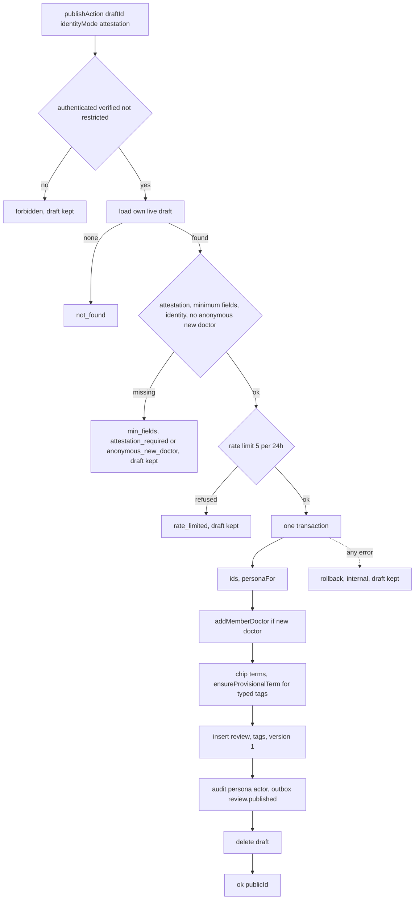
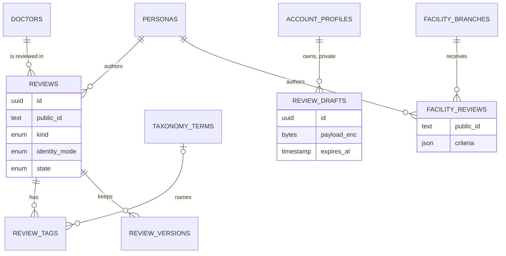

# Functional specification — U47 `u47-reviews` (release 1)

This file is the source of truth for U47's workflows and state transitions. Data shapes are in `entities.md` and decision logic in `rules.md`. The ER view and the rules summary at the end are derived from those files. Release-1 scope (FD-105): quick and detailed review publishing with minimal drafts, facility visit accounts, the public projection, the experience page with its three slots, the index, the author page and the own-review list. Deferred: follow-ups, tombstones and restore, redaction and preview of documents, reactions, the repeat-episode flag, FR46's checkboxes, custom Reviewer's labels and anonymous facility visits.

## 1. What changes

The review module goes from U46's read-side stub to a full module. It adds drafts, `review.publish` and `facilityReview.publish`, the projection, and the three C9 seams. `/write` becomes a four-step wizard that saves to the server and publishes through the module. `/experiences/[id]` renders the projection and mounts the three C16 slots. `/experiences` pages through U46's cards. `/authors/[username]` lists public, non-anonymous contributions. `/me` reads its own-review list from the module. The demo slice's write path (`createQuickReview`, `createQuickReviewWithNewDoctor`, `createPseudonymousPersona`) is deleted in the same Bolt. Everything the demo shows keeps working: write, edit (still the demo edit route until U22), attach documents, read and comment.

## 2. Module surface (C9 release 1, C19)

`packages/application/src/modules/review/` keeps U46's files unchanged. It adds `ports.ts` (`ReviewModulePorts`, ENT-012), `module.ts` (the types in § 2.1) and the factory `createReviewModule(deps)`. `container.ts` gains one review block, which wires the identity and ownership seams, `directory.addMemberDoctor`, `taxonomy.ensureProvisionalTerm` and U46's card query.

| Operation | File | Kind | Input → result | Rules |
|---|---|---|---|---|
| `review.saveDraft` | `commands/save-draft.ts` | command | `{draftId?, payload}` → `{draftId, expiresAt}` | BR1.1, BR1.4, BR2.1, BR2.2 |
| `review.getDraft` | `queries/get-draft.ts` | query | `{draftId}` → `{draftId, payload, expiresAt}` | BR1.1, BR2.3 |
| `review.listOwnDrafts` | `queries/list-own-drafts.ts` | query | `{}` → `DraftSummaryVM[]` | BR2.4 |
| `review.preview` | `queries/preview.ts` | query | `{draftId}` → `ExperiencePageVM` or `FacilityAccountVM` | BR5.10 |
| `review.publish` | `commands/publish.ts` | command | `{draftId, identityMode, attestation: true}` → `{publicId}` | BR1.2, BR1.3, BR3.*, BR4.1–BR4.7 |
| `facilityReview.publish` | `commands/facility-review-publish.ts` | command | same input → `{publicId, branchPublicId}` | BR3.10, BR4.8 |
| `review.getExperience` | `queries/get-experience.ts` | query | `{publicId}` → `ExperiencePageVM` or `not_found` | BR5.1–BR5.9 |
| `review.countExperiences` | `queries/count-experiences.ts` | query | `{}` → `{total}` | BR7.4 |
| `review.authorCards` | `queries/author-cards.ts` | query | `{username, cursor?}` → `{header, page}` | BR7.2 |
| `review.listOwnReviews` | `queries/list-own-reviews.ts` | query | `{}` → `OwnReviewVM[]` | BR1.5, BR7.3 |
| `review.hasOwnReviewOfDoctor` | `queries/has-own-review-of-doctor.ts` | query | `{draftId}` → `{duplicate}` | BR7.5 |
| `review.discardDraft` | `commands/discard-draft.ts` | command | `{draftId}` → `{}` | BR1.1, BR2.6 |
| `reviewIdForPublicId` | `queries/review-id-for-public-id.ts` | internal seam | `(tx, {publicId})` → `reviewId \| null` | BR6.1 |
| `isReviewAuthor` | `queries/is-review-author.ts` | internal seam | `(tx, {reviewId, actor})` → `boolean` | BR6.2 |
| `isReviewPublished` | `queries/is-review-published.ts` | internal seam | `(tx, {reviewId})` → `boolean` | BR6.3 |
| `lastEditedAt` | `queries/last-edited-at.ts` | internal | `(tx, {reviewId})` → `ISO date \| null` | BR6.7 |

### 2.1 The calling convention (pinned; frozen when U47 merges, BR6.8)

`packages/application/src/modules/review/module.ts` declares the types below. `modules/review/index.ts`, which U46 owns, gains one export line for them as a recorded owned-path addition (§ 7).

```text
type ReviewCtx = Tx      -- ports/unit-of-work.ts; valid inside unitOfWork.read and unitOfWork.run
interface ReviewSeams {
  reviewIdForPublicId(tx: Tx, input: {publicId: string}): Promise<string | null>;
  isReviewAuthor(tx: Tx, input: {reviewId: string; actor: Actor}): Promise<boolean>;
  isReviewPublished(tx: Tx, input: {reviewId: string}): Promise<boolean>;
}
interface ReviewModule extends ReviewSeams {
  saveDraft, discardDraft, publish, facilityReviewPublish: Command<…>;     -- defineCommand
  getDraft, listOwnDrafts, preview, getExperience, countExperiences,
  authorCards, listOwnReviews, hasOwnReviewOfDoctor: Command<…>;           -- defineQuery
  lastEditedAt(tx: Tx, input: {reviewId: string}): Promise<string | null>;
}
createReviewModule(deps: ReviewModulePorts): ReviewModule
```

- **The seams are plain functions.** They take the caller's `Tx` and close over the module's repository and `IdentityOwnership`. They never open a transaction, never throw for an expected case, and never take the actor's account id from anywhere other than `actor`.
- **Other modules** (U48 evidence, U49 community, U22's extension) take `Pick<ReviewSeams, …>` in their own factory deps, for example `createEvidenceModule({…, review: Pick<ReviewSeams, 'reviewIdForPublicId' | 'isReviewAuthor'>})`. `container.ts` passes the one `reviewModule` object into them. No module imports another module's repository or the review module's files directly.
- **The web tier** reaches the module through `main`'s `getContainer()`. U47's own append-only block adds the field `review: ReviewModule` to `WebContainer` and builds it beside U46's and U11's entries. Commands and queries run through the existing `runCommand(command, raw)` in `server/command-call.ts`. Seams run inside `getContainer().ports.unitOfWork.read(...)`.

```text
// web call shapes (illustrative)
const c = getContainer();
const page = await runCommand(c.review.getExperience, { publicId });                       // Result<ExperiencePageVM>
const reviewId = await c.ports.unitOfWork.read((tx) => c.review.reviewIdForPublicId(tx, { publicId }));
const isAuthor = reviewId !== null &&
  (await c.ports.unitOfWork.read((tx) => c.review.isReviewAuthor(tx, { reviewId, actor })));
```

The domain is `packages/domain/src/review/` (U46's policy functions stay unchanged). It contains `review.ts` (`minimumFieldsMissing`, `tagRuleSatisfied`, `periodValid`, `deriveTitle`, `detectLanguage`, `graphemeLength`, `orderedSections`) and `facility-review.ts` (`criteriaValid`). All of these are pure and import nothing outside `domain`. `projection.ts` in the module holds the pure `toExperiencePage(review, deps)` and `toFacilityAccount(payload, deps)`.

```text
toExperiencePage(review, {doctor, tagNames, byline, related}) -> ExperiencePageVM   (illustrative)
  flags: sentiment?, outcome?            -- absent means Not provided (BR5.2)
  claims: code -> {code} | other -> {text}   -- always under Reviewer's label (BR5.3)
  sections: orderedSections(review.sections)  -- empty omitted (BR5.4)
  period: {year, month}                  -- never the exact date (BR5.5)
  byline: by personaKind (BR5.7); related lists from deps (BR5.8)
```

## 3. Workflows

Every command follows T-101's `defineCommand`: parse with the contracts schema, authorize by `requires`, then run the handler inside `UnitOfWork.run`. Any `err` rolls back. Every query parses, authorizes, reads, and maps to the view model in `actor.locale`. Queries never write.

### WF1 — `/{locale}/write` request (BR8.1, BR8.8)

1. `access = await getContributionAccess()`. If it is not `allowed`, render the composer heading and `<ContributionGate purpose="write" returnTo="/{locale}/write[?doctor=…]" />`, and stop. No composer data is loaded.
2. Load in parallel through the container: `directory.listDoctors({page: 1, pageSize: 100})`; `directory.listFacilities` when `featureVisibility.facilityAccounts` is on; `taxonomy.listSpecialties()`; `taxonomy.listSuggested({group})` for each of the four groups; `account.getOwnAccount()` for the names; `config.current()` once for `emergency.*` and `featureVisibility.facilityAccounts`.
3. With `?draft=<id>`: `review.getDraft`. If it answers `not_found`, start a new draft and show `compose.draftMissing` once. Without it: `review.listOwnDrafts`. If there are drafts, a "Your drafts" panel lists each with Continue (`?draft=`), above the new composer.
4. Build `ComposerVM` and render `Composer` at the saved step or step 1. `generateMetadata` is `documentTitle('compose')`, and the page is indexable.

### WF2 — Autosave and `review.saveDraft` (BR8.3, BR2.1)

1. 1.5 s after the last change, and on every step change, the client calls `saveDraftAction({draftId?, payload})`.
2. The action calls `getActor()` and then `review.saveDraft`. The command checks `rate_limited` (BR1.4), parses leniently, encrypts, and inserts or updates the actor's own live draft with `expires_at = now + 30 d`.
3. On success the client keeps `draftId`, replaces the URL with `?draft=&step=`, shows `compose.draftSaved`, then asks for `previewAction` and `duplicateHintAction`. Each request carries the save's sequence number, and older answers are dropped.
4. On an error, the client shows `compose.draftNotSaved` and retries (5, 15, 30 s). On `not_found`, the next save creates a new draft.
5. "Save and finish later" flushes the save and goes to `/{locale}/write`, which lists the draft.

### WF3 — `review.preview` (BR5.10)

1. Authorize and load the draft (BR1.1, BR2.3).
2. Build a transient review from the payload without enforcing the minimum. Read the doctor by public id (read only). Name the suggested chips by their terms and show typed tags as written with `provisional: true`.
3. The byline comes from the persona kind of the chosen mode. Named and pseudonymous use the names from `account.getOwnAccount`, passed in by the action. Anonymous gets `{alias: null}`.
4. Return `toExperiencePage` with `publicId` and `publishedAt` absent and empty related lists. For a facility target, return `toFacilityAccount`.

### WF4 — `review.publish` (BR1–BR4)



Text version:
1. Authorization (BR1.2).
2. Load the actor's live draft (BR2.3).
3. Decide in the domain: attestation (BR3.1), then every missing minimum item collected in order (BR3.2–BR3.4, BR3.11), the identity mode (BR3.5), the anonymous new-doctor refusal (BR3.12), and the judgements and labels (BR3.8). A refusal writes nothing and does not count against the limit.
4. Hit the rate limit only now (BR1.3), so the limit counts real publish attempts.
5. In one transaction:
   1. Create the ids and call `personaFor` with the new `reviewId`.
   2. Only for a named or pseudonymous review (BR3.12), create or reuse the doctor through `addMemberDoctor` when a new doctor is given (actor: the account for the submission, `persona:<id>` for audit). An anonymous review never reaches this step, so no `profile_submissions` row ever names the author of an anonymous review.
   3. Resolve the chip terms and call `ensureProvisionalTerm` for typed tags.
   4. Insert the review (`published`, `published_at`, `attestation_at`, language by BR3.7, title by BR3.6, encrypted exact date), its tags and version 1 (actor id = persona id).
   5. Write the audit row with the persona actor and the outbox event `review.published {reviewId, doctorId, branchId: null}`.
   6. Delete the draft.
6. `publishDraftAction` calls `runCommand(getContainer().review.publish, {draftId, identityMode, attestation: true})`. On success it redirects to `/{locale}/experiences/{publicId}?published=1` (BR8.7).

### WF5 — `facilityReview.publish` (BR3.10, BR4.8)

Steps 1–2 are the same as WF4. If facility feedback is off, the command answers `forbidden`. The command then checks the branch, period, story, attestation and criteria, and refuses an anonymous mode (BR3.5). Only then does it hit the shared publish limit (BR1.3). In one transaction it calls `personaFor` (named or pseudonymous), inserts the `facility_reviews` row with every criterion key, writes the audit row with the persona actor, and deletes the draft. It writes no outbox event. The action redirects to `/{locale}/facilities/{branchPublicId}`.

### WF6 — Experience request `/{locale}/experiences/{id}` (BR5, BR6)

1. `publicId = stripSlug(id)`. If it is null, `notFound()`.
2. `load = cache((publicId) => runCommand(getContainer().review.getExperience, {publicId}))`, shared by the metadata and the page. `not_found` → `notFound()`, which gives the localised 404 before any byte is sent (no `loading.tsx` under `[id]`).
3. `getExperience` reads the eligible review with its tags and the doctor reference (U46 predicates). It reads the byline through `identity.publicProjection(personaId)` and the three related lists through `listExperienceCards`. It then calls `toExperiencePage`.
4. The page resolves the id and the authorship once, with the call shapes of § 2.1:
   - `c = getContainer()` and `actor = await getActor()`.
   - `reviewId = await c.ports.unitOfWork.read((tx) => c.review.reviewIdForPublicId(tx, {publicId}))`.
   - `isAuthor = reviewId !== null && await c.ports.unitOfWork.read((tx) => c.review.isReviewAuthor(tx, {reviewId, actor}))`.
   Each slot does the same resolution itself from its `reviewPublicId` prop, and no internal id is passed down.
5. Render `ExperiencePage`: the head (title, byline, flags, Reviewer's labels), the story or sections, `<ReviewHistory reviewPublicId>`, `<EvidenceSection reviewPublicId>`, the author tools when `isAuthor`, `<CommentThread reviewPublicId>`, the related lists, and the persistent disclaimer. The margin holds the period, the published month, the doctor with "Registration not verified" (and the member-added mark when it applies), the tags and the other experiences by the same author.
   The author tools hold `AuthorEvidence reviewPublicId` for every review the author owns. The edit link to `/{locale}/experiences/{publicId}/edit` is shown only for a quick review (`vm.reviewKind === 'quick'`), because the kept demo edit route opens quick reviews only. The condition carries `ASSUMPTION(U47)`, and U22 removes it when its route replaces the demo route (BR6.6, § 11).
6. With `?published=1` and `isAuthor`, the published note with one `PublishTick` is shown and announced once.
7. Metadata: the title, with the author name never in it, and no `robots` (indexable).

### WF7 — Index `/{locale}/experiences?cursor=` (BR7.1)

1. Call `listExperienceCards({limit: 20, cursor})`. `validation` with a cursor → 307 to `/{locale}/experiences`.
2. Call `countExperiences` for the count line.
3. Render `IndexHead`, the count line, U46's `AccountRow` cards (heading level 2) inside `Reveal`, and the pager (More experiences, Back to the newest). An empty list shows `index.beFirst` with a link to `/write`. `loading.tsx` is a static skeleton with no animation.

### WF8 — Author page `/{locale}/authors/{username}` (BR7.2)

`review.authorCards({username, cursor?})` calls `identity.publicPersonaIdsByUsername`, then `listExperienceCards({personaIds, limit: 20, cursor})`, then the header (`@username`, plus the newest named display name found among the cards). An unknown username and a user with no public reviews render the same empty state. Status is 200 and the page is `noindex`. Anonymous personas have no username, so they never match.

### WF9 — Own-review list on `/me` (BR7.3)

`me/page.tsx` replaces `accounts.listOwnReviews(account.accountId, locale)` with `runCommand(getContainer().review.listOwnReviews, {})`. A `not ok` result is thrown to the error boundary, as other server reads are today. The query reads `ownPersonaIds` and lists the actor's reviews in every state except deleted, newest first. `OwnReviewList` renders `OwnReviewVM`, which has the shape of `DemoOwnReviewRow`, so `ProfileWorkspace` does not change.

### WF10 — Code Generation order

1. **Baseline.** `pnpm infra:up`. `pnpm check` and `pnpm smoke` are green on the Bolt branch. Read the open `ISSUES.md` rows in the review, compose and experience areas. Check the dependency-check log (no new dependency is expected).
2. **FD rows** (§ 12): append them to `docs/status/decision-log.md` before any code.
3. **Check the merged seams** against the assumptions in `functional-design-questions.md`: U11's `personaFor`, `publicProjection(s)`, `publicPersonaIdsByUsername` and `IdentityOwnership`; U46's predicates and `listExperienceCards` parameters; U9's `ContributionGate` and `getContributionAccess`. Record any additive change as an owned-path addition.
4. **Domain**, then **contracts** (`schemas/review.ts`: `DraftPayload`, `SaveDraftInput.payload`, `PublishReviewInput` kept; `view-models/experience.ts`: `ExperiencePageVM`, `PageBylineVM`, `OwnReviewVM`; `view-models/composer.ts`: `ComposerVM`, `DraftSummaryVM`; the three label codes as an `as const` list), then the `AuditActor` widening.
5. **Ports and repository**: write methods in `ports/repositories/review.ts` and `packages/database/src/repositories/review.ts` beside U46's read methods (§ 5).
6. **Module**: commands, queries, `projection.ts`, `ports.ts`, the factory, and the container block. Then `taxonomy.listSpecialties` as a recorded addition.
7. **Test support**: `builders/review.ts` (`aReview()`, `aDraftPayload()`) and `fakes/review-repository.ts`.
8. **Web**: actions in `server/actions/review.ts`, the components in `frontend-components.md`, the pages, the slots and the `me/page.tsx` call.
9. **Retire the demo code** (§ 9) in the same commit as the switch, and move the affected tests.
10. **i18n** in both dictionaries in the same commit, with the Bengali drafted and flagged for the owner's bilingual review.
11. **Tests and smoke** (§ 10). Then `pnpm check`, `pnpm smoke`, `npx impeccable detect apps/web/src --no-advisory` and `pnpm contrast`. Hand-off lists the `ISS-` rows (§ 11).

## 4. State transitions

### Review (release 1)

| From | Event | To | Who |
|---|---|---|---|
| (none) | `review.publish` ok | `published` (eligible) | U47 |
| `published` | author correction | `published`, `version + 1` | U22 (demo edit route until then) |
| `published` | hide, remove, delete, restore | — | release 2 (`setState`, tombstones) |

### Draft

| From | Event | To |
|---|---|---|
| (none) | first save, fewer than 10 live drafts | live (`expires_at = now + 30 d`) |
| (none) | first save with 10 live drafts | refused (`conflict`, `errors.review.draftsFull`), nothing written |
| live | discard by its owner | deleted |
| live | save | live, expiry moved |
| live | publish ok | deleted (same transaction) |
| live | publish refused or failed | live, unchanged |
| live | 30 days without a save | expired: `not_found`, row kept until T-309 |
| any | payload unreadable | unreadable: `not_found`, logged |

### Composer (client)

| State | Shown | Leaves to |
|---|---|---|
| gated | heading and `ContributionGate` | — (sign-in or confirmation happens elsewhere) |
| editing step n (1–4) | the step, rail, preview aside | another step, saving |
| saving / saved / not saved | `#saved-flag` text, no motion | editing |
| publishing | Publish disabled, `aria-busy` | refused (summary, editing) or published (redirect) |

### Experience request outcome

| Segment or result | Page | Status | robots |
|---|---|---|---|
| not a public id | 404 page | 404 | — |
| `not_found` (unknown, hidden, removed, deleted) | 404 page | 404 | — |
| eligible | experience page | 200 | absent |
| other error | error boundary | 500 | — |

## 5. Ports and data access

**Files.** The names follow U46's pattern (U46 BR8.4: new files beside the T-201 stubs).
- **Port:** the interface `ReviewModuleRepository` goes in the write side of `packages/application/src/ports/repositories/review.ts`, beside U46's read interface.
- **Implementation:** `PgReviewModuleRepository` in a new file, `packages/database/src/repositories/review-module.ts`, with `review-module.int.test.ts`.
- **Predicates, imported and not rewritten:**
  - the eligibility predicate (U46 BR1.3) from `repositories/review-reads.ts` (`PgReviewReadRepository`'s module);
  - the visible-doctor and visible-branch predicates, and the `memberAddedNotConfirmed` expression, from `repositories/directory-module.ts`.
- **Left alone:** the T-201 stub `repositories/review.ts` (`PgReviewRepository`), `repositories/not-implemented.test.ts` and `fakes/repositories.ts`. The stub's dead methods get an `S4` row for U50.
- **Fake:** `packages/test-support/src/fakes/review-repository.ts` implements `ReviewModuleRepository` and is exported through one line in `fakes/index.ts`.

| Method | Purpose |
|---|---|
| `insertDraft`, `updateOwnDraft`, `countOwnLiveDrafts`, `findOwnLiveDraft`, `listOwnLiveDrafts`, `deleteOwnDraft` | drafts (BR2) |
| `visibleDoctorIdByPublicId`, `visibleBranchIdByPublicId`, `activeTermIdsByPublicIds` | id resolution of reference rows |
| `insertReview`, `insertTags`, `insertVersion`, `insertFacilityReview` | publish (BR4) |
| `findEligibleByPublicId` | review, tags with term names in the locale, doctor reference (BR5.1) |
| `idForPublicId`, `authorPersonaIdOf`, `isEligible`, `lastCorrectionAt` | seams (BR6) |
| `countEligible`, `listByPersonas`, `existsEligibleOfDoctorByPersonas` | lists and the hint (BR7) |

U46's `listExperienceCards` gains the optional `personaIds` and `excludePublicId` filters (additive). The review module never reads `persona_links` or `evidence_items`.

## 6. Contract changes (owned by U47 unless noted)

- `schemas/review.ts`: `DraftPayload` (ENT-006) replaces `payload: unknown`, and `PublishReviewInput` keeps its shape. `ListExperiencesInput` and the follow-up, correction, delete and restore inputs stay as they are (release 2 or U22).
- `view-models/experience.ts`: the T-003 stub fields `likes`, `dislikes`, `identityLabel`, `tombstone`, `followUps` and `evidenceGroups` are removed from `ExperiencePageVM`. `PreviewVM = ExperiencePageVM`. The `ExperienceCardVM` re-export from U46 stays. `OwnReviewVM` is added.
- `view-models/composer.ts`: `ComposerVM` and `DraftSummaryVM` (ENT-009, ENT-010).
- `ports/audit-writer.ts` (baseline C1 and C19, additive): `AuditActor` gains `persona:${string}`.
- `errors.ts` (shared contracts, additive): the error code `review.anonymous_new_doctor` (BR3.12).
- Dated notes in `contract-summary.md`:
  - C9: the release-1 operations above, `discardDraft`, `authorCards`, `lastEditedAt` and the `listExperienceCards` filters. It also pins the calling convention of § 2.1 (`ReviewSeams`, `Tx` first, reached through `getContainer().review` and factory deps). It states that `isReviewPublished` uses U46's imported eligibility predicate (U46 BR1.3), doctor join included, rather than "in the published state".
  - C7: `addMemberDoctor` is never called for an anonymous review (BR3.12). C6 (`taxonomy.listSpecialties`), C1 and C19 (the `AuditActor` widening), and C16 (the slots created, frozen at merge).

## 7. Owned paths and recorded additions

- **Owned** (as listed in `unit-of-work.md` U47): `packages/domain/src/review/` (except U46's two policy functions and U22's `versioning.ts`), `packages/application/src/modules/review/` (except U46's stub files, `index.ts` among them), `ports/repositories/review.ts` (write side), the review repository write side (`packages/database/src/repositories/review-module.ts`, the new file of § 5), `packages/contracts/src/schemas/review.ts`, `view-models/{experience,composer}.ts`, `packages/test-support/src/{builders/review.ts,fakes/review-repository.ts}`, `packages/database/src/demo/reviews.ts`, `apps/web/src/app/[locale]/(patient)/{write,authors}/`, `experiences/` (except `[id]/edit/`), `components/patient/{compose,experience}/` (except U22's `EditForm.tsx`), `profile/OwnReviewList.tsx`, `server/actions/review.ts`, and the seam files `evidence/EvidenceSection.tsx`, `comments/CommentThread.tsx` and `review-history/` until U47 merges.
- **Recorded additions** (each is small and additive, with its reason in the hand-off):
  - `me/page.tsx`: one data call (Question 15).
  - `modules/taxonomy/queries/list-specialties.ts` and its line in the taxonomy factory (Question 19).
  - `ports/audit-writer.ts`: one type member (Question 5).
  - `container.ts`: U47's own append-only block. It adds the field `review: ReviewModule` to `WebContainer`, builds `createReviewModule(deps)`, and is the place where U48 and U49 later pass `reviewModule` into their factories as `Pick<ReviewSeams, …>`.
  - `modules/review/index.ts` (U46's file): one export line for `createReviewModule`, `ReviewModule`, `ReviewSeams` and `ReviewModulePorts`.
  - `packages/contracts/src/errors.ts`: one error code (BR3.12).
  - `packages/test-support/src/fakes/index.ts`: one export line.
  - `packages/i18n/messages/{en,bn}.json`.
  - U46's `listExperienceCards`: two optional filters.
  - `demo/doctors.ts` and its tests: delete `listDoctorOptions` and `listSpecialtyOptions`.
  - The demo tests named in § 9.
- **Not touched:** `ProfileWorkspace.tsx` (U9), `EditForm.tsx` and `experiences/[id]/edit/` (U22), `server/actions/{evidence,comments}.ts` (U48, U49), `components/patient/auth/` (U9), `CommandPorts`.
- **No parallel collision:** U47 runs after U46, U11 and U9 have merged. U22, U48 and U49 start after U47 merges and own the slot folders from then on.

## 8. Facility visit accounts and the public branch page

A published facility visit appears on its branch page through U46's `FacilityAccountRow` (U46 reads `facility_reviews`). U47 adds no facility page. A facility visit never joins a doctor's figures (BR4.8). U46's queries enforce that at query level.

## 9. Demo-slice review code: what U47 replaces and deletes, and when

Everything below happens in U47's Bolt, in the same commit as the switch, so every demo flow works at every commit on `main`.

| Demo code on `main` | Called by | U47's action |
|---|---|---|
| `server/actions/review.ts` `publishReview`, its zod schemas (`ComposeInput`, `NewDoctorInput`, `ComposeCommon`), `personaFor`, `languageOf`, `ComposeField`/`ComposeValues`/`ComposeFormState` | `ComposeForm` | **replaced** by `saveDraftAction`, `previewAction`, `duplicateHintAction`, `publishDraftAction` and `publishFacilityVisitAction` over the review module; **deleted** |
| `server/actions/review.ts` `saveReviewEdit`, `EditInput`, `EditField`/`EditValues`/`EditFormState`, `refused`, `readFields`, `fieldErrorsOf` (the parts the edit needs) | U22's `EditForm` and edit route | **kept unchanged**. U22 replaces the call and deletes them |
| `demo/reviews.ts` `createQuickReview`, `insertQuickReview`, `assertPersonaOfAccount`, `createQuickReviewWithNewDoctor`, `nameKeyOf`, `columnNameKey`, `hueOf` | `publishReview` only | **deleted**. Replaced by `review.publish` with `directory.addMemberDoctor` |
| `demo/reviews.ts` `createPseudonymousPersona` | `publishReview` only | **deleted**. Replaced by `identity.personaFor` |
| `demo/reviews.ts` `getReviewByPublicId` (with its `readyEvidenceCount` SQL) | the experience page; U49's `actions/comments.ts` | the experience page **stops calling it** (it uses `review.getExperience`). It is **kept unchanged** for `actions/comments.ts`; U49 deletes it when it switches to `reviewIdForPublicId` and `isReviewPublished` |
| `demo/reviews.ts` `getOwnReviewForEdit`, `updateOwnReview`, `snapshotOf`, `personasOf` | U22's edit route; U48's `actions/evidence.ts`; the experience page | the experience page **stops calling** `getOwnReviewForEdit` (it uses `isReviewAuthor`). **Kept unchanged** for U22 and U48. The last of the two to switch deletes them, and with them the file |
| `server/data.ts` `reviews` binding | the kept functions | **kept**. It goes with the file |
| `demo/doctors.ts` `listDoctorOptions`, `listSpecialtyOptions` | `/write` and `publishReview` only | **deleted** with their rows in `doctors.int.test.ts`. Replaced by `directory.listDoctors` and `taxonomy.listSpecialties` (U46's "goes when U47 switches the composer") |
| `demo/doctors.ts` `listRecentPublishedReviews` | U20's home; `/experiences` | `/experiences` **stops calling it** (it uses `listExperienceCards`). **Deleted by U47 only if U20 has already switched**, otherwise left for U20 or U50 |
| `demo/accounts.ts` `listOwnReviews` | `/me` | `/me` **stops calling it**. Left without a caller, with an `S4` row for U50 (not U47's file) |
| `components/patient/compose/ComposeForm.tsx`, `ComposePreview.tsx`, `compose-test-support.ts` (its compose parts) | `/write` | **replaced** by the wizard components; **deleted**. `FormErrorSummary`, `OptionGroup`, `TextField` and `period.ts` are **kept and reused** (U22's `EditForm` imports the first three) |
| `components/patient/experience/ExperienceDetail.tsx`, `ExperienceIndex.tsx`, `ExperienceRow.tsx` | the experience page and the index | **replaced** by `ExperiencePage`/`ExperienceBody` and U46's `AccountRow`; **deleted** with their tests. `Byline.tsx` and `people.ts` are **kept** (today's `CommentThread` imports them) and gain the alias form |
| `app/[locale]/(patient)/experiences/[id]/page.tsx` direct `comments.listComments` call and the `EvidenceNote count={review.readyEvidenceCount}` prop | the page | **replaced** by the self-fetching `<CommentThread reviewPublicId>` and `<EvidenceSection reviewPublicId>` slots |
| Tests importing deleted code: `demo/reviews.int.test.ts` (the publish and FD-100 rows), `demo-slice.smoke.test.ts` (its publish assertion), `server/actions/review.test.ts`, `ownership.adversarial.test.ts` (the publish rows), `signed-out.adversarial.test.ts` (the `/write` row), the page tests of `/write`, `/experiences`, `/experiences/[id]` and `/me`, `pages.test.tsx` rows | — | **moved** to the module path in the same commit. Every protective expectation stays: a persona of another account is refused, a failed member-added creation leaves no doctor, and a signed-out publish writes nothing. The two `/write` rows of `signed-out.adversarial.test.ts` change from "redirected to sign in" to "shown the gate", and they still assert that no doctor list or other composer data is read and that the `returnTo` (with `?doctor=`) stays on `/write`. The reason is recorded in the hand-off (BR8.1) |

The header of `demo/reviews.ts` is rewritten to list its remaining functions and the Unit that retires each one (U22, U48, U49). U50 removes anything left without a caller.

## 10. Tests (test-after, `team.md` Testing Posture)

- **Domain:** every branch of `minimumFieldsMissing` in its order, the tag rule, the period and exact date, `deriveTitle` with Bengali graphemes, `detectLanguage`, and `criteriaValid`. A `no-score` test checks that `DraftPayload`, `ExperiencePageVM` and the criteria have no numeric judgement field.
- **Application (fakes):**
  - `saveDraft`: create, update, another account's draft, an expired draft, the rate limit, and an eleventh live draft refused with `errors.review.draftsFull` while saving an existing one still works. `discardDraft`: own draft deleted, another account's draft `not_found`.
  - `publish`: the happy path in each identity mode; each refusal (unconfirmed, restricted, rate limited, attestation, every `min_fields` item, a bad exact date, a bad label); rollback when `addMemberDoctor` or `ensureProvisionalTerm` fails; five `min_fields` refusals followed by a valid publish succeeds (the limiter is hit only after validation, BR1.3); anonymous mode with a new doctor refused with `review.anonymous_new_doctor` and `addMemberDoctor` never called; one audit assertion with the `persona:` actor; the outbox payload.
  - `facilityReview.publish`: happy path, feature off, anonymous refused.
  - Projection: Not provided, Reviewer's label, section order, month and year only, each byline kind, `otherByAuthor` empty for anonymous, and a key-denylist deep scan over generated reviews (BR5.9).
  - The three seams, including `isReviewAuthor` false for another account's anonymous review and for an unknown id.
- **Database (`*.int.test.ts`):** every repository method. Publish and rollback in one transaction leave no persona, term or doctor behind. A seeded plaintext draft is unreadable but not deleted. `exact_date_enc` is never selected by a public read.
- **Component (en and bn):** each wizard step, the gate state, the summary of missing fields, `ExperienceBody` in page and preview modes, each byline, the three slots including their empty states, the index and the author page empty state.
- **Smoke (`*.smoke.test.ts(x)`, at least one):** publish a quick review through the module and read it back through `getExperience`; the experience page renders its three slots.
- **Anonymity checks** in the normal suite (U47 is not in the high-risk class): two anonymous reviews by one account have different aliases, and neither appears on the author page or in the other's related lists. `isReviewAuthor` answers another account the same as an unknown id. A database test publishes an anonymous review with a `newDoctor` in the payload, expects `review.anonymous_new_doctor`, and asserts that `profile_submissions`, `doctors`, `reviews` and `persona_links` are unchanged. It also asserts that no `profile_submissions` row ever has a `created_doctor_id` whose reviews include an anonymous one (BR3.12).

## 11. Issue rows (added at Code Generation)

| Row | Severity |
|---|---|
| Module constants for T-105: publish 5 per 24 h, draft save 300 per hour, sentiment optional, the three label codes | S4 |
| Expired and discarded-by-expiry drafts are not purged, and no expiry warning is sent, until T-309's `retention.expire` job (FD-090 grant not applied). Live drafts are capped at 10 per account meanwhile (BR2.6) | S4 |
| U22: the kept demo `updateOwnReview` writes `review_versions.actor_id = accountId` on every correction. It must write the author persona id instead (FD row 4, BR4.7) when U22's `review.correct` replaces it | S4 |
| U22: the kept demo edit route (`getOwnReviewForEdit`) opens quick reviews only, so detailed reviews cannot be edited. The edit link is hidden on detailed reviews until U22's route supports them (BR6.6) | S4 |
| The T-201 stub `repositories/review.ts` keeps its unimplemented methods. U50 removes the ones no Unit implemented | S4 |
| Seeded plaintext drafts are unreadable (ISS-269, draft part) and wait for the release-2 drafts tab | S4 |
| Doctor picker is limited to the first 100 doctors; a search picker comes in release 2 | S4 |
| Anonymous facility visits deferred (FD row) | S4 |
| FR46 checkboxes and custom Reviewer's labels deferred (FD rows) | S4 |
| `demo/accounts.ts` `listOwnReviews` and, if U20 has not switched, `listRecentPublishedReviews` left without a U47 caller | S4 |
| Typed tag text that equals an existing alias is shown under the canonical term's name | S4 |

## 12. FD rows appended before code

Each row is marked "decided by the agent under the owner's delegation of 2026-11-04" and takes the next free FD number.
1. FR46's "What went well / What could improve" checkboxes are deferred to release 2. AC6.2.3 is narrowed to its sentiment half (Question 6).
2. Release-1 Reviewer's labels are the prototype's three suggested labels. Custom labels are deferred, and stored labels that are not codes are shown as written (Question 7).
3. Facility visit accounts are named or pseudonymous in release 1. Anonymous facility feedback is deferred (Question 4).
4. The author persona (`persona:<id>`) is the actor of review publish audit rows and of `review_versions.actor_id`, never the account. `AuditActor` is widened additively, and `01-conventions.md` §5 gets a dated note (Question 5).

## 13. Risks to check in Code Generation and Build and Test

- U46's predicates or card filters may have merged under other names. Import them, or add the filters additively (assumptions in the questions file).
- `ensureProvisionalTerm` and `addMemberDoctor` must run on the caller's `Tx` with no transaction of their own. A test proves that a publish rollback removes their writes.
- `getContributionAccess` called from a server component must keep the request's cookies (T-102's own risk). The `/write` page test mocks `@/server/actions/account`.
- The seed's anonymous personas must project an alias or null (T-104 BR2.7). A seeded legacy "Anonymous" row shows only "Written anonymously".

## Entity-relationship view (derived from `entities.md`)



Text version: a persona authors many reviews and facility visit accounts. A doctor has many reviews. A review has many tags (each naming a taxonomy term, or Not sure) and many versions. An account owns many private drafts. A branch receives many facility visit accounts. No line joins facility visits to doctors.

## Rules summary (derived from `rules.md`)

| Group | Rules | In one line |
|---|---|---|
| BR1 | BR1.1–BR1.5 | Confirmed accounts write. Publish is limited to 5 a day, counted after validation, and draft saves to 300 an hour. Own lists are private. |
| BR2 | BR2.1–BR2.6 | Drafts are encrypted, owner-only, capped at 10 live per account, and expire 30 days after the last save. An unreadable draft does not exist. A draft is deleted by its own publish or its owner's discard. |
| BR3 | BR3.1–BR3.12 | Attestation, the minimum fields, tags, period, identity, title, language, optional judgements, text as written, facility visits, the member-added doctor, no new doctor on an anonymous review. |
| BR4 | BR4.1–BR4.9 | One transaction. Persona, doctor and terms come through their modules. The audit actor is the persona. One event. Version 1. Facility visits are kept apart. Clean logs. |
| BR5 | BR5.1–BR5.10 | Eligible only. Not provided. Reviewer's label. Text as written. Month and year. Registration not verified. Bylines. Related lists. The denylist. The preview. |
| BR6 | BR6.1–BR6.8 | The three seams, the slots, author tools for the author only, the Edited date, frozen at merge. |
| BR7 | BR7.1–BR7.5 | The index, the author page, the own list, the exact count, the duplicate hint. |
| BR8 | BR8.1–BR8.12 | Gate, steps, autosave, checks, preview, refusals, calm confirmation, defaults, add-a-doctor, facility target, motion, no caveat. |
| BR9 | BR9.1–BR9.4 | Bilingual keys, demo retirement, boundaries, hard rules. |

## Sources

- Initial description: the dispatch brief for U47 (2026-11-04).
- `inception/units-generation/unit-of-work.md` U47 (responsibilities, seams, owned paths), U22, U46, U48, U49, the constants table, the open points; `unit-of-work-story-map.md`.
- `inception/contract-design/contract-summary.md` C4, C7, C9 (release 1), C15, C16, C17, C18, C19, the ownership rules.
- `docs/status/decision-log.md` FD-014, FD-015, FD-022, FD-024, FD-090, FD-099, FD-100, FD-101, FD-105.
- `construction/t-104-identity-module/functional-design/functional-spec.md` § 1–3, `entities.md` (PersonaPublicVM), `rules.md` BR1.4, BR1.6, BR2.7, BR3.4.
- `construction/t-102-patient-auth-screens/functional-design/` (ContributionGate, getContributionAccess).
- `construction/u46-directory/functional-design/functional-spec.md` § 3, WF10–WF12, § 7, `rules.md` BR5.5–BR5.8, BR6.3, BR7.2.
- Drafts in `docs/aidlc-migration/design-drafts/t-301-review-module-core/`, `t-306-composer-wizard/`, `t-307-experience-page-and-index/`.
- Code on `main` at `29e1837` (see `functional-design-questions.md` Sources).
