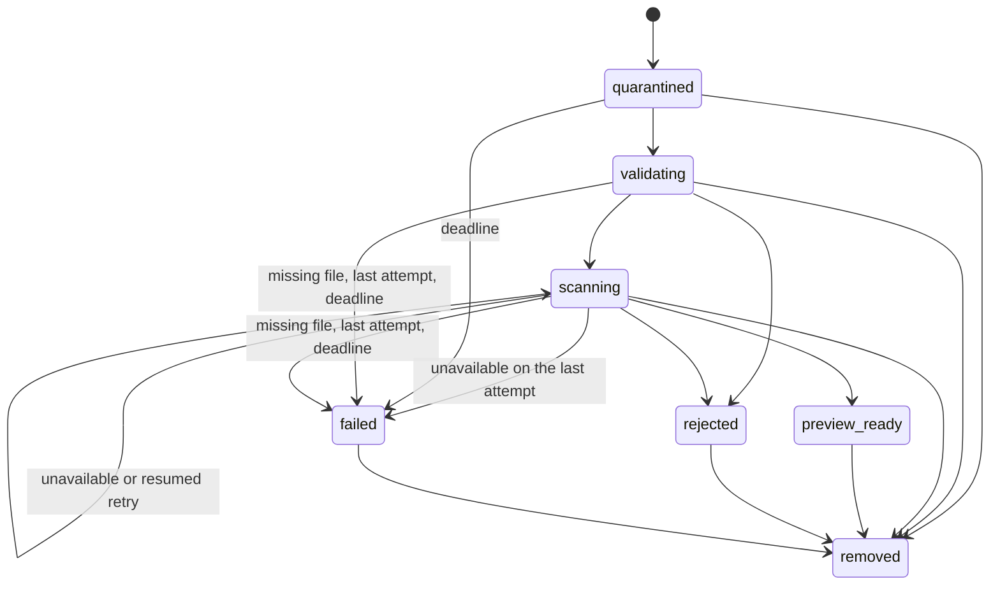
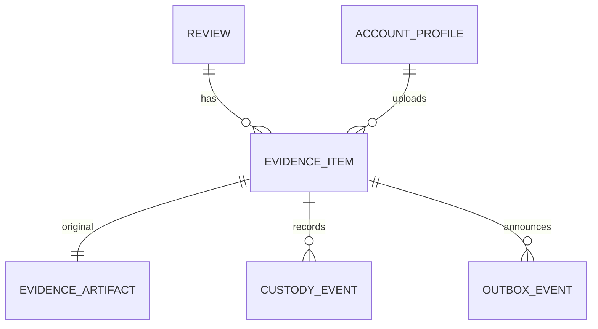

# Functional specification — U48 `u48-evidence` (release 1)

This file is the source of truth for U48's workflows and state transitions. Data shapes are in `entities.md` and decision logic in `rules.md`; the ER view and the rules summary at the end are derived from them. Release-1 scope (FD-105): upload to quarantine, the worker's validate-and-scan job that fails closed, a sweep that ends anything the job could not finish, the author's own list and removal, and the public note with the count. Deferred to release 2: sanitise and re-encode, preview, redaction, privacy confirmation, publication of processed copies, the viewer, custody views for staff, retention expiry and in-app notifications. Review 01's changes are listed in `functional-design-questions.md` § Review 01 findings.

## 1. What changes

The Evidence module is new in `packages/application/src/modules/evidence/`. Uploads move from the demo server action to `POST /api/evidence/upload`; the ClamAV scan moves from the web request into the worker's `evidence.process` job; file storage and the clamd client move from `apps/web/src/server/` into `packages/adapters/src/{storage-fs,scanner-clamd}/`. `countPublicEvidence` replaces U46's interim binding. `<EvidenceSection reviewPublicId>` and `<AuthorEvidence reviewPublicId>` keep their C16 props and get new internals; the experience page is not edited.

**End state of the release-1 pipeline: `preview_ready`** (BR4.4, BR5.1, Q2). It is the existing `EVIDENCE_STATES` value that, in the full pipeline, means "passed every automatic check and is ready for the author's privacy step". Release 1 stops there with no preview artifact. `published` stays reserved for a processed copy that was published (release 2, and the seeded corpus). `PUBLIC_EVIDENCE_STATES = ['preview_ready', 'published']`. No new enum value. Release 2 (T-305) narrows the list to `['published']` when processed copies exist; this is recorded as an S4 row.

**Every item ends in a final state.** A clean scan ends `preview_ready`; a failed check or a detection ends `rejected`; a scanner that stays down ends `failed`/`scanner_unavailable`; a missing file ends `failed`/`unknown`; anything else that stops the last attempt, and any item still in processing an hour after upload, ends `failed`/`processing_timeout` (BR4.9–BR4.11). A failed item is not counted, takes no slot, and shows its author a reason and Remove.

## 2. Module surface (C8 release 1, C17)

`createEvidenceModule(deps)` in `modules/evidence/module.ts`. Deps (`modules/evidence/ports.ts`): `unitOfWork`, `evidenceRepository`, `files: EvidenceFileWriter` (`ports/evidence-storage.ts`, BR3.6), `filenameSeal` (seal and open, wrapping the web tier's existing field cipher in `container.ts`), `rateLimiter` (C19), `clock`, `logger`, and `review: Pick<ReviewSeams, 'reviewIdForPublicId' | 'isReviewAuthor' | 'isReviewPublished'>` from U47's § 2.1 convention. The worker builds two narrower objects with `files: EvidenceFileReader`, no `filenameSeal` and no review seams: `createEvidenceProcessor({unitOfWork, evidenceRepository, files, scanner, clock, logger})` and `createEvidenceSweep({unitOfWork, evidenceRepository, files, clock, logger})`.

| Operation | File | Kind | Input → result | Rules |
|---|---|---|---|---|
| `evidence.admitUpload` | `commands/admit-upload.ts` | command (one rate-limit hit, no row written) | `{}` → `{}` or `err(rate_limited, retryAfter)` | BR1.1, BR2.7 |
| `evidence.checkUpload` | `commands/check-upload.ts` | command (read-only, no row written) | `{reviewPublicId, idempotencyKey, bytes}` → `{existing: {itemId, state}} \| {proceed: true}` | BR1.1, BR1.2, BR2.3–BR2.5, BR2.8 |
| `evidence.intake` | `commands/intake-evidence.ts` | command | `{reviewPublicId, declaredMime, declaredName, idempotencyKey}` + quarantined key and byte facts → `{itemId, state}` | BR1.1, BR1.2, BR2.*, BR3.4, BR4.1 |
| `evidence.getForAuthor` | `queries/get-for-author.ts` | query | `{reviewPublicId}` → `OwnEvidenceList \| null` | BR1.3, BR6.1, BR6.2 |
| `evidence.remove` | `commands/remove-evidence.ts` | command | `{itemPublicId}` → `{}` | BR1.3, BR6.3, BR4.7 |
| `countPublicEvidence` | `queries/count-public-evidence.ts` | port implementation (C17) | `reviewId` → `number` | BR5.1, BR5.2 |
| `processEvidence` | `jobs/process-evidence.ts` | worker use case | `{itemId, attempt, lastAttempt, signal}` → `done \| retry` | BR4.2–BR4.10 |
| `sweepEvidence` | `jobs/sweep-evidence.ts` | worker use case | `{}` → `{ended: number}` | BR4.2, BR4.7, BR4.11 |

The route passes the internal `reviewId` to the command only after resolving it (C8 amendment). To keep resolution and authorship in one transaction, the command takes `reviewPublicId` and calls the seams inside its own `unitOfWork.run` (BR1.2); the C8 field `reviewId` is therefore internal to the command. This is recorded as a contract note (Q6).

Domain (`packages/domain/src/evidence/`, imports nothing): `states.ts` (`PUBLIC_EVIDENCE_STATES`, `COUNTING_STATES`, `PROCESSING_STATES`, `authorStatusOf(state)`), `limits.ts` (the ENT-006 constants: `EVIDENCE_MAX_FILE_BYTES = 15 728 640`, `EVIDENCE_MAX_PER_REVIEW = 10`, `EVIDENCE_MAX_TOTAL_BYTES = 104 857 600`, the upload limit, the attempt budget and the processing deadline), `file-type.ts` (`detectImageType(head)`, `extensionMatches(name, mime)`, `imageStructureValid(bytes)` per BR4.3), `transitions.ts` (the table in § 4, `nextOnScan(result)` and `sweepReason(latestCustody)`), `filename.ts` (`cleanFilename`).

## 3. Workflows

### WF1 — Upload `POST /api/evidence/upload` (BR1.1, BR1.2, BR2, BR3)

1. U41's origin check and the Content-Length cap (`EVIDENCE_MAX_FILE_BYTES` + 64 KB = 15 794 176 bytes) run first; an oversized request is refused before the body is read (U41 owns these lines).
2. The route reads the session actor; signed out answers `401`, unconfirmed answers `403` (BR1.1).
3. Rate limit (BR2.7), through `evidence.admitUpload` before the body is read: `rateLimiter.hit('evidence.upload:account:<accountId>', 30, 3600)`; refused answers `429` with `ev.upload.errors.rateLimited`.
4. Parse the multipart form with `request.formData()`: `reviewPublicId`, `idempotencyKey` (a UUID), exactly one `file` part (Q7). The body stays in memory, bounded by step 1; nothing is on disk yet. A malformed `reviewPublicId` answers `404`; no file part answers `400` with `ev.upload.errors.noFile`.
5. From the first 16 bytes run `detectImageType`; with the cleaned name's extension and the declared MIME apply BR2.1 (`400 evidence.type_rejected`). Then BR2.2 on the file's size (`400 evidence.too_large`; empty is `type_rejected`).
6. Pre-check (BR2.8), `evidence.checkUpload` in `unitOfWork.read`: resolve and check the review (BR1.2, `404`); look up the idempotency key (BR2.5) and, if it exists, answer `200 [{itemId, state}]` with the existing item without writing the file; count (BR2.3, `400 evidence.too_many`); total with this file's size (BR2.4, `400 evidence.total_too_large`). Why this order is safe: nothing reaches the disk for a foreign review, a full review or a repeat, and the cost of a refused request is one bounded in-memory body under the rate limit.
7. Write the file with `files.putQuarantined(stream, {maxBytes: EVIDENCE_MAX_FILE_BYTES})`, which returns `{key, bytes, sha256}` or `too_large` (its own counter; BR2.2). A partial file is deleted.
8. Call `evidence.intake` through `runCommand`. In one `unitOfWork.run`, in this order: resolve and check the review (BR1.2); check the idempotency key (BR2.5), and if it exists return that item; take the per-review lock and check the count (BR2.3) and the total (BR2.4); insert the item (`state quarantined`, `detected_mime` from step 5, sealed name), the original artifact (`public false`), custody `received` (actor `account:<id>`, details `{bytes, mime}`), and outbox `evidence.received {itemId}` (BR4.1).
9. On any `err` from step 8, an idempotent answer from step 8, or a thrown error, delete the quarantined key (BR3.4) and answer the mapped status (§ 4 "Upload request outcome"). On success answer `200 [{itemId, state: 'quarantined'}]`, where `itemId` is the item's public id.
10. The uploader refreshes the author list (`router.refresh()`); no path revalidation of public pages is needed because the public count does not change until the scan ends.

### WF2 — `evidence.process` job (BR4)

1. The relay's existing map entry routes `evidence.received` to `evidence.process`. The job data is the C15 envelope `{eventId, name, payload: {itemId}}`; the singleton key is `evidence.process:<eventId>` from `jobKey`, one per item because intake appends exactly one `evidence.received` per item. Queue options come from `QUEUE_DECLARATION`: exclusive, `retryLimit 3` (four attempts), `retryDelay 10 s` with backoff, `expireInSeconds 300` (BR4.1).
2. `PgBossQueue.work` fetches with `includeMetadata: true` and calls the handler with `(job.data, {jobId, retryCount, retryLimit, signal})`; `main.ts` passes it on as `def.handler(payload, ctx, meta)`. The handler checks the envelope with zod (a malformed job is logged and finishes, as `mail.send` does) and calls `processEvidence({itemId, attempt: retryCount + 1, lastAttempt: retryCount >= retryLimit, signal})` under `AbortSignal.any([signal, AbortSignal.timeout(120000)])` (BR4.6, BR4.9).
3. Load the item's processing facts (BR4.8). Missing, or state not in `{quarantined, validating, scanning}`: finish (BR4.2). `created_at` older than 3600 s: current state → `failed`/`processing_timeout`, custody `failed`, outbox; finish (BR4.9).
4. State `quarantined`: compare-and-set `quarantined → validating`. State `validating` or `scanning` (a retry after a crash, an expiry or a thrown retry): resume from that state without that transition (BR4.9).
5. Read the original with `files.readQuarantined(key)`. `original_missing`: current state → `failed`/`unknown`, custody `failed {failReason: 'unknown', cause: 'original_missing'}`, outbox; finish without a retry (BR4.10).
6. Check sha256, size, magic bytes and the full structure (BR4.3). Failure: delete the original file, then current state → `rejected` with the reason, custody `validation_failed {failReason}`, outbox; finish. Pass from `validating`: `validating → scanning`, custody `validated` and `scan_started`. Pass from `scanning`: no state change; custody `scan_started` again.
7. `scanner.scan(stream)` with a 15 s timeout (BR4.6).
   - `clean`: `scanning → preview_ready`, custody `scan_clean {scannerVersion}` and `preview_ready`, outbox `evidence.stateChanged {itemId, reviewId, state: 'preview_ready'}`. Finish.
   - `infected`: delete the original file, then `scanning → rejected` with `malware`, custody `scan_detected`, outbox. Finish.
   - `unavailable` (also a scan timeout or a budget abort during the scan): custody `scan_unavailable {attempt}`. Not the last attempt: throw `ScannerUnavailable` so the queue retries, item unchanged, no outbox row. Last attempt: `scanning → failed` with `scanner_unavailable`, custody `failed {failReason}`, outbox; finish without throwing (BR4.5).
8. Last attempt, any other thrown error or a budget abort outside the scan: in a new transaction, current state → `failed`/`processing_timeout`, custody `failed {failReason}`, outbox; finish without rethrowing. If that write fails too, log the error class and rethrow; the sweep ends the item (BR4.10, BR4.11). Not the last attempt: rethrow, and pg-boss retries.
9. Every write in steps 3–8 is one transaction with its custody events and its outbox row (BR4.7). A rejection deletes the file before the state change, so a failed write keeps no infected bytes. A move to `failed` deletes the file after commit and sets the artifact's `deleted_at`; a deletion of a missing key is not an error.

### WF2b — `evidence.sweep` job (BR4.11)

1. Registry entry with `cron: '*/5 * * * *'`; `main.ts` already works and schedules a cron entry. Queue declaration entry `DEFAULT_QUEUE_DECLARATION` (exclusive, no key, so two sweeps never overlap).
2. Select up to 100 items in `{quarantined, validating, scanning}` with `created_at` older than 3600 s, oldest first, `FOR UPDATE SKIP LOCKED`.
3. Per item, one transaction: compare-and-set from the state read → `failed`, reason `scanner_unavailable` when the item's latest custody event is `scan_unavailable`, else `processing_timeout`; custody `failed {failReason}` (actor `worker`); outbox `evidence.stateChanged`. After commit delete the original and set `deleted_at`.
4. This ends the cases no attempt can: a crash or an expiry on the last attempt, an event the relay marked `outbox.dead`, and rows the demo slice left in `quarantined` with no outbox event.

### WF3 — Experience page slot `<EvidenceSection reviewPublicId>` (BR5)

1. A server component with C16's frozen props `{reviewPublicId}`. Resolve `reviewId` through `c.review.reviewIdForPublicId` inside `c.ports.unitOfWork.read`. Unknown, or `isReviewPublished` false: render nothing (the page already answered 404).
2. `count = await c.ports.publicEvidenceCount.countPublicEvidence(reviewId)`; render `EvidenceNote` with it (BR5.3). That is all it renders: the public note and the count, as C16's `shows` says.

### WF3b — Author tools `<AuthorEvidence reviewPublicId>` (BR1.3, BR6)

1. A server component with its props on `main`, `{reviewPublicId}`, mounted by U47's approved design inside `AuthorTools`. It loads its own data: `listOwnEvidenceFiles(reviewPublicId)`, now a thin call to `runCommand(c.evidence.getForAuthor, {reviewPublicId})`.
2. `null` (not the author, or signed out): render nothing. Otherwise render `<EvidenceUploader {...list} />`, as on `main`.

### WF4 — Author removes an item (BR6.3)

`removeEvidence(itemPublicId)` server action → `evidence.remove`: check authorship and uploader, not publication (BR1.3); compare-and-set to `removed`; custody `removed`; audit row `evidence:<itemId>`; outbox `evidence.stateChanged`. After commit delete the original file and set `deleted_at`; a failed delete is logged (itemId and error class only) and left for retention (S4). Then `revalidatePath` for the experience page so the public count updates.

### WF5 — Code Generation order

1. Domain (`states`, `limits`, `file-type`, `transitions`, `filename`) and its tests.
2. Contracts: `schemas/evidence.ts` (form and command inputs, error codes including `evidence.rate_limited` and `evidence.upload_failed`), `view-models/evidence.ts` (`OwnEvidenceList` and `OwnEvidenceFile` moved here, `EvidenceNoteVM`).
3. Ports (`repositories/evidence.ts`, `evidence-storage.ts` with the writer and the reader, `scanner.ts`) and fakes in `test-support`.
4. Adapters: `storage-fs` (from `server/storage.ts`, BR3, two factories) and `scanner-clamd` (from `server/clamav.ts`, with the IPv4 note kept), with tests against a temp dir and a fake clamd socket.
5. Queue: `pg-boss-queue.ts` `work()` with `includeMetadata` and the `JobAttempt` argument; `queue-declaration.ts` entries; their tests (the `mail.send` handler stays green unchanged).
6. Repository `packages/database/src/repositories/evidence.ts` and its integration tests (lock, count, total, compare-and-set, the sweep's selection, the worker column list, the three-field outbox payload). Correct the grant comment in `schema/evidence.ts` (§ 5).
7. Module commands and queries, the processor, the sweep, and their tests.
8. Worker: `handlers/evidence-process.ts`, `handlers/evidence-sweep.ts`, the registry entries and the `JobName` addition, the one-argument pass-through in `main.ts`, the container wiring, and `RELAY['evidence.stateChanged'] = []` (BR4.12). No relay entry is added: `evidence.received → ['evidence.process']` already exists.
9. Web: the route, the slim action file, `container.ts` binding swap and `evidence` field (append-only), the components, the i18n keys in `en.json` and `bn.json` (frontend-components.md § Copy).
10. Delete `demo/evidence.ts`, `server/clamav.ts`, `server/storage.ts`, the demo re-exports in `server/data.ts`, and the `DemoScanResult`/`DemoAddEvidenceInput`/`DemoOwnEvidenceRow`/`DemoEvidenceMime` contract types once unused.
11. At merge, the demo review helpers per BR8.2: grep, delete only what has no caller, in its own commit followed by `pnpm check`, and record the result.

## 4. State transitions

### Evidence item (release 1)

| From | Event | To | Custody (exact values) | Outbox |
|---|---|---|---|---|
| (none) | intake committed | `quarantined` | `received` | `evidence.received` |
| `quarantined` | job starts | `validating` | — | — |
| `validating` | checks pass | `scanning` | `validated`, `scan_started` | — |
| `scanning` | retry resumes, checks pass | `scanning` | `scan_started` | — |
| `validating` or `scanning` | check fails | `rejected` (`type_mismatch` \| `malformed` \| `too_large`) | `validation_failed` | `evidence.stateChanged` |
| `scanning` | scan clean | `preview_ready` | `scan_clean`, `preview_ready` | `evidence.stateChanged` |
| `scanning` | scan found | `rejected` (`malware`) | `scan_detected` | `evidence.stateChanged` |
| `scanning` | unavailable, attempts left | `scanning` | `scan_unavailable` | — |
| `scanning` | unavailable, last attempt | `failed` (`scanner_unavailable`) | `scan_unavailable`, `failed` | `evidence.stateChanged` |
| `validating` or `scanning` | quarantined file missing | `failed` (`unknown`) | `failed` | `evidence.stateChanged` |
| `quarantined`, `validating` or `scanning` | last attempt throws or its budget ends | `failed` (`processing_timeout`) | `failed` | `evidence.stateChanged` |
| `quarantined`, `validating` or `scanning` | past the 3600 s deadline (job or sweep) | `failed` (`scanner_unavailable` if the latest custody is `scan_unavailable`, else `processing_timeout`) | `failed` | `evidence.stateChanged` |
| any but `removed` | author removes | `removed` | `removed` | `evidence.stateChanged` |

`sanitising`, `privacy_confirmed`, `published` (except seeded rows) and `original_expired` are not entered in release 1. Text fallback for the diagram: quarantined → validating → scanning → preview_ready; validating → rejected; scanning → rejected or failed; quarantined, validating and scanning → failed (missing file, last attempt, deadline); every state but removed → removed.

### Upload request outcome

`200` item quarantined, or the existing item for a repeated idempotency key · `400` `evidence.type_rejected | too_large | too_many | total_too_large`, or no file part · `401` signed out · `403` unconfirmed or failed origin · `404` not the actor's own published review, or unknown id · `429` `evidence.rate_limited` · `500` `evidence.upload_failed` (storage or database fault; the file is deleted).

## 5. Ports and data access

- `EvidenceFileWriter` (web tier only): `putQuarantined(stream, {maxBytes}) → {key, bytes, sha256} | too_large`, `delete(key)`. `EvidenceFileReader` (worker only): `readQuarantined(key) → stream | original_missing`, `delete(key)`. Built by `createFsEvidenceWriter(root)` and `createFsEvidenceReader(root)`; neither has the other's methods, and a web container test asserts the evidence deps have no `readQuarantined` (BR3.6). No method returns a path or a URL.
- `ScannerPort`: `scan(stream, {signal}) → 'clean' | 'infected' | 'unavailable'` plus the scanner version when clamd reports it; never rejects.
- `EvidenceRepository`: `lockReview(tx, reviewId)`, `countCounting(tx, reviewId) → {count, bytes}`, `findByIdempotencyKey(tx, key)`, `insertQuarantined(tx, item)`, `listForAuthor(tx, reviewId, accountId)`, `findOwned(tx, publicId, accountId)`, `processingFacts(tx, itemId)`, `stuckItems(tx, olderThan, limit)`, `latestCustody(tx, itemId)`, `transition(tx, itemId, from, to, failReason?) → boolean`, `appendCustody(tx, …)`, `markOriginalDeleted(tx, itemId)`, `countPublic(tx, reviewId)`, and `countPublicByReview(tx, ids)` if U46's port has the batched form.
- Job handler argument (`pg-boss-queue.ts`): `JobHandler<T> = (payload: T, attempt: JobAttempt) => Promise<void> | void` (ENT-011); `JobDefinition.handler` in `registry.ts` becomes `(payload, ctx, attempt?)`. Existing handlers take fewer parameters and compile unchanged. The application `JobQueue` port (`ensure`, `enqueue`) does not change.
- Worker database grants: confirmed on `main`, no migration and no FD row. `0005_grants_part2.sql` gives `rk_worker` SELECT, INSERT, UPDATE and DELETE on `evidence_items`, `evidence_artifacts`, `evidence_custody_events` and `outbox_events`; `0001` grants INSERT on `audit_events`. That covers the job and the sweep. The grant is table-wide, so the worker could read `original_filename_enc` and `uploaded_by_account_id`; BR4.8 keeps them out by the repository's column list and its test, and § 9 records a column-level grant as an S4 proposal. The comment in `packages/database/src/schema/evidence.ts` ("`rk_worker` is granted SELECT on this one column only (0006_grants_part2.sql)") is wrong on both counts; Code Generation corrects it to say that 0005 grants table-wide SELECT and that BR4.8 keeps the column out.

## 6. Contract changes and notes

- C8: the command takes `reviewPublicId` and resolves it inside its transaction (Q6). Error codes add `evidence.upload_failed` (500) and `evidence.rate_limited` (429). The job's "retryLimit 3, 120 s" is met as retryLimit 3 with a 120 s handler budget under the queue's 300 s expiry (BR4.6).
- C14: one file part per request (Q7); `itemId` in the answer is the item's public id; a repeated idempotency key answers `200` with the existing item; `429` added.
- C15: no new relay entry (`evidence.received → [evidence.process]` exists); `evidence.stateChanged` routes to `[]` as C15's release-1 map says, payload exactly `{itemId, reviewId, state}` (BR4.12); singleton key `evidence.process:<eventId>` (C15's default); a new job `evidence.sweep` (owner U48, every 5 minutes), additive.
- C16: `EvidenceSection({reviewPublicId})` and `AuthorEvidence({reviewPublicId})` keep their props and load their own data; `EvidenceUploader` keeps `OwnEvidenceList`, whose `status` union only widens (`failed` added) and whose files gain an optional `reasonKey`; its only caller is `AuthorEvidence` (the experience page on `main` mounts `AuthorEvidence` and `EvidenceNote` only), and the widening keeps any other caller compiling.
- C17: implemented; `PUBLIC_EVIDENCE_STATES = ['preview_ready', 'published']`.
- C18: the evidence limits take C18's values unchanged: 15 MB per file, 10 files and 100 MB per review (Q1 answer B). New module constants owned by U48: the upload limit (30 per account per hour, key `evidence.upload:account:<accountId>`), the 120 s attempt budget and the 3600 s processing deadline.
- C19: the in-memory `RateLimiter` gains U48 as a user (BR2.7).

## 7. Owned paths and shared edits

Owned as listed in `unit-of-work.md` U48. Shared edits, each append-only or the one line named:

- `apps/web/src/server/container.ts`: the `evidence` field (with the writer only) and the C17 binding line.
- `apps/web/src/server/data.ts`: removal of the evidence re-exports.
- `apps/worker/src/registry.ts`: `'evidence.sweep'` added to `JobName`; the `evidence.process` and `evidence.sweep` entries; the optional third `attempt` parameter on `JobDefinition.handler`.
- `apps/worker/src/main.ts`: one line, `ctx.queue.work(name, (payload, attempt) => def.handler(payload, ctx, attempt), def.opts)`.
- `apps/worker/src/container.ts`: the processor, the sweep, the reader and the scanner.
- `apps/worker/src/handlers/outbox-relay.ts`: one line, `'evidence.stateChanged': []` (BR4.12).
- `packages/database/src/queue/queue-declaration.ts`: on the `evidence.process` entry, `expireInSeconds: 300` written explicitly and the `ASSUMPTION(CR-011)` note replaced by U48's decision (the value stays 300, so a stored queue needs no change); a new `'evidence.sweep'` entry.
- `packages/database/src/queue/pg-boss-queue.ts`: `work()` fetches with `includeMetadata: true` and passes the `JobAttempt`; the `JobHandler` type.
- `packages/database/src/schema/evidence.ts`: the comment correction only (§ 5).
- `packages/database/src/demo/reviews.ts`: deletions per BR8.2 only.
- `packages/i18n/messages/{en,bn}.json`: the `ev.*` changes and the one `errors.evidence.tooMany` wording fix, both languages in one commit.
- `docs/implementation/ISSUES.md`: the rows in § 9.

## 8. Tests (test-after, `team.md` Testing Posture)

- **Domain:** every row of the § 4 table; `detectImageType` on JPEG, PNG, GIF, a PNG header on a text body, a renamed `.exe`; `imageStructureValid` passing a valid PNG, a valid baseline JPEG, a progressive JPEG and a JPEG with an EXIF thumbnail (its inner SOI/EOI inside APP1); and failing a PNG truncated after IHDR, a PNG without IEND, a PNG whose first chunk is not IHDR, a PNG with one wrong chunk CRC, a PNG with HTML appended after IEND, a PNG with width 0 or 20001, a JPEG truncated before EOI, a JPEG with a ZIP appended after EOI, a JPEG with no SOF before SOS, and a JPEG with height 0 or 20001; `cleanFilename` on `../../a.png` and Windows paths; `authorStatusOf` for every state; `sweepReason` for both reasons.
- **Application:** intake happy path; each refusal (signed out, unconfirmed, someone else's review, unpublished review, type, 15 MB + 1 byte, eleventh file, a seventh 15 MB file after six that pushes the total past 100 MB) with the file deleted; the pre-check refusing someone else's review and a full review with no `putQuarantined` call on the fake writer; an idempotent repeat answered by the pre-check without a write; the retry of the upload that made the tenth item (lost response) answering `200` with that item, not `too_many`; the 31st upload within an hour answering `rate_limited`; list and remove by the author on an unpublished (hidden) review succeeding; remove by another account answering `not_found`; one audit assertion on remove. Processor: clean, infected, malformed, unavailable with attempts left (throws, item unchanged), unavailable on the last attempt (`failed`/`scanner_unavailable`, no throw), a retry finding `validating` (resumes and ends `preview_ready`), a retry finding `scanning` (re-validates, scans again), a missing original (`failed`/`unknown`, no throw), an unexpected error on the last attempt (`failed`/`processing_timeout`, no throw), the same error before the last attempt (rethrows), a budget abort, an item past the deadline (`failed`/`processing_timeout`). Sweep: ends stuck items older than the deadline with the right reason, leaves younger and final items alone, deletes the original, and loses a race to a removal without error.
- **Queue and worker:** `work()` passes `retryCount` and `retryLimit` from the job metadata; the `mail.send` handler test stays green unchanged; `RELAY['evidence.stateChanged']` equals `[]`; the registry has both evidence entries.
- **Database (`*.int.test.ts`):** two concurrent intakes for a review holding 9 items leave exactly 10; compare-and-set refuses a stale transition; `countPublic` ignores every non-public state; the sweep's selection skips locked rows; the worker repository's selected columns exclude `original_filename_enc` and `uploaded_by_account_id`; the outbox payload has exactly three keys.
- **Adapters:** a key with `..`, `/`, uppercase or 31 characters throws before any file call; `createFsEvidenceWriter` returns no `readQuarantined`; `readQuarantined` on a missing key answers `original_missing`; a fake clamd answering OK, FOUND, ERROR, garbage, closing early and timing out. The web container test asserts the evidence deps hold no `readQuarantined`.
- **Component (en and bn):** `EvidenceNote` with 0 (No documents) and 3; `EvidenceUploader` with rows in each status, including Could not be checked — try again later with its reason and Remove; the uploader's errors including the rate limit.
- **Smoke:** upload a PNG through the route and see it quarantined; run the processor with the fake scanner and see the public count become 1.
- **Adversarial (separate agent, 3–5):** A1 a disguised file is refused at intake (`type_rejected`) or rejected `malformed` by the worker and never counted: an executable or HTML renamed `.png` with a forged PNG signature but no valid IHDR, a PNG truncated after IHDR, and polyglots (a valid PNG with HTML after IEND, a valid JPEG with a ZIP after EOI); A2 a 16 MB file, an eleventh file (including two eleventh files sent at the same instant) and a file that pushes the review past 100 MB are refused; A3 an upload, a list and a remove against another account's review or item answer 404 and change nothing; A4 a crafted storage key or file name with `../` never reaches outside the evidence root; A5 with clamd stopped, an item stays `scanning` through the retries, ends `failed`/`scanner_unavailable`, is never counted, shows the author Could not be checked — try again later with Remove, and no route returns an original's bytes (grep the routes and request every evidence URL shape); with the worker killed during the last attempt, the sweep ends the item `failed` after the deadline.

## 9. Issue rows (added at Code Generation)

- S4: originals of `preview_ready` items do not expire in release 1 (BR8.3).
- S4: the evidence limits, the upload rate limit, the attempt budget and the processing deadline are module constants standing in for T-105 (C18).
- S4: `preview_ready` counts publicly with no preview artifact; T-305 narrows `PUBLIC_EVIDENCE_STATES` to `published`.
- S4: the image structure check walks chunks and markers but is not a full decode; data hidden inside a valid chunk or segment (`tEXt`, APPn, COM) passes it, ClamAV still scans the bytes, and originals are never served; T-305's sanitiser decodes and re-encodes (Q4).
- S4: the strict end check rejects a genuine photo that carries bytes after EOI (some phone formats); the author is told to take a photo and upload again.
- S4: an original whose post-removal or post-failure delete failed stays on disk until retention (WF2, WF4).
- S4: the upload rate limit is in memory per process (C18 rules).
- S4: an item stopped by a crash on its last attempt reads Being checked for up to an hour and five minutes before the sweep ends it.
- S4 proposal: `rk_worker` has table-wide SELECT on `evidence_items`, which includes `original_filename_enc` and `uploaded_by_account_id`; a later migration could revoke it and grant column-level SELECT without those two columns, with an FD row because it changes a data boundary. U48 writes no migration for it (BR4.8 holds through the repository).

## 10. Risks to check in Code Generation and Build and Test

- R1: an expired attempt that is still running when its retry starts; both work by compare-and-set from the state they read, so the slower one changes nothing and stops (BR4.2).
- R2: grants confirmed: `0001`, `0005` (§ 5). No migration.
- R3: `request.formData()` buffers the body; with one 15 MB file per request behind U41's cap and the rate limit this is bounded. If Code Generation streams instead, the dependency check comes first.
- R4: the seeded corpus has `published` items with no files on disk; the processor and the sweep never touch them (they are not in processing), and the count includes them by design.
- R5: `includeMetadata` and `retryCount` are pg-boss 12.31 API (`JobWithMetadata`); the queue test pins them, so an upgrade that changes them fails a test.

## Entity-relationship view (derived from `entities.md`)

Text fallback: a review has many evidence items; an account uploads many; each item has one original artifact (release 1), many custody events and outbox events.

## Rules summary (derived from `rules.md`)

| Group | IDs | What it covers |
|---|---|---|
| BR1 | BR1.1–BR1.3 | Authorization on upload, list and remove. |
| BR2 | BR2.1–BR2.8 | Type, size, count, total, idempotency, private name, rate limit, pre-check. |
| BR3 | BR3.1–BR3.6 | Quarantine keys, paths, root, cleanup, originals never served, split ports. |
| BR4 | BR4.1–BR4.12 | The job: key and options, validate, scan, fail closed, attempt source, final states, sweep, events, worker boundary, relay route. |
| BR5 | BR5.1–BR5.5 | Public states, the count, the exact note, wording, privacy. |
| BR6 | BR6.1–BR6.4 | Author statuses, reasons, removal, en and bn. |
| BR7 | BR7.1 | Log allowlist. |
| BR8 | BR8.1–BR8.3 | Demo replacement, demo helper cleanup, the S4 retention gap. |

## Sources

- `inception/units-generation/unit-of-work.md` § U48; `unit-of-work-story-map.md` (US7.1, FR53, FR56, FR60–FR62, FR65, FR66, FR68, NFR2).
- `inception/contract-design/contract-summary.md` C8 (release-1 amendments), C14 (upload amendment), C15 (release-1 relay map), C16, C17, C18, C19.
- `inception/user-stories/stories.md` AC7.1.1–AC7.1.6.
- `construction/u47-reviews/functional-design/functional-spec.md` § 2.1 and the slots.
- `construction/u48-evidence/functional-design/reviews/review-01.md`.
- Code on `main`: `apps/web/src/server/{actions/evidence.ts,storage.ts,clamav.ts}`, `apps/web/src/components/patient/evidence/`, `packages/database/src/demo/evidence.ts`, `packages/database/src/schema/{evidence.ts,enums.ts}`, `packages/database/src/queue/{pg-boss-queue.ts,queue-declaration.ts}`, `packages/contracts/src/enums.ts`, `packages/application/src/ports/{job-queue.ts,rate-limiter.ts}`, `apps/worker/src/{registry.ts,main.ts,handlers/outbox-relay.ts,handlers/mail-send.ts}`, `packages/i18n/messages/{en,bn}.json`.
