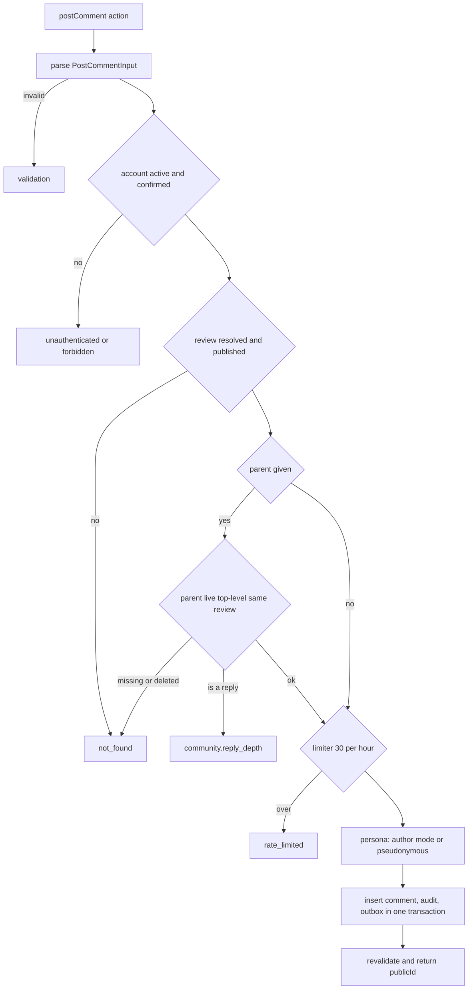
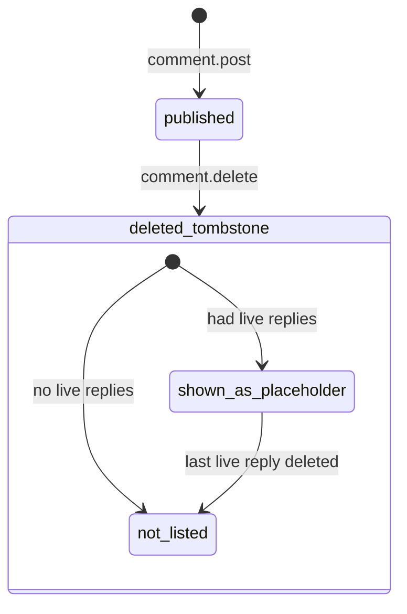
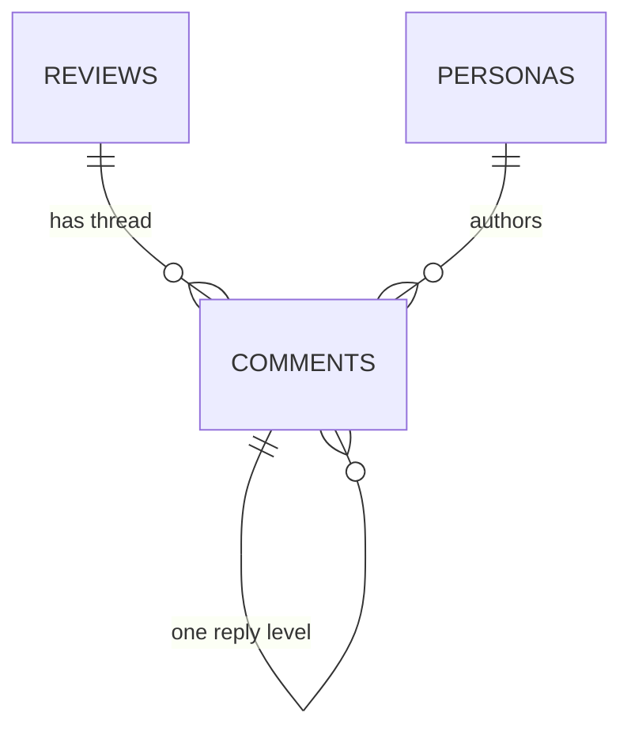

# Functional spec — U49 `u49-comments`

Source of truth for the workflows and the comment lifecycle of the release-1 Community module. Data shapes are in `entities.md` and decision logic in `rules.md`; the ER diagram and the rules summary below are derived from them. UI details are in `frontend-components.md`.

U49 merges T-401 (community module) and T-402 (discussion UI), slimmed by FD-105: post a comment or a one-level reply on a published review, the author deletes their own comment (placeholder when it has live replies), and a thread query behind U47's `<CommentThread reviewPublicId>` slot. It replaces the demo comment code. Mentions, reactions, blocks, reports, editing and the discussion email are deferred to release 2.

## 1. Module surface

| Operation | File (`packages/application/src/modules/community/`) | Kind | Input → result | Rules |
|---|---|---|---|---|
| `comment.post` | `commands/post-comment.ts` | command | `PostCommentInput {reviewPublicId, parentPublicId?, body}` → `{publicId}` | BR1.1–BR1.7, BR4.1 |
| `comment.delete` | `commands/delete-comment.ts` | command | `DeleteCommentInput {commentPublicId}` → `{placeholder: boolean}` | BR2.1–BR2.4, BR4.2 |
| `community.thread` | `queries/get-thread.ts` | query | `GetThreadInput {reviewPublicId}` → `ThreadVM` | BR3.1–BR3.7, BR4.1 |

Errors: `validation`, `unauthenticated`, `forbidden`, `not_found`, `community.reply_depth`, `rate_limited`, `internal`. Each maps to an existing i18n `messageKey` (`errors.common.*`, `errors.community.replyDepth`, `experience.commentLength`).

```text
CommunityModulePorts {
  comments: CommunityRepository;                                   -- ports/repositories/community.ts
  review: Pick<ReviewSeams, 'reviewIdForPublicId' | 'isReviewPublished' | 'isReviewAuthor'>
          & { authorIdentityModeOf(tx, {reviewId}): Promise<IdentityMode | null> };   -- Q2
  identity: Pick<IdentityModule, 'personaFor' | 'publicProjections'>;
  ownership: Pick<IdentityOwnership, 'ownsPersona'>;               -- ownPersonaIds is not used (BR3.5)
}
createCommunityModule(deps): { postComment, deleteComment, getThread }   -- defineCommand / defineQuery
```

`container.ts` gets U49's own append-only block: it builds `PgCommunityRepository` and passes the existing `reviewModule`, `identityModule` and `identityModule.ownership` into `createCommunityModule` (C19 module wiring). `CommandPorts` is not touched. The handler uses `rateLimiter`, `clock`, `ids`, `audit`, `outbox` and `logger` from `CommandPorts`.

**Repository** (`packages/database/src/repositories/community.ts`, replacing the stub): `byPublicId(tx, {reviewId?, publicId})`, `insert(tx, row)`, `countLiveReplies(tx, commentId)`, `markDeleted(tx, {commentId, at, tombstone})`, `threadRows(tx, {reviewId, limit})`. It reads and writes `comments` only; it never joins `persona_links` or `reviews`.

## 2. Workflows

### WF1 — Post a comment or a reply

1. `postComment` action (`apps/web/src/server/actions/comments.ts`) reads `reviewPublicId`, `parentPublicId?` and `body` from the form and calls `runCommand(getContainer().community.postComment, raw)`.
2. Parse with `PostCommentInput` (public ids match `PUBLIC_ID_RE`, body trimmed and NFC-normalised, 1–2000, BR1.2).
3. Authorize: account, active, email confirmed (BR1.1).
4. In the transaction: resolve `reviewId` and check `isReviewPublished` (BR1.3).
5. If `parentPublicId` is set, load the parent within the review and check it is live and top-level (BR1.4).
6. Hit the limiter `comment.post:account:<accountId>` (BR1.5). Every earlier refusal leaves the count unchanged.
7. Choose the persona: author → the review's mode (a `null` mode for the review's own author is `internal`, nothing written); others → pseudonymous; `personaFor` (BR1.6).
8. Insert the comment (`state published`), write the audit row and the `comment.posted {commentId, reviewId}` outbox event (BR1.7).
9. The action revalidates `/{en,bn}/experiences/{reviewPublicId}` and returns `{status: done, messageKey: experience.commentPosted}`. A refusal returns its `messageKey` and the typed body so the form keeps it.



Text version: parse, then authorize, then the review must exist and be published, then a reply's parent must be a live top-level comment of that review, then the hourly limit, then the persona, then one transaction writes the comment, its audit row and its outbox event.

### WF2 — Delete own comment

1. `deleteComment` action calls `runCommand(getContainer().community.deleteComment, {commentPublicId})`; it also carries `reviewPublicId` for revalidation only.
2. Authorize: any account actor (BR2.1).
3. In the transaction: load the comment by public id; `ownsPersona(accountId, authorPersonaId)`; not own, unknown or already deleted → `not_found` (BR2.1, BR2.2, BR4.2).
4. Count live replies; mark deleted with `tombstone = liveReplies > 0` (BR2.3).
5. Audit `comment.deleted` with the persona actor; no outbox (BR2.4).
6. Revalidate and return `{status: done, messageKey: experience.commentDeleted}`.

### WF3 — Read the thread (the slot)

1. `<CommentThread reviewPublicId>` (async server component) gets the container, the locale and the actor.
2. It calls `runCommand(c.community.getThread, {reviewPublicId})`. The query resolves the review once (BR3.1) and reads at most 501 rows oldest first (BR3.2, BR3.6).
3. The query builds the tree with the pure domain function `buildThread(rows)` (BR3.3), reads the distinct author projections through `publicProjections` in batches of at most 200 (BR3.4), and, only for a signed-in viewer, calls `ownsPersona` once per distinct author persona of the live comments to set `mine` (BR3.5).
4. The slot calls `getContributionAccess()` (U9) when the thread is open.
5. It renders the disclaimer, the thread, and the form or `<ContributionGate purpose="comment">` (BR5.1, BR5.2). On an error it renders the disclaimer and the fallback (BR5.5).

```text
buildThread(rows) -> ThreadItem[]     (illustrative, domain, pure)
  live(r) = r.state == published && r.deletedAt == null
  replies = rows.filter(parent != null && live) grouped by parentId
  for top in rows.filter(parent == null):
    live(top)              -> comment(top, replies[top.id])
    replies[top.id] > 0    -> placeholder(replies[top.id])
    else                   -> skip
```

## 3. Comment lifecycle



Text version: a comment is created `published`. The author's delete moves it to `deleted_tombstone` with `deleted_at` set; `tombstone` records whether it had live replies at that moment. The thread decides at read time: a deleted top-level comment is shown as a placeholder only while it still has a live reply (BR3.3). There is no transition back in release 1 (no restore). `hidden*` and `rejected` states belong to moderation and are never set or listed by U49.

## 4. ER view (derived from `entities.md`)



Text version: a published review has many comments; a top-level comment has many replies, and a reply has none; each comment points at one persona, never at an account. `reviews` is U47's and `personas` U11's.

## 5. Rules summary (derived from `rules.md`)

- **Post:** confirmed active accounts, plain text 1–2000, published reviews only, one reply level, 30 per hour, the author keeps the review's identity and everyone else is pseudonymous, one transaction (BR1).
- **Delete:** author only through `ownsPersona`, same `not_found` otherwise, placeholder with live replies, audit without outbox (BR2).
- **Thread:** empty for unknown or unpublished, oldest first, placeholders only with live replies, projections only, `mine` boolean, 500 cap, no quality numbers (BR3).
- **Privacy, UI, demo:** BR4, BR5, BR6.

## 6. Replacing the demo (when and how)

All in U49's Code Generation Bolt, in one commit with the switch, after U47, U11 and U9 have merged (BR6.1):

| Demo piece | Today | U49 |
|---|---|---|
| `packages/database/src/demo/comments.ts` (`listComments`, `addComment`, `deleteOwnComment`, which join `persona_links`) | the slot's demo binding, the actions | **deleted** |
| `packages/database/src/demo/comments.int.test.ts` | tests the demo functions | **deleted**; the cases move to `repositories/community.int.test.ts` |
| `packages/database/src/demo/index.ts` `export * as comments` | demo barrel | **line removed** (recorded addition) |
| `apps/web/src/server/data.ts` `comments = bindDb(demo.comments)` | binding | **line removed** (recorded addition, one line) |
| `packages/database/src/demo/demo-slice.smoke.test.ts` (`addComment`, `listComments`: "a comment shows on it") | cumulative smoke | **assertion replaced** by one on the community module (post, then the thread lists it), with the reason recorded in the Unit's record: the suite only grows (recorded addition) |
| `apps/web/src/server/actions/ownership.adversarial.test.ts` (mocks `comments.addComment`, `deleteOwnComment`; forged delete and forged persona cases) | adversarial | **cases moved** onto the new `postComment` and `deleteComment` actions, none dropped (recorded addition) |
| `server/actions/comments.ts` and `comments.test.ts` (`requireAccount`, `reviews.getReviewByPublicId`, `comments.*`) | demo actions | **rewritten** on `runCommand`; state type kept |
| `demo/reviews.ts` `getReviewByPublicId` (U47's file) | kept by U47 for U22, U48 and U49 | U49 **stops calling it**; whichever of U22, U48 and U49 merges last deletes it, as U22's design records |
| `CommentThread.tsx` (U47's self-fetching version over `CommentThreadView`) | demo `listComments` | **switched** to `community.getThread`; the view takes `ThreadVM` |
| U11 BR3.1 allowlist entry `demo/comments.ts (U49)` | allowed reader of `persona_links` | **removed** from U11's boundary test (recorded edit; the list only shrinks) |
| `DemoComment`, `DemoCommentThread`, `DemoAddCommentInput` in contracts | demo types | left to U50 (it removes demo leftovers without a caller) |

## 7. Contract changes

- **C10 release 1:** input field names become `reviewPublicId` and `parentPublicId` (public ids only); `comment.delete` input `{commentPublicId}` and result `{placeholder}`; `ThreadVM` as in `entities.md` (replaces the T-003 stub in `view-models/thread.ts`: no `likeCount`, `dangerous`, `providerFor`, `edited`, internal `reviewId`); the post limit of C18 is 30 per hour. The provider (U49) updates its block at Code Generation.
- **C9, additive (Q2):** `authorIdentityModeOf(tx, {reviewId}) → IdentityMode | null` on `ReviewSeams`, built by U47 before it merges (BR6.8 freezes the seams at merge, so an addition before then is not breaking). If U47 has merged without it, it is agreed in `contract-summary.md` first and added by the review module's owner; U49 does not edit the review module.

## 8. Owned paths

As `unit-of-work.md` U49 lists, plus the recorded additions: the one-line removals in `server/data.ts` and `demo/index.ts`, `demo/comments.int.test.ts` (deleted), the comment assertion in `demo/demo-slice.smoke.test.ts`, the comment cases in `server/actions/ownership.adversarial.test.ts`, `server/actions/comments.test.ts`, the U49 block in `server/container.ts`, the allowlist line in U11's `persona_links` boundary test, and the new message keys in `packages/i18n/messages/{en,bn}.json`.

**Merge order with U48:** `data.ts`, `demo/index.ts` and `ownership.adversarial.test.ts` also carry evidence lines that U48 changes in the same parallel batch. Whichever of U48 and U49 merges second rebases on `main` and edits only its own lines. Not touched: the experience page, `components/patient/auth/` (U9), the review and identity modules.

## 9. Tests (test-after, team posture)

- **Domain:** `buildThread` for every placeholder case (live, deleted with live replies, deleted without, last reply deleted, deleted reply); body validation at 0, 1, 2000, 2001 characters and with Bengali text; the limit constants.
- **Application** (fakes): post happy path, reply happy path, each refusal (unauthenticated, unconfirmed, restricted, unknown review, unpublished review, missing parent, deleted parent, reply to reply, rate limited on the post after `COMMENT_POST_LIMIT` (30) valid posts with `{minutes}` from `retryAfterSec`), refusals do not hit the limiter, author of a named and of an anonymous review gets the review's mode, others pseudonymous, the review's own author with a `null` mode gets `internal` and nothing is written, one audit and one outbox assertion; a thread with 201 distinct authors reads every byline (two `publicProjections` batches); a signed-out viewer makes no `ownsPersona` call and a signed-in one makes one per distinct author; a thread of 501 rows, tombstones included, is cut to 500 with `truncated`; delete own with and without replies, not own and unknown give identical `not_found`, already deleted.
- **Database** (`community.int.test.ts`): each repository method; the depth trigger refuses a reply to a reply.
- **Component (en and bn):** thread with comments, replies and a placeholder; empty thread; closed thread; gate states; own-comment delete; fallback.
- **Smoke:** one assertion that a confirmed account posts a comment and a reply and deletes the parent, which leaves the placeholder.
- **Privacy checks:** rendered thread HTML and `ThreadVM` JSON contain no account id, persona id or internal id; an anonymous author's comment shows the same alias as the review, and the same account's alias differs in another thread (AC3.3.2).

## Sources

- `inception/units-generation/unit-of-work.md` U49; `unit-of-work-story-map.md` (US8.1, US3.3).
- `inception/contract-design/contract-summary.md` C4, C9, C10 with its release-1 amendments, C15, C16, C18, C19, revision 2026-11-04.
- `construction/u47-reviews/functional-design/` (§ 2.1 `ReviewSeams`, BR6.1–BR6.8, slot handover); `construction/t-104-identity-module/functional-design/` (`personaFor`, `publicProjections`, `IdentityOwnership`, BR3.6 allowlist); `construction/t-102-patient-auth-screens/functional-design/` (WF9, BR8.1).
- Code on `main` at `f56e9fc`: `apps/web/src/server/actions/comments.ts`, `packages/database/src/demo/comments.ts`, `apps/web/src/components/patient/comments/`, `packages/database/src/schema/community.ts`, `migrations/0003_triggers.sql`, `packages/contracts/src/{schemas/community.ts,view-models/thread.ts}`.
- Drafts `docs/aidlc-migration/design-drafts/t-401-community-module/` and `t-402-discussion-ui/` (release-2 parts left there).

## Assumptions & Open Questions

None. Every open point is answered in `functional-design-questions.md`, decided by the agent under the owner's delegation of 2026-11-04.
