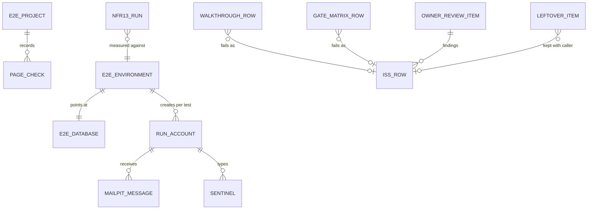

# Entities — U50 `u50-release-check`

Source of truth for the data shapes the release check reads and writes. Workflows are in `functional-spec.md`, decision logic in `rules.md`. U50 adds no table, column or migration. Its entities are test-run, demo-process and record shapes; the one product shape it changes is the health report, whose fields stay as merged and whose three probes become real (BR9). Entities owned by another Unit are listed where U50 reads them.

```yaml
entities:
  - name: E2eProject
    owner: U50
    description: "One Playwright project in apps/web/playwright.config.ts."
    attributes:
      - { name: name, type: enum, required: true, allowed: [chromium-360, chromium-desktop, chromium-reduced-motion, log-scan, nfr13] }
      - { name: viewport, type: object, required: true, constraints: "{width, height}: 360x800 or 1280x800 (BR1.1); log-scan and nfr13 have none of their own" }
      - { name: isMobile, type: boolean, required: true, constraints: "true for chromium-360 and chromium-reduced-motion" }
      - { name: reducedMotion, type: enum, required: false, allowed: [reduce, no-preference], default: no-preference }
      - { name: colorScheme, type: enum, required: true, allowed: [light, dark], constraints: "dark only for chromium-reduced-motion" }
      - { name: timezoneId, type: string, required: true, constraints: "Asia/Dhaka" }
      - { name: dependencies, type: list, required: false, constraints: "log-scan depends on the three journey projects" }
      - { name: testMatch, type: list, required: true, constraints: "per project as in BR1.1; the top level is '**/*.spec.ts', so no *.test.ts file is loaded" }
      - { name: grep, type: list, required: false, constraints: "chromium-reduced-motion only: Part 1, P3.11 and the motion-switch titles (BR1.1)" }
    constraints:
      - "Chromium engine only; no other viewport (FD-105)"

  - name: E2eEnvironment
    owner: U50
    description: "The environment the suite's web server and worker run with (e2e/helpers/env.ts)."
    attributes:
      - { name: DATABASE_URL, type: string, required: true, constraints: "rk_app on rogikotha_e2e_test, port 5433" }
      - { name: DATABASE_URL_WORKER, type: string, required: true, constraints: "rk_worker on rogikotha_e2e_test" }
      - { name: APP_URL, type: string, required: true, constraints: "http://127.0.0.1:3107" }
      - { name: APP_MODE, type: enum, required: true, allowed: [demo], constraints: "never production" }
      - { name: STORAGE_ROOT, type: string, required: true, constraints: "absolute: <repo root>/.data/e2e-storage, git-ignored; the repo root is the folder holding pnpm-workspace.yaml (BR1.2)" }
      - { name: EVIDENCE_STORAGE_DIR, type: string, required: true, constraints: "the same absolute path, for the web storage module on main" }
      - { name: lockFile, type: string, required: true, constraints: "<repo root>/.data/e2e.lock with the run's pid; one browser run per machine (BR1.3)" }
      - { name: MAILPIT_URL, type: string, required: true, constraints: "http://localhost:8025 (shared Mailpit)" }
      - { name: runId, type: string, required: true, constraints: "base36 timestamp of the global setup; in every sentinel and run username" }
      - { name: E2E_ALLOW_NO_SCANNER, type: boolean, required: false, default: false, constraints: "local runs only; a run with it set is never a gate run (BR2.3)" }
      - { name: E2E_WORKERS, type: integer, required: false, default: 2, max: 4 }
    constraints:
      - "secrets come from .env; nothing is hard-coded in the specs"

  - name: E2eDatabase
    owner: U50
    description: "The suite's own PostgreSQL database."
    attributes:
      - { name: name, type: string, required: true, constraints: "rogikotha_e2e_test (the _test suffix the merged reset accepts)" }
      - { name: owner, type: string, required: true, constraints: "rk_app; CONNECT granted to rk_worker and rk_maintenance" }
      - { name: extensions, type: list, required: true, constraints: "pg_trgm, citext, pgcrypto" }
      - { name: state_at_run_start, type: enum, required: true, allowed: [freshly_seeded], constraints: "reset, migrated and seeded once per run (BR1.3)" }

  - name: RunAccount
    owner: U50
    description: "A synthetic account a test registers for itself."
    attributes:
      - { name: username, type: string, required: true, unique: true, constraints: "e2e<runId><project initial><n>" }
      - { name: email, type: string, required: true, unique: true, constraints: "<username>@demo.rogikotha.local" }
      - { name: password, type: string, required: true, constraints: "a synthetic run password of 12+ characters; changed passwords stay synthetic" }
      - { name: displayName, type: string, required: true, constraints: "from the fixed synthetic list in e2e/fixtures/synthetic.ts" }
      - { name: locale, type: enum, required: true, allowed: [bn, en] }
      - { name: createdBy, type: enum, required: true, allowed: [registerConfirmed, serial-group], constraints: "per-test helper, or the one P2.8 describe.serial group (BR1.5)" }
    constraints:
      - "never a real person's name or address (project.md Forbidden)"
      - "used only by the test that created it"

  - name: SeedFacts
    owner: U50
    description: "The seeded facts the specs may name (e2e/fixtures/seed-facts.ts); values the storyboard and DEMO.md already publish."
    attributes:
      - { name: sharedPassword, type: string, required: true, constraints: "demo-pass-2026!" }
      - { name: usernames, type: list, required: true, constraints: "shirin_88, rafi_c, anon_author_r2, named_tanvir-ahmed" }
      - { name: profileDoctorName, type: string, required: true, constraints: "Dr. Farhana Rahman (en) and its bn name from the page" }
      - { name: r1Title, type: string, required: true, constraints: "r1's seeded title, used to open it; its public id is read from the URL" }
      - { name: sparseDoctorName, type: string, required: true, constraints: "the d7-d10 doctor P1.4b opens" }
      - { name: writeTargetDoctorName, type: string, required: true, constraints: "WRITE_TARGET_DOCTOR: one of d2-d6 that no reading test opens or counts; every writing test publishes about it or about a doctor it adds (BR7.2)" }
    constraints:
      - "no internal or public id is hard-coded (BR7.2)"

  - name: Sentinel
    owner: U50
    description: "A marker string the run types so the log scan can prove that private content never reached a log."
    attributes:
      - { name: kind, type: enum, required: true, allowed: [text, file, comment, email] }
      - { name: value, type: string, required: true, constraints: "E2E-TEXT-<runId>-<testId>, E2E-FILE-<runId>, E2E-COMMENT-<runId>-<testId>, or a run account email; testId is Playwright's testInfo.testId" }
      - { name: scanPrefix, type: string, required: true, constraints: "the log scan searches E2E-TEXT-<runId>, E2E-FILE-<runId> and E2E-COMMENT-<runId> as prefixes (BR2.8)" }

  - name: PageCheck
    owner: U50
    description: "What checkPage(page, locale, rules) asserts and records for one walked page."
    attributes:
      - { name: url, type: string, required: true }
      - { name: locale, type: enum, required: true, allowed: [bn, en] }
      - { name: cspHeader, type: string, required: true, constraints: "non-empty content-security-policy on the document response (BR2.8)" }
      - { name: axeSeriousOrCritical, type: integer, required: true, constraints: "must be 0 (BR3.1)" }
      - { name: axeOther, type: list, required: false, constraints: "moderate and minor findings, attached and summarised" }
      - { name: overflow, type: boolean, required: true, constraints: "false at 360 px (BR3.6)" }
      - { name: hardRules, type: list, required: true, constraints: "the rule names asserted on this page (BR2.5)" }
      - { name: neverAnimatedOk, type: boolean, required: true, constraints: "disclaimer, emergency guidance, demo marker (BR4.3)" }

  - name: MailpitMessage
    owner: U50 (read only; Mailpit is infrastructure)
    description: "The fields of a Mailpit message the helper reads."
    attributes:
      - { name: ID, type: string, required: true }
      - { name: To, type: list, required: true }
      - { name: From, type: string, required: true }
      - { name: Subject, type: string, required: true, constraints: "equals the account-locale value of email.verify.subject, email.reset.subject or email.existing.subject" }
      - { name: Created, type: timestamp, required: true }
      - { name: Text, type: text, required: true, constraints: "searched for the single app link (BR6.1)" }
      - { name: HTML, type: text, required: false }

  - name: EvidenceAuthorStatus
    owner: U48 (read by U50)
    description: "The status an author sees for each uploaded item, which the writing journey waits for."
    attributes:
      - { name: file, type: string, required: true, constraints: "fixture name; never shown publicly" }
      - { name: finalStatus, type: enum, required: true, allowed: [ready, could_not_be_read, malware_detected, could_not_be_checked], constraints: "U48 authorStatusOf; preview_ready reads as ready" }
    constraints:
      - "report.pdf and the 16 MB file never become items (refused at intake)"
      - "only ready items are counted on the public page (C17 PUBLIC_EVIDENCE_STATES)"

  - name: Nfr13Run
    owner: U50
    description: "One Lighthouse user-flow run on one page."
    attributes:
      - { name: page, type: enum, required: true, allowed: ["/en", "/bn", "/en/experiences/<r1>", "/bn/experiences/<r1>"] }
      - { name: attempt, type: enum, required: true, allowed: [first, idle-rerun] }
      - { name: runIndex, type: integer, required: true, min: 1, max: 5 }
      - { name: lcpMs, type: number, required: true }
      - { name: cls, type: number, required: true }
      - { name: inpMs, type: number, required: true, constraints: "from at least one measured interaction, else the run fails (BR5.3)" }
      - { name: lcpElement, type: string, required: true, constraints: "selector from the LCP element audit" }
      - { name: lcpElementAnimated, type: boolean, required: true, constraints: "must be false" }
      - { name: benchmarkIndex, type: number, required: true }
    constraints:
      - "pass per page = median of the five runs meets LCP <= 2500 ms, CLS <= 0.1, INP <= 200 ms (BR5.4)"

  - name: DemoProcess
    owner: U50
    description: "The state pnpm demo keeps in .data/demo.pid."
    attributes:
      - { name: parentPid, type: integer, required: true }
      - { name: webPid, type: integer, required: true }
      - { name: workerPid, type: integer, required: true }
      - { name: startedAt, type: timestamp, required: true }
      - { name: composeProject, type: string, required: true, default: rogikotha, constraints: "RK_COMPOSE_PROJECT for the clean-clone rehearsal only" }
    constraints:
      - ".data/ is git-ignored; the file is deleted on a clean exit"

  - name: HealthReport
    owner: U8 (merged shape); U50 wires three probes (recorded addition)
    description: "The body of GET /api/health."
    attributes:
      - { name: ok, type: boolean, required: true, constraints: "db, queue and mail all ok (BR9.2)" }
      - { name: db, type: enum, required: true, allowed: [ok, down, unknown] }
      - { name: queue, type: enum, required: true, allowed: [ok, down, unknown], constraints: "ok or down after U50" }
      - { name: mail, type: enum, required: true, allowed: [ok, down, unknown], constraints: "ok or down after U50" }
      - { name: scanner, type: enum, required: true, allowed: [ok, down, unknown], constraints: "ok or down after U50; down never makes ok false" }
      - { name: mode, type: string, required: true }
    constraints:
      - "no error detail, host or port in the body"

  - name: WalkthroughRow
    owner: U50
    description: "One row of docs/validation/U50-walkthrough.md."
    attributes:
      - { name: step, type: string, required: true, constraints: "storyboard step 1-28, or a manual-check id M<n>, CC (clean clone), RB (rollback drill)" }
      - { name: locale, type: enum, required: true, allowed: [bn, en, "—"] }
      - { name: theme, type: enum, required: true, allowed: [light, dark, "—"] }
      - { name: width, type: enum, required: true, allowed: ["360", "1280", "—"] }
      - { name: expected, type: text, required: true, constraints: "the storyboard text, release-1 part" }
      - { name: observed, type: text, required: true }
      - { name: evidence, type: text, required: true, constraints: "test title, trace path or the manual action taken" }
      - { name: verdict, type: enum, required: true, allowed: ["pass", "fail (ISS-nnn)", "release 2 (FD-105, <Unit or task>)"] }
      - { name: iss, type: string, required: false }

  - name: GateMatrixRow
    owner: U50
    description: "One row of part A of docs/validation/RELEASE-1-GATES.md."
    attributes:
      - { name: unit, type: string, required: true, constraints: "U9, U11, U20, U22, U41, U46, U47, U48, U49, U50, or a merged foundation Unit" }
      - { name: task, type: string, required: true, constraints: "T-nnn or CR-nnn" }
      - { name: row, type: text, required: true, constraints: "the acceptance row's first cell, its FD-0nn label kept" }
      - { name: expected, type: text, required: true }
      - { name: observed, type: text, required: true, constraints: "re-executed on the final main (BR11.2)" }
      - { name: mainCommit, type: string, required: true }
      - { name: evidence, type: text, required: true }
      - { name: verdict, type: enum, required: true, allowed: ["pass", "fail (ISS-nnn)", "deferred to release 2 (FD-105)"] }

  - name: GateClassification
    owner: U50
    description: "One row of parts B and C of RELEASE-1-GATES.md."
    attributes:
      - { name: source, type: enum, required: true, allowed: [production-capability-gate, architecture-acceptance-gate, release-stop-condition] }
      - { name: item, type: text, required: true }
      - { name: classification, type: enum, required: true, allowed: ["demonstrated locally", "deferred", "not hit", "hit"] }
      - { name: evidenceOrReason, type: text, required: true }

  - name: ReviewChecklistCell
    owner: U50
    description: "One cell of docs/validation/RELEASE-1-REVIEW-CHECKLIST.md: a URL in one locale against one hard rule."
    attributes:
      - { name: url, type: string, required: true }
      - { name: locale, type: enum, required: true, allowed: [bn, en] }
      - { name: rule, type: string, required: true }
      - { name: value, type: enum, required: true, allowed: ["✓ (evidence)", "✗ (ISS-nnn)", "n/a", "release 2"] }

  - name: OwnerReviewItem
    owner: U50 writes; the owner ticks
    description: "One item of docs/validation/U50-owner-review.md."
    attributes:
      - { name: id, type: string, required: true, constraints: "OR1-OR7 (BR12.1)" }
      - { name: what, type: text, required: true }
      - { name: where, type: text, required: true, constraints: "URLs or files to open" }
      - { name: languages, type: list, required: true, constraints: "en and bn" }
      - { name: themes, type: list, required: false, constraints: "light and dark where it applies" }
      - { name: widths, type: list, required: false, constraints: "360 px where it applies" }
      - { name: minutes, type: integer, required: true }
      - { name: ticked, type: boolean, required: true, default: false, constraints: "only the owner sets it (BR12.2)" }
      - { name: findings, type: list, required: false, constraints: "ISS ids with Found in 'U50 owner review'" }

  - name: LeftoverItem
    owner: U50
    description: "One row of the leftover inventory in U50.md."
    attributes:
      - { name: path, type: string, required: true }
      - { name: export, type: string, required: true, constraints: "function, binding, type, message key or test" }
      - { name: callers, type: list, required: true, constraints: "file paths outside the demo folder's own tests, or empty" }
      - { name: action, type: enum, required: true, allowed: [deleted, kept_for_release_2], constraints: "deleted only with zero callers (BR14.2)" }
      - { name: iss, type: string, required: false, constraints: "the S4 row R13 covers every kept item" }

  - name: IssRow
    owner: shared register docs/implementation/ISSUES.md
    description: "The register row shape U50 appends to."
    attributes:
      - { name: id, type: string, required: true, constraints: "next free ISS-nnn at Code Generation (ISS-455 is the last on main at 3e6a881)" }
      - { name: date, type: date, required: true }
      - { name: foundIn, type: string, required: true, constraints: "U50 T-503, U50 T-504, U50 T-505, or U50 owner review" }
      - { name: by, type: string, required: true, constraints: "a role (implementer, reviewer, validator, owner), never a tool or model" }
      - { name: severity, type: enum, required: true, allowed: [S1, S2, S3, S4] }
      - { name: area, type: string, required: true }
      - { name: title, type: string, required: true }
      - { name: evidence, type: text, required: true }
      - { name: status, type: string, required: true }
      - { name: owner, type: string, required: true }
```

## Relationships



Text version: each Playwright project records a page check for every page it walks. The e2e environment points at its own database and creates a synthetic account per writing test; each account receives its Mailpit messages and types the sentinels the log scan looks for. Each NFR13 run measures a page against that environment. A walk-through row, a gate-matrix row or a leftover kept with a caller may point at an ISS row; an owner review item may produce several.
