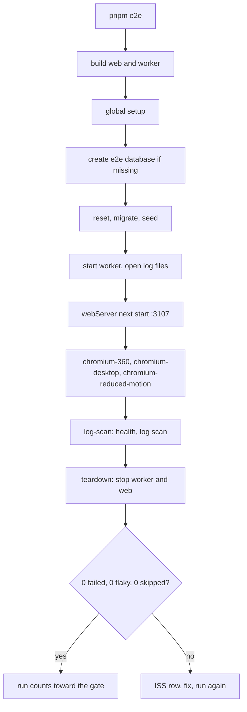
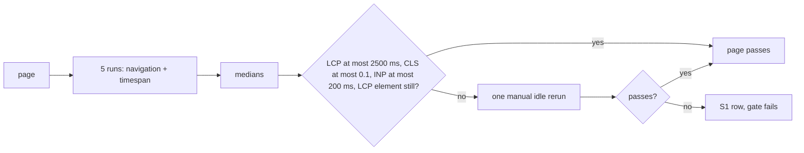
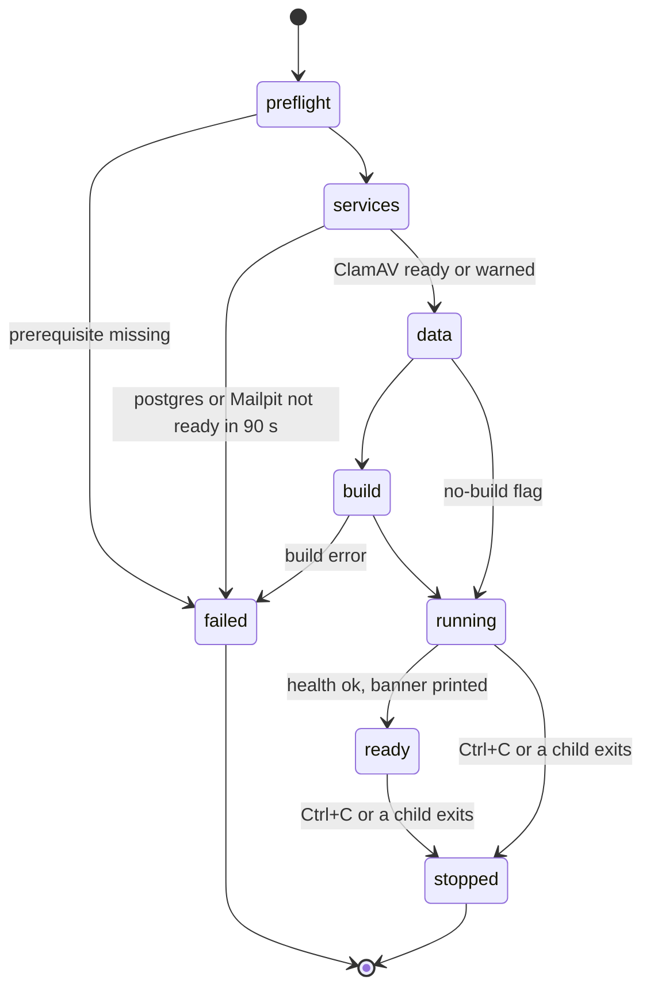
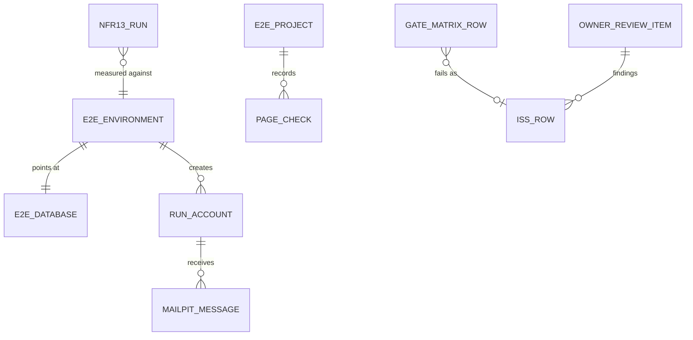

# Functional specification — U50 `u50-release-check` (release 1)

U50 merges T-503, T-504 and T-505, slimmed for release 1 (FD-105). It is the last release-1 Unit: it proves the merged product end to end in both languages, makes the demo one command, and closes release 1 with a gate matrix, the owner's review checklist and the status documents. Rules are in `rules.md`, data shapes in `entities.md`, decisions in `functional-design-questions.md`.

## 1. What changes

- **A Playwright suite** in `apps/web/e2e/` that walks storyboard Parts 1–4 in `bn` and `en` on the production build, Chromium at 360 px and 1280 px plus a reduced-motion dark project, with axe on every page, keyboard-only runs of register, sign-in and the composer, live-region, zoom and text-spacing checks, U41's security outcomes and a log scan for private content (BR1–BR4).
- **The NFR13 gate**: a Lighthouse user flow on the `/en` and `/bn` home and r1 experience pages, median of five runs (BR5).
- **The demo composition**: `pnpm demo`, `demo:serve`, `demo:down`, `demo:logs` and `demo:reset` on `scripts/demo.mjs`, `demo-reset.mjs` and `wait-for.mjs`; `DEMO.md`; real queue, mail and scanner health probes (BR8–BR10).
- **The release-1 close-out**: the walk-through record, the gate matrix, the page review checklist, the owner's review checklist, the status and planning documents, the coverage tools (BR10–BR13).
- **The clean-up**: an inventory of the demo-slice leftovers, deletion of those whose grep shows zero callers, and the old `demo.spec.ts` once its assertions are mapped (BR14). Everything else is left for release 2 (§ 16).

## 2. Baseline on `main` (`3e6a881`)

| Item | On `main` | U50 |
|---|---|---|
| `apps/web/playwright.config.ts` | T-011's: one `chromium` project, `next start` on 3107, `reuseExistingServer: false`, output in `node_modules/.playwright-results` | rewritten (BR1.1, BR1.2) |
| `apps/web/e2e/smoke/demo.spec.ts` | the demo-slice walk, once per language, with `msg()` and a `shoot()` helper | replaced by journeys and mapped (BR14.7) |
| `apps/web/e2e/smoke/motion.spec.ts` | T-011's motion checks (view-transition recorder, cookie switch) | kept; runs under the new config |
| `apps/web/package.json` | `@playwright/test` 1.64.1; script `smoke:e2e` | adds `@axe-core/playwright` and `lighthouse` (pinned after the check, BR15.6); `smoke:e2e` removed |
| Root `package.json` | `demo` = `infra:up && db:migrate && db:seed && pnpm -r --parallel dev`; `demo:reset` = `db:reset && db:seed`; `smoke` = Vitest only; `check:motion` exists | `demo*` and `e2e*` rewritten or added; `smoke` unchanged (BR1.8) |
| `scripts/` | boundary, identity, contrast and motion checks | adds `demo.mjs`, `demo-reset.mjs`, `wait-for.mjs` and their tests |
| `infra/compose/docker-compose.yml` | postgres 18 on host 5433 (ISS-084), Mailpit v1.31.1, ClamAV 1.5.4, named volumes, no profiles, no restart policy | unchanged unless a demo step needs it (BR8.9) |
| `DEMO.md` | absent | created (BR10.1) |
| `apps/web/src/server/health.ts` | db probe real; queue, mail, scanner `unknown` | three probes wired (BR9) |
| `packages/database/src/demo/` | accounts, accounts-create, comments, doctors, evidence, facilities, reviews, session, `not-built.ts`, `index.ts`, their tests, `demo-slice.smoke.test.ts`, an orphan `topics.int.test.ts`; bound in `apps/web/src/server/data.ts` | inventoried; only zero-caller items removed (BR14.1, BR14.2) |
| `apps/web/src/server/storage.ts` | the demo slice's evidence folder: `EVIDENCE_STORAGE_DIR`, else `<repo root>/var/evidence`, the repo root found by walking up to `pnpm-workspace.yaml`; the worker's `STORAGE_ROOT` defaults to the relative `./.data/storage` | not edited; the suite and the demo set both variables to one absolute path (BR1.2, BR8.5) |
| `/api/health` routes | `/api/health`, `/api/auth/[...all]` | U48 adds `/api/evidence/upload` before U50 |

## 3. Suite layout

```text
apps/web/
  playwright.config.ts          testMatch '**/*.spec.ts', projects with their own testMatch (BR1.1), webServer (BR1.2), retries 1, JSON + list reporters
  src/
    e2e-config.test.ts          Vitest web project, node environment: BR1.9 (projects, file patterns, bans)
    copy-no-rating.test.ts      Vitest web project, node environment: BR2.10 (message files)
  e2e/
    helpers/
      env.ts                    E2eEnvironment, runId
      database.ts               create-if-missing, reset, seed (BR1.3)
      global-setup.ts           database, worker spawn, log files
      global-teardown.ts        worker stop
      locale.ts                 forEachLocale (BR1.4)
      messages.ts, digits.ts    msg(), toLatinDigits (BR2.6)
      page-check.ts             checkPage: CSP, axe, overflow, hard rules, never-animated (BR2.5)
      axe.ts                    expectNoSeriousViolations, EXCLUSIONS = [] (BR3.1, BR3.2)
      motion.ts                 sampleAnimations (BR4.1)
      mailpit.ts                latestLink (BR6.1)
      accounts.ts               registerConfirmed, signIn (BR1.5)
      content.ts                publishQuickReview (BR1.5)
    fixtures/
      seed-facts.ts             BR7.2
      synthetic.ts              names, texts, sentinels (BR7.1)
    journeys/
      reading.spec.ts           Part 1
      contributor.spec.ts       Part 2
      writing.spec.ts           Part 3
      discussion.spec.ts        Part 4
    a11y/
      keyboard.spec.ts, live-region.spec.ts, zoom-and-spacing.spec.ts, motion-switch.spec.ts
    security/
      security.spec.ts          Host, Origin, upload cap (project chromium-desktop)
      health.spec.ts            project log-scan
      log-scan.spec.ts          project log-scan
    perf/
      lighthouse-flow.ts, nfr13.spec.ts   project nfr13
    smoke/
      motion.spec.ts            kept
      release1.smoke.spec.ts    one assertion per part, en and bn, no scanner
```

## 4. Workflows

### WF1 — One `pnpm e2e` run

1. `pnpm --filter @rogikotha/web --filter @rogikotha/worker build`.
2. Global setup: take the `.data/e2e.lock` lock or stop (BR1.3); build `E2eEnvironment` with a new `runId` and the absolute storage path (BR1.2); check that the compose PostgreSQL and Mailpit answer (`wait-for`, 30 s); create `rogikotha_e2e_test` when it is missing, then reset, migrate and seed it (BR1.3); empty `<repo root>/.data/e2e-storage`; open `test-results/logs/web.log` and `worker.log`; spawn the worker from the repository root and wait for its start line (BR1.2).
3. Playwright starts `next start` on 3107 and waits for `/en`.
4. The three journey projects run in parallel with two workers, each on the files its `testMatch` names (BR1.1); each test creates its own account and content through the helpers (BR1.5) and walks its pages through `checkPage`.
5. The `log-scan` project runs last: `health.spec.ts`, then `log-scan.spec.ts` over both log files (BR2.8, BR2.9).
6. Global teardown stops the worker and deletes the lock; Playwright stops the web server. The JSON report gives the counts BR1.6 needs.



Text version: build, then the global setup prepares the e2e database and starts the worker, then Playwright starts the web server, the three journey projects run, the log-scan project checks health and the logs, the teardown stops both processes, and the run counts toward the gate only when nothing failed, nothing was flaky and nothing was skipped.

### WF2 — Journeys and their exact assertions

Every step below is one test per locale, `bn` first, titled `P<part>.<step> [<locale>] <sentence>`. Every navigation ends in `checkPage` (BR2.5): demo marker, disclaimer where the page has one, CSP header, axe, 360 px overflow, never-animated elements, and the page's hard rules. Text is read from the message files with `msg(locale, key)`; "digits" means the locale's digits, and every number compared across locales is mapped with `toLatinDigits` (BR2.6). Elements a sibling Unit deferred are not asserted; they are recorded as "release 2" (§ 13).

Data rules for every row (BR1.5, BR7.2): a test that needs an account calls `registerConfirmed`, and a test that needs an experience calls `publishQuickReview`, inside its own body, so tests can run in any order and a retry gets fresh data. Writing tests publish only about `WRITE_TARGET_DOCTOR` (a seeded doctor no reading test opens) or a doctor they add, so the numbers the reading tests assert never move during a run. Reading tests assert minimum counts and per-entry properties, never totals or orders a write could change. The one ordered group is `P2.8 register, confirm, sign in, reset` (`test.describe.serial`, one account).

#### Part 1 — Reading (signed out)

| Test | Steps | Assertions |
|---|---|---|
| P1.0 language detection and stored choice | new context with locale `bn-BD`, open `/`; new context with `en-US`, open `/`; in the `bn` context switch to English, then open `/` | lands on `/bn` with `lang="bn"` and the language switch visible; lands on `/en`; after the switch `/` lands on `/en` (AC12.1.1, AC12.1.2) |
| P1.1 home | open `/{locale}` | one `h1`; the browse-by-topic chips are five links to `/{locale}/topics/{id}`; the emergency panel shows 999, 16263 and the crisis line in the locale's digits with its last-verified date, each number a `tel:` link; teaser rows carry the Limited data tag and no `0` stands for a missing value; the separation sentence on the facilities section; no search box (U20, FD-105) |
| P1.1b emergency | open `/{locale}/emergency` | the same numbers and last-verified date, signed out, no gate or sign-in prompt (AC12.1.5) |
| P1.1c policy pages | open `/about`, `/terms`, `/privacy` | correct `lang`; landmarks `main`, `nav`, `contentinfo`; one `h1`; the lawful section on `/terms` and `/privacy` only (U20 BR2.8); axe clean (AC12.1.6) |
| P1.3 doctor index | open `/{locale}/doctors` | at least 10 entries; each entry shows `label.notVerified`; the BR2.5 structural check finds no rating feature (no stars, no rating or highest sort option, no score widget or number next to a name); if a sort control exists its options are relevance, most accounts and most recent only; each member-added entry shows `label.memberAdded` (FD-100) |
| P1.4 doctor profile | open Dr. Farhana Rahman from the index | `label.notVerified`; each provenance chip reads in the `prov.updatedOn` shape; each sentiment capsule reads "n of m" (`sentiment.ofTotal`) with n ≤ m and every m equal to the profile's account count; `label.limitedData` shown exactly when that count is below 5; outcome rows, condition breakdown and chambers present; in `bn` no ASCII digit inside a capsule; inside this one test the page is read in its locale, switched with the toggle to the other locale on the same path, read again, and every number is equal after digit mapping (BR2.6); Bengali headings `text-transform: none`; the toggle announces `a11y.announce.language`. Dr. Farhana Rahman is never a writing target, so her counts cannot change during the run |
| P1.4b sparse doctor | open a seeded doctor among d7–d10 | the missing fields read `label.notProvided` or `label.noDocuments`, never `0` |
| P1.5 facility | open the first facility | nine criteria, each with its own "n of m" distribution; the same in-test cross-locale comparison as P1.4; `facility-separation` text equals its key; no doctor aggregate on the page |
| P1.5b topics | open `/{locale}/topics`, then one topic | at least 10 topic cards, the 10 seeded topic names among them (a provisional term a writing test adds may appear); the topic page shows the emergency guidance from the configuration |
| P1.6 experience r1 | open r1 from `/{locale}/experiences` by its title | `h1` equals the title; the sections in the page order; the published month and year only (no day); the byline per its identity mode; at least one "Reviewer's label" framed as the author's claim; the margin doctor shows `label.notVerified`; the evidence note reads "Documents attached — not medically validated" with the ready count in the locale's digits, or `label.noDocuments`; the comment thread with the signed-out gate; GET `/api/evidence/items/<any id>/original` is not 2xx and not `image/*` |
| P1.7 author page | open `/{locale}/authors/shirin_88`, then `/{locale}/authors/anon_author_r2` | the first lists r1's card and no anonymous review; status 200 and `meta[name=robots]` contains `noindex`; the second shows the empty state, the same as for an unknown username |

#### Part 2 — Becoming a contributor

| Test | Steps | Assertions |
|---|---|---|
| P2.8 register and confirm (first test of the serial group `P2.8 register, confirm, sign in, reset`) | from r1 press Write → `/write` shows the gate (`auth.gate.title`, `auth.gate.writeBody`) with sign-in and register links carrying `next`; open register, fill a run account, tick age and terms, submit | URL `/{locale}/verify-email`; `auth.verify.title` and the typed address in `auth.verify.body`; Mailpit has `email.verify.subject` for the address in the locale (BR6.3); opening its link shows the confirm panel and confirms nothing by itself: before Confirm is pressed, the same account signed in from a second context still sees the unconfirmed gate (`auth.gate.verifyToAct`) on `/write`; pressing `auth.verify.confirm` shows `auth.verify.done` with one `PublishTick` and the Continue link back to `/write` |
| P2.8b sign in (serial group, same account) | sign out, open `/sign-in?next=/{locale}/write`, sign in | lands on `/{locale}/write` with the composer, not the gate; without `next`, lands on `/{locale}/me` |
| P2.8c invalid form | submit register with an empty username and terms unticked | BR3.4 |
| P2.9 same email | `registerConfirmed` makes an account A; in a new context register again with A's address | the same pending page text and the same URL as a first registration; Mailpit has `email.existing.subject` for the address; no second account (signing in with the second password fails with the neutral message) |
| P2.10 security page | `registerConfirmed` makes its own account; sign it in in a second context too; in the first open `/{locale}/me/security` | the email masked and `auth.security.verified`; the sessions table has two rows, one with `auth.security.thisDevice`; change the password → `auth.security.passwordChanged`; the second context's next page load shows it signed out; "Yes, sign out everywhere" → `/sign-in?signedOut=all` with `auth.security.signedOutAll` |
| P2.10b reset password (last test of the serial group, same account) | `/reset-password` with the group's address, then with an unknown synthetic address | both answer `auth.reset.sent`; Mailpit has `email.reset.subject` for the group's address only; its link opens the new-password form; different fields → `auth.reset.mismatch`; matching → `/sign-in?reset=done` with `auth.reset.done`; the new password signs in, the old one gets the neutral message |

#### Part 3 — Writing with evidence

| Test | Steps | Assertions |
|---|---|---|
| P3.11 compose and publish | `registerConfirmed`, then `/write`, detailed mode: `WRITE_TARGET_DOCTOR`, relationship, period, the four sections (mixed Bengali, English and Banglish, the text sentinel, and in `bn` the long title and section of BR7.1), tags including Not sure and one free-text provisional term, sentiment left empty, one Reviewer's label, identity anonymous; Preview; Publish | each step change is announced and moves focus to the step heading; the preview shows the title, the sections and "Reviewer's label" as the public page does; publish lands on `/{locale}/experiences/{id}?published=1` with the published note and one `PublishTick` (BR4.5); the text reads exactly as typed (AC12.1.3); the byline is an alias, never the run username |
| P3.11b member-added doctor | `registerConfirmed`; a quick review, pseudonymous, naming a new synthetic doctor `E2E Doctor <runId>-<n>` | the experience shows the new doctor with `label.memberAdded` and `label.notVerified`; `/doctors` lists it the same way (FD-100) |
| P3.12 attach and scan | `registerConfirmed`, `publishQuickReview`; on that experience, the author tools: attach `prescription-1.jpg`, `prescription-2.jpg` and `photo.jpg`; then `broken.jpg`; then `flagged.jpg`; then `report.pdf`; then the 16 MB PNG | each of the first three rows ends Ready within 120 s; `broken.jpg` ends "could not be read"; `flagged.jpg` ends "malware detected"; `report.pdf` and the 16 MB file are refused at once with their `ev.upload.errors.*` messages and leave no row; a signed-out reader sees the evidence note with 3 in the locale's digits, and none of the file names; the original URL probe of P1.6 holds for these items |
| P3.13 correction | `registerConfirmed`, `publishQuickReview`; Edit on that experience, change the outcome, save | the page shows the Edited mark and its correction line; "Show original" is closed by default; a signed-out reader sees the same history and the original text (U22) |
| P3.14 signed-out view | `registerConfirmed`, `publishQuickReview` with identity anonymous on `WRITE_TARGET_DOCTOR`; a new context with no cookies opens that experience | the alias byline; the page HTML contains neither the run username, nor its email, nor any fixture file name; `/{locale}/authors/<run username>` does not list it |

#### Part 4 — Discussion

| Test | Steps | Assertions |
|---|---|---|
| P4.15 comment, reply, delete | account A (`registerConfirmed`) publishes a quick review (`publishQuickReview`); account B (`registerConfirmed`) posts a comment `E2E-COMMENT-<runId>-<testId> first`, replies `… reply`, posts `… second`, deletes the second, deletes the first; every item is found by its own sentinel text | each post shows `experience.commentPosted` and the new item; a reply has no reply control; the deleted second comment disappears; the deleted first comment leaves the placeholder with its reply under it; a body of 2001 characters is refused with `experience.commentLength` and kept in the field |
| P4.15b gate | open r1 signed out | `auth.gate.commentBody` with sign-in and register links carrying `next` |

#### Security and operations

| Test | Assertions |
|---|---|
| SEC CSP on every page | every document response that `checkPage` saw carried a non-empty `content-security-policy` header (BR2.8) |
| SEC Host refused | GET `/en` with `Host: evil.example` → 4xx, no page body |
| SEC Origin refused | POST to a page server action and to `/api/evidence/upload` with `Origin: http://evil.example` → 4xx |
| SEC upload cap | POST `/api/evidence/upload` declaring a Content-Length above the cap → 4xx before the body is sent in full |
| OPS health | `/api/health` → `{ok: true, db: 'ok', queue: 'ok', mail: 'ok', scanner: 'ok'}` |
| OPS logs scrubbed | no sentinel or run email in `web.log` or `worker.log`; every line parses as JSON |

### WF3 — Accessibility runs

- **axe** runs inside `checkPage` and after every sheet, dialog or `<details>` opens (BR3.1).
- **Keyboard-only** (`keyboard.spec.ts`, desktop and 360 px, both locales): skip link; register with Tab, typing and Space; the emailed link through `page.goto`; Confirm with Enter; sign-in; the composer from `/write` through every step to Publish, about `WRITE_TARGET_DOCTOR`, with its own fresh account; the account sheet opened with Enter, closed with Escape, focus back on its trigger. Visible focus is checked at every stop (BR3.3).
- **Live region** (`live-region.spec.ts`): language, theme and view announcements (BR3.7).
- **Zoom and text spacing** (`zoom-and-spacing.spec.ts`): doctor profile, r1, composer to preview, register (BR3.8).

### WF4 — Motion runs

- The `chromium-reduced-motion` project runs Part 1, the P3.11 composer and the motion-switch spec with the OS setting and samples the animations after each change (BR1.1, BR4.1). The other journeys run with motion on only.
- `motion-switch.spec.ts`: the cookie switch, the in-app switch flipped mid-session (ISS-323), the never-animated elements during a route change, and no animation running past 5 s on the home and r1 (BR4.2, BR4.3, BR4.6).
- `motion.spec.ts` (T-011) keeps its view-transition checks under the desktop project.
- `pnpm check:motion` stays inside `pnpm check` (BR4.4).

### WF5 — NFR13 gate (`pnpm e2e:perf`)

1. Same build, global setup and web server as WF1, project `nfr13`, one worker.
2. Open `/en/experiences`, find r1 by title, read its public id from the URL.
3. For each of `/en`, `/bn`, `/en/experiences/<r1>`, `/bn/experiences/<r1>`, five times: launch Playwright's Chromium through Lighthouse's own bundled `puppeteer-core` (BR5.2); `startFlow`; navigation step (Lighthouse default mobile, simulated throttling: 150 ms RTT, 1.6 Mbps, 4× CPU); timespan step with DevTools throttling at the same values and the BR5.3 interaction; read LCP, CLS, INP, the LCP element and `benchmarkIndex`; close.
4. Check the LCP element in a Playwright page at the same URL (BR5.4).
5. Compute medians; write `apps/web/test-results/nfr13/<page>.json`; fail the test for a page whose median misses a threshold.
6. A failing page is rerun once by hand, with the machine idle: `pnpm e2e:perf --grep "<page>"`; the rerun decides (BR5.5). The suite never reruns by itself.
7. Record-only pages: one navigation run each (BR5.6).



Text version: each page is measured five times; the medians and the LCP element decide; a failing page gets one manual rerun on an idle machine, and if it still fails, an S1 row is raised and the gate fails.

### WF6 — `pnpm demo`

1. **Preflight** (BR8.1): Node 24, pnpm 11, `docker info`, ports 3000, 5433, 1025, 8025 and 3310, `.env` (generated from `infra/compose/.env.example` with `APP_MODE=demo` and three fresh keys when missing), refuse `APP_MODE=production`.
2. **Services** (BR8.2): `docker compose -f infra/compose/docker-compose.yml up -d` (with `-p $RK_COMPOSE_PROJECT` when set); PostgreSQL healthy and Mailpit `/api/v1/info` within 90 s; ClamAV `PONG` within 120 s, else a warning and continue.
3. **Data** (BR8.3): `pnpm db:migrate`; count `account_profiles` through `docker compose exec -T postgres psql` (the root has no `pg` driver); seed only when it is 0, else "Existing data kept."
4. **Build** (BR8.4): web and worker, unless `--no-build`.
5. **Run** (BR8.5): resolve the storage folder to one absolute path from the repository root and give it to both processes; `next start` on 3000 and the built worker as children, cwd the repository root, prefixed output, `.data/demo.pid`, signals forwarded, both stopped together. `pnpm demo:serve` starts here.
6. **Banner** (BR8.6): when `/api/health` is ok, within 120 s.

Each step prints a timestamp and a done or failed mark; a failed step prints its reason and exits 1.



Text version: preflight, then services, data, an optional build and the running children; the banner appears once health is ok; Ctrl+C or a child's exit stops both children; any failed step ends the command with exit 1. Containers keep running after a stop; `pnpm demo:down` stops them.

### WF7 — `pnpm demo:reset`

Refuse production → confirm unless `--yes` → stop the processes named in `.data/demo.pid` → `pnpm db:reset` (drops `public` and `pgboss`, migrates from empty; the demo clock is back to 0) → `pnpm db:seed` → empty the absolute storage folder (and `var/evidence` when it exists) → Mailpit `DELETE /api/v1/messages` → print the done line (BR8.8). The owner then runs `pnpm demo` again.

### WF8 — Walk-through, manual checks and the owner's review

1. With `pnpm demo` running, walk storyboard steps 1–28 in Chrome: Parts 1–4 in `bn` then `en`, one part in the dark theme, one part at 360 px (DevTools device mode) and the rest at desktop width. Write one row per step and locale into `docs/validation/U50-walkthrough.md` (BR10.2), citing the journey test that covers it and what was seen. Steps and parts deferred by FD-105 get `release 2 (FD-105, <Unit>)` (§ 13).
2. Do the manual checks (BR10.3), the clean-clone rehearsal (BR10.4) and the rollback drill (BR10.5).
3. Write `docs/validation/U50-owner-review.md` (BR12.1). The owner reviews the live demo; no screenshot set is made in release 1.
4. The owner walks the items whenever they choose; their findings become ISS rows; they tick the items themselves (BR12.2).

### WF9 — Release gate and close-out

1. On the final `main` after rebasing: `pnpm check`, `pnpm smoke`, `pnpm e2e` twice (BR1.6), `pnpm e2e:perf`, `npx impeccable detect apps/web/src --no-advisory`.
2. Fill `RELEASE-1-GATES.md` parts A–C (BR11.1–BR11.3) and `RELEASE-1-REVIEW-CHECKLIST.md` (BR11.5).
3. Decide the verdict (BR11.4, § 5) and write `docs/validation/U50.md` (BR13.1).
4. Update the status and planning documents, the coverage matrix statuses, the `README.md` demo section and the owner review queue (BR13.2).
5. Run the identity and attribution checks (BR13.5).

### WF10 — Leftover removal (cut down for the 7 November date)

1. Rebase on `main`; write the inventory of every demo-slice export, `export *` line and `data.ts` binding with its callers (BR14.1).
2. Delete only the items whose grep shows zero callers outside their own demo `*.int.test.ts` rows, with those rows, one commit each, `pnpm check` after each (BR14.2). An item used by `demo-slice.smoke.test.ts`, an adversarial test or any file outside `demo/` stays.
3. `demo.spec.ts`: map each assertion to a new test, then delete it (BR14.7).
4. Everything else stays for release 2 under ISS row R13: emptying `demo/` and `data.ts`, the contracts demo types, unused message keys, the dead stub methods and their fakes.

### WF11 — Code Generation order

1. Baseline: `pnpm check` and `pnpm smoke` green on `main` after the nine dependencies merged; read ISS-261, ISS-309, ISS-310, ISS-323 and ISS-443 (BR15.5).
2. Dependency check and dated log entry; install `@axe-core/playwright` and `lighthouse` pinned (BR15.6).
3. Task amendments for T-503, T-504 and T-505 (BR13.4).
4. `scripts/wait-for.mjs`, `demo.mjs`, `demo-reset.mjs` and their tests; root scripts; `DEMO.md`; `.gitignore` (`.data/`, `apps/web/test-results/`, `apps/web/playwright-report/`).
5. Health probes and their tests (BR9).
6. Playwright config with per-project `testMatch`, helpers, and `apps/web/src/e2e-config.test.ts` (BR1.1, BR1.9).
7. Journeys Part 1 to Part 4 with the per-test helpers, then a11y, motion, security and log scan, then `release1.smoke.spec.ts`; `copy-no-rating.test.ts` (BR2.10).
8. NFR13 project.
9. Fixes of 1 hour or less found by the suite (BR15.1); larger ones become ISS rows.
10. The leftover inventory, the zero-caller deletions and the `demo.spec.ts` mapping (WF10).
11. Storyboard correction for ISS-261 (BR10.6).
12. `pnpm check`, `pnpm smoke` and two `pnpm e2e` runs green on the Bolt branch. Build and Test then runs WF8 and WF9.

## 5. Verdict decision table

| Condition (checked in order) | Verdict |
|---|---|
| any part-A row fails, a stop condition is hit, NFR13 fails, an e2e run is not clean, `pnpm check` or `pnpm smoke` is red, or an S1 or S2 row is open in a release-1 area | FAIL |
| any owner review item is unticked, or U50 added an S3 or S4 row | PASS WITH FOLLOW-UP (each follow-up has an owner) |
| none of the above | PASS |

A FAIL sends each failing row to its owning Unit as an ISS row; U50 reruns the gate after the fix merges.

## 6. Release-1 gate matrix outline (`docs/validation/RELEASE-1-GATES.md`)

- **Part A — Units × acceptance rows.** One table per Unit, in the order U9, U11, U20, U22, U41, U46, U47, U48, U49, U50; the rows are the acceptance tables of the Unit's task files, including the `FD-0nn:` rows of the decision amendments and the release-1 amendment. A deferred row reads "deferred to release 2 (FD-105)". A final table lists the merged foundation Units (U1–U8, U45 and the CR Units) with one row each: their record, and the final `pnpm check` and `pnpm smoke` on `main`.
- **Part B — Production capability and architecture acceptance gates.** Each bullet classified "demonstrated locally (evidence)" or "deferred (reason)"; includes the US2.2 checks and the plain-CSS guard (BR11.3).
- **Part C — Release stop conditions.** Each "not hit (evidence)" or "hit (ISS-nnn)".
- **Header.** The `main` commit, the date, the environment, and the commands with exit codes.

## 7. The owner's review checklist (`docs/validation/U50-owner-review.md`)

| Id | What the owner walks | Languages | Themes | Widths | About |
|---|---|---|---|---|---|
| OR1 | FD-053 content review of the T-102 screens: register, verify-email (pending, confirm, done, expired), sign-in (with the suspended, reset-done and signed-out-all notices), reset (request, new password, mismatch), the security page, the account menu, and the write and comment gates | en, bn | light, dark | 360 px | 25 min |
| OR2 | FD-091 look review of the same screens | en, bn | light, dark | 360 px | 15 min |
| OR3 | U45 look review of the restyled patient shell (home, doctor profile, experience, write) | en, bn | light, dark | 360 px and desktop | 10 min |
| OR4 | Storyboard walk of Parts 1–4 with the FD-042 Bengali copy review of the `bn` strings added since the last owner review (the key list is in the file) | bn, then en | light | desktop, and 360 px for Part 1 | 30 min |
| OR5 | Demo-slice items: the Bengali text of 2026-11-01, ISS-398 as accepted risk, the ISS-330 and ISS-384 decisions | bn, en | — | — | 10 min |
| OR6 | The written sign-offs of the high-risk Units whose current sign-off is agent-written under the delegation of 2026-11-04 | — | — | — | 10 min |
| OR7 | The FD rows that await the owner's confirmation (the list is copied from `decision-log.md`) | — | — | — | 10 min |

Each item gives the URLs or files to open in the running `pnpm demo`, an unticked box, and the line "a finding becomes an ISS row with Found in `U50 owner review`".

## 8. Close-out documents

| Document | Change |
|---|---|
| `docs/validation/U50.md` | the Unit's record with the ten-line summary (BR13.1) |
| `docs/validation/U50-walkthrough.md` | the walk-through record (BR10.2–BR10.5) |
| `docs/validation/RELEASE-1-GATES.md` | the gate matrix (BR11.1–BR11.3) |
| `docs/validation/RELEASE-1-REVIEW-CHECKLIST.md` | the page review (BR11.5) |
| `docs/validation/U50-owner-review.md` | the owner's checklist (§ 7) |
| `docs/status/current-status.md` | release 1 delivered locally; release 2 and production not started; what is still manual only |
| `docs/status/validation-log.md` | one entry per release-1 Unit gate plus RELEASE-1-GATES, next free V numbers |
| `docs/status/decision-log.md` | § 12 rows and the As-of date |
| `docs/status/risk-register.md` | residual risks (BR13.2) |
| `docs/status/dependency-check-log.md` | the close-out versions entry |
| `docs/planning/09-coverage-matrix.md` | release-1 row statuses with the test or gate row as evidence; deferred rows "release 2 (FD-105)"; proof anchors unchanged (R15) |
| `README.md` | one "Run the demo" section pointing at `DEMO.md` and the documentation entry points; the full rewrite is release 2 (R16) |
| `DEMO.md` | created (BR10.1) |
| recorded additions | `docs/implementation/README.md` §5, `00-master-plan.md` §5, `05-demo-storyboard.md` (BR10.6), `OWNER-REVIEW-QUEUE.md`, `ISSUES.md`, the three task files (BR13.4). Not edited in release 1: `PRODUCT.md`, `DESIGN.md`, `docs/scope-of-work.md`, `tools/` (R15, R16) |

## 9. Owned paths and shared files

**Owned** (`unit-of-work.md` U50): `apps/web/playwright.config.ts`; `apps/web/e2e/`; `scripts/{demo,demo-reset,wait-for}.mjs` (with their tests under `scripts/__tests__/`; `demo-clock.mjs` is not created, Q9); `DEMO.md`; `README.md`; `docs/validation/`; the `e2e*` and `demo*` scripts of the root `package.json` (no `screenshots` script in release 1); `infra/compose/docker-compose.yml`; the close-out entries in `docs/status/` and `docs/planning/09-coverage-matrix.md`; leftover functions in `packages/database/src/demo/`.

**Recorded additions** (shared files U50 must touch):

| File | Change | Why |
|---|---|---|
| `apps/web/package.json` | devDependencies `@axe-core/playwright`, `lighthouse`; the `smoke:e2e` script removed | BR15.6, BR1.8 |
| `pnpm-lock.yaml` | from the install | — |
| `.gitignore` | `.data/`, `apps/web/test-results/`, `apps/web/playwright-report/` (`.env` is already ignored) | BR1.3, BR8.5 |
| `apps/web/src/e2e-config.test.ts`, `apps/web/src/copy-no-rating.test.ts` (new test files) | the suite's config test and the message-file check | BR1.9, BR2.10 |
| `apps/web/src/server/health.ts`, `health.test.ts`, the web env module | the three probes | BR9, Q18 |
| `apps/web/src/server/data.ts`, `packages/database/src/demo/index.ts` | a `bindDb` or `export *` line only when its whole module has zero callers | BR14.2 |
| `packages/i18n/messages/{en,bn}.json` | new keys only for a fix, both files in one commit | BR15.4 |
| `apps/web/src/components/**`, `apps/web/src/styles/*.css` | fixes of 1 hour or less, each marked `fix: U50` | BR15.1 |
| `docs/implementation/05-demo-storyboard.md` | the ISS-261 correction | BR10.6, Q19 |
| `docs/implementation/tasks/T-503-*.md`, `T-504-*.md`, `T-505-*.md` | the release-1 amendment | BR13.4 |
| `docs/implementation/ISSUES.md` | § 11 rows; ISS-261, ISS-309, ISS-310, ISS-323 and ISS-443 closed | team.md |
| `docs/implementation/README.md`, `00-master-plan.md`, `docs/aidlc-migration/OWNER-REVIEW-QUEUE.md` | close-out text | BR13.2 |

**Never touched:** `.github/workflows` (FD-102); feature code of another Unit beyond a marked fix; `packages/database/src/schema/demo.ts` (BR14.2); `tools/`, `PRODUCT.md`, `DESIGN.md` and `docs/scope-of-work.md` (cut for the 7 November date).

## 10. Tests of U50's own code (test-after)

- **Scripts** (`scripts/__tests__/`, Vitest scripts project): the BR8.12 rows: `wait-for` both outcomes; port conflict named; `.env` generation (three keys, the right length, different values, `.gitignore` has `.env`); reset refuses production; seed-if-empty for 0 and n rows; the banner lists only release-1 accounts.
- **Health** (`health.test.ts`): the BR9.3 rows for every probe and for `ok`.
- **Suite config** (`apps/web/src/e2e-config.test.ts`, web Vitest project, node environment): BR1.9.
- **Message files** (`apps/web/src/copy-no-rating.test.ts`): BR2.10, with one planted-match case so the test can fail.
- **Smoke:** `e2e/smoke/release1.smoke.spec.ts`: `/bn` and `/en` render with the demo marker; a seeded account signs in; a quick review publishes and reads back; a comment posts. A Vitest smoke assertion that `healthReport` reports all four probes with fakes.
- The journeys are themselves the end-to-end tests; each part has its happy path and at least two refusal or edge cases (P2.8c, P2.9, the P3.12 refusals, the P4.15 length), as `construction.md` asks.

## 11. Issue rows (added at Code Generation, `Found in U50`)

| Ref | Sev | Area | Title | Status |
|---|---|---|---|---|
| R1 | S4 | demo/tooling | `demo:clock` is not built in release 1; no release-1 code reads the demo clock, and `demo:reset` returns its offset to 0 (Q9) | deferred → release 2, T-309 |
| R2 | S4 | e2e | Release-2 parts of T-503: Firefox and WebKit, the 390, 768 and 1440 px viewports, the committed screenshot set, the staff and workspace journeys, the search page and its NFR13 gate, the PWA checks (FD-105) | deferred → release 2 |
| R3 | S4 | a11y | The real iOS Safari smoke and the screen-reader output checks (NVDA with Chrome, VoiceOver) are manual and not done in release 1; their checklist is in `U50.md` | deferred → release 2, owner optional |
| R4 | S4 | infra | T-504's `profiles: ["scan"]` on ClamAV is not applied, because `pnpm infra:up` must keep starting ClamAV for every Unit (Q11) | assumption, narrower option |
| R5 | S2 | ops/health | `/api/health` reported queue, mail and scanner as `unknown` on `main`, so AC12.3.1 and AC12.3.2 were unmet and `pnpm demo` could not tell whether mail works (Q18) | fixed in U50 |
| R6 | S4 | docs/T-504 | T-504's port list names 5432; the compose PostgreSQL is on host port 5433 (ISS-084); the preflight and `DEMO.md` use 5433 | fixed in U50 (amendment) |
| R7 | S3 | patient/fonts | The Bengali body font comes from the system stack (`Noto Sans Bengali`, `Nirmala UI`, …), so layout and LCP differ by machine; the record names the font used (BR10.7) | open, release 2 (self-host the body font) |
| R8 | S4 | docs/T-505 | T-505 allowed a model id in validation records; `project.md` forbids it; no U50 record carries one and the amendment corrects the text (Q21) | fixed in U50 |
| R9 | S4 | perf | NFR13 is measured with Lighthouse's simulated mobile throttling on the development machine: a lab proxy, not field data from real phones | accepted for release 1 |
| R10 | S4 | e2e/infra | `rogikotha_e2e_test` is created by the e2e global setup through the compose superuser, not by `infra/compose/postgres-init/`, so it appears on the first `pnpm e2e` run of each volume | assumption |
| R11 | S4 | e2e | Only one browser run per machine at a time: `pnpm e2e` uses the fixed port 3107 and the fixed database `rogikotha_e2e_test`; the `.data/e2e.lock` lock refuses a second run (BR1.3) | accepted for release 1 |
| R12 | S4 | e2e/infra | The writing journey needs ClamAV ready; on a fresh volume clamd downloads its signatures first (up to the 600 s start period), so the first gate run after `infra:up` may have to wait | accepted |

| R13 | S4 | demo/cleanup | Demo-slice leftovers that U50 does not delete (cut for the 7 November date): items with any caller or used by smoke or adversarial tests, emptying `demo/` and `data.ts`, the demo types in `packages/contracts/src/view-models/demo.ts`, unused message keys, the T-201 and T-301 stub methods and their fakes; the inventory in `U50.md` lists them | deferred → release 2 |
| R14 | S4 | owner review | No `pnpm screenshots` review set in release 1; the owner reviews the live demo (cut for the 7 November date) | deferred → release 2 with the full screenshot set |
| R15 | S4 | tools/coverage | `tools/coverage.mjs` and `tools/proof-check.mjs` are not extended to `apps/` and `packages/`, so the coverage matrix cites tests and gate rows instead of checked product-code anchors (cut for the 7 November date) | deferred → release 2 |
| R16 | S4 | docs | `PRODUCT.md` Technical context, `DESIGN.md`'s technical paragraph, `docs/scope-of-work.md` Source of truth and the full `README.md` rewrite still describe the pre-build state; release 1 adds only the README demo section (cut for the 7 November date) | deferred → release 2 |
| R17 | S4 | e2e/motion | The reduced-motion project runs Part 1, the P3.11 composer and the motion-switch spec only, not every journey (cut for the 7 November date, review R-13) | accepted for release 1 |
| R18 | S4 | process | `team.md` Testing Posture says `pnpm smoke` runs `apps/web/e2e/smoke/*.spec.ts` from T-503; in release 1 `pnpm smoke` stays Vitest-only and the browser smoke runs in `pnpm e2e` (Q3); the wording is proposed for correction through the learnings ritual at U50's gate | open, U50 gate |

Existing rows closed in U50: ISS-261 (storyboard corrected, BR10.6), ISS-309 and ISS-310 (browser checks in `pnpm e2e`, which builds first; the fixed port is covered by R11), ISS-323 (mid-session switch, BR4.2), ISS-443 (`MAIL_RECIPIENT_KEY` generated, BR8.1). Rows found during Build and Test (flaky tests, axe moderate findings, kept leftovers, NFR13 or walk failures) are added then.

## 12. FD rows proposed (appended to `decision-log.md` before code, next free numbers)

1. **The NFR13 measurement method and pass rule (U50, release 1)**: Lighthouse user flow, the default mobile configuration with simulated throttling for the navigation and DevTools throttling for the INP timespan, four pages, median of five runs, the LCP element never animated, at least one interaction, one idle rerun, failure is S1. Decided by the agent under the owner's delegation of 2026-11-04.
2. **The release-1 verdict rule (U50)**: PASS, PASS WITH FOLLOW-UP or FAIL as in § 5; the owner's own reviews may be open under PASS WITH FOLLOW-UP and are never ticked by the agent. Decided by the agent under the owner's delegation of 2026-11-04.
3. **`/api/health` readiness (U50)**: `ok` means database, queue and mail; the scanner is reported but does not make `ok` false, because evidence fails closed (FD-035). Decided by the agent under the owner's delegation of 2026-11-04.

## 13. Deferred to release 2 within the walked steps (FD-105)

| Step | Release-2 part | Unit or task |
|---|---|---|
| 1 | the hero search box | T-205, T-206 |
| 2 | Banglish search and keep-original | T-205, T-206 |
| 3 | the specialty filter, and a sort control if U46 did not build one | T-205, T-206 |
| 6 | the evidence viewer (zoom, pan, page, rotate, download of the processed image); the follow-up spine if U47 does not render seeded follow-ups | T-305, T-308 |
| 11 | only what U47 deferred (FR46 checkboxes, custom Reviewer's labels) | U47 FD rows |
| 12 | the sanitising, redaction and processing bars | T-304 sanitise part |
| 13 | the redaction rectangle and privacy confirmation | T-304 |
| 15 | edit, like and dislike, bookmark, block | T-401, T-402 release-2 parts |
| 16, 17 | reports, auto-hide and the critical lane | T-403, T-404 |
| 18–25 | the staff console | T-404–T-409 |
| 26 | workspace tabs, preferences, export, account deletion | T-409, T-410 |
| 27 | PWA install and offline | T-501 |
| 28 | not deferred: `pnpm demo:reset` is walked | — |

## 14. Acceptance mapping (task acceptance rows)

| Task row | Where it is met |
|---|---|
| T-503 Suite green, all engines | `pnpm e2e` Chromium projects (BR1.1, BR1.6); other engines deferred to release 2 |
| T-503 CI green under budget | deferred: no CI (FD-102) |
| T-503 Both locales per journey | BR1.4 |
| T-503 No serious/critical axe | BR3.1, BR3.2 |
| T-503 Viewport matrix | 360 px and 1280 px (BR1.1); the rest deferred to release 2 |
| T-503 Reduced motion | BR4.1 |
| T-503 Keyboard-only | BR3.3 (register, confirm, sign-in, write, publish; the report sheet is release 2) |
| T-503 200 % + text spacing | BR3.8 |
| T-503 Bengali overflow | BR3.6 |
| T-503 Live region | BR3.7 |
| T-503 Screenshots committed | deferred to release 2 (R2, R14) |
| T-503 Quality gates | BR11.2 |
| T-503 FD-091 rows (NFR13, reduced motion, animated properties, never-animated) | BR5, BR4.1, BR4.4, BR4.3 |
| T-504 Clean clone to running demo | BR10.4 |
| T-504 Health | BR2.9, BR9 |
| T-504 Seed idempotence | BR8.3, BR10.3 |
| T-504 Reset | BR8.8, BR10.3 |
| T-504 Clock | deferred to release 2 (Q9) |
| T-504 ClamAV optional | BR8.2, BR10.3 |
| T-504 Port conflict message, Ctrl+C | BR8.1, BR8.5, BR10.3 |
| T-504 Storyboard complete | BR10.2 (28 steps, release-2 parts marked) |
| T-504 Presenter doc | BR10.1 |
| T-504 Quality gates | BR11.2 |
| T-505 Branch green | BR11.2 |
| T-505 Gate matrix complete | BR11.1–BR11.3 |
| T-505 Coverage regenerated, Proofs resolve | deferred to release 2 (R15); the matrix statuses are updated by hand (BR13.2) |
| T-505 Page review filled | BR11.5 |
| T-505 Validation log | BR13.2 (one entry per release-1 Unit gate plus the matrix) |
| T-505 Status coherent, Links | BR13.2 |
| T-505 README rewritten | partly: the demo section only; the rewrite is release 2 (R16) |
| T-505 No attribution | BR13.5, BR15.3 |
| T-505 Verdict | BR11.4 |

## 15. Risks to check in Code Generation and Build and Test

- **Flakiness.** Argon2 hashing, the worker relay and the evidence scan are the slowest steps. Two workers, bounded polls, per-test helpers and a write-target doctor no reading test asserts keep tests independent; the helpers make the suite slower (each writing test registers and confirms its own account), which the reduced-motion cut offsets; any flaky pass is an S3 row before the gate (BR1.6). Mailpit search can lag; the helper filters by `after` and recipient.
- **Timing of the scan.** ClamAV's first start can take minutes; the writing spec checks health first and says so (BR2.3). The 120 s wait per item fits inside U48's 120 s attempt budget with retries and its 3600 s deadline.
- **Bengali fonts.** The body font is a system font (R7): overflow checks wait for `document.fonts.ready`; the record names the font; a result on the owner's machine is the release-1 reference.
- **NFR13 variance.** Lighthouse lab figures move with machine load; the median of five, the recorded `benchmarkIndex` and one idle rerun keep the gate honest without retrying failures away (BR5.5). The `bn` LCP depends on the self-hosted Bengali heading font (`next/font`); if `bn` fails on font loading, the fix belongs to the owning Unit through an ISS row.
- **Shared Mailpit.** The demo and the suite share Mailpit; tests never delete mail (BR6.2), and `demo:reset` clears it for the owner.
- **Port and process clashes.** `pnpm e2e` (3107) and `pnpm demo` (3000) can run together; they share the Docker services, but the suite's database is separate (BR1.3).
- **Selectors.** Journeys prefer roles and accessible names from the message files, then the `data-testid` attributes already on `main` (`masthead-account-menu-button`, `doctor-entry-link`, `not-verified`, `member-added`, `facility-separation`, `topic-card`, the register and sign-in form ids). A missing hook is added as a marked fix (BR15.1).
- **Leftovers.** Only zero-caller items are deleted; a sibling Unit that merged without switching a page leaves its item for release 2 (R13), and U50 never rewrites another Unit's page.
- **Windows.** On Windows, `demo.mjs` stops the children with `taskkill /pid <pid> /T /F` when a signal cannot reach the process tree; the script tests cover both paths. Docker's disk file grows with resets; `DEMO.md` says so.
- **Browser runs at once.** Two browser runs on one machine would share the port and the database; the lock refuses the second (R11). `pnpm smoke` starts no browser.
- **Dependency check.** The Playwright entry is older than 3 days; `lighthouse` and `@axe-core/playwright` are first-time installs; Lighthouse's bundled `puppeteer-core` is used for the flow, never the root copy (BR5.2, BR15.6).
- **Storage paths.** The web app and the worker resolve relative paths from different folders; both get one absolute storage path from the repository root (BR1.2, BR8.5).
- **Rating words in correct copy.** Correct copy says "No scores, ever"; the page check is structural and the message-file test uses word boundaries and an allowlist (BR2.5, BR2.10).

## 16. Cut for the 7 November date (review 01)

Each cut is a decision by the agent under the owner's delegation of 2026-11-04; the list with its ISS proposals is in `functional-design-questions.md`. Cut: demo-leftover deletions beyond zero-caller items (R13); the `pnpm screenshots` review set (R14); the coverage and proof tool changes (R15); the `PRODUCT.md`, `DESIGN.md` and `scope-of-work.md` edits and the full `README.md` rewrite (R16); the reduced-motion run of every journey (R17); the browser smoke inside `pnpm smoke` (R18).

## Entity-relationship view (derived from `entities.md`)



Text version: the e2e environment points at its own database and creates run accounts, which receive Mailpit messages; each project records page checks; NFR13 runs measure against the same environment; gate rows and owner findings point at ISS rows.

## Rules summary (derived from `rules.md`)

- **BR1** suite: Chromium only with per-project file patterns, production build on 3107 with the worker and one absolute storage path, own database with a run lock, both locales, per-test helpers (one serial group), two clean runs, no sleeps, the config test in the web Vitest project, `pnpm smoke` unchanged.
- **BR2** journeys: Parts 1–4 with structural hard-rule checks on every page and a word-boundary message-file test, writes only about a doctor no reading test asserts, copy from the message files, release-2 steps in the record, U41's outcomes, health.
- **BR3, BR4** accessibility and motion: axe, keyboard-only, linked errors, lang and digits, no overflow, live region, zoom and spacing; reduced motion by OS on Part 1, the composer and the motion-switch spec, and by switch, never-animated safety elements, no reward motion, no long loops.
- **BR5** NFR13: user flow on Lighthouse's own puppeteer, four pages, median of five, LCP element still, INP needs an interaction, one manual idle rerun.
- **BR6, BR7** Mailpit and data: by recipient and subject, one link, no deletes; synthetic data with sentinels, no test-support import.
- **BR8–BR10** demo: preflight, waits, seed-if-empty, build, children, banner, reset, no clock; health probes; `DEMO.md`; the walk-through record, manual checks, clean clone, rollback drill, the ISS-261 correction.
- **BR11–BR13** release: gate matrix re-executed, production gates, stop conditions, verdict table; owner checklist on the live demo; close-out documents without tool or product-doc edits; identity clean.
- **BR14, BR15** leftovers (inventory, zero-caller deletions, `demo.spec.ts` mapping) and ownership.

## Sources

- `inception/units-generation/unit-of-work.md` U50 (responsibilities, owned paths, Not in release 1, depends on), "Decision changes per Unit" (U50 row), "Open points carried forward" (demo-slice code), "Documentation follow-ups"; `unit-of-work-story-map.md` (US1.1, US2.1–US2.4, US12.1, US12.3).
- `inception/requirements-analysis/requirements.md` NFR13; `inception/user-stories/stories.md` US1.1, US2.1, US2.2, US2.3, US2.4, US12.1, US12.3 and their acceptance criteria.
- `docs/implementation/tasks/T-503-parity-accessibility-e2e.md`, `T-504-demo-composition.md`, `T-505-final-validation-and-docs.md`; `docs/implementation/05-demo-storyboard.md`.
- Code on `main` at `3e6a881`: `apps/web/playwright.config.ts`, `apps/web/e2e/smoke/{demo,motion}.spec.ts`, `apps/web/package.json`, the root `package.json`, `scripts/`, `infra/compose/docker-compose.yml`, `infra/compose/.env.example`, `infra/compose/postgres-init/`, `packages/database/src/demo/`, `packages/database/src/reset.ts`, `packages/database/src/schema/demo.ts`, `apps/web/src/server/{health,data}.ts`, `apps/web/src/app/[locale]/layout.tsx`, `apps/web/src/styles/tokens.css`, `packages/i18n/messages/{en,bn}.json`, `packages/test-support/src/corpus/accounts.ts`, `packages/test-support/fixtures/`.
- Sibling designs (functional-spec headings, acceptance and test sections only): `construction/t-102-patient-auth-screens/` (§ 3, § 9, Q13), `t-104-identity-module/` (§ 9), `u46-directory/` (§ 3, § 9, § 14, § 16), `t-207-discover-emergency-about/` (§ 8, § 10), `u47-reviews/` (WF6–WF9, § 9, § 11), `t-302-review-changes-and-tombstones/` (WF1, § 8, § 9), `u48-evidence/` (WF1, § 4, § 8), `u49-comments/` (WF1–WF3, § 6, § 9); `t-502-security-hardening/` cited by outcome only (a CSP header on every page, Host and Origin refusals, the upload cap, scrubbed logs).
- `docs/aidlc-migration/OWNER-REVIEW-QUEUE.md` (Owner reviews waiting; the rows of 2026-11-04 and 2026-11-05 that name U50); `docs/implementation/ISSUES.md` (ISS-084, ISS-261, ISS-309, ISS-310, ISS-323, ISS-443; last id ISS-455); `docs/status/decision-log.md` (FD-091, FD-102, FD-103, FD-105); `docs/status/dependency-check-log.md` (the Playwright entry).
- `aidlc/spaces/default/memory/{team,project}.md` (Testing Posture, Deployment, Forbidden, Mandated).
- `construction/u50-release-check/functional-design/reviews/review-01.md` (R-01 to R-13); `apps/web/src/server/storage.ts` on `main` (`findRepoRoot`, `EVIDENCE_STORAGE_DIR`); `apps/worker/src/env.ts` (`STORAGE_ROOT` default).

## Assumptions & Open Questions

None. Every open point is answered in `functional-design-questions.md` (Q1–Q26 and the review 01 section), decided by the agent under the owner's delegation of 2026-11-04.
