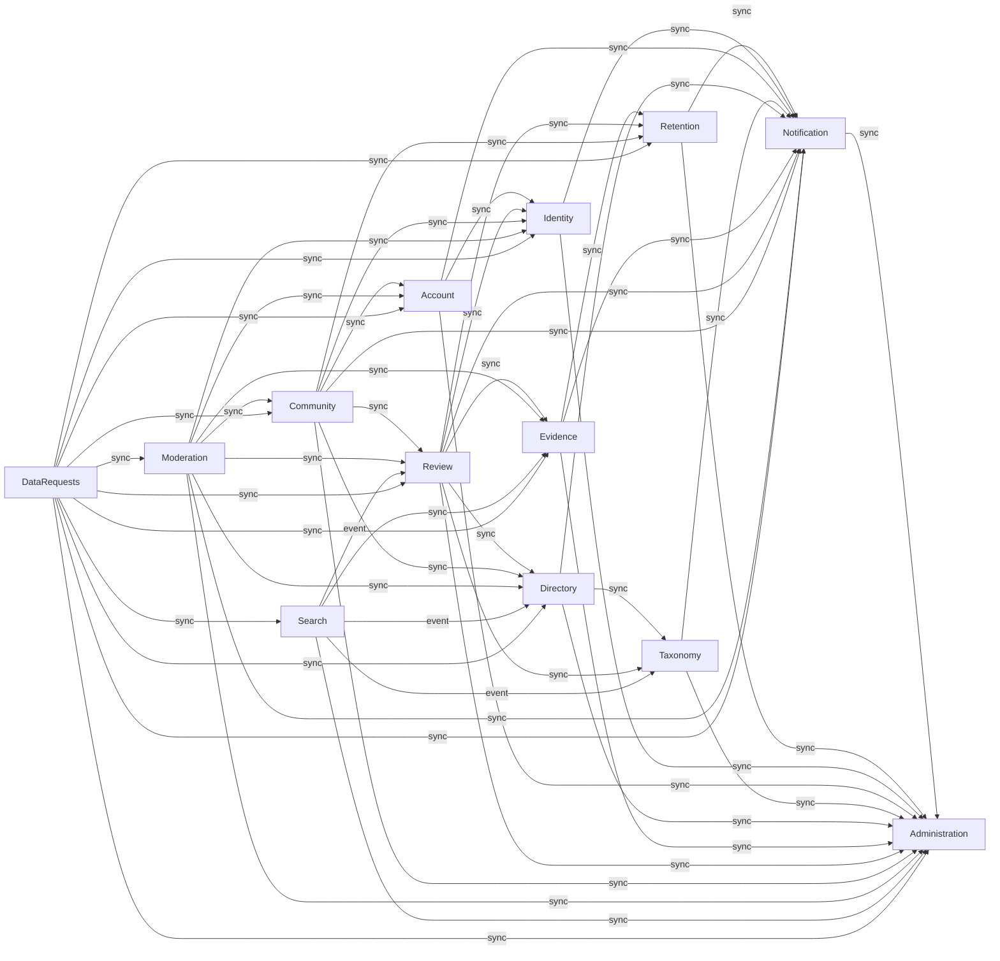

# Components — RogiKotha demo build

The logical building blocks of the system: the thirteen domain modules fixed in `01-conventions.md` §2 (ADR-001). Every one of the 58 tables in `02-data-model.md` is an entity of exactly one component; `demo_clock` is demo-only support, not a component entity. Ownership decisions FD-064..FD-066; architecture decisions in `decisions.md`. Deployment grouping is decided in Units Generation.

Built from `requirements.md` and `stories.md`, the reverse-engineered `architecture.md` and `component-inventory.md` in `aidlc/spaces/default/codekb/rogikotha/`, and `team-practices.md` from Practices Discovery.

## Component catalogue

```yaml
components:
  - name: Administration
    summary: "Versioned runtime configuration, capability toggles, the one audit trail every module writes to, and the staff dashboard's Beta metrics and console nav counts."
    behaviour: "Configuration is bounded data, not executable structure (AD-10, FD-018): config.apply validates every value against the ConfigValues schema and its ranges (fiveAccountHide 2-50, criticalHours 1-168, standardDays 1-30, appealDays 1-30, limitedDataThreshold 1-50), rejects any key outside the schema or any change to a structural security or data boundary (config.invariant), uses optimistic concurrency on expectedVersion (conflict), and requires config.write plus a fresh password recheck (stepUp). Retention periods are not configuration values: retention_policies is their only source (FD-068); any retention block in the configuration is a read-only mirror, decided in Contract Design. The current config is the highest version whose effective_from has passed; rollback and import create a new version and never rewrite history. Super Admin capabilities are fixed in code; only the Admin/Moderator identity.reveal and evidence.original toggles are configurable, and they default to off (FD-016, FD-022). The report reasons privacy, threat, unsafeFile, dangerous and other can never be disabled. AuditEvent rows are append-only (database trigger); details are allowlisted (ids, enums, counts, config before/after) and never carry user free text, emails, filenames or review bodies; the moderation case timeline is the stream case:<code> inside the same trail (FD-065). Audit rows are expired only by the maintenance-role function, on the cutoff Retention supplies. The Beta metrics view (FD-066) and adminNavCounts show aggregate counts only (accounts, published reviews, open and closed reports, evidence processed or failed, open and critical cases, pending provider work, unacked staff notifications), with no analytics and no per-user data (FD-019); a missing count renders as Not provided, never 0. The counts come through Administration's own OperationalCounts port, which the owning modules implement, so Administration calls no other module."
    responsibilities:
      - "Own ConfigVersion and ConfigChange: propose, apply, history, rollback, export/import of runtime settings"
      - "Resolve staff capabilities from role plus the configurable reveal and original-evidence toggles"
      - "Own the AuditEvent trail and the AuditWriter port every command writes through in its own transaction"
      - "Execute audit expiry on the cutoff Retention passes, excluding held records"
      - "Serve the Beta metrics view and console nav counts through the OperationalCounts port"
    depends_on: []
    dependents:
      - component: Notification
        interaction: "Writes audit rows for staff-notification acknowledgement; implements OperationalCounts (unacked staff notifications)"
      - component: Retention
        interaction: "Writes audit rows to the retention stream; checks retention.bulk, holds.manage and config.write; calls audit expiry with the audit_days cutoff"
      - component: Identity
        interaction: "Writes every reveal attempt to the identity stream; reads the Admin/Moderator reveal toggles"
      - component: Account
        interaction: "Writes account:<id> audit rows; reads rate-limit, progressive-delay and capability settings; implements OperationalCounts (accounts)"
      - component: Taxonomy
        interaction: "Writes taxonomy audit history; checks Super Admin rights for taxonomy management"
      - component: Directory
        interaction: "Writes providers audit rows; checks providers.decide; implements OperationalCounts (pending submissions, claims, protected changes)"
      - component: Evidence
        interaction: "Writes evidence:<id> audit rows; reads upload limits and the evidence.original toggle; implements OperationalCounts (evidence processed or failed)"
      - component: Review
        interaction: "Writes review:<id> audit rows; reads limitedDataThreshold and optional-field settings; implements OperationalCounts (published reviews)"
      - component: Community
        interaction: "Writes audit rows for comment, reaction and block changes; reads rate limits"
      - component: Moderation
        interaction: "Writes the case:<code> timeline; reads thresholds, SLA hours and days, enabled reasons and enforcement settings; implements OperationalCounts (reports, cases)"
      - component: Search
        interaction: "Reads limitedDataThreshold for result-card summaries"
      - component: DataRequests
        interaction: "Writes audit rows for export and deletion requests and their per-module steps"
    external_dependencies:
      - name: "PostgreSQL"
        kind: database
        purpose: "config_versions, config_changes and the append-only audit_events table (trigger-enforced; fn_expire_audit under the maintenance role)"
    entities:
      - name: ConfigVersion
        identifier: id
        attributes: [id, version, schema_version, values, actor_account_id, reason, effective_from, rolled_back_from, created_at]
        references:
          - entity: AccountProfile
            owned_by: Account
            relationship: "each config version is applied by one staff account"
      - name: ConfigChange
        identifier: id
        attributes: [id, version, path, before, after, created_at]
      - name: AuditEvent
        identifier: id
        attributes: [id, stream, action, actor, target_kind, target_id, details, created_at]
  - name: Notification
    summary: "The transactional outbox and its relay, the in-app notification feed, the staff notification tray, and content-free email delivery."
    behaviour: "Every module appends outbox events in the same transaction as its change (FD-065); event names are past tense and payloads carry opaque ids only (including the recipient account ids the publisher resolved in the web tier), never content. The worker's outbox.relay (every 2 s) enqueues each event into its jobs inside the same transaction that sets processed_at (FD-038), routing by a name-to-job table supplied by the worker composition root (dataRequest.created is routed by request kind, FD-052), so the relay depends on no consumer. notification.deliver is idempotent: one in-app item per dedupe_key <event>:<targetId>:<accountId>, so a retried job never duplicates an item (AC10.1.2). In-app items are expired when Retention's expiry job passes the notification_days cutoff from retention_policies (FD-068); Notification stores no retention period of its own: an item expires when its created_at is older than that cutoff, so the expires_at column is left unused (or dropped) and Contract Design records which. Email is content-free: message key plus ids and minimal copy, never review narrative, medical content or document data (FR88). Verification, reset, security, device-approval and deletion email are always sent; discussion and moderation email follow the recipient's preferences (FD-047), read through Notification's RecipientDirectory port, which Account implements; the evidence email category sends nothing in the demo (FD-070). RecipientDirectory and every email_deliveries write run in the web tier only; notification.deliver in the worker creates in-app items only (FD-070). Recipient addresses travel encrypted in email_deliveries.to_email_enc, written by the web tier, so the worker never reads auth_users (FD-041). Staff notifications (newReport, newProfile, evidence, claim, protectedChange, identityReveal, security) are listed with cursor paging (limit 50) and acknowledged by staff. A moderation notice never names the reporter."
    responsibilities:
      - "Own OutboxEvent and the Outbox port; relay outbox rows to durable jobs transactionally"
      - "Own Notification (in-app feed: list, mark read, unread count, expiry on the cutoff Retention passes (FD-068))"
      - "Own StaffNotification (console triage list and acknowledgement)"
      - "Own EmailDelivery and the mail.send job: content-free mail with retry and status"
      - "Apply email-category preferences and the always-allowed essential categories"
    depends_on:
      - component: Administration
        interaction: "Writes audit rows for staff acknowledgement; implements Administration's OperationalCounts port (unacked staff notifications)"
        style: sync
    dependents:
      - component: Retention
        interaction: "Appends hold.changed and retention.policyChanged to the outbox; expires notifications past notification_days"
      - component: Identity
        interaction: "Raises the identityReveal staff notification for every reveal attempt"
      - component: Account
        interaction: "Appends account.registered and account.securityEvent; queues verification, reset, security and device-approval mail; implements RecipientDirectory"
      - component: Taxonomy
        interaction: "Appends term.changed"
      - component: Directory
        interaction: "Appends doctor.changed and facility.changed; raises newProfile, claim and protectedChange staff notifications and claimant decision notices"
      - component: Evidence
        interaction: "Appends evidence.received and evidence.stateChanged; raises the staff notification for original access"
      - component: Review
        interaction: "Appends review.published, changed, hidden, restored and deleted"
      - component: Community
        interaction: "Appends comment.posted and comment.changed with the recipients to notify"
      - component: Moderation
        interaction: "Appends report.filed, case.decided and appeal.decided; raises newReport; sends the moderation notice to the affected author"
      - component: DataRequests
        interaction: "Appends dataRequest.created; sends ready and deletion notices; exports and deletes the account's notifications"
    external_dependencies:
      - name: "PostgreSQL"
        kind: database
        purpose: "outbox_events, notifications, staff_notifications, email_deliveries"
      - name: "pg-boss"
        kind: queue
        purpose: "outbox.relay, notification.deliver and mail.send jobs (singletonKey idempotency)"
      - name: "SMTP mail sink (Mailpit in the local demo)"
        kind: other
        purpose: "Mailer port adapter (nodemailer) delivering content-free email"
    entities:
      - name: Notification
        identifier: id
        attributes: [id, account_id, kind, message_key, params, route, read_at, dedupe_key, expires_at, created_at]
        references:
          - entity: AccountProfile
            owned_by: Account
            relationship: "each notification belongs to one recipient account"
      - name: StaffNotification
        identifier: id
        attributes: [id, kind, target_code, message_key, params, route, acked_by, acked_at, dedupe_key, created_at]
        references:
          - entity: AccountProfile
            owned_by: Account
            relationship: "a staff notification is acknowledged by at most one staff account"
      - name: EmailDelivery
        identifier: id
        attributes: [id, account_id, to_email_enc, locale, category, message_key, params, status, attempts, last_error_code, sent_at, created_at]
        references:
          - entity: AccountProfile
            owned_by: Account
            relationship: "each email delivery is addressed to one account"
      - name: OutboxEvent
        identifier: id
        attributes: [id, name, payload, processed_at, attempts, created_at]
  - name: Retention
    summary: "Versioned retention policy, individual legal holds, previewed bulk retention actions, and the hourly expiry schedule."
    behaviour: "Retention defaults are versioned and prospective: setPolicy (config.write plus stepUp) logs old value, new value, actor and reason, and only records created afterwards take the new default; existing records keep their deadlines (FD-005, FD-020). Changing existing records needs previewBulk (the exact affected set, count, sample ids and a preview token) followed by executeBulk (retention.bulk plus stepUp, super_admin only per FD-051) with an idempotency key; if the affected set changed since the preview it refuses with retention.preview_drift. RetentionBulkAction rows are append-only. A LegalHold (holds.manage) on one record pauses physical deletion for that record only and logs actor, reason, start and expiry or release; on release or expiry the ordinary schedule applies again (FD-021). Public visibility is decided separately by the owning module. The hourly retention.expire job computes cutoffs from the current policy and asks each owning module to expire its own records through Retention's RetentionSubject port (Evidence originals past retention_expires_at without an active hold, held comments skipped); it calls Notification to expire in-app items past notification_days and Administration to expire audit rows past audit_days. Retention never writes another module's tables (AD-1, FD-064). All time comes from the Clock port, so the demo clock can move retention deadlines (FD-035)."
    responsibilities:
      - "Own RetentionPolicy: current policy and prospective policy changes"
      - "Own LegalHold: place, release, expiry; answer active-hold checks for Evidence, Review, Community and DataRequests"
      - "Own RetentionBulkAction: preview, drift detection, idempotent execution"
      - "Run the retention.expire schedule through the RetentionSubject port and the Notification and Administration expiry commands"
    depends_on:
      - component: Administration
        interaction: "Writes retention audit rows; checks retention.bulk, holds.manage and config.write; calls audit expiry with the audit_days cutoff, excluding held records"
        style: sync
      - component: Notification
        interaction: "Appends hold.changed and retention.policyChanged to the outbox; calls notification expiry with the notification_days cutoff"
        style: sync
    dependents:
      - component: Evidence
        interaction: "Checks active holds and the current originalDays; implements RetentionSubject (original expiry, bulk preview and deadline change, hold custody events)"
      - component: Review
        interaction: "Checks holds before deletion; implements RetentionSubject for held reviews"
      - component: Community
        interaction: "Checks holds before deleting or tombstoning comments; implements RetentionSubject for comments"
      - component: DataRequests
        interaction: "Looks up active holds to plan retain_under_hold steps"
    external_dependencies:
      - name: "PostgreSQL"
        kind: database
        purpose: "retention_policies, legal_holds, append-only retention_bulk_actions"
      - name: "pg-boss"
        kind: queue
        purpose: "hourly retention.expire cron job"
    entities:
      - name: LegalHold
        identifier: id
        attributes: [id, target_kind, target_id, reason, placed_by_account_id, placed_at, expires_at, released_at, released_by, created_at]
        references:
          - entity: AccountProfile
            owned_by: Account
            relationship: "each hold is placed, and released, by a staff account"
          - entity: EvidenceItem
            owned_by: Evidence
            relationship: "a hold may target one evidence item"
          - entity: Review
            owned_by: Review
            relationship: "a hold may target one review"
          - entity: Comment
            owned_by: Community
            relationship: "a hold may target one comment"
      - name: RetentionPolicy
        identifier: id
        attributes: [id, version, original_days, audit_days, notification_days, effective_from, actor_account_id, reason, superseded_by, created_at]
        references:
          - entity: AccountProfile
            owned_by: Account
            relationship: "each policy version is set by one super admin"
      - name: RetentionBulkAction
        identifier: id
        attributes: [id, policy_version, preview, previewed_at, executed_at, actor_account_id, reason, affected_ids, drift_detected, idempotency_key, created_at]
        references:
          - entity: AccountProfile
            owned_by: Account
            relationship: "each bulk action is run by one super admin"
          - entity: EvidenceItem
            owned_by: Evidence
            relationship: "affected_ids lists the evidence items whose deadlines the action changed"
  - name: Identity
    summary: "Public persona snapshots, the private persona-to-account link, and audited staff identity reveal."
    behaviour: "Public content stores an immutable persona snapshot; the private link from persona to account is a separate resource that no public, query or analytics projection reads (AD-3). Each account has one named persona (a rename creates a new persona row and old content keeps the old snapshot), one pseudonymous persona, and one anonymous persona per review thread with a stable alias such as patient-4f2k, created on first use by personaFor; two anonymous threads by the same author get different aliases, and nothing links them to each other or to the profile (FD-015). persona_links is readable only by Identity and is excluded from the worker's database role. identity.reveal requires identity.reveal plus stepUp and a stated purpose; Super Admin may always reveal, Admin and Moderator only when the Super Admin has enabled the toggle for their role (FD-016). Every attempt, granted or refused, writes an append-only IdentityReveal row, an audit row on the identity stream and an identityReveal staff notification (a refusal is recorded through onRefused). A reveal target is resolved through Identity's RevealTarget port (implemented by Review, Community and Moderation), which returns either a persona id (review or comment author) or a restricted account id (a report's reporter, stored as reporter_account_id); Contract Design gives the port a signature that fits both, and the revealed account's username and email through Identity's RevealContact port (implemented by Account). No banner about staff access appears on review pages or in the writing flow (FD-022). accountsOf is a private query used only by DataRequests and Moderation enforcement."
    responsibilities:
      - "Own Persona: default named and pseudonymous personas, thread-scoped anonymous aliases, public projection"
      - "Own PersonaLink: the only private persona-to-account mapping"
      - "Own IdentityReveal: capability- and step-up-gated reveal that logs every attempt"
      - "De-identify an account's personas during deletion (link rows removed, snapshots kept)"
    depends_on:
      - component: Administration
        interaction: "Writes every reveal attempt to the identity audit stream; reads the Admin/Moderator reveal toggles"
        style: sync
      - component: Notification
        interaction: "Raises the identityReveal staff notification for every attempt"
        style: sync
    dependents:
      - component: Account
        interaction: "Creates default personas at registration and a new named snapshot on rename; implements RevealContact"
      - component: Review
        interaction: "Gets the author persona for the chosen identity mode at publish and its public projection; implements RevealTarget for reviews"
      - component: Community
        interaction: "Gets the thread persona or alias, resolves mentions and refuses anonymous ones; implements RevealTarget for comments"
      - component: Moderation
        interaction: "Reveals a reporter through identity.reveal and resolves an affected author's account for enforcement; implements RevealTarget for reports"
      - component: DataRequests
        interaction: "Lists an account's personas and runs the deidentify step"
    external_dependencies:
      - name: "PostgreSQL"
        kind: database
        purpose: "personas, persona_links (no worker grant), append-only identity_reveals"
    entities:
      - name: Persona
        identifier: id
        attributes: [id, kind, display_name, username, avatar_hue, created_at]
      - name: PersonaLink
        identifier: persona_id
        attributes: [persona_id, account_id, review_id, created_at]
        references:
          - entity: AccountProfile
            owned_by: Account
            relationship: "each persona link points to the one account that owns the persona"
          - entity: Review
            owned_by: Review
            relationship: "an anonymous persona's link is scoped to one review thread"
      - name: IdentityReveal
        identifier: id
        attributes: [id, requester_account_id, requester_role, target_kind, target_id, reason, granted, revealed_account_id, created_at]
        references:
          - entity: AccountProfile
            owned_by: Account
            relationship: "each reveal is requested by one staff account and, when granted, names one revealed account"
          - entity: Review
            owned_by: Review
            relationship: "a reveal may target a review's author"
          - entity: Comment
            owned_by: Community
            relationship: "a reveal may target a comment's author"
          - entity: Report
            owned_by: Moderation
            relationship: "a reveal may target a report's reporter"
  - name: Account
    summary: "Registration, authentication through Better Auth, sessions, staff devices and roles, account status and enforcement, preferences, feedback, bookmarks and blocks."
    behaviour: "Authentication is an adapter and authorization is application policy (AD-4): Better Auth's four auth tables are read only through the account repository. Registration requires email, a password of at least 10 characters (Argon2id, unique salt), a unique username, a display name, a locale, Terms/Privacy acceptance and 18+ confirmation; it returns the same success shape even when the email exists (the owner gets a security email instead), creates the profile and preferences, then calls Identity to create the named and pseudonymous personas. Email confirmation is valid for 24 hours and resend is limited to 3/hour/email; before confirmation the account may browse and edit settings, but every contribution is refused. Sign-in refuses suspended and banned accounts; restricted accounts may sign in, but commands check notRestricted. Repeated failures get a progressive delay from the 3rd failure in 15 minutes (1 s doubling to a 30 s cap) and a severe-activity notice at 10, with the values taken from runtime settings and identical responses and timing whether or not the email has an account (FD-058, FD-063). Sessions last 30 days; Sign out everywhere and password reset revoke sessions, and every reset is audited (FD-059). Staff use the same accounts with a staff role; a staff sign-in from an unseen device starts no session until the emailed 30-minute approval link is opened and the password re-entered (FD-034). stepUp opens a 5-minute recheck window and writes an audit row. Account status follows the current effective Enforcement (warn, restrict, suspend, ban), which Moderation applies. Bookmarks and blocks are private and never projected; Community enforces blocks. Account implements Notification's RecipientDirectory port (preferences, locale, encrypted contact) and Identity's RevealContact port."
    responsibilities:
      - "Own the Better Auth tables (AuthUser, AuthSession, AuthAccount, AuthVerification) behind the account repository"
      - "Own AccountProfile and AccountPreference: registration, confirmation, status, locale, email categories"
      - "Own StaffDevice and StaffDeviceApproval: new-device approval for staff"
      - "Own Enforcement: the effective restriction, suspension or ban that sets account status"
      - "Own Feedback, Bookmark and Block"
      - "Run the account step of a deletion plan in the web process (revoke sessions, status deleted, email tombstone)"
    depends_on:
      - component: Administration
        interaction: "Writes account:<id> audit rows (step-up, reset, sign-out everywhere, staff role, device approval); reads rate limits, progressive-delay values and capabilities; implements Administration's OperationalCounts port (accounts)"
        style: sync
      - component: Identity
        interaction: "Calls createDefaultPersonas at registration and creates a new named persona snapshot on rename; implements Identity's RevealContact port"
        style: sync
      - component: Notification
        interaction: "Appends account.registered and account.securityEvent; queues verification, reset, security and device-approval email; implements Notification's RecipientDirectory port"
        style: sync
    dependents:
      - component: Community
        interaction: "Checks blocks before replies, mentions and notifications; resolves a username for block.set"
      - component: Moderation
        interaction: "Reads reporter confirmation and account age for the coordination signal; applies warn, restrict, suspend and ban enforcements"
      - component: DataRequests
        interaction: "Exports profile, preferences, bookmarks and feedback; runs the account deletion step"
    external_dependencies:
      - name: "PostgreSQL"
        kind: database
        purpose: "auth_* tables, account_profiles, preferences, staff devices, enforcements, feedback, bookmarks, blocks"
      - name: "Better Auth"
        kind: other
        purpose: "email/password, confirmation and reset tokens, sessions and cookies through its Drizzle adapter"
      - name: "Argon2id (@node-rs/argon2)"
        kind: other
        purpose: "PasswordHasher port adapter"
      - name: "In-memory rate limiter"
        kind: other
        purpose: "RateLimiter port for sign-up, sign-in, reset, resend and step-up limits"
    entities:
      - name: AuthUser
        identifier: id
        attributes: [id, name, email, email_verified, image, created_at, updated_at]
      - name: AuthSession
        identifier: id
        attributes: [id, token, expires_at, ip_address, user_agent, user_id, created_at, updated_at]
      - name: AuthAccount
        identifier: id
        attributes: [id, account_id, provider_id, user_id, access_token, refresh_token, id_token, access_token_expires_at, refresh_token_expires_at, scope, password, created_at, updated_at]
      - name: AuthVerification
        identifier: id
        attributes: [id, identifier, value, expires_at, created_at, updated_at]
      - name: AccountProfile
        identifier: id
        attributes: [id, auth_user_id, username, username_key, display_name, locale, status, staff_role, age_confirmed_at, terms_version, terms_accepted_at, last_seen_at, deleted_at, created_at, updated_at]
      - name: AccountPreference
        identifier: account_id
        attributes: [account_id, interface_locale, email_security, email_moderation, email_evidence, email_discussion, created_at, updated_at]
      - name: StaffDevice
        identifier: id
        attributes: [id, account_id, device_hash, label, first_seen_at, last_seen_at, approved_at, revoked_at, created_at]
      - name: StaffDeviceApproval
        identifier: id
        attributes: [id, device_id, token_hash, expires_at, used_at, created_at]
      - name: Enforcement
        identifier: id
        attributes: [id, account_id, kind, reason_code, note_to_user, starts_at, ends_at, decision_id, actor_account_id, created_at]
        references:
          - entity: ModerationDecision
            owned_by: Moderation
            relationship: "an enforcement may come from one moderation decision"
      - name: Feedback
        identifier: id
        attributes: [id, account_id, body, locale, created_at]
      - name: Bookmark
        identifier: (account_id, review_id)
        attributes: [account_id, review_id, created_at]
        references:
          - entity: Review
            owned_by: Review
            relationship: "each bookmark saves one review for one account"
      - name: Block
        identifier: (blocker_account_id, blocked_account_id)
        attributes: [blocker_account_id, blocked_account_id, created_at]
  - name: Taxonomy
    summary: "The bilingual vocabulary of conditions, symptoms, treatments, medicines and specialties, including provisional user terms, aliases and canonical mapping."
    behaviour: "Terms carry Bengali and English names with NFC-normalised keys, plus aliases in en, bn and Banglish. Reviewers may tag in their own words: an unmapped tag becomes a provisional term at once and is shown in the original wording (FR37); staff later map provisional terms to a canonical term, the original wording stays on the review, and links open the canonical page. resolve returns the matching term, the matched alias or a provisional hint. A tag is never a diagnosis. Creating, renaming, merging, redirecting, deactivating or reordering taxonomy entries is Super Admin only and is refused server-side for anyone else; each change writes an audit history entry and a term.changed outbox event, so search follows the redirect (FR38). The condition page (getCondition) combines the term with the spread of sentiment and outcome, the medicines, treatments and symptoms mentioned with counts, and the doctors, facilities and districts; Taxonomy obtains those review-derived figures through its own ConditionStats port, which Review implements, with exact counts and denominators and no score."
    responsibilities:
      - "Own TaxonomyTerm and TaxonomyAlias: canonical and provisional terms, aliases, mapping and redirects"
      - "Resolve free text to terms and create provisional terms for the composer"
      - "List suggested terms per tag group"
      - "Serve the condition page through the ConditionStats port"
    depends_on:
      - component: Administration
        interaction: "Writes taxonomy audit history; checks Super Admin rights for taxonomy management"
        style: sync
      - component: Notification
        interaction: "Appends term.changed when a term is created, mapped, merged or redirected"
        style: sync
    dependents:
      - component: Directory
        interaction: "Reads the specialty term of each doctor"
      - component: Review
        interaction: "Resolves tags and creates provisional terms; reads term names and canonical redirects; implements ConditionStats"
      - component: Search
        interaction: "Rebuilds condition documents and aliases on term.changed"
    external_dependencies:
      - name: "PostgreSQL"
        kind: database
        purpose: "taxonomy_terms and taxonomy_aliases"
    entities:
      - name: TaxonomyTerm
        identifier: id
        attributes: [id, public_id, seed_ref, kind, name_en, name_bn, name_key_en, name_key_bn, provisional, canonical_id, created_by_account_id, state, created_at]
        references:
          - entity: AccountProfile
            owned_by: Account
            relationship: "a provisional term is created by one account"
      - name: TaxonomyAlias
        identifier: id
        attributes: [id, term_id, alias, alias_key, lang, provenance, created_at]
  - name: Directory
    summary: "Doctor, facility and branch profiles with per-field provenance, community submissions, staff-decided claims, protected field changes and duplicate merges."
    behaviour: "Profiles render only populated, non-hidden fields; empty fields are omitted, never shown as 0 or as a blank label (FR17). Every public field shows its provenance (Community submitted, Provider confirmed, Admin checked) and its last-update date in the active locale's numerals (FR18); a sourced field needs a source URL or description. Every doctor shows Registration not verified, and a BMDC number is shown only as profile information (D-003); an unverified facility shows Not verified. Community-submitted profiles start pending_review and become public only after a staff duplicate and abuse check (FR15); submitProfile is limited to 5/day and fills duplicate_of_id from bmdc_key and name_key. Staff with providers.decide decide claims from the submitted method and private evidence note, with no code step (FD-060); a claim grants field-edit rights, never control over reviews, and the profile still shows Registration not verified. After a claim, changes to name, BMDC number, degrees (qualifications) and specialty stay pending until Admin approves them; schedule, fee, booking contact, languages and chamber details publish at once with history (FD-061). A community photo suggestion needs approval; a claimed doctor's own photo publishes directly. Merging confirmed duplicates records a ProfileMerge and a ProfileRedirect (old URLs answer 301) and transfers reviews, drafts, tags, chambers and claims; the review-side transfer, and the unblocking of drafts waiting on a submission, run through Directory's ProfileMergeParticipant port, which Review implements. Facility organisations have branches; reviews attach to the visited branch, and parent aggregates disclose exact counts and their denominator. Profile pages get their account list and distributions through Directory's ProviderExperience port, which Review implements; facility feedback never enters a doctor's summaries (FR26)."
    responsibilities:
      - "Own Doctor, DoctorChamber, Facility and FacilityBranch with field provenance and publication state"
      - "Own ProfileSubmission, ProfileClaim and ProfileFieldChange and their staff decisions"
      - "Own ProfileMerge and ProfileRedirect: duplicate merge and old-URL redirects"
      - "Serve doctor and facility profile, index and branch queries"
      - "De-identify an account's submissions, claims and field changes during deletion (submitted_by, claimant, proposed_by removed; legal holds still apply, FD-069)"
    depends_on:
      - component: Administration
        interaction: "Writes providers audit rows; checks providers.decide; implements Administration's OperationalCounts port (pending submissions, claims and protected changes)"
        style: sync
      - component: Notification
        interaction: "Appends doctor.changed and facility.changed; raises newProfile, claim and protectedChange staff notifications; notifies claimants and submitters of decisions"
        style: sync
      - component: Taxonomy
        interaction: "Reads the specialty term referenced by each doctor"
        style: sync
    dependents:
      - component: Review
        interaction: "Validates the doctor or branch being reviewed, shows its card, links later providers, checks pending submissions for blocked drafts; implements ProviderExperience and ProfileMergeParticipant"
      - component: Community
        interaction: "Checks for an approved claim to label a provider's comment"
      - component: Moderation
        interaction: "Loads profile targets of reports and hides or restores them"
      - component: Search
        interaction: "Rebuilds doctor and facility documents on doctor.changed and facility.changed"
      - component: DataRequests
        interaction: "De-identifies the account's submissions, claims and field changes during deletion (FD-069)"
    external_dependencies:
      - name: "PostgreSQL"
        kind: database
        purpose: "doctors, chambers, facilities, branches, submissions, claims, field changes, merges, redirects"
    entities:
      - name: Doctor
        identifier: id
        attributes: [id, public_id, seed_ref, name_en, name_bn, specialty_id, qualifications_en, qualifications_bn, bmdc_number, gender, languages_en, languages_bn, fee_display_en, fee_display_bn, city_en, city_bn, area_en, area_bn, about_en, about_bn, field_provenance, avatar_hue, claimed_by_account_id, state, merged_into_id, name_key, bmdc_key, created_at, updated_at]
        references:
          - entity: TaxonomyTerm
            owned_by: Taxonomy
            relationship: "each doctor has one specialty term"
          - entity: AccountProfile
            owned_by: Account
            relationship: "a doctor profile may be claimed by one account"
      - name: DoctorChamber
        identifier: id
        attributes: [id, doctor_id, branch_id, name_en, name_bn, hours_en, hours_bn, provenance, sort_order, created_at]
      - name: Facility
        identifier: id
        attributes: [id, public_id, seed_ref, name_en, name_bn, type, field_provenance, avatar_hue, state, claimed_by_account_id, created_at, updated_at]
        references:
          - entity: AccountProfile
            owned_by: Account
            relationship: "a facility may be claimed by one account"
      - name: FacilityBranch
        identifier: id
        attributes: [id, public_id, seed_ref, facility_id, name_en, name_bn, city_en, city_bn, area_en, area_bn, address_en, address_bn, field_provenance, state, is_primary, created_at, updated_at]
      - name: ProfileSubmission
        identifier: id
        attributes: [id, kind, payload, submitted_by_account_id, status, duplicate_of_id, reviewer_note, decided_by, decided_at, created_doctor_id, created_facility_id, created_at]
        references:
          - entity: AccountProfile
            owned_by: Account
            relationship: "each submission is made by one account and decided by one staff account"
      - name: ProfileClaim
        identifier: id
        attributes: [id, target_kind, target_id, claimant_account_id, method, evidence_note, status, decided_by, decided_at, created_at]
        references:
          - entity: AccountProfile
            owned_by: Account
            relationship: "each claim is made by one account and decided by one staff account"
      - name: ProfileFieldChange
        identifier: id
        attributes: [id, target_kind, target_id, field, old_value, new_value, proposed_by_account_id, provenance, protected, status, decided_by, decided_at, reason, created_at]
        references:
          - entity: AccountProfile
            owned_by: Account
            relationship: "each change is proposed by one account and, when protected, decided by one staff account"
      - name: ProfileRedirect
        identifier: from_public_id
        attributes: [from_public_id, to_kind, to_public_id, merge_id, created_at]
      - name: ProfileMerge
        identifier: id
        attributes: [id, kind, source_id, target_id, actor, reason, transferred, created_at]
  - name: Evidence
    summary: "Quarantine-first image intake, the processing pipeline, author preview and redaction, privacy confirmation, public derivatives, the custody log and audited original access."
    behaviour: "Phase 1 accepts JPEG and PNG only (FD-036): the extension must be jpg, jpeg or png and the declared MIME image/jpeg or image/png, and anything else is refused with evidence.type_rejected before storage. Limits are 10 files per draft, 15 MB each and 100 MB in total, refused before processing with the limit named. Intake stores the original in private quarantine under a server-generated key, records custody received and enqueues evidence.process. The worker checks magic bytes against the declared type (40 MP cap), then scans with ClamAV and fails closed: a detection fails the item (malware), and an unavailable scanner keeps it in scanning, retried, never advancing (FD-035). It then sanitises (orientation applied, metadata stripped, re-encoded) and produces a private page image and thumbnail (preview_ready), bounded at 120 s per item with 3 retries. Any failure leaves the text review public and shows the author the exact file, the reason and Replace/Remove guidance. The author previews the processed copy and may draw redactions, which are flattened into a new page artifact (the old one stays private); the author must confirm privacy before the item can publish (FD-023). evidence.publish is internal, called by Review; it marks the artifacts public and sets retention_expires_at from the current policy. Originals are never public. The public viewer returns only published items, worded Documents attached — not medically validated, never verified or approved. Reading an original requires evidence.original plus stepUp and a purpose, and writes custody original_accessed, an audit row and a staff notification; a refused attempt is logged. Moderators remove unsafe files (removeFile) with a reason; the public copy stops being served and custody records the removal. Custody events are append-only. Holds, policy and expiry come from Retention, and Evidence implements Retention's RetentionSubject port (original expiry, bulk deadline preview and change, hold custody events)."
    responsibilities:
      - "Own EvidenceItem and its state machine (quarantined to published; failed, rejected, removed, original_expired)"
      - "Own EvidenceArtifact (originals, page images, thumbnails, superseded redacted pages)"
      - "Own EvidenceRedaction and the author's privacy confirmation"
      - "Own EvidenceCustodyEvent, the append-only custody log"
      - "Gate original access behind a separate, audited permission"
      - "Implement Retention's RetentionSubject port for originals"
    depends_on:
      - component: Administration
        interaction: "Writes evidence:<id> audit rows for original access and removal; reads upload limits and the evidence.original toggle; implements Administration's OperationalCounts port (evidence processed or failed)"
        style: sync
      - component: Notification
        interaction: "Appends evidence.received and evidence.stateChanged (author notices); raises the staff notification for original access"
        style: sync
      - component: Retention
        interaction: "Checks active holds and reads originalDays for retention_expires_at; implements Retention's RetentionSubject port (original expiry, bulk preview and deadline change, hold_placed and hold_released custody)"
        style: sync
    dependents:
      - component: Review
        interaction: "Publishes privacy-confirmed items with the review; reads public evidence groups and document counts"
      - component: Moderation
        interaction: "Loads evidence targets of reports and removes unsafe files"
      - component: Search
        interaction: "Reads document presence per evidence group for the evidence filters"
      - component: DataRequests
        interaction: "Exports derivatives only; deletes originals and derivatives unless held"
    external_dependencies:
      - name: "PostgreSQL"
        kind: database
        purpose: "evidence_items, evidence_artifacts, evidence_redactions, append-only evidence_custody_events"
      - name: "Filesystem storage (STORAGE_ROOT quarantine, private, public)"
        kind: object-store
        purpose: "Storage port: quarantined originals and immutable derivatives"
      - name: "ClamAV (clamd INSTREAM)"
        kind: other
        purpose: "MalwareScanner port; optional at start-up, fail-closed at scan time"
      - name: "sharp"
        kind: other
        purpose: "ImageSanitiser port: decode, strip metadata, re-encode"
      - name: "pg-boss"
        kind: queue
        purpose: "evidence.process job in the isolated worker"
    entities:
      - name: EvidenceItem
        identifier: id
        attributes: [id, public_id, seed_ref, review_id, group, label_en, label_bn, state, fail_reason, declared_mime, detected_mime, original_bytes, original_sha256, original_filename_enc, page_count, uploaded_by_account_id, retention_expires_at, hold_id, published_artifact_id, idempotency_key, created_at, updated_at]
        references:
          - entity: Review
            owned_by: Review
            relationship: "each evidence item supports one review"
          - entity: AccountProfile
            owned_by: Account
            relationship: "each item is uploaded by one account (private)"
          - entity: LegalHold
            owned_by: Retention
            relationship: "an item may be under one active legal hold"
      - name: EvidenceArtifact
        identifier: id
        attributes: [id, item_id, kind, page_no, storage_key, sha256, bytes, mime, width, height, sanitiser_version, scanner_version, signature_version, immutable, public, superseded_by_id, deleted_at, created_at]
      - name: EvidenceRedaction
        identifier: id
        attributes: [id, item_id, page_no, rects, applied_to_artifact_id, created_at]
      - name: EvidenceCustodyEvent
        identifier: id
        attributes: [id, item_id, event, actor, details, created_at]
  - name: Review
    summary: "Treatment accounts (quick and detailed), drafts, tags, versions, follow-ups, corrections, deletion and restore, facility feedback, and the narrative sentiment, outcome and criteria distributions."
    behaviour: "Publishing requires a verified, not-restricted account (5/day) and the minimum fields: a doctor, a short experience (quick) or at least one section (detailed), the relationship with the experience/privacy attestation, and at least one condition, symptom or free-text tag or Not sure; sentiment, outcome, claims and evidence stay optional, and no numeric rating exists anywhere (FR39-FR46). The author chooses named, pseudonymous or anonymous per review, and Review takes the matching persona from Identity. Drafts autosave encrypted and expire after 30 days; a draft that names a pending doctor submission is blocked until the submission is decided. preview returns exactly the public projection. Exact treatment dates are stored encrypted and published as month and year only (FR42). Claims render as Reviewer's label, framed as the author's claim, never as a platform finding. The composer's pattern checks (phone numbers, emergency words, duplicates) warn but never block, and no automated classifier runs (FD-009); a repeat of the same episode is flagged on review.published for Moderation. A material edit creates an append-only ReviewVersion and a dated correction. Follow-ups are ordered by their dated month and year, newest first; the newest sets latest_status, and the author cannot pin an older one (FR70). Deleting a review with discussion leaves a tombstone, otherwise a soft delete (FD-049); either is restorable within 30 days and leaves the summaries at once. Publication transitions follow the shared publication contract (AD-5), and Moderation changes state only through Review's commands (setState; redact replaces identifiers only, never the narrative). Facility feedback lives in FacilityReview with non-scored criteria and never joins a doctor's aggregates (FR26). Distributions count only published, eligible reviews, return exact counts with the denominator, show Limited data below the configured threshold (placeholder 5) and Not provided for missing values, and are never changed by reactions or evidence. Review implements Directory's ProviderExperience and ProfileMergeParticipant, Taxonomy's ConditionStats, Retention's RetentionSubject, Identity's RevealTarget and Administration's OperationalCounts ports, and reads discussion presence through its own DiscussionPresence port, which Community implements."
    responsibilities:
      - "Own Review, ReviewTag, ReviewFollowUp and ReviewDraft: compose, autosave, preview, publish"
      - "Own ReviewVersion: the append-only authorised history of corrections, redactions and restores"
      - "Own FacilityReview: branch feedback with non-scored criteria"
      - "Apply the publication state machine for reviews and facility reviews (delete, tombstone, restore window)"
      - "Compute sentiment, outcome and criteria distributions and experience cards"
      - "Publish privacy-confirmed evidence together with the review"
    depends_on:
      - component: Administration
        interaction: "Writes review:<id> audit rows; reads limitedDataThreshold and optional-field settings; implements Administration's OperationalCounts port (published reviews)"
        style: sync
      - component: Notification
        interaction: "Appends review.published, review.changed, review.hidden, review.restored and review.deleted"
        style: sync
      - component: Identity
        interaction: "Gets the author persona for the chosen identity mode and its public projection; implements Identity's RevealTarget port for reviews"
        style: sync
      - component: Directory
        interaction: "Validates the doctor or branch, shows its card, links later providers and checks pending submissions; implements Directory's ProviderExperience and ProfileMergeParticipant ports"
        style: sync
      - component: Taxonomy
        interaction: "Resolves tags, creates provisional terms, reads term names and canonical redirects; implements Taxonomy's ConditionStats port"
        style: sync
      - component: Evidence
        interaction: "Calls evidence.publish for privacy-confirmed items at review publish; reads public evidence groups and document counts"
        style: sync
      - component: Retention
        interaction: "Checks holds before deletion; implements Retention's RetentionSubject port for held reviews"
        style: sync
    dependents:
      - component: Community
        interaction: "Reads the thread's review state and author persona; implements DiscussionPresence"
      - component: Moderation
        interaction: "Loads review targets, changes publication state, redacts identifiers, marks reviews ineligible; consumes the repeat-episode flag on review.published"
      - component: Search
        interaction: "Rebuilds review documents and provider counts on review events"
      - component: DataRequests
        interaction: "Exports reviews and decrypted drafts; runs the tombstone-or-delete step"
    external_dependencies:
      - name: "PostgreSQL"
        kind: database
        purpose: "reviews, tags, append-only versions, follow-ups, drafts, facility reviews; distribution queries"
      - name: "AES-256-GCM via the Crypto port"
        kind: other
        purpose: "encrypted draft payloads and exact treatment dates"
    entities:
      - name: Review
        identifier: id
        attributes: [id, public_id, seed_ref, author_persona_id, doctor_id, branch_id, kind, relationship, identity_mode, sentiment, outcome, period_year, period_month, exact_date_enc, title, body, sections, claims, language, state, published_at, hidden_at, hidden_reason_code, deleted_at, restore_until, version, latest_status, attestation_at, created_at, updated_at]
        references:
          - entity: Persona
            owned_by: Identity
            relationship: "each review is written under one persona snapshot"
          - entity: Doctor
            owned_by: Directory
            relationship: "each review is about one doctor"
          - entity: FacilityBranch
            owned_by: Directory
            relationship: "a review may name the branch where the care happened"
      - name: ReviewTag
        identifier: id
        attributes: [id, review_id, group, term_id, free_text, not_sure, created_at]
        references:
          - entity: TaxonomyTerm
            owned_by: Taxonomy
            relationship: "a tag may point to one term (otherwise free text or not sure)"
      - name: ReviewVersion
        identifier: id
        attributes: [id, review_id, version, snapshot, change_kind, reason, actor_kind, actor_id, created_at]
      - name: ReviewFollowUp
        identifier: id
        attributes: [id, review_id, kind, dated_year, dated_month, body, later_provider_text, later_doctor_id, state, created_at]
        references:
          - entity: Doctor
            owned_by: Directory
            relationship: "a later-care follow-up may link one later doctor"
      - name: ReviewDraft
        identifier: id
        attributes: [id, account_id, review_id, kind, payload_enc, doctor_id, blocked_on_submission_id, updated_at, expires_at, created_at]
        references:
          - entity: AccountProfile
            owned_by: Account
            relationship: "each draft belongs to one account"
          - entity: Doctor
            owned_by: Directory
            relationship: "a draft may name one doctor"
          - entity: ProfileSubmission
            owned_by: Directory
            relationship: "a draft may be blocked on one pending profile submission"
      - name: FacilityReview
        identifier: id
        attributes: [id, public_id, seed_ref, author_persona_id, branch_id, identity_mode, period_year, period_month, body, criteria, state, published_at, version, deleted_at, restore_until, created_at, updated_at]
        references:
          - entity: Persona
            owned_by: Identity
            relationship: "each facility review is written under one persona snapshot"
          - entity: FacilityBranch
            owned_by: Directory
            relationship: "each facility review is about one visited branch"
  - name: Community
    summary: "Comments with one reply level, mentions, Like/Dislike reactions on reviews, facility reviews and comments, and enforcement of user blocks in discussion."
    behaviour: "Commenting requires a verified, not-restricted account that the review author has not blocked (30/hour). There is one reply level only (community.reply_depth), and no images, attachments or private messages. External links are flagged with a warning. Mentions are parsed from @username and stored as CommentMention; anonymous personas cannot be mentioned (community.mention_anonymous). A commenter appears under the identity the thread uses for them; on a thread where they wrote anonymously, that is the thread's alias. Editing sets Edited, and the earlier text is kept only in private history. Deleting a comment with replies leaves a tombstone, and without replies removes it, subject to Retention's holds. A persistent medical-advice disclaimer stays in view, and an unsafe/misleading-advice report reason is reachable from every comment, with no automated classification (FD-009, FD-017). A provider with an approved claim on the review's doctor comments through the same flow and carries a provider label. Reactions take Like or Dislike on reviews, facility reviews and comments (FD-062): one current reaction per account and target, set by an idempotent upsert (100/hour), with public_persona_id null when the reactor is anonymous on that thread; reactions never change summaries, ranking or moderation (FR78). A block hides each side's nonessential activity from the other and refuses direct replies and mentions, while the public discussion stays available to everyone else. The derived dangerous flag on a comment comes from Community's ModerationSignals port, which Moderation implements. Community implements Review's DiscussionPresence, Identity's RevealTarget and Retention's RetentionSubject ports."
    responsibilities:
      - "Own Comment and CommentMention: post, edit, delete with tombstones, thread query"
      - "Own Reaction: Like/Dislike on reviews, facility reviews and comments, and their counts"
      - "Enforce blocks in replies, mentions and notifications"
      - "Label provider comments from approved claims"
    depends_on:
      - component: Administration
        interaction: "Writes audit rows for comment, reaction and block changes; reads rate limits"
        style: sync
      - component: Notification
        interaction: "Appends comment.posted and comment.changed, carrying the review author and mentioned accounts to notify unless blocked"
        style: sync
      - component: Account
        interaction: "Checks blocks between the actor, the review author and mentioned users; resolves a username for block.set"
        style: sync
      - component: Identity
        interaction: "Gets the thread persona or alias, resolves mentions and refuses anonymous ones, reads public projections; implements Identity's RevealTarget port for comments"
        style: sync
      - component: Review
        interaction: "Reads the review's state, author persona and identity mode for the thread; implements Review's DiscussionPresence port"
        style: sync
      - component: Directory
        interaction: "Checks for an approved claim on the review's doctor to label provider comments"
        style: sync
      - component: Retention
        interaction: "Checks holds before deleting or tombstoning comments; implements Retention's RetentionSubject port for comments"
        style: sync
    dependents:
      - component: Moderation
        interaction: "Loads comment targets; hides, restores or permanently deletes comments; implements ModerationSignals"
      - component: DataRequests
        interaction: "Exports comments and reactions; runs the tombstone step"
    external_dependencies:
      - name: "PostgreSQL"
        kind: database
        purpose: "comments, comment_mentions, reactions"
      - name: "In-memory rate limiter"
        kind: other
        purpose: "RateLimiter port for comment and reaction limits"
    entities:
      - name: Comment
        identifier: id
        attributes: [id, public_id, seed_ref, review_id, parent_id, author_persona_id, body, has_external_link, state, edited_at, deleted_at, tombstone, created_at, updated_at]
        references:
          - entity: Review
            owned_by: Review
            relationship: "each comment belongs to one review thread"
          - entity: Persona
            owned_by: Identity
            relationship: "each comment is written under one persona snapshot"
      - name: CommentMention
        identifier: (comment_id, mentioned_persona_id)
        attributes: [comment_id, mentioned_persona_id, created_at]
        references:
          - entity: Persona
            owned_by: Identity
            relationship: "each mention names one non-anonymous persona"
      - name: Reaction
        identifier: id
        attributes: [id, target_kind, target_id, account_id, public_persona_id, value, created_at, updated_at]
        references:
          - entity: AccountProfile
            owned_by: Account
            relationship: "each reaction is made by one account (private)"
          - entity: Persona
            owned_by: Identity
            relationship: "a reaction shows one public persona, or none when the reactor is anonymous on that thread"
          - entity: Review
            owned_by: Review
            relationship: "a reaction may target one review"
          - entity: FacilityReview
            owned_by: Review
            relationship: "a reaction may target one facility review"
  - name: Moderation
    summary: "Report intake, the threshold and critical-reason temporary hide, the prioritised queue, bounded reason-coded actions, appeals, enforcement and restricted reporter identity."
    behaviour: "A verified account files a report with a configured reason; a repeat report by the same account on the same target never increments (moderation.duplicate_report). Reports open or update a case. A privacy, threat or unsafeFile reason hides the target as hidden_pending_review on the first report and opens a critical case; otherwise, when distinct confirmed reporters reach the configured threshold (default 5) and the reason is not factual, the target is hidden pending review exactly once; factual disputes never auto-hide (AD-12, FD-017). A case carries a coordination signal when 3 or more reports arrive within 10 minutes from accounts created less than 24 hours earlier. Hiding is a reversible workflow, not a verdict. The queue shows critical cases with a 24-hour target, standard ones with three business days and appeals with seven, ordered by priority, with priority and status shown as text. Actions (warn, redact, removeFile, lock, hide, remove, restrict, suspend, ban, none, restore) require content.act (restrict, suspend and ban need admin or above), a reason code and a policy version; each is recorded as an append-only ModerationDecision with its public effect and applied only through the owning module's command. Redaction replaces identifiers only, and any edit of the narrative is refused (moderation.narrative_locked). Bulk actions use a preview token and warn on drift. The reporter is never shown to the reported person or in any public projection, and reads restricted, never blank, in the console; revealReporter needs identity.reveal plus stepUp and goes through Identity. Appeals open in the appeals lane, due after appealDays; Super Admin decides them with a fresh checklist and a written reason, and the decider must differ from the original actor (moderation.self_appeal_review). Enforcement offers only configured actions and durations and is applied through Account. The affected author is told the action, the policy reason and the appeal route. Moderation implements Community's ModerationSignals, Identity's RevealTarget and Administration's OperationalCounts ports, and consumes the repeat-episode flag on review.published."
    responsibilities:
      - "Own Report and ModerationCase with ModerationCaseReason: intake, dedupe, thresholds, lanes, SLA, coordination signal"
      - "Own ModerationDecision: bounded, reason-coded, append-only actions applied through the owning modules"
      - "Own Appeal: filing, fresh review, decision by a different actor"
      - "Keep the reporter's identity restricted"
      - "Apply configured enforcement through Account"
      - "De-identify the reports and appeals an account filed during deletion (reporter_account_id, appellant_account_id removed; legal holds still apply, FD-069)"
    depends_on:
      - component: Administration
        interaction: "Writes the case:<code> audit timeline; reads thresholds, SLA hours and days, enabled reasons, enforcement actions and capabilities; implements Administration's OperationalCounts port (open and closed reports, critical cases)"
        style: sync
      - component: Notification
        interaction: "Appends report.filed, case.decided and appeal.decided; raises newReport; sends the affected author the content-reported and decision notices without reporter identity"
        style: sync
      - component: Account
        interaction: "Reads reporter confirmation and account age for the coordination signal; applies warn, restrict, suspend and ban enforcements"
        style: sync
      - component: Identity
        interaction: "Reveals a reporter through identity.reveal; resolves the affected author's account for enforcement and notices; implements Identity's RevealTarget port for reports"
        style: sync
      - component: Directory
        interaction: "Loads profile targets and hides or restores them"
        style: sync
      - component: Review
        interaction: "Loads review and facility-review targets, changes their publication state, redacts identifiers, marks reviews ineligible; consumes the repeat-episode flag on review.published"
        style: sync
      - component: Community
        interaction: "Loads comment targets; hides, restores or permanently deletes comments; implements Community's ModerationSignals port"
        style: sync
      - component: Evidence
        interaction: "Loads evidence targets and removes unsafe files (removeFile)"
        style: sync
    dependents:
      - component: DataRequests
        interaction: "De-identifies the reports and appeals the account filed during deletion (FD-069)"
    external_dependencies:
      - name: "PostgreSQL"
        kind: database
        purpose: "reports (reporter column restricted from the worker), cases, case reasons, append-only decisions, appeals"
    entities:
      - name: Report
        identifier: id
        attributes: [id, target_kind, target_id, review_id, reporter_account_id, reason, detail, evidence_note, created_at]
        references:
          - entity: Review
            owned_by: Review
            relationship: "each report has one review as context"
          - entity: AccountProfile
            owned_by: Account
            relationship: "each report is filed by one account (restricted)"
      - name: ModerationCase
        identifier: id
        attributes: [id, code, lane, status, target_kind, target_id, review_id, report_count, distinct_reporters, auto_hidden, coordinated_signal, summary_en, summary_bn, opened_at, sla_due_at, assigned_to, closed_at, created_at]
        references:
          - entity: Review
            owned_by: Review
            relationship: "each case has one review as context"
          - entity: AccountProfile
            owned_by: Account
            relationship: "a case may be assigned to one staff account"
      - name: ModerationCaseReason
        identifier: (case_id, reason)
        attributes: [case_id, reason, count, created_at]
      - name: ModerationDecision
        identifier: id
        attributes: [id, case_id, action, reason_code, reason_to_author, policy_version, actor_account_id, public_effect, created_at]
        references:
          - entity: AccountProfile
            owned_by: Account
            relationship: "each decision is taken by one staff account"
      - name: Appeal
        identifier: id
        attributes: [id, case_id, appellant_account_id, text, status, checklist, decided_by, decision_reason, decided_at, due_at, created_at]
        references:
          - entity: AccountProfile
            owned_by: Account
            relationship: "each appeal is filed by the affected account and decided by one staff account"
  - name: Search
    summary: "PostgreSQL-backed unified search and suggestions over published doctors, facilities, conditions and reviews, with neutral ranking and Bengali, English and Banglish aliases."
    behaviour: "PostgreSQL owns searchable truth (AD-8): one SearchDocument per published doctor, facility, condition or review, with the original text, an NFC-normalised, lowercased, de-spaced key, curated aliases (name variants, BMDC numbers, condition aliases including Banglish), full-text search and trigram matching. The publication filter is applied before ranking. Ranking is exact native-script match, then alias, then fuzzy, then the chosen order: relevance (default), most accounts or most recent; there is no sentiment, outcome, evidence or reaction boost and no highest-rated sort (FR32). An alias or typo match returns a resolved note while the query stays exactly as typed; an ambiguous Banglish query gets Did you mean suggestions. Location is a separate, manually chosen filter, with no geolocation or Near Me. Evidence filters are labelled as document presence only, never as verified. Hidden, unpublished or merged-duplicate records never appear in results or in suggestions (at most 8). Documents are rebuilt one at a time by the search.refresh job when doctor.changed, facility.changed, term.changed or review.published, hidden, deleted or restored arrive, reading each owner's published projection; documents never contain author identity, evidence filenames or private data."
    responsibilities:
      - "Own SearchDocument and SearchAlias, the derived search projection"
      - "Answer search.query and search.suggest with neutral ranking"
      - "Rebuild single documents on owner events (search.refresh)"
      - "Remove an account's documents during deletion"
    depends_on:
      - component: Administration
        interaction: "Reads limitedDataThreshold for result-card review summaries"
        style: sync
      - component: Directory
        interaction: "Rebuilds doctor and facility documents on doctor.changed and facility.changed, reading the published profile projection and the name and BMDC aliases"
        style: event
      - component: Taxonomy
        interaction: "Rebuilds condition documents and aliases on term.changed, following canonical redirects"
        style: event
      - component: Review
        interaction: "Rebuilds review documents and provider counts (accounts_count, recent_at) on review.published, hidden, deleted and restored, reading the published review projection"
        style: event
      - component: Evidence
        interaction: "Reads document presence per evidence group for the evidence filters"
        style: sync
    dependents:
      - component: DataRequests
        interaction: "Removes the deleted account's content from the index"
    external_dependencies:
      - name: "PostgreSQL full-text search and pg_trgm"
        kind: database
        purpose: "search_documents (GIN on tsv, trigram on key_nfc) and search_aliases"
      - name: "pg-boss"
        kind: queue
        purpose: "search.refresh job"
    entities:
      - name: SearchDocument
        identifier: id
        attributes: [id, kind, ref_id, public_id, title_en, title_bn, body_en, body_bn, key_nfc, tsv, published, accounts_count, recent_at, city_key, specialty_id, created_at, updated_at]
        references:
          - entity: TaxonomyTerm
            owned_by: Taxonomy
            relationship: "a doctor document may carry one specialty term, and a condition document's ref_id is a term"
          - entity: Doctor
            owned_by: Directory
            relationship: "a doctor document's ref_id is one doctor"
          - entity: Facility
            owned_by: Directory
            relationship: "a facility document's ref_id is one facility"
          - entity: Review
            owned_by: Review
            relationship: "a review document's ref_id is one review"
      - name: SearchAlias
        identifier: id
        attributes: [id, kind, ref_id, alias, alias_key, lang, provenance, created_at]
  - name: DataRequests
    summary: "Account export and orchestrated account deletion as an inspectable, idempotent, per-module plan."
    behaviour: "Export and orchestrated deletion are real in the demo (FD-035). An account may have one open request per kind; requests take an idempotency key, and only the owner can see or download them. Export builds a zip of only the requester's own data (profile, preferences, reviews including decrypted drafts, comments, reactions, bookmarks, notifications, and evidence derivatives only, never originals), marks the request ready, notifies the user and offers the download for 7 days. Deletion requires stepUp and creates a plan in which each owning module returns its action (AD-17): account delete; identity deidentify (link rows removed, persona snapshots kept); review tombstone if discussion exists, else delete; community tombstone; evidence retain_under_hold when a hold applies, else delete originals now and derivatives with the review; notification delete; search remove; directory deidentify (the account's submissions, claims and field changes kept with the account link removed, FD-069); moderation deidentify (the reports and appeals it filed kept with reporter_account_id and appellant_account_id removed, FD-069). Each step runs through the owner's own command, is idempotent and records its result; a partial failure is recorded and retried safely. Records under an active legal hold are not physically deleted until the hold ends, and retained public contributions are de-identified. The account step (revoke sessions, status deleted, email replaced by a tombstone hash) runs in the web process inside dataRequest.delete; dataRequest.created is routed to data.export or data.delete by kind (FD-052)."
    responsibilities:
      - "Own DataRequest: export and deletion requests, status, plan and per-step results"
      - "Build the export bundle from the owners' export queries"
      - "Orchestrate deletion through each owner's command, honouring legal holds"
    depends_on:
      - component: Administration
        interaction: "Writes audit rows for the request and every plan step"
        style: sync
      - component: Notification
        interaction: "Appends dataRequest.created; sends ready and deletion notices; exports and deletes the account's notifications"
        style: sync
      - component: Account
        interaction: "Exports profile, preferences, bookmarks and feedback; runs the account deletion step in the web process"
        style: sync
      - component: Identity
        interaction: "Lists the account's personas (accountsOf) and runs the deidentify step"
        style: sync
      - component: Review
        interaction: "Exports reviews and decrypted drafts; runs the tombstone-or-delete step"
        style: sync
      - component: Community
        interaction: "Exports comments and reactions; runs the tombstone step"
        style: sync
      - component: Evidence
        interaction: "Exports evidence derivatives; deletes originals and derivatives unless held"
        style: sync
      - component: Search
        interaction: "Removes the account's content from the index"
        style: sync
      - component: Retention
        interaction: "Looks up active legal holds to plan retain_under_hold steps"
        style: sync
      - component: Directory
        interaction: "Runs the de-identify step for the account's profile submissions, claims and field changes (FD-069)"
        style: sync
      - component: Moderation
        interaction: "Runs the de-identify step for the reports and appeals the account filed (FD-069)"
        style: sync
    dependents: []
    external_dependencies:
      - name: "PostgreSQL"
        kind: database
        purpose: "data_requests with the plan and step results"
      - name: "pg-boss"
        kind: queue
        purpose: "data.export and data.delete jobs"
      - name: "Filesystem storage"
        kind: object-store
        purpose: "private export zip (result_storage_key)"
    entities:
      - name: DataRequest
        identifier: id
        attributes: [id, account_id, kind, status, plan, result_storage_key, idempotency_key, requested_at, completed_at, expires_at, created_at]
        references:
          - entity: AccountProfile
            owned_by: Account
            relationship: "each data request belongs to one account"
```

## Component Diagram



Text fallback: each arrow is a `depends_on` edge (caller → called), labelled sync (in-process command or query) or event (outbox event handled by a job).

## Component Summary

| Component | Purpose | Depends On | Dependents | Entities Owned |
|---|---|---|---|---|
| Administration | Versioned runtime configuration, capability toggles, the one audit trail every module writes to, and the staff dashboard's Beta metrics and console nav counts. | — | Notification, Retention, Identity, Account, Taxonomy, Directory, Evidence, Review, Community, Moderation, Search, DataRequests | ConfigVersion, ConfigChange, AuditEvent |
| Notification | The transactional outbox and its relay, the in-app notification feed, the staff notification tray, and content-free email delivery. | Administration | Retention, Identity, Account, Taxonomy, Directory, Evidence, Review, Community, Moderation, DataRequests | Notification, StaffNotification, EmailDelivery, OutboxEvent |
| Retention | Versioned retention policy, individual legal holds, previewed bulk retention actions, and the hourly expiry schedule. | Administration, Notification | Evidence, Review, Community, DataRequests | LegalHold, RetentionPolicy, RetentionBulkAction |
| Identity | Public persona snapshots, the private persona-to-account link, and audited staff identity reveal. | Administration, Notification | Account, Review, Community, Moderation, DataRequests | Persona, PersonaLink, IdentityReveal |
| Account | Registration, authentication through Better Auth, sessions, staff devices and roles, account status and enforcement, preferences, feedback, bookmarks and blocks. | Administration, Identity, Notification | Community, Moderation, DataRequests | AuthUser, AuthSession, AuthAccount, AuthVerification, AccountProfile, AccountPreference, StaffDevice, StaffDeviceApproval, Enforcement, Feedback, Bookmark, Block |
| Taxonomy | The bilingual vocabulary of conditions, symptoms, treatments, medicines and specialties, including provisional user terms, aliases and canonical mapping. | Administration, Notification | Directory, Review, Search | TaxonomyTerm, TaxonomyAlias |
| Directory | Doctor, facility and branch profiles with per-field provenance, community submissions, staff-decided claims, protected field changes and duplicate merges. | Administration, Notification, Taxonomy | Review, Community, Moderation, Search, DataRequests | Doctor, DoctorChamber, Facility, FacilityBranch, ProfileSubmission, ProfileClaim, ProfileFieldChange, ProfileRedirect, ProfileMerge |
| Evidence | Quarantine-first image intake, the processing pipeline, author preview and redaction, privacy confirmation, public derivatives, the custody log and audited original access. | Administration, Notification, Retention | Review, Moderation, Search, DataRequests | EvidenceItem, EvidenceArtifact, EvidenceRedaction, EvidenceCustodyEvent |
| Review | Treatment accounts (quick and detailed), drafts, tags, versions, follow-ups, corrections, deletion and restore, facility feedback, and the narrative sentiment, outcome and criteria distributions. | Administration, Notification, Identity, Directory, Taxonomy, Evidence, Retention | Community, Moderation, Search, DataRequests | Review, ReviewTag, ReviewVersion, ReviewFollowUp, ReviewDraft, FacilityReview |
| Community | Comments with one reply level, mentions, Like/Dislike reactions on reviews, facility reviews and comments, and enforcement of user blocks in discussion. | Administration, Notification, Account, Identity, Review, Directory, Retention | Moderation, DataRequests | Comment, CommentMention, Reaction |
| Moderation | Report intake, the threshold and critical-reason temporary hide, the prioritised queue, bounded reason-coded actions, appeals, enforcement and restricted reporter identity. | Administration, Notification, Account, Identity, Directory, Review, Community, Evidence | DataRequests | Report, ModerationCase, ModerationCaseReason, ModerationDecision, Appeal |
| Search | PostgreSQL-backed unified search and suggestions over published doctors, facilities, conditions and reviews, with neutral ranking and Bengali, English and Banglish aliases. | Administration, Directory, Taxonomy, Review, Evidence | DataRequests | SearchDocument, SearchAlias |
| DataRequests | Account export and orchestrated account deletion as an inspectable, idempotent, per-module plan. | Administration, Notification, Account, Identity, Review, Community, Evidence, Search, Retention, Directory, Moderation | — | DataRequest |

## Entity Ownership

| Entity | Owning Component | Identifier | Attributes | References |
|---|---|---|---|---|
| ConfigVersion (`config_versions`) | Administration | id | id, version, schema_version, values, actor_account_id, reason, effective_from, rolled_back_from, created_at | AccountProfile (Account) |
| ConfigChange (`config_changes`) | Administration | id | id, version, path, before, after, created_at | — |
| AuditEvent (`audit_events`) | Administration | id | id, stream, action, actor, target_kind, target_id, details, created_at | — |
| Notification (`notifications`) | Notification | id | id, account_id, kind, message_key, params, route, read_at, dedupe_key, expires_at, created_at | AccountProfile (Account) |
| StaffNotification (`staff_notifications`) | Notification | id | id, kind, target_code, message_key, params, route, acked_by, acked_at, dedupe_key, created_at | AccountProfile (Account) |
| EmailDelivery (`email_deliveries`) | Notification | id | id, account_id, to_email_enc, locale, category, message_key, params, status, attempts, last_error_code, sent_at, created_at | AccountProfile (Account) |
| OutboxEvent (`outbox_events`) | Notification | id | id, name, payload, processed_at, attempts, created_at | — |
| LegalHold (`legal_holds`) | Retention | id | id, target_kind, target_id, reason, placed_by_account_id, placed_at, expires_at, released_at, released_by, created_at | AccountProfile (Account), EvidenceItem (Evidence), Review (Review), Comment (Community) |
| RetentionPolicy (`retention_policies`) | Retention | id | id, version, original_days, audit_days, notification_days, effective_from, actor_account_id, reason, superseded_by, created_at | AccountProfile (Account) |
| RetentionBulkAction (`retention_bulk_actions`) | Retention | id | id, policy_version, preview, previewed_at, executed_at, actor_account_id, reason, affected_ids, drift_detected, idempotency_key, created_at | AccountProfile (Account), EvidenceItem (Evidence) |
| Persona (`personas`) | Identity | id | id, kind, display_name, username, avatar_hue, created_at | — |
| PersonaLink (`persona_links`) | Identity | persona_id | persona_id, account_id, review_id, created_at | AccountProfile (Account), Review (Review) |
| IdentityReveal (`identity_reveals`) | Identity | id | id, requester_account_id, requester_role, target_kind, target_id, reason, granted, revealed_account_id, created_at | AccountProfile (Account), Review (Review), Comment (Community), Report (Moderation) |
| AuthUser (`auth_users`) | Account | id | id, name, email, email_verified, image, created_at, updated_at | — |
| AuthSession (`auth_sessions`) | Account | id | id, token, expires_at, ip_address, user_agent, user_id, created_at, updated_at | — |
| AuthAccount (`auth_accounts`) | Account | id | id, account_id, provider_id, user_id, access_token, refresh_token, id_token, access_token_expires_at, refresh_token_expires_at, scope, password, created_at, updated_at | — |
| AuthVerification (`auth_verifications`) | Account | id | id, identifier, value, expires_at, created_at, updated_at | — |
| AccountProfile (`account_profiles`) | Account | id | id, auth_user_id, username, username_key, display_name, locale, status, staff_role, age_confirmed_at, terms_version, terms_accepted_at, last_seen_at, deleted_at, created_at, updated_at | — |
| AccountPreference (`account_preferences`) | Account | account_id | account_id, interface_locale, email_security, email_moderation, email_evidence, email_discussion, created_at, updated_at | — |
| StaffDevice (`staff_devices`) | Account | id | id, account_id, device_hash, label, first_seen_at, last_seen_at, approved_at, revoked_at, created_at | — |
| StaffDeviceApproval (`staff_device_approvals`) | Account | id | id, device_id, token_hash, expires_at, used_at, created_at | — |
| Enforcement (`enforcements`) | Account | id | id, account_id, kind, reason_code, note_to_user, starts_at, ends_at, decision_id, actor_account_id, created_at | ModerationDecision (Moderation) |
| Feedback (`feedback`) | Account | id | id, account_id, body, locale, created_at | — |
| Bookmark (`bookmarks`) | Account | (account_id, review_id) | account_id, review_id, created_at | Review (Review) |
| Block (`blocks`) | Account | (blocker_account_id, blocked_account_id) | blocker_account_id, blocked_account_id, created_at | — |
| TaxonomyTerm (`taxonomy_terms`) | Taxonomy | id | id, public_id, seed_ref, kind, name_en, name_bn, name_key_en, name_key_bn, provisional, canonical_id, created_by_account_id, state, created_at | AccountProfile (Account) |
| TaxonomyAlias (`taxonomy_aliases`) | Taxonomy | id | id, term_id, alias, alias_key, lang, provenance, created_at | — |
| Doctor (`doctors`) | Directory | id | id, public_id, seed_ref, name_en, name_bn, specialty_id, qualifications_en, qualifications_bn, bmdc_number, gender, languages_en, languages_bn, fee_display_en, fee_display_bn, city_en, city_bn, area_en, area_bn, about_en, about_bn, field_provenance, avatar_hue, claimed_by_account_id, state, merged_into_id, name_key, bmdc_key, created_at, updated_at | TaxonomyTerm (Taxonomy), AccountProfile (Account) |
| DoctorChamber (`doctor_chambers`) | Directory | id | id, doctor_id, branch_id, name_en, name_bn, hours_en, hours_bn, provenance, sort_order, created_at | — |
| Facility (`facilities`) | Directory | id | id, public_id, seed_ref, name_en, name_bn, type, field_provenance, avatar_hue, state, claimed_by_account_id, created_at, updated_at | AccountProfile (Account) |
| FacilityBranch (`facility_branches`) | Directory | id | id, public_id, seed_ref, facility_id, name_en, name_bn, city_en, city_bn, area_en, area_bn, address_en, address_bn, field_provenance, state, is_primary, created_at, updated_at | — |
| ProfileSubmission (`profile_submissions`) | Directory | id | id, kind, payload, submitted_by_account_id, status, duplicate_of_id, reviewer_note, decided_by, decided_at, created_doctor_id, created_facility_id, created_at | AccountProfile (Account) |
| ProfileClaim (`profile_claims`) | Directory | id | id, target_kind, target_id, claimant_account_id, method, evidence_note, status, decided_by, decided_at, created_at | AccountProfile (Account) |
| ProfileFieldChange (`profile_field_changes`) | Directory | id | id, target_kind, target_id, field, old_value, new_value, proposed_by_account_id, provenance, protected, status, decided_by, decided_at, reason, created_at | AccountProfile (Account) |
| ProfileRedirect (`profile_redirects`) | Directory | from_public_id | from_public_id, to_kind, to_public_id, merge_id, created_at | — |
| ProfileMerge (`profile_merges`) | Directory | id | id, kind, source_id, target_id, actor, reason, transferred, created_at | — |
| EvidenceItem (`evidence_items`) | Evidence | id | id, public_id, seed_ref, review_id, group, label_en, label_bn, state, fail_reason, declared_mime, detected_mime, original_bytes, original_sha256, original_filename_enc, page_count, uploaded_by_account_id, retention_expires_at, hold_id, published_artifact_id, idempotency_key, created_at, updated_at | Review (Review), AccountProfile (Account), LegalHold (Retention) |
| EvidenceArtifact (`evidence_artifacts`) | Evidence | id | id, item_id, kind, page_no, storage_key, sha256, bytes, mime, width, height, sanitiser_version, scanner_version, signature_version, immutable, public, superseded_by_id, deleted_at, created_at | — |
| EvidenceRedaction (`evidence_redactions`) | Evidence | id | id, item_id, page_no, rects, applied_to_artifact_id, created_at | — |
| EvidenceCustodyEvent (`evidence_custody_events`) | Evidence | id | id, item_id, event, actor, details, created_at | — |
| Review (`reviews`) | Review | id | id, public_id, seed_ref, author_persona_id, doctor_id, branch_id, kind, relationship, identity_mode, sentiment, outcome, period_year, period_month, exact_date_enc, title, body, sections, claims, language, state, published_at, hidden_at, hidden_reason_code, deleted_at, restore_until, version, latest_status, attestation_at, created_at, updated_at | Persona (Identity), Doctor (Directory), FacilityBranch (Directory) |
| ReviewTag (`review_tags`) | Review | id | id, review_id, group, term_id, free_text, not_sure, created_at | TaxonomyTerm (Taxonomy) |
| ReviewVersion (`review_versions`) | Review | id | id, review_id, version, snapshot, change_kind, reason, actor_kind, actor_id, created_at | — |
| ReviewFollowUp (`review_follow_ups`) | Review | id | id, review_id, kind, dated_year, dated_month, body, later_provider_text, later_doctor_id, state, created_at | Doctor (Directory) |
| ReviewDraft (`review_drafts`) | Review | id | id, account_id, review_id, kind, payload_enc, doctor_id, blocked_on_submission_id, updated_at, expires_at, created_at | AccountProfile (Account), Doctor (Directory), ProfileSubmission (Directory) |
| FacilityReview (`facility_reviews`) | Review | id | id, public_id, seed_ref, author_persona_id, branch_id, identity_mode, period_year, period_month, body, criteria, state, published_at, version, deleted_at, restore_until, created_at, updated_at | Persona (Identity), FacilityBranch (Directory) |
| Comment (`comments`) | Community | id | id, public_id, seed_ref, review_id, parent_id, author_persona_id, body, has_external_link, state, edited_at, deleted_at, tombstone, created_at, updated_at | Review (Review), Persona (Identity) |
| CommentMention (`comment_mentions`) | Community | (comment_id, mentioned_persona_id) | comment_id, mentioned_persona_id, created_at | Persona (Identity) |
| Reaction (`reactions`) | Community | id | id, target_kind, target_id, account_id, public_persona_id, value, created_at, updated_at | AccountProfile (Account), Persona (Identity), Review (Review), FacilityReview (Review) |
| Report (`reports`) | Moderation | id | id, target_kind, target_id, review_id, reporter_account_id, reason, detail, evidence_note, created_at | Review (Review), AccountProfile (Account) |
| ModerationCase (`moderation_cases`) | Moderation | id | id, code, lane, status, target_kind, target_id, review_id, report_count, distinct_reporters, auto_hidden, coordinated_signal, summary_en, summary_bn, opened_at, sla_due_at, assigned_to, closed_at, created_at | Review (Review), AccountProfile (Account) |
| ModerationCaseReason (`moderation_case_reasons`) | Moderation | (case_id, reason) | case_id, reason, count, created_at | — |
| ModerationDecision (`moderation_decisions`) | Moderation | id | id, case_id, action, reason_code, reason_to_author, policy_version, actor_account_id, public_effect, created_at | AccountProfile (Account) |
| Appeal (`appeals`) | Moderation | id | id, case_id, appellant_account_id, text, status, checklist, decided_by, decision_reason, decided_at, due_at, created_at | AccountProfile (Account) |
| SearchDocument (`search_documents`) | Search | id | id, kind, ref_id, public_id, title_en, title_bn, body_en, body_bn, key_nfc, tsv, published, accounts_count, recent_at, city_key, specialty_id, created_at, updated_at | TaxonomyTerm (Taxonomy), Doctor (Directory), Facility (Directory), Review (Review) |
| SearchAlias (`search_aliases`) | Search | id | id, kind, ref_id, alias, alias_key, lang, provenance, created_at | — |
| DataRequest (`data_requests`) | DataRequests | id | id, account_id, kind, status, plan, result_storage_key, idempotency_key, requested_at, completed_at, expires_at, created_at | AccountProfile (Account) |

## External Dependencies

| Component | Dependency | Kind | Purpose |
|---|---|---|---|
| Administration | PostgreSQL | database | config_versions, config_changes and the append-only audit_events table (trigger-enforced; fn_expire_audit under the maintenance role) |
| Notification | PostgreSQL | database | outbox_events, notifications, staff_notifications, email_deliveries |
| Notification | pg-boss | queue | outbox.relay, notification.deliver and mail.send jobs (singletonKey idempotency) |
| Notification | SMTP mail sink (Mailpit in the local demo) | other | Mailer port adapter (nodemailer) delivering content-free email |
| Retention | PostgreSQL | database | retention_policies, legal_holds, append-only retention_bulk_actions |
| Retention | pg-boss | queue | hourly retention.expire cron job |
| Identity | PostgreSQL | database | personas, persona_links (no worker grant), append-only identity_reveals |
| Account | PostgreSQL | database | auth_* tables, account_profiles, preferences, staff devices, enforcements, feedback, bookmarks, blocks |
| Account | Better Auth | other | email/password, confirmation and reset tokens, sessions and cookies through its Drizzle adapter |
| Account | Argon2id (@node-rs/argon2) | other | PasswordHasher port adapter |
| Account | In-memory rate limiter | other | RateLimiter port for sign-up, sign-in, reset, resend and step-up limits |
| Taxonomy | PostgreSQL | database | taxonomy_terms and taxonomy_aliases |
| Directory | PostgreSQL | database | doctors, chambers, facilities, branches, submissions, claims, field changes, merges, redirects |
| Evidence | PostgreSQL | database | evidence_items, evidence_artifacts, evidence_redactions, append-only evidence_custody_events |
| Evidence | Filesystem storage (STORAGE_ROOT quarantine, private, public) | object-store | Storage port: quarantined originals and immutable derivatives |
| Evidence | ClamAV (clamd INSTREAM) | other | MalwareScanner port; optional at start-up, fail-closed at scan time |
| Evidence | sharp | other | ImageSanitiser port: decode, strip metadata, re-encode |
| Evidence | pg-boss | queue | evidence.process job in the isolated worker |
| Review | PostgreSQL | database | reviews, tags, append-only versions, follow-ups, drafts, facility reviews; distribution queries |
| Review | AES-256-GCM via the Crypto port | other | encrypted draft payloads and exact treatment dates |
| Community | PostgreSQL | database | comments, comment_mentions, reactions |
| Community | In-memory rate limiter | other | RateLimiter port for comment and reaction limits |
| Moderation | PostgreSQL | database | reports (reporter column restricted from the worker), cases, case reasons, append-only decisions, appeals |
| Search | PostgreSQL full-text search and pg_trgm | database | search_documents (GIN on tsv, trigram on key_nfc) and search_aliases |
| Search | pg-boss | queue | search.refresh job |
| DataRequests | PostgreSQL | database | data_requests with the plan and step results |
| DataRequests | pg-boss | queue | data.export and data.delete jobs |
| DataRequests | Filesystem storage | object-store | private export zip (result_storage_key) |

## Rationale

| Component | Why it is a separate building block |
|---|---|
| Administration | Distinct concern and change rate: bounded runtime settings, capability resolution and the cross-cutting audit trail are needed by every other module, so Administration sits at the bottom of the graph and calls nothing (FD-065, AD-10). Its read-only dashboard needs counts from other modules; taking them through its own OperationalCounts port keeps that need from creating a cycle. |
| Notification | Distinct lifecycle: delivery is asynchronous, retried and idempotent, and must never carry content. Owning the outbox (FD-065) makes Notification the sink every publisher writes to, so it calls nothing but Administration; recipient preferences reach it through its RecipientDirectory port and recipients arrive in the event payload, which keeps the graph acyclic. |
| Retention | Distinct concern and data ownership (FD-064): holds cover reviews and comments, not only evidence, and retention changes have their own audited, previewed lifecycle (AD-7). Evidence, Review and Community call Retention, as the owner decided, so Retention reaches back to them only through its own RetentionSubject port. The demo_clock table (02-data-model.md section 15) is demo-only migration support behind the Clock port that lets these schedules be shown in the demo; it is not an entity of any component. |
| Identity | Distinct data ownership and risk class: the persona-to-account link is the anonymity guarantee (AD-3). Identity owns the only general mapping, persona_links. Accepted exceptions, inherited from the data model: ReviewDraft.account_id, EvidenceItem.uploaded_by_account_id (readable by the worker for in-app notification of the uploader), Reaction.account_id and Report.reporter_account_id hold a private account id next to content. They are never projected publicly, never exported to anyone but their owner, and are covered by the adversarial tests of the Identity, Evidence, Review, Community and Moderation units (ADR-005). Identity sits low in the graph; the modules that hold reveal targets and account contact data plug into its RevealTarget and RevealContact ports instead of Identity calling them. |
| Account | Distinct lifecycle and risk class (auth): credentials, sessions, staff device approval and account status change for security reasons on their own schedule, and the library-owned auth tables must be wrapped by one repository (AD-4, FD-034). Private per-account settings (preferences, bookmarks, blocks, feedback) live here because they belong to the account, not to any content. |
| Taxonomy | Distinct concern and change rate: the vocabulary is curated by staff independently of any review or profile and is shared by reviews (tags), the directory (specialties) and search (aliases). Keeping it separate lets provisional terms publish at once while canonical mapping happens later. |
| Directory | Distinct data ownership and change rate: provider facts, their provenance and their ownership lifecycle (submission, claim, protected change, merge) change on staff and provider decisions, independently of patient accounts. Directory calls no content module; review-derived figures and merge transfers reach it through its ProviderExperience and ProfileMergeParticipant ports. |
| Evidence | Distinct lifecycle, process boundary and risk class: hostile files are processed in the isolated worker with narrow credentials (AD-6, AD-15), through their own state machine and append-only custody (AD-7). Nothing about a review's text depends on a file succeeding, so evidence must fail independently of review publication. |
| Review | Distinct concern and data ownership: the patient's account of care is the core asset, with its own composition, versioning, deletion and restore lifecycle and the hard rules about summaries. It is the hub that providers, vocabulary, identity and evidence feed into, so the lower modules expose ports that Review implements instead of calling Review. |
| Community | Distinct concern and change rate: discussion and engagement are high-volume, lightweight interactions with their own rate limits and block rules, and must never feed summaries or ranking. Separating them from Review keeps the account of care stable while discussion grows around it. |
| Moderation | Distinct concern, lifecycle and risk class: moderation is a workflow over other modules' content, with its own cases, lanes, deadlines and appeals, and its decisions must be applied only through the owners' commands (AD-1, AD-12). It sits near the top of the graph: it calls the content owners, and none of them calls it. |
| Search | Distinct concern and change rate: the search projection is derived, rebuilt asynchronously and tuned for ranking and Unicode matching, and must apply neutrality and publication filters in one place (AD-5, AD-8). As a pure consumer of other modules' published data it depends on them, and only deletion depends on it. |
| DataRequests | Distinct lifecycle and risk class (deletion): a deletion is an orchestrated, retried plan across owners, never a cascade (AD-17, ADR 0013), so the orchestration needs its own owner that can call every participant. It sits at the top of the graph, and nothing calls it. |

**Alternatives rejected:** fewer components (Retention folded into Evidence, DataRequests into Account) and packages-as-components; see ADR-001. Retention ownership: ADR-002; audit and outbox ownership: ADR-003; interaction styles: ADR-004.

## Open points

- Table count: 02-data-model.md and packages/database/src/schema both have 58 tables, but one is demo_clock, which the brief excludes as demo-only migration support behind the Clock port. The catalogue therefore has 57 entities, and table_map lists 57 tables (demo_clock is deliberately absent; it is mentioned in Retention's rationale).
- Settled by FD-067 (ports). (Was: Keeping the graph acyclic needs dependency inversion in 9 places. The lower component declares a port and the higher component implements it, so the edge is recorded from the implementer, while at runtime the lower component calls through its own port: Administration.OperationalCounts (implemented by Account, Directory, Evidence, Review, Moderation, Notification), Notification.RecipientDirectory (Account), Identity.RevealContact (Account), Identity.RevealTarget (Review, Community, Moderation), Retention.RetentionSubject (Evidence, Review, Community), Taxonomy.ConditionStats (Review), Directory.ProviderExperience and Directory.ProfileMergeParticipant (Review), Review.DiscussionPresence (Community), Community.ModerationSignals (Moderation). Owner choice: A. accept these ports (recommended: it is the standard ports-and-adapters cycle break and stays reversible); B. declare these pairs as deliberate_cycles instead; C. assemble the affected read-only view models (profile page, condition page, dashboard counts) in apps/web route adapters instead of single module queries. Contract Design would pin the port signatures.)
- Event edges are recorded on the consumer's side (the consumer depends_on the publisher with style event: Search on Directory, Taxonomy and Review). The outbox relay routes events to jobs through a name-to-job table supplied by the worker composition root, so Notification has no edge to the job owners (Search, Evidence, DataRequests). How Moderation picks up the repeat-episode flag is still open (see the repeat-episode point below); its edge to Review is sync today.
- Recipients in outbox payloads: 03-routes-and-contracts.md section 5 payloads (for example comment.posted carries commentId and reviewId) do not carry the account ids to notify. The worker cannot read persona_links, so it cannot work out who wrote an anonymous review. The catalogue assumes the publishing command resolves the recipients in the web tier and puts their account ids in the payload. This is a contract change for Contract Design.
- Settled by FD-070: worker-started events are in-app only; no worker email. (Was: Worker-originated email: email_deliveries.to_email_enc is written by the web tier (the worker has no auth_users grant, FD-041), but 03 has the worker's notification.deliver job insert email_deliveries, and evidence.stateChanged comes from the worker. Options: A. worker-originated events create in-app items only (breaks AC10.1.5 for the evidence email category); B. the web-tier intake command resolves the author's encrypted contact through RecipientDirectory and stores it with the pending notification request (needs a place to keep it); C. a narrowly scoped worker grant (conflicts with FD-041). Suggestion: B, decided in Contract Design.)
- Settled by FD-068: retention_policies is the source of truth. (Was: Retention values exist twice: config_versions.values.retention (originalDays, auditDays, notificationDays) and retention_policies, which Retention owns (FD-064). Suggestion: retention_policies is the source of truth and the config block is dropped or kept as a read-only mirror. In this catalogue Notification reads its 90-day expiry from Administration's config only because Notification must not call Retention (Retention already calls Notification).)
- Administration writes no outbox events: 03 section 5 lists config.applied as an outbox event whose only consumer is the audit trail. Because Notification depends on Administration, Administration cannot write Notification's outbox without a cycle, so config.applied is recorded only in Administration's own audit stream. Please confirm.
- Evidence-to-draft link: evidence.intake, the 10-files-per-draft limit and evidence.getForAuthor are keyed by reviewDraftId, but evidence_items has only review_id (a foreign key to reviews, which does not exist before publish) and no draft column. Review must check at publish that the items belong to the draft and its author. Data-model gap for Functional Design.
- Search evidence filters: search.query accepts hasEvidence and evidence-group filters, but search_documents has no evidence-presence column. The catalogue has Search read presence from Evidence (Search to Evidence, sync); denormalising a presence column into search_documents is the alternative.
- Settled by FD-069: the account deletion plan de-identifies Directory and Moderation rows. (Was: Deletion plan coverage: the plan in 03 has no Directory step (submissions, claims and field changes made by the account) and no Moderation step (reports and appeals filed by the account, and the reporter column). Please confirm whether those rows are kept, de-identified or deleted.)
- Worker boundary versus data.delete: 01-conventions.md section 2 forbids the worker from importing any deletion command, while 02 section 16 note 3 has the worker run the remaining deletion participants. Contract Design should name per-module step commands the worker may import that are not the user-facing deletion command.
- Schema gaps found while placing story behaviour: AC10.3.4 optional profile details (exact age or age range, gender, condition tags) and AC10.3.6 feedback category, screenshot and contact permission have no columns in account_profiles or feedback (Account). AC5.3.4 and AC11.1.5 rename and reorder tag groups, but tag_group is a fixed enum (Taxonomy). The suggested-term flag 03 assigns to T-007 is not a column in taxonomy_terms (Taxonomy). The AC6.4.4 ineligible marking, the AC6.4.5 summary freeze and the AC6.1.4 repeat-episode flag have no columns (Review, Moderation). Ownership is placed as shown; the schema belongs to Functional Design.
- Audit expiry and legal holds: AC7.3.5 keeps a held record's audit rows, but fn_expire_audit(before) has no hold exemption. In the catalogue, Retention passes the held targets to Administration's audit expiry; the function needs that parameter.
- Repeat-episode flag (AC6.1.4): if Moderation opens the case from review.published in the worker, rk_worker needs grants on moderation tables that 02 section 16 does not list. The alternative is that Review stores the flag and Moderation picks it up in the web tier when the queue is read. Decide in Contract Design.
- FD-062 needs no schema change: reaction_value is already like or dislike, and only the comments-take-like-only rule in 02 section 8 is retired. FD-061 widens the protected fields to qualifications and specialty, which is Directory behaviour and a Contract Design change to directory.proposeFieldChange.
- Story map: US2.2 (concept CSS), US12.2 (PWA cache), US12.3 (/api/health and logging adapters) and US12.4 (analytics, deferred) are realised in apps/web, adapters or infra rather than in a domain component, so they map to no component; suggestion: traceability status N/A with that reason. US1.1 maps to all 13 components and US2.1 to every component the seed writes, because they bind the whole platform; the alternative is N/A with target 'platform'.
- identity.reveal returns accountId, username and an optional email; Identity has the username from the persona snapshot, and the email comes through RevealContact, which Account implements, so Identity never calls Account.
- FD-070 follow-ups for Contract Design: notification.deliver creates in-app items only; the export-ready email from the data.export job is dropped or queued from the web tier; the email_deliveries.category enum needs a discussion value, since discussion email is kept.
