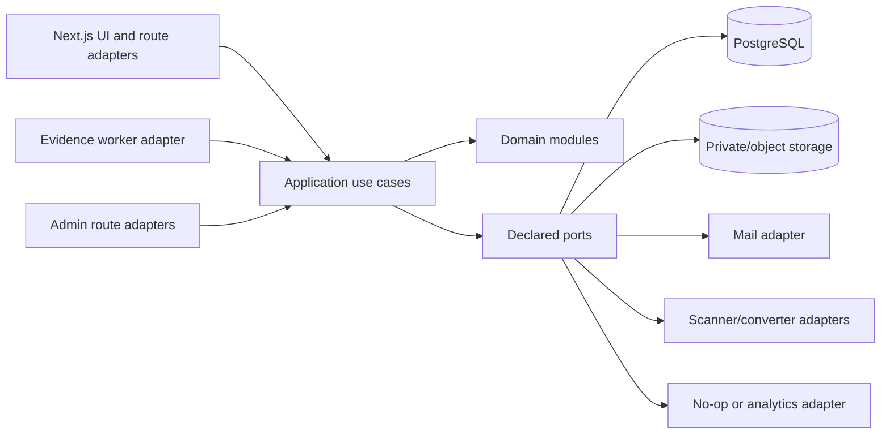
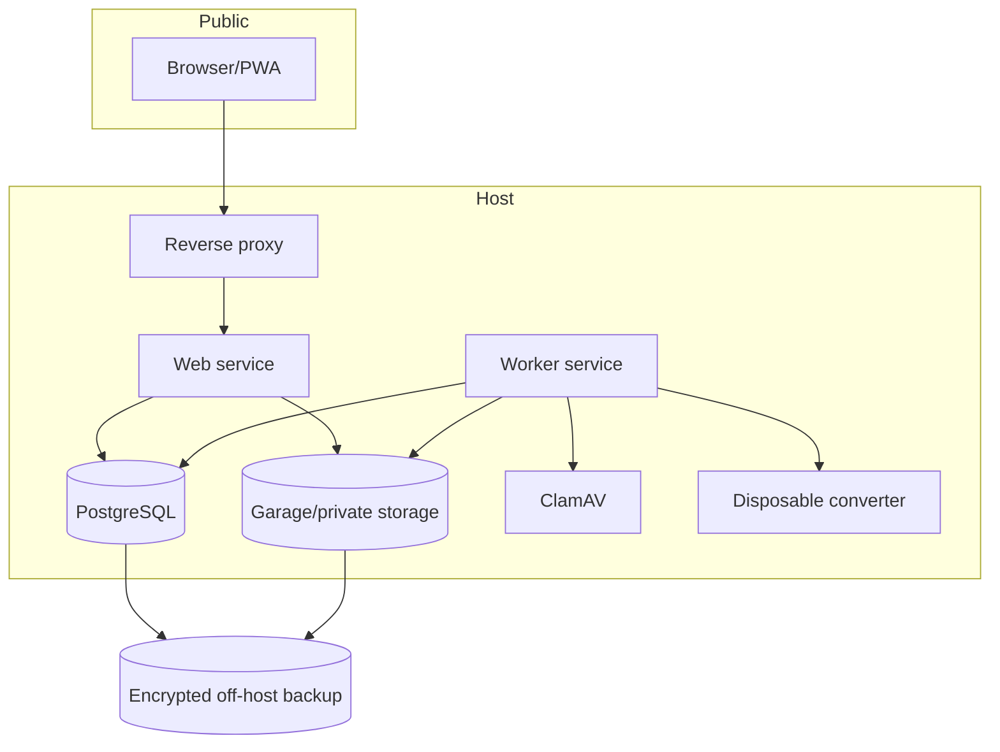

# Architecture Spine — RogiKotha

## Design Paradigm

RogiKotha is a **ports-and-adapters modular monolith**. Domain and application modules own rules and use cases; adapters own Next.js, PostgreSQL, storage, mail, analytics, malware scanning, and conversion. A separately runnable worker executes hostile or long-running evidence jobs through the same application contracts.



Adapters may depend inward. Domain and application code never import framework, database, storage, analytics, scanner, converter, or mock implementations.

## Invariants & Rules

### AD-1 — One owner per domain record [ADOPTED]

- **Binds:** all modules and persisted entities
- **Prevents:** two features mutating the same record with incompatible rules
- **Rule:** Each persisted entity has one owning domain module. Other modules reference its stable ID or call its application command; they do not write its tables directly.

### AD-2 — Commands own mutations; queries cannot mutate [ADOPTED]

- **Binds:** web routes, worker jobs, admin actions, scheduled tasks
- **Prevents:** business rules existing only in UI handlers, cron code, or database callbacks
- **Rule:** Every state change enters through an application command, runs authorization and invariants once, commits domain data plus audit/outbox records transactionally, and returns a typed result. Queries are side-effect free.

### AD-3 — Public persona is a snapshot, private identity is a separate resource [ADOPTED]

- **Binds:** accounts, reviews, comments, reactions, mentions, profiles, moderation
- **Prevents:** retroactive deanonymization and accidental joins from public data to account identity
- **Rule:** Public content stores an immutable persona snapshot. An anonymous alias is scoped to one review thread. Private account linkage is stored separately and omitted from public/query/analytics projections. Super Admin may use a purpose-bound audited reveal; Admin and Moderator may do so only through separately enabled, normally-disabled Super-Admin-controlled capabilities.

### AD-4 — Authentication is an adapter; authorization is application policy [ADOPTED]

- **Binds:** FR-AUTH-001–009 and every protected command
- **Prevents:** library sessions becoming the authorization model
- **Rule:** Better Auth supplies confirmed email/password, reset, sessions, cookie and throttling primitives. Application policies resolve actor, role, ownership, moderation capability, and step requirements for every command. Phase 1 has no MFA/passkey UI; the adapter must permit adding them without changing account IDs.

### AD-5 — Publication is an explicit projection state [ADOPTED]

- **Binds:** profiles, reviews, comments, evidence, reports, search, feeds
- **Prevents:** hidden, deleted, rejected, or unpublished content leaking through alternate queries
- **Rule:** Public visibility derives only from a shared publication transition contract and public projection. Owning modules decide only transitions allowed by that contract; they may not invent local meanings for hidden, deleted, rejected, or tombstone states. Search, feeds, caches, notifications, and analytics consume the public projection, never raw authoring/moderation tables.

### AD-6 — Evidence is quarantine-first and derivative-only public [ADOPTED]

- **Binds:** FR-FILE-001–009, FR-EVD-001–007
- **Prevents:** hostile originals reaching browsers or converters reaching application secrets
- **Rule:** Phase 1 accepts JPEG, PNG, and PDF into private quarantine under server-generated keys. Bounded validation, magic/MIME checks, malware scan, sanitisation/re-encoding, author preview, privacy confirmation, and publication produce a new immutable derivative. Originals never become public. The worker has no application session, identity-reveal, public-delete, or general database credentials.

### AD-7 — Custody, audit, retention, and holds are first-class [ADOPTED]

- **Binds:** evidence, content versions, moderation, administration, deletion
- **Prevents:** silent retention changes, untraceable evidence access, and accidental bulk deletion
- **Rule:** Custody/access/state events cannot be edited in place. They remain append-only until an authorized retention command expires their class. Versioned defaults begin at 90 days for originals and 180 days for audit/content versions. Default changes are prospective. Existing records change only through a previewed logged bulk command. A record-level legal hold overrides scheduled deletion and records actor, reason, start, expiry/release.

### AD-8 — PostgreSQL owns searchable truth [ADOPTED]

- **Binds:** FR-SRCH-001–008, FR-TAG-001–003
- **Prevents:** a second search system becoming an unsynchronised source of truth
- **Rule:** Search documents are transactionally derived in PostgreSQL using original text, NFC-normalised keys, curated aliases, full-text search, and `pg_trgm`. Exact native-script matches outrank aliases and fuzzy matches. Publication filters are applied before ranking. Search adapters return typed neutral results and expose no sentiment/outcome/evidence/reaction ranking boost.

### AD-9 — Bengali and English are equal product languages [ADOPTED]

- **Binds:** every public/admin surface, copy, content schema, search, notification, and test
- **Prevents:** one language becoming a partial translation or lower-quality path
- **Rule:** Every system-owned string ships in Bengali and English together; neither locale may block or lag release. Locale-prefixed routes, remembered override, correct `lang`, native formatting, equal journey/state coverage, and separate typography/overflow evidence are mandatory. User content may mix Bengali, English, and Banglish.

### AD-10 — Runtime configuration is bounded data, not executable structure [ADOPTED]

- **Binds:** FR-ADM-001–004 and configurable warnings, taxonomies, fields, retention, thresholds, visibility
- **Prevents:** an untestable generic workflow engine and runtime disabling of security boundaries
- **Rule:** Versioned schemas enumerate editable copy, translations, taxonomy entries, optional field definitions, retention values, report thresholds, and feature visibility. Code/migrations own authorization, identity separation, evidence custody, audit integrity, publication transitions, and database structure. Every configuration change is validated and audited.

### AD-11 — Mock and production adapters share contracts [ADOPTED]

- **Binds:** Gate 3–5 frontend work and all data-consuming components
- **Prevents:** prototype components importing fixtures and requiring a rewrite for real APIs
- **Rule:** UI features depend on typed service interfaces and serializable view models. Deterministic mock adapters, state/role simulators, and real HTTP/server adapters implement the same contract. Components never import fixture files or database types.

### AD-12 — Report thresholds are reversible workflow, not verdict [ADOPTED]

- **Binds:** FR-MOD-001–008, FR-COM-002
- **Prevents:** five coordinated reports permanently deleting criticism or warnings pretending to classify content
- **Rule:** Reports from five distinct confirmed accounts transition eligible content to `hidden_pending_review`; they do not delete it or decide truth. Moderator restore/hide decisions are reason-coded and audited. A dedicated unsafe/misleading-advice report reason exists, but Phase 1 performs no automated danger classification.

### AD-13 — Sensitive content cannot leave approved boundaries [ADOPTED]

- **Binds:** analytics, logs, error reports, email, exports, external services
- **Prevents:** private medical/evidence/identity data leaking through observability or convenience tooling
- **Rule:** Analytics receives only allowlisted aggregate events. Logs and error reports use stable opaque IDs and redacted metadata. Raw searches, review/evidence text, filenames, private identity links, and medical fields are prohibited from third-party AI, analytics, telemetry, and email payloads.

### AD-14 — Demo and production are separate operating modes [ADOPTED]

- **Binds:** deployment, data, authentication, evidence, analytics
- **Prevents:** synthetic/demo shortcuts silently reaching real users or real data entering a zero-cost showcase
- **Rule:** The USD 0 demo is public, synthetic, deterministic, read-only, resettable, and has no real auth/upload/analytics. Production enables real accounts and persistence only through deployment configuration with production secrets, database, storage, mail, backups, monitoring, and migration checks. Demo markers cannot be disabled.

### AD-15 — One-host deployability does not erase process boundaries [ADOPTED]

- **Binds:** production topology, worker, storage, backups, monitoring
- **Prevents:** resource-heavy conversion or one credential compromise gaining full platform control
- **Rule:** Web, worker, PostgreSQL, object storage, scanner, converter, proxy, and optional analytics run as separately permissioned services with explicit networks, non-root users, health checks, resource limits, and movable endpoints. Database and blobs have automated encrypted off-host backups and a tested restore path; storage replication is not backup.

### AD-16 — Independent validation is part of completion [ADOPTED]

- **Binds:** every backlog task
- **Prevents:** implementer summaries substituting for evidence
- **Rule:** The implementing session cannot be the sole validator. Validators inspect the actual diff and tests and return PASS, PASS WITH FOLLOW-UP, or FAIL with evidence. Auth, privacy, evidence, moderation, deletion, retention, and legal-response work additionally requires cross-vendor validation, automated tests, documented risk review, and human approval.

### AD-17 — Deletion is an orchestrated plan, never a blind cascade [ADOPTED]

- **Binds:** account deletion, review/comment/evidence removal, search/cache cleanup, retention, legal holds
- **Prevents:** one foreign-key cascade destroying held evidence, discussion context, auditability, or another aggregate's records
- **Rule:** A deletion request creates an idempotent, inspectable plan. Each owning module returns its action—delete, de-identify, tombstone, hide, retain-until-expiry, or retain-under-hold—and performs it through its own command. Holds pause physical deletion only for the scoped records; public visibility is decided separately. Completion records per-module results and retries partial failures safely.

## Consistency Conventions

| Concern | Convention |
|---|---|
| IDs | UUIDv7 at boundaries; opaque lowercase string in contracts; never expose sequential database IDs |
| Time | UTC `timestamptz` in storage; RFC 3339 UTC in contracts; locale formatting only in UI |
| Text | Preserve original; NFC-normalised/search keys stored separately; grapheme-aware truncation/highlighting |
| Money | Integer minor units plus ISO 4217 currency; never binary float |
| Files | Server-generated object keys; original filename private metadata; SHA-256 content hash |
| Errors | Stable typed code + safe localized message key + correlation ID; no internal stack/data in response |
| API | Versioned internal route contracts; schema-validated input/output; idempotency key for retryable commands |
| Events/jobs | Past-tense names; versioned payload; opaque IDs only; at-least-once handlers idempotent |
| Database | Snake_case tables/columns; SQL migrations reviewed and forward-only in production |
| Logging | Structured JSON, allowlisted fields, correlation/actor opaque IDs, no sensitive content |
| Configuration | Schema version, effective time, actor, reason, before/after value, optimistic concurrency |

## Stack

Authoring baseline verified 2026-08-30; exact patches and container digests are rechecked before installation.

| Name | Version |
|---|---|
| Node.js | 24.20.0 LTS |
| Next.js | 16.3.3 |
| React | 19.2.7 |
| TypeScript | 6.0.3 |
| PostgreSQL | 18.6 |
| Better Auth | 1.6.22 |
| Drizzle ORM | 0.45.2 released line |
| pg-boss | 12.26.0 |
| Tailwind CSS | 4.3.1 |
| shadcn CLI/source baseline | 4.11 line |
| Lucide | 1.27.0 |
| PDF.js | 6.1.200 |
| Garage | 2.3.0 conditional production candidate |
| ClamAV | 1.5.4 |
| LibreOffice | 26.2.5 stable production branch |
| Vitest | 4.1.10 |
| Playwright | 1.62.1 |
| axe-core | 4.11.4 |
| MSW | 2.15.0 |

## Structural Seed

```text
apps/
  web/                    # Next.js routes, UI, public/admin adapters
  worker/                 # evidence, retention, notification job adapters
packages/
  domain/                 # entities, value objects, state machines, policies
  application/            # commands, queries, ports, authorization
  contracts/              # schemas and UI/service view models
  database/               # Drizzle schema, migrations, repository adapters
  auth/                   # Better Auth adapter and application actor mapping
  evidence/               # storage/scanner/converter adapters
  search/                 # PostgreSQL search adapter and fixtures
  ui/                     # shared accessible primitives and tokens
  i18n/                   # equal Bengali/English dictionaries and checks
  test-support/           # deterministic builders, mocks, synthetic corpus
infra/
  compose/                # demo, local validation, production topology
docs/                     # decisions, planning, operations, validation evidence
```



## Capability → Architecture Map

| Capability / area | Lives in | Governed by |
|---|---|---|
| Accounts and identity | account/identity modules + auth adapter | AD-1, AD-3, AD-4 |
| Profiles, tags, search | directory/taxonomy/search modules | AD-1, AD-5, AD-8, AD-9 |
| Reviews, timelines, summaries | review module | AD-2, AD-3, AD-5, AD-9 |
| Evidence | evidence module + worker | AD-5, AD-6, AD-7, AD-15 |
| Comments, reactions, reports | community/moderation modules | AD-3, AD-5, AD-12 |
| Admin/configuration | administration module | AD-7, AD-10, AD-16 |
| Prototype/design lab | UI + mock adapters | AD-9, AD-11, AD-14 |
| Operations | infra + runbooks | AD-13, AD-15, AD-16 |
| Data requests/deletion | account orchestration + owning module commands | AD-5, AD-7, AD-17 |

## Deferred

- Office/HEIC upload enablement waits for per-format sandbox, fidelity, resource and redaction evidence.
- Garage production adoption waits for exact S3 operation, failure, upgrade and restore spikes; the storage port permits another S3-compatible provider.
- Matomo waits until production analytics value, resource budget and counsel-approved collection mode are established.
- MFA/passkeys, BM&DC verification, external search, native apps, public API, automated PII/OCR, and automated medical-content classification remain later-phase work.
- The winning visual concept remains a Gate 4 founder decision; shared contracts cannot depend on that choice.
