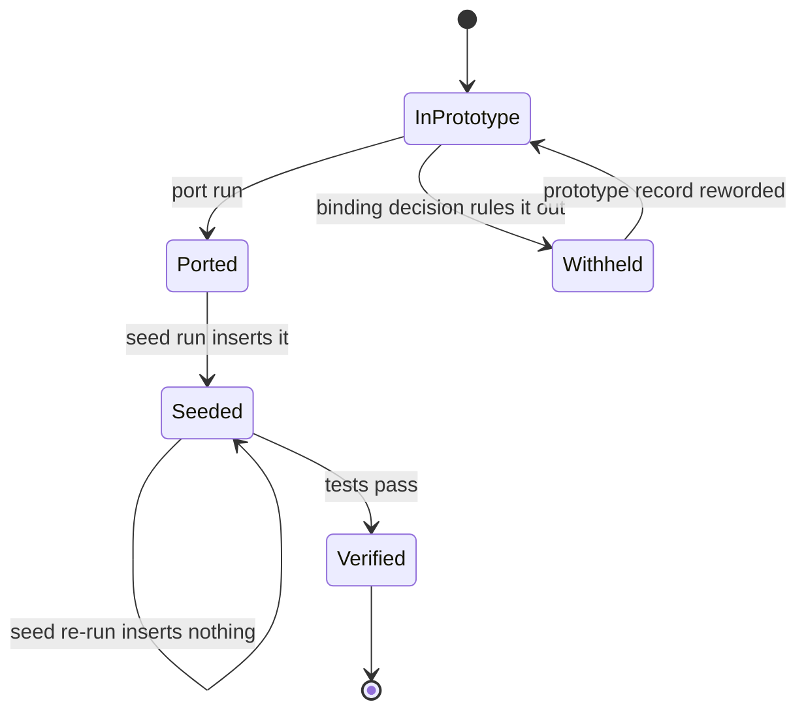
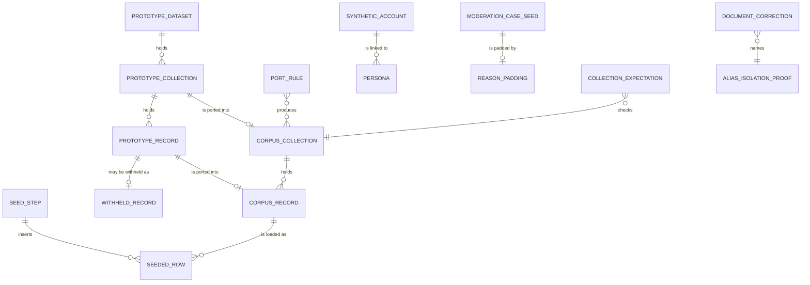

# Functional specification — U6 `cr-012-storyboard-seed-correction`

Unit U6 (kind `packaging`, size S, not high risk) delivers CR-012: the storyboard and seed correction of FD-039 (ISS-158, ISS-176, ISS-221) and, through its FD-089 amendment, about 10 fictional records per module from the expanded prototype data. Lead perspective: architect. Support perspective: developer (port and seed mechanics, idempotency, test placement), written into §§ 9–11 and synthesised in § 13. U6 has no story of its own; its sources are decisions and CR-012's acceptance rows.

Draft written ahead of the stage (owner's overlap instruction of 2026-10-28). **Stage note:** U6's kind is `packaging`, for which the compiled `produces_kinds` lists no Functional Design artifact, so the engine may treat this stage as kind-vacuous for U6 (as for U2 CR-007). The lead decides whether this file is recorded as the stage's output or carried into U6's code plan.

This file is the source of truth for the workflows and state transitions. The data shape is in `entities.md`; the decision logic is in `rules.md`. The decisions in §§ 7–10 follow the answers in `functional-design-questions.md` (all A), decided on the owner's standing instruction of 2026-10-27 and awaiting the owner's confirmation.

## 1. What changes, in one paragraph

The port (`packages/test-support/scripts/port-corpus.mjs`) is fixed in five places and re-run against the expanded prototype, so the generated corpus holds every FD-089 record while every pre-FD-089 record keeps its exact values. The seed steps load the new records, idempotently per record, with four loader fixes (chamber-to-branch names, "months ago", appeals on comments, drafts and bookmarks from the corpus) and one explicit exclusion (n8, a reporter notice FD-086 rules out). MOD-2033's three extra reports cite `factual` (FD-039, ISS-221), through a padding table that holds only MOD-2033. The storyboard names r2 and `anon_author_r2` as the alias-isolation proof (ISS-158), puts MOD-2041 in the critical lane (ISS-176) and states the new seed counts; the matching rows of T-106, T-401 and T-409 are corrected. Tests prove the counts against the prototype, the alias isolation, the reasons, the lanes, referential integrity and a zero second run. No table, migration, contract or i18n key changes.

## 2. As is (baseline on the branch)

- **The pipeline.** `port-corpus.mjs` evaluates `RK` in a `vm` context and writes 15 generated files under `packages/test-support/src/corpus/` (header: "Do not hand-edit — re-run the script"); `types.ts` and `index.ts` are hand-written. The seed (`src/seed/seed.ts`) runs seven steps in order — accounts, config, directory, content, evidence, moderation, notifications — each skipping rows that already exist. The corpus on the branch was generated from the prototype before commit `7716f2f`, so it holds the pre-FD-089 data: 6 doctors, 5 branches, 8 conditions, 12 reviews, 8 facility reviews, 10 comments, 7 evidence items, 5 cases, 5 user notifications.
- **The prototype on the branch** (commit `7716f2f`, "FD-089: prototype demo data, about 10 records per module") appends records with `push()` and changes no existing record (its one deleted line is a comment). Counts, by evaluating the file: § 6.
- **The three FD-039 facts.**
  - ISS-158: `05-demo-storyboard.md:15` names `anon_author_r4`, "author of r4 **anonymously**"; step 7 says "r4 (anonymous) is nowhere". In the prototype r4 is `pseudo`, author `r_ahmed`; the anonymous reviews are r2, r8 and r12 (and, after FD-089, r15 and r23). The same wrong name sits in T-106 (rows "Alias leakage — profile", "— search"), T-401 ("Mention refusal", "Anonymous linkage", and the later "FD-062: anonymous author's comment dislike stays unlinked") and T-409 ("Storyboard 7", "FD-088: no appeal control", and step 11).
  - ISS-176: storyboard step 19 says "standard lane shows MOD-2041"; the prototype and the seed have it `critical`.
  - ISS-221: `seed-moderation.ts:91-93` pads MOD-2033's report list by repeating its last reason, so its six reports read `factual` 2, `impersonation` 4; the prototype lists `factual, factual, impersonation` with 6 reports and says "A factual disagreement is not grounds for removal".
- **What a plain re-run of the port would break** (checked by evaluating both prototype versions, 2026-10-28):
  1. Five existing personas would change avatar hue (`nadia_k` 50 → 198, `rumana_h` 87 → 235, `Dr. Farhana Rahman` 124 → 60, `health_tips_bd` 161 → 97, `shafiq_ctg` 198 → 134): hues follow discovery order, and new review authors are now discovered before these comment authors.
  2. `anon:r15` would be emitted twice (review r15 and its anonymous comment k31), with a duplicate account, failing `corpus.test.ts`.
  3. r17's and r24's follow-ups would be lost: the port reads only `RK.followUps` chains, the prototype's `followUpsFor` also reads a review's inline `followUp`.
  4. `shash` and `mathabatha` would be stored as `en` aliases.
  5. Bookmarks are not ported at all; the seed hard-codes r6 and r9.
- **What the seed would break with the new corpus.**
  1. `seed-notifications.ts` throws on "2 months ago" (n9, n10) and on any seedRef beyond n5 (no id mapping).
  2. MOD-2018 (an appeal on comment k27) would become an `appealed` case with no decision and no appeal row: the appeal branch handles review targets only.
  3. d7–d10's chambers ("Kashful Community Hospital — Shaheb Bazar branch" and so on) would match no branch, so the new doctors would not link to f6–f10.
  4. Drafts are idempotent by count per account, which duplicates drafts when a database seeded before this Unit is topped up.
- **Tests that pin the old data:** `test-support.smoke.test.ts` (`DOCTORS` 6, `REVIEWS` 12), `cr-008-validation.test.ts` (5 notifications, one per kind, times in days or weeks only), `seed.int.test.ts` (6/5/8/12/8/10/7/5). `seed.int.test.ts` is excluded from the default sweep and run on its own (`vitest.config.ts`).
- **Notification keys.** The seed maps each user-notification kind to one key (`notif.evidenceReady`, `notif.replyReceived`, `notif.moderationOutcome`, `notif.securityNewDevice`, `notif.draftExpiring`). T-405 owns `notif.*` and plans finer keys; the message files are generated by `packages/i18n/scripts/port-from-prototype.mjs`.

## 3. Settled before this stage

FD-039 (correct the storyboard to the data; r2/r8/r12; MOD-2041 critical; MOD-2033 padded with `factual`), FD-089 (about 10 records per module, only from the prototype; existing records unchanged; Bengali flagged), FD-086 (no reporter notices), FD-088 (appeals deferred, data kept), FD-042 (bilingual review of new Bengali copy), and CR-012's "Not in scope" (no change to the database package, contracts, the prototype, or which reviews are anonymous). See `functional-design-questions.md` § "Settled before this stage".

## 4. Workflows

### WF1 — Code Generation order (the Unit end to end)

1. **Baseline.** `pnpm infra:up`; `pnpm check` and `pnpm smoke` green on the Bolt branch; record the counts. Read the open `ISSUES.md` rows in `test-support/seed`, `test-support/corpus` and `docs/storyboard`.
2. **Real-person check (BR1.2).** Check each new doctor (name with specialty and city), each new facility and organisation (name with city) and each new BMDC number against public listings; record the evidence. A real match stops the Unit (S1 row, owner).
3. **Port fixes and regeneration (WF2).**
4. **Seed fixes (WF3, WF4).**
5. **Documents (WF5).**
6. **Tests (WF6, § 11).**
7. **Records (WF7).**
8. **Gate.** `pnpm db:reset && pnpm db:migrate && pnpm db:seed` twice (second run: every step `0 inserted`); the standalone seed test; `pnpm check`, `pnpm smoke`, `pnpm test:int` exit 0 (BR6.5); fill the hand-off (what changed, owned-path additions, the Bengali review list, the alias-isolation choice and its evidence, ISS ids found and fixed).

### WF2 — Regenerate the corpus

1. Change the port (§ 9): pinned persona hues, follow-ups read like `followUpsFor`, thread-persona reuse for anonymous comments, two Banglish aliases, a `USER_BOOKMARKS` export; add `CorpusBookmark` to `types.ts`.
2. Run `pnpm --filter @rogikotha/test-support port`.
3. Compare the new corpus with the corpus on `main`, record by record (a read-only one-off comparison, its result recorded in the hand-off): every pre-FD-089 record deep-equal (BR1.3); only additions besides that, and the file-order move of anonymous personas in `personas.ts` (no value changes).
4. Run the port again: no diff beyond EOL-only churn (BR2.7, ISS-178).

### WF3 — Load the new records

1. Directory step: conditions c9, c10 with their aliases; specialties Pulmonology, Neurology, Paediatrics; organisations `org-kashful-health-group`, `org-jolrong-diagnostics-network`, `org-shobuj-chhaya-care-network`; branches f6–f10; doctors d7–d10 with chambers linked by the composite name (BR3.2); submissions, claims and field changes from the corpus.
2. Content step: reviews r13–r24 (anonymous r15, r23 through `ensureAnonymousPersona`), tags, versions, reactions; follow-ups and later care; facility reviews fr9–fr19; comments k11–k49 (k31 on r15's persona; k16, k42 on new thread accounts); drafts dr1–dr4 and the eight bookmarks from the corpus (BR3.6).
3. Evidence step: e8–e12 with generated derivatives; e11 `failed` (`malformed`, as e5).
4. Moderation step: MOD-2047, MOD-2045, MOD-2036, MOD-2031, MOD-2018 (WF4); audit rows a14–a24; staff notifications nA7–nA12.
5. Notifications step: n6, n7, n9, n10 with the id mapping of BR3.3; n8 withheld by the FD-086 exclusion (BR1.7).
6. `seed.ts`: dotenv `quiet: true` (BR3.7).

### WF4 — Moderation: padding and appeals

1. Replace "repeat the last reason" with a padding table `{ 'MOD-2033': 'factual' }` (BR4.1); a case short of reasons with no entry throws (BR4.2). The padded list feeds both `moderation_case_reasons` and the `reports` rows, as now. The comment at `seed-moderation.ts:82-90` cites FD-039 and ISS-221.
2. The appeal branch handles comment targets: k27 hidden, one `hide` decision (`other`, actor `mod_rashid`), one open appeal by `shafiq_ctg` with the prototype's appeal text. The appellant is the account linked to the target's author persona, which for MOD-2011 is `r_ahmed`, as today (BR3.4).
3. Every other case path is unchanged: auto-hidden comments flip to `hidden_pending_review` (now also k31 for MOD-2047), auto-hidden evidence keeps its state (ISS-164), MOD-2045's k38 stays visible (not auto-hidden).

### WF5 — Correct the documents

Apply SC1–SC12 (§ 8). Then run CR-012's "No stale names" grep (BR5.3) and check that every storyboard step other than 7 and 19 is byte-identical.

### WF6 — Prove it

Corpus tests in the default sweep, the seed integration test run standalone, the rewritten assertions and the new smoke assertion (§ 11).

### WF7 — Records

`ISSUES.md`: ISS-158, ISS-176, ISS-221 and ISS-252 → fixed by CR-012 with the commit; new rows for § 12, each `Found in U6 CR-012`. Hand-off: the Bengali review list (§ 10.7) and the owned-path additions (BR7.3).

## 5. State transitions

### A prototype record through the pipeline

| From | Event | To | Rule |
|---|---|---|---|
| in prototype | port run | ported (corpus record) | BR2.1–BR2.6 |
| in prototype | a binding decision rules out what it shows | withheld (recorded, ISS row) | BR1.7 |
| ported | seed run, natural key absent | seeded | BR3.1 |
| ported | seed run, natural key present | seeded (unchanged, 0 inserted) | BR3.1 |
| seeded | tests pass (counts, integrity, isolation) | verified | BR6.1, BR6.2 |
| withheld | prototype record reworded to fit the decision | in prototype (taken on the next port) | BR1.7 |



Text fallback: a prototype record is ported into the corpus, or withheld when a binding decision rules out what it shows (only n8). A ported record is seeded once; a re-run finds it by its natural key and inserts nothing. Seeded records are verified by the tests. A withheld record re-enters when the prototype changes it.

### A moderation case at seed time

`(prototype case)` → `open` (critical or standard lane; reports rows = report count; auto-hidden targets flip to `hidden_pending_review`) or → `appealed` (appeals lane; target hidden, one `hide` decision, one open appeal). MOD-2033 passes through the padding table on the way to `open`.

### ISS-158, ISS-176, ISS-221

`decided FD-039` → (corrections merged, acceptance rows green) `fixed in CR-012` with the commit. ISS-252: `queued — suggested U6` → `fixed in CR-012`.

## 6. Collection counts (prototype → seed)

"Before" is the seed on the branch; "Prototype" is the count by evaluating the file; "Seed after" is what the tests expect. Ids `DC1`–`DC22`.

| Id | Collection (table) | Before | Prototype | Seed after | Note |
|---|---|---|---|---|---|
| DC1 | doctors | 6 | 10 | 10 | d7–d10 |
| DC2 | organisations (`facilities`) | 4 | 7 distinct parents | 7 | derived from `facilities[].parent` |
| DC3 | branches (`facility_branches`) | 5 | 10 | 10 | f6–f10 |
| DC4 | conditions (`taxonomy_terms` kind `condition`) | 8 | 10 | 10 | c9, c10 |
| DC5 | specialties (`taxonomy_terms` kind `specialty`) | 6 | 9 distinct | 9 | derived from doctors |
| DC6 | aliases (`taxonomy_aliases`) | 22 | 33 | 33 | 4 Banglish after BR2.5 |
| DC7 | chambers (`doctor_chambers`) | 7 | 13 | 13 | 5 new links to f6–f10 |
| DC8 | reviews | 12 | 24 | 24 | 2 new anonymous (r15, r23) |
| DC9 | follow-ups (`review_follow_ups` kind `follow_up`) | 5 | 21 (`followUpsFor`) | 21 | r17, r24 inline |
| DC10 | later care (`review_follow_ups` kind `later_care`) | 3 | 10 | 10 | |
| DC11 | facility reviews | 8 | 19 | 19 | |
| DC12 | comments | 10 | 49 | 49 | k31 hidden by MOD-2047 |
| DC13 | evidence items | 7 | 12 | 12 | e11 failed |
| DC14 | moderation cases | 5 | 10 | 10 | critical 4, standard 4, appeals 2 |
| DC15 | reports | 10 | 17 (sum of `reports`) | 17 | from distinct `reporter_N` per case |
| DC16 | appeals; hide decisions | 1; 1 | 2 appeal cases | 2; 2 | MOD-2011, MOD-2018 |
| DC17 | case audit rows (`audit_events`, streams `case:*`) | 13 | 24 | 24 | |
| DC18 | user notifications (`notifications`) | 5 | 10 | **9** | n8 withheld (FD-086) |
| DC19 | staff notifications | 6 | 12 | 12 | |
| DC20 | drafts (`review_drafts`) | 2 | 4 | 4 | |
| DC21 | bookmarks | 2 | 8 | 8 | |
| DC22 | submissions; claims; field changes | 2; 1; 2 | 8; 6; 8 | 8; 6; 8 | all by `shirin_88` (ISS-162) |

Derived identity rows: corpus accounts 30 → 48 (plus the 50-account reactor pool: 80 → 98 `account_profiles`); personas 20 → 38 (26 named or pseudonymous, 12 anonymous). Reaction rows 313 → 683 (reviews 495, comments 188). Review tags 73. The existing cases keep their counts: MOD-2011 0/0, MOD-2029 1/1, MOD-2033 6/6, MOD-2038 1/1, MOD-2041 2/2 (report count / distinct reporters); MOD-2033's reasons become `factual` 5, `impersonation` 1.

"About 10" (FD-089) is a floor in practice: where the prototype holds more (24 reviews, 49 comments), the seed takes the prototype's count, as CR-012's row "exactly as many" requires. Every FD-089 collection holds at least 10, so the prerequisite is met and there is no blocker.

What stays unchanged for the storyboard: d1 keeps r1–r5 (step 4's distribution; r4 hidden), r1's thread k1–k3 and k8–k10 and its follow-ups (step 6, 15), r6's follow-ups and later care, e1 and e3 (step 22), P-140, P-143, C-58 (step 23), MOD-2011 (step 24), `shirin_88`'s r1, k8, k10, fr1 (steps 7, 26).

## 7. The alias-isolation choice (CR-012 step 1)

- **Evidence.** Prototype: r2, r8, r12 (and r15, r23) have `identity: 'anon'`, author "Anonymous"; r4 is `pseudo`, author `r_ahmed`. Corpus: personas `anon:r2`, `anon:r8`, `anon:r12`, each with its own account `anon_author_<review>`, which owns nothing else. So no anonymous review's author also writes public content; step 1's premise is not met by the data, and making a public author anonymous would invent a link (FD-039).
- **Choice (Question 1 answer A): r2, `anon_author_r2`.** r2 is on d1, the doctor storyboard steps 4 and 6 open; it carries no moderation case; its thread has comments by other accounts (k11, k12).
- **What proves isolation** (BR5.4): `anon_author_r2` has exactly one persona, `anon:r2`; `persona_links.review_id` is r2; that persona is the author of r2 and of nothing else (no comment, facility review or reaction carries it); `/authors/anon_author_r2` therefore lists no accounts (T-409's row), and step 7's `/authors/shirin_88` does not show r2.
- **The other anonymous accounts after FD-089.** `anon_author_r15` (r15 and its own comment k31, one thread), `anon_author_r23`, `anon_author_fr11`, `anon_author_fr19`, and the thread accounts `anon_author_r4` (comment k16) and `anon_author_r20` (comment k42), which follow the existing `anon_author_r6` (comment k5) pattern (Question 10 answer A). `anon_author_r4` is not r4's author; a corpus test says so.

## 8. Document corrections (target text)

| Id | File and place | Now | After |
|---|---|---|---|
| SC1 | storyboard, seeded-accounts table, `anon_author_r4` row | `` `anon_author_r4` `` · "verified; author of r4 **anonymously**" · "proves alias isolation" | `` `anon_author_r2` `` · "verified; author of r2 **anonymously** (its only persona)" · "proves alias isolation" |
| SC2 | storyboard, table, `shirin_88` row | "…one draft, two bookmarks, five notifications" | "…four drafts (one blocked on a pending profile), eight bookmarks, nine notifications" |
| SC3 | storyboard, "Seeded content mirrors the prototype exactly (…)" | 6 doctors, 5 facilities/branches, 8 conditions, 12 accounts, 8 facility accounts, 10 comments incl. `k8/k9/k10`, 7 evidence items, 5 cases `MOD-2011…2041`, 13 audit events | 10 doctors, 10 branches of 7 facilities, 10 conditions with aliases, 24 accounts, 19 facility accounts, 49 comments incl. `k8/k9/k10`, 12 evidence items, 10 cases `MOD-2011…2047`, 24 audit events, staff notifications, config version 1; the derivatives sentence and its TODO stay as they are |
| SC4 | storyboard step 7 | "r4 (anonymous) is nowhere" | "r2 (anonymous) is nowhere" |
| SC5 | storyboard step 19 | "standard lane shows MOD-2041 etc." | "MOD-2041 is in the critical lane; the standard lane includes MOD-2033 and MOD-2029" (rest of the step unchanged) |
| SC6 | T-106 row "Alias leakage — profile" | `/authors/anon_author_r4` … "r4 absent" | `/authors/anon_author_r2` … "r2 absent" |
| SC7 | T-106 row "Alias leakage — search" | "`search_documents` for r4" | "`search_documents` for r2" |
| SC8 | T-401 row "Mention refusal" | `@anon_author_r4`'s anonymous persona | `@anon_author_r2`'s anonymous persona |
| SC9 | T-401 rows "Anonymous linkage" and "FD-062: anonymous author's comment dislike stays unlinked" | "the anonymous author of r4" (twice) | "the anonymous author of r2" (twice) |
| SC10 | T-409 row "Storyboard 7" | "`/authors/anon_author_r4` shows no accounts" | "`/authors/anon_author_r2` shows no accounts" |
| SC11 | T-409 row "FD-088: no appeal control" | "render `/me` as `anon_author_r4`" | "render `/me` as `r_ahmed` (owner of r4, the content MOD-2011 decided)" |
| SC12 | T-409 step 11, "**Assert**" sentence | "r4 (anonymous) never appears for `anon_author_r4`" | "r2 (anonymous) never appears on any public profile, and `/authors/anon_author_r2` lists none" |

SC9's FD-062 row and SC12 are outside CR-012's literal list (Question 2 answer A); the hand-off names them as owned-path additions. No other line of the four files changes; storyboard steps 1–6, 8–18 and 20–28 stay byte-identical (BR5.1). Note the T-409 "Appeal" row itself already reads "deferred, FD-088" and names no account; SC11 corrects the row that does.

## 9. Developer view — the port

- **Pinned hues (BR2.4).** A constant in the port lists the 14 pre-FD-089 named and pseudonymous persona keys with their current hues (read from `corpus/personas.ts` on `main`). Discovery order is unchanged; a pinned key takes its pinned hue, and every new key takes the next value of the existing `+37 mod 360` sequence, continuing from the last pinned hue. A corpus test pins the 14 values. Alternative rejected: discovering pre-FD-089 records first, which needs the port to know which records are old, the same pinned knowledge in a less visible form.
- **Follow-ups (BR2.2).** For each review in prototype order: the chain if `RK.followUps[id]` exists, else `[review.followUp]` if present; seedRefs `<review>-fu-<n>` as today. Chains are emitted in the same order as now, so existing seedRefs and rows are unchanged; r17 and r24 gain `r17-fu-1` and `r24-fu-1`. Later care unchanged.
- **Thread persona reuse (BR2.3).** Before pushing `anon:<review>` for an anonymous comment, check whether that key exists; if so, emit nothing new. k5 (`anon:r6`), k16 (`anon:r4`) and k42 (`anon:r20`) are first in their threads and get personas and accounts as today; k31 reuses `anon:r15`.
- **Banglish (BR2.5).** `BANGLISH_ALIASES` gains `shash` and `mathabatha`.
- **Bookmarks (BR2.6).** `USER_BOOKMARKS` in `notifications.ts` (the file that already holds `RK.user` collections): `{ accountUsername, reviewSeedRef }[]` in prototype order; `CorpusBookmark` in `types.ts`.
- **Nothing else moves.** Accounts stay sorted by username; organisations keep their seedRefs (`org-<slug>` or the facility id); every other builder is unchanged. Named usernames keep the `named_<slug>` form (ISS-159), hyphens included.
- **Illustrative shape** (pseudocode, not the implementation):

```text
hueFor(key):  if key in PINNED_HUES then PINNED_HUES[key] else nextHue()   // nextHue starts after the last pinned value
followUpsOf(review): RK.followUps[review.id] ?? (review.followUp ? [review.followUp] : [])
onAnonComment(c): if not personas.has('anon:' + c.reviewId) then add persona and account for that thread
```

## 10. Developer view — the seed

1. **Idempotency (BR3.1).** Keys as listed in `rules.md` BR3.1. Two changes: drafts compare `(account_id, payload_enc)` per corpus draft instead of counting an account's drafts (the payload is the deterministic JSON of title and excerpt until T-101/T-301 encrypt it; `ASSUMPTION(CR-012)`, and T-301 keeps an idempotency key when it adds encryption); bookmarks read the corpus. The supported way to load the expansion into an existing demo database stays `pnpm demo:reset`; a top-up run on a database seeded before this Unit inserts only the new records.
2. **Chambers (BR3.2).** Match order: branch name, branch label, then `"<name> — <label>"` (U+2014 with spaces, as in the prototype). Existing chambers match as before (no existing chamber name has the composite form); d7 → f6, f7; d8 → f8; d9 → f9 (the Kotbari chamber stays unlinked); d10 → f10.
3. **Notifications (BR3.3).** Parser accepts `day|days|week|weeks|month|months`; a month is 30 days (`ASSUMPTION(CR-012)`). Mapping: n6 → `{reviewPublicId: r1, commentPublicId: k9}`, route `/experiences/<r1>`; n7 → `{}`, `/me` (no seeded item of `shirin_88` waits for redaction); n9 → `{}`, `/me`; n10 → `{}`, `/me/security`. Each keeps its kind's existing key (Question 7 answer A). n8 is excluded by name with a comment citing FD-086 (BR1.7).
4. **Moderation (BR3.4, BR4.1–BR4.4).** WF4. `distinct_reporters = min(report_count, 6)` as now; no new case exceeds 3.
5. **Reactions (BR3.5).** Unchanged mechanism; the largest target needs 44 of the 50 pool accounts; a target over 50 throws.
6. **No new i18n key.** Lanes, reasons, target kinds, notification kinds, staff kinds (`admin.notif.kind.*`), claim codes (`wrongDx`, `wrongRx`, `secondOpinion`) and the evidence fail reason (`malformed`) of every new record already exist. `packages/i18n/messages/*.json` is not touched; parity is unchanged.
7. **Bengali review list (BR7.2).** The hand-off lists, by corpus id and field, every new record whose Bengali enters the database: d7–d10 (name, specialty, qualifications, languages, fee, city, area, chamber names and hours); c9–c10 (names; Bengali aliases হাঁপানি, শ্বাসকষ্ট, মাইগ্রেন, আধকপালে, মাথাব্যথা); f6–f10 and the three new organisations (names, labels, city, area); r13–r24 (title, sections, tags; the seed stores the Bengali variant only, ISS row of T-007); the 16 new follow-ups and 7 new later-care entries (body, later provider); fr9–fr19 (body); k11–k49 (body); e8–e12 (label); MOD-2018/2031/2036/2045/2047 (summary; appeal text of MOD-2018); dr3, dr4 (payload title and excerpt); P-144–P-151 (payload name, specialty, city); F-79–F-84 (old and new value). User and staff notifications store keys, not text, so they add no Bengali. All of it is the prototype's authored Bengali; none is written by the agent.

## 11. Developer view — tests

### 11.1 Seed integration test (`seed.int.test.ts`, run standalone)

On an empty, migrated `rogikotha_test`:

| Assertion | Proves |
|---|---|
| row counts equal § 6 for DC1–DC22, each with its own message | BR1.5, acceptance "FD-089: counts per module" |
| MOD-2033: `moderation_case_reasons` `factual` 5, `impersonation` 1; 6 `reports` rows from 6 distinct reporters; sums agree | BR4.1, acceptance "MOD-2033 reasons" |
| MOD-2011/2029/2038/2041: report and reporter counts 0/0, 1/1, 1/1, 2/2, reasons unchanged | BR4.3, acceptance "Other cases unchanged" |
| MOD-2041 `lane = critical`; lanes of all ten cases equal the prototype's | BR4.4, acceptance "MOD-2041 lane" |
| MOD-2018: k27 `hidden_pending_review`, one `hide` decision, one open appeal by `shafiq_ctg`; MOD-2011 unchanged | BR3.4 |
| `anon_author_r2`: one persona, linked to r2, author of r2 only, no comment, facility review or reaction carries it | BR5.4, acceptance "Alias-isolation account" |
| left joins over every foreign key of the seeded tables return zero orphans (reviews → doctors and personas, comments → reviews, evidence → reviews, follow-ups → reviews, cases → their target by kind, chambers → branches where set) | acceptance "FD-089: referential integrity" |
| d7–d10 have `about_en`/`about_bn` null; f6–f10 have `address_en`/`address_bn` null; every column the prototype fills is not null on the new rows | BR1.6, acceptance "FD-089: new records are complete, some gaps remain" (data half) |
| d7's chambers link to f6 and f7 | BR3.2 |
| the second `runSeed` returns 0 for every step and every table count is unchanged | BR3.1, acceptance "Seed idempotent" |
| the existing d1 sentiment test and the facility-review separation test stay as they are | BR6.3 |

### 11.2 Corpus tests (default sweep, no database)

- **Counts against the prototype:** a test evaluates the prototype file the way the port does (read-only) and compares each corpus collection's length with its prototype count, allowing only the n8 exclusion, which it names.
- **Pinned hues:** the 14 pre-FD-089 personas keep their hues.
- **One persona per anonymous thread:** the existing invariant (no shared key, no shared account) holds; in addition, every comment and review carried by an anonymous persona sits in that persona's thread; `anon:r15` carries r15 and k31.
- **`anon_author_r4` is not r4's author:** r4's author key is `pseudonymous:r_ahmed`.
- **Banglish:** `shash`, `mathabatha` (and the existing two) are `banglish`.
- **Inline follow-ups:** `r17-fu-1` and `r24-fu-1` exist.
- `cr-008-validation.test.ts` is rewritten (BR6.3): `USER_NOTIFICATIONS` holds the prototype's records minus n8, every kind of `NOTIFICATION_KINDS` is still covered, and the times match `^\d+\s+(day|days|week|weeks|month|months)\s+ago$`. Its MOD-2033 and "other four cases" assertions stay.

### 11.3 Smoke

`test-support.smoke.test.ts`: the pinned 6 and 12 become the § 6 values (reason recorded: FD-089), and one new assertion checks through the package entry point that the corpus holds the FD-089 counts and FD-039's facts (MOD-2041 critical; MOD-2033's listed reasons are `factual, factual, impersonation` with 6 reports). Every test can fail: each count test fails on a dropped or extra record, the padding test fails on the old rule (it gives `impersonation` 4), the isolation test fails if `anon:r2` carried any other content.

### 11.4 Commands

`pnpm infra:up`; `pnpm --filter @rogikotha/test-support exec vitest run src/seed/seed.int.test.ts`; `pnpm test:int`; `pnpm smoke`; `pnpm check`.

## 12. Findings and raised items (proposed ISS rows)

Each row is `Found in U6 CR-012`; numbers are the next free ids when written.

| Ref | Sev | Area | Finding | Suggested owner |
|---|---|---|---|---|
| F1 | S4 | test-support/corpus | Owned paths extended to `scripts/port-corpus.mjs` and `src/corpus/*.ts` (Question 4), and to T-401's FD-062 row and T-409 step 11 (Question 2) | U6 (record only) |
| F2 | S3 | prototype/notifications | n8 is a reporter decision notice, which FD-086 rules out; not seeded, so user notifications are 9 of 10. Reword or remove n8 in the prototype | owner (prototype) |
| F3 | S3 | test-support/seed | n6 (`notif.replyReceived`, "commented on your experience", for a reply to a comment), n7 (`notif.evidenceReady` for "waiting for you to cover private details"; references no seeded item) and n10 (`notif.securityNewDevice` for a password change) carry their kind's generic key; re-key to `notif.discussion.reply`, `notif.evidence.<state>`, `notif.security.passwordChanged` when T-405 defines them | U34 T-405 |
| F4 | S2 | docs/storyboard | R1: the storyboard treats `rafi_c` as r6's author (table; steps 15, 17, 19), but the seed's r6 author is `named_tanvir-ahmed` and `rafi_c` has no persona or content; outside FD-039, needs a ruling | owner |
| F5 | S3 | community/identity | R2: the prototype has anonymous comments on non-anonymous threads (k5, k16, k42); T-401 step 4 lets only the review's own anonymous author use the thread alias, so the product could not create them. The seed keeps them (FD-039) | U30 T-401, U11 T-104 |
| F6 | S4 | test-support/corpus | `anon_author_<review>` means "the account behind the anonymous persona in thread <review>", not the review's author; `anon_author_r4` (k16) exists again and is not r4's author | U6 (record) |
| F7 | S4 | test-support/seed | `named_<slug>` usernames contain hyphens, outside `USERNAME_RE`; seven more after FD-089 (extends ISS-159) | U11 T-104 |
| F8 | S4 | test-support/seed | ISS-162's generic submitter now covers 8 submissions, 6 claims and 8 field changes, all by `shirin_88`; approving a claim in step 23 or deleting `shirin_88` in step 26 touches them | U17 T-204 |
| F9 | S4 | test-support/seed | d3 is listed on f4 (`facilities[].doctors`) but its chamber "Uttara Skin Care" matches no branch, so d3–f4 is not linked; an existing record, unchanged under FD-089 | U14 T-201 |
| F10 | S4 | prototype/data | The prototype's review `comments` display counts disagree with its comment records (r3 3/1, r4 11/3, r6 9/2, r7 4/2, r8 14/1, r9 5/2, r10 0/1); the seed derives counts from rows, so the demo shows the row counts | owner (prototype), info |
| F11 | S4 | directory/view models | The "renders 'Not provided', never 0" half of CR-012's completeness row is deferred: the data gaps exist (`about`, `address`), the mapping and pages come later (Question 11) | U14 T-201, U15 T-202, U16 T-203 |
| F12 | S4 | test-support/seed | `ASSUMPTION(CR-012)`: "N months ago" = N × 30 days; drafts matched by stored payload until encryption; MOD-2018's hide reason `other` and actor `mod_rashid`, as MOD-2011 | U6 (record), U21 T-301 for the draft key |
| R3 | — | — | Real-person check (BR1.2): a row only if the check finds a match (then S1, owner) | owner |

Not findings: quarantine notes (Q-882…Q-899) are not seeded today and stay so; staff notification text is key-based and unchanged in form.

## 13. Synthesis — decisions and why

- **Regenerate through the port, with five fixes, instead of hand-editing the corpus.** The corpus is generated by contract; a hand edit would be undone by the next run and would hide drift. Each fix is the smallest one that keeps every pre-FD-089 value: pinned hues rather than reordered discovery; the prototype's own `followUpsFor` reading; one thread persona per anonymous thread (T-401's rule); two Banglish words; a bookmark export.
- **Follow the prototype everywhere it is the source, except where a binding decision rules a record out.** All expanded collections are taken (Question 5) and children attach where the prototype puts them (Question 3); n8 is withheld under FD-086 (Question 6), the way FD-091 overrides the prototype's look.
- **Alias isolation on r2** (Question 1): the step's premise ("author also writes public content") is not met by any anonymous review, so the choice rests on visibility (d1) and independence from moderation state.
- **Explicit padding for MOD-2033 only, and a loud failure for any other shortfall** (FD-039, CR-012 step 4): a silent rule invented ISS-221 once.
- **Storyboard descriptions follow the seed; walkthrough steps stay** except 7 and 19 (Questions 8, 9). Text that states counts is part of the correction, not a step change.
- **No new key, no new dependency, no schema change.** Every new record fits existing keys, enums and columns; the notification key mismatch waits for T-405, which owns those keys (Question 7).
- **Developer view adopted:** per-record idempotency (drafts by payload), composite chamber names, a months parser, an appeal path for comment targets, counts checked in the default sweep against the prototype itself, and the seed test kept standalone as its config requires.

## 14. If the owner changes an answer

- **Question 1 to B or C:** replace r2/`anon_author_r2` in SC1, SC4, SC6–SC10 and SC12 and in the isolation test with r8/`anon_author_r8` or r12/`anon_author_r12`.
- **Question 2 to B:** drop SC9's FD-062 half and SC12; the "No stale names" check then fails on T-409 and is recorded as a known failure.
- **Question 3 to B:** the port or seed filters children of existing parents; DC9, DC10 and DC12 drop to the counts of new parents only, and the count test lists the exception.
- **Question 4 to B or C:** B is refused by the corpus header; C stops the FD-089 half and leaves only the FD-039 half (storyboard, rows, padding).
- **Question 5 to B:** drafts stay at 2, bookmarks at 2, and submissions, claims and field changes at 2, 1 and 2 (DC20–DC22); the port needs a filter list of old ids.
- **Question 6 to B:** remove the exclusion; DC18 becomes 10 and F2 is dropped; the demo shows a reporter notice.
- **Question 7 to B:** add four `notif.*` keys to both message files and to the i18n port's addendum (outside U6's owned paths); T-405 then inherits them. C: drop n6, n7, n10; DC18 becomes 6.
- **Question 8 to B:** only SC1, SC4 and SC5 apply; SC2 and SC3 become an ISS row.
- **Question 9 to B:** SC5 uses "the standard lane shows MOD-2033 and MOD-2029".
- **Question 10 to B:** k16 and k42 get `anon_commenter_k16` and `anon_commenter_k42`; the port keeps `anon_author_r6` for k5 by exception; the seed's anonymous persona key for comments changes accordingly.
- **Question 11 to B or C:** B blanks one field on one new doctor and one new branch (alters prototype data); C records the row as blocked.
- **Question 12 to B:** BR3.7 drops; ISS-252 stays queued.

## 15. Acceptance mapping (CR-012 checks)

| CR-012 check | Where it is met |
|---|---|
| MOD-2033 reasons (`factual` 5, `impersonation` 1; 6 reports, 6 reporters; tables agree) | WF4, § 11.1; BR4.1 |
| Other cases unchanged (0/0, 1/1, 1/1, 2/2) | § 6, § 11.1; BR4.3 |
| MOD-2041 lane `critical`, storyboard step 19 says the same | SC5, § 11.1; BR4.4, BR5.1 |
| Alias-isolation account | § 7, SC1, § 11.1; BR5.4 |
| No stale names | SC1–SC12, WF5; BR5.3 |
| Seed idempotent (`0 inserted` every step) | § 10.1, § 11.1; BR3.1 |
| FD-089: counts per module | § 6, § 11.1, § 11.2; BR1.5 |
| FD-089: new records complete, some gaps remain | § 10, § 11.1 (data half); rendering half Deferred (F11); BR1.6 |
| FD-089: referential integrity | § 11.1; BR3.2, BR4.3 |
| FD-089: storyboard unchanged (ids and counts hold; no step needs a text change) | § 6, § 8, BR1.3, BR5.1 |
| FD-089: synthetic and flagged | WF1 step 2, § 10.7; BR1.2, BR7.2 |
| Nothing else moved (`pnpm check`, `pnpm smoke`, `pnpm test:int` green; parity unchanged; counts grow) | § 10.6, § 11.4; BR6.5 |
| Hard-rule checklist: synthetic only; counts from rows; reporter restricted | BR1.2, BR3.5, BR4.3, BR4.4 |

## 16. Risks to verify in Code Generation and Build and Test

- The record-by-record comparison of the regenerated corpus with `main` shows no value change on any pre-FD-089 record (persona hues included); only additions and the anonymous personas' file order.
- The first `pnpm db:seed` after `pnpm db:reset` succeeds end to end with the new corpus (no throw on times, ids, appeals or reactions); the second prints `0 inserted` for every step.
- The standalone seed test still cannot run alongside `pnpm test:int` (shared test database); run it on its own.
- `ISSUES.md` is also edited by CR-011 on its branch; take the next free ids after CR-011 merges.
- If T-101/T-301 encrypt draft payloads before U6 lands, the draft idempotency key must move to whatever key T-301 adds.
- The real-person check may need the owner if a name matches (BR1.2).

## Entity-relationship view (derived from `entities.md`)



Text fallback: the prototype dataset holds collections of records. Each collection is ported into a corpus collection by the port rules, and each record into a corpus record, unless a binding decision withholds it. Seed steps load corpus records as database rows. Synthetic accounts are linked to personas; moderation cases may be padded by a reason padding (only MOD-2033). Collection expectations check the corpus and the seed against the prototype; document corrections name the alias-isolation proof.

## Rules summary (derived from `rules.md`)

- **Source and data (BR1.1–BR1.7):** prototype only; synthetic, checked before merge; existing records unchanged; children attach where the prototype puts them; counts equal the prototype's except n8; new records complete, gaps only where the prototype has no field; n8 withheld under FD-086.
- **Port (BR2.1–BR2.7):** regenerate, never hand-edit; inline follow-ups; one persona per anonymous thread; pinned hues; two Banglish aliases; bookmark export; deterministic.
- **Seed (BR3.1–BR3.7):** per-record idempotency; composite chamber names; months and the n6–n10 mapping; appeals on comment targets; reactions within the pool; drafts and bookmarks from the corpus; quiet dotenv.
- **Moderation (BR4.1–BR4.4):** MOD-2033 padded with `factual` from an explicit table; any other shortfall fails; existing counts unchanged; MOD-2041 critical, reporters restricted.
- **Documents (BR5.1–BR5.4):** SC1–SC12; no stale `anon_author_r4`; `anon_author_r2`'s persona on r2 only.
- **Tests (BR6.1–BR6.5):** seed test assertions; corpus tests against the prototype; rewritten assertions with reasons; one new smoke assertion; all green.
- **Records (BR7.1–BR7.3):** four ISS rows fixed; Bengali review list; owned-path additions recorded.

## Sources

- `docs/implementation/tasks/CR-012-storyboard-seed-correction.md` (steps 1–7, step 4a, acceptance checks, FD-089 amendment and prerequisite).
- `docs/status/decision-log.md` FD-039, FD-042, FD-062, FD-074, FD-086, FD-087, FD-088, FD-089, FD-091.
- `docs/implementation/ISSUES.md` ISS-158, ISS-159, ISS-162, ISS-164, ISS-173, ISS-174, ISS-176, ISS-178, ISS-221, ISS-248, ISS-252.
- `ui-design-prototype/shared/rogikotha-data.js` on the branch and at `7716f2f~1`, evaluated read-only on 2026-10-28 (collection counts, persona derivation, hues).
- `packages/test-support/scripts/port-corpus.mjs`; `packages/test-support/src/corpus/` (`types.ts`, `personas.ts`, `accounts.ts`, `corpus.test.ts`, `cr-008-validation.test.ts`); `packages/test-support/src/seed/` (all files); `packages/test-support/src/test-support.smoke.test.ts`; `packages/test-support/vitest.config.ts`.
- `packages/database/src/schema/review.ts`, `directory.ts`, `community.ts`, `moderation.ts`, `notification.ts`; `packages/contracts/src/view-models/doctor.ts`, `facility.ts`; `packages/contracts/src/schemas/account.ts` (`USERNAME_RE`).
- `packages/i18n/messages/en.json` (`notif.*`), `packages/i18n/scripts/port-from-prototype.mjs`.
- `docs/implementation/05-demo-storyboard.md`; task files T-106, T-401, T-404, T-405, T-409.
- `aidlc/spaces/default/intents/261011-aidlc-adoption/inception/units-generation/unit-of-work.md` (U6), `unit-of-work-story-map.md`, `inception/requirements-analysis/requirements.md` (Constraints: Data), `inception/domain-design/components.md`, `inception/contract-design/contract-summary.md`.
- `.claude/aidlc-common/stages/construction/functional-design.md` (`produces_kinds`).
