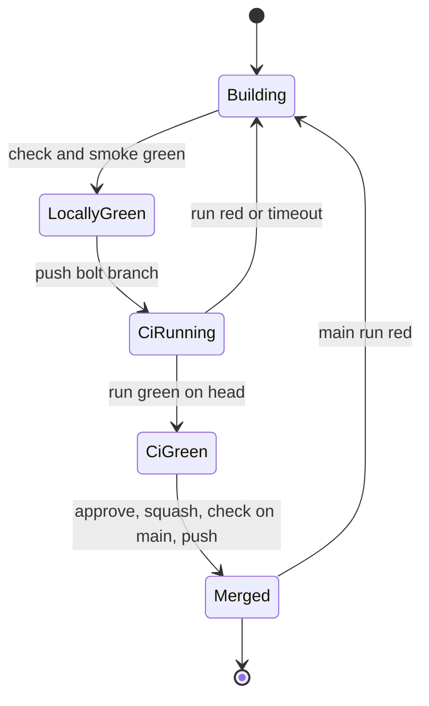
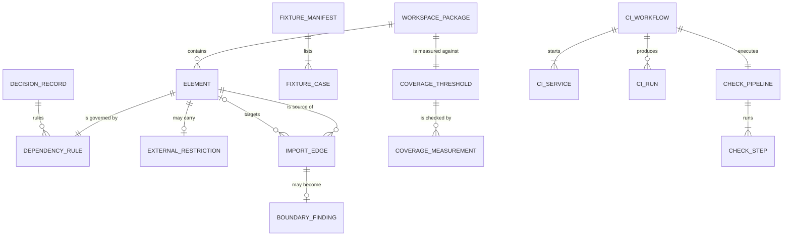

# Functional specification — U3 `t-010-boundary-lint-and-ci`

Unit U3 (kind `packaging`, size S in `unit-of-work.md`, re-estimated M–L by Question 7; not high risk) delivers T-010 for US1.1 (NFR11, D10). Lead perspective: architect. Support perspective: developer (ESLint flat-config mechanics, Vitest 4 coverage, Prettier, GitHub Actions), written into §§ 10–12 and synthesised in § 13.

Draft of 2026-10-28, written while U4 CR-011 was being built, then re-checked the same day against CR-011 as merged (`main` at `2d8a424`). § 16 records the re-check results and what is still open (the Prettier and coverage re-measure, and U6 CR-012, which was being built on `bolt/cr-012-storyboard-seed-correction` and touches `packages/test-support/`).

Inputs: `unit-of-work.md` (U3), `unit-of-work-story-map.md` (US1.1), `stories.md` (AC1.1.1–AC1.1.5), `requirements.md` (NFR6, NFR11, NFR13), `components.md` (worker boundary), `contract-summary.md` (C13 `worker_import_rule`; no runtime contract on U3's edges), T-010, T-011 (`check:motion`), CR-011 (its hand-off), `01-conventions.md` §1, §2, §7, §10, §13, team.md, `org.md`, FD-040, FD-091, ISS-060, ISS-102, ISS-127, ISS-205, ISS-226, the dependency-check log, and the code listed in `functional-design-questions.md` "Context".

This file is the source of truth for the workflows and state transitions. The data shape is in `entities.md`; the decision logic is in `rules.md`. The design choices in Questions 1–11 (all A) were decided on the owner's standing instruction of 2026-10-27 and await the owner's confirmation.

## 1. What changes, in one paragraph

`pnpm check` becomes the full gate the conventions already describe. ESLint gains boundary rules that encode `01-conventions.md` §2 with FD-040, team.md and Questions 1–5: every source file belongs to one of fourteen elements, imports follow a default-deny matrix, externals are limited where §2 limits them, and the worker's AD-6 bans work on specifiers, so they bite before Better Auth is installed. A manifest-driven fixture proves every forbidden edge is refused and every allowed exception is accepted. Vitest measures line coverage of every workspace package with source code in the same run as the tests and fails below 80%; this Unit first adds the tests that bring each package to the floor. Prettier `--check` joins the gate after one formatting-only commit, with git owning line endings. A narrow identity guard refuses attribution trailers and footers. `tools/contrast.mjs` takes `--tokens` and fails closed in that mode. A GitHub Actions workflow runs the same gate on `main` and `bolt/**` against a `postgres:18` service, and a Bolt merges only after its CI run is green. ISS-205 (raw SQL in the worker), ISS-226 (the seed edge) and ISS-060 (no identity guard) close.

## 2. As is (baseline, 2026-10-28)

The ESLint, script, Prettier, coverage and contrast facts below were read on the working tree while CR-011 was being built. The worker and `packages/database/src/queue/` facts were re-read on `main` at `2d8a424` after CR-011 merged. CR-011 did not change the root `package.json`, `vitest.workspace.ts`, `eslint.config.mjs`, `prettier.config.mjs`, `apps/worker/package.json`, `packages/database/package.json` or `apps/worker/src/container.test.ts`.

- **ESLint** 10 flat config (`eslint.config.mjs`): `@eslint/js` recommended, `typescript-eslint` `recommendedTypeChecked` with `projectService`, three extra rules, `disableTypeChecked` for `*.mjs`, `*.cjs`, `*.config.ts`, `vitest.workspace.ts`; the marked slot `// T-010 adds boundaries here`; `eslint-config-prettier` last. Ignores include `tools/**`, `docs/**`, `.github/**` and the engine directories. No boundary plugin installed.
- **Root scripts** (`package.json`): `check` = `typecheck && lint && test && i18n:check && build` (five steps). `test` runs every Vitest project through `vitest.workspace.ts`, including `database` (needs the compose PostgreSQL). `contrast` = `node tools/contrast.mjs` (the prototype file). `@vitest/coverage-v8` ^4.1.11 and `prettier` ^3.9.6 are installed; no coverage block exists in any Vitest config; there is no `format:check`.
- **Import inventory** (every `from '…'` in `packages/*/src` and `apps/*/src`):
  - `contracts` → `zod`, `uuid`; `i18n` → `next-intl`; `database` → `contracts`, `drizzle-orm`, `pg`, `pg-boss`, `dotenv`, Node built-ins; `test-support` → `contracts`, `database` (only under `src/seed/`; `fakes/repositories-superset.test.ts` names it in a comment only), `drizzle-orm`, `pg`, `sharp`, `dotenv`, `zod`, Node built-ins.
  - `apps/web` source → `next`, `next-intl`, `react`, `contracts`; nothing imports `server/`, `database`, `adapters` or `test-support`. Ten component tests and one `lib` test import `node:fs`, `node:path`, `node:module`, `node:url`. `apps/web/package.json` lists `@rogikotha/test-support` as a devDependency that nothing uses.
  - `apps/worker` (on `main` at `2d8a424`: `container.ts`, `env.ts`, `handlers/index.ts`, `handlers/outbox-relay.ts`, `health.ts`, `index.ts`, `logger.ts`, `main.ts`, `registry.ts`, plus five test files) → `@rogikotha/database` (classes `PgOutbox`, `PgOutboxRelayStore`, `PgBossQueue`, `createDb`, `closeDb`, `QueuePolicyMismatchError`; types `Db`, `RelayStore`, `EventPlan`, `OutboxEventRow`, `PlannedJob`, `EventOutcome`, `RelayBatchOptions`, `WorkOptions`), `dotenv`, `zod`, `node:url`, `node:path`, and **`drizzle-orm`** in `health.ts` (ISS-205, still open). Tests import only `vitest` and Node built-ins. Worker relative imports carry a `.js` suffix (`handlers/index.ts` → `./outbox-relay.js`); `packages/database` relative imports are extensionless since CR-009.
  - `packages/database/src/queue/` (on `main`): `pg-boss-queue.ts` (`pg-boss`), `outbox-relay-store.ts` and `sql-executor.ts` (`pg` types only, so no `pg-boss` or `pg` type leaves the package), `queue-declaration.ts`, `index.ts` (exports all four), and the test-only helper `queue-test-support.ts` (imports `../test-setup`, not exported from `index.ts`). The tests add `pg`, `drizzle-orm`, `node:crypto` and `node:perf_hooks`. Everything stays inside the `database` element, whose externals are unrestricted.
  - Outbox repository (`packages/database/src/repositories/outbox.ts` on `main`): `PgOutbox` has `append(tx, …)`, `claimUnprocessed(sql: SqlExecutor, limit)`, `markProcessed(sql, id)`, `recordFailedAttempt(sql, id)` and `markDead(sql, id)`. `markDead` sets `processed_at`, so "pending" (`processed_at is null`) already leaves out dead events. The worker container holds both `db: Db` and `outbox: PgOutbox`.
  - Both `env.ts` files call dotenv `config({ path, quiet: true })` (ISS-203 closed); `apps/worker/src/env.test.ts` and `packages/database/src/env.int.test.ts` import only `vitest`.
  - `domain`, `application`, `adapters` hold one placeholder file each (`export {};`).
- **Worker AD-6 check today:** `apps/worker/src/container.test.ts` scans non-test worker sources for the text `better-auth|identity.reveal|dataRequest.delete`.
- **Prettier** (`prettier --check`, read-only): 309 files flagged; with `--end-of-line auto`, 129. The 180 extra are CRLF working-tree files (`core.autocrlf=true`; `.gitattributes` says `* text=auto eol=lf`, but this checkout holds CRLF files, for example `prettier.config.mjs`). The 129: `test-support` 42, `database` 37 (10 drizzle `meta/*.json`), `apps/web` 22 (3 ported stylesheets), `contracts` 11, `apps/worker` 6, `i18n` 5, root Markdown 4, `infra/compose` 2.
- **Coverage trial** (all projects except `database`, `--coverage.include` on the source roots, report written outside the repository): `contracts` 74.8% (237/317 lines, 42 files), `test-support` 52.2% (211/404, 49 files), `apps/web` 79.6% (172/216, **15 of 67** source files reported), `apps/worker` 81.7% (49/60, **3 of 9**), `i18n` 97.4% (38/39). Files no test loaded did not appear, so the web and worker figures overstate their real coverage (BR6.2). `database` was not run, to leave the CR-011 build's test database alone.
- **Contrast** (`tools/contrast.mjs` run in memory with its input path swapped, nothing written): the prototype `styles.css`, `apps/web/src/styles/tokens.css` and `apps/web/src/styles/patient.css` each give identical output: five variants (LIGHT, DARK, schemes A–C), 150 pair results, 0 skipped, all pass. `tokens.css` differs from the prototype's `shared/tokens.css` in one header line only. With a token file that holds none of the tokens, every pair would be skipped and the tool would print "OK" and exit 0.
- **CI:** no `.github/workflows/`; `.github/agents/` holds BMAD agent files.
- **Database for CI:** `infra/compose/postgres-init/01-roles.sql` (roles, `rogikotha_test`, `ALTER DATABASE rogikotha`) and `02-extensions.sql` (uses `\c`, so it needs `psql`).

## 3. The dependency matrix

Elements in match order (narrower first, BR1.2). "Own" means the element's own type. Every element may import its own type.

| Id | Element | Pattern | May import (internal) | Externals |
|---|---|---|---|---|
| E1 | domain | `packages/domain/src/**` | own | none |
| E2 | contracts | `packages/contracts/src/**` | own | only `zod`, `uuid` (Q4) |
| E3 | application | `packages/application/src/**` | domain, contracts | none |
| E4 | database | `packages/database/src/**` | application, contracts | unrestricted (drizzle, pg, pg-boss, dotenv, Node) |
| E5 | adapters | `packages/adapters/src/**` | application, contracts | unrestricted (each adapter's library) |
| E6 | i18n | `packages/i18n/src/**` | own | only `next-intl` (Q4) |
| E7 | test-support-seed | `packages/test-support/src/seed/**` | application, contracts, domain, test-support, **database** (FD-040) | unrestricted |
| E8 | test-support | `packages/test-support/src/**` | application, contracts, domain | unrestricted |
| E9 | web-container | `apps/web/src/server/container.ts` | application, contracts, database, **adapters**, i18n, web-server | unrestricted |
| E10 | web-actions | `apps/web/src/server/actions/**` | application, contracts, i18n, web-container, web-server | unrestricted |
| E11 | web-server | `apps/web/src/server/**` | application, contracts, database, i18n, web-container | unrestricted |
| E12 | web-components | `apps/web/src/components/**` | contracts, i18n, **web-actions** (Q1) | source: no Node built-ins, `pg`, `pg-boss`, `drizzle-orm`, `better-auth`, `sharp`, `pdfjs-dist`, `dotenv`, `@node-rs/argon2` |
| E13 | web | `apps/web/src/**` | application, contracts, i18n, web-components, web-actions, web-server, web-container | unrestricted |
| E14 | worker | `apps/worker/src/**` | application **only via `@rogikotha/application/worker`, type-only from the root** (Q2), contracts, database, adapters | no `better-auth`, `better-auth/*`, `drizzle-orm`, `drizzle-orm/*`, `pg` (Q3) |

Test files (`*.test.ts(x)`, `*.smoke.test.ts(x)`, `*.int.test.ts`, test setup and global-setup files, test-only helpers) keep their element's row and additionally may import Node built-ins; in `packages/*` they may also import `test-support`. Nothing in `apps/*` imports `test-support`, in source or tests (FD-040).

Differences from the task's step 2, each with its source: E7 (FD-040), E9 and E10 split out of web-server (team.md: adapters only in `container.ts`; Q1), E12 gains web-actions (Q1), E13 loses `test-support` from tests (FD-040), E2 and E6 externals (Q4), E14 application surface and the `drizzle-orm`/`pg` ban (Q2, Q3), test-file allowances (Q5).

## 4. Workflows

### WF1 — Code Generation order (the Unit end to end)

1. **Preconditions (BR12.6).** CR-011 is squash-merged on `main` (`2d8a424`, re-checked in § 16). U6 CR-012 touches `packages/test-support/`; if it is still in flight, U3 waits for its merge, because the boundary rules classify the seed files and the formatting commit rewrites 42 `test-support` files. The Bolt branch `bolt/t-010-boundary-lint-and-ci` starts from `main`. Work through the open items of § 16.
2. **Baseline.** `pnpm infra:up`; `pnpm check` and `pnpm smoke` green; record test, smoke and int counts. Read the open `ISSUES.md` rows in this area: ISS-060, ISS-127, ISS-205, ISS-226 and any row CR-011 added for `apps/worker` or `packages/database/src/queue`.
3. **Research and dependency check (BR12.2).** For `eslint-plugin-boundaries`: the latest stable release (not simply the newest; 7.4.0 was about two days old on 2026-10-28), ESLint 10 and flat-config support in its changelog, which rules are current (`boundaries/dependencies` versus `element-types` and `external`) and whether a TypeScript import resolver is needed for `@rogikotha/*` and `@/`. If ESLint 10 is unsupported, take `dependency-cruiser` (`.dependency-cruiser.cjs`, `pnpm lint:deps`) and say so in the hand-off. Also: `@vitest/coverage-v8` 4.1.x (`include` and uncovered files, glob thresholds, a glob with zero lines), Prettier 3.9.x, `actions/checkout`, `actions/setup-node`, `pnpm/action-setup` (current release and commit hash), `postgres:18`. Append one dated entry; save non-trivial findings under `docs/planning/research/`.
4. **Decision entry (BR12.1).** Append the next free FD row (FD-093 at the time of writing) with the rulings of Questions 1–5 and "decided by the agent on the owner's standing instruction of 2026-10-27; awaiting the owner's confirmation".
5. **Boundary rules (WF2).** Install the plugin (and resolver, if needed). Write `eslint.boundaries.mjs` from § 3 and spread it into the marked slot. Add `lint-fixtures/**` to the root ignores. Run `pnpm lint`; handle every finding by BR4.1 and BR4.2. Expected findings from § 2: `apps/worker/src/health.ts` (`drizzle-orm`), nothing else.
6. **ISS-205 (Q3).** Add `countPending(db: Db): Promise<number>` to `PgOutbox` beside CR-011's methods (`processed_at is null`, which already leaves out dead events because `markDead` sets `processed_at`), with an integration test in `packages/database/src/outbox.int.test.ts`. `health.ts` calls `ctx.outbox.countPending(ctx.db)`; the container already holds both, so `container.ts` does not change. Remove `drizzle-orm` from `apps/worker/package.json`. Remove the unused `@rogikotha/test-support` devDependency from `apps/web/package.json` (Q5). Record the `outbox.ts` and `outbox.int.test.ts` edits as owned-path additions, as CR-011 did in ISS-248.
7. **Fixture proof (WF3).** Fixture files (§ 6), manifest, `scripts/check-boundaries-fixture.mjs`, the `tooling` Vitest project and its smoke assertion (BR5.5).
8. **Identity guard (WF8).** `scripts/check-identity.mjs` and its tests in the `tooling` project.
9. **Coverage (WF4, WF9).** Coverage block in `vitest.workspace.ts` with `include`, exclusions (§ 7) and no thresholds yet; `test:coverage` script; measure; raise each package below 80% with test files; switch the per-package thresholds on.
10. **Format (WF5 step 4).** `prettier.config.mjs` `endOfLine: 'auto'`; `.prettierignore` (§ 8); the formatting-only commit (BR7.4); `format:check` script.
11. **Contrast (WF7).** `--tokens` in `tools/contrast.mjs`, fail-closed in flag mode; one paragraph in `tools/README.md`.
12. **Root scripts.** `lint:boundaries`, `format:check`, `check:identity`, `test:coverage`, `contrast` (with `--tokens`), and `check` per BR8.1. `tools:contrast` unchanged.
13. **CI (WF6).** `.github/workflows/check.yml`; push the Bolt branch; the run is green; record its URL.
14. **Documents and records.** `01-conventions.md` §2 (the matrix of § 3 with FD-040 and the new FD id) and §13 (the nine steps); `tools/README.md`; `ISSUES.md` (BR12.4 and the new rows); the T-010 hand-off and `docs/implementation/handoffs/T-010.md` (BR12.5); propose the team.md Code Style correction of Question 4 for the learnings step.
15. **Gate.** `pnpm check` and `pnpm smoke` green locally, wall clock recorded (BR8.3), the manual acceptance rows of § 15, the mutation check (BR5.4), CI green on the Bolt head (BR10.4).

### WF2 — Deciding one import (what the rules do for each edge)

1. Classify the file: the first element whose pattern matches (BR1.1, BR1.2); no match is an error. Classify the category: test or source.
2. Resolve the specifier: relative, `@/` alias and `@rogikotha/*` (with subpath exports) must resolve to a file, whose element becomes the target (BR1.3); otherwise it is an external package or a Node built-in.
3. Internal target: allowed when it is the file's own element or in its matrix row (§ 3), plus the test allowance of BR2.5; else refused by the boundary rule.
4. External target: check the element's allowlist or denylist (BR3.1–BR3.3, BR3.6) and, for test files, the Node built-in allowance.
5. Worker files additionally: the AD-6 specifier bans (BR3.4, BR3.5), matched on the specifier text before any resolution, with type-only imports of the `@rogikotha/application` root allowed.
6. Every import kind goes through these steps (BR1.4). The first refusal is reported with its rule id.

### WF3 — Fixture proof (`pnpm lint:boundaries`, S3)

1. Run ESLint through its Node API (or CLI with `--format json`) with `--no-ignore` on `lint-fixtures/boundary-violation/`, using the repository config, in which the fixture path has type-aware rules disabled.
2. Collect every reported problem as (relative file, rule id, severity).
3. Compare with the manifest (§ 6): each violation case exactly once with its rule id; each control case nothing; no other problem (BR5.2, BR5.3).
4. On a match print `N expected violations found` and exit 0; otherwise print missing, unexpected and control problems and exit 1.

### WF4 — Coverage run (`pnpm test:coverage`, S6)

1. `vitest run --config vitest.workspace.ts --coverage` runs every project once, `database` included (needs the compose PostgreSQL; CR-007's global setup resets `rogikotha_test` once).
2. The v8 provider reports every file under `packages/*/src/**` and `apps/*/src/**` minus the exclusions of § 7, untested files at 0% (BR6.2).
3. Each package's glob threshold (`<path>/src/**`, lines 80) is checked on the package aggregate; a package with zero lines passes (BR6.3).
4. Any threshold miss or test failure exits non-zero; the text summary prints per package; the JSON summary goes to the git-ignored `coverage/`.

### WF5 — `pnpm check`

S1 `typecheck` → S2 `lint` (boundary rules included) → S3 `lint:boundaries` → S4 `format:check` → S5 `check:identity` → S6 `test:coverage` → S7 `i18n:check` → S8 `contrast` → S9 `build`, joined with `&&` (BR8.1, BR8.2). T-011 later appends `check:motion` after S8 (BR8.4).

### WF6 — CI run (`.github/workflows/check.yml`)

1. Trigger: push to `main` or `bolt/**`, or manual dispatch (BR10.1). Concurrency group per ref, cancel in progress; timeout 20 minutes; `permissions: contents: read` (BR10.5, BR10.2).
2. Service `postgres:18` with `POSTGRES_USER=postgres`, a job-only `POSTGRES_PASSWORD`, `POSTGRES_DB=rogikotha`, port 5432 mapped, `pg_isready` health check.
3. Steps: checkout; `pnpm/action-setup` (version from `packageManager`); `actions/setup-node` (`node-version-file: .nvmrc`, cache `pnpm`); generate `APP_ENCRYPTION_KEY` and `BETTER_AUTH_SECRET` with `openssl rand -base64 32` and export them for the job only; run `01-roles.sql` and `02-extensions.sql` with the runner's `psql` as `postgres` (fallback: `docker exec` into the service container if `psql` is missing); set `DATABASE_URL`, `DATABASE_URL_WORKER`, `DATABASE_URL_TEST`, `DATABASE_URL_MAINTENANCE` to the service with the compose roles, and `APP_MODE=development`; `pnpm install --frozen-lockfile`; `pnpm db:migrate` (from empty, AC1.1.2); `pnpm check`; `pnpm smoke` (BR10.3).
4. Every action is pinned to a commit hash with the version in a comment; no step commits, comments, uploads with a token or names a tool (BR10.2).

### WF7 — Contrast run

1. Parse `--tokens <path>` from `process.argv`. Without it, read the prototype 04b `styles.css` and run exactly as today (BR9.1).
2. With it: read the file (unreadable → exit 1 with the path); find the bare `:root`, dark and scheme blocks as today; no block found → exit 1; evaluate the unchanged pairs (BR9.4); any skipped pair → exit 1 naming the pair and the missing token (BR9.3).
3. Report and exit as today: text pairs below 4.5:1 and hard pairs below 3:1 fail.

### WF8 — Identity guard (`pnpm check:identity`, S5)

1. Commit messages: on a Bolt branch, from `git merge-base main HEAD` to `HEAD`; on `main` in CI, the commits of the push (the event's before and after commits; the checkout fetches enough history for that range); on `main` locally, `HEAD` only. Search for the markers of `entities.md` IdentityGuardPattern.
2. Tracked files: `git ls-files` minus the excluded trees; search the same markers.
3. Any hit → print the place and exit 1. A bare model or tool name is not a marker (BR11.2).

### WF9 — Raising a package below the floor

1. From the measurement of WF4 step 4 (no thresholds yet), list each package below 80% and its zero-coverage files.
2. Add test files only (unit tests through public exports, builders over hand-written objects, sentence names, no implementation-detail assertions, team.md Testing Posture) until the package is at or above 80%.
3. If a package cannot reach 80% without changing source code, stop that package: record an ISS row, ask the owner, and do not switch any threshold off or lower it (BR6.5).
4. Switch all thresholds on; `pnpm check` green.

## 5. State transitions

### Bolt merge readiness (every Bolt from U3 on)

| From | Event | To | Rule |
|---|---|---|---|
| building | `pnpm check` and `pnpm smoke` green locally | locally_green | BR8.1, BR10.4 |
| locally_green | Bolt branch pushed | ci_running | BR10.1 |
| ci_running | run green on the Bolt head | ci_green | BR10.3, BR10.4 |
| ci_running | run red or timed out | building | BR10.3, BR10.5 |
| ci_running | a newer commit pushed to the branch | ci_running (older run cancelled) | BR10.5 |
| ci_green | owner approves, squash-merge, `pnpm check` on `main`, push | merged | team.md Way of Working |
| merged | `main` run red | building (fix forward on a new Bolt) | BR10.4 |



Text fallback: a Bolt is built until `pnpm check` and `pnpm smoke` pass locally; its branch is pushed and CI runs; a red run sends it back to building; a green run on the branch head lets the owner approve the squash merge; a red run on `main` afterwards starts a fix on a new Bolt.

### Coverage threshold per package

| From | Event | To | Rule |
|---|---|---|---|
| exempt_no_code | first executable source line lands | enforced_failing or enforced_passing (by its figure) | BR6.3 |
| enforced_failing | tests added until ≥ 80% | enforced_passing | BR6.5 |
| enforced_passing | a change drops it below 80% | enforced_failing (`pnpm check` red) | BR6.1 |
| any | someone lowers the number or adds an unreasoned exclusion | refused at review | BR6.4, BR6.5 |

### Boundary finding (when the rules are first switched on)

`found` → `fixed_in_u3` (ISS-205, the devDependency) or `suppressed_owner_merged` (with reason and ISS row) or `escalated` (owner not merged: the Unit stops) (BR4.1, BR4.2).

## 6. Fixture cases

All under `lint-fixtures/boundary-violation/`, in the repository's `packages/…/src` and `apps/…/src` shape, plus small stub files (for example a stub `apps/web/src/server/auth.ts` and a stub `server/actions/sample.ts`) that are imported but are not cases. Imports of `@rogikotha/*` resolve to the real packages, so a fixture domain file importing `@rogikotha/application` crosses the real edge.

| Case | Kind | File (under the fixture root) | Import | Expected | Proves |
|---|---|---|---|---|---|
| FX1 | violation | `packages/domain/src/domain-bad.ts` | `@rogikotha/application` | boundary rule | BR2.1, BR1.3 (task case 1) |
| FX2 | violation | `apps/web/src/components/ComponentBad.tsx` | `node:fs` | restricted import | BR3.3 (task case 2) |
| FX3 | violation | `apps/web/src/components/ComponentDb.tsx` | `@rogikotha/database` | boundary rule | BR2.4 |
| FX4 | violation | `apps/web/src/components/ComponentAuth.tsx` | stub `server/auth.ts` | boundary rule | BR2.4 |
| FX5 | violation | `apps/web/src/app/page-bad.tsx` | `@rogikotha/adapters` | boundary rule | BR2.3 |
| FX6 | violation | `packages/test-support/src/fakes/fake-bad.ts` | `@rogikotha/database` | boundary rule | BR2.2 |
| FX7 | violation | `apps/web/src/lib/web-bad.test.ts` | `@rogikotha/test-support` | boundary rule | BR2.6 |
| FX8 | violation | `apps/worker/src/worker-bad.ts` | `better-auth` (not installed) | restricted import | BR3.4 (task case 3) |
| FX9 | violation | `apps/worker/src/worker-app.ts` | value import of `@rogikotha/application` | restricted import | BR3.5 |
| FX10 | violation | `apps/worker/src/worker-sql.ts` | `drizzle-orm` | restricted import | BR3.6 |
| FX11 | control | `apps/worker/src/worker-types.ts` | `import type` from `@rogikotha/application` | none | BR3.5 |
| FX12 | control | `packages/test-support/src/seed/seed-ok.ts` | `@rogikotha/database` | none | BR2.2 |
| FX13 | control | `apps/web/src/server/container.ts` | `@rogikotha/adapters` | none | BR2.3 |
| FX14 | control | `apps/web/src/components/Component.test.tsx` | `node:fs` | none | BR2.5 |
| FX15 | control | `apps/web/src/components/ComponentForm.tsx` | stub `server/actions/sample.ts` | none | BR2.4 (Q1) |

"Boundary rule" is the plugin's current dependency rule (§ 4 WF1 step 3); "restricted import" is `no-restricted-imports` or its TypeScript variant. The manifest names the exact rule ids once chosen. The acceptance row "3 expected violations found" reads "10 expected violations found" with this manifest (Question 6).

## 7. Coverage design

- **Scope:** every workspace package; the thresholds map is written for all nine (`packages/{domain,contracts,application,database,adapters,i18n,test-support}/src/**`, `apps/{web,worker}/src/**`), lines 80 each. Empty packages pass with zero lines (BR6.3); to be verified in Code Generation that Vitest 4 treats a glob with zero lines as passing and not as an error (§ 16).
- **Counted files:** `include` lists the nine source roots so untested files appear at 0% (BR6.2). Code Generation proves it: the report's file count per package equals the package's non-excluded source files.
- **Exclusions (Q8, BR6.4):** `**/*.test.ts`, `**/*.test.tsx` (smoke and int tests included by these), `**/test-setup.ts`, `**/global-setup.ts`, test-only helper modules (`**/*-test-support.ts`; today exactly `packages/database/src/queue/queue-test-support.ts`, confirmed on `main`: it imports `../test-setup` and is not exported from `queue/index.ts`; `sql-executor.ts` is exported source and counts), `**/*.d.ts`, and files with a generated header (none today; `packages/i18n/src/keys.ts` has no such header and counts). Entry points, route files and corpus data count.
- **Run:** one run in `pnpm check` (BR6.6); `pnpm test` stays without coverage for quick local runs.
- **Expected raise work (from § 2, before untested files are added to the count):** `contracts` +17 lines or more; `test-support` +112 or more; `apps/web` and `apps/worker` unknown until untested files count; `database` unmeasured. This is the reason for the M–L re-estimate (Question 7).

## 8. Format design

- **`format:check`** = `prettier --check .` with `.prettierignore` defining the scope (BR7.1). Scope in: `apps/`, `packages/`, `scripts/`, `lint-fixtures/`, `.github/workflows/`, root configuration files.
- **`.prettierignore` additions** (each with a one-line reason comment): `apps/web/src/styles/**` (ported staff stylesheet, FD-091 patient CSS until T-011 decides), `**/migrations/**` (generated SQL and snapshots), `**/*.md`, `aidlc/**`, `.claude/**`, `.codex/**`, `.agents/**`, `.github/agents/**`, `.impeccable/**`, `_bmad/**` (already), `docs/**`, `tools/**`, `ui-design-prototype/**` (already), `.data/**`, `pnpm-lock.yaml` (already), `**/dist`, `**/.next` (already).
- **Line endings:** `endOfLine: 'auto'` (BR7.3).
- **Baseline commit:** `prettier --write .` within the scope, after CR-011's merge, alone in its commit; a whitespace-insensitive review of that commit shows no token change; then `pnpm check` (BR7.4).

## 9. CI design notes

- **Why no separate `test:int`:** `pnpm check`'s S6 runs every project, `database` included; a second `test:int` would rerun the integration tests (task step 7 predates CR-007 and team.md's note that `pnpm test` includes the database project).
- **Why `pnpm smoke` after `pnpm check`:** it is the second half of the local gate (team.md), and it fails with a clear reason when PostgreSQL is missing on a local machine (ISS-127); in CI the service is always there.
- **Only PostgreSQL:** no test needs Mailpit or ClamAV today. The first Unit whose tests need one adds the service (finding F8).
- **Next build in CI:** `pnpm build` runs with the job's environment only (no `.env`); Code Generation confirms `next build` and the worker `tsc` build need no value the job lacks.

## 10. Developer view — lint mechanics

- **Second root for the fixture.** Each element pattern accepts the fixture root as an optional prefix, so the fixture is classified by the same list (illustrative):

```js
const root = '{,lint-fixtures/boundary-violation/}';
export const elements = [
  { type: 'domain', pattern: `${root}packages/domain/src/**` },
  { type: 'test-support-seed', pattern: `${root}packages/test-support/src/seed/**` },
  { type: 'test-support', pattern: `${root}packages/test-support/src/**` },
  { type: 'web-container', pattern: `${root}apps/web/src/server/container.ts`, mode: 'full' },
  // … in the order of § 3
];
```

- **One `no-restricted-imports` per file set (BR3.7).** Flat config replaces a rule's options when a later block matches the same file. Write one block for worker source and tests (AD-6 and Q3 bans together), one for component source (Node built-ins and server libraries), and none that overlaps them. Use the TypeScript variant where the type-only allowance is needed (`allowTypeImports` for the root `@rogikotha/application` path only).
- **Node built-ins:** ban both `node:*` and bare names (`fs`, `path`, `crypto`, …), taken from `module.builtinModules` in the config file.
- **Resolution:** `@rogikotha/*` resolves through the pnpm workspace symlinks to `packages/*/src/index.ts` (`exports` point at source). Files reached through `node_modules` must be classified by their real path, not as external; the fixture's FX1, FX3, FX5, FX6 fail if they are not. `@/` needs `apps/web/tsconfig.json`'s paths, through the TypeScript resolver if the plugin does not read them. Relative specifiers come in two styles: the worker writes `./outbox-relay.js` for a `.ts` file, `packages/database` is extensionless (CR-009). The resolver must map a `.js` specifier to its `.ts` source; otherwise every worker relative import is unresolved and BR1.3 turns lint red.
- **Fixture and type-aware rules:** the fixture block uses `disableTypeChecked`, so no tsconfig is needed for it and it stays out of every tsconfig `include` (task step 4's separate `lint-fixtures/tsconfig.json` is then unnecessary; add it only if the resolver needs one).
- **Stubbing uninstalled packages:** FX8 imports `better-auth`, which is not installed; `no-restricted-imports` matches the text, so no stub is needed.

## 11. Developer view — test design

| Test | Where | Shape | Proves |
|---|---|---|---|
| Fixture proof | `scripts/check-boundaries-fixture.mjs` (S3) | WF3 against the manifest | BR5.2, BR5.3 and every BR of § 6 |
| Smoke assertion | `scripts/boundaries.smoke.test.mjs` in a new `tooling` project (`scripts/vitest.config.ts`, added to `vitest.workspace.ts` `projects`) | lint FX1 through ESLint's Node API, expect the boundary rule's error | BR5.5 |
| Identity guard tests | `scripts/check-identity.test.mjs` (tooling project) | a temporary file and message with a `Co-Authored-By` trailer are refused; a bare model name passes | BR11.1, BR11.2 |
| Contrast flag | manual acceptance rows at Build and Test, plus one tooling test running the tool on a temporary file without the tokens | flag mode fails closed; `pnpm contrast` output equals `pnpm tools:contrast` | BR9.2, BR9.3 |
| Outbox pending count | `packages/database/src/outbox.int.test.ts` or the repository's own int test | count of unprocessed rows before and after marking | BR3.6 (ISS-205) |
| Coverage raise tests | the packages below 80% | ordinary unit tests through public exports | BR6.5 |
| Mutation check | Build and Test, manual | disable one rule block → `pnpm lint:boundaries` exits 1; lower one threshold in a scratch run → refused at review, never committed | BR5.4 |

The tooling project is not under the coverage floor (its files are root scripts, not a workspace package's `src`). Test names read as sentences; temporary files go to the OS temp directory.

## 12. Developer view — files, owned paths and records

- **Task owned paths (create):** `eslint.boundaries.mjs`, `lint-fixtures/boundary-violation/**`, `scripts/check-boundaries-fixture.mjs`, `.github/workflows/check.yml`; **(modify):** `eslint.config.mjs`, root `package.json`, `tools/contrast.mjs`, `tools/README.md`, the T-010 task file hand-off.
- **Owned-path additions (each in the hand-off, BR12.5):** `pnpm-lock.yaml` (new devDependencies); `vitest.workspace.ts` (coverage, tooling project); `scripts/vitest.config.ts`, `scripts/boundaries.smoke.test.mjs`, `scripts/check-identity.mjs`, `scripts/check-identity.test.mjs` (Q11, BR5.5); `prettier.config.mjs`, `.prettierignore`, and every file the formatting commit touches (Q9); new test files in the packages raised to the floor (Q7); `apps/worker/src/health.ts`, the outbox repository and its test, `apps/worker/package.json` (Q3); `apps/web/package.json` (Q5); `docs/implementation/01-conventions.md` §2 and §13; `docs/status/decision-log.md`; `docs/status/dependency-check-log.md`; `docs/implementation/ISSUES.md`; `docs/implementation/handoffs/T-010.md`; research notes under `docs/planning/research/`.
- **Task text corrected (hand-off, BR12.5):** step 2 "web → test-support from tests" (FD-040); "web-server → adapters" (team.md); fixture files outside the element patterns (Q6); "exactly three errors" and "3 expected violations found" (Q6: 10); step 5's `check` composition (nine steps; "all seven steps" in the acceptance table); step 6 "byte-identical" (one header line differs, output identical); step 7 triggers `task/**` (now `bolt/**`, Q10) and the separate `pnpm test:int` (§ 9); the missing coverage, format and identity items (D10, team.md, ISS-060); the size estimate (Q7).
- **`ISSUES.md`:** ISS-205 → fixed in U3 T-010 (Q3); ISS-226 → fixed in U3 T-010 (FD-040 encoded); ISS-060 → fixed in U3 T-010 (Q11); ISS-127 → note that CI runs PostgreSQL, the local message stays open (owner T-505). New rows F1–F9 below, `Found in U3 T-010`.

Findings (proposed ISS rows; severities per team.md):

- **F1 (S3, U3 T-010)** — `tools/contrast.mjs` prints "OK" and exits 0 when the token file holds none of the pairs' tokens (every pair skipped), so a wrong path would pass. Fixed in U3 by BR9.3.
- **F2 (S4, U3 T-010)** — `format:check` cannot pass on the current tree: 129 files differ from Prettier in content, and every CRLF working-tree file fails Prettier's default `endOfLine: lf` on Windows (`core.autocrlf=true`). Fixed in U3 by Q9.
- **F3 (S3, U3 T-010)** — Measured line coverage is below 80% in `contracts` (74.8%), `test-support` (52.2%) and `apps/web` (≤ 79.6%); U3's size S does not include the raise. Fixed in U3 by Q7, re-estimated M–L.
- **F4 (S4, U3 T-010)** — A Vitest coverage run with `include` set reported only files some test loaded (web 15 of 67, worker 3 of 9), so a naive configuration would overstate coverage. Fixed in U3 by BR6.2 and its proof.
- **F5 (S4, U3 T-010)** — `01-conventions.md` §2 and team.md Code Style contradict merged code: `contracts` imports `uuid`, `packages/i18n/src` imports `next-intl`. §2 fixed in U3 (Q4); the team.md line is proposed through the learnings step.
- **F6 (S3, U3 T-010)** — A literal "components may not import `node:`" rule fails on eleven merged web tests that read files. Fixed in U3 by Q5.
- **F7 (S4, owner: the first Unit that imports application code into the worker)** — AD-6's path patterns cannot see capabilities reached through the `@rogikotha/application` root export; that Unit adds the `@rogikotha/application/worker` subpath (Q2).
- **F8 (S4, owners: the first Unit whose tests need Mailpit or ClamAV, and U45 T-011)** — CI starts PostgreSQL only; and T-011's token changes will make `pnpm contrast` fail closed until it updates the pairs for the FD-091 tokens.
- **F9 (S4, U3 T-010)** — T-010's task text drifted (the corrections listed above); recorded in the hand-off.

## 13. Synthesis — decisions and why

- **Encode §2, then make it true in writing.** The matrix follows §2, FD-040 and team.md; where merged code and §2 disagree (Q4) or §2 is silent (Q1, Q5), the rule follows the working design and §2 is corrected under one FD entry, so the lint and the conventions say the same thing.
- **Fail on what cannot be judged.** Unclassified files and unresolved internal imports fail (BR1.1, BR1.3), and the contrast tool fails on skipped pairs in flag mode (BR9.3): a gate that passes when it sees nothing is worse than no gate.
- **AD-6 by specifier, with a second net.** Specifier bans work whether `better-auth` is installed or not; the worker entry subpath (Q2) closes the root-export hole; the grep test stays because it sees text the import rules cannot.
- **A fixture that can fail and that covers every edge class** (Q6), with controls for every exception, so neither a missing rule nor an over-wide rule goes unnoticed (BR5.2–BR5.4).
- **The floor as written, applied honestly.** All packages with code, untested files counted, few reasoned exclusions, no exemption list, never lowered, and the raise done in this Unit (Q7, Q8). The size grows; the floor does not shrink.
- **Formatting without fighting git.** Git owns line endings; Prettier judges content; one reviewable formatting-only commit after CR-011 (Q9).
- **CI before merge without pull requests** (Q10): push the Bolt branch, wait for green, then squash locally as the team already does.
- **Developer view adopted.** One effective `no-restricted-imports` per file set; fixture classified through a second root; coverage in the same run as the tests; actions pinned by hash; no repository secrets.

## 14. If the owner changes an answer

- **Q1 → B:** drop web-actions from E12's row and FX15 becomes a violation; UI Units pass actions as props.
- **Q2 → B:** replace BR3.5 by the task's path patterns; FX9 and FX11 are removed; the grep test is the only check on the root export.
- **Q3 → B:** add the suppression with `-- ISS-205`; `drizzle-orm` stays in `apps/worker/package.json`; FX10 stays. **→ C:** remove the ban and FX10.
- **Q4 → B:** contracts and i18n allowlists shrink; `newId()` and the next-intl wiring move in their own Units, and lint stays red until then (so B needs those Units first).
- **Q5 → B:** FX14 becomes a violation and the eleven tests are rewritten.
- **Q6 → B:** the manifest shrinks to FX1, FX2, FX8; the other edges rely on manual checks.
- **Q7 → B:** a new Unit (next free id) raises coverage; U3 switches thresholds on after it. **→ C:** `test-support` drops out of the thresholds map (an owner decision against team.md).
- **Q8 → B:** entry points and route files join the exclusions with their reasons.
- **Q9 → B:** `endOfLine` stays `lf` and every checkout is renormalised. **→ C:** `format:check` runs on changed files only.
- **Q10 → B:** triggers become `main` and manual only; BR10.4 drops the pre-merge wait.
- **Q11 → B:** S5 and its scripts are dropped; ISS-060 stays open for T-505.

## 15. Acceptance mapping (T-010 acceptance checks)

| T-010 check | Where it is met |
|---|---|
| `pnpm lint` exit 0 | WF1 step 5, BR4.1 |
| `pnpm lint:boundaries` "N expected violations found" | WF3, § 6 (N = 10), BR5.2, BR5.3 |
| domain → application blocked (temporary import) | BR2.1, FX1, smoke assertion BR5.5 |
| component cannot import `node:fs` | BR3.3, FX2 |
| worker cannot import `better-auth` | BR3.4, FX8 |
| `pnpm check` exit 0, all steps | WF5, BR8.1 (nine steps) |
| `pnpm contrast` same pass output as `pnpm tools:contrast` | WF7, BR9.2 |
| CI green, run URL in hand-off | WF6, BR10.3, BR10.4 |
| `pnpm check` < 5 min locally, recorded | BR8.3 |
| team.md: 80% floor per package (AC1.1.3) | WF4, WF9, BR6.1–BR6.7 |
| team.md: `format:check` in `pnpm check` and CI | WF5, § 8, BR7.1–BR7.4 |
| Hard rule: reporter identity, private linkage and originals cannot reach the worker | BR3.4, BR3.5 (imports); the grants are CR-006's |
| Hard rule: no attribution in any file, commit or workflow | BR10.2, BR11.1 |

## 16. Re-check after CR-011, open items, and risks to verify

Re-checked on `main` at `2d8a424` (CR-011 merged), 2026-10-28, read-only:

| Item | Result | Effect on this design |
|---|---|---|
| Worker import list | Externals are still `dotenv`, `zod`, `node:url`, `node:path` and `drizzle-orm` (`health.ts` only); `@rogikotha/database` gives classes and types only; no application, Better Auth or `pg` import; relative imports use `.js` suffixes (§ 2) | No rule change. The ISS-205 fix is still needed (Q3). § 10 adds the `.js` resolution requirement |
| `container.test.ts` | Unchanged since T-009 | BR3.8 holds |
| Outbox repository | `append`, `claimUnprocessed`, `markProcessed`, `recordFailedAttempt`, `markDead`, all on a `SqlExecutor` (or `Tx` for `append`); `markDead` sets `processed_at` | WF1 step 6: `countPending(db: Db)` beside them; the heartbeat's meaning ("not yet processed or dead") is unchanged |
| New `queue/` files | `outbox-relay-store.ts`, `queue-declaration.ts`, `sql-executor.ts` (exported source); `queue-test-support.ts` (test-only helper, imports `../test-setup`, not exported) | All in the `database` element, no restriction hit. The coverage exclusion `**/*-test-support.ts` matches exactly the helper (§ 7); the test-file category already lists that pattern (`entities.md` FileCategory) |
| Both `env.ts` files and their tests | `quiet: true` in both; the two new tests import only `vitest` | No rule change |
| Root and package manifests, `vitest.workspace.ts`, ESLint and Prettier configs | Unchanged by CR-011 | § 2 baseline and the `check` composition hold |
| ISS ids | Highest is ISS-257 on `main`, on the CR-012 branch and in the working tree; CR-011's rows ISS-248..ISS-257 are outside U3's area (ISS-252, the seed's dotenv banner, is `test-support`'s) | The new rows F1–F9 take the next free ids when written, ISS-258 or later; CR-012 may take some first |
| FD ids | Highest is FD-092 on `main` and on the CR-012 branch | FD-093 is still free; confirm at WF1 step 4, after CR-012 |

Still open before Code Generation:

- **Prettier and coverage re-measure**, deferred by the coordinator while a build runs on this machine. CR-011 added and rewrote files under `apps/worker/src` and `packages/database/src`, so the § 2 figures (129 files, the per-package coverage) are from before it. The re-measure also adds `packages/database`, which the first trial left out.
- **U6 CR-012** (`packages/test-support/` and docs). After it merges: re-read the `test-support` imports (the seed edge, any new file outside `seed/` that touches `database`), the next free ISS and FD ids, and the `test-support` Prettier and coverage figures.

Risks to verify in Code Generation and Build and Test:

- The adopted `eslint-plugin-boundaries` release supports ESLint 10 and classifies workspace-symlinked files by real path; otherwise the fallback (WF1 step 3).
- The resolver maps the worker's `.js` relative specifiers to `.ts` files (§ 10).
- Vitest 4: uncovered files appear with `include` set across projects; a glob threshold matching only zero-line files passes; a failed threshold makes the run exit non-zero.
- `pnpm check` stays under 5 minutes with coverage on; if not, BR8.3.
- The runner's `psql` can run `02-extensions.sql` (`\c`); otherwise `docker exec`.
- `next build` succeeds in CI without a `.env`.
- The formatting commit does not touch the ignored trees and changes no token.

Risks to verify in Code Generation and Build and Test:

- The adopted `eslint-plugin-boundaries` release supports ESLint 10 and classifies workspace-symlinked files by real path; otherwise the fallback (WF1 step 3).
- Vitest 4: uncovered files appear with `include` set across projects; a glob threshold matching only zero-line files passes; a failed threshold makes the run exit non-zero.
- `pnpm check` stays under 5 minutes with coverage on; if not, BR8.3.
- The runner's `psql` can run `02-extensions.sql` (`\c`); otherwise `docker exec`.
- `next build` succeeds in CI without a `.env`.
- The formatting commit does not touch the ignored trees and changes no token.

## Entity-relationship view (derived from `entities.md`)



Text fallback: a workspace package contains elements and has one coverage threshold, checked by measurements. Each element has one dependency rule and may carry an external restriction; import edges start at an element, may target another, and may become a boundary finding. The fixture manifest lists the fixture cases. The check pipeline runs its steps; the CI workflow starts its PostgreSQL service, executes the pipeline and produces runs. The FD entry rules the dependency rules that differ from §2's text.

## Rules summary (derived from `rules.md`)

- **Classification (BR1.1–BR1.4):** one element per file, narrow patterns first, internal imports must resolve, every import kind checked.
- **Direction (BR2.1–BR2.6):** default-deny matrix; seed-only database edge; adapters only in the container; components to contracts, i18n, components and actions; test allowances; no `test-support` in apps.
- **Externals and AD-6 (BR3.1–BR3.8):** pure domain and application; contracts `zod`/`uuid`, i18n `next-intl`; no server libraries in components; worker without Better Auth, without the application root, without `drizzle-orm`/`pg`; one restricted-imports block per file set; the grep test stays.
- **Real tree (BR4.1–BR4.2):** lint green; suppressions only with owner, reason and ISS row.
- **Fixture (BR5.1–BR5.5):** isolated, layout-mirroring, exact manifest, controls silent, able to fail, one smoke assertion.
- **Coverage (BR6.1–BR6.7):** 80% lines per package, untested files count, mechanical exemption, narrow exclusions, never lowered, one run, figures as measured.
- **Format (BR7.1–BR7.4):** in the gate, ported and generated files out, git owns line endings, one formatting-only commit.
- **Gate (BR8.1–BR8.4):** nine steps in order, fail fast, time recorded, later Units append.
- **Contrast (BR9.1–BR9.4):** `--tokens`, same result today, fail closed in flag mode, thresholds unchanged.
- **CI (BR10.1–BR10.5):** `main` and `bolt/**`, safe environment, the local gate, merge waits for green, one run per ref.
- **Identity (BR11.1–BR11.2):** markers refused, names and allowed audit entries pass.
- **Records (BR12.1–BR12.6):** FD entry first, dependency check first, documents updated, ISS rows, hand-off, start after CR-011.

## Sources

- `docs/implementation/tasks/T-010-boundary-lint-and-ci.md` (goal, owned paths, steps 1–9, acceptance checks, tests, hard-rule checklist).
- `aidlc/spaces/default/intents/261011-aidlc-adoption/inception/units-generation/unit-of-work.md` (U3, U45) and `unit-of-work-story-map.md` (US1.1); `unit-of-work-dependency.md` (T-010 depends on CR-007; every feature Unit depends on T-010).
- `aidlc/spaces/default/intents/261011-aidlc-adoption/inception/user-stories/stories.md` US1.1 (AC1.1.1–AC1.1.5); `inception/requirements-analysis/requirements.md` NFR6, NFR11, NFR13.
- `aidlc/spaces/default/intents/261011-aidlc-adoption/inception/domain-design/components.md` (worker boundary open point); `inception/contract-design/contract-summary.md` (edges without a runtime contract; C13 `worker_import_rule`).
- `aidlc/spaces/default/memory/team.md` (Way of Working, Testing Posture, Code Style), `org.md` (Testing Posture for `classic`), `project.md` (Mandated: decision log, dependency check, ISS rows).
- `docs/implementation/01-conventions.md` §1, §2, §7, §8, §10, §13; `docs/status/decision-log.md` FD-040, FD-091; `docs/status/dependency-check-log.md` (entries of 2026-09-10, 2026-09-13, 2026-10-28); `docs/implementation/ISSUES.md` ISS-060, ISS-102, ISS-127, ISS-205, ISS-226.
- `docs/implementation/tasks/T-011-patient-design-and-motion-system.md` (`check:motion`); `docs/implementation/tasks/CR-011-queue-dedup-reset-and-quiet-env.md` (owned paths, hand-off).
- CR-011 as merged, `main` at `2d8a424`: `apps/worker/src/**`, `apps/worker/package.json`, `packages/database/src/queue/**`, `packages/database/src/repositories/outbox.ts`, both `env.ts` files and their tests (read with `git show`, 2026-10-28).
- Code on the working tree of 2026-10-28: `eslint.config.mjs`, `package.json` files, `vitest.workspace.ts` and every `vitest.config.ts`, `prettier.config.mjs`, `.prettierignore`, `.gitattributes`, `tsconfig.base.json`, `tools/contrast.mjs`, `tools/README.md`, `apps/worker/src/container.test.ts`, `apps/worker/src/health.ts`, `infra/compose/docker-compose.yml`, `infra/compose/postgres-init/*.sql`, `infra/compose/.env.example`.
- Read-only measurements of 2026-10-28: `prettier --check` (with and without `--end-of-line auto`), a Vitest coverage run of every project except `database` with its report written outside the repository, and `tools/contrast.mjs` run in memory against three stylesheets.
- npm registry, `eslint-plugin-boundaries` `latest` (7.4.0, peer `eslint >=6.0.0`), and the plugin's README (rules `boundaries/dependencies`, `boundaries/element-types`, `boundaries/external`, `boundaries/no-unknown-files`; `boundaries/elements` and file-category settings), read 2026-10-28.
