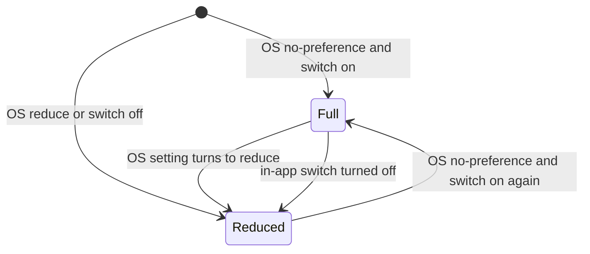
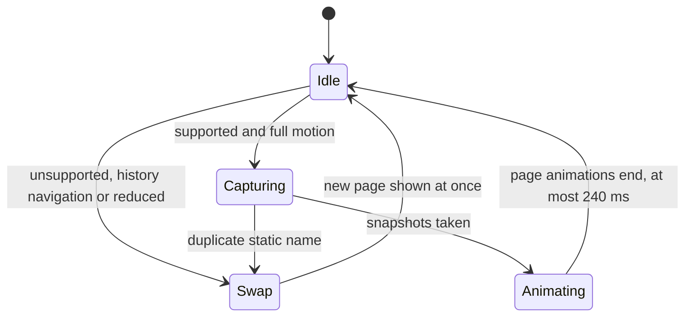
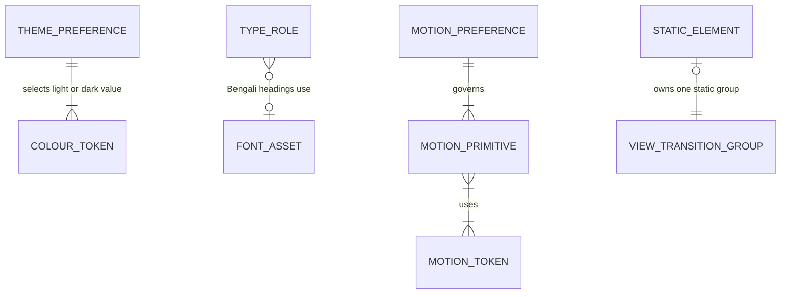

# Functional specification — U45 `t-011-patient-design-and-motion-system`

| Field | Value |
|---|---|
| Unit | U45 `t-011-patient-design-and-motion-system` (kind `ui`, size XL, not high risk); depends on U3 (T-010); every patient UI Unit depends on it (T-102, T-202, T-203, T-206, T-207, T-306, T-307, T-308, T-402, T-409, T-501) |
| Source | T-011 (`docs/implementation/tasks/T-011-patient-design-and-motion-system.md`) |
| Stories | US2.4 (AC2.4.1–AC2.4.6) and US2.3 (AC2.3.1–AC2.3.6) — `unit-of-work-story-map.md` |
| Requirements | NFR13 (visual and motion quality), FR95 (accessible controls), NFR1 (performance reference), NFR4 (responsive), NFR5 (browsers), NFR6 (accessibility), NFR7 (localization) — `requirements.md` |
| Decisions | FD-091 (redesign and motion), FD-032 (plain CSS, no animation library), FD-030 (staff console keeps Chart Tray), FD-024 (equal languages), FD-042 (Bengali copy review); CR-004 (motion toggle stays silent) |
| Upstream design | `components.md`: no domain component owns presentation. `contract-summary.md`: "FD-091 (patient redesign) and U45 T-011: presentation only. U45 has no runtime contract"; C14 is unchanged |
| Questions | Q1–Q8 in `functional-design-questions.md`, all answered A on the owner's standing instruction of 2026-10-27 and listed in `docs/aidlc-migration/OWNER-REVIEW-QUEUE.md` for the owner to confirm or change. This specification follows A throughout; § 10 lists what changes under each other option |
| Status | Draft written ahead of the stage, from the CR-011 Bolt branch; `apps/web`, `tools`, `packages/i18n` and `package.json` are identical to `main` there |

This file is the source of truth for the Unit's workflows and state transitions. `entities.md` holds the shape of the design-system objects and `rules.md` the numbered decision rules. Concrete token values are in `frontend-components.md` § 3–4. The entity-relationship view (§ 6) and the rules summary at the end are derived from those files.

## 1. What changes, in one paragraph

The patient side swaps the 04b "Quiet Clinic" look for FD-091's "Warm Paper, Soft Depth":
- **Look:** warm paper pages, white cards with soft shadows, one teal primary, a warm amber used only as decoration, and a larger type scale with its own Bengali sizes and line-heights.
- **Fonts:** Hind Siliguri 600 for Bengali headings; system fonts for everything else.
- **Controls:** 44 px targets and a 3 px blue focus ring.
- **Motion:** CSS-only, in one file. Pages fade and rise on navigation, lists stagger their first six items, the composer's steps slide, sheets rise in, presses give a small squeeze, and a publish shows one drawn tick. Only `transform` and `opacity` animate, and only after the first paint.
- **Reduced motion:** both the operating-system setting and the existing in-app switch turn all movement off, including route transitions.
- **Never animated:** the demo marker, the medical-advice disclaimer and the emergency guidance; during route changes they never move and are never covered.
- **Staff console:** unchanged.
- **New check:** `check:motion` joins `pnpm check`, and a second contrast run checks the new palette.

## 2. As is (baseline on `main`)

| Element | Where | Today |
|---|---|---|
| Tokens | `tokens.css` (shared with the staff console via `globals.css`); `patient.css` carries its own concept-04 layer, the 04b block and scheme A/B/C blocks that override it on patient pages | 04b teal-grey palette, rounded system faces, radii 10/16/22 |
| Patient motion | `patient.css`, 44 `transition`/`animation` declarations | `.view` rises on every mount; `.display`, `.lede` and first list rows rise 700–800 ms on load; distribution bars grow from 0 in 800 ms; colour transitions on tabs and controls; hover lifts, including on emergency lines; `backdrop-filter` blur on `.panel` and `.masthead` |
| Reduced motion | `patient.css` | A blanket `prefers-reduced-motion: reduce` rule (all durations 1 ms) and `body[data-motion="off"]` (animations none); neither reaches `::view-transition-*` |
| Motion switch | `ThemeControls` `#motion`, `rk.motion` cookie `on`/`off`, `<body data-motion>` set by `[locale]/layout.tsx` | Works; silent (CR-004 BR4.4) |
| Fonts | `tokens.css` stacks | No web font |
| Contrast | `pnpm contrast` (T-010: `tools/contrast.mjs --tokens apps/web/src/styles/tokens.css`) | Checks the staff palette's fixed names in `hsl()` |
| Browser tests | none | No Playwright in the repository; `pnpm smoke` runs Vitest `*.smoke.test.*` |

## 3. Workflows

### WF1 — A patient page renders (first paint)

1. The `[locale]` layout renders `<html lang data-lang data-theme>` as today, plus:
   - `data-motion="reduced"` when the `rk.motion` cookie reads `off` (BR5.2);
   - the Hind Siliguri font variable class when the locale is `bn` (BR2.4).

   `<body data-app data-motion>` is unchanged.
2. The patient layout loads `globals.css` (with the staff palette in `tokens.css`), then `patient.css`, whose token block redefines every token the patient side reads (BR1.5, BR1.6), then `motion.css`.
3. The theme picks light or dark values: an explicit `data-theme` first, otherwise the system colour scheme (BR1.7).
4. Text takes the Latin or the `:lang(bn)` type tokens (BR2.1). Bengali headings name the Hind Siliguri variable first, so only `bn` pages request the font, and the system Bengali face shows until it arrives (`swap`, BR2.4).
5. Everything the server rendered appears at full opacity in its final place. No entry rule applies yet, because `data-motion-ready` is not set (BR4.5). This protects the LCP element.
6. After hydration, `RouteTransition` sets `data-motion-ready` on `<html>`. Only elements inserted from now on can run entry motion.

### WF2 — Route change inside the patient app

1. The reader activates a link (tab, card, footer link) to another locale-free path.
2. Next.js runs the navigation as a React transition. `RouteTransition`'s key changes, so its old boundary exits and the new one enters as the `page` pair (BR6.1).
3. If the browser lacks view transitions, or this is a back or forward navigation, the page swaps at once. Stop.
4. The browser captures the old state. The root and the static groups (`masthead`, `demo`, `colophon`, and `emergency` or `disclaimer` when present) are captured separately from `page` (BR7.2).
5. The DOM updates to the new page; Next.js scrolls as it does today.
6. Effective motion is full:
   - the old `page` image fades out over 160 ms (`--ease-in`);
   - the new `page` image fades in and rises 12 px over 240 ms (`--ease-out`);
   - the `page` group does not morph;
   - the root swaps at once;
   - each static group shows only its new state, above `page`, from the first frame.
   - Pointer input passes through to the new page throughout (BR4.6).
7. Effective motion is reduced: every view-transition pseudo-element has `animation: none`, so the swap is instant (BR5.4).
8. A duplicate static name on the new page makes the browser skip the transition: a plain swap, with a console error that Build and Test watches for (BR7.3).
9. The view announcement (CR-004) runs as today, 150 ms after the view mounts; motion does not change it.

```mermaid
sequenceDiagram
  actor Reader
  participant Link as Patient link
  participant RT as RouteTransition
  participant VT as Browser view transition
  participant Static as Static groups
  participant Page as page group
  Reader->>Link: activate
  Link->>RT: navigation in a transition, new path key
  alt no view transitions, or back or forward
    RT-->>Reader: plain swap
  else supported
    RT->>VT: start, old and new page boundaries
    VT->>Static: capture masthead, demo, colophon, emergency, disclaimer
    VT->>Page: capture old and new content
    alt effective motion full
      Page-->>Reader: old fades out 160 ms, new fades in and rises 12 px in 240 ms
      Static-->>Reader: new state at once, above page
    else effective motion reduced
      VT-->>Reader: no animation, instant swap
    end
  end
```

Text fallback: activate a link → new path key → unsupported or history navigation: plain swap → supported: capture the static groups and the page separately → full motion: page fades out, then fades in and rises, while static groups show at once on top → reduced motion: instant swap.

### WF3 — A list arrives after the first paint

1. A page or a later Unit renders a list inside `Reveal` (`data-reveal-list`).
2. If the list is part of the first paint, nothing animates (BR4.5).
3. If the list's children are inserted after motion-ready (client navigation, filter results, "load more") and motion is full, children 1–6 fade in and rise 12 px over 240 ms. Each starts 40 ms after the one before, so the sixth starts at 200 ms. Children from the 7th on appear at once (BR6.2).
4. In reduced mode all children appear at once (BR5.4).
5. Static blocks are never placed in a `Reveal` list (BR7.4).

### WF4 — Reduced motion: the operating-system setting and the in-app switch

1. Effective mode = reduced if `prefers-reduced-motion: reduce` OR `rk.motion` = `off`; otherwise full (BR5.1).
2. The reader activates `#motion`. The existing handler writes the opposite of the stored value and refreshes, as today. The layout re-renders `<html data-motion="reduced">` (or removes it), and `<body data-motion>` as before (BR5.2). Nothing is announced (CR-004 BR4.4).
3. When the attribute or the media query changes, motion rules stop matching at once. A CSS animation whose rule no longer matches is cancelled and its element shows its final static style; nothing new starts. A view transition already under way can run its remaining time, at most 240 ms.
4. With the operating system asking for reduced motion, the in-app switch cannot restore motion. Its pressed state shows only the app's own setting.

### WF5 — Press, hover and focus feedback

1. Hover: colour, background and border change at once; nothing moves (BR6.5).
2. Press (`:active`) with full motion: the control scales to 0.98 over 100 ms and back on release. With reduced motion there is a colour change only. Static elements (emergency call links, footer links) never scale (BR7.1).
3. Keyboard focus: the 3 px `--focus` ring with a 2 px offset appears at once, in every mode (BR3.4).

### WF6 — Publish confirmation (built by T-308 on this primitive)

1. A publish succeeds.
2. T-308 renders `PublishTick` with `compose.publishedNote` as its text, and announces the same text through the existing live region (BR6.4).
3. With full motion, the tick's short arm draws over the first 40% of 360 ms and the long arm over the rest, by `transform` only. With reduced motion, the full tick shows at once.
4. Nothing else happens: no confetti, badge, points, streak, counter or nudge to share (BR8.1).

### WF7 — Other primitives

| Primitive | Trigger | Full motion | Reduced | Rules |
|---|---|---|---|---|
| Composer step slide (T-306) | Next or previous step | Incoming panel slides 24 px from the direction of travel with a fade, 240 ms, `--ease-standard`; outgoing leaves at once | Instant | BR6.3 |
| Sheet or menu entry | Opens | Fade and 12 px rise, 240 ms, via `@starting-style`; closing is instant | Instant (scrim may fade in 100 ms) | BR6.7 |
| Home scroll reveal (T-207) | Section after the first enters the viewport | Fade and 12 px rise across the entry range, inside `@supports (animation-timeline: view())` | Static | BR6.6 |
| Reading-progress bar | Scroll | `scaleX` follows scroll, inside `@supports (animation-timeline: scroll())` | Hidden | BR6.9 |
| Skeleton (any later Unit) | Load over 1 s | Static block sized to the final layout | Same | BR6.8 |
| Data displays | Render or update | Appear at final value; no growth from 0 | Same | BR6.10 |

### WF8 — Checks (Code Generation and Build and Test)

1. Before building, Code Generation:
   - appends dependency-check entries: `next/font/local` and Hind Siliguri, Playwright, React `ViewTransition` on React 19.3.0 and Next 16.3.4, and impeccable (BR9.7);
   - runs the half-day spike on `RouteTransition` (keyed boundary in the layout, Q4) and on the static groups (Q8).
2. `pnpm check` runs, after T-010 and this Unit: typecheck, lint, boundaries, tests, i18n parity, `contrast` (staff palette, output unchanged), `contrast:patient`, `check:motion` (self-test first) and build (BR9.1, BR1.2).
3. `pnpm smoke` runs the cumulative Vitest smoke suite, including the new motion smoke. `pnpm --filter @rogikotha/web smoke:e2e` runs the Playwright motion spec against the built app (BR9.4).
4. Build and Test then:
   - executes every acceptance row of T-011;
   - runs the Bengali rendering check (BR2.5) and the viewport and zoom run (BR3.5);
   - records the Lighthouse baseline (BR9.5).
5. The hand-off lists renames, final colours, the font size and the baseline (BR9.7).

## 4. State transitions

### Effective motion mode (per page view)



| From | Event | To | Effect |
|---|---|---|---|
| (load) | OS `no-preference` and `rk.motion` `on` | Full | All primitives available after motion-ready |
| (load) | OS `reduce` or `rk.motion` `off` | Reduced | Reduced behaviour of every primitive; no view-transition animation |
| Full | OS setting changes to `reduce` | Reduced | Media query stops matching; running CSS animations are cancelled, none starts (WF4 step 3) |
| Full | `#motion` activated (switch off) | Reduced | Refresh renders `data-motion="reduced"` |
| Reduced | Both sources allow motion again | Full | Motion resumes for new events only |

### Document motion readiness

| From | Event | To | Effect |
|---|---|---|---|
| Server-rendered | First paint | Painted, not ready | Every element at full opacity in place; no entry motion (BR4.5) |
| Painted, not ready | Hydration completes; `RouteTransition` mounts | Ready (`data-motion-ready`) | Entry primitives apply to elements inserted from now on |
| Ready | Full page reload | Server-rendered | Mark gone until hydration again |

### Route transition (one navigation)



Text fallback:

| From | Event | To | Static groups | Page group |
|---|---|---|---|---|
| Idle | Path changes; unsupported, back/forward, or reduced | Swap | — | New content at once |
| Idle | Path changes; supported, full motion | Capturing | Captured separately | Captured |
| Capturing | Two elements share a static name | Swap | — | New content at once (browser skips) |
| Capturing | Snapshots taken | Animating | New state at once, above page; old state hidden | Old fades out 160 ms; new fades in and rises 12 px over 240 ms |
| Animating | Last page animation ends | Idle | Live DOM | Live DOM |

### Effective theme

Unchanged: `light` ↔ `dark` through the existing two-state toggle (CR-004 WF1, `ASSUMPTION(T-008)`). This Unit only supplies the warm light and night-paper values (BR1.7). A theme change is not a route change and runs no motion.

## 5. Motion primitive catalogue

| Primitive | Properties | Duration / easing | Distance | Reduced | Hook | Built here or consumed by |
|---|---|---|---|---|---|---|
| Route transition | opacity, transform | outgoing 160 ms `--ease-in`; incoming 240 ms `--ease-out` | 12 px rise (incoming only) | none (instant) | `RouteTransition`, group `page` | here |
| List reveal | opacity, transform | 240 ms, 40 ms stagger, first 6 | 12 px | none | `Reveal` (`data-reveal-list`) | here; used by list pages |
| Step slide | opacity, transform | 240 ms `--ease-standard` | 24 px | none | `[data-step-dir]` | T-306 |
| Press | transform | 100 ms | scale 0.98 | colour only | `:active` on controls | here |
| Publish tick | transform | 360 ms | — | full tick at once | `PublishTick` | T-308 |
| Scroll reveal | opacity, transform | scroll-driven | 12 px | static | `.reveal` (after the first section) | T-207 |
| Sheet entry | opacity, transform | 240 ms `--ease-out` | 12 px | at once (scrim ≤ 100 ms fade) | `.sheet`, `.overlay` | here |
| Reading bar | transform | scroll-driven | scaleX | hidden | `.progress i` | here |

## 6. Entity-relationship view (derived from `entities.md`)



Text fallback: the theme preference selects each colour token's light or dark value; Bengali heading roles use the one font asset; the motion preference governs every motion primitive; primitives use motion tokens; each static element owns at most one static view-transition group per page. Shape tokens stand alone. No primitive targets a static element (BR7.4).

## 7. Edge cases and failure behaviour

| Case | Behaviour | Rule |
|---|---|---|
| First visit, cold cache, `/bn` | Headings render in the system Bengali face, then swap to Hind Siliguri; line boxes keep their height; any rewrap shift is measured in the baseline | BR2.4, BR9.5 |
| `/en` visit | The font file is never requested | BR2.4 |
| Font file fails to load | System Bengali face stays; nothing else changes | BR2.4, BR9.6 |
| OS reduce on, in-app switch off as well | Reduced; the switch shows pressed | BR5.1 |
| OS reduce on, in-app switch on | Reduced; the switch shows not pressed and cannot restore motion | BR5.1 |
| Scripts disabled | No hydration, so no motion-ready, no route transitions, no entries; the cookie still renders `data-motion="reduced"`; every page fully usable | BR4.5, BR5.2, BR5.5 |
| Firefox without view-transition types, Samsung Internet, older WebKit | Same-document transitions where supported, otherwise plain swap; scroll reveals static without `view()` support | BR9.6 |
| Back or forward | Plain swap | BR6.1 |
| Search filter or `?page=` change | Same key: no route transition; new results inserted after motion-ready may use Reveal | BR6.1, BR6.2 |
| Theme toggle or server-action refresh | No motion | BR6.1 |
| Language toggle | Locale segment remounts; the new page enters like a route change (or swaps when reduced); CR-004's announcement unchanged | BR6.1 |
| A page with two emergency blocks | Only one carries `data-static="emergency"`; both are static; route transition intact | BR7.3 |
| A page wrongly gives two blocks the same static group | Browser skips the transition: plain swap and a console error; Build and Test logs an `ISS-` row | BR7.3 |
| Navigation while a transition runs | The browser ends the running transition and starts the new one; input still reaches the page | BR4.6 |
| Very slow page (over about 4 s) | The browser may skip the transition; plain swap | BR9.6 |
| 200% zoom at 360 px | Masthead wraps; no horizontal overflow; 44 px targets keep | BR3.5, BR3.3 |
| Long Bengali brand tagline at 360 px | Tagline wraps under the brand name; brand name and all controls stay visible | BR3.5 |
| Staff console pages | No `motion.css`, no `RouteTransition`, no change in look; `<html data-motion="reduced">` may appear but nothing reads it there | BR1.6 |

## 8. Acceptance mapping (T-011 acceptance table)

| Check | Expected under this design | Rules |
|---|---|---|
| AC2.4.1: tokens and plain CSS | Token block in `patient.css` (not `tokens.css`, Q1 A) with the § 3 values; `package.json` has no Tailwind, CSS-in-JS or animation library | BR1.1, BR1.5, BR2.1, BR3.1, BR3.3, BR9.2 |
| AC2.4.2: motion on key moments | Playwright motion spec: tab click runs `page` animations from the tokens; Reveal staggers items 1–6 only (run via `smoke:e2e`; `pnpm smoke` runs the Vitest motion smoke) | BR4.1, BR4.2, BR6.1, BR6.2 |
| AC2.4.3: reduced motion | Motion spec with `reducedMotion: 'reduce'` and with `rk.motion=off`: no view-transition animation, no stagger, no slide; every step completes | BR5.1–BR5.5 |
| AC2.4.4: never-animated elements | Component test (no motion hook on static elements) and `check:motion` `M7-static` | BR7.1–BR7.4 |
| AC2.4.5: no gamification | `rg -i "confetti\|streak\|badge-earn\|points" apps/web/src` finds nothing in patient motion code | BR8.1 |
| Animated properties | `pnpm check:motion` passes; the self-test's planted `transition: width` fails | BR4.2, BR9.1 |
| Contrast | `pnpm contrast:patient` passes every pair; `pnpm contrast` output unchanged | BR1.2, BR1.6 |
| Both languages | Component tests in `en` and `bn`; the font variable appears only for `bn`; no uppercase or tracking on Bengali (`M8-bangla`) | BR2.2, BR2.4 |
| AC2.4.6 baseline | Lighthouse on `/en` and `/bn` home (shell) recorded in the hand-off; the gated run is U42's | BR9.5 |

Story coverage, including the US2.3 criteria, is in `traceability.json`. AC2.3.4 (form errors) is N/A here because this Unit adds no form.

## 9. Decisions

**D1 — Patient tokens live in `patient.css`, and `tokens.css` stays the staff palette (Q1 A).** Chosen because `tokens.css` feeds the staff console, and `patient.css` already overrides it on patient pages. Rejected: B, rewriting `tokens.css` and freezing the staff palette in `admin.css`, which touches the staff stylesheet and drops the staff palette from `pnpm check`; C, scoping under `[data-app]`, which the contrast tool cannot read. Consequence: the task's acceptance row "inspect `tokens.css`" reads "inspect the `patient.css` token block", recorded in the hand-off.

**D2 — Canonical FD-091 names plus legacy aliases, in `hsl()`.** Chosen so that 2,000+ lines of `patient.css` and the contrast tool's fixed pair list keep working while new code uses role names. Rejected: renaming everywhere (large diff, high regression risk) and keeping only the old names (`--accent` would keep meaning "primary" while FD-091 calls the amber "accent"). The amber is `--decor`.

**D3 — Night-paper dark palette (Q2 A).** Chosen to keep one design across themes. Rejected: the 04b dark palette (two designs) and light only (drops a shipped feature; needs an FD).

**D4 — `data-motion="reduced"` on `<html>` beside the unchanged body attribute (Q3 A).** Chosen because `::view-transition-*` pseudo-elements hang off the root element and the staff console reads the body attribute. Rejected: moving the attribute and editing `admin.css`; keeping only the body attribute, which cannot stop route transitions.

**D5 — One keyed `RouteTransition` in the patient layout (Q4 A).** Chosen so every patient page, now and later, gets the same behaviour from one place. Rejected: per-page wrappers (24 files outside owned paths, easy to forget) and `ViewShell` (shared with staff pages). Reversible: if the spike fails on the pins, fall back to per-page wrappers (Q4 B) and add the wrapper to each later Unit's checklist.

**D6 — Only `transform` and `opacity` ever transition; hover colours are instant (Q5 A).** Chosen to match AC2.4.2, AC2.4.6 and NFR13 word for word and keep `check:motion` a plain allow-list.

**D7 — The design brief's Bengali line-heights, verified in the running app (Q6 A).** Chosen because they are FD-091's adopted values and stay above the 1.4 floor. The safety net is the Build and Test rendering check, raising by 0.05 where clipping appears.

**D8 — Minimal Playwright now (Q7 A).** Chosen because view transitions, scroll timelines and `@starting-style` exist only in real browsers, and T-011 already names a Playwright spec. T-503 extends the same configuration with Firefox, WebKit and axe.

**D9 — Static view-transition groups (Q8 A).** Chosen as the only option that meets "never animated in or out, never covered by a moving element" on `/emergency` and on pages with in-page disclaimers. Cost: up to five extra captured groups per navigation, each with no animation. The safe failure (a duplicate name means a plain swap) is accepted.

**D10 — No first-paint motion (`data-motion-ready`).** Chosen as one global rule that guarantees FD-091 rule 2 (the LCP element is never animated in) for every later Unit, without per-page judgement. Rejected: excluding the LCP element case by case, which is unknowable per viewport.

**D11 — One motion file and a zero-dependency check with a self-test.** Chosen so motion is reviewed in one place, later Units extend it there, and the check proves it can fail on every run. `scripts/` is not a Vitest project, so the self-test stands in for a separate test runner.

**D12 — No blur, 44 px targets everywhere, static data displays.** Chosen for the low-end Android performance gate (blur), FD-091's target size on every pointer (not only coarse pointers), and the exact-count rule (a bar growing from 0 shows a false value).

## 10. Option deltas (if the owner changes an answer)

| Question → option | What changes |
|---|---|
| Q1 → B | Tokens move to `tokens.css`; the staff palette's 04b values are copied into a block at the top of `admin.css` (outside owned paths; plan approval); `contrast:patient` is dropped and `pnpm contrast` checks the patient palette; BR1.5 and BR1.6 rewritten |
| Q1 → C | Tokens in `tokens.css` under `[data-app="patient"]`; the contrast tool needs a new `--scope` option (T-010's tool, outside owned paths) or the patient palette goes unchecked |
| Q2 → B | Dark values are the current 04b dark block, renamed onto the canonical roles; BR1.7 says "04b dark" |
| Q2 → C | Theme toggle removed from the patient masthead (`ThemeControls` gains a prop); needs a new FD entry; CR-004's theme announcement no longer applies on the patient side |
| Q3 → B | `<body data-motion>` moves to `<html>` with `on`/`off`; `admin.css`'s three selectors change; BR5.2 rewritten |
| Q3 → C | The in-app switch stops everything except route transitions; AC2.4.3 is then only partly met and needs an FD note |
| Q4 → B | `RouteTransition` is added to each patient `page.tsx` (24 files now; each later Unit adds it to its own pages); keying is per page and no longer needed |
| Q4 → C | `ViewShell` renders `RouteTransition` only when the app is `patient`; `ViewShell.tsx` joins the owned paths |
| Q5 → B | `check:motion` `M1-property` allows `color`, `background-color` and `border-color` at `--dur-instant` on interactive controls; T-503 mirrors the exception |
| Q6 → B | Bengali line-heights stay body 2.0, headings 1.45, display 1.34; the type table in `frontend-components.md` § 3.2 changes |
| Q7 → B | `scripts/motion-smoke.mjs` with `puppeteer-core`; no Playwright config; T-503 later rewrites it |
| Q7 → C | No browser smoke in this Unit; AC2.4.2 and AC2.4.3 are verified by static checks and jsdom, with an S4 `ISS-` row deferring the browser proof to U42 |
| Q8 → B | Only `masthead` and `colophon` are static groups; in-page emergency and disclaimer blocks fade with the page; AC2.4.4 needs an FD note |
| Q8 → C | `RouteTransition` gets an opt-out, and pages with emergency guidance pass it; each later Unit must remember it |

## 11. Risks to verify in Code Generation and Build and Test

- **Keyed `ViewTransition` in a layout on Next 16.3.4 / React 19.3.0.** The React reference page still shows canary examples (`motion-tech-research.md` §2.1). The spike confirms enter, exit and share behaviour and that `update: none` keeps in-page transitions still. Fallback: Q4 B.
- **Static groups above `page`.** `z-index` on `::view-transition-group(...)` and the nested-name paint order are browser behaviour. The spike checks Chromium; WebKit and Firefox are checked by U42. If a static group paints under `page` somewhere, that browser shows a fading page over the static element for 160–240 ms; this is logged as an `ISS-` row, not patched by animating the static element.
- **Static capture cost on low-end Android.** Up to six captured groups per navigation. Check frame timing in the throttled profile; if it is poor, drop `demo` from the static groups (the demo marker is above the masthead, and the incoming page rises from below it).
- **CSP (T-502).** React's `ViewTransition` sets `view-transition-name` through the style property, not the style attribute. This is expected to be CSP-safe but unverified (`motion-tech-research.md` §2.1). `RouteTransition` itself writes no style attribute.
- **Font swap shift on `/bn`.** `next/font/local` fallback adjustment targets Latin fallbacks, not Nirmala UI or Noto Sans Bengali. Measure CLS on a cold `/bn` load. If the heading rewrap contributes noticeably, add a manual fallback `@font-face` with `size-adjust` tuned to the Bengali system face, and record it.
- **Masthead at 360 px in `bn`.** Brand, a 44 px compose button and four 44 px controls on one row is tight; tabs wrap below. Verify no overflow at 360 px and 200% zoom (BR3.5).
- **Tokens falling through to the staff palette.** List every `var(--…)` in `patient.css` and `motion.css` and confirm each is defined in the patient block (BR1.5); record the list's count in the hand-off.
- **Owned-path gaps.** `components/patient/shell/**` does not exist; the real shell files, `apps/web/playwright.config.ts`, `apps/web/package.json` and the `contrast:patient` script line need plan approval.
- **Docs that describe the old look.** `DESIGN.md` (patient sections), `01-conventions.md` §6 and §7.1/§7.4/§7.5/§7.7, `PRODUCT.md` line 87 (`body[data-motion="off"]`) and `.impeccable/config.json`'s `side-tab` reason all describe 04b. None is in owned paths; proposed `ISS-` row.

## 12. Dependency check status (2026-10-28)

| Dependency | Latest log entry | Action for Code Generation |
|---|---|---|
| Hind Siliguri, `next/font/local` | none | New entry: font version and licence, `next/font/local` options on Next 16.3.4 |
| Playwright | 2026-09-10 (1.63.0, origin plan) | Re-check (older than 3 days) |
| React `ViewTransition`, Next 16.3.4, React 19.3.0 | 2026-09-13 (T-008); research 2026-10-27 is not a log entry | Re-check and log: stable `ViewTransition` on 19.3.0, known issues, the 16.4.3 and 19.3.1 notes |
| impeccable | 2026-09-10 (4.1.0) | Re-check |

## Rules summary (derived from `rules.md`)

| ID | Rule in one line |
|---|---|
| BR1.1 | Colours come only from the FD-091 role tokens |
| BR1.2 | Text 4.5:1, focus and boundaries 3:1, surface and hairline steps, light and dark |
| BR1.3 | The warm accent is decoration only |
| BR1.4 | Colour is never the only signal |
| BR1.5 | One `hsl()` token block at the top of `patient.css`, canonical names plus aliases |
| BR1.6 | Staff console unchanged |
| BR1.7 | Night-paper dark palette; both dark blocks identical |
| BR2.1 | FD-091 type scale with `:lang(bn)` sizes and line-heights |
| BR2.2 | No uppercase or letter-spacing on Bengali |
| BR2.3 | System fonts for body and Latin text |
| BR2.4 | Hind Siliguri 600 subset for Bengali headings, `bn` only, swap, no preload |
| BR2.5 | Bengali line-height ≥ 1.4, no clipping, no fixed height around Bengali words |
| BR3.1 | Radii 8/16/999; elevations 0/1/2 |
| BR3.2 | No glass or blur |
| BR3.3 | 44 × 44 px targets everywhere |
| BR3.4 | 3 px focus ring, never animated |
| BR3.5 | No horizontal overflow at five viewports, both languages, 200% zoom |
| BR4.1 | Durations and easings only from tokens |
| BR4.2 | Only `transform` and `opacity` animate |
| BR4.3 | Small movement only |
| BR4.4 | Nothing loops or auto-plays |
| BR4.5 | Nothing animates on first paint |
| BR4.6 | Motion never delays reading or input |
| BR4.7 | All patient motion in `motion.css` |
| BR5.1 | Reduced = OS reduce OR in-app switch |
| BR5.2 | `<html data-motion="reduced">` from the cookie |
| BR5.3 | Every movement rule inside both guards |
| BR5.4 | Reduced mode: no movement, instant route swap |
| BR5.5 | Every step works without motion |
| BR6.1 | Route transition on path changes only |
| BR6.2 | Reveal staggers the first 6 children |
| BR6.3 | Composer step slide 24 px |
| BR6.4 | Publish tick plus plain text |
| BR6.5 | Press scale 0.98; instant hover |
| BR6.6 | Home scroll reveals below the first section |
| BR6.7 | Sheets enter with a rise; close at once |
| BR6.8 | Static skeletons only |
| BR6.9 | Reading bar scales with scroll; hidden in reduced mode |
| BR6.10 | Data displays never animate |
| BR7.1 | Demo marker, disclaimer and emergency guidance never animated |
| BR7.2 | Static groups above the moving page |
| BR7.3 | One element per group name per page |
| BR7.4 | No motion rule touches a static element |
| BR8.1 | No gamification or dark-pattern motion |
| BR9.1 | `check:motion` in `pnpm check` |
| BR9.2 | Plain CSS plus React ViewTransition; no library; no motion style attributes |
| BR9.3 | No new keys expected; any new key in both dictionaries, flagged |
| BR9.4 | All UI gates green before done |
| BR9.5 | Shell Lighthouse baseline recorded, not gated |
| BR9.6 | Motion is progressive enhancement |
| BR9.7 | Hand-off and dependency entries |
