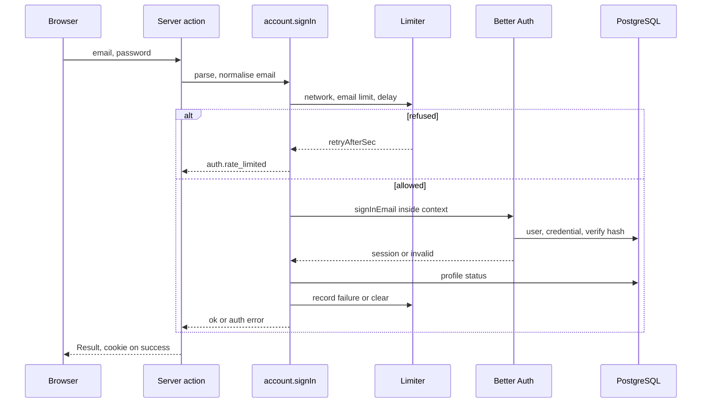
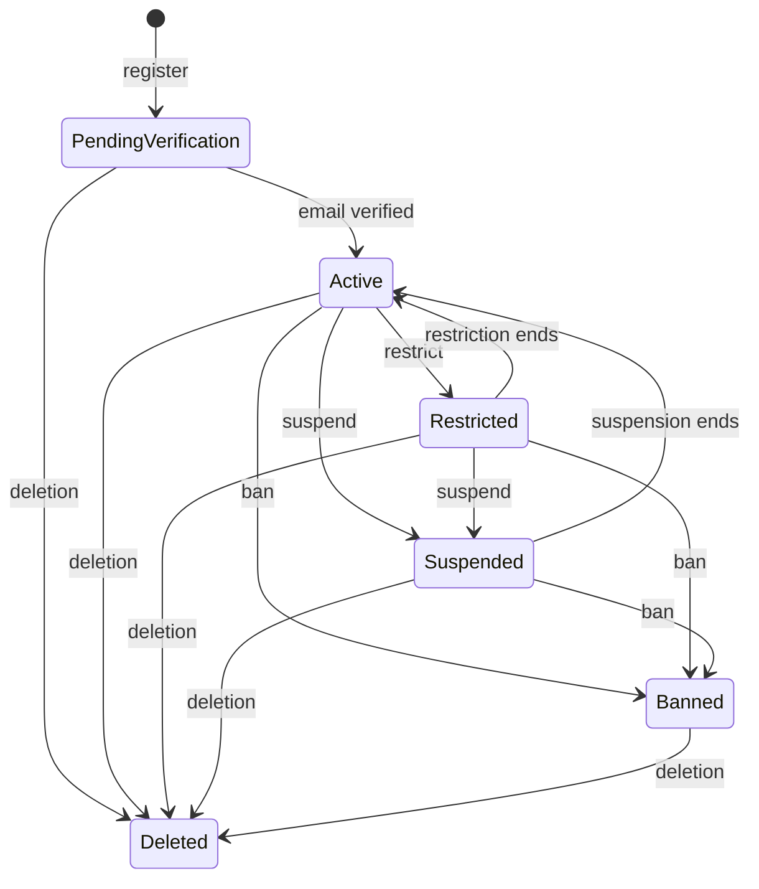
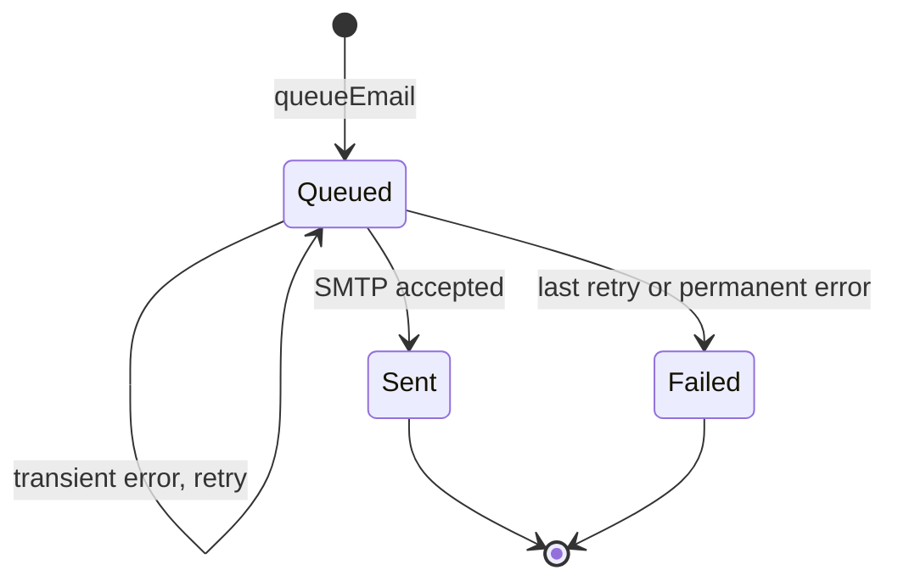
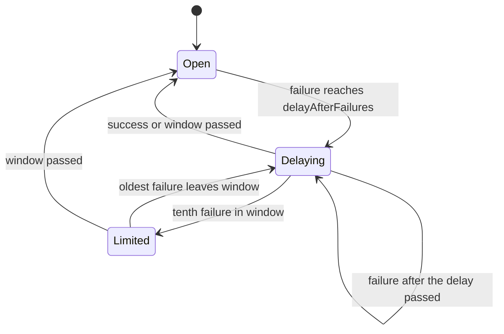
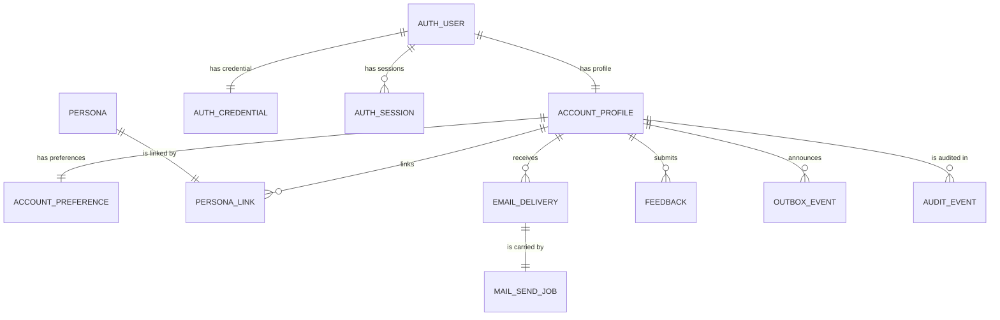

# Functional specification — U8 `t-101-better-auth-adapter`

Draft written ahead of the stage. The lead finalises it when the workflow reaches this Unit; then it moves to `<record>/construction/t-101-better-auth-adapter/functional-design/`.

Unit U8 (kind `library`, size XL, **high risk**: authentication, identity, sessions) delivers T-101 for US3.1 and US3.2. Lead perspective: architect. Support perspectives written into this file: developer (library mechanics, transactions, timing, test approach: §§ 10–11) and security engineer (threat cases, session handling, enumeration resistance, rate limits: § 12), synthesised in § 13.

Inputs: listed in `functional-design-questions.md` (Context). This file is the source of truth for the workflows and state transitions. The data shape is in `entities.md`; the decision logic is in `rules.md`. The answers to Questions 1–11 (all A) were decided on the owner's standing instruction of 2026-10-27 and await the owner's confirmation.

## 1. What changes, in one paragraph

Better Auth 1.7.x is wired behind the application boundary: the commands in `packages/application/src/modules/account/` own every flow (register, verify, resend, sign-in, sign-out, sign out everywhere, reset request, reset, change password, session list, preferences, feedback) and call the library's server API inside a request-scoped command context; the `/api/auth/*` route answers only an allowlist (Q1). Registration creates the library credential, then the profile, preferences, two personas, audit row, `account.registered` and the verification email in one application transaction, with the same success shape and cost for an email that already exists. Unconfirmed accounts sign in but cannot contribute (Q2). Sign-in applies the network limit, the per-email limit and the FD-063 progressive delay as refusals before any database read or password check, and a real account that reaches the severe threshold gets one security email and one `account.securityEvent` per window, written after the response (Q9). Sessions last 30 days from creation, absolutely, and store no IP (Q5). Every email is queued by the first version of C2's `notification.queueEmail` on the caller's transaction (Q3), with the recipient encrypted; the worker's new `mail.send` handler decrypts it, renders it from `packages/i18n`, sends it through SMTP and clears the link. The relay no longer routes any account event to `mail.send`. `ConfigValues` gains the `signIn` block, and the web composition root gets a defaults-only `ConfigProvider`. The application layer's foundations (`defineCommand`, the ports, the `Crypto` adapter, the account state table) are created because no earlier Unit built them.

## 2. As is (baseline on `main`, 2026-10-28)

- **Application layer: empty.** `packages/application/src/index.ts` is `// Filled by T-101`; there is no `defineCommand`, no port interface and no module. `packages/adapters/src/index.ts` and `packages/domain` are empty too. `test-support` already has fakes shaped like the 03 §3 ports (`FakeCrypto` with AES-256-GCM `iv | tag | ciphertext`, `FastHasher`, `RecordingMailer`, `AlwaysAllowRateLimiter`, `StaticConfigProvider`, `FakeClock`, `MemoryJobQueue`).
- **Auth schema.** `schema/auth.ts` has the four tables with the right columns for 1.7.3 (no `account.issuer`), but its comment block gives a `modelName`/`fields` mapping that makes the adapter throw (ISS-112, S2), and three library indexes are missing (ISS-113). `account_profiles`, `account_preferences`, `personas`, `persona_links`, `feedback` and `email_deliveries` exist; `email_deliveries` has no `dedupe_key`.
- **Repository.** `PgAccountRepository` is stubs that throw `NotImplemented`, which still embeds caller arguments in its message (ISS-111 item 1). `PgAuditWriter` and `PgOutbox.append(tx, …)` are real.
- **Queue.** `PgBossQueue.enqueue(name, payload, {key, executor})` runs on the caller's transaction when given an executor and then does not create the queue (the caller ensures it first, ISS-253). `mail.send` is declared `exclusive`, 5 retries with backoff; a send without a key counts as the empty key.
- **Worker.** One job, `outbox.relay`. Its `RELAY` map still routes `account.registered → mail.send` and `account.securityEvent → notification.deliver, mail.send`. `env.ts` has no `APP_ENCRYPTION_KEY`. The logger redacts keys matching `email|token|body|filename|password`. `rk_worker` cannot read `auth_users` (CR-006, `0007`).
- **Contracts.** `actor.ts` (anonymous | account), `errors.ts` (no `auth.password_equals_email`), `config-values.ts` (strict, no `signIn` block), `schemas/account.ts` (no password maximum, no display-name maximum).
- **Web.** No `server/auth.ts`, no `server/container.ts`, no `/api/auth` route; `/api/health` reports every probe as `unknown`.
- **i18n.** `email.verify`, `email.reset`, `email.existing`, `email.security.passwordChanged` and every `errors.auth.*` key exist in both files; `email.security.severeSignInActivity` does not.

## 3. Settled before this stage

FD-056, FD-057, FD-058, FD-059, FD-063, FD-071, FD-072, the C5 and C15 amendments, review R-14, FD-041 and FD-092 (worker grants), and the CR-011 queue rules. See `functional-design-questions.md` § "Settled before this stage".

## 4. Workflows

Every command runs `parse → authorize → load → decide → persist` with its audit and outbox rows in one transaction (01-conventions §3), inside a `CommandContext` (§ 10.1). "Library" means the Better Auth server API, called only from inside a command.

### WF0 — Code Generation order (the Unit end to end)

1. **Baseline.** `pnpm infra:up`; `pnpm check` and `pnpm smoke` green on the Bolt branch; read the open rows of § 2 and `functional-design-questions.md` Context; record the counts.
2. **Dependency check (BR7.8).** Better Auth, nodemailer, `@node-rs/argon2`: current stable, advisories, Next 16.3.4 peers; append the entry.
3. **Spike, time-boxed 45 minutes (T-101 step 1).** Install, build, one `signUpEmail` from a script. Confirm on the pinned version the capabilities in § 16 (allowlisted route, `disabledPaths`, callbacks with `token`, before-hooks returning `false`, IP tracking switch, adapter transactions). Record the results in the hand-off.
4. **Contracts first.** 03 §2 gains `auth.password_equals_email`, then `errors.ts`; `config-values.ts` gains `signIn`; `schemas/account.ts` gains the password and display-name maximums; `actor.ts` gains `refusal?`.
5. **Domain and application foundations.** `domain/account/account-state.ts`, the sign-in delay policy, `defineCommand`, command context, ports.
6. **Adapters.** `password-argon2` (+ bench), `crypto`, `rate-limit-memory`, `mail-smtp`.
7. **Database.** Migration (three auth indexes, `email_deliveries.dedupe_key`), `PgAccountRepository`, `RecipientDirectory` data access, schema test.
8. **Commands and queries** (WF1–WF11), `queueEmail` (WF12).
9. **Web.** `server/auth.ts` (instance, hooks, `getActor`), `server/container.ts`, `/api/auth/[...all]` allowlist route, `server/actions/account.ts`, the health route's `db` probe.
10. **Worker.** `env.ts`, container, `handlers/mail-send.ts`, registry entry, relay map change.
11. **i18n.** The new keys in both files (Bengali flagged).
12. **Tests (§ 11)**, `pnpm check`, `pnpm smoke`, `pnpm test:int`.
13. **Records.** Reference-document corrections (BR10.2), `ISSUES.md` (BR10.3), hand-off with the Argon2 median, the timing floors and the spike results.

### WF1 — Register (`account.register`)

1. Network rate check, 5 per hour (BR1.2). Over → `auth.rate_limited`.
2. Parse and validate the whole input (BR1.1). Normalise the email.
3. Username check against `account_profiles` (case-insensitive), whatever the email (BR1.3). Taken → `auth.username_taken`.
4. Look up the normalised email through the account repository.
5. **Existing email** (BR1.4): hash the submitted password once and discard it (cost parity, BR1.6); if a non-deleted profile exists, one transaction: `queueEmail(email.existing, {link: APP_URL/<locale>/sign-in})`, `account.securityEvent {kind: existingEmailRegister}`, audit `existing_email_register`. Result `ok({accountId: newId()})`, never persisted.
6. **New email** (BR1.5): inside the register context, the library creates the user and credential (hash through the port, no session, no library email; `user.create.before` allows it because the context is `account.register`). Then one transaction: profile, preferences, two personas and links, audit `registered`, outbox `account.registered {accountId}`, and the verification email (WF2 step 1 for the token, `queueEmail(email.verify)`). If the transaction fails: delete the library user, log `auth.register_rolled_back`, return `internal`.
7. Wait until the register floor has passed (BR1.6). Return `ok({accountId})`.

### WF2 — Verification email and confirmation

1. **Token** (inside a command): the command asks the library to issue a verification token for the user; the library calls `sendVerificationEmail({user, url, token})`; the callback hands `token` to the running command (BR7.9) and returns. The command builds `APP_URL/<locale>/verify-email?token=<token>` and queues `email.verify` on its own transaction (BR2.1, BR6.1).
2. **Confirm** (`account.verifyEmail {token}`, from the verify page): the library verifies the token. Expired → `auth.token_expired`; invalid or used → `auth.token_invalid` (BR2.3).
3. Load the profile. Pending → one transaction: status `active`, audit `email_verified`; then create a session (sign-in after verification) and set the cookie. Active or restricted → no change, `ok`. Suspended, banned or deleted → no change, no session, `auth.token_invalid` (BR2.2).

### WF3 — Resend verification (`account.resendVerification {email}`)

1. Email-key rate check, 3 per hour, for every address (BR2.4).
2. Look up the address. Pending profile → WF2 step 1. Anything else (unknown, active, deleted) → nothing.
3. Wait until the resend floor has passed; return `ok({})`.

### WF4 — Sign in (`account.signIn {email, password}`)



Text fallback: the browser posts to the server action; the command normalises the email and asks the limiter; a refusal returns `auth.rate_limited` with no database read and no password check; otherwise the library checks the credential (one Argon2 verify, a dummy one for an unknown email) and the command reads the profile status, records a failure or clears the counter, and returns the result; only a success sets the cookie.

1. Normalise the email; compute the email key and the network key (BR3.1, BR4.9, BR3.12).
2. Read `signIn` from `ConfigProvider` (BR3.4).
3. Refusals, in order, before any read (BR3.2): network 30 failures / 15 min; email 10 failures / 15 min; progressive delay (BR3.3). Each → `auth.rate_limited {retryAfterSec}`; nothing recorded.
4. Credential check through the library inside the sign-in context. The `session.create.before` hook refuses a session for a suspended, banned or deleted profile.
5. Decide:
   - unknown email, wrong password, deleted account → record a failure on both keys, `auth.invalid_credentials` (BR3.5, BR3.7); if the email key's count now equals `severeFailures` → schedule WF5 after the response (BR3.9);
   - suspended or banned with the right password → revoke any session the library returned, `auth.account_suspended`, no failure (BR3.6);
   - pending, active or restricted with the right password → clear the email key, set the cookie, `ok({})` (BR3.8).
6. No challenge field in any result (BR3.10); every refusal has the same shape (BR3.11).

Delay policy (illustrative; the pure function in `modules/account/sign-in-delay.ts`):

```ts
interface SignInSettings { delayAfterFailures: number; windowMinutes: number; firstDelaySeconds: number; maxDelaySeconds: number }

export function signInRefusal(failures: Date[], now: Date, s: SignInSettings): number | null {
  const recent = failures.filter((t) => now.getTime() - t.getTime() < s.windowMinutes * 60_000);
  const n = recent.length;
  if (n < s.delayAfterFailures) return null;
  const delay = Math.min(s.firstDelaySeconds * 2 ** (n - s.delayAfterFailures), s.maxDelaySeconds);
  const last = Math.max(...recent.map((t) => t.getTime()));
  const waitMs = last + delay * 1000 - now.getTime();
  return waitMs > 0 ? Math.max(1, Math.ceil(waitMs / 1000)) : null;
}
```

With the defaults, after failures 3, 4, 5, 6, 7, 8, 9 the next early attempt is refused with 1, 2, 4, 8, 16, 30, 30 seconds (the FD-063 row).

### WF5 — Severe-activity notice (after the response, Q9)

1. Runs through the `AfterResponse` port with the email key's account lookup result.
2. No account for the address, or a deleted one → stop (nothing written).
3. An `email_deliveries` row with message key `email.security.severeSignInActivity` for this account newer than `windowMinutes` → stop (once per window).
4. One transaction: `queueEmail(security, email.security.severeSignInActivity, {link: APP_URL/<locale>/reset-password})`, outbox `account.securityEvent {accountId, kind: severeSignInActivity}`, audit `severe_sign_in_activity {failures}`.
5. Failure → log `auth.severe_notice_failed {accountId}`; nothing is retried (the next window can send again).

### WF6 — Sign out and sign out everywhere

- `account.signOut` (authenticated): revoke the current session, audit `signed_out`, clear the cookie; the staff device cookie stays (BR4.5).
- `account.signOutEverywhere` (authenticated, no step-up, Q10): revoke every session, audit `signed_out_everywhere {revoked}`, outbox `account.securityEvent {kind: signOutAll}`, clear the cookie (BR4.6).

### WF7 — Request a reset (`account.requestPasswordReset {email}`)

1. Email-key rate check, 3 per hour, every address alike (BR5.1).
2. Non-deleted profile for the address → the library issues a reset token (1 h) and calls `sendResetPassword({user, url, token})`; the callback hands the token to the command; the command queues `email.reset` with `{link: APP_URL/<locale>/reset-password?token=<token>}`.
3. Wait until the reset floor has passed; return `ok({})`.

### WF8 — Reset (`account.resetPassword {token, newPassword}`)

1. Validate the new password (BR1.1 password rules; "equals email" against the token's account, checked after the token resolves).
2. The library consumes the token and rotates the password, revoking sessions. Expired → `auth.token_expired`; invalid or used → `auth.token_invalid` (BR2.3).
3. One transaction (retried up to 3 times, Q4): revoke any remaining session, audit `password_reset`, outbox `account.securityEvent {kind: passwordChanged}`, `queueEmail(email.security.passwordChanged)`; a pending profile also becomes `active` with email verified and audit `email_verified {via: reset}` (BR5.4).
4. Return `ok({})`; the page sends the holder to `/sign-in` with `auth.reset.done`.

### WF9 — Change password (`account.changePassword {currentPassword, newPassword}`)

1. Account rate check, 5 failures per 15 minutes on `action:account:<id>` (BR5.3).
2. Verify the current password through the port. Wrong → record a failure, `auth.invalid_credentials`.
3. Validate the new password (BR1.1).
4. The library changes the password and revokes the other sessions; then one transaction: audit `password_changed`, outbox `passwordChanged`, `queueEmail(email.security.passwordChanged)`.

### WF10 — Session list (`account.listSessions`)

Authenticated. Read the account's sessions; drop expired ones and those past the 30-day cap; map each to `{id, current, label, firstSeen, lastSeen}` (BR4.7).

### WF11 — `getActor()` (every request)

1. `cache()` per request. Read the session through the library with the request headers (BR4.4).
2. No session → anonymous. Session older than 30 days from `created_at` → revoke it, anonymous (BR4.1).
3. Load the profile by `auth_user_id` and the named persona; map the status (BR4.3); resolve capabilities through the stub; set locale and correlation id.

### WF12 — `queueEmail(tx, input)` (web tier, C2 first version)

1. Precondition: the caller ensured the `mail.send` queue before opening `tx` (container start-up and before each command transaction that may queue mail).
2. `RecipientDirectory.contactFor(tx, accountId)`: read the address through the account repository, encrypt it with `Crypto`, read `interface_locale` and the preferences. Null (deleted) → return `ok({suppressed: true})`, write nothing.
3. Check the params allowlist for the message key (BR6.2).
4. `dedupeKey` already present → return the existing delivery id, write nothing.
5. Insert the `EmailDelivery` (queued) and enqueue `mail.send {deliveryId}` with key `mail.send:<deliveryId>` on `tx` (BR6.1). `deduplicated` from the queue is impossible with a fresh key; `job_not_enqueued` → `err('internal')`, so the caller's transaction rolls back.

### WF13 — `mail.send` (worker)

1. Parse `{deliveryId}`; unknown payload shape → log `mail.payload_invalid`, finish (no retry).
2. Load the row. Missing or not `queued` → finish without sending (idempotent).
3. Decrypt `to_email_enc`. Failure → `failed`, `decrypt_failed`, params cleared, no retry.
4. Render `<message_key>.subject` and `.body` from the i18n messages in `row.locale`, replacing `{link}`; missing key → `failed`, `template_missing`; params outside the allowlist → `failed`, `params_invalid`.
5. Send through `MailTransport` (nodemailer, `SMTP_HOST:SMTP_PORT`, 30 s timeout, `MAIL_FROM`).
6. Success → `sent`, `sent_at`, `attempts + 1`, params cleared (BR6.8). Error → `attempts + 1`, `last_error_code`; if `attempts < 6` rethrow for pg-boss's retry, else `failed` with params cleared.
7. Log `mail.sent` or `mail.failed` with `deliveryId`, `messageKey`, `status`, `errorCode` only.

### WF14 — Preferences and feedback

- `account.updatePreferences` (authenticated, pending allowed): partial update; audit `preferences_updated {fields}` (BR11.1).
- `account.submitFeedback {body}` (authenticated): 5 per day per account; insert `{body, locale}`; audit `feedback_submitted` (no body) (BR11.2).

## 5. State transitions

### 5.1 Account status (`domain/account/account-state.ts`)

The full table follows 02 §17; T-101 performs only the first row and reads the others.

| From | Event | To | Performed by | Rule |
|---|---|---|---|---|
| (none) | register, new email | pending_verification | U8 | BR1.5 |
| pending_verification | email verified (link, or a completed reset) | active | U8 | BR2.2, BR5.4 |
| active | enforcement restrict | restricted | U33 | — |
| restricted | enforcement ends | active | U33 | — |
| active, restricted | enforcement suspend | suspended | U33 | — |
| suspended | enforcement ends | active | U33 | — |
| any but deleted | enforcement ban | banned | U33 | — |
| any | deletion plan completes | deleted | U39 | — |



Text fallback: registration creates a pending account; confirming the email (by link or by a completed reset) makes it active. Moderation moves active accounts to restricted, suspended or banned and back when an enforcement ends; a completed deletion plan makes any account deleted. What each status allows: pending signs in and edits settings, never contributes; active does everything; restricted signs in, commands check `notRestricted`; suspended and banned get no session; deleted is treated as unknown.

### 5.2 Email delivery (`email_deliveries.status`)

| From | Event | To | Rule |
|---|---|---|---|
| (none) | queueEmail | queued | BR6.1 |
| queued | SMTP accepted | sent (params cleared) | BR6.3, BR6.8 |
| queued | transient error, attempts < 6 | queued (attempts + 1, retried) | BR6.3 |
| queued | transient error, attempts = 6 | failed (params cleared) | BR6.3, BR6.8 |
| queued | decrypt, template or params error | failed (params cleared) | BR6.3 |

`suppressed` is never written by U8 (U34 adds the send-time preference check).



Text fallback: a delivery starts queued, stays queued while retries remain, and ends sent or failed; both final states clear the link.

### 5.3 Sign-in email key (per normalised address, in memory)

| State | Condition (failures in window = n) | Next attempt |
|---|---|---|
| open | n < delayAfterFailures | checked normally |
| delaying | delayAfterFailures ≤ n < 10, delay not passed | refused with `retryAfterSec` |
| delaying, delay passed | same, delay passed | checked normally |
| limited | n ≥ 10 | refused until the oldest counted failure leaves the window |
| (any) | a successful sign-in | back to open |
| (any) | every failure older than windowMinutes | back to open |



Text fallback: an address is open until its third failure in the window; then each further attempt waits for the growing delay; at ten failures it is limited until old failures leave the window; a success or an empty window opens it again. The severe notice fires on the transition into the tenth failure for real accounts only.

### 5.4 Session

| From | Event | To | Rule |
|---|---|---|---|
| (none) | sign-in or verify for an allowed status | live | BR3.8, BR2.2 |
| live | sign-out, sign out everywhere, reset, change password (other sessions) | revoked | BR4.5, BR4.6, BR5.2, BR5.3 |
| live | created_at + 30 days reached | revoked on next request | BR4.1 |
| live | profile becomes suspended, banned or deleted | refused on next request (anonymous Actor) | BR4.8 |

### 5.5 Reset token

`issued` (1 h) → `used` (row deleted, password rotated) or `expired`. A used or expired token is refused and changes nothing (BR2.3).

## 6. Interfaces

### 6.1 Commands and queries (all in `modules/account`)

| Name | Input | Requires | Limit (RateLimiter port) | Audit (`account:<id>`) | Outbox | Expected errors |
|---|---|---|---|---|---|---|
| `account.register` | `RegisterInput` | anonymous | 5 / h / network | `registered` or `existing_email_register` | `account.registered` or `securityEvent existingEmailRegister` | `auth.password_too_short`, `auth.password_equals_email`, `auth.username_invalid`, `auth.username_taken`, `auth.age_required`, `auth.terms_required`, `auth.rate_limited`, `validation` |
| `account.verifyEmail` | `VerifyEmailInput` | anonymous | — | `email_verified` | — | `auth.token_invalid`, `auth.token_expired` |
| `account.resendVerification` | `ResendVerificationInput` | anonymous | 3 / h / email | — | — | `auth.rate_limited` |
| `account.signIn` | `SignInInput {email, password}` (new, `.strict()`) | anonymous | 30 failures / 15 min / network, 10 / 15 min / email, delay | `severe_sign_in_activity` (WF5 only) | `securityEvent severeSignInActivity` (WF5 only) | `auth.invalid_credentials`, `auth.account_suspended`, `auth.rate_limited` |
| `account.signOut` | `SignOutInput` | authenticated | — | `signed_out` | — | — |
| `account.signOutEverywhere` | `SignOutEverywhereInput` | authenticated | — | `signed_out_everywhere` | `securityEvent signOutAll` | — |
| `account.requestPasswordReset` | `RequestPasswordResetInput` | anonymous | 3 / h / email | — | — | `auth.rate_limited` |
| `account.resetPassword` | `ResetPasswordInput` | anonymous | — | `password_reset` (+ `email_verified`) | `securityEvent passwordChanged` | `auth.token_invalid`, `auth.token_expired`, `auth.password_too_short`, `auth.password_equals_email`, `validation` |
| `account.changePassword` | `ChangePasswordInput` | authenticated | 5 failures / 15 min / account | `password_changed` | `securityEvent passwordChanged` | `auth.invalid_credentials`, `auth.rate_limited`, password codes |
| `account.listSessions` (query) | `ListSessionsInput` | authenticated | — | — | — | — |
| `account.updatePreferences` | `UpdatePreferencesInput` | authenticated | — | `preferences_updated` | — | — |
| `account.submitFeedback` | `SubmitFeedbackInput` (body max 2000) | authenticated | 5 / day / account | `feedback_submitted` | — | `rate_limited` |

`validation`, `forbidden` and `internal` apply to every command (C-rules). `account.stepUp` and the `staff.*` commands are U10's.

### 6.2 Ports created or used

| Port | Methods (T-101's shape) | Real adapter | Test fake |
|---|---|---|---|
| `PasswordHasher` | `hash(pw)`, `verify(pw, phc)` (NFC applied by the caller) | `adapters/password-argon2` | `FastHasher` |
| `RateLimiter` | `hit(key, limit, windowSec) → {allowed, retryAfter?}`; `failures(key, windowSec) → Date[]`; `recordFailure(key)`; `clear(key)` | `adapters/rate-limit-memory` (Clock-driven) | a windowed fake added to `test-support` (owned-path addition), `AlwaysAllowRateLimiter` kept |
| `ConfigProvider` | `current() → ConfigValues` | defaults-only provider in `container.ts` (T-105 replaces) | `StaticConfigProvider` |
| `Crypto` | `encrypt`, `decrypt`, `hash`, `randomToken`, plus `hmac(key, bytes)` for counter keys | `adapters/crypto` | `FakeCrypto` (gains `hmac`) |
| `Clock`, `IdGenerator` | `now()`; `newId()`, `newPublicId()` | system clock, `contracts/ids` | `FakeClock`, deterministic ids |
| `JobQueue` | `ensure(name)`, `enqueue(tx, name, payload, {key}) → Result<'enqueued' \| 'deduplicated'>` | `database/queue` | `MemoryJobQueue` |
| `Outbox`, `AuditWriter` | `append(tx, name, payload)`; `write(tx, event)` | `database` | list fakes |
| `MailTransport` | `send({to, subject, text}) → Result<{messageId}>` | `adapters/mail-smtp` (worker only) | `RecordingMailer` adapted |
| `AfterResponse` | `run(task)` | Next `after()` | runs at once and records |
| `AccountRepository` | profile, preferences, personas, credential read, session list, recipient read | `database/repositories/account.ts` | `test-support` fake |
| `RecipientDirectory` (C2) | `contactFor(tx, accountId)` | `modules/account` over the repository | — |

### 6.3 Server actions (`apps/web/src/server/actions/account.ts`)

One exported async function per command, each `parse → getActor → command → Result`, no rendering (T-102 consumes them). Sign-in, verify and reset set or clear the session cookie from the headers the library returns.

## 7. Library configuration (target values)

| Option | Value | Rule |
|---|---|---|
| database | Drizzle adapter, schema aliased under the model names, no `fields` block | BR7.3 |
| `emailAndPassword` | enabled, `requireEmailVerification: false`, `autoSignIn: false`, `minPasswordLength: 10`, `maxPasswordLength: 256`, `resetPasswordTokenExpiresIn: 3600`, `revokeSessionsOnPasswordReset: true`, `password.hash/verify` → port, `sendResetPassword` → hand token to the command | BR1.8, BR2.6, BR5.2, Q2 |
| `emailVerification` | `expiresIn: 86400`, `sendOnSignUp: false`, `sendOnSignIn: false`, `autoSignInAfterVerification: false` (the command signs in after its own status check), `sendVerificationEmail` → hand token to the command | BR2.1, BR2.2, BR2.6 |
| `session` | `expiresIn: 30 days`, `updateAge: 24 h`, cookie cache off | BR4.1 |
| `advanced` | cookies HttpOnly, SameSite Lax, Secure iff https; IP tracking off | BR4.2, BR4.9 |
| `trustedOrigins` | `[APP_URL]` | BR4.2 |
| `rateLimit` | enabled in every mode, memory, rules no stricter than the port | BR7.5 |
| `disabledPaths` | every path the commands own (BR7.1) | BR7.1 |
| `databaseHooks` | `user.create.before`: only in `account.register`; `session.create.before`: refuse suspended, banned, deleted | BR1.7, BR3.6 |
| `plugins` | none | BR7.7 |
| `secret` | `BETTER_AUTH_SECRET`, ≥ 32 characters, checked at start | BR7.2 |

## 8. Email catalogue

| Message key | Category | Trigger | `{link}` target | New copy |
|---|---|---|---|---|
| `email.verify` | verification | register (new), resend | `/<locale>/verify-email?token=` (24 h) | no |
| `email.existing` | security | register (existing) | `/<locale>/sign-in` | no |
| `email.reset` | reset | reset request | `/<locale>/reset-password?token=` (1 h) | no |
| `email.security.passwordChanged` | security | reset, change password | `/<locale>/reset-password` | no |
| `email.security.severeSignInActivity` | security | WF5 | `/<locale>/reset-password` | **yes** |

Proposed copy for the new key (Bengali flagged for the owner's review, like FD-042):

| Key | en | bn |
|---|---|---|
| `email.security.severeSignInActivity.subject` | Many failed sign-in attempts on your RogiKotha account | আপনার রোগীকথা অ্যাকাউন্টে অনেকবার ব্যর্থ সাইন-ইন চেষ্টা |
| `email.security.severeSignInActivity.body` | We noticed many failed attempts to sign in to your account. If this was not you, you can reset your password here: {link}. No action is needed if it was you. | আপনার অ্যাকাউন্টে সাইন ইন করার অনেকগুলো ব্যর্থ চেষ্টা দেখা গেছে। আপনি না হলে এখানে পাসওয়ার্ড রিসেট করতে পারেন: {link}। আপনি হলে কিছু করার দরকার নেই। |

The in-app notice key `notif.security.severeSignInActivity` is U34's (C5).

## 9. Raised for the owner, not decided

- **R1 — Worker key scope (data boundary, needs an FD entry).** FD-071 gives the worker `APP_ENCRYPTION_KEY`. That key encrypts every `*_enc` column; `rk_worker` can read `reviews.exact_date_enc` (ISS-240) and `evidence_items.original_filename_enc` (ISS-139), so with the key it could decrypt the private treatment date and original file names. A dedicated mail-recipient key used only for `to_email_enc` (the web encrypts with it, the worker holds only it) closes that, at the cost of one more secret. The design follows FD-071 as written; `Crypto` is built with a key parameter so the change is a wiring change. Suggested: decide before U8's Code Generation wires the worker env.
- **R2 — FR90's feedback fields have no builder** (Question 11): admin-configured category list, optional screenshot with the sensitive-data warning, contact permission. Suggested: an FD entry deciding whether they are built in this intent (and by T-409 with T-105 and an upload path) or deferred.

### Findings (proposed ISS rows, each `Found in U8 T-101`)

| Id | Sev | Finding | Owner (suggested) |
|---|---|---|---|
| F1 | S2 | R1 above: the worker's `APP_ENCRYPTION_KEY` also decrypts `reviews.exact_date_enc` and `evidence_items.original_filename_enc`, which `rk_worker` can read | founder (FD entry) |
| F2 | S2 | R2 above: AC10.3.6 / FR90 feedback fields have no builder | founder |
| F3 | S3 | `severeFailures` may be set up to 100 (C1), but the fixed per-email limit stops attempts at 10 failures, so values above 10 never fire (Q8) | U12 T-105, C1 |
| F4 | S3 | `errors.auth.rateLimited` says "{minutes} minutes"; the progressive delay is 1–30 seconds, so the copy misleads for short waits | U9 T-102 (render seconds, copy in the `auth.*` namespace) |
| F5 | S3 | `auth-screens-spec.md` §3.6 shows the email address on `/me/security`, while 03 §2 forbids emails in view models | U9 T-102 (owner decides) |
| F6 | S3 | A reset or verification link sits in `email_deliveries.params`, readable by `rk_worker`, from queueing until the delivery is final; BR6.8 clears it then | U34 T-405 keeps BR6.8 |
| F7 | S4 | T-101's owned paths omit files this design must change (§ 15) | U8 T-101 |
| F8 | S4 | Task step 4's `requireEmailVerification: true` contradicts FR4 and AC3.1.4 (Q2) | U8 T-101 |
| F9 | S4 | C14's "the progressive delay answers 429" no longer applies: the library sign-in endpoint is closed and the delay is an `AppError` (Q1) | Contract Design note |
| F10 | S4 | C5's `actor_shape` line differs from `actor.ts` (Q6) | Contract Design note |
| F11 | S4 | 02 §1 calls sessions "rolling"; AC3.2.4 needs an absolute 30 days | U8 T-101 (02 §1 corrected) |
| F12 | S4 | 01-conventions §11's worker environment list omits `APP_ENCRYPTION_KEY`, which FD-071 requires | U8 T-101 (§11 corrected) |
| F13 | S4 | Spec §3.6 asks for a password before Sign out everywhere; T-101 adds no step-up (Q10) | U9 T-102, U10 T-103 |
| F14 | S4 | `ASSUMPTION(T-101)`: counters and limits are per process and lost on restart | U41 T-502 |
| F15 | S4 | `ASSUMPTION(T-101)`: the client address comes from `x-forwarded-for` outside production; the production proxy trust rule is not set | U41 T-502 |
| F16 | S4 | `mail.send` is at-least-once: a crash after SMTP accepted and before the status update sends the email again | U34 T-405 (informational) |
| F17 | S4 | Dependency re-check due: Better Auth entry 48 days old, `@node-rs/argon2` 45 days, nodemailer none | U8 T-101 (Code Generation) |
| F18 | S4 | `ASSUMPTION(T-101)`: the register, resend and reset timing floors are measured constants | U8 T-101 |

## 10. Developer view — mechanics

### 10.1 Command context and transactions

- `defineCommand({name, input, requires, handle})` runs parse, authorize (`modules/account/authorization.ts`), then `handle` inside `withTx` and inside an AsyncLocalStorage `CommandContext {command, tx}`. Library calls made inside `handle` run on their own connection (Q4); their callbacks find the context and hand back the token.
- The register compensation (WF1 step 6) deletes the library user through the account repository (`auth_users` cascade), never through a library HTTP path.
- `queueEmail` requires the caller's `tx` and the queue ensured beforehand: the web container calls `JobQueue.ensure('mail.send')` at start and `defineCommand` calls it (memoised) before opening a transaction for commands flagged `sendsMail`.

### 10.2 Timing floors

Floors for register, resend and reset request are measured in Code Generation (median of the slower branch over 20 runs on the dev machine, plus 20 %), kept as named constants with `ASSUMPTION(T-101)` and recorded in the hand-off. Sign-in needs no floor: the library performs one Argon2 verify for unknown and known emails (to confirm in the spike; if not, the command verifies against a dummy PHC for unknown emails), refusals touch nothing, and WF5 runs after the response.

### 10.3 Client address

One helper reads the address for a request. For the local demo it takes the first value of `x-forwarded-for` only when `APP_MODE` is not `production`, else the platform address; with none it uses the shared key `signin:net:unknown`. T-502 owns the production trust rule (proxy chain). Raw addresses are never stored or logged.

### 10.4 Migration

Next free number at Code Generation (after `0008`): three indexes (`auth_sessions(user_id)`, `auth_accounts(user_id)`, `auth_verifications(identifier)`) and `email_deliveries.dedupe_key text unique null`. Forward-only, generated as a drizzle custom migration so the journal timestamp is later than 0008 (the CR-006 lesson). `migrations.int.test.ts`'s exact count goes up by one, with a comment (ISS-242 precedent). No grant changes: `rk_worker` already holds DML on `email_deliveries`, which covers the new column.

### 10.5 Worker

`env.ts` adds `APP_ENCRYPTION_KEY` (BR6.5). `container.ts` wires `Crypto`, `MailTransport` and the handler. `registry.ts` gains `mail.send` (queue-driven, not an interval). `main.ts` already ensures each registered queue before `work()`; the relay no longer names `mail.send`, so it is ensured through the registry loop. The handler reads i18n messages as JSON (no next-intl).

### 10.6 Library fallback

If the Drizzle adapter or Next 16.3.4 peer resolution fails inside the spike box, switch to the library's built-in `pg` adapter on the same tables and record why (T-101 step 1). No `--legacy-peer-deps`.

## 11. Developer view — test design

Builders and synthetic addresses only (`shirin.demo@example.test`, `nobody.demo@example.test`); names read as sentences; each test can fail.

| Level | File | What it proves |
|---|---|---|
| domain | `packages/domain/src/account/account-state.test.ts` | every allowed and refused transition of § 5.1 |
| application | `modules/account/sign-in-delay.test.ts` | schedule 1, 2, 4, 8, 16, 30, 30; window expiry; cap; settings from `StaticConfigProvider` (threshold 5, cap 10 s) and defaults; same behaviour for an unknown address; severe at 10 writes one delivery and one event in one transaction, once per window; nothing for an unknown address (BR3.1–BR3.9) |
| application | `modules/account/*.test.ts` | each command's happy path, each refusal, one audit assertion each; register existing email returns the same shape and queues `email.existing`; username taken regardless of email; password 9 chars, equals email, 257 chars; age, terms; resend and reset neutral for unknown; change with a wrong current password; sign out everywhere; sixth feedback in a day |
| application | `modules/notification/internal/queue-email.test.ts` | delivery + job on one transaction; key per delivery; dedupe; deleted account suppressed; params allowlist |
| adapters | `password-argon2/*.test.ts`, `rate-limit-memory/*.test.ts`, `crypto/*.test.ts`, `mail-smtp/*.test.ts` | PHC format and parameters, verify true/false; window semantics, `retryAfter`, clear; round trip, tamper detected; timeout mapped to `smtp_timeout` |
| contracts | `config-values.test.ts`, `schemas.test.ts` | `signIn` defaults and ranges, the two cross-field refusals; password and display-name bounds |
| database | `repositories/account.int.test.ts` | each repository method; citext username conflict (`Shirin_88` vs `shirin_88`); the library's expected columns exist; the new migration applies from empty |
| web | `apps/web/src/server/auth.int.test.ts` | register → Mailpit → verify → sign-in → `getActor` → sign-out against compose; timing medians (register, delay real vs unknown, reset); cookie attributes; network limit (31st); allowlisted route returns 404 for library paths; session older than 30 days refused; suspended Actor; log capture finds no address, token, link or password |
| worker | `handlers/mail-send.test.ts` | status transitions with a failing transport; retries end in `failed` at 6; decrypt failure fails without sending; params cleared on final states; no resend of a `sent` row |
| worker | `handlers/mail-send.int.test.ts` | as `rk_worker` against compose and Mailpit, a queued row is delivered with no read of `auth_users` |
| worker | `handlers/outbox-relay.test.ts` (existing, extended) | no `account.*` event maps to `mail.send` |
| smoke | `*.smoke.test.ts` | register then verify gives an account Actor; `/api/auth/sign-up/email` answers 404 (BR9.2) |

Every T-101 acceptance row maps to one of these (§ 17).

## 12. Security view — threat cases and adversarial angles

### 12.1 Threat cases

| # | Threat | Defence | Rules |
|---|---|---|---|
| T1 | Enumeration through register, resend, reset, sign-in or their timing | same shape, equal work, floors, refusals before reads, username check independent of email, severe notice after the response | BR1.3, BR1.4, BR1.6, BR2.4, BR3.2, BR3.11, BR5.1 |
| T2 | Credential stuffing and brute force | network and per-email limits, progressive delay as refusal, severe notice, generic error, no lockout message | BR3.2–BR3.9 |
| T3 | Counter bypass with address variants | one key per normalised address (NFC, trim, lowercase) | BR3.1 |
| T4 | Bypassing the commands through library endpoints | route allowlist, `disabledPaths`, user-create and session-create hooks, callbacks only inside a command | BR7.1, BR1.7, BR3.6, BR7.9 |
| T5 | Token replay, expiry, reactivation | single-use reset tokens, expiry codes, verify never changes a suspended or deleted account | BR2.2, BR2.3, BR5.2 |
| T6 | Session survives a reset, a password change, a suspension or 30 days | revocation on reset and change, status read every request, absolute cap, no cookie cache | BR4.1, BR4.8, BR5.2, BR5.3 |
| T7 | Pre-registration of someone else's address | no contribution before confirmation; a reset proves the inbox, confirms it and revokes every session | BR2.5, BR5.2, BR5.4 |
| T8 | CSRF on auth actions | POST-only server actions with Next's origin check, `trustedOrigins`, SameSite Lax | BR4.2 |
| T9 | Private data in logs, payloads, audit, view models | allowlists, payload scan, params cleared after send, no IP stored | BR6.6, BR6.8, BR8.1–BR8.3, BR4.9 |
| T10 | Worker reaches plaintext addresses | no `auth_users` grant (FD-041), recipient only as ciphertext; key scope raised as R1 | BR6.3, BR6.5 |
| T11 | Hash-cost denial of service | 256-character cap, sign-up limit, refusals before hashing | BR1.1, BR1.2, BR3.2 |
| T12 | Secrets missing or defaulted | start-up checks, `.env.example` empty values | BR7.2, BR6.5 |

### 12.2 Adversarial angles for the separate agent (3–5 tests, defensive regression checks)

Each is written as a regression test that must stay green; it fails if the defence regresses.

1. **Enumeration oracle sweep.** For one existing, one pending, one suspended, one deleted and one unknown synthetic address, run register, resend, reset request and ten wrong sign-ins. Assert byte-identical result bodies apart from the correlation id and the random `accountId`, the same status, the same `retryAfterSec` sequence, and timing medians within 15 %. Include a register with a taken username for an existing and an unknown email: both must answer `auth.username_taken`.
2. **Limit and delay bypass.** Send the same address as upper case, with surrounding spaces and in NFD form: one counter. Send the correct password while a delay is pending: refused without a password check (no hasher call recorded). Rotate addresses from one network until the 31st failure: refused. Probe every library path under `/api/auth/` (sign-up, sign-in, request-password-reset, reset-password, verify-email, change-password, update-user, delete-user, revoke-sessions, list-sessions): each answers 404.
3. **Token and session abuse.** Reuse a reset token; use one after 1 h (FakeClock or database time); replay a verify token after the account was suspended (status unchanged, no session); keep an old session across reset, password change and sign out everywhere (refused); present a session older than 30 days that the library refreshed (refused); after suspension, the next request with the old cookie gives an anonymous Actor with `refusal`.
4. **Library policy bypass.** Call `auth.api.signUpEmail` directly outside `account.register`: no `auth_users` row. Trigger the library's email callbacks outside a command: no `email_deliveries` row. Ask the library for a session for a suspended account: none created.
5. **Private-data leak scan.** After the full cycle, scan `pgboss.job.data`, `outbox_events.payload`, `audit_events.details`, final `email_deliveries.params`, `auth_sessions.ip_address` and captured logs for the address, the password, any token and any IP: none found. Tamper with one `to_email_enc` byte: the delivery fails `decrypt_failed` and nothing is sent.

## 13. Synthesis — decisions and why

- **Commands own every flow; the library is an adapter (Q1, AD-4).** The policy that makes this Unit safe (limits, delay, timing, domain rows, audit) lives in one tested place; the catch-all route is reduced to an allowlist, which stays closed when an upgrade adds endpoints.
- **Unconfirmed accounts sign in (Q2).** FR4 and AC3.1.4 require settings before confirmation; the application gates contributions on `emailVerified`. The pre-registration risk is closed by a reset proving the inbox and revoking every session.
- **C2's `queueEmail` from the first version (Q3).** One queueing path with its contract signature and de-duplication, so U34 extends instead of replacing; the worker-side transport is a separate, narrow port.
- **Library first, then one application transaction (Q4).** Atomic where the application owns the rows; explicit compensation or retry where the library committed first; the spike may remove the gap.
- **No IP stored (Q5), Actor shape kept (Q6), equals-email error and length cap (Q7), C5 numbers kept with the range gap raised (Q8), severe notice after the response (Q9), no step-up for sign out everywhere (Q10), feedback body only with FR90 raised (Q11).** Each takes the narrower, reversible option that meets the acceptance rows.
- **Absolute 30-day sessions.** AC3.2.4 says "since it was created"; a rolling session would outlive it. The daily refresh is kept only for "last seen".
- **Username check before the email branch, refusals before reads, equal work plus floors.** Each closes a concrete enumeration channel the task's literal steps leave open.
- **Links cleared after send.** FD-071 puts live links in a table the worker can read; clearing them at the final status keeps them at rest only while they are needed.
- **Foundations built here.** `defineCommand`, ports, `Crypto`, the account state table: T-101 is the first command Unit, and later Units depend on these shapes.
- **What this design does not decide:** R1 (worker key scope) and R2 (FR90 fields), each a boundary or scope change without an FD entry.

## 14. If the owner changes an answer

- **Q1 → B:** library endpoints stay open with the policy in `hooks.before/after`; the allowlist route and the own-page links go; C14's 429 line stays; adversarial angle 2's 404 probes become hook tests.
- **Q2 → B:** `requireEmailVerification: true`; sign-in of a pending account returns `auth.email_unverified` (after the password check); BR2.5's settings part and BR5.4 go; FR4 and AC3.1.4 are recorded as partly unmet.
- **Q3 → B:** a web `Mailer` adapter writes the row; U34 later rewrites every caller. **→ C:** no `dedupe_key` column; the migration has the indexes only.
- **Q4 → B:** the repository writes credential rows in the command transaction; the compensation and retry code goes; a schema test pins the library's token formats.
- **Q5 → B:** IP tracking on; `SessionListItem` still omits the IP.
- **Q6 → B:** `actor.ts` takes C5's shape; `actor.test.ts` and later Units' expectations change.
- **Q7 → B:** no new error code; ISS-033 stays open.
- **Q8 → B:** the per-email fixed limit becomes `max(10, severeFailures)`; C5 is revised.
- **Q9 → B:** WF5 runs inside the request; the timing test for the 10th failure is relaxed to shape only.
- **Q10 → B:** `SignOutEverywhereInput` gains `password`; the command verifies it.
- **Q11 → B or C:** a migration adds the columns (and, for C, an upload path); U38 T-409's panel changes.

## 15. Owned paths and recorded additions

T-101's owned paths are as listed in its task file. These additions follow from this design and are recorded in the hand-off and one ISS row (BR10.1):

- `packages/application/src/{index.ts, command.ts, command-context.ts}`, `ports/*.ts` (beyond the three the task names), `authorization/capabilities.ts` (named in step 8), `audit/*` helpers, `modules/notification/internal/queue-email.ts` (C2).
- `packages/domain/src/account/account-state.ts` (02 §17).
- `packages/adapters/src/crypto/**`.
- `packages/contracts/src/errors.ts` (Q7) and `docs/implementation/03-routes-and-contracts.md` §2–§5 corrections.
- `packages/database/src/migrations/**` (the new migration), `migrations.int.test.ts` (count), `repositories/not-implemented.ts` (ISS-111 item 1).
- `apps/worker/src/{env.ts, container.ts, registry.ts, handlers/outbox-relay.ts, handlers/index.ts}` and their tests.
- `apps/web/src/app/api/health/route.ts` (`db` probe only).
- `packages/test-support/src/fakes/{rate-limiter.ts, crypto.ts, mailer.ts, repositories.ts, repositories-superset.test.ts}` (windowed limiter fake, `hmac`, transport fake, account repository fake, ISS-223).
- `docs/implementation/02-data-model.md` §1 and `01-conventions.md` §11 sentence corrections.

## 16. Risks to verify in Code Generation

- On the pinned 1.7.x: `disabledPaths` names; callbacks receive `token`; `user.create.before` and `session.create.before` returning `false` abort cleanly; IP tracking switch name; whether the Drizzle adapter can run on a caller's transaction (Q4); whether email-verification tokens are rows or signed tokens (affects replay, BR2.2 covers both); whether `signInEmail` verifies a dummy hash for unknown emails; whether `requestPasswordReset` and `sendVerificationEmail` can be called server-side for a given user without HTTP.
- The library's own rate limiter does not answer before the port (BR7.5).
- Next 16.3.4 `after()` runs in server actions in `next dev` and `next start` (Q9).
- The register, resend and reset floors keep the medians within 15 % on the dev machine; record the numbers.
- The Argon2 median (bench) and whether it exceeds 500 ms.
- The migration's journal timestamp is later than 0008's.
- No other Unit took the next migration number or touched `email_deliveries` meanwhile.

## 17. Acceptance mapping (T-101 acceptance checks)

| T-101 check | Where it is met |
|---|---|
| Build with Better Auth on Next 16.3.4 | WF0 step 3; BR7.8 |
| Register creates domain rows | WF1; BR1.5, BR1.10, BR1.8 |
| Verification mail | WF2, WF13; BR2.1, BR6.3, BR6.7 |
| Verify link | WF2; BR2.2 |
| Existing email | WF1 step 5; BR1.4 |
| Timing | § 10.2; BR1.6 |
| Reset | WF7, WF8; BR5.1, BR5.2 |
| Sessions 30 d, cookies | § 7; BR4.1, BR4.2 |
| Rate limit (31st from one network) | WF4 step 3; BR3.2 |
| Argon2 bench | BR7.6 |
| Suspended cannot act | WF11; BR4.3, BR4.8 |
| FD-071 recipient encrypted, payload has only the id | WF12; BR6.1, BR6.6 |
| FD-071 worker never reads `auth_users` | WF13; BR6.3 |
| FD-063 delay schedule, window expiry | WF4, § 5.3; BR3.3 |
| FD-058 no enumeration through the delay | BR3.1, BR3.11 |
| FD-063 settings through `ConfigProvider` | BR3.4, BR7.4 |
| FD-058 severe email and event, once per window, none for unknown | WF5; BR3.9 |
| FD-058 no CAPTCHA | BR3.10 |
| FD-059 every reset audited, reopened link refused | WF8; BR5.2, BR2.3 |
| FD-057 sign out everywhere, list without history | WF6, WF10; BR4.6, BR4.7 |
| FD-056 no automatic deletion | BR1.9 |
| FD-063 C5 settings block and ranges | BR7.4 |
| FD-063 refusal, not wait | BR3.2 |
| FD-063 deleted account refused | BR3.7 |
| FD-071/C15 no relay route to `mail.send` | BR6.4 |
| `pnpm check` | BR9.3 |

## Entity-relationship view (derived from `entities.md`)



Text fallback: each auth user has one profile, one credential and many sessions; each profile has one preference row, two persona links at registration (each to one persona), many email deliveries (each carried by one `mail.send` job), feedback rows, outbox events and audit rows. The in-memory counters and the value objects (`SignInSettings`, `Actor`, `SessionListItem`, `CommandContext`) are not persisted and have no table.

## Rules summary (derived from `rules.md`)

- **Registration (BR1.1–BR1.10):** full validation first; sign-up limit; username check independent of email; neutral existing-email branch; library credential then one app transaction; equal cost and floor; library creates users only in the command; NFC + Argon2id; no automatic deletion; two personas.
- **Verification (BR2.1–BR2.6):** 24 h own-page link; verify activates only pending accounts; token codes; neutral rate-limited resend; unconfirmed accounts edit settings, never contribute; the library sends no mail.
- **Sign-in (BR3.1–BR3.12):** one key per normalised address; network, email and delay refusals before any read; the delay formula; settings through the port; what counts as a failure; suspended only after the password; deleted as wrong password; pending signs in; one severe notice per account per window; no CAPTCHA; identical refusals; hashed in-memory keys.
- **Sessions and Actor (BR4.1–BR4.9):** absolute 30 days; cookies; status mapping per request; no cached session reads; sign-out; sign out everywhere; session list; no IP.
- **Reset and change (BR5.1–BR5.4):** neutral limited request; completed reset revokes, audits and emails; change needs the current password; a reset confirms a pending email.
- **Email (BR6.1–BR6.8):** `queueEmail` on the caller's transaction; one-link allowlist; worker handler; no account route to `mail.send`; worker key and start check; no address in payloads; bilingual content-free mail; links cleared after send.
- **Library and composition (BR7.1–BR7.10):** allowlisted HTTP; start-up secrets; model mapping and indexes; `signIn` config; library limiter as backup; hasher port and bench; no plugins; dependency re-check; callbacks only in a command; public reading untouched.
- **Privacy and boundaries (BR8.1–BR8.6), verification (BR9.1–BR9.5), records (BR10.1–BR10.4), settings and feedback (BR11.1–BR11.2).**

## Sources

- `docs/implementation/tasks/T-101-better-auth-adapter.md` (steps 1–12, acceptance checks, tests, threat notes, amendments FD-056..FD-059, FD-063, FD-071, FD-072, C5, C15, review R-14).
- `docs/status/decision-log.md` FD-013, FD-019, FD-041, FD-056..FD-059, FD-063, FD-070..FD-072, FD-076, FD-077, FD-092.
- `aidlc/spaces/default/intents/261011-aidlc-adoption/inception/contract-design/contract-summary.md` C1, C2, C5, C14, C15 and "Contract ownership rules".
- `aidlc/spaces/default/intents/261011-aidlc-adoption/inception/units-generation/unit-of-work.md` U8 and the open points; `unit-of-work-story-map.md`.
- `aidlc/spaces/default/intents/261011-aidlc-adoption/inception/requirements-analysis/requirements.md` FR1–FR9, NFR3, NFR10, NFR11; `inception/user-stories/stories.md` US3.1, US3.2, AC10.1.4, AC10.3.6; `inception/domain-design/components.md` Account.
- `docs/implementation/01-conventions.md` §1–§5, §10, §11; `02-data-model.md` §1–§3, §12, §16, §17; `03-routes-and-contracts.md` §1–§5; `docs/design/auth-screens-spec.md` §1, §3, §5.
- Code on `main` listed in § 2; `docs/implementation/ISSUES.md` rows in `functional-design-questions.md` Context; `docs/status/dependency-check-log.md` entries 2026-09-10, 2026-09-13, 2026-10-28.
- Better Auth documentation, read 2026-10-28: options reference (https://www.better-auth.com/docs/reference/options), database hooks (https://www.better-auth.com/docs/concepts/database), email and password (https://www.better-auth.com/docs/authentication/email-password).
