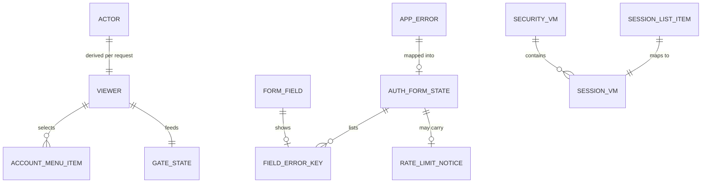

# Entities — U9 `t-102-patient-auth-screens`

Draft written ahead of the stage. The lead finalises it when the workflow reaches this Unit; then it moves to `<record>/construction/t-102-patient-auth-screens/functional-design/`.

Source of truth for the shapes this Unit works on. Built from T-102, `auth-screens-spec.md` §1–§3 and §5, `03-routes-and-contracts.md` §2 and §6 (`SecurityVM`), the code on `main` (`packages/contracts/src/{actor,errors}.ts`, `schemas/account.ts`, `view-models/security.ts`), the T-101 draft (the actions, `getActor`, `SessionListItem`) and the T-011 draft (the components this Unit renders inside). Workflows and state transitions are in `functional-spec.md`; decision logic is in `rules.md`; component props are in `frontend-components.md`.

This Unit stores nothing and adds no table, column or migration. Its entities are of four kinds:
- **value objects** that cross the server–client boundary (the viewer, the form state, view models);
- **one browser cookie** (the pending address);
- **client state** (password visibility, gate state, sign-out confirmation);
- **consumed** shapes owned by other Units (the `Actor` and `AppError` from contracts, T-101's session list item), listed so the boundary is explicit.

```yaml
entities:
  - id: ENT-001
    name: Viewer
    kind: value-object
    owner: "U9 (built in apps/web/src/app/[locale]/(patient)/layout.tsx from getActor())"
    description: "What the patient chrome needs to know about who is looking: enough for the account entry, the menu and the gate, nothing more."
    attributes:
      - { name: kind, type: enum, required: true, allowed: [anonymous, account] }
      - { name: displayName, type: string, required: false, constraints: "account only; the default persona's display name (public by design); 1-60 characters" }
      - { name: initials, type: string, required: false, constraints: "account only; 1-2 grapheme clusters (BR8.5)" }
      - { name: verified, type: boolean, required: false, constraints: "account only; actor.emailVerified" }
      - { name: staff, type: boolean, required: true, default: false, constraints: "true when actor.staffRole is set; shows the staff console item" }
      - { name: unreadCount, type: integer, required: false, min: 1, constraints: "absent until T-405 supplies it; never 0 (BR8.6)" }
    constraints:
      - "Never carries accountId, personaId, status, capabilities, stepUp or any email (BR8.7, 03 §2)"
      - "A suspended or banned session arrives as an anonymous Actor (T-101 BR4.3), so the viewer is anonymous"
    relationships:
      - { to: Actor, cardinality: "one-to-one per request", direction: "derived from the consumed Actor" }
      - { to: AccountMenuItem, cardinality: "one-to-many", direction: "decides which items show" }

  - id: ENT-002
    name: AuthFormState
    kind: value-object
    owner: "U9 (returned by the wrappers in server/actions/account.ts)"
    description: "The useActionState state of every auth form: what happened, what to show, what to put back in the fields."
    attributes:
      - { name: status, type: enum, required: true, allowed: [idle, error, done] }
      - { name: formError, type: "message reference", required: false, constraints: "a non-field error: {key, params?} (rate limit, suspended, token, internal)" }
      - { name: fieldErrors, type: "map field -> messageKey", required: false, constraints: "keys from ENT-004; at most one per field" }
      - { name: values, type: "map field -> string | boolean", required: false, constraints: "only email, username, displayName, locale, ageConfirmed, termsAccepted; never a password or a token (BR1.2)" }
      - { name: doneKey, type: string, required: false, constraints: "status done only: the confirmation key (auth.verify.resent, auth.reset.sent, auth.security.passwordChanged)" }
    constraints:
      - "Serialisable; no functions, no Date objects"
      - "A redirect on success is not a state: the wrapper calls redirect() instead (BR3.5, BR4.4, BR5.4, BR6.3)"
      - "INITIAL state is {status: 'idle'} with values from the page (for example the route locale)"
    relationships:
      - { to: AppError, cardinality: "zero-or-one", direction: "mapped from T-101's err result (BR1.12)" }
      - { to: FieldErrorKey, cardinality: "many", direction: "fieldErrors values are FieldErrorKey entries" }
      - { to: RateLimitNotice, cardinality: "zero-or-one", direction: "formError for a rate limit is built as a RateLimitNotice" }

  - id: ENT-003
    name: FormField
    kind: value-object
    owner: "U9"
    description: "One input of an auth form, with its fixed id, error id, hint and autofill hint."
    attributes:
      - { name: name, type: enum, required: true, allowed: [email, password, username, displayName, locale, ageConfirmed, termsAccepted, currentPassword, newPassword, confirmPassword, token] }
      - { name: id, type: string, required: true, constraints: "f-email, f-password, f-username, f-display, f-locale, f-age, f-terms, f-currentPassword, f-newPassword, f-confirmPassword; token has no visible field (BR1.6)" }
      - { name: errorId, type: string, required: true, constraints: "err-<name>" }
      - { name: hintKey, type: string, required: false, constraints: "auth.passwordHint, auth.usernameHint, auth.displayNameHint" }
      - { name: autocomplete, type: string, required: false, constraints: "per BR1.7" }
      - { name: maxLength, type: integer, required: false, constraints: "email 254, username 24, displayName 60; none on passwords (BR2.3)" }
      - { name: secret, type: boolean, required: true, constraints: "true for every password field; secret fields are never echoed" }

  - id: ENT-004
    name: FieldErrorKey
    kind: value-object
    owner: "Shared: T-101 emits them in fieldErrors; U9 renders them and adds the missing keys to both dictionaries"
    description: "The catalogue of field error message keys an auth form can receive. It is the contract between T-101's validation and T-102's rendering."
    attributes:
      - { name: field, type: enum, required: true, allowed: [email, password, newPassword, username, displayName, ageConfirmed, termsAccepted, currentPassword, confirmPassword] }
      - { name: key, type: string, required: true }
      - { name: exists_today, type: boolean, required: true }
    values:
      - { field: email, key: errors.auth.emailInvalid, exists_today: false }
      - { field: password, key: errors.auth.passwordTooShort, exists_today: true }
      - { field: password, key: errors.auth.passwordTooLong, exists_today: false }
      - { field: password, key: errors.auth.passwordEqualsEmail, exists_today: false, note: "added by T-101 (its Q7)" }
      - { field: newPassword, key: "same three password keys", exists_today: partly }
      - { field: username, key: errors.auth.usernameInvalid, exists_today: true }
      - { field: username, key: errors.auth.usernameTaken, exists_today: true }
      - { field: displayName, key: errors.auth.displayNameRequired, exists_today: false }
      - { field: ageConfirmed, key: errors.auth.ageRequired, exists_today: true }
      - { field: termsAccepted, key: errors.auth.termsRequired, exists_today: true }
      - { field: currentPassword, key: errors.auth.invalidCredentials, exists_today: true }
      - { field: confirmPassword, key: auth.reset.mismatch, exists_today: true, note: "set by the wrapper, never by a command (BR2.4)" }
    constraints:
      - "T-101's RegisterInput validation names these keys; a field error with any other key is a defect (closes ISS-020)"

  - id: ENT-005
    name: NextPath
    kind: value-object
    owner: "U9 (sanitiseNext in apps/web/src/server/actions/account.ts, reused by AccountEntry and the gate)"
    description: "Where to send the person after sign-in or sign-out. Untrusted input until sanitised."
    attributes:
      - { name: raw, type: string, required: false, constraints: "from the query string or a hidden field" }
      - { name: path, type: "locale-free path", required: false, constraints: "accepted only per BR4.3; null when rejected" }
    constraints:
      - "One leading '/', no '//' or '/\\', no control or whitespace characters, at most 512 characters"
      - "Not under /admin, /api, /_next, and not an auth page"
      - "Rejected -> /me after sign-in, / after sign-out"
    examples:
      - { raw: "/experiences/abc", result: "/experiences/abc" }
      - { raw: "/x?y=1#z", result: "/x?y=1#z" }
      - { raw: "/bn/doctors", result: "/doctors (redirect builds /<locale>/doctors)" }
      - { raw: "//evil.example", result: null }
      - { raw: "/\\evil.example", result: null }
      - { raw: "https://evil.example", result: null }
      - { raw: "/admin/queue", result: null }
      - { raw: "/sign-in", result: null }

  - id: ENT-006
    name: PendingEmailFlash
    kind: browser-cookie
    owner: "U9"
    description: "The cookie that carries the address the person just typed from the register action to the pending screen (Q3 A)."
    attributes:
      - { name: name, type: string, required: true, constraints: "rk.pending" }
      - { name: value, type: email-address, required: true, constraints: "normalised (trimmed, lowercase); the person's own input" }
      - { name: maxAgeSeconds, type: integer, required: true, constraints: "1800" }
      - { name: flags, type: string, required: true, constraints: "HttpOnly; SameSite=Lax; Secure when APP_URL is https; Path=/" }
    constraints:
      - "Set by register ok, renewed by resend ok, deleted by sign-in ok, verify ok and sign-out (BR13.4)"
      - "Read only on the server by the /verify-email page; never sent to the client as a prop except as the visible address and the hidden resend field on that page"

  - id: ENT-007
    name: SessionVM
    kind: value-object
    owner: "Contracts (packages/contracts/src/view-models/security.ts); refined here per its TODO(T-102)"
    description: "One row of the 'Where you're signed in' table."
    attributes:
      - { name: id, type: string, required: true, constraints: "opaque; used only as a React key" }
      - { name: current, type: boolean, required: true }
      - { name: browser, type: string, required: false, constraints: "family name, for example Chrome; replaces label (Q10 A)" }
      - { name: os, type: string, required: false, constraints: "family name, for example Windows" }
      - { name: firstSeen, type: "ISO date YYYY-MM-DD", required: true, constraints: "the session's creation date" }
      - { name: lastSeen, type: "ISO date YYYY-MM-DD", required: true }
    constraints:
      - "No IP address, no location, no token (T-101 Q5 A)"
      - "Active sessions only; no login history and no failed attempts (FD-057)"
      - "Change against today's shape: label is replaced by browser and os; recorded in both hand-offs (Q10 A)"
    relationships:
      - { to: SessionListItem, cardinality: "one-to-one", direction: "mapped from T-101's account.listSessions result" }

  - id: ENT-008
    name: SecurityVM
    kind: value-object
    owner: "Contracts (view-models/security.ts)"
    description: "Everything /me/security renders for the signed-in holder."
    attributes:
      - { name: sessions, type: "SessionVM[]", required: true }
      - { name: emailVerified, type: boolean, required: true, constraints: "new field" }
      - { name: ownEmail, type: email-address, required: false, constraints: "ONLY if the owner adopts Question 4 A (B: a masked form); absent under Q4 C, which applies now" }
      - { name: trustedDevices, type: "TrustedDeviceVM[]", required: false, constraints: "staff only; T-103's" }
    constraints:
      - "Built per request for the signed-in holder; the response is not cached"

  - id: ENT-009
    name: PendingBannerVM
    kind: value-object
    owner: "U9"
    description: "What the signed-in-unverified banner on /me and /write shows."
    attributes:
      - { name: show, type: boolean, required: true, constraints: "actor.kind = account AND NOT actor.emailVerified" }
      - { name: ownEmail, type: email-address, required: false, constraints: "ONLY under Question 4 A or B; absent now" }
    constraints:
      - "Without ownEmail the banner uses auth.verify.bodyNoEmail and its Resend form shows an email field (BR5.2, BR5.7)"

  - id: ENT-010
    name: AccountMenuItem
    kind: value-object
    owner: "U9"
    description: "One entry of the account sheet, in fixed order."
    attributes:
      - { name: id, type: enum, required: true, allowed: [verify, mine, saved, notifications, security, staff, signOut] }
      - { name: labelKey, type: string, required: true, constraints: "auth.verifyPending, nav.mine, mine.bookmarks, mine.notifications, auth.security.nav, nav.admin, auth.signOut" }
      - { name: href, type: string, required: false, constraints: "/verify-email, /me, /saved, /notifications, /me/security, /admin; signOut is a form, not a link" }
      - { name: shownWhen, type: string, required: true, constraints: "verify: unverified only; staff: viewer.staff only; others: always" }
      - { name: count, type: integer, required: false, constraints: "notifications only, from viewer.unreadCount (BR8.6)" }

  - id: ENT-011
    name: GateState
    kind: client-state
    owner: "U9 (AuthGateProvider)"
    description: "Whether the one gate sheet is open and which message it shows."
    attributes:
      - { name: open, type: boolean, required: true, default: false }
      - { name: variant, type: enum, required: false, allowed: [signedOut, unverified] }
      - { name: next, type: NextPath, required: false, constraints: "the current locale-free path, for the Sign in link" }
    constraints:
      - "One per page (BR10.5); focus returns to the control that opened it (shared Sheet)"

  - id: ENT-012
    name: PasswordVisibility
    kind: client-state
    owner: "U9 (PasswordField)"
    attributes:
      - { name: shown, type: boolean, required: true, default: false }
      - { name: hydrated, type: boolean, required: true, default: false, constraints: "the toggle renders only when true (BR2.2)" }
    constraints:
      - "Set back to false on the form's submit event"

  - id: ENT-013
    name: SignOutAllConfirmation
    kind: client-state
    owner: "U9 (SignOutEverywhere)"
    attributes:
      - { name: mode, type: enum, required: true, allowed: [inline, stepUp], default: inline, constraints: "stepUp is set by T-103 (Q7 A)" }
      - { name: confirming, type: boolean, required: true, default: false }
    constraints:
      - "Without JavaScript the confirmation is a second page state: the first POST returns status 'confirm', the second POST signs out (functional-spec.md WF9)"

  - id: ENT-014
    name: RateLimitNotice
    kind: value-object
    owner: "U9"
    description: "The rendered form of a rate-limit refusal."
    attributes:
      - { name: retryAfterSec, type: integer, required: false, min: 1 }
      - { name: unit, type: enum, required: true, allowed: [seconds, minutes] }
      - { name: count, type: integer, required: true, constraints: "seconds, or ceil(seconds / 60)" }
      - { name: display, type: string, required: true, constraints: "formatNumber(count, locale)" }
      - { name: key, type: enum, required: true, allowed: [errors.auth.rateLimitedSeconds, errors.auth.rateLimited] }
    constraints:
      - "unit = seconds IFF retryAfterSec < 60 (BR4.6)"

  - id: ENT-015
    name: JourneyStep
    kind: value-object
    owner: "U9"
    attributes:
      - { name: step, type: integer, required: true, min: 1, max: 3 }
      - { name: labelKey, type: enum, required: true, allowed: [auth.journey.create, auth.journey.confirm, auth.journey.start] }
      - { name: current, type: boolean, required: true }
    constraints:
      - "/register: step 1 current; /verify-email: step 2; /me?welcome=1 with a verified Actor: step 3 (BR11.8)"

  # Consumed, not owned
  - id: ENT-016
    name: Actor
    kind: consumed
    owner: "packages/contracts/src/actor.ts; filled by T-101 getActor()"
    description: "Read-only input. This Unit reads kind, emailVerified, staffRole and the default persona's display name (through T-101's accessor), and nothing else."
    constraints:
      - "T-101's optional refusal field is not shown: a suspended session is simply signed out in the chrome; the suspended message appears at sign-in (BR4.5)"

  - id: ENT-017
    name: AppError
    kind: consumed
    owner: "packages/contracts/src/errors.ts"
    description: "code, messageKey, fieldErrors, correlationId, retryAfterSec. The correlation id is never shown in the page (it may be logged by T-101)."

  - id: ENT-018
    name: SessionListItem
    kind: consumed
    owner: "T-101 (account.listSessions)"
    description: "T-101's session row; under Q10 A it carries browser and os instead of one English label. Mapped 1:1 to SessionVM."
```

## Relationships



Text fallback: each request's Actor gives one Viewer, which decides the account menu items and feeds the gate state. A T-101 error becomes at most one form state, which lists field error keys and may carry a rate-limit notice; each form field shows at most one field error key. Each T-101 session item maps to one session view model, and the security view model contains them. The pending-email cookie serves only the pending screen right after registration; the signed-in banner never reads it.
