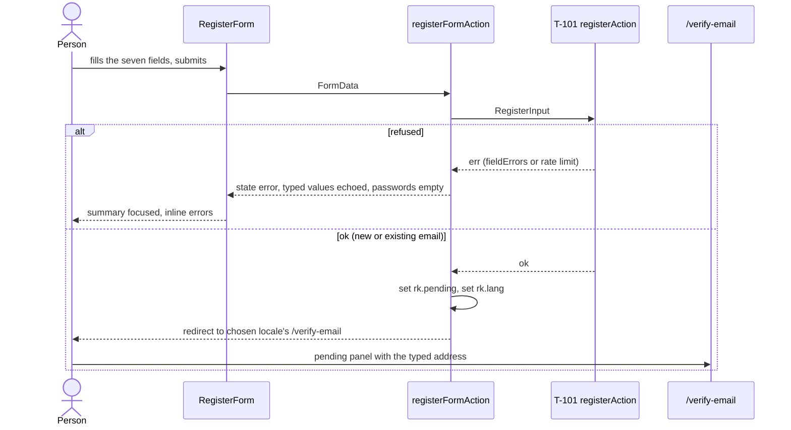
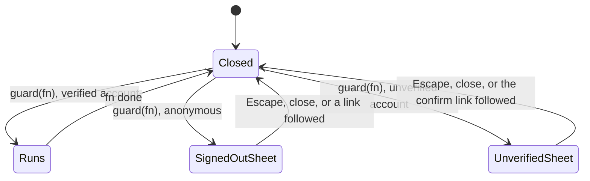
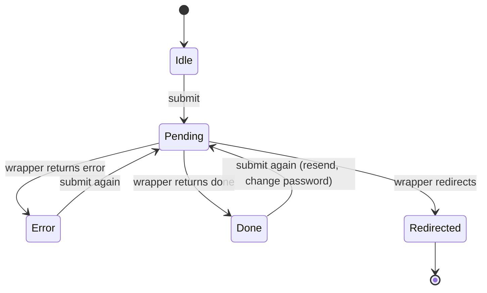
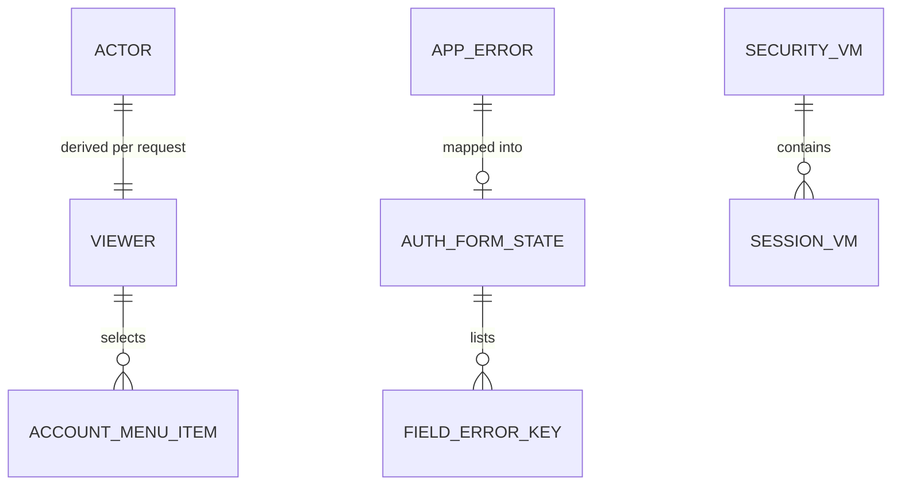

# Functional specification — U9 `t-102-patient-auth-screens`

Draft written ahead of the stage. The lead finalises it when the workflow reaches this Unit; then it moves to `<record>/construction/t-102-patient-auth-screens/functional-design/`.

| Field | Value |
|---|---|
| Unit | U9 `t-102-patient-auth-screens` (kind `ui`, size L, **high risk**: authentication); depends on U8 T-101, U3 T-010, U45 T-011; T-306, T-307, T-402, T-405, T-409, T-501 and T-106 build on it |
| Source | T-102 (`docs/implementation/tasks/T-102-patient-auth-screens.md`) with its FD-091, FD-053 and FD-057 amendments |
| Stories | US3.1 (AC3.1.1–AC3.1.6) and US3.2 (AC3.2.1–AC3.2.5), `unit-of-work-story-map.md`; AC2.3.1–AC2.3.4, AC2.4.3–AC2.4.5 and AC12.1.6 apply to these screens as well |
| Requirements | FR1–FR9, FR91, FR95, NFR4, NFR6, NFR7, NFR13 |
| Decisions | FD-013, FD-024, FD-034, FD-042, FD-053, FD-057, FD-058, FD-059, FD-063, FD-088, FD-091 |
| Upstream design | T-101 draft (commands, server actions, `getActor`, codes, `SessionListItem`); T-011 draft (tokens, `RouteTransition` in the patient layout, sheet entry, `PublishTick`, static set) |
| Questions | Q1–Q13 in `functional-design-questions.md`: Q1–Q3 and Q5–Q13 answered A on the owner's standing instruction of 2026-10-27 and awaiting confirmation; **Q4 is open for the owner** (data boundary) and this specification follows its option C until it is answered. § 10 lists what changes under every other option |
| Status | Draft written ahead of the stage on the CR-012 Bolt branch; nothing in this Unit's area differs from `main` there. T-101 and T-011 are not built yet, so their drafts are the interface this design builds on |

Lead perspective: architect. Support perspectives written into this file: frontend developer (component mechanics, server actions, progressive enhancement, tests: §§ 4, 11) and security and accessibility reviewer (enumeration, redirects, tokens, focus and announcements: § 8), synthesised in § 9. Data shapes are in `entities.md`, decision logic in `rules.md`, components and copy in `frontend-components.md`.

## 1. What changes, in one paragraph

The five placeholder pages (`/register`, `/sign-in`, `/verify-email`, `/reset-password`, `/me/security`) become working screens on top of T-101's actions, with the D-001 content and flows and the FD-091 look from T-011. Every form is a server-action form that works without JavaScript, keeps what the person typed (never passwords), and reports problems in a focused error summary plus labelled inline errors in the active language. The masthead's static sign-in link becomes the account entry: a link with `next` when signed out, a button that opens the account sheet when signed in, with a dot and spoken "email not confirmed" for unconfirmed accounts. One gate sheet, reachable through `useAuthGate()`, and a `/write` gate callout stop signed-out and unconfirmed people at the contribution controls without blocking any reading. Three things depart from the literal task text, for reasons the inputs show: the confirmation link opens a page with a Confirm button (a page render cannot set the session cookie), the typed address reaches the pending screen through a short-lived cookie instead of the URL, and Sign out everywhere asks for a confirmation rather than a password that nothing would check. Copy gains about 25 keys, all in both languages and flagged for the owner's Bengali review.

## 2. As is (baseline on `main`, 2026-10-28)

| Element | Where | Today |
|---|---|---|
| Auth pages | `app/[locale]/(patient)/{register,sign-in,verify-email,reset-password,me/security}/page.tsx` | `ViewShell` with a `shell.placeholder` note naming T-102; `noindex` already set |
| Policy pages | `terms/page.tsx`, `privacy/page.tsx`, `components/patient/Policy.tsx` | Built (T-207a) with the FD-022 sentence and its tests |
| Account control | `components/patient/Masthead.tsx` | Static `Link#account.ctl` to `/sign-in` with the person glyph; comment says T-102 replaces it |
| Sheet | `components/shared/Sheet.tsx` | `.overlay > .sheet[role=dialog]`, focus trap, Escape, focus return |
| Live region | `LiveRegion` + `useAnnounce()` | One `#sr-live` polite region; messages clear after 1 s |
| Workspace nav, Composer, AccountEntry | — | Do not exist |
| Server actions | `server/actions/preferences.ts` only | No `account.ts` (T-101 creates it) |
| Copy | `packages/i18n/messages/{en,bn}.json` | Every spec §5 `auth.*` key and the `errors.auth.*` keys exist (`auth.signIn.label` for the spec's `auth.signIn`) |
| Contracts | `actor.ts`, `errors.ts`, `schemas/account.ts`, `view-models/security.ts` | `SessionVM {id, current, label, firstSeen, lastSeen}` with a `TODO(T-102)` to refine |
| CSS | `patient.css` | D-001's `.field-error` and `.ctl.account` rules on the 04b look; T-011 restyles the file |

## 3. Settled before this stage

FD-034 and FD-053 (screens and the D-001 gate), FD-057 (session list and Sign out everywhere only), FD-058 and FD-063 (delay as `auth.rate_limited` with `retryAfterSec`, no CAPTCHA), FD-059 (self-service reset), FD-088 (no appeals in release 1), FD-091 (the look and motion), and T-101's answers Q2 (unconfirmed accounts sign in), Q5 (no IP), Q7 (equals-email code, 256 cap) and Q10 (no step-up). See `functional-design-questions.md` § "Settled before this stage".

## 4. Workflows

"Wrapper" means the form-facing server action this Unit adds in `server/actions/account.ts`; it parses `FormData`, calls T-101's action and returns `AuthFormState` or redirects (`frontend-components.md` § 4.3). Every redirect target is `/<locale><path>`.

### WF0 — Code Generation order (the Unit end to end)

1. **Gate.** Read this Unit's record: the owner's D-001 content and flow approval (Q13 A) must be recorded with its date. If not, stop (BR14.6).
2. **Baseline.** `pnpm infra:up`; `pnpm check` and `pnpm smoke` green on the Bolt branch; open `ISSUES.md` rows of `functional-design-questions.md` Context read; counts recorded.
3. **Dependency check (BR14.4).** `next`, `react`, `next-intl`: stable releases and known `useActionState` and form-action issues; append the entry.
4. **Spike, 30 minutes.** On the pins: a `useActionState` form posting a server action re-renders with its state without JavaScript; `redirect()` and cookie writes from the action; `defaultValue` from state survives React's form reset; `metadata.referrer` per page.
5. **Copy.** The keys of `frontend-components.md` § 6 in both files (Bengali flagged).
6. **Contracts.** `SessionVM` (`browser`, `os`), `SecurityVM.emailVerified`, coordinated with T-101 (Q10 A).
7. **Primitives.** `AuthHead`, `ErrorSummary`, `FieldError`, `TextField`, `PasswordField`, `CheckField`, `LanguageChoice`, `SubmitButton`, `StatusCallout`, `JourneySteps`.
8. **Wrappers.** `sanitiseNext`, `toFormState`, the nine wrappers.
9. **Pages and components.** Register, verify, sign-in, reset, security, workspace nav, account entry and menu, gate provider and sheet, write gate, welcome, pending banner.
10. **Owned-path additions (Q1 A).** Layout, `/me` and `/write` hunks, each listed.
11. **Styles.** T-102's section of `patient.css`.
12. **Tests (§ 11)**, then `pnpm check`, `pnpm smoke`, `pnpm check:motion`, `impeccable detect`, both contrast runs.
13. **Records.** Hand-off (owned-path additions, renamed or changed keys, assumptions), ISS rows (BR14.7), and the owner's review on the T-011 look scheduled (BR14.6).

### WF1 — A patient page renders (viewer and chrome)

1. The patient layout calls `getActor()` (T-101, cached per request) and builds the `Viewer` (BR8.7, ENT-001).
2. `Masthead` renders `AccountEntry` first in `.controls` (BR8.1): signed out a link to `/sign-in?next=<path>` (BR8.2); signed in a button with the initials (BR8.3, BR8.5) and, when unconfirmed, the dot and the spoken suffix (BR8.4).
3. The page renders inside T-011's `RouteTransition` and this Unit's `AuthGateProvider` (BR10.5, BR11.2).
4. Nothing here redirects: every public page stays public (BR10.7).

### WF2 — Register

Text fallback: the person submits; the wrapper calls T-101; a refusal comes back as a state with the typed values (no passwords) and the form shows the summary (focused) and the inline errors; an accepted registration, whether the email was new or already registered, sets the pending cookie and the language cookie and redirects to the pending screen in the chosen language.

1. A signed-in visitor is redirected to `next` or `/me` before the page renders (BR3.7).
2. The form renders the fields of BR3.1 with the hints, native radios defaulting to the route locale (BR3.2), the live preview (BR3.3) and new-tab policy links (BR3.4). `JourneySteps` shows step 1 (BR11.8).
3. On submit, T-101 validates everything (BR1.5). Field errors arrive with the keys of BR3.8; a rate limit with `retryAfterSec` (BR4.6).
4. On ok, the wrapper sets `rk.pending` (BR13.4) and `rk.lang`, and redirects to `/<chosen>/verify-email` (BR3.5). The existing-email case looks identical (BR4.7).

### WF3 — Pending screen and resend

1. `/verify-email` without a token reads `rk.pending` on the server (BR5.1).
2. It renders `JourneySteps` step 2, the body with the address in bold (or `auth.verify.bodyNoEmail` without the cookie), the 24-hour callout, `ResendForm` and, outside production, the local inbox link.
3. Resend posts the hidden address (or the typed one); ok renews the cookie and shows `auth.verify.resent` as a status; a limit shows BR4.6's copy. Nothing differs by account (BR5.2).

### WF4 — Confirming the email

1. The link `…/verify-email?token=` renders `VerifyConfirmForm`: the lede and one button; the render calls no command (BR5.3). `TokenUrlCleaner` removes the token from the address bar; the page sends no referrer (BR5.6).
2. The person presses **Confirm my email**; `verifyEmailFormAction` calls T-101, which confirms and creates the session.
3. Ok: delete `rk.pending`; redirect to `/me?welcome=1` (BR5.4). `/me` shows `VerifyWelcome` (with the tick, BR11.5) and `JourneySteps` step 3 only when the Actor is verified (BR5.5).
4. Expired or used: the panel shows `auth.verify.expired` with `ResendForm` (BR5.4).

### WF5 — Sign in

1. A signed-in visitor is redirected (BR3.7). The page shows `auth.reset.done` after a reset or `auth.security.signedOutAll` after a sign out everywhere (BR4.1).
2. Submit: T-101 applies the limits and the FD-063 delay before any check.
3. Results: wrong email or password → one generic message, email kept (BR4.2); suspended or banned → the reworded message, no link (BR4.5); refused by a limit or delay → seconds or minutes copy (BR4.6).
4. Ok: delete `rk.pending`; redirect to `sanitiseNext(next)` or `/me` (BR4.3, BR4.4).

### WF6 — Request a reset

Submit the address; ok or not, the form is replaced by `auth.reset.sent` as a status (BR6.1); a limit keeps the form and shows BR4.6's copy.

### WF7 — Set a new password

1. `…/reset-password?token=` renders `ResetSetForm` (BR6.2); token cleaned from the address bar, no referrer (BR5.6).
2. Submit: the wrapper compares the two fields first (BR2.4), then T-101 rotates the password and revokes every session.
3. Ok: redirect to `/sign-in?reset=done` (with the tick, BR11.5). Expired or used: the token message with a link to request again (BR6.3).

### WF8 — Sign out

1. The account sheet's **Sign out** is a POST form with the current path as `next` (BR7.1).
2. With JavaScript, on a public page: T-101 signs out; the wrapper deletes `rk.pending`, revalidates the layout and returns done; the sheet closes, the masthead shows the sign-in link, and `auth.signedOut` is announced (BR7.2). On `/me/*`, `/saved` or `/notifications`: navigate to `/`.
3. Without JavaScript: redirect to the same target.
4. The staff device cookie is untouched (BR7.3).

### WF9 — Security page

1. Signed out: the gate panel with Sign in (BR9.1). Signed in: `WorkspaceNav` (current Security) and four sections.
2. **Email:** confirmed or not confirmed, and the note; no address until Q4 is answered (BR9.2).
3. **Password:** current, new, confirm; the wrapper checks the match; T-101 changes it and revokes the other sessions; done shows `auth.security.passwordChanged` with the tick and empty fields (BR9.3).
4. **Where you're signed in:** active sessions, this device first and marked, localised device labels and dates, "Just now" for this device; no login history and no alert (BR9.4, BR9.7, FD-057).
5. **Sign out everywhere:** the button reveals the note with **Yes, sign out everywhere** and **Cancel** (BR9.5). Without JavaScript the first POST returns the confirm state and the second performs it (ENT-013). Confirmed: T-101 revokes every session; redirect to `/sign-in?signedOut=all`.
6. **Your data:** link to `/me` (BR9.6).

### WF10 — Account menu

1. Signed in, activating the entry opens the shared `Sheet` titled with the display name (Q9 A; T-011 sheet rise, BR11.4).
2. Items in order (ENT-010): Confirm your email (unconfirmed only), My writing, Saved, Notifications (count only when real, BR8.6), Security, Staff console (staff only), then Sign out.
3. Escape or the close button closes it and returns focus to the entry (shared Sheet).

### WF11 — Gate on a contribution control (T-202, T-204, T-307, T-402, T-409 call it)

Text fallback: `guard(fn)` runs `fn` for a confirmed account; for an anonymous viewer it opens the sheet with the sign-in and register links; for an unconfirmed account it opens the sheet with "Confirm your email to do this" and the link to the confirmation page; closing returns to the control (BR10.3, BR10.4). Without JavaScript the control's own form posts and the server refuses with its message (BR10.6).

### WF12 — `/write` and `/me` (owned-path additions, Q1 A)

- `/write`: signed out → `WriteGateCallout` and no composer (BR10.1); unconfirmed → `PendingVerificationBanner` above T-306's placeholder, with `publishDisabledReason` exported for T-306 (BR10.2); confirmed → T-306's placeholder as today.
- `/me`: `VerifyWelcome` (BR5.5) and, for an unconfirmed holder, `PendingVerificationBanner` (BR5.7), above T-409's placeholder.

### WF13 — Checks (Code Generation and Build and Test)

1. `pnpm check` (typecheck, lint, boundaries, unit and integration tests, i18n parity, contrast runs, `check:motion`, build) and `pnpm smoke` (Vitest smoke plus T-011's `smoke:e2e` with `auth.spec.ts`).
2. Build and Test executes every T-102 acceptance row (§ 13) in `en` and `bn`, both themes, 360 px and 200% zoom, with and without JavaScript, with motion on and reduced.
3. High-risk extras: collaborators on, 3–5 adversarial tests by a separate agent (§ 8.2), the owner's written sign-off and the owner's review on the T-011 look (BR14.5, BR14.6).

## 5. State transitions

### 5.1 Auth form (every form)

| From | Event | To | Shown |
|---|---|---|---|
| Idle | submit | Pending | button disabled, form busy (BR1.8) |
| Pending | error | Error | summary focused, inline errors, typed values, empty passwords, "Error:" title (BR1.2–BR1.4, BR1.10) |
| Pending | done | Done | status message (with tick for password changed) (BR11.5) |
| Pending | redirect | Redirected | next page; `h1` focused after client arrival (BR1.9) |
| Error | submit | Pending | as above |

### 5.2 `/verify-email`

| State | Condition | Shown |
|---|---|---|
| Pending, address known | no token, `rk.pending` present | body with the address, Resend with a hidden address |
| Pending, address unknown | no token, no cookie | `auth.verify.bodyNoEmail`, Resend with an email field |
| Confirm | `token` present | lede and Confirm button |
| Expired | Confirm returned `auth.token_expired` or `auth.token_invalid` | `auth.verify.expired` and Resend |
| (left) | Confirm ok | `/me?welcome=1` |

### 5.3 Sign out everywhere

| From | Event | To |
|---|---|---|
| Idle | press Sign out everywhere | Confirming (note, confirm, cancel) |
| Confirming | Cancel | Idle (focus back on the button) |
| Confirming | Confirm | signed out everywhere → `/sign-in?signedOut=all` |
| Idle | `confirm='stepUp'` (T-103) and press | step-up sheet → on success as Confirm |

### 5.4 Account entry

| Viewer | Control | Activation |
|---|---|---|
| anonymous | link `#account` with glyph | `/sign-in?next=` |
| account, unverified | button with initials and dot | sheet with Confirm first |
| account, verified | button with initials | sheet |
| account, staff | as verified | sheet with Staff console last |

## 6. Interfaces consumed (T-101) and exposed

| T-101 action (draft § 6.3) | Input from the wrapper | Results this Unit renders |
|---|---|---|
| `registerAction` | `RegisterInput` | ok; field errors (BR3.8); `auth.rate_limited`; `validation`; `internal` |
| `resendVerificationAction` | `{email}` | ok; `auth.rate_limited` |
| `verifyEmailAction` | `{token}` | ok (session set); `auth.token_expired`; `auth.token_invalid` |
| `signInAction` | `{email, password}` | ok (session set); `auth.invalid_credentials`; `auth.account_suspended`; `auth.rate_limited` |
| `signOutAction`, `signOutEverywhereAction` | `{}` | ok |
| `requestPasswordResetAction` | `{email}` | ok; `auth.rate_limited` |
| `resetPasswordAction` | `{token, newPassword}` | ok; token codes; password codes |
| `changePasswordAction` | `{currentPassword, newPassword}` | ok; `auth.invalid_credentials`; `auth.rate_limited`; password codes |
| `account.listSessions` | `{}` | `SessionListItem[]` with `browser`, `os` (Q10 A) |
| `getActor()` | request | `Actor` |

Exposed to later Units: `useAuthGate()`, `AuthGateSheet` (T-202, T-204, T-307, T-402, T-409), `WriteGateCallout` and `publishDisabledReason` (T-306), `PendingVerificationBanner` and `VerifyWelcome` (T-409), `WorkspaceNav` (T-409), `SecuritySettings` `confirm` prop and `SessionsTable` (T-103), the sign-out action (T-501), the account menu's notification item (T-405 adds the count).

## 7. Edge cases and failure behaviour

| Case | Behaviour | Rule |
|---|---|---|
| JavaScript disabled, register with a 9-character password | POST re-renders the page with the summary and the inline error; typed values back; password empty | BR1.1, BR1.2 |
| Double click on Create account | second click ignored while pending | BR1.8 |
| Same email registered twice | the same pending screen both times (T-101 mails the owner) | BR3.5, BR4.7 |
| Registration from `/en` choosing Bengali | lands on `/bn/verify-email`; email in Bengali | BR3.5 |
| Pending screen opened in another browser | no address shown; Resend asks for it | BR5.1, BR5.2 |
| Link opened by a mail scanner | confirm page only; nothing confirmed | BR5.3 |
| Link opened after 24 hours | Confirm → expired panel with Resend | BR5.4 |
| `/me?welcome=1` typed by hand while unconfirmed | no confirmation callout | BR5.5 |
| `next=https://evil.example`, `//evil.example`, `/\evil.example` | `/me` | BR4.3 |
| `next=/admin/queue` on the patient sign-in | `/me` (staff use `/admin/sign-in`, T-103) | BR4.3 |
| 4th sign-in failure inside the delay | "Try again in 1 second" (or the current delay) | BR4.6 |
| 11th attempt after 10 failures in 15 minutes | minutes copy until the window passes | BR4.6 |
| Suspended account, right password | suspended message, no link | BR4.5 |
| Passwords that do not match | mismatch error; nothing sent to T-101 | BR2.4 |
| Reset link reused | token message and a link to request again; password unchanged | BR6.3 |
| Sign out on `/me/security` | home page | BR7.2 |
| Sign out everywhere from browser A, then reload browser B | B is signed out (T-101); its masthead shows the sign-in link | BR9.5 |
| A session T-101 cannot parse | "Unknown device" | BR9.7 |
| Very long Bengali display name at 360 px | the sheet title wraps; initials are two graphemes | BR8.5, BR11.7 |
| Reduced motion (OS or switch) | no route movement, sheet appears at once, full tick at once; every flow completes | BR11.6 |
| T-405 not built | no unread count | BR8.6 |
| T-306 not built | `/write` shows the gate (signed out) or the banner (unconfirmed) above the placeholder | Q1 A |
| T-011's layout-level `RouteTransition` fell back to per-page wrappers | each auth page wraps itself | BR11.2 |
| Live region busy with the view announcement after sign-out on `/` | the view announcement wins; on public pages there is no navigation, so `auth.signedOut` is heard | BR7.2 |

## 8. Security and accessibility view

### 8.1 Threat cases

| # | Threat | Defence | Rules |
|---|---|---|---|
| T1 | Enumeration through UI differences | wrappers add no account branch; neutral copy; identical redirects and cookies | BR3.5, BR4.7, BR13.3 |
| T2 | Open redirect through `next` | strict sanitiser; locale rebuilt by the server | BR4.3 |
| T3 | Staff session through the patient sign-in | `/admin` rejected as `next`; staff device approval is T-103's | BR4.3 |
| T4 | Token leakage (Referer, history, screenshots, scanners) | no-referrer, token removed from the bar, confirm button instead of GET action | BR5.3, BR5.6, BR13.5 |
| T5 | Address leakage through URLs or view models | flash cookie; no address in view models until Q4 | BR13.1, BR13.2, BR13.4 |
| T6 | Password exposure | never echoed; hidden again before submit; no `maxlength` truncation | BR1.2, BR2.2, BR2.3 |
| T7 | CSRF on sign-out or sign-in | POST server actions only; Next's origin check; SameSite Lax | BR7.1, BR13.5 |
| T8 | Gate bypass | server checks every command | BR10.6 |
| T9 | A false "confirmed" message | welcome requires a verified Actor | BR5.5 |
| T10 | Security theatre at Sign out everywhere | confirmation, no ignored password | BR9.5 |

### 8.2 Adversarial angles for the separate agent (3–5 tests, defensive regression checks)

1. **Redirect sweep.** Feed `sanitiseNext` and the sign-in and sign-out wrappers 30 hostile `next` values (absolute URLs, protocol-relative, backslash, encoded `%2F%2F`, tab and newline, `javascript:`, `/admin`, `/api`, auth pages, 600-character paths, double locale `/bn/en/x`); every one lands on `/me` or `/`, and the `Location` header never leaves the origin.
2. **Enumeration through the UI.** For an existing, a pending, a suspended and an unknown synthetic address, run register, resend and reset through the wrappers with T-101 faked to return its neutral results; assert byte-identical states, identical redirects and identical `Set-Cookie` headers apart from expiry times.
3. **No secret in the page.** After failed register, sign-in, reset and change-password submissions (with and without JavaScript), scan the HTML, the RSC payload and the form state: no submitted password, no token outside the hidden field of the token pages, no address outside the pending page and the echoed register field.
4. **No state change on GET.** Request every auth URL with GET and with a token; no T-101 action is called and no `Set-Cookie` for the session appears.
5. **Gate and welcome tampering.** With an unconfirmed session, call a gated command's action directly (bypassing `guard`) and open `/me?welcome=1`; the command is refused and no confirmation is shown.

### 8.3 Accessibility checklist (Build and Test)

Keyboard-only completion of every flow; the summary focused and read after a failed submit; the `h1` focused after a client arrival; every field's label, hint and error read in order; the Show button's name and announcement; the account sheet traps and returns focus; the gate sheet the same; axe with no serious or critical finding in `en` and `bn`; 44 px targets; no overflow at 360 px and 200% zoom; reduced motion completes every flow (AC2.3.1–AC2.3.4, AC12.1.6).

## 9. Decisions

**D1 — Server-action forms with `useActionState`, values echoed, passwords never.** Chosen because spec §2 requires no-JavaScript operation and 01-conventions §8 names the pattern; React's automatic form reset makes the echo necessary. Rejected: client-only forms (fail without JavaScript) and controlled inputs everywhere (lose the no-JavaScript path).

**D2 — Confirm button on the link page (Q2 A).** Chosen because a page render cannot set cookies and a GET must not change state. Rejected: a GET route handler (scanners act on it), auto-submit (the same, plus surprise).

**D3 — Flash cookie for the typed address (Q3 A).** Chosen to keep the address out of URLs and logs while keeping spec §3.1's redirect. Rejected: the query string (privacy), in-place rendering (no redirect, resubmit on refresh).

**D4 — No address in signed-in view models until the owner decides (Q4 open).** The rule as written stands; the components already accept the field.

**D5 — Rate-limit unit from `retryAfterSec`, real plurals (Q5 A); suspended copy without appeal route (Q6 A, FD-088).**

**D6 — Confirmation, not password, before Sign out everywhere (Q7 A),** with the step-up swap prepared for T-103.

**D7 — Show/Hide text without `aria-pressed` (Q8 A).** Chosen for an unambiguous announcement; the task's test wording changes.

**D8 — One `Sheet` for the account menu at every width (Q9 A).** Matches the approved prototype and keeps one focus model.

**D9 — Device labels from parts through a key (Q10 A).** Equal Bengali status for the whole page.

**D10 — T-011 motion plus one tick beside two confirmations; a static joining strip (Q11 A, Q12 A).** The owner's "rich and alive" within FD-091; nothing moves that carries an error or a hard rule.

**D11 — Small, recorded changes in the layout, `/me` and `/write` (Q1 A).** The steps and storyboard need them now; the later Units keep the components.

**D12 — Native radios and checkboxes; links list instead of an ARIA menu; grapheme initials; strict `next`.** Each closes a concrete defect the literal port would carry (findings F9, F10; BR8.5; BR4.3).

## 10. Option deltas (if the owner changes an answer)

| Question → option | What changes |
|---|---|
| Q1 → B | The three hunks go; the components are exported only; the "Spec §6 flow" row and storyboard step 8 are recorded as waiting for T-306 and T-409 |
| Q2 → B | `verify-email/confirm/route.ts` (GET) verifies, sets the cookie and redirects; `VerifyConfirmForm`, `auth.verify.confirmLede` and `auth.verify.confirmSubmit` go; adversarial angle 4 excludes that route |
| Q2 → C | As A plus an auto-submit effect; the button stays as the fallback |
| Q3 → B | `rk.pending` goes; the register wrapper redirects with `?email=`; the page reads the parameter (echo only); BR13.1 gains the URL exception |
| Q3 → C | No redirect: `RegisterForm` renders `PendingPanel` from the done state; `rk.pending` goes |
| Q4 → A | `SecurityVM.ownEmail` and `PendingBannerVM.ownEmail` filled from T-101's account repository for the holder only; the pending banner uses `auth.verify.body`; the email section shows the address; an FD entry and a 03 §2 sentence come first |
| Q4 → B | As A with a masked address (`s****@example.test`) |
| Q5 → B | One key `errors.auth.rateLimitedWait`; BR4.6 simplified |
| Q5 → C | No new key; minutes rounded up |
| Q6 → B | Copy unchanged; a link to `/me` under the message |
| Q7 → B | No confirmation; `confirm` prop kept for T-103 |
| Q8 → B | Fixed "Show" text with `aria-pressed`; `auth.showPasswordAria`, `auth.hidePasswordAria`, the two announcements go |
| Q8 → C | Prototype as is |
| Q9 → B | A `Popover` component from 760 px with its own focus and dismissal; Playwright checks both widths |
| Q9 → C | A disclosure dropdown at every width |
| Q10 → B | `SessionVM.label` kept; BR9.7 and the two keys go; FD-024 gap recorded as an ISS row |
| Q11 → B | No `PublishTick` on the two confirmations |
| Q12 → B | No `JourneySteps`; five keys go |
| Q13 → B | WF0 step 1 removed after the owner's FD entry; only the post-build review gates the Unit |

## 11. Owned paths and recorded additions

T-102's owned paths are as its task file lists. These additions follow from this design and are listed in the Code Generation plan and the hand-off with one ISS row (BR14.7):

- `apps/web/src/app/[locale]/(patient)/layout.tsx` (viewer, `AuthGateProvider`, `viewer` to `Masthead`), shared with T-011's `RouteTransition` hunk (Q1 A).
- `apps/web/src/app/[locale]/(patient)/me/page.tsx` and `write/page.tsx` (one hunk each, Q1 A).
- `apps/web/e2e/smoke/auth.spec.ts` (T-011's Playwright setup).
- `packages/contracts/src/view-models/security.ts` (Q10 A, with T-101).

## 12. Risks to verify in Code Generation and Build and Test

- **Progressive enhancement on the pins.** Next 16.3.4 renders a `useActionState` form's server-action result without JavaScript, and `redirect()` plus cookie writes work from the same action (WF0 spike).
- **React's form reset.** `defaultValue` from the returned state survives the automatic reset in React 19.3.0; if not, the forms become controlled for the echoed fields only.
- **Focus and the view announcement.** Focusing the `h1` after a client arrival and CR-004's "View: …" announcement may both speak; check with a screen reader and, if doubled, skip the `h1` focus on pages where the announcement already names the view (record it).
- **Sign-out without navigation.** `revalidatePath` from the action re-renders the masthead on the same page; if not, fall back to `router.refresh()` and record it.
- **T-101 shapes.** The final action names, result shapes, the `fieldErrors` keys (ENT-004) and `SessionListItem` (`browser`, `os`) match this design; differences are listed in the hand-off.
- **T-011 shapes.** `RouteTransition` sits in the layout (its Q4 A), `PublishTick` takes children, and the `.opt`, `.ctl.account`, `.kv` and `.callout` classes keep their names.
- **ICU plurals.** next-intl formats the `plural` messages with the pre-formatted digit parameter as designed; the i18n parity check accepts different parameter use in `en` and `bn`.
- **Bengali at 360 px.** The register form, the sessions table and the account sheet do not overflow in `bn` with the longest corpus names.
- **The whole dictionary on the client (ISS-137).** The new client components add to it; record the size in the hand-off.

## 13. Acceptance mapping (T-102 acceptance checks)

| T-102 check | Where it is met |
|---|---|
| Spec §6 flow (register → Mailpit → confirm → `/me?welcome=1`) | WF2–WF4; BR3.5, BR5.3–BR5.5; Q1 A, Q2 A |
| Same-email register | WF2 step 4; BR4.7 |
| No-JS | BR1.1, BR1.2 |
| Focus | BR1.3, BR1.9 |
| `next` safety | BR4.3 |
| Rate limit copy (reworded per finding F11) | BR4.6 |
| Sessions | WF9; BR9.4, BR9.5 |
| Both locales | BR12.1–BR12.3, BR11.7 |
| noindex | BR1.11 |
| Detector + contrast | BR14.3 |
| FD-053: D-001 gate recorded | WF0 step 1; BR14.6; Q13 A |
| FD-053: built screens match the approved review | BR14.6, BR11.7 |
| FD-057: security page scope (AC3.2.3) | BR9.4 |
| FD-057: sign out everywhere (AC3.2.3) | WF9 step 5; BR9.5 |
| Checks (`pnpm check`) | BR14.3 |
| FD-091: motion check | BR11.1, BR11.3 |
| FD-091: reduced-motion journey | BR11.6 |
| FD-091: detector and contrast on the new styles | BR11.1, BR14.3 |
| FD-091: auth screens re-reviewed on the T-011 look | BR14.6 |

Story coverage is in `traceability.json`.

## Entity-relationship view (derived from `entities.md`)

Text fallback: each request's Actor gives one Viewer, which selects the menu items; a T-101 error becomes at most one form state listing field error keys; the security view model contains the session rows. Nothing is persisted.

## Rules summary (derived from `rules.md`)

- **Shared forms (BR1.1–BR1.13):** server-action forms that work without JavaScript; values echoed, passwords never; focused summary; linked inline errors; server-side validation; fixed ids; autofill hints; no double submit; focus rules; error title; noindex; keys only; one `h1`.
- **Password field (BR2.1–BR2.4):** Show/Hide, after hydration, hidden on submit, hint, no meter, no `maxlength`, confirmation checked first.
- **Register (BR3.1–BR3.8), sign-in (BR4.1–BR4.7), verify (BR5.1–BR5.7), reset (BR6.1–BR6.3), sign-out (BR7.1–BR7.3).**
- **Account entry (BR8.1–BR8.7), security page (BR9.1–BR9.7), gates (BR10.1–BR10.7).**
- **Look and motion (BR11.1–BR11.8), language (BR12.1–BR12.4), privacy and safety (BR13.1–BR13.6), verification and records (BR14.1–BR14.7).**

## Sources

- `docs/implementation/tasks/T-102-patient-auth-screens.md` (goal, read-first list, owned paths, steps 1–12, acceptance checks, tests, hard-rule checklist, amendments FD-091, FD-053, FD-057).
- `docs/design/auth-screens-spec.md` §0–§3, §5, §6; the D-001 prototype `ui-design-prototype/concepts/concept-04b-quiet-clinic-minimal/app.js` (auth helpers, render functions, handlers).
- `aidlc/spaces/default/intents/261011-aidlc-adoption/inception/units-generation/unit-of-work.md` (U9, decision-change table), `unit-of-work-dependency.md`, `unit-of-work-story-map.md`; `inception/requirements-analysis/requirements.md` (FR1–FR9, FR91, FR95, NFR4, NFR6, NFR7, NFR13); `inception/user-stories/stories.md` (US2.3, US2.4, US3.1, US3.2, US12.1).
- `docs/status/decision-log.md` FD-013, FD-022, FD-024, FD-034, FD-042, FD-053, FD-057–FD-059, FD-063, FD-088, FD-091.
- `docs/implementation/01-conventions.md` §5–§9, §11; `03-routes-and-contracts.md` §1, §2, §4, §6; `05-demo-storyboard.md` Part 2.
- `docs/aidlc-migration/design-drafts/t-101-better-auth-adapter/` (functional-spec §§ 4, 6, 9) and `t-011-patient-design-and-motion-system/` (functional-spec, frontend-components, rules); `docs/aidlc-migration/OWNER-REVIEW-QUEUE.md`.
- Code on `main` listed in § 2; `docs/implementation/ISSUES.md` rows named in `functional-design-questions.md` Context; `docs/status/dependency-check-log.md` entries of 2026-09-13.
- React documentation, read 2026-10-28: `<form>` (automatic reset of uncontrolled fields after an action; `useActionState` progressive enhancement), https://react.dev/reference/react-dom/components/form.
