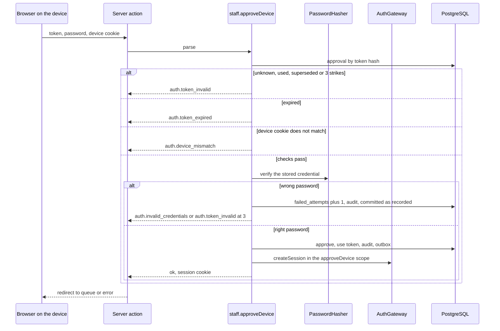
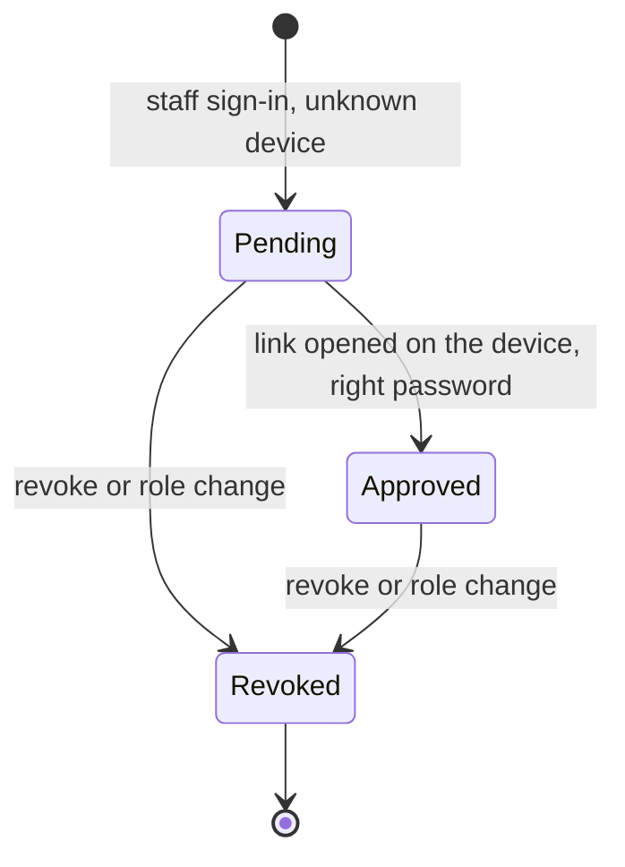
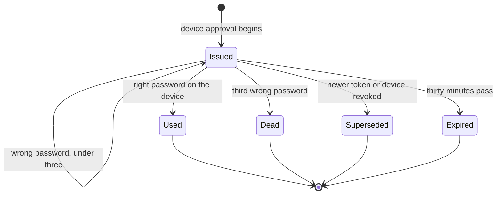
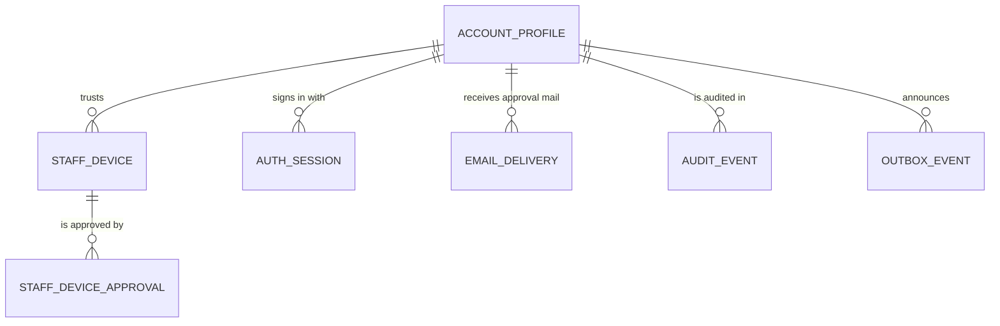

# Functional specification — U10 `t-103-staff-access-and-devices`

Draft written ahead of the stage. The lead finalises it when the workflow reaches this Unit; then it moves to `<record>/construction/t-103-staff-access-and-devices/functional-design/`.

Unit U10 (kind `library`, size XL) delivers T-103 for US3.2 (AC3.2.4, AC3.2.5) and US11.1 (AC11.1.2, AC11.1.6). It is **high risk** (authentication, staff identity, authorization): `team.md` puts every auth Unit in that class, and the owner's queue records the ruling (2026-10-28, R2), although the Units table still marks U10 "—" (finding F10). Collaborators run, a separate agent writes 3–5 adversarial tests (§ 12.2), and the owner signs off in writing. **Precondition met (FD-053, R1):** the owner approved the staff sign-in and device-approval screens as they are in the prototype (`ui-design-prototype/admin/`, staff console look) on 2026-10-29 (`docs/aidlc-migration/OWNER-REVIEW-QUEUE.md`), so T-103 may be built. WF0 step 1 copies that approval, with its date, into this Unit's record before the Bolt branch exists (BR12.5). Lead perspective: architect. Support perspectives written into this file: developer (mechanics, transactions, test design: §§ 10–11) and security engineer (threats, cookies, enumeration, authorization order: § 12), synthesised in § 13.

Inputs: listed in `functional-design-questions.md` (Context). This file is the source of truth for the workflows and state transitions. The data shape is in `entities.md`; the decision logic is in `rules.md`; the screens are in `frontend-components.md`. Questions 1–10 (all A) were chosen on the owner's standing instruction of 2026-10-27. Questions 11–13 (all A) were decided by the agent under the owner's no-questions instruction of 2026-10-29. All await the owner's confirmation.

## Refreshed 2026-10-29

Re-checked against T-010 as merged on `main` (`14c21a9`), the refreshed T-101 draft, the refreshed T-102 draft, T-011's recorded Functional Design, the T-104, T-105 and T-106 drafts, and the owner's answers in `docs/aidlc-migration/OWNER-REVIEW-QUEUE.md`. What changed:

- **Owner's answers.**
  - R1: the owner first answered that the FD-053 review of the staff screens comes later and that this Unit is not built until it is approved (2026-10-28). Then the owner approved the staff sign-in and device-approval screens as they are in the prototype (`ui-design-prototype/admin/`, staff console look) on 2026-10-29. The precondition is met; WF0 step 1 records the approval in this Unit's record (BR12.5).
  - R2: high risk (BR11.4): collaborators on, 3–5 adversarial tests by a separate agent, the owner's written sign-off.
  - Consequence: U11 T-104, U12 T-105, U13 T-106, U17 T-204 and the Units after U21 that depend on U10 are no longer held back by this review (F3 and F17 resolved).
- **Boundaries (FD-093).**
  - `application` imports no external package and no Node built-in. The first draft's HKDF, HMAC, `timingSafeEqual` and `sha256` calls in `application/authorization/step-up.ts` would have turned `pnpm lint` red (F18). They move behind three new `Crypto` port methods in `adapters/crypto`: `signClaims`, `verifyClaims` and `tokenHash` (Q11).
  - Only `server/container.ts` builds adapters. Components import server actions only.
  - The worker gains nothing. The device-approval params entry sits in the notification allowlist that `@rogikotha/application/worker` already exports, and it imports nothing from `modules/account`.
  - § 6.5 lists the element of every file.
- **T-101 as refreshed.**
  - Sessions come from `AuthGateway.createSession` in the new gateway scopes `staffSignIn` and `approveDevice`, not from command-context names or a `ctx.staffSessionAllowed` flag (Q2, BR4.5).
  - `defineCommand` already has the full `requires` order, `onRefused` for every refusal after `authenticated`, and the `recorded` error. This Unit no longer edits `command.ts` (BR7.4, BR7.5).
  - A wrong password on an approval token now returns `recorded: true`. Without it the strike would roll back, and the three-strike limit would never trip (F19, S2; Q12).
  - ISS-108 is closed by U8. This Unit adds its eight audit actions to U8's allowlist builders (F16 closed).
  - The Actor gets its staff role and capabilities only here, behind the device gate. U8's stub returns `[]` for everyone.
  - The password is checked through `PasswordHasher` first, with U8's dummy hash, at sign-in and at approval. The session is created last (Q13).
  - Other U8 shapes this design uses: `await config.current()`, `sendsMail: true` on `staff.signIn`, and two of T-101's proposed FD rows, referred to here by content because their numbers are given only when they are appended: the mail-only key FD (`MAIL_RECIPIENT_KEY`) and the worker-reads-message-files FD. FD-094 in the decision log is the owner's change of D13 (parallel builds), not the mail key.
- **Gate and tests (T-010).**
  - `pnpm check` has nine steps, and eleven once T-011 merges. CI must be green on the Bolt head before merge.
  - The 80% line floor applies to every touched package, untested files counted.
  - Both migration-count pins (`migrations.int.test.ts`, `validator-probes.int.test.ts` P8) go up by one.
  - The four T-103 stub methods leave `PgAccountRepository`, with `not-implemented.test.ts` (ISS-294) and `repositories-superset.test.ts` updated in the same commit.
  - The integration tests run in U8's `web-int` project.
- **T-102 and T-011.**
  - The security page reuses T-102's `SessionsTable`, `ChangePasswordForm`, `PasswordField` and `ErrorSummary`.
  - `StepUpSheet` uses T-011's `.sheet` and `.overlay` entry and adds no CSS or motion rule.
  - T-102's account-menu "Staff console" item appears only on an approved device, because only then does the Actor carry a role (F23).
- **New findings** F17–F25 (§ 9). Every S1 or S2 among them is designed out; the schedule finding F17 and F3 are resolved by the owner's approval of 2026-10-29. There are no decision-log rows to propose.

## 1. What changes, in one paragraph

Staff keep using the ordinary accounts built by U8; `account_profiles.staff_role` marks them. A staff account gets its role and its capabilities in the `Actor` **only** when the request carries an approved `rk_staff_device` cookie for that same account and the account is active (Q3). This makes the device the security boundary for every page, server action and route handler, not only for the console layout, which only redirects. Staff sign-in on `/admin/sign-in` checks the password through the `PasswordHasher` port before any session exists (Q1, U8 Q14): a non-staff account gets `staff.notStaff` with no session, an unknown device starts a device approval (no session, an emailed 30-minute single-use link), and an approved device gets a session from `AuthGateway.createSession` in the `staffSignIn` scope (Q2). The approval link works only in the browser that holds the device cookie it was issued for (Q4). It asks for the password again, which is checked through `PasswordHasher` (Q13), and allows three wrong passwords before the token dies (a counter column, Q5; each strike is committed with U8's `recorded` flag, Q12). It then approves the device, appends `account.securityEvent {kind: deviceApproved}` for the in-app notice (Q6) and signs the holder in through `createSession` in the `approveDevice` scope. `/admin/security` lists and revokes trusted devices and reuses U9's session and password parts. `account.stepUp` verifies the password and sets a 5-minute `rk_stepup` cookie bound to the account and the session, signed by the `Crypto` adapter (Q11). U8's `defineCommand` checks `requires.stepUp` after the capability check and returns `auth.step_up_required`. Every attempt is audited with its purpose (Q7). `StepUpSheet` and `useStepUp()` give every later Unit the re-run-after-recheck pattern. The masthead gets a read-only `RoleChip` and a `StaffAccountMenu`. `staff.setStaffRole` is built as a command with no UI (Q8). The release needs no more than this on the staff side (FD-088). The screens follow the prototype the owner approved on 2026-10-29 (FD-053, R1).

## 2. As is (baseline: `main` at `14c21a9` with T-010 merged, read 2026-10-29; U8, U9 and U45 as their refreshed drafts describe them)

- **Contracts.** `actor.ts` has the eight `Capability` values, `ALL_CAPABILITIES`, the `Actor` with `staffRole?`, `capabilities`, `stepUp?: {rechecked_at}`, and `capabilitiesForRole(role, config.capabilities)` with the FD-051 table already right (`retention.bulk` and `config.write` only for `super_admin`). `config-values.ts` has `capabilities.{admin,moderator}.{revealIdentity,originalEvidence}`, defaults all `false`. `schemas/staff.ts` has `BeginDeviceApprovalInput {deviceSecret?}`, `ApproveDeviceInput {token, password}`, `ListStaffDevicesInput`, `RevokeStaffDeviceInput {deviceId}`, `SetStaffRoleInput {accountId, role|null}`. `schemas/account.ts` has `StepUpInput {password}`. `errors.ts` has `auth.step_up_required`, `auth.device_unapproved`, `auth.token_invalid`, `auth.token_expired`; there is no code for a device mismatch and none for "not staff". `view-models/security.ts` has `TrustedDeviceVM {id, label, approvedAt?, lastSeenAt}` (no `firstSeen`, no `current`).
- **Database.** `staff_devices` (`account_id`, `device_hash`, `label`, `first_seen_at`, `last_seen_at`, `approved_at`, `revoked_at`, `created_at`) has no index on `(account_id, device_hash)`. `staff_device_approvals` (`device_id`, `token_hash` unique, `expires_at`, `used_at`, `created_at`) has no failure counter. `email_deliveries.category` already allows `device_approval`. `rk_worker` holds no privilege on either staff table (FD-037 default-deny; `02-data-model.md` §16), and this Unit changes no grant. The seed sets `staff_role` for `mod_rashid` (moderator), `admin_nadia` (admin) and `sa_founder` (super_admin) and seeds no device.
- **Application.** Empty on `main`. U8 (refreshed draft) creates:
  - `defineCommand({name, input, requires, sendsMail?, onRefused?, handle})`, which authorizes in the order `authenticated → verifiedEmail → notRestricted → staffRole → capability → stepUp → owner`. It runs `onRefused` in its own committed transaction for every refusal after `authenticated`, and it commits a handler `err` only when the handler marks it `recorded: true`;
  - the explicit command context `{input, actor, ports, tx}` (no async-local state, `Tx` opaque);
  - the `AuthGateway` port, whose library calls run in a web-tier library-call scope with purposes `register … signIn`, `sessionAllowed` set only by `createSession`, and "T-103 adds `staffSignIn` and `approveDevice`";
  - `PasswordHasher` with the dummy credential for unknown addresses, `RateLimiter` with the shared sign-in keys `signin:email:<hmac>` and `signin:net:<hmac>`, and the asynchronous `ConfigProvider.current(): Promise<ConfigValues>`;
  - `Crypto` with `encrypt`, `decrypt`, `hash`, `randomToken`, `hmac(purpose, bytes)` (per-purpose keys by HKDF from `BETTER_AUTH_SECRET`), plus the separate `mailCrypto` instance (the mail-only key FD T-101 proposes);
  - `authorization/capabilities.ts`, a stub that returns `[]` for every account, super_admin included (`TODO(T-103)`; U8 F23);
  - the pure `resolveActor`, which leaves `staffRole` unset and `personaId` unset;
  - `queueEmail` (C2's first version), the audit allowlist builders that close ISS-108, and `@rogikotha/application/worker`.
- **Boundaries (T-010, FD-093).** `eslint.boundaries.mjs` is default-deny:
  - `application` may import `domain` and `contracts` only, and no external package or Node built-in;
  - only `apps/web/src/server/container.ts` may import `adapters`; `app/` may not import `database`;
  - components (`apps/web/src/components/**`) may import `contracts`, `i18n`, `apps/web/src/server/actions/**` and `web-shared`, and no Node built-in or server library;
  - the worker reaches application code only through `@rogikotha/application/worker`, by no other specifier, a relative path included (FD-093 (2)).
  - `pnpm lint:boundaries` proves 15 violations and 6 controls.
- **Gate and CI (T-010).** `pnpm check` = `typecheck`, `lint`, `lint:boundaries`, `format:check`, `check:identity`, `test:coverage` (80% lines per package, untested files counted), `i18n:check`, `contrast`, `build`. U45 T-011 adds `contrast:patient` and `check:motion` before `build` (eleven steps). `.github/workflows/check.yml` runs on `main` and `bolt/**`, and a Bolt merges only after its branch head is green.
- **Database tests and stubs.**
  - `PgAccountRepository` still declares four T-103 stub methods (`listDevices`, `upsertDevice`, `createDeviceApproval`, `consumeDeviceApproval`) beside U8's, U30's (T-401) and U38's (T-409).
  - `not-implemented.test.ts` expects every method of each class in `STUB_REPOSITORIES` to throw `NotImplemented` naming its owner (ISS-294). U8 changes the account entry when it builds its methods (U8 F32).
  - `repositories-superset.test.ts` reads each stub's method names from its source and requires the fake to be a superset.
  - `migrations.int.test.ts` and `validator-probes.int.test.ts` (P8) both pin the number of applied migrations (9 on `main`, 10 after U8).
- **Web.** `app/[locale]/admin/layout.tsx` renders the console chrome with no guard (`TODO(T-103)`). `admin/sign-in`, `admin/approve-device` and `admin/security` are placeholder pages inside that layout, so they show the full chrome (ISS-100, owner T-103). `components/admin/Masthead.tsx` already dropped the prototype's `#role` switcher and the account entry (`TODO(T-103)`). `components/shared/Sheet.tsx` is the shared dialog. U8 creates `server/auth.ts` (`getActor`), `server/container.ts`, `server/better-auth/{instance,gateway,library-scope,user-agent}.ts` and `server/actions/account.ts`. U9 creates `components/patient/auth/**` (`SessionsTable`, `ChangePasswordForm`, `PasswordField`, `ErrorSummary`, `SignOutEverywhere` with its `confirm` prop) and the account menu. U45 restyles the patient side and keeps `.sheet` and `.overlay` with the sheet entry motion.
- **i18n.** Every `staff.*`, `email.staff.deviceApproval.*`, `errors.auth.stepUpRequired`, `errors.auth.deviceUnapproved` and `admin.role.{sa,admin,mod}` key exists in both files. `admin.role.current` was removed by T-006 (ISS-054). `staff.device.body` and `email.staff.deviceApproval.body` write "30" / "৩০" into the string (Q10).

## 3. Settled before this stage

FD-016, FD-022 (reveal toggles off by default, Super Admin controls them), FD-018 (security boundaries stay out of runtime config), FD-034 (same account system, specified screens, seeded staff), FD-035 (device approval is real), FD-051 (retention bulk super_admin only), FD-053 (D-001 review gates this Unit), FD-065 (Notification owns notifications and the outbox, Administration owns audit), FD-071 with T-101's proposed mail-only key row (mail recipients through `to_email_enc` under `MAIL_RECIPIENT_KEY`), T-101's proposed message-files row (the worker renders email copy from the message files), FD-094 (the owner's change of D13: independent Units built in parallel), FD-088 (staff side narrowed: this Unit is in release 1), FD-093 (import boundaries), C2 (`queueEmail` category `device_approval`, caller U10), C5 (the `staff.*` operations and the capability function are U10's), C15 (`account.securityEvent` kind `deviceApproved`), U8's Questions 12–14 (the `AuthGateway` port, the worker subpath, password through the port first), and the owner's answers to R1 (the staff screens approved as they are in the prototype, 2026-10-29, after the 2026-10-28 answer that the build waits for that approval) and R2 (high risk). See `functional-design-questions.md` § "Settled before this stage".

## 4. Workflows

Every command runs `parse → authorize → load → decide → persist` with its audit and outbox rows in one `UnitOfWork` transaction (01-conventions §3), through U8's `defineCommand` with the explicit context `{input, actor, ports, tx}`. "Gateway" means U8's `AuthGateway` port. Only commands call it, and each of its methods runs the library inside a library-call scope (U8 BR7.9). This Unit adds the scope purposes `staffSignIn` and `approveDevice`.

### WF0 — Code Generation order (the Unit end to end)

1. **Precondition (R1, BR12.5): met.** The owner approved the staff sign-in and device-approval screens as they are in the prototype (`ui-design-prototype/admin/`, Chart Tray look, which FD-091 keeps) on 2026-10-29. Before the Bolt branch exists, copy that approval into this Unit's record: the owner's words, the date and the queue row. `frontend-components.md` follows those screens; the copy it adds for states the prototype does not show (§ 8) is agent-decided and changes no layout.
2. **Baseline.** U8, U9 and U45 merged on `main`; `pnpm infra:up`; `pnpm check` (eleven steps after U45) and `pnpm smoke` green on the Bolt branch. Record the counts and the per-package coverage table. Read the open rows of § 2 and the Context, and confirm the U8 shapes this design names (§ 16).
3. **Decision log.** This Unit proposes no FD row: no hard rule, data boundary or founder decision changes.
4. **Dependency check (BR12.4).** Better Auth is the only library this Unit leans on in a new way (`createSession` from two more scopes, Q2). Reuse U8's entry if it is under 3 days old, otherwise re-check and append.
5. **Contracts first.** 03 §2 gains `auth.device_mismatch`, then `errors.ts`. `StaffSignInInput` goes in `schemas/staff.ts`; `StepUpInput` gains `purpose`; `STEP_UP_PURPOSES` goes in `enums.ts`; `TrustedDeviceVM` gains `firstSeen` and `current`; the `capabilitiesForRole` comment names FD-051.
6. **Application.**
   - `authorization/capabilities.ts`: `resolveCapabilities`, replacing U8's stub.
   - `authorization/step-up.ts`: the pure claims check; the signing is the `Crypto` port's (Q11).
   - `ports/crypto.ts` gains `signClaims`, `verifyClaims` and `tokenHash` (Q11). `ports/repositories/staff.ts` holds the `StaffRepository` port.
   - `modules/account/staff-access.ts`: device state and staff powers for `resolveActor`.
   - `modules/account/commands/{staff-sign-in,staff-begin-device-approval,staff-approve-device,staff-revoke-device,staff-set-staff-role,step-up}.ts` and `queries/staff-devices.ts`.
   - The detail builders for the eight audit actions in U8's `audit/` allowlist.
   - `command.ts` is not changed: U8 built `requires.stepUp`, `onRefused` and `recorded`.
7. **Adapters.** `crypto` implements the three new methods (HMAC-SHA256 with the per-purpose key U8 derives, base64url, constant-time compare, SHA-256 hex), with tests.
8. **Database.**
   - The migration (Q5).
   - `repositories/staff.ts` (`PgStaffRepository`). The four T-103 stubs leave `repositories/account.ts`; the methods are rebuilt under the port's names.
   - `not-implemented.test.ts` (ISS-294) and the two migration-count pins (`migrations.int.test.ts`, `validator-probes.int.test.ts` P8) change in the same commit. So does the schema test.
9. **Notification wiring.** `device_approval` becomes an always-sent category in `queueEmail`, and `email.staff.deviceApproval` gets its `[link]` entry in the one params allowlist of `modules/notification/`. Both U8's `queueEmail` and `sendEmailDelivery` (the worker's use case) read that list. The worker itself changes nothing (BR9.4).
10. **test-support.** `FakeStaffRepository`, `FakeCrypto` with the three methods, the account fake without the four device methods, `repositories-superset.test.ts` (account pair shrinks, staff pair added) and `port-fakes.test.ts`.
11. **Web.**
    - `server/better-auth/library-scope.ts` gains the two purposes. `gateway.ts` gives `createSession` a `purpose`, and `getSession` returns the session id (§ 16).
    - `server/auth.ts`: the device and step-up cookies go into the Actor inputs, and `getStaffContext` is added.
    - `server/container.ts`: `PgStaffRepository`, and the staff commands in the account module.
    - `server/actions/{staff,step-up}.ts`. `server/actions/account.ts`: sign-out also clears `rk_stepup`.
    - The route-group split (§ 6.4), the four screens, `RoleChip`, `StaffAccountMenu`, `StepUpSheet` + `useStepUp()`.
12. **i18n.** New keys and the changed string, both files (Bengali flagged).
13. **Tests (§ 11)**, then `pnpm check`, `pnpm smoke`, `pnpm test:int` (U8's `database`, `web-int` and `worker-int` projects), `npx impeccable detect apps/web/src --no-advisory` and `pnpm contrast`. The CI run on the pushed Bolt head must be green before merge.
14. **Records.** Reference-document corrections (BR12.2), `ISSUES.md` (BR12.3), and the hand-off with the coverage table before and after.

### WF1 — Staff sign-in (`staff.signIn {email, password}`, from `/admin/sign-in`)

Text fallback: the server action passes the email, password and device cookie to `staff.signIn`. The limiter may refuse first, with no read and no password check. Otherwise the command reads the credential and profile and verifies the password once through the port, with a dummy hash for an unknown email. Then it branches:
- a wrong password or unknown email records a failure and returns the generic error;
- a right password on an account without a staff role returns `staff.notStaff` and creates nothing;
- a staff account on an approved device gets a session from the gateway in the `staffSignIn` scope;
- a staff account on any other device starts WF2 and gets no session.

`staff.signIn` is declared with `sendsMail: true`, so `defineCommand` ensures the `mail.send` queue before its transaction (U8 § 10.1). The device secret never comes from the form. The server action parses the form with `StaffSignInInput` (`{email, password}`, strict), then calls the command with that input plus `deviceSecret` read from `rk_staff_device`. The command's own schema is `StaffSignInCommandInput`: `StaffSignInInput` plus an optional `deviceSecret`, base64url, at most 64 characters. `staff.approveDevice` takes its secret the same way.

1. Normalise the email; compute the email key and network key exactly as U8's `account.signIn` does, through the same helper (BR4.2): the staff route and the patient route share one counter per address and per network.
2. Refusals before any read (U8 BR3.2): network limit, email limit, progressive delay → `auth.rate_limited {retryAfterSec}`.
3. `AccountRepository.findCredentialByEmail(email)` gives `{accountId, authUserId, passwordHash, status}` or nothing. `PasswordHasher.verify` runs once, against the stored hash or against U8's dummy PHC for an unknown or deleted address, so the work is the same (BR4.3, U8 Q14).
4. Wrong password, unknown or deleted address → record a failure on both keys (and U8's severe notice applies), `auth.invalid_credentials`.
5. Suspended or banned with the right password → `auth.account_suspended` (U8 BR3.6), no session, no device row.
6. Right password, `staff_role` null, or status not `active` → `forbidden` with message key `staff.notStaff`; clear the email key; no session, no device cookie, no row (BR4.4).
7. Right password and staff: `staffAccessFor(accountId, deviceSecret)` (BR2.3) hashes the secret with `Crypto.tokenHash` and reads the open row.
   - `approved` → in the transaction: update `last_seen_at` and audit `staff_signed_in {deviceId}`. Last step: `AuthGateway.createSession({email, password, purpose: 'staffSignIn'})` (WF7). Result `ok({cookieHeaders, next})`; the action sets the cookie and redirects to a validated `next` or `/<locale>/admin/queue` (BR3.5).
   - `unknown`, `pending` or `revoked` → WF2, then redirect to `/<locale>/admin/approve-device`.

### WF2 — Begin a device approval (`staff.beginDeviceApproval`, internal to WF1)

1. Account rate check: 3 approval emails per hour per account (`action:account:<id>:device-approval`). Over → `auth.rate_limited {retryAfterSec}` shown on the sign-in screen; nothing written (BR5.6).
2. Device cookie: if the browser has no cookie, or its pair for this account is `revoked`, mint a new secret with `Crypto.randomToken()` (32 bytes, base64url, BR2.1). The command returns it as `ok({pending: true, newDeviceSecret})` to its server action only. The action sets `rk_staff_device` and drops the field from what it returns to the browser (BR10.1).
3. In the command's transaction:
   - find the open (not revoked) `staff_devices` row for `(account_id, Crypto.tokenHash(secret))`, or insert one with `label` from the user agent (U8's label helper, passed in by the action), `first_seen_at = last_seen_at = now`;
   - mark every unused, unexpired approval of that device `used_at = now` (superseded, BR5.5);
   - insert `staff_device_approvals {device_id, token_hash = Crypto.tokenHash(token), expires_at = now + 30 min, failed_attempts = 0}` for a fresh `Crypto.randomToken()`;
   - `queueEmail(tx, {accountId, category: device_approval, messageKey: email.staff.deviceApproval, params: {link: APP_URL/<locale>/admin/approve-device?token=<token>}, dedupeKey: device-approval:<approvalId>})`. The recipient is encrypted with `mailCrypto` (`MAIL_RECIPIENT_KEY`, the mail-only key FD T-101 proposes) by U8's `RecipientDirectory`; the queue was ensured by `sendsMail`;
   - audit `account:<id>` action `staff_device_requested {deviceId}`.
4. The token never appears in a log, an audit row, a job payload or a result. It exists only in the email's `params` until the delivery is final (U8 BR6.8).

### WF3 — Pending screen (`/admin/approve-device` without a token)

1. The page reads `rk_staff_device` and calls the query `staff.pendingDevice {deviceSecret}` (anonymous; it hashes the secret with `Crypto.tokenHash` and returns `{label, firstSeen}` or nothing, never an account field) through `server/`. No cookie, or no open device row with an unused, unexpired approval for that hash → redirect to `/<locale>/admin/sign-in` (BR5.7).
2. Otherwise render the pending panel: `staff.device.title`, `staff.device.body` with `{minutes}` (Q10), a `.kv` with the newest pending device's label and `first_seen_at`, and outside production the dev-only Mailpit link (`auth.verify.devInbox`, ISS-021). No account name, no email, no resend button.

### WF4 — Approve the device (`staff.approveDevice {token, password}`)

Text fallback: the command finds the approval by the token's hash. An unknown, used, superseded or exhausted token is invalid, and a late one is expired. The browser must carry the device cookie the token was issued for. Only then is the password checked, once, through `PasswordHasher` against the account's stored credential. A wrong password adds a strike, which is committed although the command returns an error; the third strike ends the token. A right password approves the device, uses the token and writes the audit and outbox rows. As its last step the command asks the gateway for a session in the `approveDevice` scope and returns the session cookie.

1. Network rate check, 10 attempts per 15 minutes (`action:net:<hmac>:device-approve`) (BR5.8).
2. Look up `Crypto.tokenHash(token)`. Not found, `used_at` set, or `failed_attempts >= 3` → `auth.token_invalid`. `expires_at <= now` → `auth.token_expired` (BR5.2).
3. Load the device and the profile. The device is revoked, the account has lost its staff role, or its status is not `active` → `auth.token_invalid` (BR5.4).
4. `Crypto.tokenHash(deviceSecret)` must equal the device's `device_hash`; otherwise `auth.device_mismatch`, no strike, no password check (Q4, BR5.3). The secret comes from `rk_staff_device` through the server action, as in WF1.
5. `AccountRepository.findOwnEmail(accountId)`, then `findCredentialByEmail`, then `PasswordHasher.verify` once (Q13). Wrong → in the command's transaction `failed_attempts + 1` and audit `staff_device_approval_failed {deviceId, attempt}`; the handler returns the refusal with `recorded: true`, so U8's `UnitOfWork` commits the strike (Q12). At 3 the result is `auth.token_invalid` and the token is dead; below 3 → `auth.invalid_credentials`.
6. Right → in the transaction: `staff_devices.approved_at = now`, `last_seen_at = now`; the approval `used_at = now`; audit `staff_device_approved {deviceId}`; outbox `account.securityEvent {accountId, kind: deviceApproved}` (Q6). Any session already on that browser for another account is revoked through `AuthGateway.revokeSession` (BR5.10). The last step is `AuthGateway.createSession({email, password, purpose: 'approveDevice'})` (WF7).
   - If it fails, the handler returns `internal` and nothing commits: the token stays usable and the device stays pending.
   - If the commit fails after the session was created, the action receives `internal` and never forwards the cookie, so the session token never reaches a browser (BR5.9, `ASSUMPTION(T-103)` F24).
7. Result `ok({cookieHeaders})`; the action sets the cookie and redirects to `/<locale>/admin/queue`.

### WF5 — Trusted devices and revoke (`/admin/security`)

1. `staff.listDevices` (query, staff): open and approved devices of the actor's account → `TrustedDeviceVM {id, label, firstSeen, lastSeen, approvedAt?, current}`; `current` when the row's hash equals `Crypto.tokenHash` of the request's cookie. Revoked rows are not listed (BR6.1).
2. `staff.revokeDevice {deviceId}` (staff): the device must belong to the actor's account, else `not_found` (BR6.2). One transaction: `revoked_at = now`, every unused approval of the device `used_at = now`, audit `staff_device_revoked {deviceId, current}`. If it is the current device, the command also revokes the current session through `AuthGateway.revokeSession`. The action then clears `rk_staff_device` and `rk_stepup` and redirects to `/<locale>/admin/sign-in` (BR6.3).
3. A revoked device stops working on its next request on every browser, because `getActor` reads the device state per request (BR3.2).
4. Sessions and change password reuse U9's components and U8's commands inside the staff layout (BR6.4).

### WF6 — Step-up (`account.stepUp {password, purpose}`)

1. Authenticated (any account, staff or not: U39's account deletion uses it too).
2. Account rate check: 5 failures per 15 minutes on `action:account:<id>:step-up` (03 §4). Over → `auth.rate_limited` (BR7.7).
3. Verify through the `PasswordHasher` port against the account's credential (`findOwnEmail` then `findCredentialByEmail`). Wrong → record a failure and audit `step_up_failed {purpose}` (AC11.1.2 "the failed attempt recorded"). The handler returns `auth.invalid_credentials` with `recorded: true`, so the audit row commits (Q12, BR7.6).
4. Right → audit `step_up {purpose}`.
   - `value = Crypto.signClaims('rk_stepup', {a: accountId, s: sessionId, u: until})`, with `until = now + 300 s` (Clock port). The adapter signs with HMAC-SHA256 under the per-purpose key U8's adapter derives from `BETTER_AUTH_SECRET` (BR7.1, BR7.2, Q11).
   - Result `ok({rechecked_at, cookieValue: value})` to the server action only. The action sets `rk_stepup` (`httpOnly`, `sameSite strict`, `secure` iff https, `path /`, `maxAge 300`) and returns `{rechecked_at}` to the browser (BR10.1).
5. `getActor` passes the cookie value to the application, which calls `Crypto.verifyClaims('rk_stepup', value)`. The adapter checks the format and the MAC in constant time before parsing. Then the pure `stepUpFrom(claims, {accountId, sessionId, now})` sets `Actor.stepUp = {rechecked_at}` only when `a` equals the actor's account, `s` equals the current session id and `u > now` (BR7.3).
6. U8's `defineCommand` checks `requires.stepUp` after `authenticated`, `staffRole` and `capability`. A missing or stale step-up returns `auth.step_up_required`, and U8 runs the command's `onRefused` if it declares one (BR7.4). The command's own audit builder writes `step_up: true` into its details (BR7.5).
7. Client: `useStepUp().withStepUp(fn)` calls `fn`; on `auth.step_up_required` it opens `StepUpSheet`; on a successful `stepUp` action it re-runs `fn` once; on cancel it returns the original error (BR7.8).

### WF7 — Creating a staff session (used by WF1 and WF4)

The command calls `AuthGateway.createSession({email, password, purpose})` with `purpose` `staffSignIn` (WF1) or `approveDevice` (WF4). It passes the account's stored email (read through the account repository) and the password the person just typed, which the command has already verified through `PasswordHasher` (Q1, Q2, Q13).
- The gateway runs the library's email sign-in inside its library-call scope with that purpose and `sessionAllowed` set (U8 § 10.2).
- U8's `session.create.before` hook allows the session because the scope allows it, never for a suspended, banned or deleted profile.
- The gateway returns the session cookie headers, which the server action forwards.

No other path creates a staff session. The library's own sign-in endpoint stays closed (U8 BR7.1).

### WF8 — Every request: `getActor()` and `getStaffContext()`

1. U8's `getActor` (`server/auth.ts`, cached per request) gathers the session from `AuthGateway.getSession` (session id included), the profile, and now also the `rk_staff_device` and `rk_stepup` cookie values. The mapping stays U8's pure `resolveActor` (U8 BR4.3).
2. If the profile has a `staff_role` and its status is `active`, `staffAccessFor(accountId, deviceSecret)` (application) hashes the secret with `Crypto.tokenHash` and reads the open row for `(accountId, hash)` → `approved | pending | unknown | revoked` (BR2.3). Only `approved` puts `staffRole` and `resolveCapabilities(role, (await config.current()).capabilities)` into the Actor. Anything else gives `staffRole` undefined and `capabilities []` (Q3, BR3.1).
3. `stepUpFrom` (WF6 step 5) sets `Actor.stepUp`.
4. `getStaffContext()` (`server/auth.ts`, cached per request, from the same reads) returns `{role?: StaffRole, device}` for the console layout's redirect decision only. It is never an authorization input to a command (BR3.4).

### WF9 — Console guard (`app/[locale]/admin/(console)/layout.tsx` and every console page)

1. No session → redirect `/<locale>/admin/sign-in?next=<path>` (BR3.3).
2. Session, but `getStaffContext().role` undefined → the same redirect; the sign-in screen then answers `staff.notStaff` only after a correct password.
3. Staff role but device not approved → redirect `/<locale>/admin/approve-device` (WF3 sends the visitor on to sign-in when nothing is pending).
4. Approved → render the Chart Tray chrome with `RoleChip` and `StaffAccountMenu`.
5. The layout is not the boundary: layouts do not re-run on client navigation (Next.js authentication guide, read 2026-10-28), so every console page and every staff query and command checks the Actor itself (BR3.2).

### WF10 — Set a staff role (`staff.setStaffRole {accountId, role|null}`)

Requires `staffRole: ['super_admin']` and `stepUp`. Refuses the actor's own account (`forbidden`), a target that is not `active` (`conflict`), and a role equal to the current one (no change, `ok`). One transaction: update `account_profiles.staff_role`; when the role is removed or changed, revoke every `staff_devices` row of the target (`revoked_at = now`) so the new role starts from a fresh approval; audit `account:<target>` action `staff_role_changed {from, to, step_up: true}`. No UI in this Unit (Q8, BR8.1–BR8.3).

## 5. State transitions

### 5.1 Staff device (`staff_devices`, per account and cookie hash)

| From | Event | To | Rule |
|---|---|---|---|
| (none) | staff sign-in from an unknown device (right password) | pending | BR2.2, BR5.1 |
| pending | approval with the right password on that device | approved | BR5.3 |
| pending, approved | revoke (owner, or role change) | revoked | BR6.2, BR8.3 |
| revoked | staff sign-in from the same browser | (a new row) pending, with a new secret | BR2.2 |

Text fallback: a device starts pending when a staff member signs in from it with the right password; the approval link with the right password, opened on that device, makes it approved; a revoke or a role change makes it revoked, and a revoked row is never reused (signing in again from that browser creates a new pending row with a new cookie secret). Only approved gives staff powers.

### 5.2 Approval token (`staff_device_approvals`)

| From | Event | To | Rule |
|---|---|---|---|
| (none) | WF2 | issued (30 min, 0 strikes) | BR5.1 |
| issued | right password on the matching device | used | BR5.3 |
| issued | wrong password, strikes < 3 | issued (strikes + 1) | BR5.2 |
| issued | third wrong password | dead (refused as invalid) | BR5.2 |
| issued | a newer token for the same device, or the device revoked | superseded (`used_at` set) | BR5.5, BR6.2 |
| issued | `expires_at` reached | expired | BR5.2 |
| issued | link opened in another browser | issued (unchanged, refused as mismatch) | BR5.3 |

Text fallback: a token is issued with no strikes and lives 30 minutes; a wrong password adds a strike and the third kills it; a right password on the matching device uses it; a newer token or a revoke supersedes it; time expires it. A mismatched browser changes nothing. Every end state is refused on reuse.

### 5.3 Step-up window (per account and session, in the cookie)

`none` → `account.stepUp` with the right password → `active until now + 5 min` → `none` at `until` (refused from 5:00:01), on sign-out (the session id no longer matches), or on another account's session in the browser. A wrong password leaves it as it was and is audited.

### 5.4 Account status

Unchanged from U8 (`functional-spec.md` § 5.1 of U8's draft). This Unit performs no status transition; it reads `active` as the only status that carries staff powers (BR3.1).

## 6. Interfaces

### 6.1 Commands and queries (all in `modules/account`)

| Name | Input | Requires | Limit | Audit (`account:<id>`) | Outbox | Expected errors |
|---|---|---|---|---|---|---|
| `staff.signIn` | form `StaffSignInInput {email, password}` (new, `.strict()`); command `StaffSignInCommandInput` adds `deviceSecret?` from the cookie | anonymous; `sendsMail: true` | U8's sign-in keys and delay (shared) | `staff_signed_in` (approved device) | — | `auth.invalid_credentials`, `auth.account_suspended`, `auth.rate_limited`, `forbidden` (`staff.notStaff`) |
| `staff.beginDeviceApproval` | internal from `staff.signIn`, on its transaction; `BeginDeviceApprovalInput` kept for the contract | staff credential just verified | 3 / h / account | `staff_device_requested` | — | `auth.rate_limited` |
| `staff.approveDevice` | `ApproveDeviceInput {token, password}`; command input adds `deviceSecret?` from the cookie | anonymous or any session | 10 / 15 min / network; 3 strikes / token (`recorded`) | `staff_device_approved`, `staff_device_approval_failed` | `account.securityEvent {deviceApproved}` | `auth.token_invalid`, `auth.token_expired`, `auth.device_mismatch`, `auth.invalid_credentials`, `auth.rate_limited` |
| `staff.pendingDevice` (query, new) | `{deviceSecret?}` from the cookie | anonymous | — | — | — | — (nothing → the page redirects) |
| `staff.listDevices` (query) | `ListStaffDevicesInput` | `staffRole` (any) | — | — | — | — |
| `staff.revokeDevice` | `RevokeStaffDeviceInput {deviceId}` | `staffRole` (any), owner of the device | — | `staff_device_revoked` | — | `not_found` |
| `staff.setStaffRole` | `SetStaffRoleInput` | `staffRole: [super_admin]`, `stepUp` | — | `staff_role_changed` | — | `forbidden`, `conflict`, `auth.step_up_required` |
| `account.stepUp` | `StepUpInput {password, purpose}` | authenticated | 5 failures / 15 min / account | `step_up`, `step_up_failed` (`recorded`) | — | `auth.invalid_credentials`, `auth.rate_limited` |

`validation`, `forbidden` and `internal` apply to every command (C-rules). `requires.staffRole` and `requires.capability` read only the Actor, so they inherit the device gate (BR3.1).

### 6.2 Functions and ports

| Name | Where | Shape |
|---|---|---|
| `capabilitiesForRole(role, toggles)` | `contracts/actor.ts` (kept; the one table, C5) | `Capability[]` |
| `resolveCapabilities(staffRole \| undefined, toggles)` | `application/authorization/capabilities.ts` | `[]` for no role, else `capabilitiesForRole(role, toggles)`; replaces U8's `[]` stub; the caller passes `(await config.current()).capabilities` |
| `staffAccessFor(accountId, deviceSecret?)` | `application/modules/account/staff-access.ts` | `{state: approved \| pending \| unknown \| revoked, deviceId?}`; `Crypto.tokenHash` plus `StaffRepository.findOpenDevice`; the one function behind `getActor`, `getStaffContext`, WF1 and WF5 |
| `stepUpFrom(claims, {accountId, sessionId, now})` | `application/authorization/step-up.ts` | pure: `{rechecked_at}` or nothing; no crypto here (Q11) |
| `Crypto.signClaims(purpose, claims)`, `Crypto.verifyClaims(purpose, value)`, `Crypto.tokenHash(token)` | `application/ports/crypto.ts` (added to U8's port), `adapters/crypto` | `signClaims`: claims of strings and integers → `base64url(JSON).base64url(HMAC-SHA256)` under the per-purpose key; `verifyClaims`: exactly two parts, at most 256 characters, MAC compared in constant time before the JSON is parsed, else `null`; `tokenHash`: SHA-256 of the UTF-8 token, lowercase hex. Strings in and out, so `application` needs no byte encoding (F21) |
| `AuthGateway.createSession({email, password, purpose})` | U8's port, `server/better-auth/gateway.ts` | `purpose` ∈ `signIn \| staffSignIn \| approveDevice` (default `signIn`); `getSession` returns the session id (§ 16) |
| `StaffRepository` | port `application/ports/repositories/staff.ts`; `database/repositories/staff.ts` | `findOpenDevice(tx, accountId, hash)`, `insertDevice`, `touchDevice`, `approveDevice`, `revokeDevice`, `revokeAllDevices(accountId)`, `listDevices(accountId)`, `insertApproval`, `supersedeApprovals(deviceId)`, `findApprovalByHash`, `recordApprovalFailure`, `useApproval`, `findPendingByHash(hash)` (for WF3, no account data), `setStaffRole` |
| Ports used | U8's | `PasswordHasher`, `RateLimiter`, `ConfigProvider`, `Crypto`, `Clock`, `IdGenerator`, `AuditWriter`, `Outbox`, `JobQueue` (through `queueEmail`), `Logger`, `AccountRepository`, `AuthGateway`, `UnitOfWork` |

### 6.3 Server actions

- `apps/web/src/server/actions/staff.ts`: `staffSignIn`, `approveDevice`, `revokeDevice`, `setStaffRole` (unused by any UI in this Unit; exported for tests and T-408 later). Each is `parse → getActor → command → Result`. Sign-in and approval read `rk_staff_device` into the command input, forward the gateway's `Set-Cookie` headers through `cookies()` from `next/headers`, and set `rk_staff_device` when WF2 minted one. The secret and the session headers never go back to the browser in the result.
- `apps/web/src/server/actions/step-up.ts`: `stepUp({password, purpose})` sets `rk_stepup` from the command's `cookieValue` and returns `{rechecked_at}` only.
- `apps/web/src/server/actions/account.ts` (U8's): `signOut` and `signOutEverywhere` also delete `rk_stepup`; `rk_staff_device` stays (U8 BR4.5).

### 6.4 Routes (URLs unchanged; folders regrouped)

| Folder | URLs | Guard | Chrome |
|---|---|---|---|
| `admin/layout.tsx` (shared) | every `/admin/*` | none | `admin.css`, `noindex`, skip link, demo marker, `main` |
| `admin/(public)/layout.tsx` | `/admin/sign-in`, `/admin/approve-device` | none | brand, staff badge, language and theme controls; no nav, tab bar or crumbs (closes ISS-100) |
| `admin/(account)/layout.tsx` | `/admin/security` | WF9 | as `(public)` plus `StaffAccountMenu` |
| `admin/(console)/layout.tsx` | `/admin`, `/admin/queue`, `/admin/queue/[code]`, `/admin/evidence`, `/admin/providers`, `/admin/config`, `/admin/notifications` | WF9 | full Chart Tray chrome, `RoleChip`, `StaffAccountMenu` |

The existing console pages move into `(console)/` unchanged (owned-path addition, BR12.1). `/admin/security` is guarded, against T-103 step 3, which put it with the public screens; 03 §1 says "any staff" (BR3.6).

### 6.5 Placement under the T-010 boundaries

| Files | Element | May import | Note |
|---|---|---|---|
| `packages/contracts/src/{errors,enums,actor}.ts`, `schemas/{staff,account}.ts`, `view-models/security.ts` | contracts | `zod`, `uuid` | |
| `packages/application/src/{authorization/**, ports/crypto.ts, ports/repositories/staff.ts, modules/account/**, audit/**}` | application | domain, contracts | no external, no Node built-in: no `node:crypto`, no `Buffer`, no `TextEncoder`; crypto only through the port (Q11) |
| `packages/application/src/modules/notification/**` (allowlist entry) | application | domain, contracts | reachable from `@rogikotha/application/worker`; imports nothing from `modules/account` (U8's import-graph test) |
| `packages/adapters/src/crypto/**` | adapters | application ports, contracts, `node:crypto` | built only by the containers |
| `packages/database/src/{repositories/staff.ts, repositories/account.ts, schema/account.ts, migrations/**}` | database | application ports, contracts, drizzle, pg | |
| `apps/web/src/server/better-auth/{gateway,library-scope}.ts`, `server/auth.ts` | web-server | application, contracts, database, i18n, `better-auth`, `next/headers` | no adapters |
| `apps/web/src/server/container.ts` | web-server (container) | the above plus adapters | the only file that builds `PgStaffRepository` and the `Crypto` adapter |
| `apps/web/src/server/actions/{staff,step-up,account}.ts` | web-actions | application, contracts, i18n, web-server, web-shared | |
| `apps/web/src/app/[locale]/admin/**` | web | web-server, web-components, web-actions, contracts, i18n, web-shared | no database, no adapters; pages read through `server/` |
| `apps/web/src/components/admin/auth/*.tsx`, `components/shared/StepUpSheet.tsx` | web-components | contracts, i18n, `server/actions/**`, web-shared | data by props; actions only (FD-093 (1)) |
| `packages/test-support/src/fakes/**` | test-support | application, contracts, domain | `FakeStaffRepository`, `FakeCrypto` methods |

## 7. Cookies

| Cookie | Value | Flags | Lifetime | Rule |
|---|---|---|---|---|
| `rk_staff_device` | 32 random bytes, base64url (43 characters) | `HttpOnly`, `SameSite=Lax` (so the emailed link, a top-level navigation, still carries it), `Secure` iff `APP_URL` is https, `Path=/` | 90 days | BR2.1 |
| `rk_stepup` | `Crypto.signClaims('rk_stepup', {a, s, u})` = `base64url({a, s, u}).base64url(HMAC-SHA256)` (under 200 bytes) | `HttpOnly`, `SameSite=Strict`, `Secure` iff https, `Path=/` | 300 s | BR7.1 |
| session cookie | U8's | U8 BR4.2 | 30 days absolute | U8 BR4.1 |

The database stores `Crypto.tokenHash(device secret)` (SHA-256, hex) only; the step-up cookie is not stored. Sign-out and sign out everywhere delete `rk_stepup` and keep `rk_staff_device` (U8 BR4.5).

## 8. Email and copy

| Message key | Category | Trigger | `{link}` target | New copy |
|---|---|---|---|---|
| `email.staff.deviceApproval` | `device_approval` (always sent, essential) | WF2 | `/<locale>/admin/approve-device?token=` (30 min) | no (the body keeps its literal digits, Q10) |

New or changed keys (Bengali flagged for the owner's review, FD-042 precedent):

| Key | en | bn | Why |
|---|---|---|---|
| `errors.auth.deviceMismatch` (new) | Open this link on the device you signed in from. | যে ডিভাইস থেকে সাইন ইন করেছিলেন, সেই ডিভাইসেই এই লিংকটি খুলুন। | Q4 |
| `staff.device.body` (changed) | We sent an approval link to your staff email. It expires in {minutes} minutes. Open it on this device. | আপনার স্টাফ ইমেইলে অনুমোদনের লিংক পাঠিয়েছি। এটি {minutes} মিনিটে মেয়াদোত্তীর্ণ হবে। এই ডিভাইসেই সেটি খুলুন। | Q10: digits from `formatNumber` |
| `staff.account.menu` (new) | Account | অ্যাকাউন্ট | `StaffAccountMenu` button label; the D-001 prototype used the staff name, which the console does not show |

Every other string the screens use already exists in both files: `staff.*`, `auth.email`, `auth.password`, `auth.showPassword`, `auth.hidePassword`, `auth.errorSummary`, `auth.security.*`, `auth.signOut`, `auth.verify.devInbox`, `admin.role.{sa,admin,mod}`, `errors.auth.*`. `staff.notStaff` is used as the `messageKey` of the `forbidden` result (BR4.4).

## 9. The owner's answers, and findings

- **R1 — FD-053 gate (answered 2026-10-28, approved 2026-10-29).** The owner first answered that the review of the staff sign-in and device-approval screens comes later and that **T-103 is not built until the owner approves it**. On 2026-10-29 the owner approved the staff sign-in and device-approval screens as they are in the prototype (`ui-design-prototype/admin/`, staff console look) on 2026-10-29, so T-103 may be built. The precondition is met; WF0 step 1 copies the approval into this Unit's record before a Bolt branch exists (BR12.5). The look is Chart Tray, which FD-091 keeps; the queue row's "on the new look" applies to T-102 only. F3 and F17 are resolved.
- **R2 — Unit risk class (answered 2026-10-28).** High risk, as `team.md` requires: collaborators on, 3–5 adversarial tests, the owner's written sign-off (BR11.4). `unit-of-work.md` is corrected at the next Units revision (F10).
- **No decision-log row.** Questions 11–13 change no hard rule, data boundary or founder decision.

### Findings (proposed ISS rows, each `Found in U10 T-103`)

| Id | Sev | Finding | Owner (suggested) |
|---|---|---|---|
| F1 | S2 | T-103 step 6 approves the device named in the token from whichever browser opens the link. An attacker with a stolen password triggers an approval; the real staff member opens the email on their own browser and approves the attacker's device. Closed by Q4 A (the link works only with the matching device cookie, as the email copy already says) | U10 T-103 |
| F2 | S2 | T-103 step 3 and U8's capability stub give capabilities from the role alone; a staff account signed in on the patient route from an unapproved device could call staff server actions directly, because the layout guard does not protect actions (and does not re-run on client navigation). Closed by Q3 A | U10 T-103 |
| F3 | — | Resolved: FD-053's approval of the staff screens was missing and blocked this Unit's build by the owner's answer to R1; the owner approved the screens as they are in the prototype on 2026-10-29 (WF0 step 1 records it) | — |
| F4 | S3 | `staff.device.body` and `email.staff.deviceApproval.body` write "30" / "৩০" into the strings, against `auth-screens-spec.md` §5 ("Bengali numerals are applied by the formatter") and T-103's checklist. Screen fixed (Q10 A); the email keeps literal digits | U10 T-103 (screen), U34 T-405 (email params, if wanted) |
| F5 | S3 | Storyboard step 24 signs in as `sa_founder` on browser B without the device approval that per-account trust requires there | U6 CR-012 or U44 T-505 (storyboard wording) |
| F6 | S4 | T-103 step 9 is stale: T-008 already removed the `#role` switcher, and T-006 removed `admin.role.current` (ISS-054) | U10 T-103 |
| F7 | S4 | Three names for one function: C5 `capabilitiesOf`, code `capabilitiesForRole`, task `resolveCapabilities`. The code's table stays the one source; `resolveCapabilities` is a thin wrapper | Contract Design note |
| F8 | S4 | C5 lists `stepUp` among U8's account commands; U8's draft and T-103 make it U10's | Contract Design note |
| F9 | S4 | `RoleChip.tsx` is in both T-103's (`components/admin/auth/`) and T-406's owned paths; T-103 builds it, T-406 reuses it | U37 T-406 |
| F10 | S3 | U10 is marked not high-risk in `unit-of-work.md` (R2) | Units revision |
| F11 | S4 | `staff_devices` has no index on `(account_id, device_hash)` and `staff_device_approvals` no failure counter (Q5) | U10 T-103 |
| F12 | S4 | T-103's acceptance row "audit + notifications rows" becomes "audit row + `account.securityEvent {deviceApproved}` outbox row" until U34 T-405 routes it (Q6) | U10 T-103, U34 T-405 |
| F13 | S4 | `ASSUMPTION(T-103)`: `staff_devices.last_seen_at` moves at staff sign-in and approval only, not on every request | U10 T-103 |
| F14 | S4 | `TrustedDeviceVM` lacks `firstSeen` and `current`, which spec §4.3 shows; added (additive) | U10 T-103 |
| F15 | S4 | Spec §4.4 puts `step_up: true` in the action's audit row; T-103 step 8 audits `step_up {purpose}`. Both are written (BR7.5, BR7.6) | U10 T-103 |
| F16 | — | Closed: ISS-108 is fixed and closed by U8 T-101 (its BR8.2). This Unit adds the detail builders of its eight audit actions (ids, enums, counts, booleans) to U8's allowlist, with a test per action | U8 T-101 (closed), U10 T-103 (builders) |
| F17 | — | Resolved: by the owner's first R1 answer this Unit, and through it U11 T-104, U12 T-105, U13 T-106, U17 T-204 and every Unit from U21 T-301 on (`unit-of-work-dependency.md`), waited for the staff-screen approval; the owner gave it on 2026-10-29, so the chain is held only by its ordinary dependencies | — |
| F18 | S1 → designed out | Under FD-093, `application` may import no Node built-in: the first draft's `authorization/step-up.ts` with HKDF, HMAC and `crypto.timingSafeEqual`, and `sha256(secret)` in the application, would turn `pnpm lint` red. Moved behind `Crypto.signClaims`, `verifyClaims` and `tokenHash` (Q11) | U10 T-103 |
| F19 | S2 → designed out | Under U8's `defineCommand`, a handler `err` rolls back unless it is `recorded`. The first draft's wrong-password strike (`failed_attempts + 1`) and `step_up_failed` audit row would roll back with the refusal, so the three-strike limit would never trip and AC11.1.2's "failed attempt recorded" would fail. Both return `recorded: true` now (Q12) | U10 T-103 |
| F20 | S4 | The first draft wired staff sessions through U8 "command-context names" and a `ctx.staffSessionAllowed` flag; U8's refreshed design has no async-local command context. Staff sessions use `AuthGateway.createSession` with the purposes `staffSignIn` and `approveDevice` (BR4.5) | U10 T-103 |
| F21 | S3 | U8's `Crypto` port takes and returns `Uint8Array`, but `application` has no byte encoder: its `tsconfig` lib is ES2023, and the house rule (`contracts/src/page.ts`) avoids `Buffer`, `btoa` and `TextEncoder` in core packages. This Unit's three methods take and return strings. U8's own `hmac('sign-in-counter', …)` call from an email string needs the same care | U8 T-101 (port shape), U10 T-103 |
| F22 | S4 | The step-up binding needs the session id, which U8's `AuthGateway.getSession` must return; added if U8's `SessionInfo` lacks it (additive) | U10 T-103 |
| F23 | S4 | T-102's account menu shows "Staff console" only when the Actor has a `staffRole`, which now needs an approved device: a staff member on an unapproved browser reaches `/admin/sign-in` directly, as intended | U9 T-102 (note) |
| F24 | S4 | `ASSUMPTION(T-103)`: if the approval transaction fails after `createSession`, the library's session row stays but its cookie is never sent to any browser. It is unusable, and `account.listSessions` may show it as an unknown session until its 30 days end | U10 T-103 |
| F25 | S4 | `PgAccountRepository` declares four T-103 stubs (`listDevices`, `upsertDevice`, `createDeviceApproval`, `consumeDeviceApproval`) under names the port does not use; they leave the class for `PgStaffRepository`, and `not-implemented.test.ts` (ISS-294) and `repositories-superset.test.ts` change in the same commit | U10 T-103 |

## 10. Developer view — mechanics

### 10.1 The gateway, the hasher and the command helper

- The application holds no async-local state (U8). The staff commands reach the library only through `AuthGateway.createSession({email, password, purpose})`, `revokeSession` and `getSession`. `server/better-auth/library-scope.ts` gains the purposes `staffSignIn` and `approveDevice`. `createSession` is the only method that sets `sessionAllowed`, and only commands that have already decided call it, so U8's `session.create.before` hook needs no new rule (BR4.5). A library sign-in outside a scope creates nothing (U8 BR7.9).
- The password checks of WF1, WF4 and WF6 read the credential through U8's `AccountRepository` (`findCredentialByEmail`, after `findOwnEmail` where only the account id is known) and verify once with `PasswordHasher`. The dummy PHC for unknown addresses is U8's, hashed once at start-up with the production parameters (BR4.3).
- `defineCommand` is U8's and is not changed here:
  - `requires.stepUp` reads `Actor.stepUp`;
  - `onRefused` runs for every refusal after `authenticated`;
  - a handler `err` commits only with `recorded: true` (strikes and failed step-ups, Q12);
  - `sendsMail: true` ensures the `mail.send` queue (WF2).
  The step-up flag `step_up: true` is written by each step-up-gated command's own audit builder (BR7.5). A registry test asserts that every command declared with `requires.stepUp` writes it.
- WF7 relies on U8's spike result that the library's email sign-in runs server-side and returns `Set-Cookie` headers (U8 § 16). If U8 recorded a fallback, `createSession` keeps U8's fallback and the purposes still apply.

### 10.2 Step-up claims and the `Crypto` methods

- `Crypto.signClaims(purpose, claims)`: `claims` holds strings and integers only. The adapter serialises them as JSON, base64url-encodes them, and appends `.` and the base64url HMAC-SHA256 under the key U8's adapter derives for `purpose` (`rk_stepup`) from `BETTER_AUTH_SECRET` by HKDF. The key is derived once per process and never leaves the adapter.
- `Crypto.verifyClaims(purpose, value)` returns `null` unless the value has exactly two base64url parts and is at most 256 characters. It compares the MAC in constant time (`timingSafeEqual`, inside the adapter) before the JSON is parsed. Any parse error is `null`.
- `Crypto.tokenHash(token)` is SHA-256 of the UTF-8 token, lowercase hex: `staff_devices.device_hash` and `staff_device_approvals.token_hash`.
- `application/authorization/step-up.ts` keeps only `stepUpFrom(claims, {accountId, sessionId, now})`. `until` is seconds since the epoch from the `Clock` port, and the window is 300 s.
- `FakeCrypto` implements the three methods deterministically with the same format. The adapter tests cover tampering, truncation, a foreign purpose and a value over 256 characters.

### 10.3 Migration

The migration takes the next free number at Code Generation. It adds `staff_device_approvals.failed_attempts smallint not null default 0`, and a unique index `staff_devices (account_id, device_hash) where revoked_at is null` (one open row per account and cookie). Forward-only, a drizzle custom migration whose journal timestamp is later than the previous one (the CR-006 lesson). Both exact counts go up by one with a comment: `migrations.int.test.ts` and `validator-probes.int.test.ts` P8. No grant change: `rk_worker` holds nothing on either table and keeps nothing.

### 10.4 Route groups

Moving the console pages into `(console)/` changes no URL. `lib/cookies.ts` `activeAdminTab` keeps returning `undefined` for the three auth paths. The `[locale]` layout still derives `data-app="admin"` from the `/admin` prefix (01-conventions §7.3), so `admin.css` scoping is unchanged.

### 10.5 Client step-up

`useStepUp()` lives in `components/shared/StepUpSheet.tsx` (a client module). It imports only the `stepUp` server action, contracts, i18n and `components/shared/Sheet.tsx` (FD-093 (1)). `withStepUp(fn)` keeps a single pending call; it never stores the password; the sheet's input is cleared on close. The sheet uses U45's `.sheet` and `.overlay` entry motion and `data-press` on its button, and adds no CSS and no motion rule (U45 BR4.7; `check:motion` stays green). The patient side reuses it for U39's account deletion. U9 merges before this Unit (Bolt order U8, U9, U10), so `SecuritySettings` keeps `confirm='inline'` for Sign out everywhere (Q9 A): nothing to swap.

### 10.6 Stubs, fakes and the pins T-010 added

- `PgAccountRepository` loses the four T-103 stub methods. `PgStaffRepository` (new file) implements `StaffRepository`.
- `not-implemented.test.ts` (ISS-294): the account entry no longer lists those four. If U8 left `PgAccountRepository` in `STUB_REPOSITORIES` with a per-method list for its remaining T-401 and T-409 stubs, that list shrinks; `PgStaffRepository` is never a stub.
- `repositories-superset.test.ts`: the account pair checks the fake against the smaller stub. The staff pair is added, or replaced by `FakeStaffRepository implements StaffRepository` with a comment.
- `port-fakes.test.ts` covers the three `FakeCrypto` methods.

### 10.7 Coverage and gate

The 80% line floor applies to `application`, `adapters`, `contracts`, `database`, `test-support` and `apps/web`, with untested files counted. Each new source file carries its own tests (§ 11). The integration tests under `apps/web/src/**/*.int.test.ts` run in U8's `web-int` project (group 3, after `database` and `test-support-seed`) and count toward `apps/web`'s floor. CI already has Mailpit and `MAIL_RECIPIENT_KEY` from U8; this Unit adds no service and no variable. The gate is U45's eleven-step `pnpm check`, green locally and on the pushed Bolt head before the merge.

## 11. Developer view — test design

Builders and synthetic data only (`mod_rashid`, `admin_nadia`, `sa_founder`, `shirin_88`, `*.demo@example.test` in unit tests); names read as sentences; each test can fail.

| Level | File | What it proves |
|---|---|---|
| contracts | `actor.test.ts` (extended) | the 3 roles × 4 toggle states = 12 rows; `super_admin` always all eight; no admin or moderator row holds `retention.bulk` or `config.write`; no role → `[]` (BR1.1–BR1.4) |
| application | `authorization/capabilities.test.ts` | `resolveCapabilities` for no role, each role, every toggle; config with unknown keys rejected by the strict schema (BR1.5) |
| application | `authorization/step-up.test.ts` | `stepUpFrom` with `FakeClock`: another account; another session; `until` = now (refused), now − 1 s (refused at 5:01); missing claims (BR7.3) |
| adapters | `crypto/claims.test.ts` (new) | `signClaims` then `verifyClaims`; one byte tampered in payload or MAC; another purpose's key; three parts, one part, over 256 characters, non-base64url → `null`; `tokenHash` is 64 lowercase hex characters and differs from its input (BR7.1–BR7.3, BR2.1) |
| application | `modules/account/commands/staff-*.test.ts`, `step-up.test.ts`, `staff-access.test.ts` | WF1 branches (unknown, wrong, suspended, non-staff, pending account, approved device, unknown device), shared counters with `account.signIn`, `createSession` called only on the approved branch with purpose `staffSignIn`; WF2 supersede, 3 per hour, the new secret returned only to the action; WF4 every refusal, three strikes committed through `recorded` (the fake unit of work records a commit), mismatch without a password check (no hasher call recorded), `createSession` failing → nothing committed; revoke owner check and current-device sign-out; setStaffRole self-refusal, step-up requirement, device revocation; step-up audit on success and failure (committed), 6th failure refused; `requires.stepUp` order after capability and U8's `onRefused` called; `staffAccessFor` four states; one audit assertion per command; a registry test that every `requires.stepUp` command writes `step_up: true` |
| database | `repositories/staff.int.test.ts` | each method; partial unique index (a revoked row and a new open row for one pair); `failed_attempts` default; the migration applies from empty; both migration-count pins updated |
| test-support | `fakes/port-fakes.test.ts`, `fakes/repositories-superset.test.ts` | `FakeCrypto`'s three methods; the account fake still covers the smaller stub; `FakeStaffRepository` covers the port |
| web (`web-int`) | `server/auth.int.test.ts` (extended) and `server/actions/staff.int.test.ts` | the browser-less flow against compose PostgreSQL and Mailpit: sign-in unknown device → Mailpit `email.staff.deviceApproval.subject` → approve → session → `getActor` has role and capabilities; the same session without the device cookie → `capabilities []`; cookie copied to `admin_nadia` → `unknown`; device hash never equals the cookie value; revoked device refused on the next request; cookie flags and sizes; `next` outside `/admin` ignored; logs hold no token, secret or email; no command result returned to the browser holds a secret, a cookie value or a session header |
| component | `components/admin/auth/*.test.tsx`, `components/shared/StepUpSheet.test.tsx` | the four screens and the sheet render in `en` and `bn`; error summary and field errors; `RoleChip` `title` per role (`staff.role.chipTitle` with `admin.role.*`); `StaffAccountMenu` links; `withStepUp` re-runs once after success and returns the error on cancel |
| smoke | `*.smoke.test.ts` | `resolveCapabilities('admin', allOn)` has no `retention.bulk`; a capability-gated test command refuses an account Actor without an approved device |

Every T-103 acceptance row maps to one of these (§ 17).

## 12. Security view — threat cases and adversarial angles

### 12.1 Threat cases

| # | Threat | Defence | Rules |
|---|---|---|---|
| T1 | Stolen staff password used from the attacker's device | no session before approval; email link plus password; the link only works on the device that asked | BR4.6, BR5.1–BR5.3 |
| T2 | Real staff member approves the attacker's device by opening the link on their own browser | device-cookie binding of the token (Q4) | BR5.3 |
| T3 | Intercepted approval link | 30 min, single use, superseded by a newer one, password required, 3 strikes, bound to the device | BR5.1–BR5.5 |
| T4 | Device cookie copied to another staff account | trust per `(account, hash)` | BR2.3 |
| T5 | Staff powers without the console: a patient-route session of a staff account calling staff server actions or route handlers | role and capabilities in the Actor only with an approved device; every command and query checks the Actor | BR3.1, BR3.2 |
| T6 | Non-staff session on `/admin` | per-request Actor check in pages and commands; the guard redirects | BR3.2, BR3.3 |
| T7 | Revoked device or demoted staff keeps working | device state and role read on every request; role change revokes the devices | BR3.1, BR6.3, BR8.3 |
| T8 | Step-up cookie forged, replayed after expiry, moved to another account or session | HMAC with a per-purpose derived key inside the adapter, `until`, account and session binding, `SameSite=Strict`, constant-time compare before parsing | BR7.1–BR7.3 |
| T9 | Step-up brute force or silent failures | 5 failures / 15 min; every attempt audited, failures committed through `recorded` | BR7.6, BR7.7 |
| T17 | Unlimited password guesses on one approval token | the strike is committed with `recorded: true` even though the command refuses; 10 attempts per 15 min per network on top | BR5.2, BR5.8 |
| T10 | Role escalation through config | `super_admin` fixed in code; config toggles only the two flags; strict schema | BR1.1–BR1.5 |
| T11 | Enumeration of staff emails through the staff route | same refusals, counters, delay and work as patient sign-in; `staff.notStaff` only after the right password | BR4.1–BR4.4 |
| T12 | Brute force split across the two sign-in routes | one counter per address and network across both | BR4.2 |
| T13 | Email flooding by repeating sign-in | 3 approval emails per hour per account | BR5.6 |
| T14 | Open redirect through `next` | only same-origin paths under `/<locale>/admin/` | BR3.5 |
| T15 | Token leakage through the referrer or logs | `Referrer-Policy: no-referrer` on the approval page; tokens and secrets never logged, audited or returned | BR5.11, BR10.1 |
| T16 | CSRF on staff actions | POST-only server actions with Next's origin check; `SameSite` cookies | BR7.1, U8 BR4.2 |

### 12.2 Adversarial angles for the separate agent (3–5 tests, defensive regression checks)

Each is a regression test that must stay green; it fails if the defence regresses.

1. **Device-trust bypass.** Sign `mod_rashid` in through the patient route (U8 `account.signIn`) in a browser without an approved device. Call every staff server action this Unit ships (`revokeDevice`, `setStaffRole`), a test command with `requires: {capability: 'reports.read'}` and one with `requires: {staffRole: ['moderator']}`, and request `/en/admin/queue` and `/en/admin/security`: every command returns `forbidden` and writes nothing; the pages redirect; `getActor` shows `staffRole` undefined and `capabilities []`. Repeat with a revoked device and with an approved device belonging to `admin_nadia`.
2. **Approval link abuse.** Start an approval for `mod_rashid` in browser X; open the link in browser Y (no cookie, then `admin_nadia`'s cookie): `auth.device_mismatch`, no password check, X's device stays pending. Then in X: reuse after success → `auth.token_invalid`; a token at 30:01 (`FakeClock`) → `auth.token_expired`; three wrong passwords then the right one → `auth.token_invalid`, device pending, and `staff_device_approvals.failed_attempts` reads 3 in the database after each refusal has returned (the strikes committed); start a second approval and use the first link → `auth.token_invalid`; remove the role between request and approval → `auth.token_invalid`, no session.
3. **Cookie and token storage.** After the full cycle, scan `staff_devices`, `staff_device_approvals`, `audit_events.details`, `outbox_events.payload`, `pgboss.job.data`, final `email_deliveries.params` and captured logs for the device secret, the approval token and the email address: none found; `device_hash` equals `Crypto.tokenHash(secret)` and never the secret; no command result the browser receives carries the secret, the step-up value or a session header. A random or truncated `rk_staff_device` gives `unknown` and no 500.
4. **Step-up forgery and order.** Flip one byte of the payload, of the MAC, swap `a` for another account, reuse a cookie after sign-out and sign-in (new session id), present it at 5:01: each gives `auth.step_up_required`. A moderator without `identity.reveal` calling a `capability + stepUp` command with a valid step-up gets `forbidden`, not the step-up prompt. Six wrong step-up passwords in 15 minutes: the sixth is `auth.rate_limited`; every wrong attempt has a `step_up_failed` audit row.
5. **Escalation and enumeration.** With every config toggle on, neither `admin_nadia` nor `mod_rashid` holds `retention.bulk` or `config.write`, and a `retention.bulk` test command refuses both with nothing written; a config value with an extra key (`capabilities.admin.retentionBulk: true`) is rejected by the schema. On `/admin/sign-in`, an unknown address, a wrong password for `shirin_88` and a wrong password for `mod_rashid` give byte-identical results apart from the correlation id, the same `retryAfterSec` sequence, and timing medians within 15 %; alternating attempts between the staff and patient routes for one address hit the shared delay.

## 13. Synthesis — decisions and why

- **The device is enforced in the Actor, not the layout (Q3).** Next.js layouts do not re-run on client navigation and do not protect server actions; putting role and capabilities behind the device check in `getActor` makes every later staff Unit safe by construction, with one place to test.
- **Password before session (Q1, Q13), the gateway for the session (Q2).** No session row ever exists for a non-staff account or an unknown device on this route, which is what AC3.2.5 and the "no `auth_sessions` row" acceptance row say. The library still owns session creation, behind U8's `AuthGateway`. The approval's recheck goes through the same `PasswordHasher` path as sign-in, so a wrong password never reaches the library.
- **Crypto stays behind the port (Q11).** FD-093 keeps Node built-ins out of `application`. Three string-based `Crypto` methods put the HMAC, the constant-time compare and the hashing in the adapter, where U8's per-purpose keys already live. Only the claims rule (account, session, time) stays in the application.
- **Refusals that must be remembered are `recorded` (Q12).** U8's command helper rolls a refused command back by default. The strike counter and the failed step-up row are the two writes of this Unit that must survive a refusal, so they use U8's `recorded` flag.
- **The link belongs to the device (Q4).** The email copy already tells the holder to open it "on that device"; enforcing it closes the one path by which a careful staff member could trust an attacker's browser.
- **Strikes in the table (Q5).** Three strikes per token must survive a restart; one small column and an index for the per-account lookup.
- **Notices through the outbox (Q6).** Notification owns its tables (FD-065) and C15 already names `deviceApproved`; writing the rows here would duplicate them once U34 routes the event.
- **Every step-up attempt audited with a fixed purpose (Q7).** AC11.1.2 needs the failed attempt recorded; a closed enum keeps free text out of audit details.
- **`setStaffRole` built without UI (Q8), no step-up on Sign out everywhere (Q9), formatter digits on screen (Q10).** Each is the narrower option that meets the contracts and the acceptance rows.
- **Shared sign-in counters, guarded `/admin/security`, newest token only, a role change revokes devices, staff powers only for active accounts.** Each closes a concrete gap the task's literal steps leave open; none changes a hard rule or a data boundary.
- **What this design does not decide:** nothing is left open. The owner approved the staff screens (R1, 2026-10-29) and answered R2 (high risk); the agent-decided answers await the owner's confirmation through the queue.

## 14. If the owner changes an answer

- **Q1 → B:** the staff command calls the library sign-in first with the session hook refusing; the spike must show a refused session still tells a right password from a wrong one. **→ C:** a session row exists for a moment for non-staff and unknown-device sign-ins; the acceptance row "no `auth_sessions` row" is read as "none left"; adversarial angle 1 adds a race test.
- **Q2 → B:** WF7 calls the library's internal session creation; a schema test pins the session row shape; one Argon2 verify fewer on the approved path.
- **Q3 → B:** the Actor keeps role and capabilities without a device check; `getStaffContext` becomes an extra `requires.approvedDevice` on every staff command, which every later Unit must remember; adversarial angle 1 changes to test each command.
- **Q4 → B:** step 4 of WF4 goes; the email and screen copy change to "open this link"; T2 stays open (raised as an S2 ISS row).
- **Q5 → B:** no migration column; strikes reset on restart (ISS row); the unique index still needs a migration, or the lookup takes the newest open row by query.
- **Q6 → B:** WF4 inserts one `staff_notifications` row (kind `security`) and one `notifications` row (kind `security`) in its transaction; U34 must then skip `deviceApproved` to avoid a duplicate.
- **Q7 → B:** `StepUpInput` stays `{password}`; only successful step-ups are audited; AC11.1.2's "failed attempt recorded" is met by the action's own refusal row where one exists.
- **Q8 → B:** `staff.setStaffRole` is not built; C5 marks it deferred; roles stay seed-only (ISS row).
- **Q9 → B:** `account.signOutEverywhere` gains `requires.stepUp`; U9's button goes through `withStepUp`.
- **Q10 → B:** `email.staff.deviceApproval` params become `{link, minutes}`, with `minutes` formatted per locale by the worker's `sendEmailDelivery`; the one allowlist in `modules/notification/` changes accordingly.
- **Q11 → B:** the step-up codec moves to `apps/web/src/server/step-up-cookie.ts` (web-server, `node:crypto`), and the application receives verified claims. The `Crypto` port is unchanged, but the hashing of device secrets and tokens still needs `tokenHash` or a web-tier hash before the command. **→ C:** a pure TypeScript HMAC and SHA-256 in `application`; not recommended (hand-written crypto).
- **Q12 → B:** the strikes move to the in-memory limiter keyed by the token hash (Q5 B's trade-off: lost on restart), and `step_up_failed` is written by an `onRefused`-like second transaction that U8's helper does not offer, so U8's `command.ts` changes.
- **Q13 → B:** WF4 step 5 signs in through the library as the recheck. A wrong password then reaches the library, and a refused session must still tell a right password from a wrong one (Q1 B's spike question).

## 15. Owned paths and recorded additions

T-103's owned paths are as listed in its task file. These additions follow from this design and are recorded in the hand-off and one ISS row (BR12.1):

- `packages/contracts/src/{errors.ts, enums.ts, schemas/account.ts, schemas/staff.ts, view-models/security.ts}` (Q4 error code, step-up purposes, `StaffSignInInput` and `StaffSignInCommandInput`, `TrustedDeviceVM` fields) and `docs/implementation/03-routes-and-contracts.md` §1, §2, §3 (`Crypto` methods), §4 corrections.
- `packages/application/src/{ports/crypto.ts, ports/repositories/staff.ts, audit/**, modules/account/resolve-actor.ts}` (U8's files: three `Crypto` methods, the staff port, eight audit detail builders, the staff inputs of `resolveActor`). `command.ts` is not changed.
- `packages/application/src/modules/notification/**` (category `device_approval`, the allowlist entry read by `queueEmail` and `sendEmailDelivery`).
- `packages/adapters/src/crypto/**` (the three methods and their tests).
- `packages/database/src/{schema/account.ts, migrations/**, repositories/account.ts, repositories/not-implemented.test.ts, migrations.int.test.ts, validator-probes.int.test.ts}` (the four stubs leave; the stub test and both count pins).
- `apps/web/src/app/[locale]/admin/**` (route groups: every existing console page moves into `(console)/`).
- `apps/web/src/server/{container.ts, auth.ts, better-auth/gateway.ts, better-auth/library-scope.ts, actions/account.ts}` (staff repository wiring, the Actor inputs, `createSession` purposes and the session id, sign-out clears `rk_stepup`).
- `packages/test-support/src/fakes/**` (`FakeStaffRepository`, `FakeCrypto` methods, the account fake, `port-fakes.test.ts`, `repositories-superset.test.ts`).
- `docs/implementation/01-conventions.md` §5 (Actor: staff powers need an approved device) and `02-data-model.md` §2 (the new column and index).

## 16. Risks to verify in Code Generation

- U8 merged with the shapes this design names: `AuthGateway.createSession` and the library-call scope (purposes are an enum this Unit extends), `getSession` returning the session id (F22), `defineCommand` with `requires.stepUp`, `onRefused` and `recorded`, the `Crypto` port with per-purpose HKDF keys, `findCredentialByEmail` and `findOwnEmail`, the dummy credential, the asynchronous `ConfigProvider`, the audit allowlist builders, `web-int`. A differing shape is adapted here and recorded in the hand-off. The rules stay.
- On the pinned Better Auth 1.7.x (U8's spike): `createSession` from the two new scopes returns the session cookie headers, and no library endpoint creates a staff session outside these commands (U8 BR7.1 allowlist).
- `cookies().set` from a server action that then calls `redirect()` keeps both the session cookie and `rk_staff_device` (Next 16.3.4).
- `SameSite=Lax` sends `rk_staff_device` on the top-level navigation from the webmail (Mailpit) to the approval page in Chrome and Firefox.
- Resolved: U45's recorded design keeps `.overlay` and `.sheet` with the sheet entry motion, so `StepUpSheet` renders on the patient side with no new CSS.
- The next migration number (after U8's, and any of U9's) and that no other Unit touched the staff tables meanwhile.
- The owner's approval of the staff screens (R1, 2026-10-29) is copied into this Unit's record before the Bolt starts, and the built screens match the prototype screens it approved (BR10.6).

## 17. Acceptance mapping (T-103 acceptance checks)

| T-103 check | Where it is met |
|---|---|
| Non-staff refused (`shirin_88`, no `auth_sessions` row) | WF1 step 6; BR4.4, BR4.5 |
| Guard (302 → sign-in with `next`) | WF9; BR3.3, BR3.5 |
| Unknown device (pending screen, Mailpit, no session cookie) | WF1 step 7, WF2, WF3; BR4.6, BR5.1 |
| Approve (3 wrong → invalid; right → queue, `approved_at`, audit + event) | WF4; BR5.2, BR5.3, BR5.9; F12, F19 |
| Known device → straight to the queue | WF1 step 7; BR2.3 |
| Revoke current → signed out, approval required again | WF5; BR6.2, BR6.3 |
| Cookie per account | WF8; BR2.3 |
| Capabilities, 12 combinations, FD-051 | BR1.1–BR1.4 |
| Step-up, 5 min, refused at 5:01 | WF6; BR7.1–BR7.4 |
| Cookie flags and sizes | § 7; BR2.1, BR7.1 |
| FD-051 bulk retention super_admin only (AC7.3.4), super_admin keeps it (AC7.3.3) | BR1.2, BR1.3 |
| FD-053 D-001 gate recorded (the owner's approval of the staff screens, 2026-10-29, copied into the record before the build) | WF0 step 1; R1; BR12.5 |
| FD-053 screens match the approved review | `frontend-components.md`; BR10.6 |
| `pnpm check` (eleven steps), CI green on the Bolt head | BR11.3 |

## Entity-relationship view (derived from `entities.md`)

Text fallback: a staff account (an account profile with a staff role) has many devices, each with many approval tokens over time; it signs in with sessions, receives approval emails, and every device, approval, step-up and role event writes an audit row; an approval appends one outbox event. The device cookie, the step-up cookie, the staff context, the capability table and the Actor are value objects with no table.

## Rules summary (derived from `rules.md`)

- **Capabilities (BR1.1–BR1.5):** one table in code; super_admin all; admin and moderator fixed sets plus two toggles; FD-051; strict config.
- **Device cookie and trust (BR2.1–BR2.4):** 32-byte secret, hashed at rest; new secret for a revoked pair; per-account lookup; four states.
- **Actor and guard (BR3.1–BR3.6):** staff powers only with an approved device and an active account; checks at the data, not the layout; redirects; safe `next`; staff context is not an authorization input; security page guarded.
- **Staff sign-in (BR4.1–BR4.6):** same refusals as patient sign-in; shared counters; password through the port first; `staff.notStaff` only after the right password; sessions only by the staff commands; unknown device gets none.
- **Device approval (BR5.1–BR5.11):** 30-minute single-use token; strikes; device binding; role and status re-checked; newest token only; email limit; pending screen; network limit; compensation; one account per browser; referrer.
- **Devices (BR6.1–BR6.4), step-up (BR7.1–BR7.8), roles (BR8.1–BR8.3), email and notices (BR9.1–BR9.4), privacy and UI (BR10.1–BR10.7), verification (BR11.1–BR11.5), records (BR12.1–BR12.5).**

## Sources

- `docs/implementation/tasks/T-103-staff-access-and-devices.md` (goal, steps 1–10, acceptance checks, tests, threat notes 1–8, hard-rule checklist, amendments FD-051, FD-053).
- `docs/status/decision-log.md` FD-016, FD-018, FD-022, FD-034, FD-035, FD-037, FD-041, FD-051, FD-053, FD-065, FD-071, FD-088, FD-091.
- `aidlc/spaces/default/intents/261011-aidlc-adoption/inception/contract-design/contract-summary.md` C1, C2, C5, C15 and "Contract ownership rules".
- `aidlc/spaces/default/intents/261011-aidlc-adoption/inception/units-generation/unit-of-work.md` U10, `unit-of-work-dependency.md`, `unit-of-work-story-map.md`.
- `aidlc/spaces/default/intents/261011-aidlc-adoption/inception/requirements-analysis/requirements.md` FR6, FR7, FR100, FR101, FR102; `inception/user-stories/stories.md` US3.2 (AC3.2.4, AC3.2.5), US11.1 (AC11.1.1–AC11.1.6), AC7.3.3, AC7.3.4.
- `docs/implementation/01-conventions.md` §3, §5, §7–§11; `02-data-model.md` §0, §2, §11, §12, §16; `03-routes-and-contracts.md` §1–§5; `05-demo-storyboard.md` (seeded accounts, steps 18 and 24); `docs/design/auth-screens-spec.md` §0, §2, §4, §5, §6.
- `ui-design-prototype/admin/app.js` (`renderSignin`, `renderApprove`, `renderSecurity`, `renderStaffAccount`, `openStepUp`, the auth handlers) and `admin/index.html`.
- Code on `main` at `14c21a9` listed in § 2, including T-010's `eslint.boundaries.mjs`, `vitest.workspace.ts`, `.github/workflows/check.yml`, `packages/database/src/repositories/{account.ts, not-implemented.test.ts}`, `migrations.int.test.ts`, `validator-probes.int.test.ts`, `packages/test-support/src/fakes/repositories-superset.test.ts`, `packages/contracts/src/page.ts`; `docs/implementation/01-conventions.md` §2 as built; `docs/status/decision-log.md` FD-093; `docs/implementation/ISSUES.md` rows ISS-021, ISS-023, ISS-024, ISS-025, ISS-034, ISS-054, ISS-100, ISS-108, ISS-294; `docs/aidlc-migration/OWNER-REVIEW-QUEUE.md` (T-103 R1 and R2 answers, the FD-053 staff-screen approval of 2026-10-29; the no-questions instruction of 2026-10-29; U8 R1 mail-only key).
- `docs/aidlc-migration/design-drafts/t-101-better-auth-adapter/` refreshed 2026-10-29 (§§ 4 WF4, WF6, WF11, WF12, 6.2, 6.4, 9.1, 10.1, 10.2; rules BR4.3, BR7.9, BR7.11, BR7.12; entities `CommandContext`, `LibraryCallScope`, `Actor`); `t-102-patient-auth-screens/` refreshed 2026-10-29 (`frontend-components.md` § 2, `functional-spec.md` § 6); U45's recorded Functional Design (`aidlc/spaces/default/intents/261011-aidlc-adoption/construction/t-011-patient-design-and-motion-system/functional-design/`: sheet entry, `data-press`, eleven-step gate).
- Next.js authentication guide, read 2026-10-28 (https://nextjs.org/docs/app/guides/authentication): "Layouts and auth checks" (layouts do not re-render on navigation; check close to the data source) and "Server Actions" (treat them as public endpoints).
