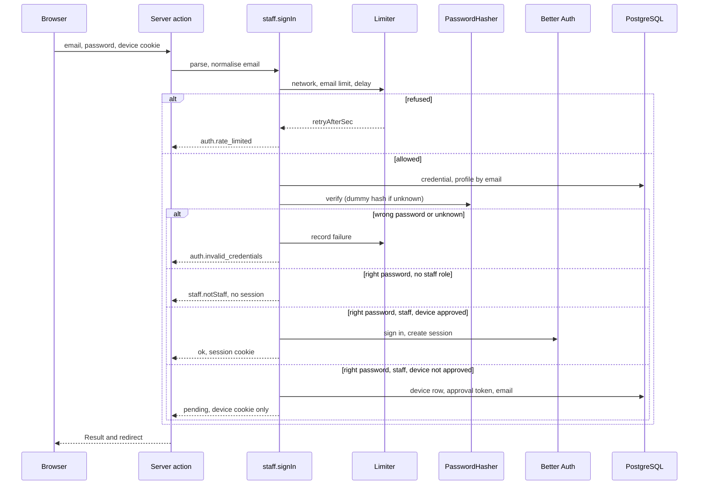
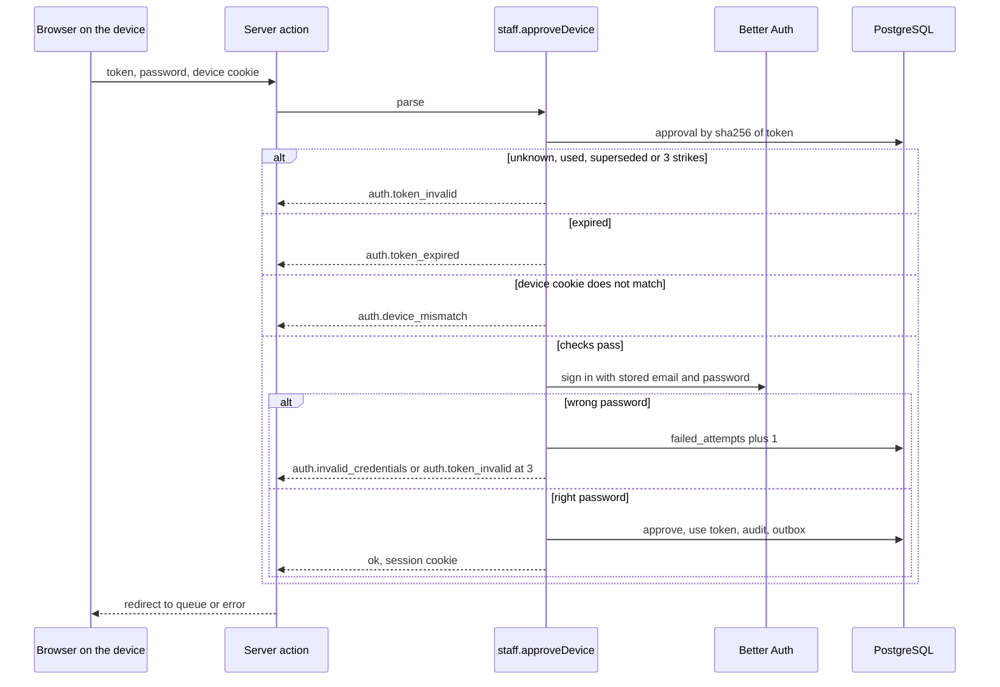
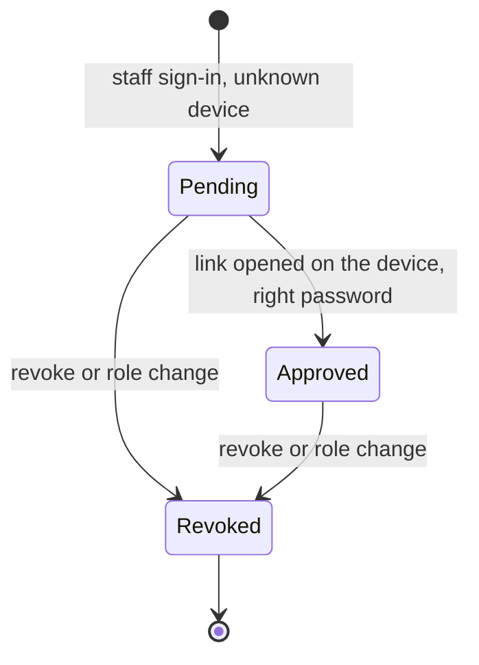
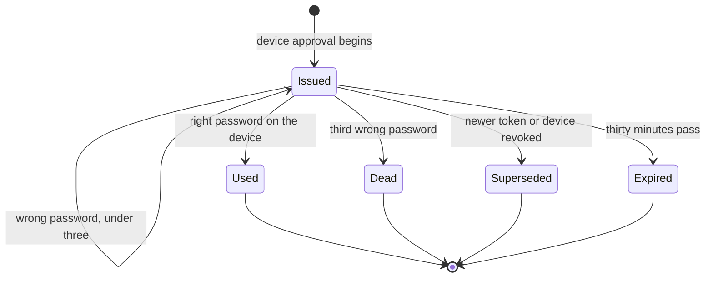
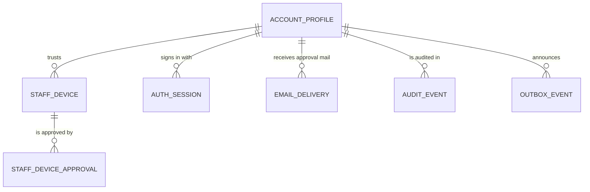

# Functional specification — U10 `t-103-staff-access-and-devices`

Draft written ahead of the stage. The lead finalises it when the workflow reaches this Unit; then it moves to `<record>/construction/t-103-staff-access-and-devices/functional-design/`.

Unit U10 (kind `library`, size XL) delivers T-103 for US3.2 (AC3.2.4, AC3.2.5) and US11.1 (AC11.1.2, AC11.1.6). It is treated as **high risk** (authentication, staff identity, authorization): `team.md` puts every auth Unit in the high-risk class, although the Units table marks U10 "—" (finding F10). Collaborators run, a separate agent writes 3–5 adversarial tests (§ 12.2), and the owner signs off in writing. Lead perspective: architect. Support perspectives written into this file: developer (mechanics, transactions, test design: §§ 10–11) and security engineer (threats, cookies, enumeration, authorization order: § 12), synthesised in § 13.

Inputs: listed in `functional-design-questions.md` (Context). This file is the source of truth for the workflows and state transitions. The data shape is in `entities.md`; the decision logic is in `rules.md`; the screens are in `frontend-components.md`. The answers to Questions 1–10 (all A) were chosen on the owner's standing instruction of 2026-10-27 and await the owner's confirmation.

## 1. What changes, in one paragraph

Staff keep using the ordinary accounts built by U8; `account_profiles.staff_role` marks them. A staff account gets its role and its capabilities in the `Actor` **only** when the request carries an approved `rk_staff_device` cookie for that same account and the account is active (Q3). This makes the device the security boundary for every page, server action and route handler, not only for the console layout, which only redirects. Staff sign-in on `/admin/sign-in` checks the password through the `PasswordHasher` port before any session exists (Q1): a non-staff account gets `staff.notStaff` with no session, an unknown device starts a device approval (no session, an emailed 30-minute single-use link), and an approved device gets a session through the library's own sign-in (Q2). The approval link works only in the browser that holds the device cookie it was issued for (Q4), asks for the password again, allows three wrong passwords before the token dies (a counter column, Q5), and then approves the device, signs the holder in and appends `account.securityEvent {kind: deviceApproved}` for the in-app notice (Q6). `/admin/security` lists and revokes trusted devices and reuses U9's session and password parts. `account.stepUp` verifies the password and sets a 5-minute HMAC-signed `rk_stepup` cookie bound to the account and the session; `defineCommand`'s `requires.stepUp` checks it after the capability check and returns `auth.step_up_required`; every attempt is audited with its purpose (Q7). `StepUpSheet` and `useStepUp()` give every later Unit the re-run-after-recheck pattern. The masthead gets a read-only `RoleChip` and a `StaffAccountMenu`. `staff.setStaffRole` is built as a command with no UI (Q8). The release needs no more than this on the staff side (FD-088).

## 2. As is (baseline on `main`, 2026-10-28)

- **Contracts.** `actor.ts` has the eight `Capability` values, `ALL_CAPABILITIES`, the `Actor` with `staffRole?`, `capabilities`, `stepUp?: {rechecked_at}`, and `capabilitiesForRole(role, config.capabilities)` with the FD-051 table already right (`retention.bulk` and `config.write` only for `super_admin`). `config-values.ts` has `capabilities.{admin,moderator}.{revealIdentity,originalEvidence}`, defaults all `false`. `schemas/staff.ts` has `BeginDeviceApprovalInput {deviceSecret?}`, `ApproveDeviceInput {token, password}`, `ListStaffDevicesInput`, `RevokeStaffDeviceInput {deviceId}`, `SetStaffRoleInput {accountId, role|null}`. `schemas/account.ts` has `StepUpInput {password}`. `errors.ts` has `auth.step_up_required`, `auth.device_unapproved`, `auth.token_invalid`, `auth.token_expired`; there is no code for a device mismatch and none for "not staff". `view-models/security.ts` has `TrustedDeviceVM {id, label, approvedAt?, lastSeenAt}` (no `firstSeen`, no `current`).
- **Database.** `staff_devices` (`account_id`, `device_hash`, `label`, `first_seen_at`, `last_seen_at`, `approved_at`, `revoked_at`, `created_at`) has no index on `(account_id, device_hash)`. `staff_device_approvals` (`device_id`, `token_hash` unique, `expires_at`, `used_at`, `created_at`) has no failure counter. `email_deliveries.category` already allows `device_approval`. `rk_worker` holds no privilege on either staff table (FD-037 default-deny; `02-data-model.md` §16), and this Unit changes no grant. The seed sets `staff_role` for `mod_rashid` (moderator), `admin_nadia` (admin) and `sa_founder` (super_admin) and seeds no device.
- **Application.** Empty on `main`; U8 creates `defineCommand`, the ports, `authorization/capabilities.ts` (a stub: `[]` unless super_admin, `TODO(T-103)`), the command context and the first `queueEmail` (U8 draft BR4.3, BR6.1).
- **Web.** `app/[locale]/admin/layout.tsx` renders the console chrome with no guard (`TODO(T-103)`). `admin/sign-in`, `admin/approve-device` and `admin/security` are placeholder pages inside that layout, so they show the full chrome (ISS-100, owner T-103). `components/admin/Masthead.tsx` already dropped the prototype's `#role` switcher and the account entry (`TODO(T-103)`). `components/shared/Sheet.tsx` is the shared dialog. No `server/auth.ts` yet (U8).
- **i18n.** Every `staff.*`, `email.staff.deviceApproval.*`, `errors.auth.stepUpRequired`, `errors.auth.deviceUnapproved` and `admin.role.{sa,admin,mod}` key exists in both files. `admin.role.current` was removed by T-006 (ISS-054). `staff.device.body` and `email.staff.deviceApproval.body` write "30" / "৩০" into the string (Q10).

## 3. Settled before this stage

FD-016, FD-022 (reveal toggles off by default, Super Admin controls them), FD-018 (security boundaries stay out of runtime config), FD-034 (same account system, specified screens, seeded staff), FD-035 (device approval is real), FD-051 (retention bulk super_admin only), FD-053 (D-001 review gates this Unit), FD-065 (Notification owns notifications and the outbox, Administration owns audit), FD-071 and the owner's answer on U8 R1 (mail recipients through `to_email_enc`, the worker holds a mail-only key), FD-088 (staff side narrowed: this Unit is in release 1), C2 (`queueEmail` category `device_approval`, caller U10), C5 (the `staff.*` operations and the capability function are U10's), C15 (`account.securityEvent` kind `deviceApproved`). See `functional-design-questions.md` § "Settled before this stage".

## 4. Workflows

Every command runs `parse → authorize → load → decide → persist` with its audit and outbox rows in one transaction (01-conventions §3), inside U8's command context. "Library" means the Better Auth server API, called only from inside a command (U8 BR7.9).

### WF0 — Code Generation order (the Unit end to end)

1. **Gate.** The owner's approval of the D-001 auth-screen review is recorded in this Unit's record with its date, covering `en`, `bn`, both themes and 360 px (FD-053). Without it, Code Generation does not start (R1).
2. **Baseline.** `pnpm infra:up`; `pnpm check` and `pnpm smoke` green on the Bolt branch; U8 merged; read the open rows of § 2 and the Context; record the counts.
3. **Dependency check (BR12.4).** Better Auth is the only library this Unit leans on in a new way (server-side session creation and password verification, Q1, Q2); reuse U8's entry if it is under 3 days old, otherwise re-check and append.
4. **Contracts first.** 03 §2 gains `auth.device_mismatch`, then `errors.ts`; `StepUpInput` gains `purpose`; `STEP_UP_PURPOSES` in `enums.ts`; `TrustedDeviceVM` gains `firstSeen` and `current`; the `capabilitiesForRole` comment names FD-051.
5. **Application.** `authorization/capabilities.ts` (`resolveCapabilities`, replacing U8's stub), `authorization/step-up.ts` (sign and verify), `defineCommand`'s `requires.stepUp` and the step-up audit flag, `modules/account/commands/{staff-sign-in,staff-begin-device-approval,staff-approve-device,staff-revoke-device,staff-set-staff-role,step-up}.ts`, `queries/staff-devices.ts`, `authorization.ts`.
6. **Database.** Migration (Q5), `repositories/staff.ts`, schema test.
7. **Notification wiring.** `device_approval` as an always-sent category in `queueEmail` and `email.staff.deviceApproval` in the params allowlist on both sides (`queue-email.ts`, `mail-send.ts`).
8. **Web.** `server/auth.ts` (`getStaffContext`, the device gate in `getActor`, step-up cookie parsing), `server/actions/{staff,step-up}.ts`, the route-group split (§ 6.4), the four screens, `RoleChip`, `StaffAccountMenu`, `StepUpSheet` + `useStepUp()`.
9. **i18n.** New keys and the two changed strings, both files (Bengali flagged).
10. **Tests (§ 11)**, `pnpm check`, `pnpm smoke`, `pnpm test:int`, `npx impeccable detect apps/web/src --no-advisory`, `pnpm contrast`.
11. **Records.** Reference-document corrections (BR12.2), `ISSUES.md` (BR12.3), hand-off.

### WF1 — Staff sign-in (`staff.signIn {email, password}`, from `/admin/sign-in`)

Text fallback: the server action passes the email, password and device cookie to `staff.signIn`; the limiter may refuse first (no read, no password check); otherwise the command reads the credential and profile, verifies the password once through the port (a dummy hash for an unknown email); a wrong password or unknown email records a failure and returns the generic error; a right password on an account without a staff role returns `staff.notStaff` and creates nothing; a staff account on an approved device is signed in through the library; a staff account on any other device starts WF2 and gets no session.

1. Normalise the email; compute the email key and network key exactly as U8's `account.signIn` does (BR4.2): the staff route and the patient route share one counter per address and per network.
2. Refusals before any read (U8 BR3.2): network limit, email limit, progressive delay → `auth.rate_limited {retryAfterSec}`.
3. Read the credential and the profile through the account repository. Verify the password through the `PasswordHasher` port; for an unknown or deleted address verify against a fixed dummy PHC so the work is the same (BR4.3).
4. Wrong password, unknown or deleted address → record a failure on both keys (and U8's severe notice applies), `auth.invalid_credentials`.
5. Suspended or banned with the right password → `auth.account_suspended` (U8 BR3.6), no session, no device row.
6. Right password, `staff_role` null, or status not `active` → `forbidden` with message key `staff.notStaff`; clear the email key; no session, no device cookie, no row (BR4.4).
7. Right password and staff: read `rk_staff_device`; compute `getStaffContext` for `(accountId, sha256(secret))` (BR2.3).
   - `approved` → create the session (WF7), update `last_seen_at`, audit `staff_signed_in {deviceId}`, redirect to a validated `next` or `/<locale>/admin/queue` (BR3.5).
   - `unknown`, `pending` or `revoked` → WF2, then redirect to `/<locale>/admin/approve-device`.

### WF2 — Begin a device approval (`staff.beginDeviceApproval`, internal to WF1)

1. Account rate check: 3 approval emails per hour per account (`action:account:<id>:device-approval`). Over → `auth.rate_limited {retryAfterSec}` shown on the sign-in screen; nothing written (BR5.6).
2. Device cookie: if the browser has no cookie, or its pair for this account is `revoked`, mint a new 32-byte secret (BR2.1) and set `rk_staff_device` on the response.
3. One transaction:
   - find the open (not revoked) `staff_devices` row for `(account_id, device_hash)` or insert one with `label` from the user agent (U8's label helper), `first_seen_at = last_seen_at = now`;
   - mark every unused, unexpired approval of that device `used_at = now` (superseded, BR5.5);
   - insert `staff_device_approvals {device_id, token_hash = sha256(token), expires_at = now + 30 min, failed_attempts = 0}` for a fresh 32-byte token;
   - `queueEmail(tx, {accountId, category: device_approval, messageKey: email.staff.deviceApproval, params: {link: APP_URL/<locale>/admin/approve-device?token=<token>}, dedupeKey: device-approval:<approvalId>})`;
   - audit `account:<id>` action `staff_device_requested {deviceId}`.
4. The token never appears in a log, an audit row, a job payload or a result; it exists only in the email's `params` until the delivery is final (U8 BR6.8).

### WF3 — Pending screen (`/admin/approve-device` without a token)

1. Read `rk_staff_device`. No cookie, or no open device row with an unused, unexpired approval for that hash → redirect to `/<locale>/admin/sign-in` (BR5.7).
2. Otherwise render the pending panel: `staff.device.title`, `staff.device.body` with `{minutes}` (Q10), a `.kv` with the newest pending device's label and `first_seen_at`, and outside production the dev-only Mailpit link (`auth.verify.devInbox`, ISS-021). No account name, no email, no resend button.

### WF4 — Approve the device (`staff.approveDevice {token, password}`)

Text fallback: the command finds the approval by the token's hash; an unknown, used, superseded or exhausted token is invalid, a late one is expired; the browser must carry the device cookie the token was issued for; only then is the password checked through the library's own sign-in; a wrong password adds a strike (the third ends the token); a right one approves the device, uses the token, writes the audit and outbox rows and returns with the session cookie.

1. Network rate check, 10 attempts per 15 minutes (`action:net:<hmac>:device-approve`) (BR5.8).
2. Look up `sha256(token)`. Not found, `used_at` set, or `failed_attempts >= 3` → `auth.token_invalid`. `expires_at <= now` → `auth.token_expired` (BR5.2).
3. Load the device and the profile. The device is revoked, the account has lost its staff role, or its status is not `active` → `auth.token_invalid` (BR5.4).
4. Read `rk_staff_device`; `sha256(secret)` must equal the device's `device_hash`; otherwise `auth.device_mismatch`, no strike, no password check (Q4, BR5.3).
5. Verify the password by signing in through the library with the account's stored email and the entered password, inside the `staff.approveDevice` context (WF7, Q2). Wrong → in one transaction `failed_attempts + 1` and audit `staff_device_approval_failed {deviceId, attempt}`; at 3 the result is `auth.token_invalid` and the token is dead; below 3 → `auth.invalid_credentials`.
6. Right → one transaction: `staff_devices.approved_at = now`, `last_seen_at = now`; the approval `used_at = now`; audit `staff_device_approved {deviceId}`; outbox `account.securityEvent {accountId, kind: deviceApproved}` (Q6). If that transaction fails, revoke the session the library created and return `internal` (BR5.9).
7. Any session already on that browser for another account is signed out first (BR5.10). Redirect to `/<locale>/admin/queue`.

### WF5 — Trusted devices and revoke (`/admin/security`)

1. `staff.listDevices` (query, staff): open and approved devices of the actor's account → `TrustedDeviceVM {id, label, firstSeen, lastSeen, approvedAt?, current}`; `current` when the row's hash equals the request's cookie hash. Revoked rows are not listed (BR6.1).
2. `staff.revokeDevice {deviceId}` (staff): the device must belong to the actor's account, else `not_found` (BR6.2). One transaction: `revoked_at = now`, every unused approval of the device `used_at = now`, audit `staff_device_revoked {deviceId, current}`. If it is the current device: also revoke the current session, clear `rk_staff_device` and redirect to `/<locale>/admin/sign-in` (BR6.3).
3. A revoked device stops working on its next request on every browser, because `getActor` reads the device state per request (BR3.2).
4. Sessions and change password reuse U9's components and U8's commands inside the staff layout (BR6.4).

### WF6 — Step-up (`account.stepUp {password, purpose}`)

1. Authenticated (any account, staff or not: U39's account deletion uses it too).
2. Account rate check: 5 failures per 15 minutes on `action:account:<id>:step-up` (03 §4). Over → `auth.rate_limited` (BR7.7).
3. Verify through the `PasswordHasher` port against the account's credential. Wrong → record a failure, audit `step_up_failed {purpose}` (AC11.1.2 "the failed attempt recorded"), `auth.invalid_credentials` (BR7.6).
4. Right → audit `step_up {purpose}`; set `rk_stepup` = `base64url(payload).base64url(HMAC-SHA256(key, payload))` with payload `{a: accountId, s: sessionId, u: until}`, `until = now + 300 s`, key derived from `BETTER_AUTH_SECRET` with the label `rk_stepup` (BR7.1, BR7.2); cookie `httpOnly`, `sameSite strict`, `secure` iff https, `path /`, `maxAge 300`. Result `ok({rechecked_at})`.
5. `getActor` sets `Actor.stepUp = {rechecked_at}` only when the signature verifies, `a` equals the actor's account, `s` equals the current session id and `u > now` (Clock port) (BR7.3).
6. `requires.stepUp` in `defineCommand` is checked after `authenticated`, `staffRole` and `capability`; a missing or stale step-up returns `auth.step_up_required` and runs the command's `onRefused` if it declares one (BR7.4). The command's own audit row then carries `step_up: true` (BR7.5).
7. Client: `useStepUp().withStepUp(fn)` calls `fn`; on `auth.step_up_required` it opens `StepUpSheet`; on a successful `account.stepUp` it re-runs `fn` once; on cancel it returns the original error (BR7.8).

### WF7 — Creating a staff session (used by WF1 and WF4)

Inside the staff command context, call the library's email sign-in with the account's stored email (read through the account repository) and the password the person just typed (Q2). U8's `session.create.before` hook allows the session because the context is `staff.signIn` or `staff.approveDevice` and the command has already decided; the library's response headers carry the session cookie, which the server action forwards. No other path creates a staff session.

### WF8 — Every request: `getActor()` and `getStaffContext()`

1. U8's `getActor` resolves the session, the profile and the status (U8 BR4.3).
2. If the profile has a `staff_role` and its status is `active`: read `rk_staff_device`, hash it, look up the open row for `(accountId, hash)` → `approved | pending | unknown | revoked` (BR2.3). Only `approved` puts `staffRole` and `resolveCapabilities(role, config.capabilities)` into the Actor; anything else gives `staffRole` undefined and `capabilities []` (Q3, BR3.1).
3. Parse `rk_stepup` (WF6 step 5).
4. `getStaffContext()` (server helper, cached per request) returns `{role?: StaffRole, device}` for the console layout's redirect decision only; it is never an authorization input to a command (BR3.4).

### WF9 — Console guard (`app/[locale]/admin/(console)/layout.tsx` and every console page)

1. No session → redirect `/<locale>/admin/sign-in?next=<path>` (BR3.3).
2. Session, but `getStaffContext().role` undefined → the same redirect; the sign-in screen then answers `staff.notStaff` only after a correct password.
3. Staff role but device not approved → redirect `/<locale>/admin/approve-device` (WF3 sends the visitor on to sign-in when nothing is pending).
4. Approved → render the Chart Tray chrome with `RoleChip` and `StaffAccountMenu`.
5. The layout is not the boundary: layouts do not re-run on client navigation (Next.js authentication guide, read 2026-10-28), so every console page and every staff query and command checks the Actor itself (BR3.2).

### WF10 — Set a staff role (`staff.setStaffRole {accountId, role|null}`)

Requires `staffRole: ['super_admin']` and `stepUp`. Refuses the actor's own account (`forbidden`), a target that is not `active` (`conflict`), and a role equal to the current one (no change, `ok`). One transaction: update `account_profiles.staff_role`; when the role is removed or changed, revoke every `staff_devices` row of the target (`revoked_at = now`) so the new role starts from a fresh approval; audit `account:<target>` action `staff_role_changed {from, to, step_up: true}`. No UI in this Unit (Q8, BR8.1–BR8.3).

## 5. State transitions

### 5.1 Staff device (`staff_devices`, per account and cookie hash)

| From | Event | To | Rule |
|---|---|---|---|
| (none) | staff sign-in from an unknown device (right password) | pending | BR2.2, BR5.1 |
| pending | approval with the right password on that device | approved | BR5.3 |
| pending, approved | revoke (owner, or role change) | revoked | BR6.2, BR8.3 |
| revoked | staff sign-in from the same browser | (a new row) pending, with a new secret | BR2.2 |

Text fallback: a device starts pending when a staff member signs in from it with the right password; the approval link with the right password, opened on that device, makes it approved; a revoke or a role change makes it revoked, and a revoked row is never reused (signing in again from that browser creates a new pending row with a new cookie secret). Only approved gives staff powers.

### 5.2 Approval token (`staff_device_approvals`)

| From | Event | To | Rule |
|---|---|---|---|
| (none) | WF2 | issued (30 min, 0 strikes) | BR5.1 |
| issued | right password on the matching device | used | BR5.3 |
| issued | wrong password, strikes < 3 | issued (strikes + 1) | BR5.2 |
| issued | third wrong password | dead (refused as invalid) | BR5.2 |
| issued | a newer token for the same device, or the device revoked | superseded (`used_at` set) | BR5.5, BR6.2 |
| issued | `expires_at` reached | expired | BR5.2 |
| issued | link opened in another browser | issued (unchanged, refused as mismatch) | BR5.3 |

Text fallback: a token is issued with no strikes and lives 30 minutes; a wrong password adds a strike and the third kills it; a right password on the matching device uses it; a newer token or a revoke supersedes it; time expires it. A mismatched browser changes nothing. Every end state is refused on reuse.

### 5.3 Step-up window (per account and session, in the cookie)

`none` → `account.stepUp` with the right password → `active until now + 5 min` → `none` at `until` (refused from 5:00:01), on sign-out (the session id no longer matches), or on another account's session in the browser. A wrong password leaves it as it was and is audited.

### 5.4 Account status

Unchanged from U8 (`functional-spec.md` § 5.1 of U8's draft). This Unit performs no status transition; it reads `active` as the only status that carries staff powers (BR3.1).

## 6. Interfaces

### 6.1 Commands and queries (all in `modules/account`)

| Name | Input | Requires | Limit | Audit (`account:<id>`) | Outbox | Expected errors |
|---|---|---|---|---|---|---|
| `staff.signIn` | `StaffSignInInput {email, password}` (new, `.strict()`) | anonymous | U8's sign-in keys and delay (shared) | `staff_signed_in` (approved device) | — | `auth.invalid_credentials`, `auth.account_suspended`, `auth.rate_limited`, `forbidden` (`staff.notStaff`) |
| `staff.beginDeviceApproval` | internal from `staff.signIn`; `BeginDeviceApprovalInput` kept for the contract | staff credential just verified | 3 / h / account | `staff_device_requested` | — | `auth.rate_limited` |
| `staff.approveDevice` | `ApproveDeviceInput {token, password}` + device cookie | anonymous or any session | 10 / 15 min / network; 3 strikes / token | `staff_device_approved`, `staff_device_approval_failed` | `account.securityEvent {deviceApproved}` | `auth.token_invalid`, `auth.token_expired`, `auth.device_mismatch`, `auth.invalid_credentials`, `auth.rate_limited` |
| `staff.listDevices` (query) | `ListStaffDevicesInput` | `staffRole` (any) | — | — | — | — |
| `staff.revokeDevice` | `RevokeStaffDeviceInput {deviceId}` | `staffRole` (any), owner of the device | — | `staff_device_revoked` | — | `not_found` |
| `staff.setStaffRole` | `SetStaffRoleInput` | `staffRole: [super_admin]`, `stepUp` | — | `staff_role_changed` | — | `forbidden`, `conflict`, `auth.step_up_required` |
| `account.stepUp` | `StepUpInput {password, purpose}` | authenticated | 5 failures / 15 min / account | `step_up`, `step_up_failed` | — | `auth.invalid_credentials`, `auth.rate_limited` |

`validation`, `forbidden` and `internal` apply to every command (C-rules). `requires.staffRole` and `requires.capability` read only the Actor, so they inherit the device gate (BR3.1).

### 6.2 Functions and ports

| Name | Where | Shape |
|---|---|---|
| `capabilitiesForRole(role, toggles)` | `contracts/actor.ts` (kept; the one table, C5) | `Capability[]` |
| `resolveCapabilities(staffRole \| undefined, config)` | `application/authorization/capabilities.ts` | `[]` for no role, else `capabilitiesForRole(role, config.capabilities)`; replaces U8's stub |
| `signStepUp(key, payload)`, `verifyStepUp(key, value, now)` | `application/authorization/step-up.ts` | pure; `Crypto.hmac` (U8 adds `hmac`) and constant-time compare |
| `StaffRepository` | `database/repositories/staff.ts` | `findOpenDevice(tx, accountId, hash)`, `insertDevice`, `touchDevice`, `approveDevice`, `revokeDevice`, `listDevices(accountId)`, `insertApproval`, `supersedeApprovals(deviceId)`, `findApprovalByHash`, `recordApprovalFailure`, `useApproval`, `findPendingByHash(hash)` (for WF3, no account data), `setStaffRole` |
| Ports used | U8's | `PasswordHasher`, `RateLimiter`, `ConfigProvider`, `Crypto`, `Clock`, `IdGenerator`, `AuditWriter`, `Outbox`, `JobQueue` (through `queueEmail`), `Logger`, `AccountRepository` |

### 6.3 Server actions

- `apps/web/src/server/actions/staff.ts`: `staffSignIn`, `approveDevice`, `revokeDevice`, `setStaffRole` (unused by any UI in this Unit; exported for tests and T-408 later). Each is `parse → getActor → command → Result`; sign-in and approval forward the library's `Set-Cookie` headers and set `rk_staff_device` when WF2 minted one.
- `apps/web/src/server/actions/step-up.ts`: `stepUp({password, purpose})` sets `rk_stepup`.

### 6.4 Routes (URLs unchanged; folders regrouped)

| Folder | URLs | Guard | Chrome |
|---|---|---|---|
| `admin/layout.tsx` (shared) | every `/admin/*` | none | `admin.css`, `noindex`, skip link, demo marker, `main` |
| `admin/(public)/layout.tsx` | `/admin/sign-in`, `/admin/approve-device` | none | brand, staff badge, language and theme controls; no nav, tab bar or crumbs (closes ISS-100) |
| `admin/(account)/layout.tsx` | `/admin/security` | WF9 | as `(public)` plus `StaffAccountMenu` |
| `admin/(console)/layout.tsx` | `/admin`, `/admin/queue`, `/admin/queue/[code]`, `/admin/evidence`, `/admin/providers`, `/admin/config`, `/admin/notifications` | WF9 | full Chart Tray chrome, `RoleChip`, `StaffAccountMenu` |

The existing console pages move into `(console)/` unchanged (owned-path addition, BR12.1). `/admin/security` is guarded, against T-103 step 3, which put it with the public screens; 03 §1 says "any staff" (BR3.6).

## 7. Cookies

| Cookie | Value | Flags | Lifetime | Rule |
|---|---|---|---|---|
| `rk_staff_device` | 32 random bytes, base64url (43 characters) | `HttpOnly`, `SameSite=Lax` (so the emailed link, a top-level navigation, still carries it), `Secure` iff `APP_URL` is https, `Path=/` | 90 days | BR2.1 |
| `rk_stepup` | `base64url({a, s, u}).base64url(HMAC-SHA256)` (under 200 bytes) | `HttpOnly`, `SameSite=Strict`, `Secure` iff https, `Path=/` | 300 s | BR7.1 |
| session cookie | U8's | U8 BR4.2 | 30 days absolute | U8 BR4.1 |

The database stores `sha256(device secret)` only; the step-up cookie is not stored. Sign-out clears `rk_stepup` and keeps `rk_staff_device` (U8 BR4.5).

## 8. Email and copy

| Message key | Category | Trigger | `{link}` target | New copy |
|---|---|---|---|---|
| `email.staff.deviceApproval` | `device_approval` (always sent, essential) | WF2 | `/<locale>/admin/approve-device?token=` (30 min) | no (the body keeps its literal digits, Q10) |

New or changed keys (Bengali flagged for the owner's review, FD-042 precedent):

| Key | en | bn | Why |
|---|---|---|---|
| `errors.auth.deviceMismatch` (new) | Open this link on the device you signed in from. | যে ডিভাইস থেকে সাইন ইন করেছিলেন, সেই ডিভাইসেই এই লিংকটি খুলুন। | Q4 |
| `staff.device.body` (changed) | We sent an approval link to your staff email. It expires in {minutes} minutes. Open it on this device. | আপনার স্টাফ ইমেইলে অনুমোদনের লিংক পাঠিয়েছি। এটি {minutes} মিনিটে মেয়াদোত্তীর্ণ হবে। এই ডিভাইসেই সেটি খুলুন। | Q10: digits from `formatNumber` |
| `staff.account.menu` (new) | Account | অ্যাকাউন্ট | `StaffAccountMenu` button label; the D-001 prototype used the staff name, which the console does not show |

Every other string the screens use already exists in both files: `staff.*`, `auth.email`, `auth.password`, `auth.showPassword`, `auth.hidePassword`, `auth.errorSummary`, `auth.security.*`, `auth.signOut`, `auth.verify.devInbox`, `admin.role.{sa,admin,mod}`, `errors.auth.*`. `staff.notStaff` is used as the `messageKey` of the `forbidden` result (BR4.4).

## 9. Raised for the owner, not decided

- **R1 — FD-053 gate.** The owner's approval of the D-001 auth-screen review is not yet recorded ("Owner reviews waiting" in `OWNER-REVIEW-QUEUE.md`). The queue row says "on the new look"; for the staff screens the look is Chart Tray, which FD-091 keeps, so the review covers the existing `ui-design-prototype/admin/` screens. Code Generation does not start until the approval is in this Unit's record (WF0 step 1).
- **R2 — Unit risk class.** `unit-of-work.md` marks U10 not high-risk, but `team.md` puts every auth Unit in the high-risk class. This design follows `team.md` (collaborators, adversarial tests, written sign-off); a Units revision can correct the table.

### Findings (proposed ISS rows, each `Found in U10 T-103`)

| Id | Sev | Finding | Owner (suggested) |
|---|---|---|---|
| F1 | S2 | T-103 step 6 approves the device named in the token from whichever browser opens the link. An attacker with a stolen password triggers an approval; the real staff member opens the email on their own browser and approves the attacker's device. Closed by Q4 A (the link works only with the matching device cookie, as the email copy already says) | U10 T-103 |
| F2 | S2 | T-103 step 3 and U8's capability stub give capabilities from the role alone; a staff account signed in on the patient route from an unapproved device could call staff server actions directly, because the layout guard does not protect actions (and does not re-run on client navigation). Closed by Q3 A | U10 T-103 |
| F3 | S2 | FD-053's D-001 approval is not recorded (R1); it blocks Code Generation | founder |
| F4 | S3 | `staff.device.body` and `email.staff.deviceApproval.body` write "30" / "৩০" into the strings, against `auth-screens-spec.md` §5 ("Bengali numerals are applied by the formatter") and T-103's checklist. Screen fixed (Q10 A); the email keeps literal digits | U10 T-103 (screen), U34 T-405 (email params, if wanted) |
| F5 | S3 | Storyboard step 24 signs in as `sa_founder` on browser B without the device approval that per-account trust requires there | U6 CR-012 or U44 T-505 (storyboard wording) |
| F6 | S4 | T-103 step 9 is stale: T-008 already removed the `#role` switcher, and T-006 removed `admin.role.current` (ISS-054) | U10 T-103 |
| F7 | S4 | Three names for one function: C5 `capabilitiesOf`, code `capabilitiesForRole`, task `resolveCapabilities`. The code's table stays the one source; `resolveCapabilities` is a thin wrapper | Contract Design note |
| F8 | S4 | C5 lists `stepUp` among U8's account commands; U8's draft and T-103 make it U10's | Contract Design note |
| F9 | S4 | `RoleChip.tsx` is in both T-103's (`components/admin/auth/`) and T-406's owned paths; T-103 builds it, T-406 reuses it | U37 T-406 |
| F10 | S3 | U10 is marked not high-risk in `unit-of-work.md` (R2) | Units revision |
| F11 | S4 | `staff_devices` has no index on `(account_id, device_hash)` and `staff_device_approvals` no failure counter (Q5) | U10 T-103 |
| F12 | S4 | T-103's acceptance row "audit + notifications rows" becomes "audit row + `account.securityEvent {deviceApproved}` outbox row" until U34 T-405 routes it (Q6) | U10 T-103, U34 T-405 |
| F13 | S4 | `ASSUMPTION(T-103)`: `staff_devices.last_seen_at` moves at staff sign-in and approval only, not on every request | U10 T-103 |
| F14 | S4 | `TrustedDeviceVM` lacks `firstSeen` and `current`, which spec §4.3 shows; added (additive) | U10 T-103 |
| F15 | S4 | Spec §4.4 puts `step_up: true` in the action's audit row; T-103 step 8 audits `step_up {purpose}`. Both are written (BR7.5, BR7.6) | U10 T-103 |
| F16 | S4 | The open ISS-108 (S2, audit details are a shallow denylist) also covers this Unit's audit rows; this design writes only ids, enums and counts and relies on U8's audit helper fixing ISS-108 | U8 T-101 |

## 10. Developer view — mechanics

### 10.1 Command context and the library

- U8's `CommandContext` gains the command names `staff.signIn`, `staff.approveDevice` and `account.stepUp`. U8's `session.create.before` hook allows a session in `staff.signIn` and `staff.approveDevice` only when the command has set `ctx.staffSessionAllowed = true` just before the library call (BR4.5). A library sign-in started from the staff commands without that flag creates nothing.
- The password check of WF1 reads the credential row through U8's account repository (credential read) and verifies with the `PasswordHasher` port; the dummy PHC for unknown addresses is a module constant hashed once at start-up with the production parameters (BR4.3).
- WF7 uses the library's public email sign-in API. The spike in WF0 step 3 confirms on the pinned 1.7.x that it can be called server-side with headers and returns the `Set-Cookie` header; if not, the fallback is the library's documented server-side session creation for a known user, recorded in the hand-off (Q2).

### 10.2 Step-up key and comparison

`key = HKDF-SHA256(ikm = BETTER_AUTH_SECRET, salt = "rogikotha", info = "rk_stepup", 32 bytes)`, computed once per process. Verification parses exactly two base64url parts, recomputes the HMAC and compares with `crypto.timingSafeEqual` before parsing the JSON; any parse error is "no step-up". `until` is seconds since the epoch from the `Clock` port.

### 10.3 Migration

Next free number at Code Generation: `staff_device_approvals.failed_attempts smallint not null default 0`, and a unique index `staff_devices (account_id, device_hash) where revoked_at is null` (one open row per account and cookie). Forward-only, a drizzle custom migration whose journal timestamp is later than the previous one (the CR-006 lesson); `migrations.int.test.ts`'s exact count goes up by one with a comment. No grant change: `rk_worker` holds nothing on either table and keeps nothing.

### 10.4 Route groups

Moving the console pages into `(console)/` changes no URL. `lib/cookies.ts` `activeAdminTab` keeps returning `undefined` for the three auth paths. The `[locale]` layout still derives `data-app="admin"` from the `/admin` prefix (01-conventions §7.3), so `admin.css` scoping is unchanged.

### 10.5 Client step-up

`useStepUp()` lives in `components/shared/StepUpSheet.tsx` (a client module). `withStepUp(fn)` keeps a single pending call; it never stores the password; the sheet's input is cleared on close. The patient side reuses it for U39's account deletion; U9's `SecuritySettings` swap happens only if U9 has merged (otherwise a follow-up ISS row, T-103 owned paths).

## 11. Developer view — test design

Builders and synthetic data only (`mod_rashid`, `admin_nadia`, `sa_founder`, `shirin_88`, `*.demo@example.test` in unit tests); names read as sentences; each test can fail.

| Level | File | What it proves |
|---|---|---|
| contracts | `actor.test.ts` (extended) | the 3 roles × 4 toggle states = 12 rows; `super_admin` always all eight; no admin or moderator row holds `retention.bulk` or `config.write`; no role → `[]` (BR1.1–BR1.4) |
| application | `authorization/capabilities.test.ts` | `resolveCapabilities` for no role, each role, every toggle; config with unknown keys rejected by the strict schema (BR1.5) |
| application | `authorization/step-up.test.ts` | sign then verify; one byte tampered in payload or MAC; another account; another session; `until` = now (refused), now − 1 s (refused at 5:01 with `FakeClock`); malformed values (BR7.1–BR7.3) |
| application | `modules/account/commands/staff-*.test.ts`, `step-up.test.ts` | WF1 branches (unknown, wrong, suspended, non-staff, pending account, approved device, unknown device), shared counters with `account.signIn`; WF2 supersede, 3 per hour; WF4 every refusal, 3-strike, mismatch without a password check (no hasher call recorded), compensation on a failed transaction; revoke owner check and current-device sign-out; setStaffRole self-refusal, step-up requirement, device revocation; step-up audit on success and failure, 6th failure refused; `requires.stepUp` order after capability and `onRefused` called; one audit assertion per command |
| database | `repositories/staff.int.test.ts` | each method; partial unique index (a revoked row and a new open row for one pair); `failed_attempts` default; the migration applies from empty |
| web | `server/auth.int.test.ts` (extended) and `server/actions/staff.int.test.ts` | the browser-less flow against compose PostgreSQL and Mailpit: sign-in unknown device → Mailpit `email.staff.deviceApproval.subject` → approve → session → `getActor` has role and capabilities; the same session without the device cookie → `capabilities []`; cookie copied to `admin_nadia` → `unknown`; device hash never equals the cookie value; revoked device refused on the next request; cookie flags and sizes; `next` outside `/admin` ignored; logs hold no token, secret or email |
| component | `components/admin/auth/*.test.tsx`, `components/shared/StepUpSheet.test.tsx` | the four screens and the sheet render in `en` and `bn`; error summary and field errors; `RoleChip` `title` per role (`staff.role.chipTitle` with `admin.role.*`); `StaffAccountMenu` links; `withStepUp` re-runs once after success and returns the error on cancel |
| smoke | `*.smoke.test.ts` | `resolveCapabilities('admin', allOn)` has no `retention.bulk`; a capability-gated test command refuses an account Actor without an approved device |

Every T-103 acceptance row maps to one of these (§ 17).

## 12. Security view — threat cases and adversarial angles

### 12.1 Threat cases

| # | Threat | Defence | Rules |
|---|---|---|---|
| T1 | Stolen staff password used from the attacker's device | no session before approval; email link plus password; the link only works on the device that asked | BR4.6, BR5.1–BR5.3 |
| T2 | Real staff member approves the attacker's device by opening the link on their own browser | device-cookie binding of the token (Q4) | BR5.3 |
| T3 | Intercepted approval link | 30 min, single use, superseded by a newer one, password required, 3 strikes, bound to the device | BR5.1–BR5.5 |
| T4 | Device cookie copied to another staff account | trust per `(account, hash)` | BR2.3 |
| T5 | Staff powers without the console: a patient-route session of a staff account calling staff server actions or route handlers | role and capabilities in the Actor only with an approved device; every command and query checks the Actor | BR3.1, BR3.2 |
| T6 | Non-staff session on `/admin` | per-request Actor check in pages and commands; the guard redirects | BR3.2, BR3.3 |
| T7 | Revoked device or demoted staff keeps working | device state and role read on every request; role change revokes the devices | BR3.1, BR6.3, BR8.3 |
| T8 | Step-up cookie forged, replayed after expiry, moved to another account or session | HMAC with a derived key, `until`, account and session binding, `SameSite=Strict`, constant-time compare | BR7.1–BR7.3 |
| T9 | Step-up brute force or silent failures | 5 failures / 15 min; every attempt audited | BR7.6, BR7.7 |
| T10 | Role escalation through config | `super_admin` fixed in code; config toggles only the two flags; strict schema | BR1.1–BR1.5 |
| T11 | Enumeration of staff emails through the staff route | same refusals, counters, delay and work as patient sign-in; `staff.notStaff` only after the right password | BR4.1–BR4.4 |
| T12 | Brute force split across the two sign-in routes | one counter per address and network across both | BR4.2 |
| T13 | Email flooding by repeating sign-in | 3 approval emails per hour per account | BR5.6 |
| T14 | Open redirect through `next` | only same-origin paths under `/<locale>/admin/` | BR3.5 |
| T15 | Token leakage through the referrer or logs | `Referrer-Policy: no-referrer` on the approval page; tokens and secrets never logged, audited or returned | BR5.11, BR10.1 |
| T16 | CSRF on staff actions | POST-only server actions with Next's origin check; `SameSite` cookies | BR7.1, U8 BR4.2 |

### 12.2 Adversarial angles for the separate agent (3–5 tests, defensive regression checks)

Each is a regression test that must stay green; it fails if the defence regresses.

1. **Device-trust bypass.** Sign `mod_rashid` in through the patient route (U8 `account.signIn`) in a browser without an approved device. Call every staff server action this Unit ships (`revokeDevice`, `setStaffRole`), a test command with `requires: {capability: 'reports.read'}` and one with `requires: {staffRole: ['moderator']}`, and request `/en/admin/queue` and `/en/admin/security`: every command returns `forbidden` and writes nothing; the pages redirect; `getActor` shows `staffRole` undefined and `capabilities []`. Repeat with a revoked device and with an approved device belonging to `admin_nadia`.
2. **Approval link abuse.** Start an approval for `mod_rashid` in browser X; open the link in browser Y (no cookie, then `admin_nadia`'s cookie): `auth.device_mismatch`, no password check, X's device stays pending. Then in X: reuse after success → `auth.token_invalid`; a token at 30:01 (`FakeClock`) → `auth.token_expired`; three wrong passwords then the right one → `auth.token_invalid`, device pending; start a second approval and use the first link → `auth.token_invalid`; remove the role between request and approval → `auth.token_invalid`, no session.
3. **Cookie and token storage.** After the full cycle, scan `staff_devices`, `staff_device_approvals`, `audit_events.details`, `outbox_events.payload`, `pgboss.job.data`, final `email_deliveries.params` and captured logs for the device secret, the approval token and the email address: none found; `device_hash` equals `sha256(secret)` and never the secret. A random or truncated `rk_staff_device` gives `unknown` and no 500.
4. **Step-up forgery and order.** Flip one byte of the payload, of the MAC, swap `a` for another account, reuse a cookie after sign-out and sign-in (new session id), present it at 5:01: each gives `auth.step_up_required`. A moderator without `identity.reveal` calling a `capability + stepUp` command with a valid step-up gets `forbidden`, not the step-up prompt. Six wrong step-up passwords in 15 minutes: the sixth is `auth.rate_limited`; every wrong attempt has a `step_up_failed` audit row.
5. **Escalation and enumeration.** With every config toggle on, neither `admin_nadia` nor `mod_rashid` holds `retention.bulk` or `config.write`, and a `retention.bulk` test command refuses both with nothing written; a config value with an extra key (`capabilities.admin.retentionBulk: true`) is rejected by the schema. On `/admin/sign-in`, an unknown address, a wrong password for `shirin_88` and a wrong password for `mod_rashid` give byte-identical results apart from the correlation id, the same `retryAfterSec` sequence, and timing medians within 15 %; alternating attempts between the staff and patient routes for one address hit the shared delay.

## 13. Synthesis — decisions and why

- **The device is enforced in the Actor, not the layout (Q3).** Next.js layouts do not re-run on client navigation and do not protect server actions; putting role and capabilities behind the device check in `getActor` makes every later staff Unit safe by construction, with one place to test.
- **Password before session (Q1), public library API for the session (Q2).** No session row ever exists for a non-staff account or an unknown device on this route, which is what AC3.2.5 and the "no `auth_sessions` row" acceptance row say; the library still owns session creation.
- **The link belongs to the device (Q4).** The email copy already tells the holder to open it "on that device"; enforcing it closes the one path by which a careful staff member could trust an attacker's browser.
- **Strikes in the table (Q5).** Three strikes per token must survive a restart; one small column and an index for the per-account lookup.
- **Notices through the outbox (Q6).** Notification owns its tables (FD-065) and C15 already names `deviceApproved`; writing the rows here would duplicate them once U34 routes the event.
- **Every step-up attempt audited with a fixed purpose (Q7).** AC11.1.2 needs the failed attempt recorded; a closed enum keeps free text out of audit details.
- **`setStaffRole` built without UI (Q8), no step-up on Sign out everywhere (Q9), formatter digits on screen (Q10).** Each is the narrower option that meets the contracts and the acceptance rows.
- **Shared sign-in counters, guarded `/admin/security`, newest token only, a role change revokes devices, staff powers only for active accounts.** Each closes a concrete gap the task's literal steps leave open; none changes a hard rule or a data boundary.
- **What this design does not decide:** R1 (FD-053 approval) and R2 (risk class).

## 14. If the owner changes an answer

- **Q1 → B:** the staff command calls the library sign-in first with the session hook refusing; the spike must show a refused session still tells a right password from a wrong one. **→ C:** a session row exists for a moment for non-staff and unknown-device sign-ins; the acceptance row "no `auth_sessions` row" is read as "none left"; adversarial angle 1 adds a race test.
- **Q2 → B:** WF7 calls the library's internal session creation; a schema test pins the session row shape; one Argon2 verify fewer on the approved path.
- **Q3 → B:** the Actor keeps role and capabilities without a device check; `getStaffContext` becomes an extra `requires.approvedDevice` on every staff command, which every later Unit must remember; adversarial angle 1 changes to test each command.
- **Q4 → B:** step 4 of WF4 goes; the email and screen copy change to "open this link"; T2 stays open (raised as an S2 ISS row).
- **Q5 → B:** no migration column; strikes reset on restart (ISS row); the unique index still needs a migration, or the lookup takes the newest open row by query.
- **Q6 → B:** WF4 inserts one `staff_notifications` row (kind `security`) and one `notifications` row (kind `security`) in its transaction; U34 must then skip `deviceApproved` to avoid a duplicate.
- **Q7 → B:** `StepUpInput` stays `{password}`; only successful step-ups are audited; AC11.1.2's "failed attempt recorded" is met by the action's own refusal row where one exists.
- **Q8 → B:** `staff.setStaffRole` is not built; C5 marks it deferred; roles stay seed-only (ISS row).
- **Q9 → B:** `account.signOutEverywhere` gains `requires.stepUp`; U9's button goes through `withStepUp`.
- **Q10 → B:** `email.staff.deviceApproval` params become `{link, minutes}` with `minutes` formatted per locale in the worker; the allowlist in `queue-email.ts` and `mail-send.ts` changes accordingly.

## 15. Owned paths and recorded additions

T-103's owned paths are as listed in its task file. These additions follow from this design and are recorded in the hand-off and one ISS row (BR12.1):

- `packages/contracts/src/{errors.ts, enums.ts, schemas/account.ts, view-models/security.ts}` (Q4 error code, step-up purposes, `StaffSignInInput` in `schemas/staff.ts`, `TrustedDeviceVM` fields) and `docs/implementation/03-routes-and-contracts.md` §1, §2, §4 corrections.
- `packages/application/src/{command.ts, command-context.ts}` (U8's files: `requires.stepUp`, the step-up audit flag, the staff session flag).
- `packages/application/src/modules/notification/internal/queue-email.ts` (category `device_approval`, allowlist entry).
- `packages/database/src/{schema/account.ts, migrations/**}`, `migrations.int.test.ts` (count).
- `apps/web/src/app/[locale]/admin/**` (route groups: every existing console page moves into `(console)/`), `apps/web/src/server/container.ts` (staff repository wiring).
- `packages/test-support/src/fakes/**` (a `StaffRepository` fake).
- `docs/implementation/01-conventions.md` §5 (Actor: staff powers need an approved device) and `02-data-model.md` §2 (the new column and index).

## 16. Risks to verify in Code Generation

- On the pinned Better Auth 1.7.x: the email sign-in API called server-side returns the session cookie headers; U8's `session.create.before` hook can read the command context; there is no library endpoint left open that creates a session for a staff account outside these commands (U8 BR7.1 allowlist).
- U8's account repository exposes the credential read and the stored email for an account id in the web tier only.
- `cookies().set` from a server action that then calls `redirect()` keeps both the library's session cookie and `rk_staff_device` (Next 16.3.4).
- `SameSite=Lax` sends `rk_staff_device` on the top-level navigation from the webmail (Mailpit) to the approval page in Chrome and Firefox.
- U45 T-011's patient restyle keeps `.overlay`, `.sheet`, `.field`, `.btn` and `.note` in `patient.css`, so `StepUpSheet` still renders on the patient side.
- The next migration number and that no other Unit touched the staff tables meanwhile.

## 17. Acceptance mapping (T-103 acceptance checks)

| T-103 check | Where it is met |
|---|---|
| Non-staff refused (`shirin_88`, no `auth_sessions` row) | WF1 step 6; BR4.4, BR4.5 |
| Guard (302 → sign-in with `next`) | WF9; BR3.3, BR3.5 |
| Unknown device (pending screen, Mailpit, no session cookie) | WF1 step 7, WF2, WF3; BR4.6, BR5.1 |
| Approve (3 wrong → invalid; right → queue, `approved_at`, audit + event) | WF4; BR5.2, BR5.3, BR5.9; F12 |
| Known device → straight to the queue | WF1 step 7; BR2.3 |
| Revoke current → signed out, approval required again | WF5; BR6.2, BR6.3 |
| Cookie per account | WF8; BR2.3 |
| Capabilities, 12 combinations, FD-051 | BR1.1–BR1.4 |
| Step-up, 5 min, refused at 5:01 | WF6; BR7.1–BR7.4 |
| Cookie flags and sizes | § 7; BR2.1, BR7.1 |
| FD-051 bulk retention super_admin only (AC7.3.4), super_admin keeps it (AC7.3.3) | BR1.2, BR1.3 |
| FD-053 D-001 gate recorded | WF0 step 1; R1 |
| FD-053 screens match the approved review | `frontend-components.md`; BR10.6 |
| `pnpm check` | BR11.3 |

## Entity-relationship view (derived from `entities.md`)

Text fallback: a staff account (an account profile with a staff role) has many devices, each with many approval tokens over time; it signs in with sessions, receives approval emails, and every device, approval, step-up and role event writes an audit row; an approval appends one outbox event. The device cookie, the step-up cookie, the staff context, the capability table and the Actor are value objects with no table.

## Rules summary (derived from `rules.md`)

- **Capabilities (BR1.1–BR1.5):** one table in code; super_admin all; admin and moderator fixed sets plus two toggles; FD-051; strict config.
- **Device cookie and trust (BR2.1–BR2.4):** 32-byte secret, hashed at rest; new secret for a revoked pair; per-account lookup; four states.
- **Actor and guard (BR3.1–BR3.6):** staff powers only with an approved device and an active account; checks at the data, not the layout; redirects; safe `next`; staff context is not an authorization input; security page guarded.
- **Staff sign-in (BR4.1–BR4.6):** same refusals as patient sign-in; shared counters; password through the port first; `staff.notStaff` only after the right password; sessions only by the staff commands; unknown device gets none.
- **Device approval (BR5.1–BR5.11):** 30-minute single-use token; strikes; device binding; role and status re-checked; newest token only; email limit; pending screen; network limit; compensation; one account per browser; referrer.
- **Devices (BR6.1–BR6.4), step-up (BR7.1–BR7.8), roles (BR8.1–BR8.3), email and notices (BR9.1–BR9.4), privacy and UI (BR10.1–BR10.7), verification (BR11.1–BR11.5), records (BR12.1–BR12.5).**

## Sources

- `docs/implementation/tasks/T-103-staff-access-and-devices.md` (goal, steps 1–10, acceptance checks, tests, threat notes 1–8, hard-rule checklist, amendments FD-051, FD-053).
- `docs/status/decision-log.md` FD-016, FD-018, FD-022, FD-034, FD-035, FD-037, FD-041, FD-051, FD-053, FD-065, FD-071, FD-088, FD-091.
- `aidlc/spaces/default/intents/261011-aidlc-adoption/inception/contract-design/contract-summary.md` C1, C2, C5, C15 and "Contract ownership rules".
- `aidlc/spaces/default/intents/261011-aidlc-adoption/inception/units-generation/unit-of-work.md` U10, `unit-of-work-dependency.md`, `unit-of-work-story-map.md`.
- `aidlc/spaces/default/intents/261011-aidlc-adoption/inception/requirements-analysis/requirements.md` FR6, FR7, FR100, FR101, FR102; `inception/user-stories/stories.md` US3.2 (AC3.2.4, AC3.2.5), US11.1 (AC11.1.1–AC11.1.6), AC7.3.3, AC7.3.4.
- `docs/implementation/01-conventions.md` §3, §5, §7–§11; `02-data-model.md` §0, §2, §11, §12, §16; `03-routes-and-contracts.md` §1–§5; `05-demo-storyboard.md` (seeded accounts, steps 18 and 24); `docs/design/auth-screens-spec.md` §0, §2, §4, §5, §6.
- `ui-design-prototype/admin/app.js` (`renderSignin`, `renderApprove`, `renderSecurity`, `renderStaffAccount`, `openStepUp`, the auth handlers) and `admin/index.html`.
- Code on `main` listed in § 2; `docs/implementation/ISSUES.md` rows ISS-021, ISS-023, ISS-024, ISS-025, ISS-034, ISS-054, ISS-100, ISS-108; `docs/aidlc-migration/OWNER-REVIEW-QUEUE.md` (FD-053 review waiting; U8 R1 mail-only key).
- `docs/aidlc-migration/design-drafts/t-101-better-auth-adapter/` (U8's draft: command context, hooks, `getActor`, `queueEmail`, sign-in counters).
- Next.js authentication guide, read 2026-10-28 (https://nextjs.org/docs/app/guides/authentication): "Layouts and auth checks" (layouts do not re-render on navigation; check close to the data source) and "Server Actions" (treat them as public endpoints).
