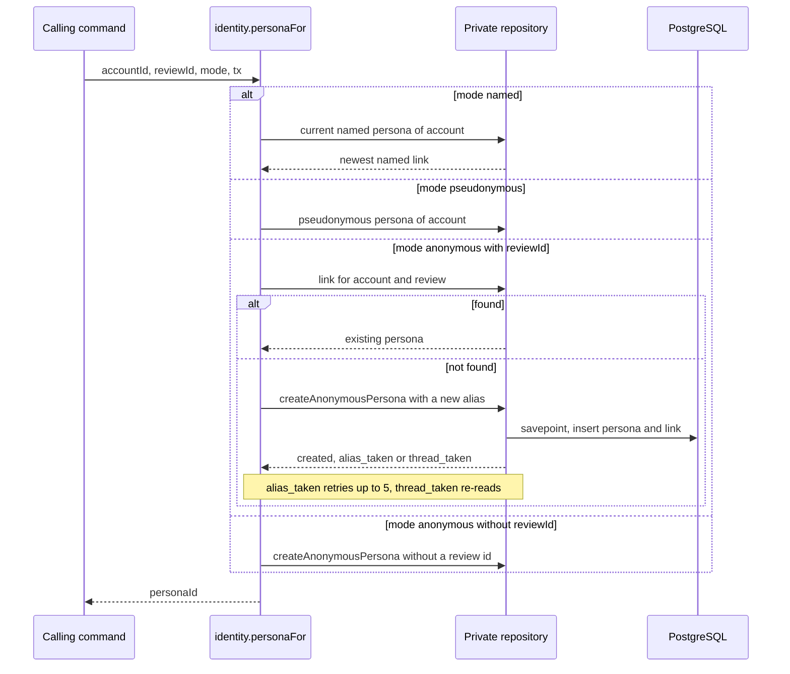
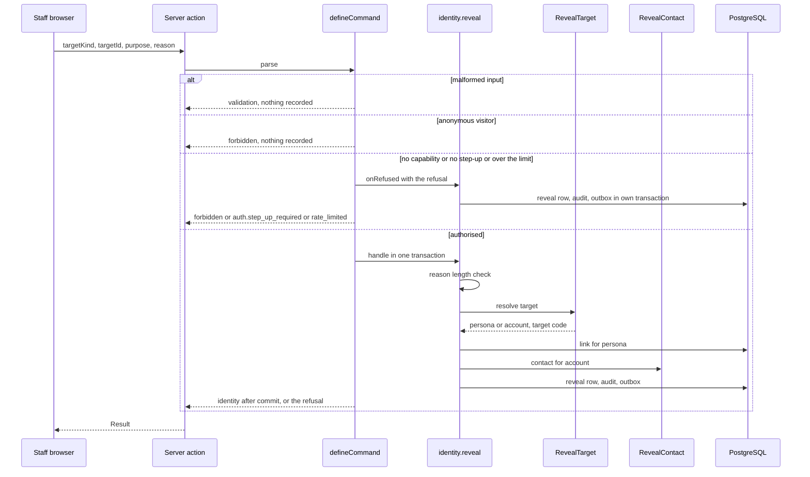
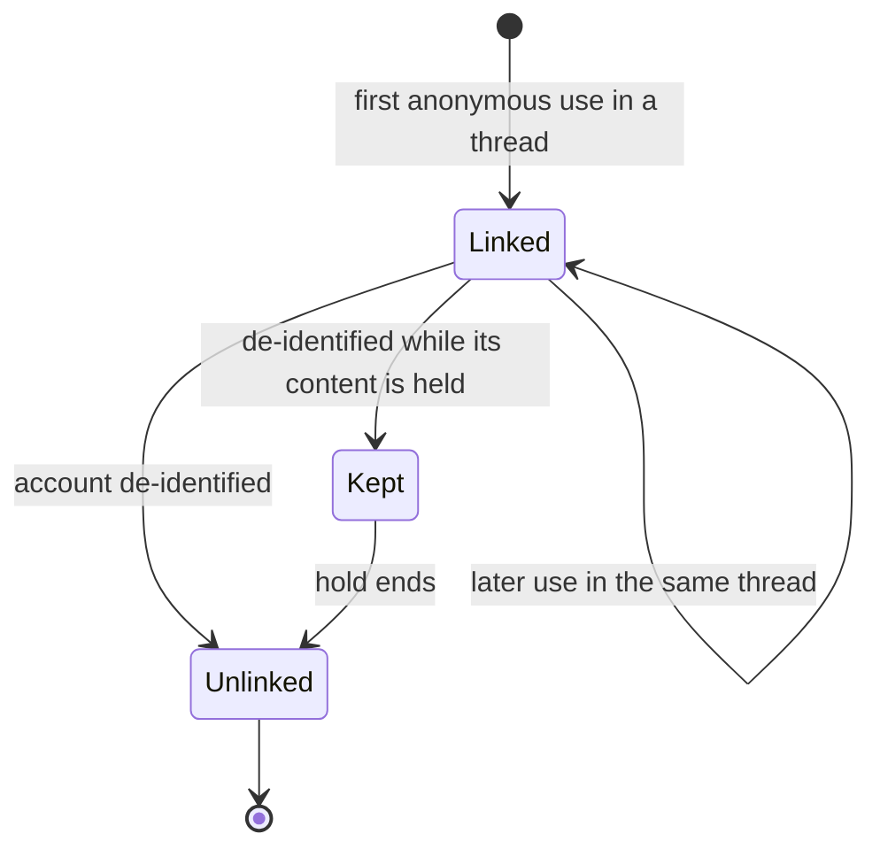
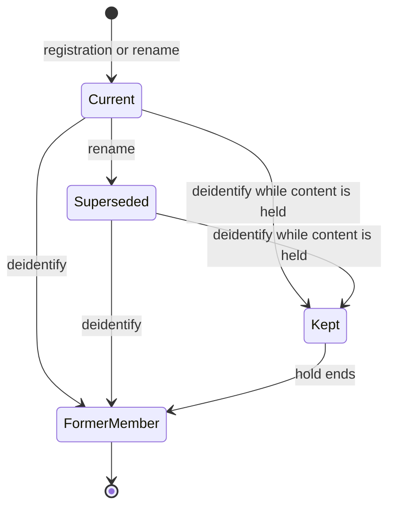
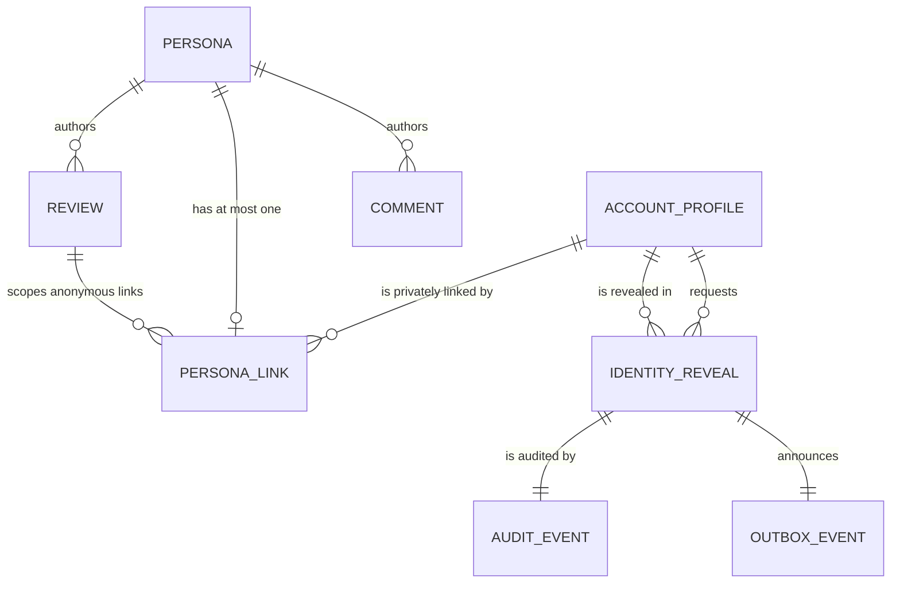

# Functional specification — U11 `t-104-identity-module`

Draft written ahead of the stage. The lead finalises it when the workflow reaches this Unit; then it moves to `<record>/construction/t-104-identity-module/functional-design/`.

Unit U11 (kind `library`, size L, **high risk**: identity) delivers T-104 for US3.3 (AC3.3.1–AC3.3.6). Collaborators run, a separate agent writes 3–5 adversarial tests (§ 12.2), and the owner signs off in writing before the phase gate. Lead perspective: architect. Support perspectives written into this file: developer (mechanics, transactions, test design: §§ 10–11) and security engineer (threats, linkage leaks, recording guarantees: § 12), synthesised in § 13.

Inputs: listed in `functional-design-questions.md` (Context). This file is the source of truth for the workflows and state transitions. The data shape is in `entities.md`; the decision logic is in `rules.md`. T-104 has no screens (the reveal button is U35 T-406's, the bylines are rendered by U15 T-202, U27 T-307 and U31 T-402), so there is no `frontend-components.md`. Questions 1–14 were answered A on the owner's standing instruction of 2026-10-27. Question 15 was answered B by the owner on 2026-10-29 ("Former member"). Questions 16–18 and R1 were decided by the agent under the owner's no-questions instruction of 2026-10-29. All but Question 15 await the owner's confirmation.

## Refreshed 2026-10-29

Re-checked against T-010 as merged on `main` (`14c21a9`), the refreshed T-101 draft, the T-103 draft (refreshed the same day), the refreshed T-201 draft, the T-202, T-207 and T-301 drafts, and the owner's answers in `docs/aidlc-migration/OWNER-REVIEW-QUEUE.md`. A second pass the same day aligned the byline and the private queries with the refreshed T-301 draft (its Questions 8 and 18, F25 and F29) and recorded the owner's approval of U10's staff screens. What changed:

- **Owner's answer to Q15: "Former member".**
  - De-identification scrubs the stored snapshot of a named or pseudonymous persona: `deidentified_at`, empty `display_name`, no `username`, hue 0, with a check constraint (Q16).
  - Every projection then shows `byline.formerMember`, with no username and no profile link.
  - FD-<next: Former member> is proposed in § 9.1 and appended before any code. It amends C4, T-410 step 3 and the Units table, and FD-090's held-link function must apply the same scrub.
- **R1 decided under the no-questions instruction**, consistently with T-301 Q16 A and T-207 Q1:
  - no anonymity caveat on the public experience page;
  - U26 T-306 rewords the composer note without the legal or staff-access sentence;
  - the lawful-access explanation sits in a section of both the Terms and the Privacy Policy.
  - This Unit changes no copy for it. The FD entries are U21 T-301's and U20 T-207's.
- **One byline shape (Q17, aligned with T-301 Q18 A and F25).** The T-201, T-202 and T-301 drafts defined their own bylines, without the alias that AC3.3.2 needs and without a former-member form.
  - Identity now owns the one `BylineVM` (also used as `PersonaPublicVM`).
  - Its fields: `personaKind`; `displayName` for named personas; `username` for pseudonymous personas; `profileUsername` for both, the profile link (FR11, AC10.2.1); `alias` for anonymous personas, the thread alias shown as the author's name; `initials`; `avatarHue`; `formerMember`.
  - `identity.bylinesFor({personaIds, surface})`: the thread surface (experience page, comments, the thread's reactions) carries the alias, the list surface (cards, facility accounts, search, profile lists) does not, so the alias stays inside its thread (T-301 F25).
  - A former member and an anonymous persona never carry `profileUsername`.
  - This replaces the first refresh's "a named byline carries no username" (T-202 Q7 A): FR11 and AC10.2.1 already put the username and display name together on the public profile, so the link reveals nothing new (T-301 Q18 A, decided by the agent under the owner's no-questions instruction of 2026-10-29). T-202 renders a named author as a profile link (F33).
  - T-201, T-202 and T-301 take byline data from `identity.bylinesFor` (F27, S2).
- **T-101 as refreshed.**
  - ISS-108 is fixed by U8 (Q12 now only checks that it is closed). U8's `defineCommand` already runs `onRefused` for every refusal after `authenticated` and commits a `recorded` handler error. This Unit no longer edits `command.ts` (F12 closed).
  - `getActor` leaves `personaId` unset and reads no persona; this Unit fills it through `identity.currentPersonaOf` (F9 closed in U8).
  - U8's `AccountRepository.insertDefaultPersonas` (`TODO(T-104)`) is a second writer of `persona_links`. It is removed, and `account.register` calls `identity.createDefaultPersonas` (F28).
  - `RevealContact` reads the email with U8's `findOwnEmail`.
  - `ConfigProvider.current()` is asynchronous, behind T-103's capability resolution.
- **T-010 boundaries and gate.**
  - `application` holds an opaque `Tx` and imports no external package, so it cannot open a savepoint. The alias and thread retries move into the private repository, which returns a typed clash result (Q18, F29).
  - Random bytes come from a new `Crypto.randomBytes` port method (F30).
  - The worker cannot reach `modules/identity` (FD-093 (2), U8's import-graph test).
  - In the same commit: `PgIdentityRepository` leaves `STUB_REPOSITORIES` (ISS-294); both migration-count pins go up by one; `repositories-superset.test.ts` is updated; ISS-290 closes with the new fakes.
  - Gate: the 80% floor in `domain`, `application`, `database`, `contracts`, `test-support` and `apps/web`; the eleven-step `pnpm check` after T-011; CI green before merge; the web integration test runs in U8's `web-int` project.
  - § 6.4 lists the element of every file.
- **T-301 (refreshed).** Two internal operations it asks for are built here (its Question 8 refresh, F29):
  - `identity.ownsAnyPersona({accountId, personaIds}) → boolean`, for the repeat-episode flag of FD-080, so Review never receives an account id;
  - `identity.currentPersonaOf` returns `{namedPersonaId, pseudonymousPersonaId}`, so the write-free preview finds the pseudonymous persona.
- **T-106.** The `RevealTarget` registry is filled when the identity module is built, so a `web-int` test in `apps/web` registers its own resolver without `test-support` (T-106 § 12 item 3, its M21).
- **T-103.**
  - Staff powers need an approved device. The step-up flag is written by the command's own audit builder.
  - The owner approved the staff sign-in and device-approval screens as they are in the prototype (2026-10-29), so U10 may be built and this Unit no longer waits on that review (F31 resolved).
- **Seed.** Aliases for seeded anonymous personas come from the domain alias function with a seeded byte source keyed by the corpus persona key. Re-seeding is stable, and later corpus additions (for example T-201's r25) get one too. The generated corpus files stay untouched.
- **New findings** F26–F33 (§ 9.2). Every S1 or S2 among them is designed out, except F27, which binds the sibling drafts when they are finalised. F31 is resolved by the owner's approval of U10's screens.

## 1. What changes, in one paragraph

The Identity module becomes the only code that knows which account stands behind a public persona (AD-3). `personas` stay public snapshots with no account column; `persona_links` and `identity_reveals` are read and written only by one private repository, which the composition root hands to the identity module and to nothing else (Q8). Registration gets its two default personas through `identity.createDefaultPersonas` on the register transaction, replacing U8's interim insert in the account repository. `identity.personaFor` returns one of three personas (BR2.1–BR2.3):
- the current named persona;
- the pseudonymous persona;
- or the one anonymous persona of that account in that review thread. It is created on first use with a random alias `patient-xxxx` that is unique among aliases and derived from nothing. The private repository retries alias and thread clashes inside its own savepoint (Q18).

The one byline shape, `BylineVM`, carries:
- `personaKind`;
- the display name and initials for a named persona, the username and initials for a pseudonymous one, and the thread alias for an anonymous one;
- the avatar hue;
- and, after deletion, only `formerMember`.

Named and pseudonymous bylines also carry `profileUsername` for the profile link (FR11, AC10.2.1); a list surface (cards) leaves the alias out, so it stays inside its thread. It never carries an id (Q17). `identity.reveal` is a capability- and step-up-gated command. Every attempt by a signed-in account, granted or refused, writes one `identity_reveals` row, one audit row on the `identity` stream and one `identity.revealed` outbox event. A granted reveal returns the username and display name, plus the email address for a Super Admin only (Q3). Rename creates a new named persona. De-identification deletes the account's links except those of held personas. It also scrubs the named and pseudonymous snapshots, so they read "Former member" (Q15 B, Q16, FD-<next: Former member>). One forward-only migration adds:
- the indexes and a deferrable link key;
- a reveal target-kind enum, and the reveal purpose and outcome columns;
- a nullable requester role;
- `personas.deidentified_at` with its scrub check (§ 7).

## 2. As is (baseline: `main` at `14c21a9` with T-010 merged, read 2026-10-29, plus the Units this one depends on as their refreshed drafts describe them)

- **Schema.** `schema/identity.ts` has `personas` (`kind identity_mode`, `display_name`, `username null`, `avatar_hue smallint null`), `persona_links` (`persona_id` pk, `account_id` cascade, `review_id null`, no index besides the pk) and `identity_reveals` (`requester_account_id` not null, `requester_role staff_role` **not null**, `target_kind target_kind` — the shared enum `review | facility_review | comment | evidence | profile`, with no `report` (ISS-090) — `target_id uuid`, `reason text`, `granted bool`, `revealed_account_id null`). `persona_links.review_id` references `reviews(id) ON DELETE SET NULL` through `0004_deferred_fks.sql`, **not deferrable**, while `reviews.author_persona_id` is `NOT NULL` (F5). `0003_triggers.sql` makes `identity_reveals` append-only.
- **Grants.** `0001_grants_part1.sql` revokes everything on `persona_links` and `identity_reveals` from `rk_worker`; `0001` grants it SELECT on `personas` ("live, not ratified", FD-092). `migrations.int.test.ts` already proves the `persona_links` denial; nothing proves the `identity_reveals` denial.
- **Repositories and the tests T-010 pinned.**
  - `repositories/identity.ts` is a stub: `createPersona`, `linkPersona`, `findPersonaFor`, `publicProjection` and `recordReveal`, all `NotImplemented('T-104')`.
  - `not-implemented.test.ts` lists `PgIdentityRepository` in `STUB_REPOSITORIES` and expects every method to throw (ISS-294).
  - `test-support` has `FakeIdentityRepository`, whose `linkPersona` stores no `mode`, so `findPersonaFor` never finds a link it made (ISS-290). `repositories-superset.test.ts` requires the fake to cover the stub's method names.
  - `migrations.int.test.ts` and `validator-probes.int.test.ts` (P8) both pin the applied-migration count: 9 on `main`, plus one each for U8 and U10.
- **Boundaries and gate (T-010, FD-093).**
  - `application` imports `domain` and `contracts` only, with no external package and no Node built-in, and holds `Tx` as an opaque type.
  - `domain` imports nothing. Only `server/container.ts` builds adapters.
  - The worker may import application code only through `@rogikotha/application/worker`, never `modules/identity/`, and by no other specifier, a relative path included (FD-093 (2); lint plus U8's import-graph test).
  - `pnpm check` is nine steps, eleven after U45 T-011. `test:coverage` holds 80% lines per package with untested files counted, so `domain` and `application` stop being exempt once they hold code (U8 gives them code first).
  - CI runs on `bolt/**`.
- **Contracts.** `schemas/identity.ts` has `PersonaForInput`, `PublicProjectionInput`, `RevealIdentityInput {targetKind: TARGET_KINDS, targetId, reason: min(1)}`, `CreateDefaultPersonasInput`, and `AccountsOfInput = z.unknown()` (`TODO(T-104)`). No `view-models/persona.ts`. `actor.ts` has `identity.reveal` and the capability table (U10 keeps it).
- **Seed.** `seed-accounts.ts` inserts named and pseudonymous personas and links directly (FD-040 exception). `seed-content.ts` `ensureAnonymousPersona` inserts the 12 anonymous personas of the corpus (CR-012's port, one anonymous account each), whose `display_name` is the corpus `displayName.en`, the English word `Anonymous`. It links facility-review ones with `review_id null` and back-fills the review id of doctor-review ones after the review row exists (F5, F6). The corpus files under `test-support/src/corpus/` are generated ("Do not hand-edit") from the prototype. Named authors carry synthetic `named_<slug>` usernames, some with hyphens (ISS-159, ISS-264).
- **i18n.** `byline.anonSentence`, `byline.identity.real|pseudo`, `byline.commentBy`, `byline.yourIdentity`, `compose.identity.anon`, `admin.reveal.audited`, `admin.done.revealed`, `admin.notif.kind.identityReveal` exist in both files. There is no `errors.identity.*` key and no "Former member" key.
- **From U8 (refreshed draft).**
  - `defineCommand({name, input, requires, sendsMail?, onRefused?, handle})` with the order `authenticated → verifiedEmail → notRestricted → staffRole → capability → stepUp → owner`. It runs `onRefused({actor, input, refusal})` in its own committed transaction for every refusal after `authenticated`. A handler `err` commits only when it is marked `recorded: true`, a flag stripped before the result leaves the application (U8 BR7.11). F12 is designed out there.
  - The explicit context `{input, actor, ports, tx}` with an opaque `Tx`.
  - The ports, among them `Crypto` (`encrypt`, `decrypt`, `hash`, `randomToken`, `hmac`; no random-bytes method), the asynchronous `ConfigProvider`, `RateLimiter`, `AuditWriter` with the recursive allowlist that closes ISS-108 (U8 BR8.2), and `Outbox`.
  - `getActor` maps a session through the pure `resolveActor` and leaves `personaId` unset, with no persona read (U8 F26, closing this draft's F9).
  - `account.register` writes the two personas and their links through `AccountRepository.insertDefaultPersonas` (`TODO(T-104)`).
  - `AccountRepository.findOwnEmail(accountId)` exists. `web-int` and `worker-int` projects exist.
- **From U10 (draft refreshed 2026-10-29).** Staff powers are in the `Actor` only with an approved device (U10 Q3), and capabilities come from `resolveCapabilities` over `(await config.current()).capabilities`. `STEP_UP_PURPOSES` includes `identity.reveal`. The step-up flag `step_up: true` is written by each step-up-gated command's own audit builder (U10 BR7.5). The owner approved U10's staff screens on 2026-10-29 (its R1 precondition is met), so U10 is not held back by that review (F31 resolved).

## 3. Settled before this stage

FD-008 and FD-022 (limits of anonymity and staff access are described only in the Terms and Privacy Policy), FD-015 (one stable alias per review thread, never linked to the profile, reactions, mentions or other anonymous reviews), FD-016 (Super Admin always; Admin and Moderator only with their toggle, off by default), FD-065 (Notification owns `staff_notifications` and the outbox; Administration owns audit), FD-067 (the `RevealTarget` and `RevealContact` ports break the cycle), FD-069, FD-077, FD-079 (de-identification in the web transaction; held posts keep their persona link), FD-086 (no reporter id in any payload, view model or log), FD-090 (T-309's `SECURITY DEFINER` function deletes held links later; not built here), FD-092 (`rk_worker` holds nothing on `persona_links` or `identity_reveals`), FD-093 (the import boundaries; the worker may not value-import `modules/identity/`), C4 and C15 (`contract-summary.md`), AD-3, the U8 and U10 shapes above. The owner's answer to Q15 (B, "Former member", 2026-10-29). The agent-decided T-301 Q16 A (no public anonymity caveat; reworded composer note) and the owner's T-207 Q1 (the lawful-access section on both Terms and Privacy), which settle R1. The agent-decided T-301 Q8 A (`ownsAnyPersona`, the pseudonymous id of `currentPersonaOf`) and Q18 A (`profileUsername` on named and pseudonymous bylines). The owner's approval of U10's staff screens (2026-10-29). See `functional-design-questions.md` § "Settled before this stage".

## 4. Workflows

Every command runs `parse → authorize → load → decide → persist` with its audit and outbox rows in one `UnitOfWork` transaction (01-conventions §3), through U8's `defineCommand`. "Internal" operations take the caller's transaction (`tx`) and write no audit row of their own unless stated; the calling command audits the change it is part of.

### WF0 — Code Generation order (the Unit end to end)

1. **Baseline.** U8 and U10 merged on `main` (the owner approved U10's screens on 2026-10-29, F31 resolved). `pnpm infra:up`; `pnpm check` (eleven steps after U45) and `pnpm smoke` green on the Bolt branch. Record the counts and the per-package coverage table. Read the open rows in § 9 and the Context, and confirm the U8 and U10 shapes this design names (§ 16).
2. **Decision log first.** Append the Former-member row of § 9.1 with the next free FD number at that moment (FD-094 is the owner's D13 change; T-101 appends its four rows first) before any source file changes.
3. **ISS-108 check (Q12).** U8 closes ISS-108 with a recursive allowlist (U8 BR8.2). Confirm it is closed. If it is still the shallow denylist, apply Q12 A first, as an owned-path addition, with a test per accepted case.
4. **Contracts.**
   - `enums.ts`: `REVEAL_TARGET_KINDS`, `REVEAL_PURPOSES`, `REVEAL_OUTCOMES`.
   - `schemas/identity.ts`: the inputs of § 6.1 (`.strict()`).
   - `view-models/persona.ts`: the one `BylineVM`, with `PersonaPublicVM` as its alias (Q17).
   - 03 §4 and `contract-summary.md` C4/C15 corrected in the same commit (BR7.1).
5. **Domain.** `domain/identity/{persona.ts, alias.ts, projection.ts, byline.ts}` and their tests: alias alphabet, length and rejection sampling, with the byte source passed in; a projection and byline property test over 1 000 generated personas, Former member included. No new dependency: a seeded generator.
6. **Database.**
   - The migration of § 7.
   - `schema/identity.ts`, `schema/enums.ts`.
   - `repositories/identity.ts` (public) and `repositories/identity-private.ts` (private, with the savepoint retries of Q18).
   - The stub class goes, and `PgIdentityRepository` leaves `STUB_REPOSITORIES` in `not-implemented.test.ts` (ISS-294).
   - `AccountRepository.insertDefaultPersonas` is removed from `repositories/account.ts`.
   - Both migration-count pins (`migrations.int.test.ts`, `validator-probes.int.test.ts` P8) change, and the `identity_reveals` worker denial is added.
7. **Application.**
   - `ports/repositories/identity.ts`; `ports/crypto.ts` gains `randomBytes(n)` (F30).
   - `modules/identity/{commands,queries,internal,authorization.ts,ports.ts,index.ts}`, the `RevealTarget` registry and the `RevealContact` port.
   - `modules/account/reveal-contact.ts` (C4: built by U11 in the account module).
   - The identity audit detail builders in U8's `audit/`.
   - `account.register` calls `identity.createDefaultPersonas` (F28); the `insertDefaultPersonas` method leaves U8's `AccountRepository` port.
   - `command.ts` is not changed: U8 built `onRefused` for every refusal and `recorded`.
8. **Adapters.** `crypto` implements `randomBytes` (`node:crypto` `randomBytes`), with a test.
9. **Web.**
   - `server/container.ts`: the private repository only into the identity module (Q8).
   - `server/actions/identity.ts` (`revealIdentity`).
   - `server/auth.ts`: `personaId` through `identity.currentPersonaOf`.
   - `server/container.test.ts`: the boundary test.
10. **test-support.**
    - New `FakeIdentityRepository` and `FakePrivateIdentityRepository`, implementing the two ports; ISS-290 is closed.
    - `FakeCrypto.randomBytes` from a seeded source.
    - The account fake without `insertDefaultPersonas`.
    - `repositories-superset.test.ts` (identity pair, Q18) and `port-fakes.test.ts`.
11. **Seed (Q6).** Seeded anonymous personas get aliases from `newAnonymousAlias` with a seeded byte source keyed by the corpus persona key (`seed-content.ts`; the generated corpus files are not edited). The review link is written in the same transaction as the review (Q7).
12. **i18n.** `errors.identity.reasonTooShort` and `byline.formerMember` (Q15 B), both files, Bengali flagged.
13. **Tests (§ 11)**, then `pnpm check`, `pnpm smoke`, `pnpm test:int` (U8's `database`, `web-int` and `worker-int` projects). The CI run on the pushed Bolt head must be green before merge.
14. **Records.** Reference-document corrections (BR7.1), `ISSUES.md` (BR7.4), and the hand-off with the coverage table before and after.

### WF1 — Default personas at registration (`identity.createDefaultPersonas`, internal)

Called by `account.register` inside its new-email transaction (U8 BR1.5). It replaces U8's interim `AccountRepository.insertDefaultPersonas`, which goes, so the account repository no longer writes `personas` or `persona_links` (BR3.1, F28).

1. Input `{accountId, username, displayName}`; display name trimmed and NFC (1–60), username as the account stores it (no re-validation, Q11).
2. Read the account's links through the private repository. If a named and a pseudonymous persona already exist, return their ids (idempotent, a re-run of the seed or a retried transaction adds nothing).
3. Otherwise insert, on the caller's `tx`: a `named` persona (`display_name = displayName`, `username = username`, `avatar_hue` = a random 0–359 from `Crypto.randomBytes`), a `pseudonymous` persona (`display_name = username`, `username = username`, the same hue), and one `persona_links` row each (`review_id null`).
4. Result `{namedPersonaId, pseudonymousPersonaId}`. No audit row (register writes `registered`), no outbox, no log line naming both an account and a persona.

### WF2 — Persona for a contribution (`identity.personaFor`, internal, caller's transaction)

C4 calls it a query; it writes on first use, so it is an internal operation on the caller's transaction (F15).



Text fallback: named mode returns the newest named persona linked to the account; pseudonymous mode returns the account's pseudonymous persona; anonymous mode with a review id returns the account's persona for that thread, creating it with a fresh alias on first use (an alias clash retries with a new alias up to five times, a concurrent creation for the same thread re-reads the winner); anonymous mode without a review id (facility feedback, which has no thread) always creates a fresh persona.

1. `named` → the newest named persona linked to the account (BR6.8); `pseudonymous` → the account's pseudonymous persona; `reviewId` is ignored for both (BR2.7). None found → `not_found` (a data defect; logged with the account id only).
2. `anonymous` with `reviewId`: look up `persona_links (account_id, review_id)`; found → its persona (BR2.3).
3. Not found: `alias = newAnonymousAlias(ports.crypto.randomBytes)`; `PrivateIdentityRepository.createAnonymousPersona(tx, {alias, accountId, reviewId})` runs a savepoint of its own and inserts `personas {kind: anonymous, display_name: alias, username: null, avatar_hue: 0}` and `persona_links {persona_id, account_id, review_id}`. The application holds an opaque `Tx` and cannot open a savepoint itself (Q18). The repository maps the two unique violations to typed results and leaves the outer transaction usable:
   - `alias_taken` → new alias, up to 5 attempts, then `internal` and log `identity.alias_exhausted` (BR2.2);
   - `thread_taken` → re-read the existing link (a concurrent first comment and publish, BR2.3).
4. `anonymous` without `reviewId`: always a new persona and an unscoped link through the same repository method; never reused (BR2.4).
5. The review row may not exist yet when the publish command calls this (it generates the review id first); the deferrable key of § 7 lets the persona, the review and the link be inserted in any order in one transaction (Q7).
6. Who may use an anonymous persona in a thread (only the review's author, or any commenter) is the calling module's rule, not identity's (Q10, ISS-262).

### WF3 — Public projection and byline data (queries, anyone)

There is one byline shape for every page (Q17). `domain/identity/byline.ts` builds it from a persona row, and every module that shows an author gets it from identity, never by reading `personas` itself. These are T-201's experience cards (its `ProviderExperience` port, list surface), T-202's and T-203's pages, T-301's experience page and preview (thread surface), T-307, T-401, T-402 and T-409 (F27).

Two surfaces share the one type. The **thread** surface (the experience page and its preview, the thread's comments and reaction lists) carries everything below. The **list** surface (experience cards, facility accounts, search results, profile lists) leaves out `alias` and nothing else, so an alias never appears outside its thread (T-301 F25).

| `personaKind` | Fields present (all others absent) | Rendered as (components, by variant) |
|---|---|---|
| `named` | `displayName`, `initials`, `profileUsername`, `avatarHue` | the name, linking to `/<locale>/authors/<profileUsername>`, chip `byline.identity.real` (FR11, AC10.2.1, T-301 Q18 A; the prototype links it too) |
| `pseudonymous` | `username`, `initials` (`@` + first grapheme), `profileUsername` (equal to `username`), `avatarHue` | `@username`, linking to `/<locale>/authors/<profileUsername>`, chip `byline.identity.pseudo` |
| `anonymous` | `alias` (`patient-xxxx`, Q6 A; thread surface only), `avatarHue: 0` | the lede `byline.anonSentence` ("Written anonymously"), followed by the alias as the author's name on the thread surface, chip `compose.identity.anon`, never a link (AC3.3.2) |
| `named` or `pseudonymous`, de-identified | `formerMember: true`, `avatarHue: 0` | `byline.formerMember` ("Former member"), no chip, no initials, never a link (Q15 B) |

1. `identity.publicProjection {personaId}` → `PersonaPublicVM`, which is the same type as `BylineVM` (an alias kept for C4's name); no id of any kind, no timestamp (BR1.3, BR1.4).
2. `identity.bylinesFor {personaIds, surface}` (batch, replaces the task's `bylineFor(personaId, locale)`, F21; `surface` is `thread` or `list`) → `BylineVM[]` in input order, by the table above. `publicProjection` uses the thread surface. Named initials take the first grapheme of the first and of the last word after a leading `Dr.`/`ডা.`, by `Intl.Segmenter`, as the prototype's `initials()` does. Components choose the lede key by variant (`experience.writtenBy`, `byline.commentBy`, `byline.yourIdentity`, `byline.anonSentence`), as the prototype's `byline()` does. The data carries no localised text, so the locale is not an input.
3. `identity.publicByUsername {username}` → the pseudonymous persona of that username, else the current named one. Never an anonymous persona (aliases are not usernames, BR1.8) and never a de-identified one (its username is gone). For mentions (U30) and profiles (U38).

### WF4 — Reveal (`identity.reveal {targetKind, targetId, purpose, reason}`)



Text fallback: a malformed input is refused with `validation` and not recorded, because it names no target that can be stored. A signed-out visitor is refused and not recorded, because there is no requester. An authenticated account without the capability or without a fresh step-up is refused, and U8's `onRefused` records the attempt in a separate committed transaction. An attempt over the rate limit is refused and recorded the same way, before the target is touched. An authorised attempt checks the reason, resolves the target through the owning module's port, follows the private link, fetches the contact and records the outcome in the same transaction. The identity leaves the server only after that transaction commits.

1. **Parse** `RevealIdentityInput` (`.strict()`): `targetKind ∈ REVEAL_TARGET_KINDS` (`review | facility_review | comment | report`, Q2), `targetId` a uuid, `purpose ∈ REVEAL_PURPOSES` (`moderation | security | legal`, Q4), `reason` a string of at most 500 graphemes. A structural failure → `validation`; not recorded; log `identity.reveal_input_rejected {actorAccountId?}` (BR4.3).
2. **Authorize** (`requires: {authenticated: true, capability: 'identity.reveal', stepUp: true}`, U8's order). Anonymous → `forbidden`, not recorded, logged (BR4.11). U8 runs the command's `onRefused` (WF5) for every later refusal:
   - no capability → `forbidden` (outcome `no_capability`);
   - capability but no fresh step-up → `auth.step_up_required` (outcome `step_up_required`).
3. **Rate limit** `identity:reveal:account:<id>`, 20 attempts per hour (Q13). Over → `rate_limited` with `retryAfterSec`, recorded with outcome `rate_limited`. If U8's `defineCommand` offers a command-level limit, it is declared there and refuses through `onRefused` (U8 BR7.11). Otherwise the handler checks the limit first, records the attempt with the target unresolved, and returns `err('rate_limited', {recorded: true})`. Either way, one row, one audit row and one event.
4. **Reason** NFC, trimmed, counted in graphemes (`Intl.Segmenter`): under 10 → `validation` with `fieldErrors.reason = errors.identity.reasonTooShort`, recorded (outcome `reason_too_short`) (BR4.4).
5. **Resolve** `RevealTarget[targetKind].resolve(tx, {targetKind, targetId})` → `{subject: 'persona', personaId, targetCode}` (review, facility review, comment) or `{subject: 'account', accountId | null, targetCode}` (report: the restricted reporter, null once de-identified, FD-078). No resolver or not found → `not_found`, recorded (outcome `target_not_found`) (BR4.5).
6. **Link.** Persona subject → `linkFor(personaId)`; no link (de-identified) → `not_found`, recorded (outcome `no_link`); account subject with `null` → the same (BR4.6).
7. **Contact.** `RevealContact.contactForReveal(tx, accountId, {withEmail: actor.staffRole === 'super_admin'})` → `{username, displayName, email?}`. The email is read only for a Super Admin, through U8's `AccountRepository.findOwnEmail(accountId)` (BR4.7). `null` (profile gone) → `not_found`, outcome `no_link`.
8. **Record** (same transaction): `identity_reveals {requester_account_id, requester_role, target_kind, target_id, purpose, outcome: granted, reason, granted: true, revealed_account_id}`; audit `identity` stream, action `reveal`, actor `account:<requesterId>`, details per BR5.5 with `step_up: true` from the command's own audit builder (U10 BR7.5); outbox `identity.revealed {revealId, granted: true, outcome, targetKind, targetCode, requesterRole}` (Q5).
9. **Return** after commit `ok({username, displayName, email?})` (Q3). The action marks nothing cacheable and logs only `identity.revealed {revealId, outcome}`.
10. Refusals from steps 3–7 return the error after their row has been written in the command's own transaction. The handler records the refusal, then returns `err(code, {recorded: true})`, and U8's `UnitOfWork` commits it (U8 BR7.11, § 10.2).

### WF5 — Recording a refused attempt (`onRefused`)

1. U8's `defineCommand` calls `onRefused({actor, input, refusal})` for **every** authorization refusal after `authenticated` passed (`staffRole`, `capability`, `stepUp`, and a command-level rate limit if U8 offers one), as U8 BR7.11 specifies. F12 is closed there, and this Unit changes nothing in `command.ts`. `input` is the parsed input; parsing always happens before authorization.
2. `onRefused` runs in its own committed transaction (U8) and writes the reveal row (`granted false`, `outcome`, `revealed_account_id null`, `requester_role = actor.staffRole ?? null`), the audit row and the outbox event, exactly as WF4 step 8 with `granted: false`.
3. If that transaction fails, the result is `internal` (the attempt is still refused; the failure is logged `identity.refusal_unrecorded {correlationId}`); a refusal is never returned as if it had been recorded (BR5.2).
4. The target is not resolved for these refusals (an unauthorised actor learns nothing about whether the target exists), so the event's `targetCode` is absent and the notice names the target kind only.

### WF6 — Rename (`identity.renameNamed {accountId, displayName}`, internal)

1. Called by the account command that changes a display name (U38 T-409, on its transaction; it also updates `account_profiles.display_name` and audits). Display name trimmed, NFC, 1–60.
2. Equal to the current named persona's display name → no change, returns the current id.
3. Otherwise insert a new `named` persona (new display name, the same username and avatar hue) and its link; it becomes current because it is the newest named link (BR6.7, BR6.8). Old personas and the content pointing at them are unchanged (threat 6).

### WF7 — De-identification (`identity.deidentify {accountId, keepPersonaIds}`, internal deletion step)

1. Called by `dataRequest.delete` (U39 T-410) inside its web-process transaction (FD-077), after retention has named the held personas (FD-079).
2. Every id in `keepPersonaIds` must be a persona linked to `accountId`; otherwise `validation` and nothing is deleted (BR6.2).
3. Delete every `persona_links` row of the account whose persona is not kept (`removeLinks`, returning the removed persona ids and kinds).
4. **Former member (Q15 B, Q16, FD-<next: Former member>).** For the removed personas of kind `named` or `pseudonymous`, `scrubDeidentified(tx, personaIds)` sets `deidentified_at = now`, `display_name = ''`, `username = null` and `avatar_hue = 0` in the same transaction. The migration's check constraint holds the four together (BR6.3). From then on the projection and the bylines show `formerMember` only (WF3).
5. Anonymous aliases stay as they are (BR6.4). `identity_reveals` rows stay (append-only, BR6.5).
6. Audit `account:<accountId>` action `identity_deidentified {removedLinks, keptLinks, scrubbed}`. Result `{removedLinks, keptLinks}`. A second run returns `{removedLinks: 0, keptLinks}` and scrubs nothing more (idempotent).
7. Kept links are deleted later by T-309's narrow function when the hold ends (FD-090). That function is not built here. By FD-<next: Former member> it must apply the same scrub to the named and pseudonymous personas whose link it deletes (a recorded obligation for U29 T-309; F32).

### WF8 — Private reads (internal queries, web tier only)

- `identity.accountsOf {personaIds}` → `[{personaId, accountId}]` for linked personas (unlinked ones are omitted). Callers: Community (comment recipients), Moderation (affected author), DataRequests (C4).
- `identity.personasOf {accountId}` → `{personaIds}` (every persona ever linked to the account, all kinds). Caller: DataRequests.
- `identity.currentPersonaOf {accountId}` → `{namedPersonaId, pseudonymousPersonaId}`. `getActor` uses the named id: U8's `getActor` leaves `Actor.personaId` unset, and this Unit adds the call to the inputs `server/auth.ts` gathers for a non-deleted account Actor (one indexed read per request, cached per request), which `resolveActor` passes through. U21 T-301's write-free preview uses the pseudonymous id (its Question 8 refresh, F29). No account-repository method reads `persona_links`.
- `identity.ownsAnyPersona {accountId, personaIds}` → `boolean`: true when any of 1–50 given personas is linked to the account (BR3.7). Caller: Review's publish, for the repeat-episode flag of FD-080 (T-301 Q8 A). One `EXISTS` read through the private repository's `ownsAny`; the answer names no persona, count or kind, is never logged, and Review keeps it only as its flag.
- None is exposed as a server action or route handler. None is reachable from the worker: the FD-093 lint refuses a value import of `modules/identity/`, U8's import-graph test proves `@rogikotha/application/worker` re-exports nothing from it, and `rk_worker` is denied the tables.

## 5. State transitions

### 5.1 Anonymous persona per (account, review thread)

| From | Event | To | Rule |
|---|---|---|---|
| (none) | first `personaFor(account, review, anonymous)` | linked alias | BR2.1, BR2.3 |
| linked alias | later `personaFor` for the same pair | linked alias (same persona) | BR2.3 |
| linked alias | `deidentify` without a hold on its content | unlinked alias (text unchanged; aliases are never scrubbed) | BR6.1, BR6.4 |
| linked alias | `deidentify` with its content held | kept link | BR6.1, FD-079 |
| kept link | hold ends (T-309's function) | unlinked alias | FD-090 |
| linked alias | review row deleted (`ON DELETE SET NULL`) | linked, thread-less | § 7 note |



Text fallback: an anonymous persona exists from the first anonymous use of an account in a thread and is reused for every later use there; de-identification removes its link (or keeps it while its content is held, until the hold ends). Its alias text never changes, and an unlinked persona can never be linked again.

### 5.2 Named personas (per account)

`current` → `renameNamed` with a new name → `superseded` (still linked, still on its old content) while the new persona becomes `current`; any state → `deidentify` → `former member` (unlinked and scrubbed: `deidentified_at` set, no name, no username, hue 0; shown as "Former member", Q15 B, Q16) — or `kept` while its content is held, then `former member` when T-309's function removes the link. There is one pseudonymous persona per account; its only transition is the same one to `former member`.



Text fallback: a named persona is current until a rename supersedes it; de-identification turns a current or superseded persona into a former member at once, or keeps it linked while its content is held and turns it into a former member when the hold ends. A former member never changes again. The pseudonymous persona follows the same path from its first state.

### 5.3 A reveal attempt (one row per attempt, never updated)

| Outcome | `granted` | Recorded by | Result |
|---|---|---|---|
| `granted` | true | handler (WF4 step 8) | `ok({username, displayName, email?})` |
| `no_capability` | false | `onRefused` | `forbidden` |
| `step_up_required` | false | `onRefused` | `auth.step_up_required` |
| `rate_limited` | false | `onRefused` | `rate_limited` |
| `reason_too_short` | false | handler | `validation` (`reason`) |
| `target_not_found` | false | handler | `not_found` |
| `no_link` | false | handler | `not_found` |
| (malformed input, signed out) | — | not recorded, logged | `validation`, `forbidden` |

A normal Super Admin reveal from a cold start writes two rows: `step_up_required`, then `granted` after the step-up sheet (F24).

## 6. Interfaces

### 6.1 Operations (all in `modules/identity`)

| Name | Kind | Input | Requires | Result | Audit | Outbox | Expected errors |
|---|---|---|---|---|---|---|---|
| `identity.createDefaultPersonas` | internal (caller tx) | `{accountId, username, displayName}` | caller | `{namedPersonaId, pseudonymousPersonaId}` | — (caller) | — | — |
| `identity.personaFor` | internal (caller tx) | `{accountId, reviewId?, mode}` | caller | `{personaId}` | — (caller) | — | `not_found`, `internal` |
| `identity.publicProjection` | query | `{personaId}` | none | `PersonaPublicVM` | — | — | `not_found` |
| `identity.bylinesFor` | query | `{personaIds, surface}` (1–200 ids; `thread` or `list`) | none | `BylineVM[]` | — | — | — |
| `identity.publicByUsername` | query | `{username}` | none | `{personaId}` | — | — | `not_found` |
| `identity.reveal` | command | `RevealIdentityInput {targetKind, targetId, purpose, reason}` | authenticated, `identity.reveal`, stepUp; 20/h | `{username, displayName, email?}` | `identity` `reveal` | `identity.revealed` | `forbidden`, `auth.step_up_required`, `rate_limited`, `validation`, `not_found` |
| `identity.renameNamed` | internal (caller tx) | `{accountId, displayName}` | caller | `{personaId}` | — (caller) | — | `validation` |
| `identity.deidentify` | internal (caller tx) | `{accountId, keepPersonaIds}` | caller | `{removedLinks, keptLinks}` | `account:<id>` `identity_deidentified` | — | `validation` |
| `identity.accountsOf` | internal query | `{personaIds}` | caller | `[{personaId, accountId}]` | — | — | — |
| `identity.personasOf` | internal query | `{accountId}` | caller | `{personaIds}` | — | — | — |
| `identity.currentPersonaOf` | internal query | `{accountId}` | caller | `{namedPersonaId, pseudonymousPersonaId}` | — | — | `not_found` |
| `identity.ownsAnyPersona` | internal query | `{accountId, personaIds}` (1–50) | caller | `boolean` | — | — | `validation` |

"Internal" operations are exported from `modules/identity/internal/` for other application modules and the web composition root only; they are never server actions.

### 6.2 Ports

| Name | Where | Shape |
|---|---|---|
| `IdentityRepository` (public) | `application/ports/repositories/identity.ts` | `getPersona(id)`, `listPersonas(ids)`, `findPublicByUsername(username)` — reads `personas` only |
| `PrivateIdentityRepository` | same file, branded with a unique symbol | `linkFor(tx, personaId)`, `personasOf(tx, accountId)`, `currentNamedOf(tx, accountId)`, `pseudonymousOf(tx, accountId)`, `ownsAny(tx, accountId, personaIds) → boolean` (BR3.7), `findAnonymousFor(tx, accountId, reviewId)`, `createDefault(tx, {accountId, named, pseudonymous})`, `createAnonymousPersona(tx, {alias, accountId, reviewId?}) → Result<{personaId}, 'alias_taken' \| 'thread_taken'>` (own savepoint, Q18), `createNamed(tx, persona)` (rename), `accountsOf(tx, personaIds)`, `removeLinks(tx, accountId, keepPersonaIds) → [{personaId, kind}]`, `scrubDeidentified(tx, personaIds)` (Q15 B, Q16), `recordReveal(tx, row)` |
| `RevealTarget` (declared by identity, C4) | `modules/identity/ports.ts` | `resolve(tx, {targetKind, targetId}): Promise<Result<{subject: 'persona', personaId, targetCode} \| {subject: 'account', accountId: string \| null, targetCode}>>` (adds `targetCode`, additive, Q5) |
| `RevealContact` (declared by identity, implemented by Account, built here, C4) | `modules/identity/ports.ts`, `modules/account/reveal-contact.ts` | `contactForReveal(tx, accountId, {withEmail}): Promise<{username, displayName, email?} \| null>` (adds `displayName` and the `withEmail` flag, Q3) |
| `Crypto.randomBytes(n)` | added to U8's `application/ports/crypto.ts`; `adapters/crypto` (`node:crypto`), `FakeCrypto` (seeded) | `Uint8Array` of `n` random bytes; the only random source of the alias and the avatar hue (F30) |
| Ports used | U8's | `Crypto` (`randomBytes`), `Clock`, `IdGenerator`, `RateLimiter`, `AuditWriter`, `Outbox`, `Logger`, `UnitOfWork`, `AccountRepository` (`findOwnEmail` and the profile read, inside `RevealContact`), `ConfigProvider` (through U10's capability resolution) |

`RevealTarget` implementations: Review for `review` and `facility_review` (U21), Community for `comment` (U30), Moderation for `report` (U32). Until they exist, the registry has none and every reveal ends `target_not_found` (Q9). The registry is filled when the identity module is built (`makeIdentityModule({revealTargets})`), so a test in `apps/web` can register its own resolver without `test-support` (T-106 § 12 item 3, M21).

### 6.3 Server action

`apps/web/src/server/actions/identity.ts`: `revealIdentity(input)` = `parse → getActor → identity.reveal → Result`. No other identity operation is a server action. U35 T-406 renders the button and the step-up flow (`useStepUp().withStepUp`, U10); its components import `revealIdentity` as a server action and nothing else under `server/` (FD-093 (1)).

### 6.4 Placement under the T-010 boundaries

| Files | Element | May import | Note |
|---|---|---|---|
| `packages/domain/src/identity/{persona,alias,projection,byline}.ts` | domain | nothing | pure; the byte source and `Intl.Segmenter` are passed in or global |
| `packages/contracts/src/{enums.ts, schemas/identity.ts, view-models/persona.ts}` | contracts | `zod`, `uuid` | |
| `packages/application/src/{ports/repositories/identity.ts, ports/crypto.ts, modules/identity/**, modules/account/{reveal-contact.ts, commands/register.ts}, audit/**}` | application | domain, contracts | no external, no Node built-in, no savepoint API (the `Tx` is opaque, Q18); never reachable from `src/worker.ts` |
| `packages/adapters/src/crypto/**` | adapters | application ports, contracts, `node:crypto` | `randomBytes` |
| `packages/database/src/{repositories/identity.ts, repositories/identity-private.ts, repositories/account.ts, schema/identity.ts, schema/enums.ts, migrations/**}` | database | application ports, contracts, drizzle, pg | the only reader and writer of `persona_links` and `identity_reveals` is `identity-private.ts` (BR3.1) |
| `apps/web/src/server/{container.ts, auth.ts}`, `server/container.test.ts` | web-server (container) | application, contracts, database, i18n, adapters (container only) | the private repository only into the identity module (BR3.2) |
| `apps/web/src/server/actions/identity.ts` | web-actions | application, contracts, i18n, web-server, web-shared | `revealIdentity` only |
| `packages/test-support/src/{fakes/**, seed/seed-content.ts}` | test-support, test-support-seed | application, contracts, domain (seed: also database, FD-040) | the seed uses `domain/identity/alias.ts` with a seeded source |
| `apps/worker/**` | worker | — | unchanged; `modules/identity/` refused by lint (FD-093 (2)) |

## 7. Migration (one, forward-only, next free number at Code Generation)

1. `CREATE TYPE reveal_target_kind AS ENUM ('review','facility_review','comment','report')`; `identity_reveals.target_kind` changes type to it (`USING target_kind::text::reveal_target_kind`; the table is empty in every environment; the `0003` trigger fires on row changes, not on DDL) (Q2, ISS-090).
2. `CREATE TYPE reveal_purpose AS ENUM ('moderation','security','legal')`; `identity_reveals.purpose reveal_purpose NOT NULL` (Q4).
3. `CREATE TYPE reveal_outcome AS ENUM ('granted','no_capability','step_up_required','rate_limited','reason_too_short','target_not_found','no_link')`; `identity_reveals.outcome reveal_outcome NOT NULL`.
4. `identity_reveals.requester_role DROP NOT NULL` (Q1).
5. `CREATE UNIQUE INDEX persona_links_account_review_uq ON persona_links (account_id, review_id) WHERE review_id IS NOT NULL` (one anonymous persona per account and thread; the partial predicate cannot read `personas.kind`, and only anonymous links carry a review id, BR2.3).
6. `CREATE INDEX persona_links_account_idx ON persona_links (account_id)` (every private lookup is by account).
7. `CREATE UNIQUE INDEX personas_anonymous_alias_uq ON personas (display_name) WHERE kind = 'anonymous'` (BR2.2; needs the seed change of Q6 first, F6).
8. Drop and re-add `persona_links_review_id_reviews_id_fk` as `DEFERRABLE INITIALLY DEFERRED`, keeping `ON DELETE SET NULL` (Q7).
9. No grant change: `rk_worker` already holds nothing on `persona_links` and `identity_reveals` (`0001`), and new enum types need none. Its SELECT on `personas` ("live, not ratified", FD-092) now sees scrubbed rows only, once an account is deleted.
10. `personas.deidentified_at timestamptz null` (Q15 B), with `CONSTRAINT personas_deidentified_scrubbed_ck CHECK (deidentified_at IS NULL OR (kind <> 'anonymous' AND display_name = '' AND username IS NULL AND avatar_hue = 0))` (Q16). The existing rows all have `deidentified_at` null, so the constraint holds from the start.

Drizzle custom migration with a journal timestamp later than the previous one (the CR-006 lesson). Both exact counts rise by one with a comment: `migrations.int.test.ts` and `validator-probes.int.test.ts` P8 (ISS-242 precedent). No `SECURITY DEFINER` function is added, so the CR-006 adversarial test's definer list is unchanged.

## 8. Copy

| Key | en | bn | Why |
|---|---|---|---|
| `errors.identity.reasonTooShort` (new) | Give a reason of at least 10 characters. | কমপক্ষে ১০ অক্ষরের একটি কারণ লিখুন। | BR4.4; the digits in the Bengali string are written per language, like `staff.device.body` before U10's change (Bengali flagged for the owner's review, FD-042 precedent) |
| `byline.formerMember` (new, Q15 B) | Former member | প্রাক্তন সদস্য | WF3, WF7 (Bengali flagged for the owner's review) |

The alias `patient-xxxx` is an identifier, like a username, and is shown unchanged in both languages. No identity copy says anything about staff access (FD-022, AC3.3.6). The one string that does, `compose.identity.anonNote`, is settled by R1 (§ 9) and changed by U26 T-306, not here.

## 9. The owner's answers, decisions to record and findings

- **Q15 — What a deleted account's named and pseudonymous personas show (the owner's answer, 2026-10-29: B).** "Former member" for named and pseudonymous personas whose link was removed, with no username or profile link. C4, T-410 step 3 and the Units table's deletion participants are corrected by FD-<next: Former member> (§ 9.1). Q16 adds that the stored snapshot is scrubbed, not only hidden. This was decided by the agent under the owner's no-questions instruction of 2026-10-29, because `rk_worker` can read `personas` and FR13 says "de-identified". Anonymous aliases stay unchanged.
- **R1 — Anonymity note in the writing flow and on the review page** (decided by the agent under the owner's no-questions instruction of 2026-10-29, consistent with the T-301 draft's Q16 A and the owner's T-207 Q1):
  - the public experience page shows no anonymity caveat and no margin note; only the anonymous byline ("Written anonymously" with the thread alias, Q6 A);
  - U26 T-306 rewords the composer's `compose.identity.anonNote` without the legal or staff-access sentence, keeping "Anonymous hides your name from readers." with a line such as "Your name and profile are not shown with this review";
  - the lawful-access and staff-access explanation lives in a section of both the Terms and the Privacy Policy (U20 T-207).
  - FD-008, FD-022 and AC3.3.6 hold. This Unit changes no copy for it and appends no row: the FD entry for the page and the composer is U21 T-301's (its Q16), the one for the policy pages is U20 T-207's (its Q1), and the key belongs to U26 T-306 and U27 T-307.

### 9.1 Proposed decision-log row (appended verbatim before any code)

FD-094 in the decision log is now the owner's change of D13 (parallel builds), so no proposed row carries a fixed number: this row is written `FD-<next>` and takes the next free number when it is appended (after T-101's four rows; U10 T-103 proposes none; U12 T-105 proposes two). Keep the text; only the number is filled in.

```
| FD-<next> | **A deleted account's named and pseudonymous personas show "Former member" (U11 T-104 draft Q15, Q16)**: when `identity.deidentify` (called by U39 T-410's deletion plan, FD-077) removes the private link of a named or pseudonymous persona, the same transaction scrubs its public snapshot: `personas.deidentified_at = now`, `display_name = ''`, `username = null`, `avatar_hue = 0` (a check constraint keeps them together; anonymous personas are never scrubbed). Every public projection, byline, mention and profile lookup then shows the localised `byline.formerMember` ("Former member" / "প্রাক্তন সদস্য") with no username, no initials, no chip and no profile link, and `identity.publicByUsername` never resolves a scrubbed persona. Anonymous aliases do not change (FD-015). A persona whose content is under a legal hold keeps its link and its snapshot until the hold ends; FD-090's `SECURITY DEFINER` function (U29 T-309), which then deletes the link, applies the same scrub. Amends C4 ("personas keep their snapshots"), the Units table's deletion participants and T-410 step 3; FR13 and AC10.3.3 ("de-identified") are read this way. | A deleted person's real name or username should not stay public on retained posts, and `rk_worker` can read `personas`. The owner chose "Former member" (2026-10-29, `docs/aidlc-migration/OWNER-REVIEW-QUEUE.md`, T-104 draft Q15 = B); scrubbing the stored snapshot rather than only hiding it (Q16) was decided by the agent under the owner's no-questions instruction of 2026-10-29. Appended by U11 T-104 before its code |
```

### 9.2 Findings (proposed ISS rows, each `Found in U11 T-104`)

| Id | Sev | Finding | Owner (suggested) |
|---|---|---|---|
| F1 | — | Resolved: T-104 step 3 replaced display names while C4, the Units table and T-410 kept snapshots. The owner chose "Former member" (Q15 B); FD-<next: Former member> corrects C4, T-410 and the Units table | U11 T-104 (FD-<next: Former member>), U39 T-410 |
| F2 | S2 | C15's `identity.revealed {revealId, granted}` cannot become a staff notice: the worker's `notification.deliver` has no privilege on `identity_reveals` (02 §16 (f)) and so cannot find the target code. Payload extended (Q5) | U11 T-104 (payload), U34 T-405 (route) |
| F3 | S2 | `identity_reveals.target_kind` uses the shared `target_kind` enum, which has no `report`, while C4 and `moderation.revealReporter` need it (extends ISS-090) (Q2) | U11 T-104 |
| F4 | S2 | `identity_reveals.requester_role` is `NOT NULL`, so an attempt by an account with no staff role in its Actor (an ordinary account, or a staff member on an unapproved device under U10 Q3) cannot be recorded (Q1) | U11 T-104 |
| F5 | S2 | `persona_links.review_id`'s key is not deferrable while `reviews.author_persona_id` is `NOT NULL`, so an anonymous review cannot be published in one transaction in either insert order; the seed works around it by back-filling the review id (Q7) | U11 T-104 |
| F6 | S2 | The 12 seeded anonymous personas all have the display name `Anonymous`: the alias uniqueness index cannot be created on that data, and storyboard step 14 and AC3.3.2 expect a per-thread alias the prototype never shows (Q6) | U11 T-104 (seed), U27 T-307, U31 T-402 (bylines) |
| F7 | S2 | No index enforces one anonymous persona per (account, thread); a partial index cannot read `personas.kind`, so it is keyed on `review_id IS NOT NULL` (§ 7) | U11 T-104 |
| F8 | — | Closed by U8 T-101: ISS-108 (the shallow denylist) is fixed there with a recursive allowlist (U8 BR8.2); this Unit only adds the `identity` stream's detail builders and checks the closure at baseline (Q12) | U8 T-101 |
| F9 | — | Closed by U8 T-101 (its F26): `getActor` no longer reads a persona; this Unit fills `Actor.personaId` through `identity.currentPersonaOf` | U8 T-101, U11 T-104 |
| F10 | — | Decided (R1, no-questions instruction): no caveat on the public page; U26 T-306 rewords `compose.identity.anonNote` without the legal or staff-access sentence; the explanation sits on Terms and Privacy (T-301 Q16 A, T-207 Q1) | U21 T-301 (FD entry), U26 T-306, U27 T-307, U20 T-207 |
| F11 | S3 | No `RevealTarget` implementation exists until U21, U30 and U32, so T-104's "Reveal always recorded" row and T-106's "Capability toggles" row can only run with test resolvers in Phase 1 (Q9) | U11 T-104, U13 T-106 |
| F12 | — | Closed by U8 T-101: its `defineCommand` runs `onRefused` for every refusal after `authenticated` and commits a `recorded` handler error (U8 BR7.11); U10 no longer narrows it. This Unit changes nothing in `command.ts` | U8 T-101 |
| F13 | S3 | `admin.config.cap.identity` reads "Reveal reporter identity", but the toggle also governs anonymous-author reveal (FD-016) | U37 T-408 |
| F14 | S3 | The prototype reveals "the reporter" of a case; a case aggregates reports from several reporters, and `RevealTarget` for `report` resolves one report row. `moderation.revealReporter {caseCode, reason}` cannot name one reporter | U32 T-403, U35 T-406 |
| F15 | S4 | C4 types `identity.personaFor` as a query, but it writes on first use (01-conventions §3: queries never write); designed as an internal operation on the caller's transaction | Contract Design note |
| F16 | S4 | Three reveal result shapes: T-104 step 4 `{username, displayName} + email`, C4 and 03 §4 `{accountId, username, email?}` (Q3) | U11 T-104 (C4, 03 corrected) |
| F17 | S4 | T-104 step 6 hands the private repository to three modules; C4 routes the data-requests and moderation uses through identity operations (Q8) | U11 T-104 |
| F18 | S4 | `identity.deidentify` is `{accountId}` in T-104 and `{accountId, keepPersonaIds}` in C4 (FD-079); C4 is built | U11 T-104 |
| F19 | S4 | T-104 says `admin.reveal.*` keys exist; only `admin.reveal.audited` does. The console copy is U35 T-406's | U35 T-406 |
| F20 | S3 | T-402's `ReplyBox` prefills `@<alias>` for anonymous authors, which `comment.post` refuses (`community.mention_anonymous`) | U31 T-402 |
| F21 | S4 | `bylineFor(personaId, locale)`: the data carries i18n keys, so the locale is not needed; batched as `bylinesFor({personaIds, surface})` | U11 T-104 |
| F22 | S4 | `ASSUMPTION(T-104)`: 31^4 = 923 521 aliases, unique across all anonymous personas; at large scale collisions grow and the length should become 5 | U11 T-104 |
| F23 | S4 | UUIDv7 persona ids carry their creation time; no view model or byline carries a persona id (BR1.4) | U11 T-104 |
| F24 | S4 | A cold-start reveal writes two rows (`step_up_required`, then `granted`); T-406's audit view must read `outcome` | U35 T-406 |
| F25 | S4 | T-104's acceptance row "three staff notifications" becomes "three `identity.revealed` outbox events" until U34 routes them (Q5) | U11 T-104, U34 T-405 |
| F26 | S4 | The seeded anonymous personas take their name from the generated corpus (`displayName.en` = "Anonymous"); the seed, not the corpus, assigns aliases, with the domain alias function and a seeded byte source keyed by the persona key, so `pnpm demo:reset` gives the same aliases and later corpus additions (T-201's r25 or more) get one too | U11 T-104 |
| F27 | S2 | Several byline shapes: the T-201 and T-202 drafts use a `BylineVM` with nothing for anonymous authors (no alias, against AC3.3.2 and storyboard step 14), nothing for deleted ones and no profile username for named ones; T-301 defines its own `PageBylineVM` from identity's data. Reconciled here (Q17, matching T-301 Q18 A and F25): one `BylineVM` owned by identity, with `profileUsername` for named and pseudonymous, `alias` for anonymous on the thread surface only, `formerMember` after deletion, and a list surface without the alias for cards. U14 T-201's `ProviderExperience` (list surface) and every byline renderer take it from `identity.bylinesFor`; T-301's `PageBylineVM` maps the thread surface one to one. If built as T-201 drafts it, cards cannot show "Former member" or the profile link | U14 T-201, U15 T-202, U16 T-203, U21 T-301, U27 T-307 (adopt), U11 T-104 (shape) |
| F28 | S3 | U8's `AccountRepository.insertDefaultPersonas` (`TODO(T-104)`) writes `personas` and `persona_links` from the account repository, a second writer of the private link between U8's merge and this one (BR3.1); removed here, `account.register` calls `identity.createDefaultPersonas` | U11 T-104 |
| F29 | S2 → designed out | The first draft opened a savepoint (`tx.transaction(...)`) in the application to retry alias and thread clashes; under T-010 and U8 the application holds an opaque `Tx` and imports no database library, so it cannot. The private repository runs the savepoint and returns `alias_taken` or `thread_taken` (Q18) | U11 T-104 |
| F30 | S3 | U8's `Crypto` port has no random-bytes method (`randomToken` returns a string); the alias draw and the avatar hue need bytes. `Crypto.randomBytes(n)` is added to the port, the adapter and the fake | U11 T-104 |
| F31 | — | Resolved: this Unit depends on U10 T-103, which was not to be built before the owner approved its staff screens; the owner approved them as they are in the prototype on 2026-10-29 (U10 F17 resolved) | — |
| F32 | S3 | FD-<next: Former member> extends FD-090's held-link function (U29 T-309): when a hold ends and it deletes a named or pseudonymous persona's link, it must also scrub the snapshot, inside the same `SECURITY DEFINER` function (the worker holds SELECT only on `personas`); T-309's design and the CR-006 adversarial test's definer list follow | U29 T-309 |
| F33 | S3 | T-202 Q7 A renders a named author as plain text, but the one byline now carries `profileUsername` for named authors (T-301 Q18 A, FR11, AC10.2.1), and the prototype links real names to the profile. T-202's `Byline` component links a named author to `/<locale>/authors/<profileUsername>` when it is finalised; U26 T-306's identity choice must not tell an author that a username keeps their real name off their profile (T-301 F11) | U15 T-202, U26 T-306 |

## 10. Developer view — mechanics

### 10.1 Transactions

- `createDefaultPersonas`, `personaFor`, `renameNamed` and `deidentify` take the caller's `tx` and never open their own; they are not `defineCommand` commands (no actor of their own).
- `personaFor`'s creation calls `PrivateIdentityRepository.createAnonymousPersona(tx, …)`. The repository runs the two inserts in a savepoint of its own (Drizzle's nested `tx.transaction`, inside `packages/database`), so a unique violation on either index rolls back only the attempt and leaves the caller's transaction usable. It returns `alias_taken` or `thread_taken` as a typed result, never a thrown error (Q18). Identity retries on `alias_taken` and re-reads on `thread_taken`.
- `identity.reveal` is a `defineCommand` command. Its handler returns `err` for steps 3–7 after writing the record; § 10.2 says how that record survives.

### 10.2 Recording refusals

Two places, one shape (`recordAttempt(tx, {actor, input, outcome, granted, revealedAccountId?, targetCode?})`), both provided by U8's `defineCommand` as built (U8 BR7.11). This Unit changes nothing in `command.ts`.

- **Authorization refusals** (no capability, no step-up, and a command-level rate limit if U8 offers one): U8 calls the command's `onRefused({actor, input, refusal})` for every refusal after `authenticated`, in a committed transaction of its own. The command result is the refusal code.
- **Handler refusals** (rate limit if checked in the handler, reason, target, link): the handler writes the record, then returns `err(code, {recorded: true})`. U8's `UnitOfWork` commits the transaction of a handler that returned `err` only when `recorded` is set, and strips the flag before the result leaves the application.

Every reveal path ends in exactly one `recordAttempt`. A unit test drives each outcome of § 5.3 and counts rows, audit entries and outbox events (one each). Another test asserts that an `onRefused` failure returns `internal` (U8's behaviour) and that no identity is ever returned without its committed row.

### 10.3 Alias generation

`newAnonymousAlias(randomBytes)`: draw bytes from the `Crypto` port's `randomBytes` (added here, F30), keep a byte only if it is below 248 (8 × 31, rejection sampling, no modulo bias), map `byte % 31` into `abcdefghjkmnpqrstuvwxyz23456789`, four characters, prefix `patient-`. Pure in `domain/identity/alias.ts` with the byte source passed in (domain imports nothing). The domain test checks the alphabet, the length, the bias (chi-square over 100 000 draws with a seeded source) and that `i`, `l`, `o`, `0`, `1` never appear. The seed calls the same function with a seeded source keyed by the corpus persona key (F26).

### 10.4 Boundary type test

`PrivateIdentityRepository` carries `readonly [PRIVATE_IDENTITY]: true` (a `unique symbol` exported from the port file). `container.test.ts` has a type-level helper `ContainsPrivate<T>` that walks the parameter types of every module factory (`makeCommunityModule`, `makeReviewModule`, `makeSearchModule`, `makeModerationModule`, `makeDataRequestsModule`, …) and a `// @ts-expect-error` line per factory that tries to pass the branded repository; a plain test asserts that the container passes it only to `makeIdentityModule`. A unit test in `packages/database` asserts that no source file except `repositories/identity-private.ts`, the schema files, the migrations and the FD-040 seed imports the `personaLinks` or `identityReveals` table symbols.

### 10.5 RevealContact in the account module

`modules/account/reveal-contact.ts` implements the port with U8's account repository: profile `username` and `display_name` by account id. When `withEmail` is set, it also reads the email with `AccountRepository.findOwnEmail(accountId)` (web tier only; the worker never reaches it, because `@rogikotha/application/worker` re-exports nothing from `modules/account`). A deleted account returns its username, its last display name and no email (the email is a tombstone hash after deletion, FD-077).

### 10.6 Register

U8's `account.register` replaces its call to `AccountRepository.insertDefaultPersonas` with `identity.createDefaultPersonas(tx, {accountId, username, displayName})`. The method leaves the port, `PgAccountRepository` and the account fake, and the `TODO(T-104)` goes (F28). U8's register integration test keeps its counts (one named, one pseudonymous, two links).

### 10.7 Stubs, fakes, pins, coverage and gate

- **Stubs and pins.**
  - `repositories/identity.ts` becomes the public repository. `PgIdentityRepository`'s stub methods go, and it leaves `STUB_REPOSITORIES` in `not-implemented.test.ts` (ISS-294).
  - `repositories-superset.test.ts` pairs `identity.ts` with the new `FakeIdentityRepository`, and adds `identity-private.ts` with `FakePrivateIdentityRepository`. Both fakes `implement` their ports.
  - ISS-290 (the old fake's `linkPersona` stored no mode) closes with the replaced fake.
  - Both migration-count pins rise by one.
- **Coverage.** The 80% line floor holds in `domain`, `application`, `adapters`, `contracts`, `database`, `test-support` and `apps/web`, with every new source file tested. `server/actions/identity.int.test.ts` runs in U8's `web-int` project, after the `database` and `test-support-seed` groups.
- **Gate.** U45's eleven-step `pnpm check` (T-010's `typecheck`, `lint`, `lint:boundaries`, `format:check`, `check:identity`, `test:coverage`, `i18n:check`, `contrast` and `build`, plus `contrast:patient` and `check:motion`) and `pnpm smoke`, then CI green on the pushed Bolt head before merge. `check:identity` refuses a commit with a tool or model identity; this Unit adds no CI service or variable.

## 11. Developer view — test design

Builders and synthetic data only (`shirin_88`, `anon_author_r2`, `mod_rashid`, `admin_nadia`, `sa_founder`, `*.demo@example.test`); names read as sentences; each test can fail.

| Level | File | What it proves |
|---|---|---|
| domain | `domain/identity/alias.test.ts` | prefix, length, alphabet, no confusables, unbiased with a seeded source, uses only the given bytes |
| domain | `domain/identity/projection.test.ts` | 1 000 generated personas (all kinds, random names in both scripts, some de-identified), on both surfaces: the byline JSON holds no key from the denylist (`id`, `personaId`, `accountId`, `account_id`, `email`, `reviewId`, `review_id`, `createdAt`, `userId`, `authUserId`, `linkId`); field presence follows the WF3 table exactly (named: `displayName` and `profileUsername`, no `username`; pseudonymous: `username` equal to `profileUsername`; anonymous: `alias` on the thread surface only and never `profileUsername`; de-identified: `formerMember` only); initials grapheme-aware for Bengali names |
| domain | `domain/identity/persona.test.ts` | rename produces a new persona with the same username and hue; equal name is no change |
| application | `modules/identity/*.test.ts` (fakes) | every operation's happy path; `ownsAnyPersona` true for one linked persona among unlinked ones, false for none, false after de-identification, `validation` for 0 or 51 ids; `currentPersonaOf` returns both ids; `personaFor` twice for one thread → same, other thread → different alias; alias clash retry and exhaustion; facility (no `reviewId`) → fresh each time; createDefaultPersonas idempotent; deidentify counts, kept ids, foreign kept id refused, second run; reveal: each row of § 5.3, row + audit + outbox counted once each, email only for `super_admin`, `RevealContact` asked for the email only then, reason 9 and 10 Bengali graphemes, 21st attempt in an hour; audit details allowlist; logs carry no account id next to a persona id |
| application | `modules/identity/reveal.test.ts` (U8's helper used, not changed) | the reveal declares `onRefused`, and U8 runs it for `capability` and `stepUp` refusals, never for `authenticated`; handler refusals return `recorded` and commit (the in-memory unit of work records the commit); deidentify scrubs named and pseudonymous, never anonymous, and reports `scrubbed` |
| database | `repositories/identity.int.test.ts`, `identity-private.int.test.ts` | each method; the thread unique index (a second link for one pair → `thread_taken`, the outer transaction still usable afterwards); the alias unique index (→ `alias_taken`, same); the deferrable key (persona, review, link inserted in that order in one transaction); the scrub check constraint (a scrubbed row with a name, or an anonymous row with `deidentified_at`, is refused); `identity_reveals` UPDATE and DELETE raise; the enum change; the migration applies from empty; both migration-count pins; as `rk_worker`: `permission denied` on `persona_links` and `identity_reveals` (`-t worker-grants`) |
| adapters | `crypto/*.test.ts` (extended) | `randomBytes(n)` returns `n` bytes and two calls differ |
| test-support | `fakes/repositories-superset.test.ts`, `port-fakes.test.ts`, `seed/seed.int.test.ts` | the identity pairs; `FakeCrypto.randomBytes` is deterministic per seed; every seeded anonymous persona has a distinct `patient-xxxx` alias, the same after a second `db:reset && db:seed` |
| web | `server/container.test.ts` | the boundary type test and the single-recipient assertion (§ 10.4) |
| web (`web-int`) | `server/actions/identity.int.test.ts` | `revealIdentity` end to end with a test `RevealTarget` against compose PostgreSQL: the three acceptance actors give rows `false, false, true`, three audit rows, three outbox events. The registry takes its resolvers when the module is built (`makeIdentityModule({revealTargets})`), so the test defines its resolver in its own file and builds the module through the container's factory, with no `test-support` import (FD-040); U13 T-106's M21 reuses the same seam |
| smoke | `identity.smoke.test.ts` | a thread byline of a seeded anonymous persona has an `alias` and no `username` or `profileUsername`, and its list byline has no `alias`; `personaFor` returns the same persona twice for one thread; a de-identified fake persona's byline is `formerMember` only |

Every T-104 acceptance row maps to one of these (§ 17).

## 12. Security view — threat cases and adversarial angles

### 12.1 Threat cases

| # | Threat | Defence | Rules |
|---|---|---|---|
| T1 | Joining public tables to accounts | no account column on `personas`; links only through the private repository; worker denied; import test | BR1.1, BR3.1, BR3.4 |
| T2 | Cross-thread correlation of an anonymous author | one persona per (account, thread); random alias from nothing; constant avatar hue; no username; no ids in view models | BR2.1–BR2.6, BR1.4, BR1.6 |
| T3 | Reveal without a trace | every authenticated attempt recorded once, granted or refused, append-only; a refusal that cannot be recorded is `internal` | BR5.1–BR5.3, BR5.7 |
| T4 | Admin or moderator reveal by default | capability only with the toggle (U10); step-up; purpose and reason | BR4.1, BR4.2, BR4.3 |
| T5 | Reveal through a query path that bypasses the command | private repository only in the identity module (brand + type test); private queries not server actions; worker lint | BR3.2, BR3.3 |
| T6 | Rename retroactively edits old bylines | new persona per rename | BR6.7 |
| T7 | Deletion removes the alias and so changes others' threads, or leaves a link | links removed, alias text kept; held links only by FD-079 | BR6.1, BR6.4 |
| T14 | A deleted person's name or username stays public, or readable by the worker, on retained posts | the named and pseudonymous snapshots are scrubbed in the deletion transaction (a check constraint holds the scrub together); bylines show "Former member"; FD-090's function scrubs held ones when the hold ends | BR6.3, FD-<next: Former member> |
| T8 | Logs carry account and persona pairs, reasons or emails | identity logs one kind of id per line; reason and email never logged | BR3.6, BR5.5 |
| T9 | A revealed email spreads | email only to a Super Admin, read only then, never in audit, outbox, notice or log; not cached | BR4.7, BR4.8 |
| T10 | Mass reveal with one step-up window | 20 attempts per hour per account, all recorded, each one a staff notice | BR4.9, BR5.6 |
| T11 | Probing whether a target exists | unauthorised attempts are recorded without resolving the target; the result never says more than the refusal | WF5 step 4, BR4.5 |
| T12 | Reporter identity reaching the reported person | reporter reveal only through `identity.reveal`; the reporter id never in a payload, view model, notice or log (FD-086) | BR5.6, BR7.7 |
| T13 | Alias guessing or enumeration | aliases resolve to nothing publicly (no username lookup, no route); cards never carry them | BR1.8, BR2.6, BR1.3 |
| T15 | Persona-to-account oracle through another module | `ownsAnyPersona` answers one boolean for at most 50 ids, internal only; Review receives no account id | BR3.3, BR3.7 |

### 12.2 Adversarial angles for the separate agent (3–5 tests, defensive regression checks)

Each is a regression test that must stay green; it fails if the defence regresses.

1. **Linkage leak hunt.** Build one account with a named review, a pseudonymous review, two anonymous reviews with comments by the author in both threads, a rename and a facility review. Scan every `BylineVM`, `identity.revealed` payload, `audit_events.details` row and captured log line for the account id, the email, the other thread's alias and any persona id: none found. Then de-identify the account: as `rk_worker`, `select display_name, username from personas` returns neither the old display name nor the username for any of its named and pseudonymous personas, and every byline is `formerMember` only, while the two aliases are unchanged. The two aliases differ and share no field except the constant hue. As `rk_worker`, selecting `persona_links` and `identity_reveals` is denied; joining `reviews`, `comments`, `reactions` and `personas` to `account_profiles` without `persona_links` finds no path.
2. **Every attempt recorded exactly once.** Call `identity.reveal` as: signed out; `shirin_88`; `mod_rashid` on an unapproved device; `mod_rashid` with the toggle off; `admin_nadia` with the toggle on and no step-up; with an expired step-up (5:01, `FakeClock`); `sa_founder` with a 9-grapheme Bengali reason; an unknown target; a de-identified target; the 21st call in an hour; a granted call. Expect rows and outcomes exactly as § 5.3 (none for the first, `requester_role` null for the second and third), one audit row and one outbox event per row. Then make `AuditWriter` throw on the granted path: the result is `internal`, no identity is returned and no row remains. `UPDATE` and `DELETE` on `identity_reveals` raise.
3. **Alias races and collisions.** Twenty concurrent `personaFor(acc, r1, anonymous)` calls on separate connections give one persona, and every caller's transaction can still commit its own other writes afterwards (the savepoint is the repository's); a fake byte source that repeats an existing alias makes the next attempt use a new one; a source that repeats it six times ends `internal` with nothing written; `personaFor` without `reviewId` creates a new persona each time; `publicByUsername` never returns an anonymous persona, even for a username equal to an alias.
4. **Boundary.** The `@ts-expect-error` lines fail to compile if any non-identity factory accepts the branded repository; the import scan fails if a new file imports `personaLinks` or `identityReveals`; a worker source file with a value import of `modules/identity/` fails lint; no exported server action reaches `accountsOf`, `personasOf`, `currentPersonaOf` or `ownsAnyPersona`.
5. **Email minimisation.** `admin_nadia` with the toggle on and a valid step-up reveals a review author: the result has no `email` key and the `RevealContact` spy was called with `withEmail: false`; `sa_founder` gets the email; neither result appears in captured logs, audit details, the outbox payload or `staff_notifications`.

## 13. Synthesis — decisions and why

- **One reader of the private link (Q8).** The data-requests and moderation needs in C4 are identity operations (`accountsOf`, `personasOf`, `deidentify`), so handing the repository itself to three modules (the task's step 6) only widens the surface. One recipient makes the type test meaningful.
- **Every authenticated attempt recorded (Q1, F12).** "Every reveal attempt, granted or not" (02 §3, FD-016) includes the ordinary account and the staff member on an unapproved device, who are exactly the suspicious ones; a nullable role is the smallest schema change that allows it, and `onRefused` must fire for every refusal, not only step-up.
- **Outcome and purpose in the record (Q2, Q4).** The record must say why an attempt failed and what it was for without free text in audit details; enums do both and keep the reason only in the private table.
- **Notices through the outbox, with a target code (Q5).** Notification owns its tables (FD-065), C15 already names the event, and the worker cannot read `identity_reveals`, so the payload carries what the notice needs and nothing private.
- **Nothing identifying leaves the server unless needed (Q3).** No account id in the result (03 §2's rule for view models applies to the console too); the email only for the role that the task and C4 give it, read only then.
- **Visible per-thread alias (Q6).** AC3.3.2 and storyboard step 14 need it; the prototype's sentence stays as the lede; seeded personas get aliases so the uniqueness index holds.
- **Deferrable thread key (Q7).** The same pattern `evidence_items.published_artifact_id` already uses; publish needs no two-phase identity call.
- **Mechanism here, policy in the caller (Q10).** Identity cannot know a review's author without reading the review module; Community and Review decide who may comment anonymously (ISS-262).
- **Former member, scrubbed (Q15 B, Q16).** The owner chose "Former member". Hiding the name while it stays in `personas`, which `rk_worker` can read, would not be de-identification, so the deletion transaction removes the stored name, username and hue too. A check constraint makes a half-scrubbed row impossible.
- **One byline shape, owned by identity (Q17).** The persona projection is identity's contract (C4). One shape with the alias on thread surfaces (AC3.3.2), the profile username on named and pseudonymous bylines (FR11, AC10.2.1, T-301 Q18 A) and a former-member form stops several Units from building different bylines; the list surface keeps the alias inside its thread.
- **One boolean, not a link (T-301 Q8 A).** Review's repeat-episode flag needs only "is this the same author"; `ownsAnyPersona` answers exactly that, so Review never holds an account id and the private link never leaves identity.
- **Retries where the transaction lives (Q18).** The application cannot open a savepoint on an opaque `Tx`, so the private repository does it and reports the clash as data.
- **R1 follows the founder decisions.** No caveat on public pages; a reworded composer note; the explanation in the Terms and the Privacy Policy. This matches T-301 Q16 A and T-207 Q1, and needs nothing from identity.
- **What this design does not decide:** nothing open is left. The owner confirms or changes the agent-decided answers through the queue.

## 14. If the owner changes an answer

- **Q1 → B:** only actors with a staff role are recorded; ordinary accounts and staff on unapproved devices are refused with a log line only; no column change. **→ C:** the role is read from the profile, bypassing U10's device gate for the record only.
- **Q2 → B:** `report` is added to the shared `target_kind`, which `reports.target_kind` also uses (a report could then target a report: a check constraint is needed there). **→ C:** reporter reveal is postponed; `report` leaves `REVEAL_TARGET_KINDS`.
- **Q3 → B:** the result carries `accountId` as C4 says; adversarial angle 1 adds the console response to its scan. **→ C:** the Super Admin sees a masked email (`s***@example.test`), like the holder's own address (owner's answer for U9).
- **Q4 → B:** no `purpose`; the column and enum are not added; the audit cannot tell the purpose without free text.
- **Q5 → B:** the transaction inserts one `staff_notifications` row (kind `identityReveal`, `target_code`); U34 must not route `identity.revealed` again.
- **Q6 → B:** the alias stays internal; bylines show "Written anonymously" only; storyboard step 14 and AC3.3.2 are reworded through a requirements change; the alias index still needs the seed change.
- **Q7 → B:** `personaFor` splits into `reserveAnonymous` (persona only) and `bindAnonymous` (link after the review insert); U21 and U30 call both.
- **Q8 → B:** the container passes the repository to the three modules of the task; the type test allows those three.
- **Q9 → B:** T-104 writes an interim `review` resolver in `modules/review/reveal-target.ts`, which U21 replaces.
- **Q10 → B:** identity refuses an anonymous persona unless the account authored the thread anonymously, which needs a review-author port from Review (a new cycle break).
- **Q11 → B:** identity validates persona usernames with `USERNAME_RE` and the seed's `named_<slug>` usernames are rewritten with underscores.
- **Q12 → B:** identity writes only flat details and ISS-108 stays with U8.
- **Q13 → B:** no reveal limit; T10's defence is the record and the notice only.
- **Q14 → B:** a `personas.is_current` flag or an `account_profiles.named_persona_id` column marks the current named persona.
- **Q15 → A (keep the snapshots):** FD-<next: Former member> is not appended; no `deidentified_at`, no scrub, no `byline.formerMember`; C4, T-410 and the Units table stay. **→ C:** only named personas are scrubbed; pseudonymous usernames stay public.
- **Q16 → B (hide, keep stored):** `deidentified_at` only; the projection hides the name, but `personas` (readable by `rk_worker`) still holds it; the check constraint and FD-<next: Former member>'s scrub sentence go.
- **Q17 → B (the siblings' shape):** no `alias` in bylines; AC3.3.2 and storyboard step 14 need a requirements change; `formerMember` is still added. **→ C (no username on named bylines, the first refresh):** `profileUsername` leaves named bylines, T-202 Q7 A stands, T-301 Q18 changes to B and T-307 step 2 changes; F33 goes.
- **T-301 Q8 → B:** `ownsAnyPersona` is not built; Review would receive account ids through `accountsOf`, which this design does not recommend.
- **Q18 → B:** U8's `UnitOfWork` gains `savepoint(tx, fn)`, and identity retries itself; U8's port, its in-memory fake and its database implementation change.

## 15. Owned paths and recorded additions

T-104's owned paths are as listed in its task file. These additions follow from this design and are recorded in the hand-off and one ISS row (BR7.5):

- `docs/status/decision-log.md` (FD-<next: Former member>, § 9.1).
- `packages/contracts/src/enums.ts` (`REVEAL_TARGET_KINDS`, `REVEAL_PURPOSES`, `REVEAL_OUTCOMES`), `view-models/persona.ts` (the one `BylineVM`, `PersonaPublicVM` as its alias).
- `packages/database/src/schema/{identity.ts, enums.ts}`, `migrations/**` (the migration of § 7, not only `*_identity_grants.sql`), `repositories/account.ts` (`insertDefaultPersonas` removed), `repositories/not-implemented.test.ts` (ISS-294), `migrations.int.test.ts` and `validator-probes.int.test.ts` (counts).
- `packages/application/src/{ports/crypto.ts, ports/repositories/account.ts}` (U8's ports: `randomBytes`; `insertDefaultPersonas` removed), `audit/**` (the identity detail builders), `modules/identity/ports.ts`, `modules/account/{reveal-contact.ts, commands/register.ts}` (C4 places `RevealContact` there; register calls identity). `command.ts` is not changed.
- `packages/adapters/src/crypto/**` (`randomBytes`).
- `apps/web/src/server/{auth.ts, container.ts}` (`Actor.personaId` through `identity.currentPersonaOf`; the private repository wiring).
- `packages/application/src/modules/identity/internal/owns-any-persona.ts` (asked by U21 T-301, its Question 8 A; within the module's owned paths, recorded as a C4 addition).
- `packages/application/src/audit/**` and `packages/database/src/audit-writer.ts` beyond the builders, only if ISS-108 is still open at baseline (Q12).
- `packages/test-support/src/seed/seed-content.ts` (aliases for seeded anonymous personas; the review link in the review's transaction), `src/fakes/{repositories.ts, crypto.ts, repositories-superset.test.ts, port-fakes.test.ts}` (the new identity fakes, `randomBytes`, the account fake), `src/seed/seed.int.test.ts` (alias assertions).
- `docs/implementation/02-data-model.md` §3 (columns, indexes, enums, the check constraint), `03-routes-and-contracts.md` §2 (`BylineVM`) and §4 "identity", `aidlc/.../contract-design/contract-summary.md` C4 and C15, `aidlc/.../units-generation/unit-of-work.md` deletion participants, `docs/implementation/tasks/T-410-*.md` step 3 (BR7.1, FD-<next: Former member>).

## 16. Risks to verify in Code Generation

- That U8 merged `defineCommand` as its refreshed draft says: `onRefused` for every refusal after `authenticated`, and `recorded` commits (§ 10.2). Also `findOwnEmail`, `insertDefaultPersonas` (to remove), the `Crypto` port shape (to extend with `randomBytes`), `getActor` leaving `personaId` unset, and the `web-int` project. A differing shape is adapted here and recorded in the hand-off; the rules stay.
- That U10 reads the toggles per request through `await config.current()`, so a toggle switched off stops the next reveal; and that its step-up audit builders write `step_up: true`.
- That the T-201, T-202 and T-301 drafts take this Unit's `BylineVM` when they are finalised (F27): T-201's cards the list surface, T-301's page the thread surface. Whichever Unit builds first, the shape lives only in `contracts/view-models/persona.ts`.
- Whether U21 T-301 or this Unit merges first: if T-301 merged its fallback `ownsAnyPersona` or the pseudonymous id already, this Unit keeps them and records the hand-over.
- Drizzle 0.45 cannot express a deferrable key or a partial unique index on a different table's column; both go in the raw SQL migration, and the schema file comments say where.
- `ALTER COLUMN TYPE` on `identity_reveals` with the append-only trigger in place, on an empty table, on PostgreSQL 18.
- The seed change of Q6 must land before or with the alias index, or `pnpm db:seed` fails on the second `Anonymous`.
- The next migration number and that no other Unit touched `persona_links` or `identity_reveals` meanwhile.

## 17. Acceptance mapping (T-104 acceptance checks)

| T-104 check | Where it is met |
|---|---|
| Alias scoped (same persona for r1 twice, a different alias for r2) | WF2; BR2.1–BR2.3 |
| No linkage in projection (property test over 1 000 personas) | WF3; BR1.3, BR1.4 |
| Reveal always recorded (moderator without capability, admin without step-up, super admin with step-up: rows false, false, true; three audit rows; three notices) | WF4, WF5; BR5.1–BR5.3; "three notices" read as three outbox events until U34 (F25); target through a test resolver (Q9) |
| Worker cannot read links | BR3.4; `identity.int.test.ts -t worker-grants` |
| Register still works | WF1; BR1.2 |
| Deidentify (links gone; named and pseudonymous show "Former member", scrubbed, Q15 B; anonymous aliases untouched; public pages still render) | WF7; BR6.1–BR6.4; FD-<next: Former member> |
| `pnpm check` (eleven steps), CI green on the Bolt head | BR8.3 |

## Entity-relationship view (derived from `entities.md`)



Text fallback: an account is linked privately to many personas, each persona to at most one account (none after de-identification); an anonymous link is scoped to one review thread; personas author reviews and comments; staff accounts request reveals and accounts are revealed in them, and every reveal attempt has exactly one audit row and one outbox event. The alias, the projections, the byline data, the reveal input and result and the port shapes are value objects with no table.

## Rules summary (derived from `rules.md`)

- **Personas and projection (BR1.1–BR1.8):** public snapshots without account data; two default personas; allowlisted projection without ids; immutable snapshots; avatar hue; byline data; username lookups never anonymous.
- **Anonymous alias (BR2.1–BR2.9):** random alias from nothing; unique; one per account and thread; facility feedback unscoped; policy in the caller; unreachable; named and pseudonymous resolution; links never re-pointed; deferrable key.
- **Private boundary (BR3.1–BR3.7), reveal authorization (BR4.1–BR4.11), reveal records (BR5.1–BR5.8), rename and de-identification (BR6.1–BR6.8), contracts and records (BR7.1–BR7.7), verification (BR8.1–BR8.5).**

## Sources

- `docs/implementation/tasks/T-104-identity-module.md` (goal, steps 1–8, acceptance checks, tests, threat notes 1–8, hard-rule checklist).
- `docs/status/decision-log.md` FD-008, FD-015, FD-016, FD-022, FD-037, FD-040, FD-065, FD-067, FD-069, FD-077, FD-078, FD-079, FD-086, FD-090, FD-092, FD-093.
- `aidlc/spaces/default/intents/261011-aidlc-adoption/inception/contract-design/contract-summary.md` C4, C5, C15, "How to read the contracts", "Contract ownership rules".
- `aidlc/spaces/default/intents/261011-aidlc-adoption/inception/units-generation/unit-of-work.md` U11 and "Deletion and export participants", `unit-of-work-dependency.md`, `unit-of-work-story-map.md`.
- `aidlc/spaces/default/intents/261011-aidlc-adoption/inception/requirements-analysis/requirements.md` FR10, FR11, FR13, FR78; `inception/user-stories/stories.md` US3.3 (AC3.3.1–AC3.3.6), US10.2 (AC10.2.1, AC10.2.3), AC10.3.3.
- `docs/implementation/01-conventions.md` §1–§5, §11, §14, §15; `02-data-model.md` §0, §3, §6, §8, §9, §10, §12, §16; `03-routes-and-contracts.md` §2, §3, §4 (identity, account.register, moderation.revealReporter, dataRequest.delete); `05-demo-storyboard.md` (seeded accounts, step 14); `T-106-auth-identity-validation.md` (negative matrix); `T-401`, `T-402`, `T-410` task files.
- `docs/architecture/ARCHITECTURE-SPINE.md` AD-3, AD-4; `docs/planning/05-recommended-architecture.md` "Authentication and identity".
- Code on `main` listed in § 2; `docs/implementation/ISSUES.md` rows ISS-090, ISS-108, ISS-111, ISS-159, ISS-262, ISS-263, ISS-264; `docs/aidlc-migration/OWNER-REVIEW-QUEUE.md` (owner answers: mail-only worker key; the holder's own email shown masked).
- `ui-design-prototype/shared/rogikotha-data.js` (`accountsByAuthor`, the anonymous fixtures), `concepts/concept-04b-quiet-clinic-minimal/app.js` (`byline()`, `initials()`, `renderPerson()`, the composer identity field and the review margin), `ui-design-prototype/admin/app.js` (reporter reveal, `data-request`).
- `docs/aidlc-migration/design-drafts/t-101-better-auth-adapter/` refreshed 2026-10-29 (U8: register and `insertDefaultPersonas`, `getActor` without a persona, `defineCommand` with `onRefused` and `recorded`, the `Crypto` port, `findOwnEmail`, ISS-108 closed, its four proposed FD rows, `web-int`); `t-103-staff-access-and-devices/` refreshed 2026-10-29 (U10: Actor device gate, step-up purposes and audit flag, the R1 precondition); `t-201-directory-and-taxonomy-modules/` refreshed 2026-10-29 (its `BylineVM`, r25, the seed); `t-202-doctor-index-and-profile/` (Q7 A, `Byline` component, F8); `t-301-review-module-core/` refreshed 2026-10-29 (Q8 refresh, Q16 A, Q18 A, F25, F29, `PageBylineVM`); `t-207-discover-emergency-about/` (Q1, the owner's answer).
- T-010 as merged on `main` (`14c21a9`): `eslint.boundaries.mjs`, `01-conventions.md` §2, FD-093, `vitest.workspace.ts`, `packages/database/src/repositories/{identity.ts, not-implemented.test.ts}`, `migrations.int.test.ts`, `validator-probes.int.test.ts`, `cr-006-adversarial.int.test.ts`, `packages/test-support/src/{fakes/repositories-superset.test.ts, seed/seed-content.ts, corpus/personas.ts}`; `docs/implementation/ISSUES.md` ISS-290, ISS-294; `docs/aidlc-migration/OWNER-REVIEW-QUEUE.md` (T-104 Q15 answer, the no-questions instruction, T-301 Q16, T-207 Q1, the owner's approval of the T-103 staff screens of 2026-10-29).
