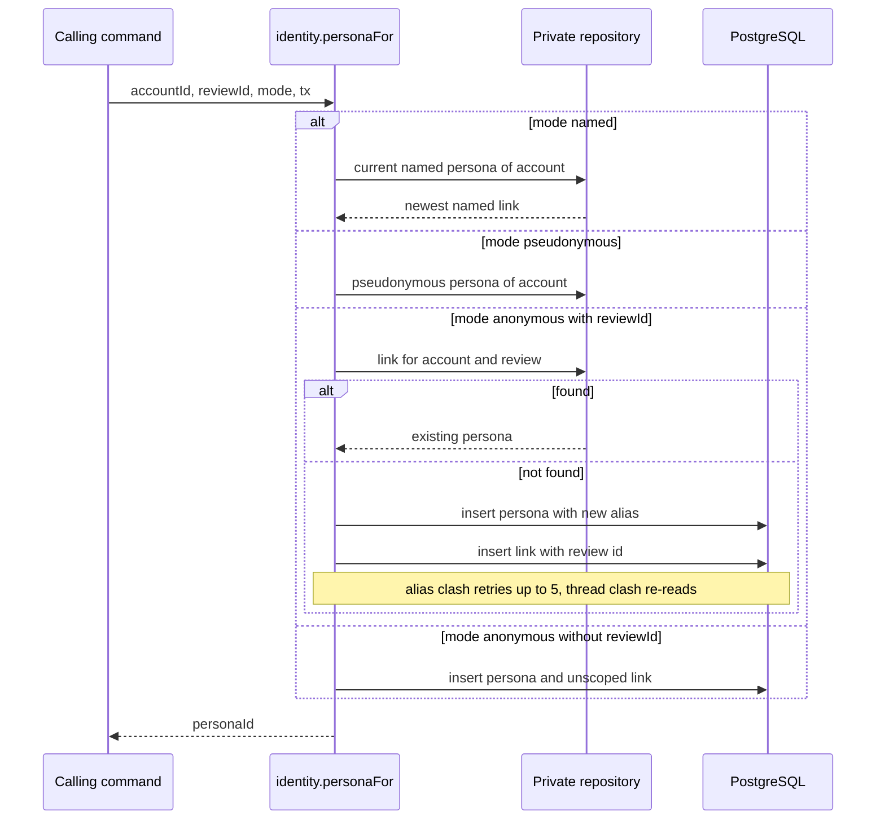
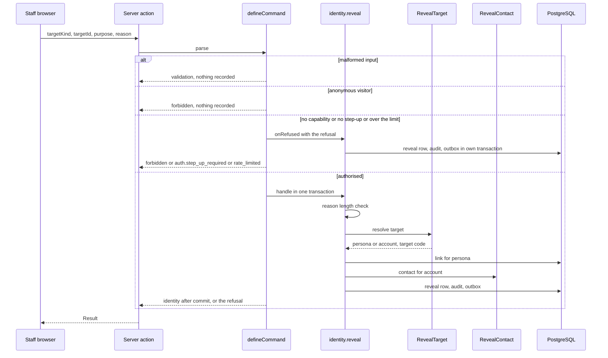
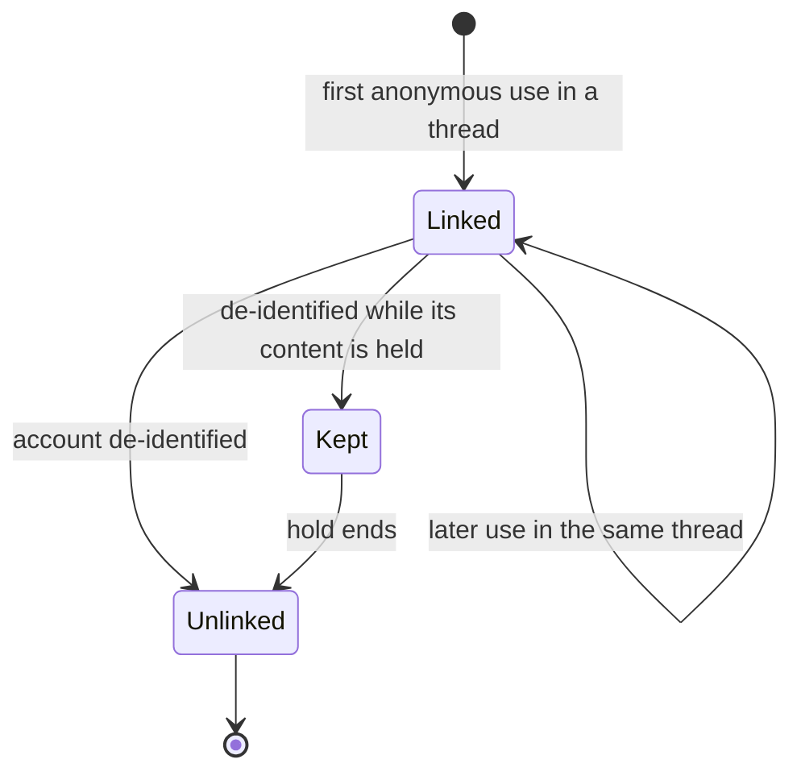
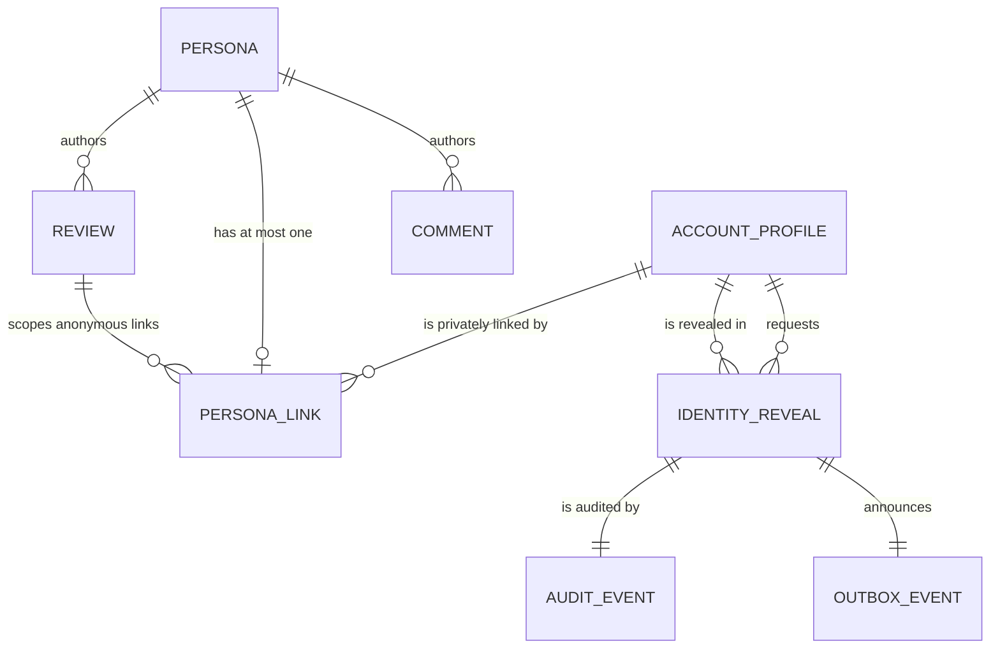

# Functional specification — U11 `t-104-identity-module`

Draft written ahead of the stage. The lead finalises it when the workflow reaches this Unit; then it moves to `<record>/construction/t-104-identity-module/functional-design/`.

Unit U11 (kind `library`, size L, **high risk**: identity) delivers T-104 for US3.3 (AC3.3.1–AC3.3.6). Collaborators run, a separate agent writes 3–5 adversarial tests (§ 12.2), and the owner signs off in writing before the phase gate. Lead perspective: architect. Support perspectives written into this file: developer (mechanics, transactions, test design: §§ 10–11) and security engineer (threats, linkage leaks, recording guarantees: § 12), synthesised in § 13.

Inputs: listed in `functional-design-questions.md` (Context). This file is the source of truth for the workflows and state transitions. The data shape is in `entities.md`; the decision logic is in `rules.md`. T-104 has no screens (the reveal button is U35 T-406's, the bylines are rendered by U27 T-307 and U31 T-402), so there is no `frontend-components.md`. Questions 1–14 were answered A on the owner's standing instruction of 2026-10-27 and await the owner's confirmation; Question 15 changes a data boundary and is left for the owner.

## 1. What changes, in one paragraph

The Identity module becomes the only code that knows which account stands behind a public persona (AD-3). `personas` stay public snapshots with no account column; `persona_links` and `identity_reveals` are read and written only by one private repository, which the composition root hands to the identity module and to nothing else (Q8). Registration gets its two default personas through `identity.createDefaultPersonas` on the register transaction. `identity.personaFor` returns the current named persona, the pseudonymous persona, or the one anonymous persona of that account in that review thread, created on first use with a random alias `patient-xxxx` that is unique among aliases and derived from nothing (BR2.1–BR2.3). Public projections and byline data carry the display name, the username for non-anonymous personas, the kind and the avatar hue, and never an id. `identity.reveal` is a capability- and step-up-gated command: every attempt by a signed-in account, granted or refused, writes one `identity_reveals` row, one audit row on the `identity` stream and one `identity.revealed` outbox event, and a granted reveal returns the username and display name, plus the email address for a Super Admin only (Q3). Rename creates a new named persona; de-identification deletes the account's links except those of held personas. One forward-only migration adds the indexes, a deferrable link key, a reveal target-kind enum, the reveal purpose and outcome columns and a nullable requester role (§ 7).

## 2. As is (baseline on `main`, 2026-10-28, plus the Units this one depends on)

- **Schema.** `schema/identity.ts` has `personas` (`kind identity_mode`, `display_name`, `username null`, `avatar_hue smallint null`), `persona_links` (`persona_id` pk, `account_id` cascade, `review_id null`, no index besides the pk) and `identity_reveals` (`requester_account_id` not null, `requester_role staff_role` **not null**, `target_kind target_kind` — the shared enum `review | facility_review | comment | evidence | profile`, with no `report` (ISS-090) — `target_id uuid`, `reason text`, `granted bool`, `revealed_account_id null`). `persona_links.review_id` references `reviews(id) ON DELETE SET NULL` through `0004_deferred_fks.sql`, **not deferrable**, while `reviews.author_persona_id` is `NOT NULL` (F5). `0003_triggers.sql` makes `identity_reveals` append-only.
- **Grants.** `0001_grants_part1.sql` revokes everything on `persona_links` and `identity_reveals` from `rk_worker`; `0001` grants it SELECT on `personas` ("live, not ratified", FD-092). `migrations.int.test.ts` already proves the `persona_links` denial; nothing proves the `identity_reveals` denial.
- **Repositories.** `repositories/identity.ts` is a stub (`createPersona`, `linkPersona`, `findPersonaFor`, `publicProjection`, `recordReveal`, all `NotImplemented('T-104')`); `test-support` has a matching in-memory fake.
- **Contracts.** `schemas/identity.ts` has `PersonaForInput`, `PublicProjectionInput`, `RevealIdentityInput {targetKind: TARGET_KINDS, targetId, reason: min(1)}`, `CreateDefaultPersonasInput`, and `AccountsOfInput = z.unknown()` (`TODO(T-104)`). No `view-models/persona.ts`. `actor.ts` has `identity.reveal` and the capability table (U10 keeps it).
- **Seed.** `seed-accounts.ts` inserts named and pseudonymous personas and links directly (FD-040 exception); `seed-content.ts` `ensureAnonymousPersona` inserts 12 anonymous personas whose `display_name` is the English word `Anonymous`, links facility-review ones with `review_id null` and back-fills the review id of doctor-review ones after the review row exists (F5, F6). Named authors carry synthetic `named_<slug>` usernames, some with hyphens (ISS-159, ISS-264).
- **i18n.** `byline.anonSentence`, `byline.identity.real|pseudo`, `byline.commentBy`, `byline.yourIdentity`, `compose.identity.anon`, `admin.reveal.audited`, `admin.done.revealed`, `admin.notif.kind.identityReveal` exist in both files. There is no `errors.identity.*` key and no "Former member" key.
- **From U8 (draft).** `defineCommand`, the command context, the ports, `AuditWriter`, `Outbox`, `getActor` (whose `personaId` is "the named persona", loaded through the account repository: F9) and `account.register`, which inserts the two personas with `TODO(T-104)`. `application/audit/` helpers are U8's (ISS-108 is still open and names T-104 as owner).
- **From U10 (draft).** Staff powers in the `Actor` only with an approved device (U10 Q3); `requires` order `authenticated → … → staffRole → capability → stepUp → owner`; `onRefused` runs **only** on a missing step-up (U10 BR7.4, F12); `STEP_UP_PURPOSES` includes `identity.reveal`; the step-up audit flag `step_up: true` (U10 BR7.5).

## 3. Settled before this stage

FD-008 and FD-022 (limits of anonymity and staff access are described only in the Terms and Privacy Policy), FD-015 (one stable alias per review thread, never linked to the profile, reactions, mentions or other anonymous reviews), FD-016 (Super Admin always; Admin and Moderator only with their toggle, off by default), FD-065 (Notification owns `staff_notifications` and the outbox; Administration owns audit), FD-067 (the `RevealTarget` and `RevealContact` ports break the cycle), FD-069, FD-077, FD-079 (de-identification in the web transaction; held posts keep their persona link), FD-086 (no reporter id in any payload, view model or log), FD-090 (T-309's `SECURITY DEFINER` function deletes held links later; not built here), FD-092 (`rk_worker` holds nothing on `persona_links` or `identity_reveals`), FD-093 (the worker may not value-import `modules/identity/`), C4 and C15 (`contract-summary.md`), AD-3, the U10 answers above. See `functional-design-questions.md` § "Settled before this stage".

## 4. Workflows

Every command runs `parse → authorize → load → decide → persist` with its audit and outbox rows in one transaction (01-conventions §3). "Internal" operations take the caller's transaction (`tx`) and write no audit row of their own unless stated; the calling command audits the change it is part of.

### WF0 — Code Generation order (the Unit end to end)

1. **Baseline.** `pnpm infra:up`; `pnpm check` and `pnpm smoke` green on the Bolt branch; U8 and U10 merged; read the open rows in § 9 and the Context; record the counts.
2. **ISS-108 gate (Q12).** If `assertAllowlisted` is still the shallow denylist, make the audit detail helper recursive and allowlist-based first (owned-path addition), with a test per accepted case in ISS-108.
3. **Contracts.** `enums.ts`: `REVEAL_TARGET_KINDS`, `REVEAL_PURPOSES`, `REVEAL_OUTCOMES`; `schemas/identity.ts`: the inputs of § 6.1 (`.strict()`); `view-models/persona.ts`: `PersonaPublicVM`, `BylineVM`; 03 §4 and `contract-summary.md` C4/C15 corrected in the same commit (BR7.1).
4. **Domain.** `domain/identity/{persona.ts, alias.ts, projection.ts, byline.ts}` and tests (alias alphabet, length, rejection sampling; projection denylist property test over 1 000 generated personas, no new dependency: a seeded generator).
5. **Database.** The migration of § 7, `schema/identity.ts`, `schema/enums.ts`, `repositories/identity.ts` (public), `repositories/identity-private.ts` (private), `migrations.int.test.ts` count and the `identity_reveals` worker denial.
6. **Application.** `ports/repositories/identity.ts`; `modules/identity/{commands,queries,internal,authorization.ts,index.ts}`; `RevealTarget` registry and `RevealContact` port; `modules/account/reveal-contact.ts` (C4: built by U11 in the account module); `defineCommand`'s `onRefused` widened (Q1, F12); `account.register` calls `identity.createDefaultPersonas`.
7. **Web.** `server/container.ts` (the private repository only into the identity module, Q8), `server/actions/identity.ts` (`revealIdentity`), `getActor`'s persona lookup through identity (F9), `container.test.ts` boundary test.
8. **Seed (Q6).** Seeded anonymous personas get aliases; the review link is written in the same transaction as the review (Q7).
9. **i18n.** `errors.identity.reasonTooShort` (and `byline.formerMember` only if the owner answers Q15 with B), both files, Bengali flagged.
10. **Tests (§ 11)**, `pnpm check`, `pnpm smoke`, `pnpm test:int`.
11. **Records.** Reference-document corrections (BR7.1), `ISSUES.md` (BR7.4), hand-off.

### WF1 — Default personas at registration (`identity.createDefaultPersonas`, internal)

Called by `account.register` inside its new-email transaction (U8 BR1.5), replacing U8's direct inserts.

1. Input `{accountId, username, displayName}`; display name trimmed and NFC (1–60), username as the account stores it (no re-validation, Q11).
2. Read the account's links through the private repository. If a named and a pseudonymous persona already exist, return their ids (idempotent, a re-run of the seed or a retried transaction adds nothing).
3. Otherwise insert, on the caller's `tx`: a `named` persona (`display_name = displayName`, `username = username`, `avatar_hue` = a random 0–359), a `pseudonymous` persona (`display_name = username`, `username = username`, the same hue), and one `persona_links` row each (`review_id null`).
4. Result `{namedPersonaId, pseudonymousPersonaId}`. No audit row (register writes `registered`), no outbox, no log line naming both an account and a persona.

### WF2 — Persona for a contribution (`identity.personaFor`, internal, caller's transaction)

C4 calls it a query; it writes on first use, so it is an internal operation on the caller's transaction (F15).

Text fallback: named mode returns the newest named persona linked to the account; pseudonymous mode returns the account's pseudonymous persona; anonymous mode with a review id returns the account's persona for that thread, creating it with a fresh alias on first use (an alias clash retries with a new alias up to five times, a concurrent creation for the same thread re-reads the winner); anonymous mode without a review id (facility feedback, which has no thread) always creates a fresh persona.

1. `named` → the newest named persona linked to the account (BR6.8); `pseudonymous` → the account's pseudonymous persona; `reviewId` is ignored for both (BR2.7). None found → `not_found` (a data defect; logged with the account id only).
2. `anonymous` with `reviewId`: look up `persona_links (account_id, review_id)`; found → its persona (BR2.3).
3. Not found: `alias = newAnonymousAlias(Crypto)`; in a savepoint insert `personas {kind: anonymous, display_name: alias, username: null, avatar_hue: 0}` and `persona_links {persona_id, account_id, review_id}`. A unique violation on the alias index → new alias, up to 5 attempts, then `internal` and log `identity.alias_exhausted` (BR2.2). A unique violation on the thread index → roll back the savepoint and re-read the existing link (a concurrent first comment and publish, BR2.3).
4. `anonymous` without `reviewId`: always a new persona and an unscoped link; never reused (BR2.4).
5. The review row may not exist yet when the publish command calls this (it generates the review id first); the deferrable key of § 7 lets the persona, the review and the link be inserted in any order in one transaction (Q7).
6. Who may use an anonymous persona in a thread (only the review's author, or any commenter) is the calling module's rule, not identity's (Q10, ISS-262).

### WF3 — Public projection and byline data (queries, anyone)

1. `identity.publicProjection {personaId}` → `PersonaPublicVM {kind, displayName, username?, avatarHue}`: `username` only for `named` and `pseudonymous`; no id of any kind, no timestamp (BR1.3, BR1.4).
2. `identity.bylinesFor {personaIds}` (batch, replaces the task's `bylineFor(personaId, locale)`, F21) → `BylineVM[]` in input order: `kind`, `name` (display name; for anonymous the alias, Q6), `initials` (named: first and last grapheme of the name without a leading `Dr.`/`ডা.`; pseudonymous: `@` + first grapheme; anonymous: none), `chipKey` (`byline.identity.real`, `byline.identity.pseudo`, `compose.identity.anon`), `anonymous` (bool), `profileUsername?` (named and pseudonymous only, for `/authors/<username>`). Components choose the lede key (`experience.writtenBy`, `byline.commentBy`, `byline.yourIdentity`, `byline.anonSentence`) by variant, as the prototype's `byline()` does; the data carries keys, never localised text, so the locale is not an input.
3. `identity.publicByUsername {username}` → the pseudonymous persona of that username, else the current named one; never an anonymous persona (aliases are not usernames, BR1.8). For mentions (U30) and profiles (U38).

### WF4 — Reveal (`identity.reveal {targetKind, targetId, purpose, reason}`)

Text fallback: a malformed input is refused with `validation` and not recorded (it names no target that can be stored); a signed-out visitor is refused and not recorded (there is no requester); an authenticated account without the capability, without a fresh step-up or over the rate limit is refused and its attempt recorded in a separate transaction; an authorised attempt checks the reason, resolves the target through the owning module's port, follows the private link, fetches the contact and records the outcome in the same transaction, and the identity leaves the server only after that transaction commits.

1. **Parse** `RevealIdentityInput` (`.strict()`): `targetKind ∈ REVEAL_TARGET_KINDS` (`review | facility_review | comment | report`, Q2), `targetId` a uuid, `purpose ∈ REVEAL_PURPOSES` (`moderation | security | legal`, Q4), `reason` a string of at most 500 graphemes. A structural failure → `validation`; not recorded; log `identity.reveal_input_rejected {actorAccountId?}` (BR4.3).
2. **Authorize** (`requires: {authenticated: true, capability: 'identity.reveal', stepUp: true}`, U10 order). Anonymous → `forbidden`, not recorded, logged (BR4.11). Any later refusal runs `onRefused` (WF5): no capability → `forbidden` (outcome `no_capability`); capability but no fresh step-up → `auth.step_up_required` (outcome `step_up_required`).
3. **Rate limit** `identity:reveal:account:<id>` 20 attempts per hour (Q13); over → `rate_limited` with `retryAfterSec`, recorded (outcome `rate_limited`) through `onRefused`.
4. **Reason** NFC, trimmed, counted in graphemes (`Intl.Segmenter`): under 10 → `validation` with `fieldErrors.reason = errors.identity.reasonTooShort`, recorded (outcome `reason_too_short`) (BR4.4).
5. **Resolve** `RevealTarget[targetKind].resolve(tx, {targetKind, targetId})` → `{subject: 'persona', personaId, targetCode}` (review, facility review, comment) or `{subject: 'account', accountId | null, targetCode}` (report: the restricted reporter, null once de-identified, FD-078). No resolver or not found → `not_found`, recorded (outcome `target_not_found`) (BR4.5).
6. **Link.** Persona subject → `linkFor(personaId)`; no link (de-identified) → `not_found`, recorded (outcome `no_link`); account subject with `null` → the same (BR4.6).
7. **Contact.** `RevealContact.contactForReveal(tx, accountId, {withEmail: actor.staffRole === 'super_admin'})` → `{username, displayName, email?}`; the email is read only for a Super Admin (BR4.7). `null` (profile gone) → `not_found`, outcome `no_link`.
8. **Record** (same transaction): `identity_reveals {requester_account_id, requester_role, target_kind, target_id, purpose, outcome: granted, reason, granted: true, revealed_account_id}`; audit `identity` stream, action `reveal`, actor `account:<requesterId>`, details per BR5.5 with `step_up: true`; outbox `identity.revealed {revealId, granted: true, outcome, targetKind, targetCode, requesterRole}` (Q5).
9. **Return** after commit `ok({username, displayName, email?})` (Q3). The action marks nothing cacheable and logs only `identity.revealed {revealId, outcome}`.
10. Refusals from steps 4–7 return the error after their row has been written in the command's own transaction (the handler records the refusal, then returns `err`; `defineCommand` commits a transaction whose handler returned `err` only when the handler flags it as `recorded`, see § 10.2).

### WF5 — Recording a refused attempt (`onRefused`)

1. `defineCommand` calls `onRefused({actor, input, refusal})` for **every** authorization refusal after `authenticated` passed: `staffRole`, `capability`, `stepUp`, the rate limit (U10 runs it only on `stepUp`: widened here, F12, Q1). `input` is the parsed input; parsing always happens before authorization.
2. `onRefused` opens its own transaction and writes the reveal row (`granted false`, `outcome`, `revealed_account_id null`, `requester_role = actor.staffRole ?? null`), the audit row and the outbox event, exactly as WF4 step 8 with `granted: false`.
3. If that transaction fails, the result is `internal` (the attempt is still refused; the failure is logged `identity.refusal_unrecorded {correlationId}`); a refusal is never returned as if it had been recorded (BR5.2).
4. The target is not resolved for these refusals (an unauthorised actor learns nothing about whether the target exists), so the event's `targetCode` is absent and the notice names the target kind only.

### WF6 — Rename (`identity.renameNamed {accountId, displayName}`, internal)

1. Called by the account command that changes a display name (U38 T-409, on its transaction; it also updates `account_profiles.display_name` and audits). Display name trimmed, NFC, 1–60.
2. Equal to the current named persona's display name → no change, returns the current id.
3. Otherwise insert a new `named` persona (new display name, the same username and avatar hue) and its link; it becomes current because it is the newest named link (BR6.7, BR6.8). Old personas and the content pointing at them are unchanged (threat 6).

### WF7 — De-identification (`identity.deidentify {accountId, keepPersonaIds}`, internal deletion step)

1. Called by `dataRequest.delete` (U39 T-410) inside its web-process transaction (FD-077), after retention has named the held personas (FD-079).
2. Every id in `keepPersonaIds` must be a persona linked to `accountId`; otherwise `validation` and nothing is deleted (BR6.2).
3. Delete every `persona_links` row of the account whose persona is not kept. Display names: per the owner's answer to Q15 (BR6.3). Anonymous aliases stay as they are (BR6.4). `identity_reveals` rows stay (append-only, BR6.5).
4. Audit `account:<accountId>` action `identity_deidentified {removedLinks, keptLinks}`. Result `{removedLinks, keptLinks}`; a second run returns `{removedLinks: 0, keptLinks}` (idempotent).
5. Kept links are deleted later by T-309's narrow function when the hold ends (FD-090); that function is not built here.

### WF8 — Private reads (internal queries, web tier only)

- `identity.accountsOf {personaIds}` → `[{personaId, accountId}]` for linked personas (unlinked ones are omitted). Callers: Community (comment recipients), Moderation (affected author), DataRequests (C4).
- `identity.personasOf {accountId}` → `{personaIds}` (every persona ever linked to the account, all kinds). Caller: DataRequests.
- `identity.currentPersonaOf {accountId}` → `{namedPersonaId}` for `getActor` (F9), so the account repository no longer reads `persona_links`.
- None is exposed as a server action or route handler; none is reachable from the worker (FD-093 lint, `rk_worker` denial).

## 5. State transitions

### 5.1 Anonymous persona per (account, review thread)

| From | Event | To | Rule |
|---|---|---|---|
| (none) | first `personaFor(account, review, anonymous)` | linked alias | BR2.1, BR2.3 |
| linked alias | later `personaFor` for the same pair | linked alias (same persona) | BR2.3 |
| linked alias | `deidentify` without a hold on its content | unlinked alias (text unchanged) | BR6.1, BR6.4 |
| linked alias | `deidentify` with its content held | kept link | BR6.1, FD-079 |
| kept link | hold ends (T-309's function) | unlinked alias | FD-090 |
| linked alias | review row deleted (`ON DELETE SET NULL`) | linked, thread-less | § 7 note |

Text fallback: an anonymous persona exists from the first anonymous use of an account in a thread and is reused for every later use there; de-identification removes its link (or keeps it while its content is held, until the hold ends). Its alias text never changes, and an unlinked persona can never be linked again.

### 5.2 Named personas (per account)

`current` → `renameNamed` with a new name → `superseded` (still linked, still on its old content) while the new persona becomes `current`; any state → `deidentify` → unlinked (display name per Q15). There is one pseudonymous persona per account; it has no transitions except the link removal.

### 5.3 A reveal attempt (one row per attempt, never updated)

| Outcome | `granted` | Recorded by | Result |
|---|---|---|---|
| `granted` | true | handler (WF4 step 8) | `ok({username, displayName, email?})` |
| `no_capability` | false | `onRefused` | `forbidden` |
| `step_up_required` | false | `onRefused` | `auth.step_up_required` |
| `rate_limited` | false | `onRefused` | `rate_limited` |
| `reason_too_short` | false | handler | `validation` (`reason`) |
| `target_not_found` | false | handler | `not_found` |
| `no_link` | false | handler | `not_found` |
| (malformed input, signed out) | — | not recorded, logged | `validation`, `forbidden` |

A normal Super Admin reveal from a cold start writes two rows: `step_up_required`, then `granted` after the step-up sheet (F24).

## 6. Interfaces

### 6.1 Operations (all in `modules/identity`)

| Name | Kind | Input | Requires | Result | Audit | Outbox | Expected errors |
|---|---|---|---|---|---|---|---|
| `identity.createDefaultPersonas` | internal (caller tx) | `{accountId, username, displayName}` | caller | `{namedPersonaId, pseudonymousPersonaId}` | — (caller) | — | — |
| `identity.personaFor` | internal (caller tx) | `{accountId, reviewId?, mode}` | caller | `{personaId}` | — (caller) | — | `not_found`, `internal` |
| `identity.publicProjection` | query | `{personaId}` | none | `PersonaPublicVM` | — | — | `not_found` |
| `identity.bylinesFor` | query | `{personaIds}` (1–200) | none | `BylineVM[]` | — | — | — |
| `identity.publicByUsername` | query | `{username}` | none | `{personaId}` | — | — | `not_found` |
| `identity.reveal` | command | `RevealIdentityInput {targetKind, targetId, purpose, reason}` | authenticated, `identity.reveal`, stepUp; 20/h | `{username, displayName, email?}` | `identity` `reveal` | `identity.revealed` | `forbidden`, `auth.step_up_required`, `rate_limited`, `validation`, `not_found` |
| `identity.renameNamed` | internal (caller tx) | `{accountId, displayName}` | caller | `{personaId}` | — (caller) | — | `validation` |
| `identity.deidentify` | internal (caller tx) | `{accountId, keepPersonaIds}` | caller | `{removedLinks, keptLinks}` | `account:<id>` `identity_deidentified` | — | `validation` |
| `identity.accountsOf` | internal query | `{personaIds}` | caller | `[{personaId, accountId}]` | — | — | — |
| `identity.personasOf` | internal query | `{accountId}` | caller | `{personaIds}` | — | — | — |
| `identity.currentPersonaOf` | internal query | `{accountId}` | caller | `{namedPersonaId}` | — | — | `not_found` |

"Internal" operations are exported from `modules/identity/internal/` for other application modules and the web composition root only; they are never server actions.

### 6.2 Ports

| Name | Where | Shape |
|---|---|---|
| `IdentityRepository` (public) | `application/ports/repositories/identity.ts` | `getPersona(id)`, `listPersonas(ids)`, `findPublicByUsername(username)` — reads `personas` only |
| `PrivateIdentityRepository` | same file, branded with a unique symbol | `linkFor(tx, personaId)`, `personasOf(tx, accountId)`, `currentNamedOf(tx, accountId)`, `pseudonymousOf(tx, accountId)`, `findAnonymousFor(tx, accountId, reviewId)`, `createPersona(tx, persona, link)`, `accountsOf(tx, personaIds)`, `removeLinks(tx, accountId, keepPersonaIds)`, `recordReveal(tx, row)`, `deidentifyNames(tx, personaIds)` (only if Q15 = B) |
| `RevealTarget` (declared by identity, C4) | `modules/identity/ports.ts` | `resolve(tx, {targetKind, targetId}): Promise<Result<{subject: 'persona', personaId, targetCode} \| {subject: 'account', accountId: string \| null, targetCode}>>` (adds `targetCode`, additive, Q5) |
| `RevealContact` (declared by identity, implemented by Account, built here, C4) | `modules/identity/ports.ts`, `modules/account/reveal-contact.ts` | `contactForReveal(tx, accountId, {withEmail}): Promise<{username, displayName, email?} \| null>` (adds `displayName` and the `withEmail` flag, Q3) |
| Ports used | U8's | `Crypto` (random bytes), `Clock`, `IdGenerator`, `RateLimiter`, `AuditWriter`, `Outbox`, `Logger`, `ConfigProvider` (through U10's capability resolution) |

`RevealTarget` implementations: Review for `review` and `facility_review` (U21), Community for `comment` (U30), Moderation for `report` (U32). Until they exist, the registry has none and every reveal ends `target_not_found` (Q9).

### 6.3 Server action

`apps/web/src/server/actions/identity.ts`: `revealIdentity(input)` = `parse → getActor → identity.reveal → Result`. No other identity operation is a server action. U35 T-406 renders the button and the step-up flow (`useStepUp().withStepUp`, U10).

## 7. Migration (one, forward-only, next free number at Code Generation)

1. `CREATE TYPE reveal_target_kind AS ENUM ('review','facility_review','comment','report')`; `identity_reveals.target_kind` changes type to it (`USING target_kind::text::reveal_target_kind`; the table is empty in every environment; the `0003` trigger fires on row changes, not on DDL) (Q2, ISS-090).
2. `CREATE TYPE reveal_purpose AS ENUM ('moderation','security','legal')`; `identity_reveals.purpose reveal_purpose NOT NULL` (Q4).
3. `CREATE TYPE reveal_outcome AS ENUM ('granted','no_capability','step_up_required','rate_limited','reason_too_short','target_not_found','no_link')`; `identity_reveals.outcome reveal_outcome NOT NULL`.
4. `identity_reveals.requester_role DROP NOT NULL` (Q1).
5. `CREATE UNIQUE INDEX persona_links_account_review_uq ON persona_links (account_id, review_id) WHERE review_id IS NOT NULL` (one anonymous persona per account and thread; the partial predicate cannot read `personas.kind`, and only anonymous links carry a review id, BR2.3).
6. `CREATE INDEX persona_links_account_idx ON persona_links (account_id)` (every private lookup is by account).
7. `CREATE UNIQUE INDEX personas_anonymous_alias_uq ON personas (display_name) WHERE kind = 'anonymous'` (BR2.2; needs the seed change of Q6 first, F6).
8. Drop and re-add `persona_links_review_id_reviews_id_fk` as `DEFERRABLE INITIALLY DEFERRED`, keeping `ON DELETE SET NULL` (Q7).
9. No grant change: `rk_worker` already holds nothing on `persona_links` and `identity_reveals` (`0001`), and new enum types need none.
10. If the owner answers Q15 with B: `personas.deidentified_at timestamptz null`.

Drizzle custom migration with a journal timestamp later than the previous one (the CR-006 lesson); `migrations.int.test.ts`'s exact count rises by one with a comment.

## 8. Copy

| Key | en | bn | Why |
|---|---|---|---|
| `errors.identity.reasonTooShort` (new) | Give a reason of at least 10 characters. | কমপক্ষে ১০ অক্ষরের একটি কারণ লিখুন। | BR4.4; the digits in the Bengali string are written per language, like `staff.device.body` before U10's change (Bengali flagged for the owner's review, FD-042 precedent) |
| `byline.formerMember` (new, only if Q15 = B) | Former member | প্রাক্তন সদস্য | WF7 |

The alias `patient-xxxx` is an identifier, like a username, and is shown unchanged in both languages. No identity copy says anything about staff access (FD-022, AC3.3.6); R1 raises the one string that does.

## 9. Raised for the owner, not decided

- **Q15 — What a deleted account's named and pseudonymous personas show.** The sources disagree: T-104 step 3 and its acceptance row replace the display names with "Former member"; C4, the Units table's deletion participants and T-410 step 3 say "personas keep their snapshots". Keeping them leaves a deleted person's real name on their retained reviews; FR13 says retained contributions are "de-identified". This decides what stays public after deletion (a data boundary), so it is left for the owner (`functional-design-questions.md` Q15). Suggested: B.
- **R1 — Anonymity note in the writing flow and on the review page.** `compose.identity.anonNote` ("your account and contact details remain private but known to us, and can be required by law") is shown by the prototype in the composer and in the margin of every anonymous review. FD-008 puts lawful disclosure only in the Terms, and FD-022 and AC3.3.6 forbid any warning about staff identity access on the review page and in the writing flow. The string belongs to U26 T-306 and U27 T-307, not to this Unit; whether to drop it, reword it or keep it is a founder decision. Suggested: keep the first sentence ("Anonymous hides your name from readers.") and move the rest to the Terms.

### Findings (proposed ISS rows, each `Found in U11 T-104`)

| Id | Sev | Finding | Owner (suggested) |
|---|---|---|---|
| F1 | S2 | T-104 step 3 and its "Deidentify" acceptance row replace display names; C4, the Units table and T-410 keep snapshots (Q15) | founder |
| F2 | S2 | C15's `identity.revealed {revealId, granted}` cannot become a staff notice: the worker's `notification.deliver` has no privilege on `identity_reveals` (02 §16 (f)) and so cannot find the target code. Payload extended (Q5) | U11 T-104 (payload), U34 T-405 (route) |
| F3 | S2 | `identity_reveals.target_kind` uses the shared `target_kind` enum, which has no `report`, while C4 and `moderation.revealReporter` need it (extends ISS-090) (Q2) | U11 T-104 |
| F4 | S2 | `identity_reveals.requester_role` is `NOT NULL`, so an attempt by an account with no staff role in its Actor (an ordinary account, or a staff member on an unapproved device under U10 Q3) cannot be recorded (Q1) | U11 T-104 |
| F5 | S2 | `persona_links.review_id`'s key is not deferrable while `reviews.author_persona_id` is `NOT NULL`, so an anonymous review cannot be published in one transaction in either insert order; the seed works around it by back-filling the review id (Q7) | U11 T-104 |
| F6 | S2 | The 12 seeded anonymous personas all have the display name `Anonymous`: the alias uniqueness index cannot be created on that data, and storyboard step 14 and AC3.3.2 expect a per-thread alias the prototype never shows (Q6) | U11 T-104 (seed), U27 T-307, U31 T-402 (bylines) |
| F7 | S2 | No index enforces one anonymous persona per (account, thread); a partial index cannot read `personas.kind`, so it is keyed on `review_id IS NOT NULL` (§ 7) | U11 T-104 |
| F8 | S2 | ISS-108 (open, S2, owner T-104): the audit detail check is a shallow denylist; the `identity` stream is the most sensitive audit stream (Q12) | U11 T-104 if U8 has not fixed it |
| F9 | S2 | U8's draft loads `Actor.personaId` ("the named persona") through the account repository, which would read `persona_links` outside the private repository (AD-3). Moved to `identity.currentPersonaOf` | U11 T-104 |
| F10 | S2 | `compose.identity.anonNote` on the composer and on anonymous review pages describes lawful and staff access, against FD-008, FD-022 and AC3.3.6 (R1) | founder; then U26 T-306, U27 T-307 |
| F11 | S3 | No `RevealTarget` implementation exists until U21, U30 and U32, so T-104's "Reveal always recorded" row and T-106's "Capability toggles" row can only run with test resolvers in Phase 1 (Q9) | U11 T-104, U13 T-106 |
| F12 | S2 | U10's `defineCommand` runs `onRefused` only on a missing step-up (U10 BR7.4); a capability refusal would go unrecorded, against T-104's acceptance row and C4. Widened here (§ 10.2) | U11 T-104 |
| F13 | S3 | `admin.config.cap.identity` reads "Reveal reporter identity", but the toggle also governs anonymous-author reveal (FD-016) | U37 T-408 |
| F14 | S3 | The prototype reveals "the reporter" of a case; a case aggregates reports from several reporters, and `RevealTarget` for `report` resolves one report row. `moderation.revealReporter {caseCode, reason}` cannot name one reporter | U32 T-403, U35 T-406 |
| F15 | S4 | C4 types `identity.personaFor` as a query, but it writes on first use (01-conventions §3: queries never write); designed as an internal operation on the caller's transaction | Contract Design note |
| F16 | S4 | Three reveal result shapes: T-104 step 4 `{username, displayName} + email`, C4 and 03 §4 `{accountId, username, email?}` (Q3) | U11 T-104 (C4, 03 corrected) |
| F17 | S4 | T-104 step 6 hands the private repository to three modules; C4 routes the data-requests and moderation uses through identity operations (Q8) | U11 T-104 |
| F18 | S4 | `identity.deidentify` is `{accountId}` in T-104 and `{accountId, keepPersonaIds}` in C4 (FD-079); C4 is built | U11 T-104 |
| F19 | S4 | T-104 says `admin.reveal.*` keys exist; only `admin.reveal.audited` does. The console copy is U35 T-406's | U35 T-406 |
| F20 | S3 | T-402's `ReplyBox` prefills `@<alias>` for anonymous authors, which `comment.post` refuses (`community.mention_anonymous`) | U31 T-402 |
| F21 | S4 | `bylineFor(personaId, locale)`: the data carries i18n keys, so the locale is not needed; batched as `bylinesFor({personaIds})` | U11 T-104 |
| F22 | S4 | `ASSUMPTION(T-104)`: 31^4 = 923 521 aliases, unique across all anonymous personas; at large scale collisions grow and the length should become 5 | U11 T-104 |
| F23 | S4 | UUIDv7 persona ids carry their creation time; no view model or byline carries a persona id (BR1.4) | U11 T-104 |
| F24 | S4 | A cold-start reveal writes two rows (`step_up_required`, then `granted`); T-406's audit view must read `outcome` | U35 T-406 |
| F25 | S4 | T-104's acceptance row "three staff notifications" becomes "three `identity.revealed` outbox events" until U34 routes them (Q5) | U11 T-104, U34 T-405 |

## 10. Developer view — mechanics

### 10.1 Transactions

- `createDefaultPersonas`, `personaFor`, `renameNamed` and `deidentify` take the caller's `tx` and never open their own; they are not `defineCommand` commands (no actor of their own).
- `personaFor`'s creation runs in a savepoint (`tx.transaction(...)` nested) so a unique violation on either index rolls back only the attempt; the alias index violation retries, the thread index violation re-reads.
- `identity.reveal` is a `defineCommand` command. Its handler returns `err` for steps 4–7 after writing the record; § 10.2 says how that record survives.

### 10.2 Recording refusals

Two places, one shape (`recordAttempt(tx, {actor, input, outcome, granted, revealedAccountId?, targetCode?})`):

- **Authorization refusals** (no capability, no step-up, rate limit): `defineCommand` calls `onRefused({actor, input, refusal})` for every refusal after `authenticated`, inside `withTx` of its own; the command result is the refusal code. This widens U10's BR7.4 (F12) in U8's `command.ts` (owned-path addition), with tests for each refusal code.
- **Handler refusals** (reason, target, link): the handler writes the record, then returns `err(code, {recorded: true})`. `defineCommand` commits the transaction of a handler that returned `err` only when `recorded` is set (by default an `err` rolls back, so no other command changes behaviour). The flag is internal to the application layer and never reaches the client.

Every reveal path ends in exactly one `recordAttempt`; a unit test drives each outcome of § 5.3 and counts rows, audit entries and outbox events (one each).

### 10.3 Alias generation

`newAnonymousAlias(randomBytes)`: draw bytes from the `Crypto` port, keep a byte only if it is below 248 (8 × 31, rejection sampling, no modulo bias), map `byte % 31` into `abcdefghjkmnpqrstuvwxyz23456789`, four characters, prefix `patient-`. Pure in `domain/identity/alias.ts` with the byte source passed in; the domain test checks the alphabet, the length, the bias (chi-square over 100 000 draws with a seeded source) and that `i`, `l`, `o`, `0`, `1` never appear.

### 10.4 Boundary type test

`PrivateIdentityRepository` carries `readonly [PRIVATE_IDENTITY]: true` (a `unique symbol` exported from the port file). `container.test.ts` has a type-level helper `ContainsPrivate<T>` that walks the parameter types of every module factory (`makeCommunityModule`, `makeReviewModule`, `makeSearchModule`, `makeModerationModule`, `makeDataRequestsModule`, …) and a `// @ts-expect-error` line per factory that tries to pass the branded repository; a plain test asserts that the container passes it only to `makeIdentityModule`. A unit test in `packages/database` asserts that no source file except `repositories/identity-private.ts`, the schema files, the migrations and the FD-040 seed imports the `personaLinks` or `identityReveals` table symbols.

### 10.5 RevealContact in the account module

`modules/account/reveal-contact.ts` implements the port with U8's account repository: profile `username` and `display_name` by account id; when `withEmail` is set, the auth user's email through the repository's credential read (web tier only; the worker never reaches it). A deleted account returns its username, its last display name and no email (the email is a tombstone hash after deletion, FD-077).

### 10.6 Register

U8's `account.register` replaces its two direct persona inserts with `identity.createDefaultPersonas(tx, {accountId, username, displayName})`; the `TODO(T-104)` goes. U8's register integration test keeps its counts (one named, one pseudonymous, two links).

## 11. Developer view — test design

Builders and synthetic data only (`shirin_88`, `anon_author_r2`, `mod_rashid`, `admin_nadia`, `sa_founder`, `*.demo@example.test`); names read as sentences; each test can fail.

| Level | File | What it proves |
|---|---|---|
| domain | `domain/identity/alias.test.ts` | prefix, length, alphabet, no confusables, unbiased with a seeded source, uses only the given bytes |
| domain | `domain/identity/projection.test.ts` | 1 000 generated personas (all kinds, random names in both scripts): the projection and byline JSON hold no key from the denylist (`id`, `personaId`, `accountId`, `account_id`, `email`, `reviewId`, `review_id`, `createdAt`, `userId`, `authUserId`, `linkId`); anonymous never has `username` or `profileUsername`; initials grapheme-aware for Bengali names |
| domain | `domain/identity/persona.test.ts` | rename produces a new persona with the same username and hue; equal name is no change |
| application | `modules/identity/*.test.ts` (fakes) | every operation's happy path; `personaFor` twice for one thread → same, other thread → different alias; alias clash retry and exhaustion; facility (no `reviewId`) → fresh each time; createDefaultPersonas idempotent; deidentify counts, kept ids, foreign kept id refused, second run; reveal: each row of § 5.3, row + audit + outbox counted once each, email only for `super_admin`, `RevealContact` asked for the email only then, reason 9 and 10 Bengali graphemes, 21st attempt in an hour; audit details allowlist; logs carry no account id next to a persona id |
| application | `command.test.ts` (extended) | `onRefused` runs for `staffRole`, `capability`, `stepUp` and the rate limit, never for `authenticated`; a handler `err` with `recorded` commits, without it rolls back; an `onRefused` failure returns `internal` |
| database | `repositories/identity.int.test.ts` | each method; the thread unique index (a second link for one pair fails); the alias unique index; the deferrable key (persona, review, link inserted in that order in one transaction); `identity_reveals` UPDATE and DELETE raise; the enum change; the migration applies from empty; as `rk_worker`: `permission denied` on `persona_links` and `identity_reveals` (`-t worker-grants`) |
| web | `server/container.test.ts` | the boundary type test and the single-recipient assertion (§ 10.4) |
| web | `server/actions/identity.int.test.ts` | `revealIdentity` end to end with a test `RevealTarget` against compose PostgreSQL: the three acceptance actors give rows `false, false, true`, three audit rows, three outbox events |
| smoke | `identity.smoke.test.ts` | a projection of a seeded anonymous persona has no username and an alias display name; `personaFor` returns the same persona twice for one thread |

Every T-104 acceptance row maps to one of these (§ 17).

## 12. Security view — threat cases and adversarial angles

### 12.1 Threat cases

| # | Threat | Defence | Rules |
|---|---|---|---|
| T1 | Joining public tables to accounts | no account column on `personas`; links only through the private repository; worker denied; import test | BR1.1, BR3.1, BR3.4 |
| T2 | Cross-thread correlation of an anonymous author | one persona per (account, thread); random alias from nothing; constant avatar hue; no username; no ids in view models | BR2.1–BR2.6, BR1.4, BR1.6 |
| T3 | Reveal without a trace | every authenticated attempt recorded once, granted or refused, append-only; a refusal that cannot be recorded is `internal` | BR5.1–BR5.3, BR5.7 |
| T4 | Admin or moderator reveal by default | capability only with the toggle (U10); step-up; purpose and reason | BR4.1, BR4.2, BR4.3 |
| T5 | Reveal through a query path that bypasses the command | private repository only in the identity module (brand + type test); private queries not server actions; worker lint | BR3.2, BR3.3 |
| T6 | Rename retroactively edits old bylines | new persona per rename | BR6.7 |
| T7 | Deletion removes the alias and so changes others' threads, or leaves a link | links removed, alias text kept; held links only by FD-079 | BR6.1, BR6.4 |
| T8 | Logs carry account and persona pairs, reasons or emails | identity logs one kind of id per line; reason and email never logged | BR3.6, BR5.5 |
| T9 | A revealed email spreads | email only to a Super Admin, read only then, never in audit, outbox, notice or log; not cached | BR4.7, BR4.8 |
| T10 | Mass reveal with one step-up window | 20 attempts per hour per account, all recorded, each one a staff notice | BR4.9, BR5.6 |
| T11 | Probing whether a target exists | unauthorised attempts are recorded without resolving the target; the result never says more than the refusal | WF5 step 4, BR4.5 |
| T12 | Reporter identity reaching the reported person | reporter reveal only through `identity.reveal`; the reporter id never in a payload, view model, notice or log (FD-086) | BR5.6, BR7.7 |
| T13 | Alias guessing or enumeration | aliases resolve to nothing publicly (no username lookup, no route) | BR1.8, BR2.6 |

### 12.2 Adversarial angles for the separate agent (3–5 tests, defensive regression checks)

Each is a regression test that must stay green; it fails if the defence regresses.

1. **Linkage leak hunt.** Build one account with a named review, a pseudonymous review, two anonymous reviews with comments by the author in both threads, a rename and a facility review; then scan every `PersonaPublicVM`, `BylineVM`, `identity.revealed` payload, `audit_events.details` row and captured log line for the account id, the email, the other thread's alias and any persona id: none found. The two aliases differ and share no field except the constant hue. As `rk_worker`, selecting `persona_links` and `identity_reveals` is denied; joining `reviews`, `comments`, `reactions` and `personas` to `account_profiles` without `persona_links` finds no path.
2. **Every attempt recorded exactly once.** Call `identity.reveal` as: signed out; `shirin_88`; `mod_rashid` on an unapproved device; `mod_rashid` with the toggle off; `admin_nadia` with the toggle on and no step-up; with an expired step-up (5:01, `FakeClock`); `sa_founder` with a 9-grapheme Bengali reason; an unknown target; a de-identified target; the 21st call in an hour; a granted call. Expect rows and outcomes exactly as § 5.3 (none for the first, `requester_role` null for the second and third), one audit row and one outbox event per row. Then make `AuditWriter` throw on the granted path: the result is `internal`, no identity is returned and no row remains. `UPDATE` and `DELETE` on `identity_reveals` raise.
3. **Alias races and collisions.** Twenty concurrent `personaFor(acc, r1, anonymous)` calls on separate connections give one persona; a fake byte source that repeats an existing alias makes the next attempt use a new one; a source that repeats it six times ends `internal` with nothing written; `personaFor` without `reviewId` creates a new persona each time; `publicByUsername` never returns an anonymous persona, even for a username equal to an alias.
4. **Boundary.** The `@ts-expect-error` lines fail to compile if any non-identity factory accepts the branded repository; the import scan fails if a new file imports `personaLinks` or `identityReveals`; a worker source file with a value import of `modules/identity/` fails lint; no exported server action reaches `accountsOf`, `personasOf` or `currentPersonaOf`.
5. **Email minimisation.** `admin_nadia` with the toggle on and a valid step-up reveals a review author: the result has no `email` key and the `RevealContact` spy was called with `withEmail: false`; `sa_founder` gets the email; neither result appears in captured logs, audit details, the outbox payload or `staff_notifications`.

## 13. Synthesis — decisions and why

- **One reader of the private link (Q8).** The data-requests and moderation needs in C4 are identity operations (`accountsOf`, `personasOf`, `deidentify`), so handing the repository itself to three modules (the task's step 6) only widens the surface. One recipient makes the type test meaningful.
- **Every authenticated attempt recorded (Q1, F12).** "Every reveal attempt, granted or not" (02 §3, FD-016) includes the ordinary account and the staff member on an unapproved device, who are exactly the suspicious ones; a nullable role is the smallest schema change that allows it, and `onRefused` must fire for every refusal, not only step-up.
- **Outcome and purpose in the record (Q2, Q4).** The record must say why an attempt failed and what it was for without free text in audit details; enums do both and keep the reason only in the private table.
- **Notices through the outbox, with a target code (Q5).** Notification owns its tables (FD-065), C15 already names the event, and the worker cannot read `identity_reveals`, so the payload carries what the notice needs and nothing private.
- **Nothing identifying leaves the server unless needed (Q3).** No account id in the result (03 §2's rule for view models applies to the console too); the email only for the role that the task and C4 give it, read only then.
- **Visible per-thread alias (Q6).** AC3.3.2 and storyboard step 14 need it; the prototype's sentence stays as the lede; seeded personas get aliases so the uniqueness index holds.
- **Deferrable thread key (Q7).** The same pattern `evidence_items.published_artifact_id` already uses; publish needs no two-phase identity call.
- **Mechanism here, policy in the caller (Q10).** Identity cannot know a review's author without reading the review module; Community and Review decide who may comment anonymously (ISS-262).
- **What this design does not decide:** Q15 (display names after deletion) and R1 (the anonymity note).

## 14. If the owner changes an answer

- **Q1 → B:** only actors with a staff role are recorded; ordinary accounts and staff on unapproved devices are refused with a log line only; no column change. **→ C:** the role is read from the profile, bypassing U10's device gate for the record only.
- **Q2 → B:** `report` is added to the shared `target_kind`, which `reports.target_kind` also uses (a report could then target a report: a check constraint is needed there). **→ C:** reporter reveal is postponed; `report` leaves `REVEAL_TARGET_KINDS`.
- **Q3 → B:** the result carries `accountId` as C4 says; adversarial angle 1 adds the console response to its scan. **→ C:** the Super Admin sees a masked email (`s***@example.test`), like the holder's own address (owner's answer for U9).
- **Q4 → B:** no `purpose`; the column and enum are not added; the audit cannot tell the purpose without free text.
- **Q5 → B:** the transaction inserts one `staff_notifications` row (kind `identityReveal`, `target_code`); U34 must not route `identity.revealed` again.
- **Q6 → B:** the alias stays internal; bylines show "Written anonymously" only; storyboard step 14 and AC3.3.2 are reworded through a requirements change; the alias index still needs the seed change.
- **Q7 → B:** `personaFor` splits into `reserveAnonymous` (persona only) and `bindAnonymous` (link after the review insert); U21 and U30 call both.
- **Q8 → B:** the container passes the repository to the three modules of the task; the type test allows those three.
- **Q9 → B:** T-104 writes an interim `review` resolver in `modules/review/reveal-target.ts`, which U21 replaces.
- **Q10 → B:** identity refuses an anonymous persona unless the account authored the thread anonymously, which needs a review-author port from Review (a new cycle break).
- **Q11 → B:** identity validates persona usernames with `USERNAME_RE` and the seed's `named_<slug>` usernames are rewritten with underscores.
- **Q12 → B:** identity writes only flat details and ISS-108 stays with U8.
- **Q13 → B:** no reveal limit; T10's defence is the record and the notice only.
- **Q14 → B:** a `personas.is_current` flag or an `account_profiles.named_persona_id` column marks the current named persona.

## 15. Owned paths and recorded additions

T-104's owned paths are as listed in its task file. These additions follow from this design and are recorded in the hand-off and one ISS row (BR7.5):

- `packages/contracts/src/enums.ts` (`REVEAL_TARGET_KINDS`, `REVEAL_PURPOSES`, `REVEAL_OUTCOMES`), `view-models/persona.ts` (`BylineVM` beside `PersonaPublicVM`).
- `packages/database/src/schema/{identity.ts, enums.ts}`, `migrations/**` (the migration of § 7, not only `*_identity_grants.sql`), `migrations.int.test.ts` (count).
- `packages/application/src/command.ts` (U8's file: `onRefused` for every refusal, the `recorded` flag), `modules/identity/ports.ts`, `modules/account/reveal-contact.ts` (C4 places it there).
- `apps/web/src/server/auth.ts` (`getActor`'s persona lookup through `identity.currentPersonaOf`, F9).
- `packages/application/src/audit/**` and `packages/database/src/audit-writer.ts` only if ISS-108 is still open (Q12).
- `packages/test-support/src/seed/seed-content.ts` (aliases for seeded anonymous personas; the review link in the review's transaction) and `src/fakes/repositories.ts` (the fake), after the Unit now editing the seed has merged (Q6).
- `docs/implementation/02-data-model.md` §3 (columns, indexes, enums), `03-routes-and-contracts.md` §4 "identity", `aidlc/.../contract-design/contract-summary.md` C4 and C15 (BR7.1).

## 16. Risks to verify in Code Generation

- That U8 merged `command.ts` with a hook point where `onRefused` can run for every refusal, and that its transaction helper can commit a handler that returns `err` (§ 10.2).
- That U10's capability resolution reads the toggles per request, so a toggle switched off stops the next reveal.
- Drizzle 0.45 cannot express a deferrable key or a partial unique index on a different table's column; both go in the raw SQL migration, and the schema file comments say where.
- `ALTER COLUMN TYPE` on `identity_reveals` with the append-only trigger in place, on an empty table, on PostgreSQL 18.
- The seed change of Q6 must land before or with the alias index, or `pnpm db:seed` fails on the second `Anonymous`.
- The next migration number and that no other Unit touched `persona_links` or `identity_reveals` meanwhile.

## 17. Acceptance mapping (T-104 acceptance checks)

| T-104 check | Where it is met |
|---|---|
| Alias scoped (same persona for r1 twice, a different alias for r2) | WF2; BR2.1–BR2.3 |
| No linkage in projection (property test over 1 000 personas) | WF3; BR1.3, BR1.4 |
| Reveal always recorded (moderator without capability, admin without step-up, super admin with step-up: rows false, false, true; three audit rows; three notices) | WF4, WF5; BR5.1–BR5.3; "three notices" read as three outbox events until U34 (F25); target through a test resolver (Q9) |
| Worker cannot read links | BR3.4; `identity.int.test.ts -t worker-grants` |
| Register still works | WF1; BR1.2 |
| Deidentify (links gone; display names per the owner's Q15; anonymous aliases untouched; public pages still render) | WF7; BR6.1–BR6.4 |
| `pnpm check` | BR8.3 |

## Entity-relationship view (derived from `entities.md`)

Text fallback: an account is linked privately to many personas, each persona to at most one account (none after de-identification); an anonymous link is scoped to one review thread; personas author reviews and comments; staff accounts request reveals and accounts are revealed in them, and every reveal attempt has exactly one audit row and one outbox event. The alias, the projections, the byline data, the reveal input and result and the port shapes are value objects with no table.

## Rules summary (derived from `rules.md`)

- **Personas and projection (BR1.1–BR1.8):** public snapshots without account data; two default personas; allowlisted projection without ids; immutable snapshots; avatar hue; byline data; username lookups never anonymous.
- **Anonymous alias (BR2.1–BR2.9):** random alias from nothing; unique; one per account and thread; facility feedback unscoped; policy in the caller; unreachable; named and pseudonymous resolution; links never re-pointed; deferrable key.
- **Private boundary (BR3.1–BR3.6), reveal authorization (BR4.1–BR4.11), reveal records (BR5.1–BR5.8), rename and de-identification (BR6.1–BR6.8), contracts and records (BR7.1–BR7.7), verification (BR8.1–BR8.5).**

## Sources

- `docs/implementation/tasks/T-104-identity-module.md` (goal, steps 1–8, acceptance checks, tests, threat notes 1–8, hard-rule checklist).
- `docs/status/decision-log.md` FD-008, FD-015, FD-016, FD-022, FD-037, FD-040, FD-065, FD-067, FD-069, FD-077, FD-078, FD-079, FD-086, FD-090, FD-092, FD-093.
- `aidlc/spaces/default/intents/261011-aidlc-adoption/inception/contract-design/contract-summary.md` C4, C5, C15, "How to read the contracts", "Contract ownership rules".
- `aidlc/spaces/default/intents/261011-aidlc-adoption/inception/units-generation/unit-of-work.md` U11 and "Deletion and export participants", `unit-of-work-dependency.md`, `unit-of-work-story-map.md`.
- `aidlc/spaces/default/intents/261011-aidlc-adoption/inception/requirements-analysis/requirements.md` FR10, FR11, FR13, FR78; `inception/user-stories/stories.md` US3.3 (AC3.3.1–AC3.3.6), US10.2 (AC10.2.1, AC10.2.3), AC10.3.3.
- `docs/implementation/01-conventions.md` §1–§5, §11, §14, §15; `02-data-model.md` §0, §3, §6, §8, §9, §10, §12, §16; `03-routes-and-contracts.md` §2, §3, §4 (identity, account.register, moderation.revealReporter, dataRequest.delete); `05-demo-storyboard.md` (seeded accounts, step 14); `T-106-auth-identity-validation.md` (negative matrix); `T-401`, `T-402`, `T-410` task files.
- `docs/architecture/ARCHITECTURE-SPINE.md` AD-3, AD-4; `docs/planning/05-recommended-architecture.md` "Authentication and identity".
- Code on `main` listed in § 2; `docs/implementation/ISSUES.md` rows ISS-090, ISS-108, ISS-111, ISS-159, ISS-262, ISS-263, ISS-264; `docs/aidlc-migration/OWNER-REVIEW-QUEUE.md` (owner answers: mail-only worker key; the holder's own email shown masked).
- `ui-design-prototype/shared/rogikotha-data.js` (`accountsByAuthor`, the anonymous fixtures), `concepts/concept-04b-quiet-clinic-minimal/app.js` (`byline()`, `initials()`, `renderPerson()`, the composer identity field and the review margin), `ui-design-prototype/admin/app.js` (reporter reveal, `data-request`).
- `docs/aidlc-migration/design-drafts/t-101-better-auth-adapter/` (U8: register, `getActor`, `defineCommand`) and `t-103-staff-access-and-devices/` (U10: Actor device gate, `requires` order, `onRefused`, step-up purposes).
