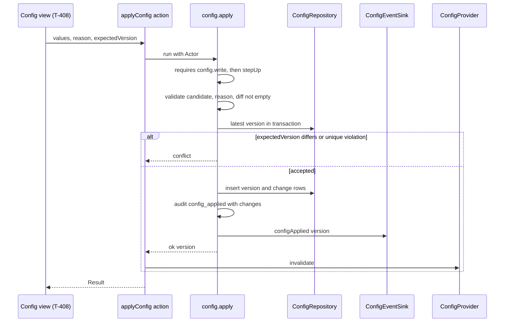
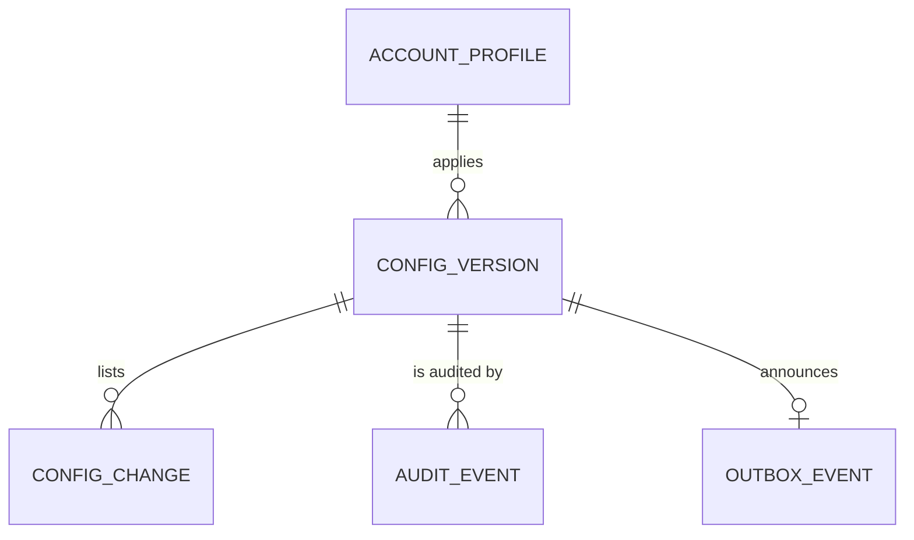

# Functional specification — U12 `t-105-runtime-configuration`

Draft written ahead of the stage. The lead finalises it when the workflow reaches this Unit; then it moves to `<record>/construction/t-105-runtime-configuration/functional-design/`.

Unit U12 (kind `library`, size M) delivers T-105 for US11.1 (AC11.1.1–AC11.1.4, AC11.1.6) and the runtime-settings clause of AC3.1.5. It is not in the high-risk class: `team.md` lists auth, identity, evidence, moderation, retention and deletion, and `unit-of-work.md` marks U12 "—". It does switch security-relevant values (the reveal toggles and the sign-in brute-force settings), so this file includes a security view (§ 10) and the reviewer's diff review checks it. Lead perspective: architect. Support perspectives written into this file: developer (mechanics, transactions, test design: § 9) and security engineer (threats: § 10), synthesised in § 11.

Inputs: listed in `functional-design-questions.md` (Context). This file is the source of truth for the workflows and state transitions. The data shape is in `entities.md`; the decision logic is in `rules.md`. The Unit has no screens (the configuration view is U37 T-408), so there is no `frontend-components.md`. The answers to Questions 1–10 (all A) were chosen on the owner's standing instruction of 2026-10-27 and await the owner's confirmation; R1 and R2 (§ 8) are left for the owner.

## 1. What changes, in one paragraph

Runtime configuration becomes real versioned data. `ConfigValues` moves to schema version 2: the `retention` block goes (FD-082), the `signIn` block U8 added gets ranges in which every value takes effect (Q1), the five always-enabled report reasons and the emergency-date rules are encoded (Q4, Q6), and every object stays strict. `config.propose` previews a whole candidate (Q3) as a diff with a validation result; `config.apply` validates it again, checks `expectedVersion`, and writes the new version, one change row per changed setting, an audit row with the before and after values and a `config.applied` outbox row through `ConfigEventSink`, all in one transaction, behind `config.write` and a step-up; `config.rollback` copies an older version into a new one, upgrading and re-validating it first. A refused change by a Super Admin who passed the step-up is recorded as `config_rejected` (Q8). The database `ConfigProvider` replaces U8's defaults-only one: `current()` is asynchronous (Q2), returns the highest version (Q9), caches it for 5 seconds of process time, falls back to the last good values or the defaults and never throws. A migration strips the old `retention` blocks and makes both configuration tables append-only (Q7). The emergency page reads the live numbers, and the two strings that wrote "999" and "16263" into the copy take the numbers as parameters (Q5). Export and import are the existing query and apply (Q10). Nothing here is a screen.

## 2. As is (working tree, 2026-10-28)

- **Contracts.** `config-values.ts` has the schema version 1 shape: `thresholds`, `retention`, `limitedDataThreshold`, `reportReasons` (`.min(1)`, no always-enabled rule, ISS-079), `capabilities`, `featureVisibility`, `emergency` (numbers `.min(1)`, `lastVerified` by regex only), all strict; no `signIn` (U8 adds it before this Unit). `schemas/administration.ts` types `values` with `ConfigValuesSchema` (propose: shallow partial with `TODO(T-408)`), `reason` `.min(1)`, `expectedVersion` `.min(1)`. `view-models/config.ts` has `ConfigVM`, `ConfigVersionVM` (no actor, no `rolledBackFrom`), `ConfigChangeRowVM` with `TODO(T-408)`. `errors.ts` has `config.invariant`, `config.out_of_range`, `conflict`, `validation`, `not_found`, `auth.step_up_required`. `enums.ts` has `REPORT_REASONS` (13) and `CRITICAL_REPORT_REASONS`.
- **Database.** `config_versions` and `config_changes` as in `02-data-model.md` §11, no foreign key from `config_changes.version`, no append-only trigger (§10 protects six other tables). `rk_worker` holds SELECT on `config_versions`. `repositories/config.ts` is three stubs that throw `NotImplemented('T-105')` / `('T-408')`.
- **Seed.** `seed-config.ts` writes version 1 with `schemaVersion: 1` and a `retention` block (90/180/90), actor `sa_founder`, plus `retention_policies` version 1 and the `demo_clock` row.
- **Test support.** `aConfig()` merges `retention`; `StaticConfigProvider.current()` returns a plain value.
- **Application.** Empty; U8 builds `defineCommand`, the command context, the `ConfigProvider` port and its defaults-only provider in `apps/web/src/server/container.ts`; U10 builds `requires.stepUp`, `onRefused` use, `STEP_UP_PURPOSES` (`config.apply`, `config.rollback`) and `resolveCapabilities(role, config)`.
- **Web.** `/[locale]/emergency` imports `DEFAULT_CONFIG_VALUES.emergency` with an `ASSUMPTION(CR-005)` marker (ISS-171). `/admin/config` is a placeholder page (T-408 builds it).
- **i18n.** `errors.config.invariant` and `errors.config.outOfRange` exist; `admin.config.*` exists (copy awaits review, ISS-050). `emergency.body` and `compose.safetyEmergFix` write "999" / "৯৯৯" and "16263" / "১৬২৬৩" into the strings (Q5).

## 3. Settled before this stage

AD-10, FD-018 (bounded configuration; structural boundaries stay out), FD-068 and FD-082 (no retention block, schema version 2), FD-083 (`config.applied` through `ConfigEventSink`), FD-058, FD-063, FD-072 (the sign-in settings are runtime settings with the owner's defaults), FD-016, FD-022, FD-051 (capability toggles), C1 (operations, authorization, errors), U10's step-up and capability rules, FD-088 (no UI here; T-408 is in release 1). See `functional-design-questions.md` § "Settled before this stage".

## 4. Workflows

Every command runs `parse → authorize → load → decide → persist` with its audit and outbox rows in one transaction (01-conventions §3), inside U8's command context. "Validate" always means `validateCandidate` (BR2.2): upgrade, denylist, strict schema, cross-field and current-version rules, all findings collected, mapped to codes by BR2.3.

### WF0 — Code Generation order (the Unit end to end)

1. Before building: `pnpm check` green on the Bolt branch; read ISS-079, ISS-108, ISS-171 and this file; confirm U8's port shape (`current(): Promise<ConfigValues>`, Q2) and U10's `requires.stepUp`, `onRefused` and purposes are on `main`.
2. Dependency check: zod and drizzle are already in use; no new dependency. Re-confirm the Next.js 16 request-time rendering call (`connection()`) for the emergency page in the dependency-check log if no entry under 3 days covers it.
3. Contracts first: `03-routes-and-contracts.md` §3 and §4 corrected, then `config-values.ts` (schema 2, BR1.x), `enums.ts` (`ALWAYS_ENABLED_REPORT_REASONS`), `schemas/administration.ts`, `view-models/config.ts`.
4. Domain: `administration/config-policy.ts` (denylist, diff, upgrade) with tests.
5. Application: `modules/administration/` (ports, authorization, validation, queries, commands), `modules/notification/config-event-sink.ts`.
6. Database: the migration (BR11.1), `repositories/config.ts` (`PgConfigRepository`, `PgConfigProvider`), integration tests.
7. Test support: `aConfig`, `StaticConfigProvider`, a `FakeConfigRepository` and a recording `ConfigEventSink`, `seed-config.ts`.
8. Web: `server/container.ts`, `server/config.ts`, `server/actions/config.ts`, the emergency page, i18n keys.
9. Reference documents and T-408 corrections (BR12.5); `pnpm check`, `pnpm smoke`; hand-off.

### WF1 — Read the configuration (`await config.current()`, every module)

1. If the process snapshot is younger than 5000 ms (monotonic clock), return its values (BR4.3).
2. Otherwise start one load; concurrent callers wait for the same load.
3. Load: the row with the highest `version` (BR4.2). None → `DEFAULT_CONFIG_VALUES`, version 0, `config.defaults_in_use` logged once (BR4.4).
4. Upgrade (`schema_version` 1 → 2, BR3.3) and parse with `ConfigValuesSchema`. Failure → `config.invalid_version {version}` logged; keep the last good snapshot or use the defaults (BR4.5).
5. A database error → `config.read_failed` logged; same fallback (BR4.5). The next call after 5 s tries again.
6. Store `{values, version, loadedAt, source}` and return the values.

### WF2 — Staff reads (`config.current`, `config.history`)

- `config.current`: any staff role; reads the repository directly (no cache) and returns `{version, schemaVersion: 2, values}` (BR5.1). The same object is the export file (Q10).
- `config.history {page}`: any staff role; 20 versions per page, newest first, each with its change rows, reason, `rolledBackFrom` and the actor as `{username, role, deleted}` (BR5.2). No account id leaves the query.

### WF3 — Preview (`config.propose {values}`)

1. `requires {capability: 'config.write'}` (Super Admin only); no step-up.
2. Validate the candidate against the current version.
3. Valid → `ok({diff: diff(current, candidate), validation: {ok: true}})`. Invalid → `ok({diff: [], validation: {ok: false, code, fieldErrors}})` (BR5.3). Nothing is written in either case.

### WF4 — Apply (`config.apply {values, reason, expectedVersion}`)

Text fallback: the configuration view sends the candidate, reason and expected version to the server action, which runs the command with the Actor. The command checks `config.write`, then the step-up, then validates the candidate, the reason and that something changed. Inside the transaction it reads the latest version; a different `expectedVersion`, or losing the race on the unique version number, gives `conflict`. Otherwise it inserts the new version and its change rows, writes the audit row and appends `config.applied` through the sink, all in one transaction, and returns the version; the action then drops the provider's cached snapshot.

1. `requires {capability: 'config.write', stepUp: true}`; `forbidden` or `auth.step_up_required` write nothing (BR6.1, BR8.4).
2. Reason trimmed, 5–500 characters, else `validation` on `reason` (BR2.4).
3. Validate the candidate (BR2.2); invalid → its code and field errors (BR6.2), and `onRefused` writes `config_rejected` (WF6).
4. `diff(current, candidate)` empty → `validation` / `errors.config.noChange` (BR2.5).
5. In the transaction: `latest = max(version)`; `expectedVersion ≠ latest` → `conflict` (BR6.3).
6. Insert `config_versions` (`latest + 1`, schema 2, normalised values, actor, reason, `effective_from = Clock.now()`), one `config_changes` row per diff entry, the audit row `config_applied {version, changes, step_up: true}` and `ConfigEventSink.configApplied(tx, {version})` (BR6.4, BR8.1, BR8.2). A unique violation on `version` → `conflict`.
7. Result `ok({version})`; the server action calls `container.config.invalidate()` (BR4.6).

### WF5 — Rollback (`config.rollback {toVersion, reason}`)

1. `requires {capability: 'config.write', stepUp: true}` (purpose `config.rollback`) (BR7.1).
2. Reason as in WF4 step 2.
3. Load version `toVersion`; none → `not_found` (BR7.2).
4. Upgrade its values (a `retention` block goes, FD-082) and validate them against today's rules and the current version (BR7.2); invalid → its code and `config_rejected`.
5. Equal to current → `errors.config.noChange` (BR7.3).
6. In the transaction: insert `latest + 1` with `rolled_back_from = toVersion`, change rows `diff(current, restored)`, audit `config_rolled_back {version, rolledBackFrom, changes, step_up: true}`, `configApplied(tx, {version, rolledBackFrom})`; a unique violation → `conflict` (BR7.3).
7. Result `ok({version})`; invalidate as in WF4.

### WF6 — Record a refused change (`onRefused` of apply and rollback)

Runs only when `requires` passed (the actor is a Super Admin with a valid step-up) and the command then refused with `config.invariant`, `config.out_of_range`, `validation`, `conflict` or `not_found`. In its own transaction it writes `config_rejected {operation, code, paths, unknownKeyCount, step_up: true}` on the `config` stream (BR8.3). `paths` lists only known setting paths; unknown keys are counted. Nothing else is written.

### WF7 — Import and export (Q10)

- Export: the config view downloads the `config.current` result as `rogikotha-config-v<version>.json` (T-408).
- Import: the config view reads a file, and sends its `values` (and its `schemaVersion` when it is 1) through WF3 and WF4. The file is never trusted: it passes the same validation, reason and step-up as a typed change, and an unchanged import is refused as "no change".

### WF8 — Consumers

- The web container wires `PgConfigProvider`; `getConfig()` in `apps/web/src/server/config.ts` is the helper for pages and layouts (BR9.2).
- `/[locale]/emergency` opts into request-time rendering, reads `(await getConfig()).emergency` and passes it to `Emergency` (BR9.3, closes ISS-171).
- U8's sign-in, U10's `getActor`, U14's limited data and facility feedback, U15/T-207's emergency panels, U21, U32 and U33 read the same port (BR9.1). A capability toggle change reaches the next `getActor` (BR9.5).

### WF9 — Migration and seed

1. Migration (next free number): strip `retention` and set `schema_version = 2` on every stored version-1 row, then attach `fn_block_mutation()` to `config_versions` and `config_changes` (BR11.1).
2. Seed: version 1 at schema version 2 from `DEFAULT_CONFIG_VALUES` and the corpus values, no `retention`, actor `sa_founder`, idempotent (BR11.2). `retention_policies` keeps its own seed (U29 owns it).

## 5. State transitions

### 5.1 The configuration history

`empty` (no row; readers get the defaults, version 0) → seed or first apply → `v1` → apply → `v2` → … Each accepted apply or rollback appends exactly one version; nothing ever updates or deletes a version or a change row after the migration (BR11.1). A rollback to `vN` appends `v(latest+1)` whose values equal the upgraded `vN` and whose `rolled_back_from` is `N`. The current version is always the latest (BR4.2).

### 5.2 The provider snapshot (per process)

| From | Event | To |
|---|---|---|
| `none` | `current()` | `loading` |
| `loading` | load ok | `fresh (database)` |
| `loading` | empty table | `fresh (defaults)`, logged once |
| `loading` | read error or invalid value, last good exists | `fresh (last_good)`, logged |
| `loading` | read error or invalid value, no last good | `fresh (defaults)`, logged |
| `fresh` | 5000 ms pass | `stale` |
| `stale` | `current()` | `loading` (the stale values stay as last good) |
| any | `invalidate()` | `none` (the last good values are kept for the fallback) |

## 6. Interfaces

### 6.1 Queries and commands (all in `modules/administration`)

| Name | Input | Requires | Audit (`config`) | Outbox | Expected errors |
|---|---|---|---|---|---|
| `config.current` (query) | `GetCurrentConfigInput {}` | `staffRole` (any) | — | — | — |
| `config.history` (query) | `GetConfigHistoryInput {page?}` | `staffRole` (any) | — | — | — |
| `config.propose` (query) | `ProposeConfigInput {values}` | `capability: config.write` | — | — | — (the result carries validation) |
| `config.apply` | `ApplyConfigInput {values, reason, expectedVersion}` | `capability: config.write`, `stepUp` | `config_applied`; `config_rejected` on refusal | `config.applied {version}` | `config.invariant`, `config.out_of_range`, `validation`, `conflict`, `auth.step_up_required` |
| `config.rollback` | `RollbackConfigInput {toVersion, reason}` | `capability: config.write`, `stepUp` | `config_rolled_back`; `config_rejected` on refusal | `config.applied {version, rolledBackFrom}` | `not_found`, `config.invariant`, `config.out_of_range`, `validation`, `conflict`, `auth.step_up_required` |

`forbidden` and `internal` apply to every operation (C-rules). C1 lists no `validation` or range errors for rollback; they are added (additive, BR7.2, BR2.5).

### 6.2 Functions and ports

| Name | Where | Shape |
|---|---|---|
| `ConfigProvider` | `application/ports/config-provider.ts` (U8 creates it) | `current(): Promise<ConfigValues>` (Q2) |
| `PgConfigProvider` | `database/repositories/config.ts` | implements `ConfigProvider`, plus `invalidate()` |
| `ConfigRepository` | `modules/administration/ports.ts` | `latest`, `findVersion`, `history`, `insertVersion`, `insertChanges` |
| `ConfigEventSink` | `modules/administration/ports.ts` | `configApplied(tx, {version, rolledBackFrom?}): Promise<void>` (FD-083) |
| `OutboxConfigEventSink` | `modules/notification/config-event-sink.ts` | `Outbox.append(tx, 'config.applied', payload)` |
| `validateCandidate(raw, current, today)` | `modules/administration/config-validation.ts` | `Result<ConfigValues>` with code and field errors |
| `findDenylistedPaths`, `diffConfig`, `upgradeConfigValues` | `domain/administration/config-policy.ts` | pure, plain JSON (BR3.1–BR3.4) |
| Ports used | U8's | `Clock`, `IdGenerator`, `AuditWriter`, `Outbox`, `Logger` |

### 6.3 Server actions and helpers

- `apps/web/src/server/actions/config.ts`: `getCurrentConfig`, `getConfigHistory`, `proposeConfig`, `applyConfig`, `rollbackConfig`. Each is `parse → getActor → command → Result`; `applyConfig` and `rollbackConfig` call `container.config.invalidate()` after an ok result. T-408 imports these and does not create `admin-config.ts` (F9).
- `apps/web/src/server/config.ts`: `getConfig(): Promise<ConfigValues>`.

## 7. Copy

New message keys (both languages in one commit, Bengali for the owner's review, FD-042):

| Key | en | bn |
|---|---|---|
| `errors.config.reasonRequired` | This report reason can't be turned off. Nothing was changed. | এই রিপোর্টের কারণটি বন্ধ করা যায় না। কিছু বদলানো হয়নি। |
| `errors.config.noChange` | There is nothing to apply: the values match the current version. | প্রয়োগ করার মতো কোনো পরিবর্তন নেই: মানগুলো বর্তমান সংস্করণের মতোই। |
| `errors.config.reasonLength` | Reason: write between 5 and 500 characters. | কারণ: ৫ থেকে ৫০০ অক্ষরের মধ্যে লিখুন। |
| `errors.config.lastVerifiedRequired` | You changed an emergency number. Set "Last verified" to the day you checked the numbers. | আপনি একটি জরুরি নম্বর বদলেছেন। যেদিন নম্বরগুলো যাচাই করেছেন, "সর্বশেষ যাচাই" তারিখটি সেই দিনে দিন। |
| `errors.config.dateInFuture` | This date can't be in the future. | এই তারিখ ভবিষ্যতের হতে পারে না। |
| `errors.config.dateInvalid` | Enter a real date. | একটি সঠিক তারিখ দিন। |
| `errors.config.phoneFormat` | Use digits and hyphens only, 3 to 15 characters. | শুধু অঙ্ক ও হাইফেন ব্যবহার করুন, ৩ থেকে ১৫ অক্ষর। |
| `errors.config.maxDelayOrder` | The longest delay can't be shorter than the first delay. | সবচেয়ে দীর্ঘ বিলম্ব প্রথম বিলম্বের চেয়ে কম হতে পারে না। |
| `errors.config.severeOrder` | The severe-activity threshold must be higher than the threshold where delays start. | গুরুতর কার্যকলাপের সীমা বিলম্ব শুরুর সীমার চেয়ে বেশি হতে হবে। |

Changed keys (Q5; with the default numbers the rendered text is unchanged): `emergency.body` takes `{ambulance}` and `{healthLine}`; `compose.safetyEmergFix` takes `{ambulance}`. Exact text in `functional-design-questions.md` Question 5. The digits in `errors.config.reasonLength` and `errors.config.phoneFormat` are written per language in the string, as `label.limitedDataWhy` does, because a field error carries a key and no parameters.

Existing keys reused: `errors.config.invariant`, `errors.config.outOfRange`, `errors.common.conflict`, `errors.common.validation`, `errors.common.notFound`, `errors.common.forbidden`, `errors.auth.stepUpRequired`.

## 8. Raised for the owner, not decided

- **R1 — AC11.1.1 and FR100 name settings no Unit builds.** Label translations and wording, warnings, "whether sentiment is optional" (FR45), the label-approval workflow (FR47), the dangerous-advice visibility policy (FR75), navigation, profile and form fields, browser-support display and public status labels are not in `ConfigValues`, and no consumer would read them; the label-approval workflow does not exist. Narrowing a Must requirement needs an FD entry. Suggested: A, an FD entry narrows FR100 and AC11.1.1 for release 1 to the settings `ConfigValues` holds. B adds two booleans with their readers in U21, U26 and U32; C builds everything. Until answered, this design covers the settings `ConfigValues` holds, and `traceability.json` says so.
- **R2 — The limited-data threshold can switch the "Limited data" label off.** With the contract's minimum of 1, `0 < total < 1` is never true. Suggested: A, range 2–50. B keeps 1–50. It changes how a hard rule behaves, so it is the owner's call; BR1.3 keeps 1–50 until answered.

### Findings (proposed ISS rows, each `Found in U12 T-105`)

| Id | Sev | Finding | Owner (suggested) |
|---|---|---|---|
| F1 | S2 | T-105's acceptance row "apply the severe threshold 10→12 … the notice fires at the 12th" cannot pass: C5 fixes the per-email limit at 10 failures in 15 minutes, so the 11th and 12th failures never happen (U8 BR3.2, BR3.5). C1's ranges `severeFailures` 2–100 and `delayAfterFailures` 1–20 allow values that never take effect. Closed by Q1 A (ranges 2–10 and 1–9, row 10→8); also closes U8's draft F3 | U12 T-105, C1 |
| F2 | S2 | `emergency.body` and `compose.safetyEmergFix` write 999 and 16263 into the copy while the numbers are editable; after a change one panel would show two ambulance numbers. Closed by Q5 A | U12 T-105 (keys); U15 T-202, T-207, U26 T-306 pass the parameters |
| F3 | S2 | R2: a limited-data threshold of 1 makes the "Limited data" hard-rule label unreachable through a configuration change | founder |
| F4 | S3 | The always-enabled report reasons differ: `02-data-model.md` §11 and T-105 say privacy, threat, unsafeFile, dangerous, other; T-408 step 3 says factual plus the three critical reasons. ISS-079 (not encoded) is closed by Q4 A; T-408 is corrected | U12 T-105, U37 T-408 |
| F5 | S3 | `ConfigProvider.current()` is written synchronously in 03 §3, in the fake and in the U8, U10, U14, U15 and U16 drafts; a database provider with a cache must be awaited (Q2). U8 defines the port as asynchronous; the drafts add `await` when finalised | U8 T-101 (port), each draft's lead |
| F6 | S3 | T-305 step text says "until T-309 is merged use the config default 90 from `ConfigProvider`" for the original-retention deadline; after FD-082 the configuration has no retention value | U25 T-305 |
| F7 | S3 | `ProposeConfigInput` and `ApplyConfigInput` parse `values` with `ConfigValuesSchema`, so an unknown key is refused at the input boundary as `validation`, not `config.invariant` as the acceptance rows expect. Closed by Q3 A (BR2.1) | U12 T-105 |
| F8 | S3 | FR101 and AC11.1.4 ask for export and import; no task builds them. Closed by Q10 A here; T-408 needs two buttons | U37 T-408 |
| F9 | S4 | T-105 owns `server/actions/config.ts` and T-408 owns `server/actions/admin-config.ts` with the same three actions (`proposeConfig`, `applyConfig`, `rollbackConfig`); T-408 reuses T-105's file | U37 T-408 |
| F10 | S4 | `config_versions` and `config_changes` are not append-only in the database although threat 6 relies on it (Q7) | U12 T-105 |
| F11 | S4 | `02-data-model.md` §11 chooses the current version by `effective_from <= now()` with the Clock port; moving the demo clock back hides newer versions (Q9). The data model and T-105's integration row are corrected | U12 T-105 |
| F12 | S4 | The open ISS-108 (S2, audit details are a shallow denylist) also covers the `config` stream's nested `changes`; this design writes only known paths and bounded values and relies on the Unit that fixes ISS-108 for the enforcement | owner of ISS-108 |

ISS-079 and ISS-171 move to "fixed in U12 T-105" when the Unit merges.

## 9. Developer view — mechanics and tests

### 9.1 Transactions and concurrency

- One transaction per accepted change: version row, change rows, audit row, outbox row (BR6.4). The `onRefused` record runs in its own transaction after the command's has rolled back (BR8.3).
- No lock is taken: `expectedVersion` is compared with `max(version)` read in the transaction, and the unique constraint on `config_versions.version` decides a race (BR6.3). The repository maps the unique violation (`23505` on `config_versions_version_unique`) to `conflict`.
- `invalidate()` runs after the command returns ok, in the server action, so a concurrent reload cannot cache the old values after the commit for longer than one 5-second period.

### 9.2 Validation mapping

`validateCandidate` collects zod issues and the policy findings. `unrecognized_keys` → `config.invariant` (no key name kept); `too_small` / `too_big` → `config.out_of_range`; `invalid_type` (including a missing key) and `invalid_format` → `validation`; the custom checks (always-enabled reasons, unchanged `lastVerified`, sign-in order, date in the future) carry their code and message key. The result code is the most serious one found (BR2.3). `fieldErrors` keys are known setting paths (`thresholds.fiveAccountHide`, `emergency.lastVerified`), so T-408 can place each message beside its input.

### 9.3 Migration

`UPDATE config_versions SET "values" = "values" - 'retention', schema_version = 2 WHERE schema_version = 1;` then `CREATE TRIGGER config_versions_append_only BEFORE UPDATE OR DELETE ON config_versions FOR EACH ROW EXECUTE FUNCTION fn_block_mutation();` and the same for `config_changes`. The update runs before the triggers exist. `migrations.int.test.ts` counts one more migration. The test reset drops and recreates the schema, so the triggers do not block it (verify, § 14).

### 9.4 Test design

| Level | File | Covers |
|---|---|---|
| contracts | `config-values.test.ts` (extended) | each range's minimum, maximum and ±1 (thresholds, limited data, every `signIn` key); the two sign-in order rules; strict refusal of `retention`, `auth`, `capabilities.super_admin`; always-enabled reasons; phone and date formats; defaults parse and equal FD-063's values (BR1.1–BR1.10) |
| domain | `administration/config-policy.test.ts` | every denylisted prefix, in any case and depth; `signIn.*` not denylisted; diff on nested leaves, arrays as sets, unchanged values omitted, keys on one side; upgrade 1 → 2 and refusal of other versions (BR3.1–BR3.3) |
| application | `modules/administration/*.test.ts` (fakes) | propose valid and invalid; apply happy path (version 2, one change row, audit details with only known paths, one sink call); `forbidden` for Admin and Moderator with nothing written; `auth.step_up_required` with nothing written; conflict by stale `expectedVersion` and by a simulated unique violation; no-change refusal; rollback chain (1 → 2 → rollback 1 = 3, `rolledBackFrom` 1); rollback strips `retention`; rollback to a value today's ranges refuse; `config_rejected` written once with no unknown key name; capability toggle reaches `resolveCapabilities` (BR5.x–BR8.x, BR9.5) |
| database | `repositories/config.int.test.ts` | each repository method; provider: cached within 5 s, reloaded after `invalidate()`, empty table gives defaults and one log line, an invalid stored row falls back to the last good values, a version-1 row inserted raw reads as schema 2 without `retention`; the migration's trigger refuses UPDATE and DELETE (BR4.x, BR11.1) |
| test-support | `seed.int.test.ts` (extended) | version 1 at schema 2 with no `retention`; a second seed run inserts nothing (BR11.2) |
| web | `emergency/page.test.tsx` | renders the configured numbers in `en` and `bn` from a provider returning non-default numbers, and the defaults when the provider is in fallback (BR9.3) |
| smoke | `administration.smoke.test.ts` | defaults parse; an apply through fakes creates version 2 with one change and one `config.applied` (BR12.2) |

The FD-072 sign-in row (Q1: 10→8) is an application test with U8's sign-in command, `FakeClock` stepping past each delay and the fake provider returning the applied version; the live variant with `shirin.demo@example.test` is run once at Build and Test against the demo stack.

## 10. Security view — threat cases

| # | Threat | Defence | Rules |
|---|---|---|---|
| T1 | Configuration used to disable a security boundary (`auth.*`, `audit.*`, a new capability) | strict schema at every level, structural denylist before parsing, only enumerated keys exist; the refusal is recorded | BR1.1, BR3.1, BR8.3 |
| T2 | Privilege escalation through `capabilities` | Super Admin fixed in code; only four booleans; a toggle change is audited with before and after | BR1.5, BR8.1, BR9.5 |
| T3 | A silent change | `config.write` plus step-up for every apply and rollback, reason required, audit row with the diff in the same transaction | BR2.4, BR6.1, BR6.4 |
| T4 | Lost update between two editors | `expectedVersion` and the unique version number | BR6.3 |
| T5 | Threshold set to weaponise reports or switch labels off | `fiveAccountHide >= 2`; the critical, unsafe-advice and catch-all reasons cannot be disabled; R2 for the limited-data label | BR1.2, BR1.4, R2 |
| T6 | Rollback or a database edit used to erase history | rollback is a new version; triggers refuse UPDATE and DELETE on both tables | BR7.3, BR11.1 |
| T7 | Retroactive retention change through configuration | no retention block; a `retention` key is an unknown key; old versions lose the block on read and in the migration | BR1.1, BR3.3, BR11.1 |
| T8 | Brute-force settings relaxed to uselessness | bounded ranges, every value takes effect, the fixed per-email limit of C5 stays below any setting | BR1.9 |
| T9 | Attacker-chosen text in records through unknown key names or the reason | unknown key names are counted, never written or logged; the reason stays in `config_versions` | BR2.3, BR8.1, BR8.3 |
| T10 | Wrong emergency numbers shown, or shown as freshly verified | number format, a changed number needs a new non-future verification date, the copy uses the configured numbers | BR1.7, BR1.8, BR10.1 |
| T11 | Availability: a database failure takes down sign-in and the emergency page | the provider falls back to last good values or defaults and never throws; defaults switch every reveal toggle off | BR4.5, BR9.3 |

## 11. Synthesis — decisions and why

- **Ranges where every value works (Q1).** A setting that silently does nothing is worse than a narrower range; the owner's defaults do not move.
- **An asynchronous port, decided before U8 builds it (Q2).** A database read cannot be synchronous without serving values that were never loaded; fixing the shape now costs U8 one `Promise` and saves a breaking change.
- **Whole candidates, validated inside the command (Q3).** The preview and the apply see the same input, the acceptance rows' codes come out exactly, and import is the same path.
- **Five reasons always on (Q4), numbers as copy parameters (Q5), a fresh verification date with every number change (Q6).** Each keeps a safety-relevant hard rule true after a Super Admin edits the values.
- **Strip once, upgrade on read, then lock the tables (Q7).** FD-082's migration happens in the database, rollback and import still handle version 1, and threat 6 is enforced by the database instead of by convention.
- **Refusals recorded after step-up (Q8).** FR102's "result" and AC11.1.3 are met without writing anything for actors who never passed authorization.
- **The latest version is current (Q9).** No command schedules versions, and the demo clock must not hide configuration.
- **Export and import through the existing query and command (Q10).** No new code path that could skip validation.
- **Step-up on every change, no-change refused, history without account ids, an uncached staff read, a provider that never throws, a live emergency page, no worker wiring yet.** Each closes a gap the task's literal steps leave open; none changes a hard rule, a data boundary or a founder decision.
- **What this design does not decide:** R1 (AC11.1.1 scope) and R2 (limited-data minimum).

## 12. If the owner changes an answer

- **Q1 → B:** U8's fixed per-email limit becomes `max(10, severeFailures)` (C5 changes, U8's BR3.2 changes); the ranges stay 2–100 and 1–20; the row stays 10→12. **→ C:** the ranges stay; values 11–100 are accepted and documented as having no effect; the row becomes 10→8.
- **Q2 → B:** the port stays synchronous; `PgConfigProvider` loads at container creation and refreshes in the background; the first reads in a new process return the defaults (ISS row). **→ C:** `getConfig()` and the command context load once per request and pass the values on; `current()` reads that snapshot.
- **Q3 → B:** `ProposeConfigInput.values` becomes a deep partial merged onto the current values; arrays replace wholesale; import sends a whole file as a "partial".
- **Q4 → B:** `ALWAYS_ENABLED_REPORT_REASONS` gains `factual`. **→ C:** it becomes `factual`, `privacy`, `threat`, `unsafeFile`; `02-data-model.md` §11 changes.
- **Q5 → B:** the three numbers leave `ConfigValues` (schema change; FR100's emergency contacts narrowed by an FD entry); `lastVerified` stays. **→ C:** no copy change; F2 stays open as an S2 row.
- **Q6 → B:** BR1.8 is dropped. **→ C:** BR1.7 keeps only the format check.
- **Q7 → B:** no migration and no triggers; the read path alone upgrades; F10 stays open. **→ C:** the read-time upgrade is dropped; the rollback row is tested only against a pre-migration database.
- **Q8 → B:** no `onRefused`; refusals return their code and leave no record.
- **Q9 → B:** the provider selects `max(version) WHERE effective_from <= Clock.now()`; a note in the demo runbook warns against moving the demo clock back. **→ C:** the same with the database's `now()`.
- **Q10 → B:** `config.export` and `config.import` are added with audit actions `config_exported` and `config_imported`. **→ C:** an FD entry narrows FR101 and AC11.1.4; WF7 is dropped.

## 13. Owned paths and recorded additions

T-105's owned paths are as listed in its task file. These additions follow from this design and are recorded in the hand-off and one ISS row (BR12.4):

- `packages/contracts/src/{enums.ts, schemas/administration.ts, view-models/config.ts}` (Q3, Q4, BR5.2) and `docs/implementation/03-routes-and-contracts.md` §3, §4.
- `packages/domain/src/administration/config-policy.test.ts` (with the owned `config-policy.ts`).
- `packages/database/src/migrations/<next free>_config_schema_v2.sql` and `migrations.int.test.ts` (count).
- `packages/test-support/src/{seed/seed-config.ts, seed/seed.int.test.ts, builders/config.ts, fakes/config-provider.ts, fakes/index.ts}` and a `FakeConfigRepository`.
- `apps/web/src/server/config.ts`, `apps/web/src/app/[locale]/(patient)/emergency/{page.tsx, page.parity.test.ts}` (ISS-171).
- `packages/i18n/messages/{en,bn}.json` `emergency.body`, `compose.safetyEmergFix` (Q5) beside the owned `errors.config.*`.
- `docs/implementation/02-data-model.md` §10, §11; `contract-summary.md` C1 (the `signIn` range line); `docs/implementation/tasks/T-408-staff-notifications-and-config.md` (Q4, Q10, F9).

## 14. Risks to verify in Code Generation

- U8 merged `ConfigProvider` with `current(): Promise<ConfigValues>` (Q2); if not, this Unit changes the port, its fake and U8's callers in the same Bolt and records it.
- U10 merged `requires.stepUp`, `onRefused` and the `config.apply` / `config.rollback` purposes.
- Next.js 16.x: `connection()` from `next/server` makes the emergency page render at request time under `[locale]` with next-intl; `pnpm build` no longer lists it as a static route.
- zod 4 issue codes for `.strict()` and ranges are as BR2.3 assumes on the pinned version.
- The test-database reset drops the schema (it is not blocked by the new triggers), and `pnpm db:reset` still works.
- `fn_block_mutation()` raises the same `append_only_violation` for the two new tables.
- The next free migration number after U8's and U10's migrations.

## 15. Acceptance mapping (T-105 acceptance checks)

| T-105 check | Where it is met |
|---|---|
| Ranges (each boundary, ±1 → `config.out_of_range`) | BR1.2, BR1.3, BR1.9, BR2.3; § 9.4 contracts |
| Unknown key (`auth: {mfa: true}` → `config.invariant`) | BR2.1, BR3.1, BR2.3; propose returns it as `validation.code` (BR5.3) |
| Mandatory reasons (disable `privacy`) | BR1.4 |
| Apply without step-up → `auth.step_up_required`, nothing written | BR6.1, BR8.4 |
| Apply 5→3 → version 2, one change row, audit and outbox, `current()` returns 3 within 5 s | WF4; BR6.4, BR8.1, BR8.2, BR4.6 |
| Concurrency → second `conflict` | BR6.3 |
| Rollback(1) → version 3 equals version 1, `rolled_back_from = 1` | WF5; BR7.3 |
| Admin cannot apply → `forbidden` | BR6.1 |
| Super admin caps fixed | BR1.5, BR9.5 |
| FD-063 sign-in defaults in `DEFAULT_CONFIG_VALUES` and seeded version 1 | BR1.10, BR11.2 |
| FD-072 sign-in settings change without a deployment | BR1.9, BR4.6, BR9.1; the row reads 10→8 (Q1, F1) |
| FD-072 sign-in settings bounded | BR1.9 |
| FD-068 config never changes a retention period | BR1.1, BR6.2 |
| FD-082 version-1 value read as schema 2; history still lists it | BR3.3, BR4.2, BR5.2, BR11.1 |
| FD-082 rollback strips retention | BR7.2 |
| FD-083 `config.applied` through the sink, no job | BR8.2 |
| C1 sign-in ranges and order rules | BR1.9 |
| `pnpm check` | BR12.3 |
| Integration row "`effective_from` in the future ignored until due" | replaced by "the latest version is current" (Q9, F11) |

## Entity-relationship view (derived from `entities.md`)

Text fallback: a Super Admin's account applies many configuration versions; each version lists its changed settings as change rows, is recorded by one audit row on the `config` stream and announces itself with one `config.applied` outbox row. Refused attempts add audit rows without a version. The configuration values, the candidate, the diff, the view models and the provider snapshot are value objects with no table of their own.

## Rules summary (derived from `rules.md`)

- **Values (BR1.1–BR1.10):** seven strict blocks at schema version 2; contract ranges, with the sign-in ranges narrowed so every value works; five reasons always on; four toggles; emergency formats and a fresh verification date; the owner's defaults.
- **Validation (BR2.1–BR2.5):** whole candidates as JSON; fixed order; one code per finding, most serious wins, no echo of unknown keys; reason length; no-change refused.
- **Policy (BR3.1–BR3.4):** denylist, leaf diff, version-1 upgrade, pure functions.
- **Provider (BR4.1–BR4.6):** asynchronous; latest version; 5-second process-time cache; defaults when empty; never throws; same process at once, others within 5 s.
- **Queries (BR5.1–BR5.3), apply (BR6.1–BR6.4), rollback (BR7.1–BR7.3), records (BR8.1–BR8.4), consumers (BR9.1–BR9.5), copy (BR10.1–BR10.2), migration and seed (BR11.1–BR11.3), verification and records (BR12.1–BR12.6).**

## Sources

- `docs/implementation/tasks/T-105-runtime-configuration.md` (goal, steps 1–7, acceptance checks, tests, threat notes 1–8, hard-rule checklist, amendments FD-063, FD-068, FD-072, FD-082, FD-083, C1 sign-in ranges).
- `docs/status/decision-log.md` FD-009, FD-016, FD-017, FD-018, FD-020, FD-022, FD-035, FD-051, FD-058, FD-063, FD-065, FD-067, FD-068, FD-072, FD-082, FD-083, FD-088, FD-093.
- `aidlc/spaces/default/intents/261011-aidlc-adoption/inception/contract-design/contract-summary.md` C1, C3 (`retention.setPolicy`), C5, C15, "Contract ownership rules", "Task-file amendments".
- `aidlc/spaces/default/intents/261011-aidlc-adoption/inception/units-generation/unit-of-work.md` U12 and the open-point and documentation tables, `unit-of-work-dependency.md`, `unit-of-work-story-map.md`.
- `aidlc/spaces/default/intents/261011-aidlc-adoption/inception/requirements-analysis/requirements.md` FR38, FR45, FR47, FR75, FR100, FR101, FR102; `inception/user-stories/stories.md` US11.1 (AC11.1.1–AC11.1.6), AC3.1.5, AC4.3.5, AC6.4.2, AC9.1.4, AC9.1.6.
- `docs/implementation/01-conventions.md` §2–§6, §10; `02-data-model.md` §0, §10, §11, §15, §16; `03-routes-and-contracts.md` §1–§5; `05-demo-storyboard.md` (seeded accounts, steps 1 and 24); `docs/implementation/tasks/T-408-staff-notifications-and-config.md` (steps 3–8, acceptance rows); `T-305-privacy-preview-redaction-publish.md` (retention default note).
- `ui-design-prototype/admin/app.js` (`loadConfig`, `saveConfig`, `renderConfig`), `shared/rogikotha-data.js` (`config`, `moderation.thresholds`, `moderation.permissions`, `emergency.body`, `compose.safetyEmergFix`), `concepts/concept-04b-quiet-clinic-minimal/app.js` (emergency panels).
- Code on the working tree listed in § 2; `docs/implementation/ISSUES.md` rows ISS-050, ISS-079, ISS-090, ISS-091, ISS-108, ISS-134, ISS-171, ISS-186; `docs/aidlc-migration/OWNER-REVIEW-QUEUE.md`.
- The drafts in `docs/aidlc-migration/design-drafts/` for U8 (`t-101-better-auth-adapter`: `signIn` block, defaults-only provider, F3), U10 (`t-103-staff-access-and-devices`: step-up, purposes, capabilities), U14, U15 and U16 (configuration readers).
- Next.js request-time rendering (`connection()` from `next/server`) and zod 4 issue codes: taken from the libraries' documented behaviour as known when this draft was written, not re-checked online for this draft; Code Generation confirms both on the pinned versions and records the check in `docs/status/dependency-check-log.md` (§ 14, WF0 step 2).
