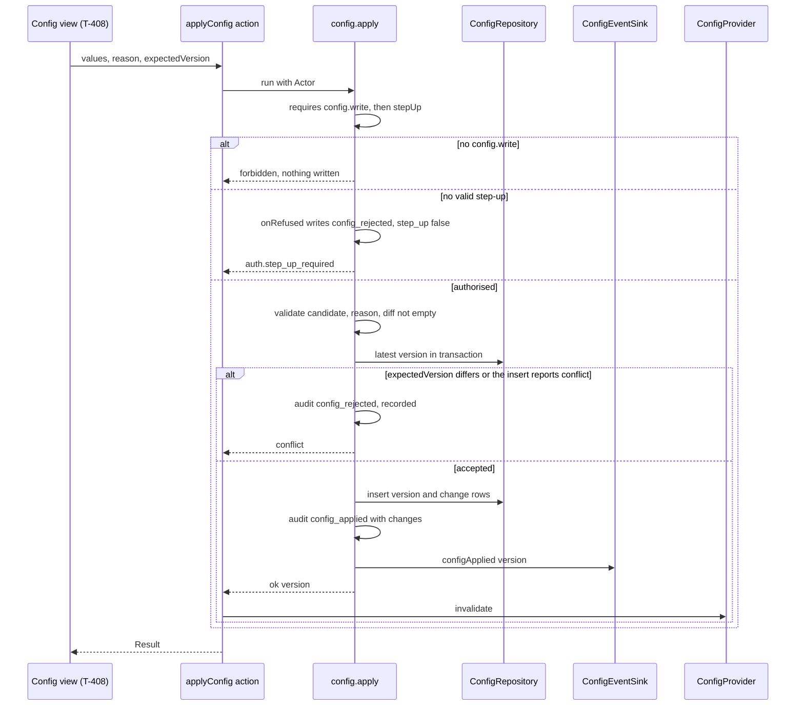
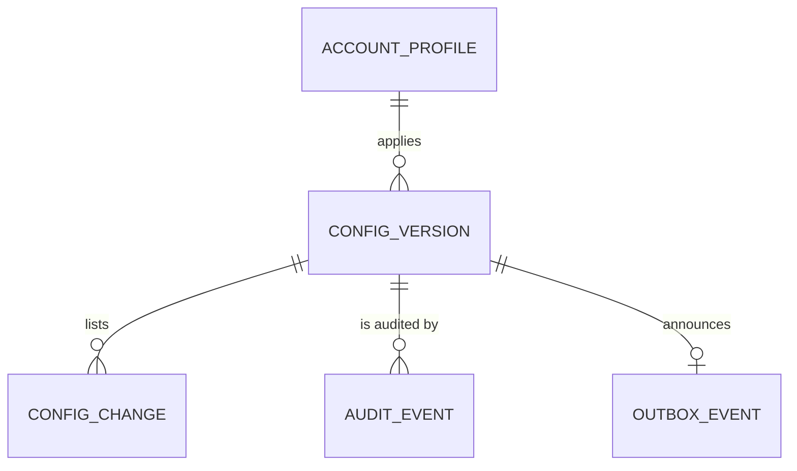

# Functional specification — U12 `t-105-runtime-configuration`

Draft written ahead of the stage. The lead finalises it when the workflow reaches this Unit; then it moves to `<record>/construction/t-105-runtime-configuration/functional-design/`.

Unit U12 (kind `library`, size M) delivers T-105 for US11.1 (AC11.1.1–AC11.1.4, AC11.1.6) and the runtime-settings clause of AC3.1.5. It is not in the high-risk class: `team.md` lists auth, identity, evidence, moderation, retention and deletion, and `unit-of-work.md` marks U12 "—". It does switch security-relevant values (the reveal toggles and the sign-in brute-force settings), so this file includes a security view (§ 10) and the reviewer's diff review checks it. Lead perspective: architect. Support perspectives written into this file: developer (mechanics, transactions, test design: § 9) and security engineer (threats: § 10), synthesised in § 11.

Inputs: listed in `functional-design-questions.md` (Context). This file is the source of truth for the workflows and state transitions. The data shape is in `entities.md`; the decision logic is in `rules.md`. The Unit has no screens (the configuration view is U37 T-408), so there is no `frontend-components.md`. Questions 1–10 (all A) were chosen on the owner's standing instruction of 2026-10-27. Questions 11–13 (all A) were decided by the agent under the owner's no-questions instruction of 2026-10-29. Both groups await the owner's confirmation. R1 and R2 (§ 8) are the owner's answers of 2026-10-29.

## Refreshed 2026-10-29

Re-checked against T-010 as merged on `main` (`14c21a9`), the refreshed T-101 draft, the T-103 draft (refreshed the same day), the refreshed T-201 draft, the T-106 draft and the owner's answers in `docs/aidlc-migration/OWNER-REVIEW-QUEUE.md`. A second pass the same day recorded the owner's approval of U10's screens and took over T-106's F25 (a missing step-up is recorded). What changed:

- **Owner's answers.**
  - R1: release 1 builds only the settings `ConfigValues` holds, the ones the demo uses. The other FR100 and AC11.1.1 settings move to release 2 (FD-<next: release-1 settings>, § 8.1).
  - R2: `limitedDataThreshold` is 2–50, so "Limited data" can never be switched off from settings (FD-<next: limited-data 2–50>). BR1.3 and the contracts change accordingly; T-201 already reads 2–50.
- **Boundaries (FD-093).**
  - `application` may import no external package, not even `zod` as a type. The first draft's validation, which mapped zod issue codes inside the application, would turn `pnpm lint` red (F13).
  - `contracts` now exports a zod-free `parseConfigValues(raw)`, and the application maps its findings (Q11).
  - `PgConfigProvider` stays in `database`. Only `server/container.ts` builds it. Pages pass values to components as props.
  - BR9.4's worker note is corrected: the worker would import the provider from `database`, not through the application subpath.
  - § 6.4 lists the element of every file.
- **T-101 as refreshed.** T-101's proposed FD rows are referred to by content here; FD-094 in the decision log is the owner's D13 change.
  - U8's `defineCommand` runs a declared `onRefused` for every refusal after `authenticated`. A blanket `onRefused` on apply and rollback would therefore write `config_rejected` for an Admin's `forbidden`, against AC11.1.6 (F14, S2).
  - Refusals after the step-up are written by the handler with `recorded: true` (Q13).
  - A lost race on the version number is caught in the repository's savepoint and returns `conflict`, so the record can still be written (Q13, F15).
  - U8 already adds the `signIn` block with the narrowed ranges and order rules (its Q8 C), and makes `ConfigProvider.current()` and `StaticConfigProvider` asynchronous (F5 closed by U8). This Unit takes both over.
  - ISS-108 is closed by U8 (F12 closed).
- **T-106 F25 (AC11.1.2).** A wrong or missing password must leave "the failed attempt recorded". U10 records a wrong password (`step_up_failed`), but a missing or stale step-up never reaches U10. Apply and rollback now declare an `onRefused` that writes `config_rejected {operation, code: 'auth.step_up_required', step_up: false}` for that refusal only; `forbidden` still writes nothing (Q13 A, F20). The task row "Apply without step-up: nothing written" reads "no configuration written; the attempt recorded" (F21).
- **Version-1 rows without `signIn`.** Rows seeded before U8 have no `signIn` block, so they would fail the strict schema after the upgrade. The upgrade and the migration fill it with FD-063's defaults (Q12, F16).
- **T-103.** The step-up comes from U10's `rk_stepup` (purposes `config.apply`, `config.rollback`), and `config.write` reaches only a Super Admin on an approved device. The owner approved U10's staff screens on 2026-10-29, so U10, which this Unit depends on, is not held back by that review (F17 resolved).
- **Gate and tests (T-010).**
  - In the same commit: `PgConfigRepository` leaves `STUB_REPOSITORIES` (all three methods are built here, `history` included; ISS-294); both migration-count pins go up by one; `repositories-superset.test.ts` is updated.
  - The 80% floor per package with untested files counted, the eleven-step `pnpm check` after T-011 (`format:check` and `check:identity` included), and CI green on the pushed Bolt head before merge. The seed test runs in the `test-support-seed` project.
- **New findings** F13–F21 (§ 8.2). Every S1 or S2 among them is designed out; F17 is resolved.

## 1. What changes, in one paragraph

Runtime configuration becomes real versioned data. `ConfigValues` moves to schema version 2:
- the `retention` block goes (FD-082);
- the `signIn` block U8 added keeps the ranges in which every value takes effect (Q1, U8 Q8 C);
- `limitedDataThreshold` becomes 2–50, so "Limited data" cannot be switched off (R2, FD-<next: limited-data 2–50>);
- the five always-enabled report reasons and the emergency-date rules are encoded (Q4, Q6);
- every object stays strict. Release 1 holds only these seven blocks (R1, FD-<next: release-1 settings>).

`contracts` gives the application a zod-free parse result (Q11). `config.propose` previews a whole candidate (Q3) as a diff with a validation result. `config.apply` validates it again and checks `expectedVersion`. Behind `config.write` and a step-up, it then writes in one transaction:
- the new version;
- one change row per changed setting;
- an audit row with the before and after values;
- a `config.applied` outbox row through `ConfigEventSink`.

`config.rollback` copies an older version into a new one, upgrading and re-validating it first (a version-1 value loses `retention` and gains FD-063's `signIn` defaults when it lacks them, Q12). A refused change by a Super Admin who passed the step-up is recorded as `config_rejected` by the handler with U8's `recorded` flag. A Super Admin's attempt without a valid step-up is recorded the same way by the command's `onRefused`, with `step_up: false` (AC11.1.2). An actor without `config.write` gets `forbidden` and nothing is written (AC11.1.6) (Q8, Q13). The database `ConfigProvider` replaces U8's defaults-only one: `current()` is asynchronous (Q2), returns the highest version (Q9), caches it for 5 seconds of process time, falls back to the last good values or the defaults and never throws. A migration strips the old `retention` blocks and makes both configuration tables append-only (Q7). The emergency page reads the live numbers, and the two strings that wrote "999" and "16263" into the copy take the numbers as parameters (Q5). Export and import are the existing query and apply (Q10). Nothing here is a screen.

## 2. As is (baseline: `main` at `14c21a9` with T-010 merged, read 2026-10-29; U8 and U10 as their refreshed drafts describe them)

- **Contracts.** `config-values.ts` has the schema version 1 shape: `thresholds`, `retention`, `limitedDataThreshold` (`min(1).max(50)`), `reportReasons` (`.min(1)`, no always-enabled rule, ISS-079), `capabilities`, `featureVisibility`, `emergency` (numbers `.min(1)`, `lastVerified` by regex only), all strict. U8 adds `signIn` before this Unit, with the narrowed ranges and the two order rules (U8 Q8 C). Because the seed spreads `DEFAULT_CONFIG_VALUES`, version 1 rows seeded after U8 carry `signIn` and rows seeded before do not (F16). `schemas/administration.ts` types `values` with `ConfigValuesSchema` (propose: shallow partial with `TODO(T-408)`), `reason` `.min(1)`, `expectedVersion` `.min(1)`. `view-models/config.ts` has `ConfigVM`, `ConfigVersionVM` (no actor, no `rolledBackFrom`), `ConfigChangeRowVM` with `TODO(T-408)`. `errors.ts` has `config.invariant`, `config.out_of_range`, `conflict`, `validation`, `not_found`, `auth.step_up_required`. `enums.ts` has `REPORT_REASONS` (13) and `CRITICAL_REPORT_REASONS`.
- **Database.**
  - `config_versions` and `config_changes` are as in `02-data-model.md` §11, with no foreign key from `config_changes.version` and no append-only trigger (§10 protects six other tables). `rk_worker` holds SELECT on `config_versions`.
  - `repositories/config.ts` is three stubs that throw `NotImplemented('T-105')` / `('T-408')` (`currentVersion`, `history`, `insertVersion`). `not-implemented.test.ts` lists `PgConfigRepository` in `STUB_REPOSITORIES` (ISS-294).
  - `repositories-superset.test.ts` requires `FakeConfigRepository` to cover the stub's names.
  - `migrations.int.test.ts` and `validator-probes.int.test.ts` (P8) pin the applied-migration count: 9 on `main`, plus one each for U8, U10 and U11.
- **Seed.** `seed-config.ts` writes version 1 with `schemaVersion: 1` and a `retention` block (90/180/90), actor `sa_founder`, plus `retention_policies` version 1 and the `demo_clock` row. It builds the values by spreading `DEFAULT_CONFIG_VALUES`. Its integration test runs in the `test-support-seed` Vitest project, after the `database` project.
- **Test support.** `aConfig()` merges `retention`. U8 makes `StaticConfigProvider.current()` asynchronous and updates `port-fakes.test.ts` (U8 F31).
- **Application.** Empty on `main`. U8 (refreshed draft) builds:
  - `defineCommand` with the full `requires` order. It runs `onRefused` for every refusal after `authenticated` and commits a handler `err` only when it is `recorded`;
  - the explicit context with an opaque `Tx`;
  - the asynchronous `ConfigProvider` port, and its defaults-only provider in `apps/web/src/server/container.ts`;
  - the audit allowlist builders that close ISS-108.

  U10 (refreshed draft) fills `Actor.stepUp` from `rk_stepup`, adds `STEP_UP_PURPOSES` (`config.apply`, `config.rollback`) and `resolveCapabilities(role, toggles)` behind its approved-device gate. The owner approved its staff screens on 2026-10-29 (its R1 precondition is met).
- **Boundaries and gate (T-010, FD-093).**
  - `application` may import `domain` and `contracts` only, with no external package and no Node built-in. `contracts` may import `zod` and `uuid`; `domain` imports nothing.
  - Only `server/container.ts` builds adapters and wires the providers; `app/` may not import `database`; components import server actions only.
  - The worker may import `database` and takes application code only through `@rogikotha/application/worker`, by no other specifier, a relative path included (FD-093 (2)); type-only imports stay allowed.
  - `pnpm check` is nine steps (eleven after U45 T-011), with 80% lines per package and untested files counted. CI runs on `bolt/**`.
- **Web.** `/[locale]/emergency` imports `DEFAULT_CONFIG_VALUES.emergency` with an `ASSUMPTION(CR-005)` marker (ISS-171). `/admin/config` is a placeholder page (T-408 builds it).
- **i18n.** `errors.config.invariant` and `errors.config.outOfRange` exist; `admin.config.*` exists (copy awaits review, ISS-050). `emergency.body` and `compose.safetyEmergFix` write "999" / "৯৯৯" and "16263" / "১৬২৬৩" into the strings (Q5).

## 3. Settled before this stage

AD-10, FD-018 (bounded configuration; structural boundaries stay out), FD-068 and FD-082 (no retention block, schema version 2), FD-083 (`config.applied` through `ConfigEventSink`), FD-058, FD-063, FD-072 (the sign-in settings are runtime settings with the owner's defaults), FD-016, FD-022, FD-051 (capability toggles), C1 (operations, authorization, errors), FD-088 (no UI here; T-408 is in release 1), FD-093 (import boundaries). Also: U8's `defineCommand`, asynchronous `ConfigProvider` and `signIn` block (its Q8 C), U10's step-up and capability rules, and the owner's approval of U10's staff screens (2026-10-29). The owner's answers of 2026-10-29: R1 (narrow release-1 settings; FD-<next: release-1 settings>) and R2 (limited-data threshold 2–50; FD-<next: limited-data 2–50>). See `functional-design-questions.md` § "Settled before this stage".

## 4. Workflows

Every command runs `parse → authorize → load → decide → persist` with its audit and outbox rows in one `UnitOfWork` transaction (01-conventions §3), through U8's `defineCommand`. "Validate" always means `validateCandidate` (BR2.2): upgrade, denylist, `parseConfigValues` (the strict schema, inside `contracts`), then the cross-field and current-version rules, with all findings collected and mapped to codes by BR2.3.

### WF0 — Code Generation order (the Unit end to end)

1. **Baseline.** U8 and U10 merged on `main` (the owner approved U10's screens on 2026-10-29, F17 resolved). `pnpm infra:up`; `pnpm check` (eleven steps after U45) and `pnpm smoke` green on the Bolt branch. Record the counts and the per-package coverage table. Read ISS-079, ISS-171 and ISS-294 and this file, and confirm:
   - U8's port shape (`current(): Promise<ConfigValues>`, Q2), its `signIn` block and the async `StaticConfigProvider`;
   - `onRefused` (run for every refusal after `authenticated`) and `recorded` in U8's `defineCommand`;
   - U10's `Actor.stepUp`, `STEP_UP_PURPOSES` and `resolveCapabilities`;
   - ISS-108 closed by U8.
2. **Decision log first.** Append the two rows of § 8.1, each with the next free FD number at that moment (FD-094 is the owner's D13 change; T-101's four proposed rows and U11's Former-member row come first if their Units merge first), before any source file changes.
3. **Dependency check.** zod and drizzle are already in use; no new dependency. Re-confirm two behaviours on the pinned versions and log them if no entry under 3 days covers them: the Next.js 16 request-time rendering call (`connection()`) for the emergency page, and zod 4's issue codes for `parseConfigValues`.
4. **Contracts first.**
   - Correct `03-routes-and-contracts.md` §3 and §4 first (the `signIn` range line, `limitedDataThreshold` 2–50, the `noChange` refusal).
   - `config-values.ts`: schema 2, BR1.x, `limitedDataThreshold.min(2)`, and the zod-free `parseConfigValues(raw)` (Q11).
   - `enums.ts` (`ALWAYS_ENABLED_REPORT_REASONS`), `schemas/administration.ts`, `view-models/config.ts`.
5. **Domain.** `administration/config-policy.ts` (denylist, diff, the upgrade with its `fill` argument, Q12), with tests.
6. **Application.** `modules/administration/` (ports, authorization, `config-validation.ts` over `parseConfigValues`, queries, commands whose `onRefused` records only a missing step-up, Q13), `modules/notification/config-event-sink.ts`, and the `config` stream's detail builders in U8's audit allowlist.
7. **Database.**
   - The migration (BR11.1: strip `retention`, fill a missing `signIn`, `schema_version` 2, the two triggers).
   - `repositories/config.ts`: `PgConfigRepository`, whose `insertVersion` runs in a savepoint and returns `conflict`; and `PgConfigProvider`.
   - Integration tests. `PgConfigRepository` leaves `STUB_REPOSITORIES` in `not-implemented.test.ts` (ISS-294), and both migration-count pins change, in the same commit.
8. **Test support.** `aConfig`, a `FakeConfigRepository` implementing the port (`repositories-superset.test.ts` updated), a recording `ConfigEventSink`, and `seed-config.ts` (schema 2, no `retention`). `StaticConfigProvider` is already async (U8).
9. **Web.** `server/container.ts` (`PgConfigProvider` in place of U8's defaults-only provider), `server/config.ts`, `server/actions/config.ts`, the emergency page (`connection()`; numbers as props to `Emergency`), i18n keys.
10. **Records and gate.** Reference documents and T-408 corrections (BR12.5); `pnpm check`, `pnpm smoke`, `pnpm test:int`; CI green on the pushed Bolt head before merge; the hand-off with the coverage table before and after.

### WF1 — Read the configuration (`await config.current()`, every module)

1. If the process snapshot is younger than 5000 ms (monotonic clock), return its values (BR4.3).
2. Otherwise start one load; concurrent callers wait for the same load.
3. Load: the row with the highest `version` (BR4.2). None → `DEFAULT_CONFIG_VALUES`, version 0, `config.defaults_in_use` logged once (BR4.4).
4. Upgrade (`schema_version` 1 → 2: drop `retention`, fill a missing `signIn` with FD-063's defaults, BR3.3, Q12) and parse with `ConfigValuesSchema`. Failure → `config.invalid_version {version}` logged; keep the last good snapshot or use the defaults (BR4.5).
5. A database error → `config.read_failed` logged; same fallback (BR4.5). The next call after 5 s tries again.
6. Store `{values, version, loadedAt, source}` and return the values.

### WF2 — Staff reads (`config.current`, `config.history`)

- `config.current`: any staff role; reads the repository directly (no cache) and returns `{version, schemaVersion: 2, values}` (BR5.1). The same object is the export file (Q10).
- `config.history {page}`: any staff role; 20 versions per page, newest first, each with its change rows, reason, `rolledBackFrom` and the actor as `{username, role, deleted}` (BR5.2). No account id leaves the query.

### WF3 — Preview (`config.propose {values}`)

1. `requires {capability: 'config.write'}` (Super Admin only); no step-up.
2. Validate the candidate against the current version.
3. Valid → `ok({diff: diff(current, candidate), validation: {ok: true}})`. Invalid → `ok({diff: [], validation: {ok: false, code, fieldErrors}})` (BR5.3). Nothing is written in either case.

### WF4 — Apply (`config.apply {values, reason, expectedVersion}`)



Text fallback: the configuration view sends the candidate, reason and expected version to the server action, which runs the command with the Actor. The command checks `config.write`, then the step-up. An actor without `config.write` is refused with nothing written. A Super Admin without a valid step-up is refused, and the command's `onRefused` writes one `config_rejected` row with `step_up: false` in its own transaction. Then the command validates the candidate and checks that something changed. Inside the transaction it reads the latest version. A different `expectedVersion`, or the repository reporting a lost race on the unique version number, gives `conflict`: the command then writes one `config_rejected` audit row and returns the refusal marked `recorded`, so only that row commits. Otherwise it inserts the new version and its change rows, writes the audit row and appends `config.applied` through the sink, all in one transaction, and returns the version. The action then drops the provider's cached snapshot.

1. `requires {capability: 'config.write', stepUp: true}` (BR6.1). U8 runs the command's `onRefused` for both refusals (Q13):
   - `forbidden` (no `config.write`: an Admin, a Moderator, or a staff account on an unapproved device) → `onRefused` writes nothing (AC11.1.6, BR8.4);
   - `auth.step_up_required` (a Super Admin with no `rk_stepup`, or a stale or tampered one) → `onRefused` writes `config_rejected {operation: apply, code: 'auth.step_up_required', step_up: false}` in its own committed transaction (AC11.1.2, T-106 F25, BR8.4). No configuration row is written, and the client re-runs after `account.stepUp`.
2. Reason trimmed, 5–500 characters, checked by `ApplyConfigInput` at parse time, before authorization; a failure is `validation` on `reason` and is not recorded (BR2.4).
3. Validate the candidate (BR2.2); invalid → its code and field errors (BR6.2). The handler writes `config_rejected` (WF6) and returns the refusal with `recorded: true`.
4. `diff(current, candidate)` empty → `validation` / `errors.config.noChange` (BR2.5), recorded the same way.
5. In the transaction: `latest = max(version)`; `expectedVersion ≠ latest` → `conflict` (BR6.3), recorded.
6. Insert, then audit and append (BR6.4, BR8.1, BR8.2):
   - `ConfigRepository.insertVersion(tx, row)` with `latest + 1`, schema 2, the normalised values, actor, reason and `effective_from = Clock.now()`. The repository runs the insert in a savepoint of its own and maps the unique violation on `config_versions_version_unique` to `err('conflict')`. The outer transaction stays usable, so `config_rejected` can still be written and committed (Q13).
   - One `config_changes` row per diff entry.
   - The audit row `config_applied {version, changes, step_up: true}`, from the `config` stream's detail builder.
   - `ConfigEventSink.configApplied(tx, {version})`.
7. Result `ok({version})`; the server action calls `container.config.invalidate()` (BR4.6).

### WF5 — Rollback (`config.rollback {toVersion, reason}`)

1. `requires {capability: 'config.write', stepUp: true}` (purpose `config.rollback`) (BR7.1). The same `onRefused` as WF4, with `operation: rollback`.
2. Reason as in WF4 step 2.
3. Load version `toVersion`; none → `not_found` (BR7.2), recorded (WF6).
4. Upgrade its values (a `retention` block goes, FD-082; a missing `signIn` is filled with FD-063's defaults, Q12). Validate them against today's rules and the current version (BR7.2). Invalid → its code, recorded.
5. Equal to current → `errors.config.noChange` (BR7.3), recorded.
6. In the transaction:
   - `insertVersion` (`latest + 1`, `rolled_back_from = toVersion`; the repository savepoint maps a lost race to `conflict`, recorded);
   - change rows `diff(current, restored)`;
   - audit `config_rolled_back {version, rolledBackFrom, changes, step_up: true}`;
   - `configApplied(tx, {version, rolledBackFrom})` (BR7.3).
7. Result `ok({version})`; invalidate as in WF4.

### WF6 — Record a refused change (two recorders, Q13)

Both recorders write one `config_rejected` row on the `config` stream and nothing else. Only a Super Admin on an approved device ever reaches either, because the step-up check runs after the capability check (U10 BR7.4).

1. **After `requires` passed (the handler, with U8's `recorded` flag).** The actor holds `config.write` and a valid step-up. It covers a command that then refused with `config.invariant`, `config.out_of_range`, `validation` (findings, no change), `conflict` or `not_found`. The handler writes `config_rejected {operation, code, paths, unknownKeyCount, step_up: true}` in the command's own transaction. Nothing else has been written at that point: the version insert, if it ran, was rolled back to the repository's savepoint. The handler returns `err(code, {recorded: true})`, so U8's `UnitOfWork` commits the row and strips the flag (U8 BR7.11, BR8.3). `paths` lists only known setting paths; unknown keys are counted.
2. **A missing or stale step-up (the command's `onRefused`).** U8 calls `onRefused({actor, input, refusal})` in a committed transaction of its own. For `refusal.code = 'auth.step_up_required'` it writes `config_rejected {operation, code: 'auth.step_up_required', step_up: false}`: no paths and no key count, because the candidate was not validated. For any other refusal (`forbidden`) it writes nothing (BR8.4). If the row cannot be written, U8 returns `internal`, and the attempt stays refused.
3. A wrong step-up password never reaches this Unit: U10's `account.stepUp` records it as `step_up_failed` (U10 BR7.6). Together with item 2, every wrong or missing password is recorded (AC11.1.2).

### WF7 — Import and export (Q10)

- Export: the config view downloads the `config.current` result as `rogikotha-config-v<version>.json` (T-408).
- Import: the config view reads a file, and sends its `values` (and its `schemaVersion` when it is 1) through WF3 and WF4. The file is never trusted: it passes the same validation, reason and step-up as a typed change, and an unchanged import is refused as "no change".

### WF8 — Consumers

- The web container (`server/container.ts`, the only file that builds it) wires `PgConfigProvider` in place of U8's defaults-only provider. `getConfig()` in `apps/web/src/server/config.ts` (web-server) is the helper for pages and layouts (BR9.2).
- `/[locale]/emergency` (element `web`) opts into request-time rendering with `connection()`, reads `(await getConfig()).emergency` and passes the numbers to `Emergency` as props; the component imports nothing from `server/` (BR9.3, closes ISS-171).
- These read the same port (BR9.1):
  - U8's sign-in;
  - U10's `getActor`, which awaits `config.current()` on every request of an approved staff device;
  - U14's limited data (2–50) and facility feedback;
  - U15/T-207's emergency panels;
  - U21, U32 and U33.
- A capability toggle change reaches the next `getActor` (BR9.5).

### WF9 — Migration and seed

1. Migration (next free number at merge time): strip `retention`, add FD-063's `signIn` defaults where a row has none (Q12), and set `schema_version = 2` on every stored version-1 row; then attach `fn_block_mutation()` to `config_versions` and `config_changes` (BR11.1).
2. Seed: version 1 at schema version 2 from `DEFAULT_CONFIG_VALUES` and the corpus values, no `retention`, actor `sa_founder`, idempotent (BR11.2). A stored `limitedDataThreshold` of 1 cannot occur (corpus and default 5), so the 2–50 range needs no data change. `retention_policies` keeps its own seed (U29 owns it).

## 5. State transitions

### 5.1 The configuration history

`empty` (no row; readers get the defaults, version 0) → seed or first apply → `v1` → apply → `v2` → … Each accepted apply or rollback appends exactly one version; nothing ever updates or deletes a version or a change row after the migration (BR11.1). A rollback to `vN` appends `v(latest+1)` whose values equal the upgraded `vN` and whose `rolled_back_from` is `N`. The current version is always the latest (BR4.2).

### 5.2 The provider snapshot (per process)

| From | Event | To |
|---|---|---|
| `none` | `current()` | `loading` |
| `loading` | load ok | `fresh (database)` |
| `loading` | empty table | `fresh (defaults)`, logged once |
| `loading` | read error or invalid value, last good exists | `fresh (last_good)`, logged |
| `loading` | read error or invalid value, no last good | `fresh (defaults)`, logged |
| `fresh` | 5000 ms pass | `stale` |
| `stale` | `current()` | `loading` (the stale values stay as last good) |
| any | `invalidate()` | `none` (the last good values are kept for the fallback) |

## 6. Interfaces

### 6.1 Queries and commands (all in `modules/administration`)

| Name | Input | Requires | Audit (`config`) | Outbox | Expected errors |
|---|---|---|---|---|---|
| `config.current` (query) | `GetCurrentConfigInput {}` | `staffRole` (any) | — | — | — |
| `config.history` (query) | `GetConfigHistoryInput {page?}` | `staffRole` (any) | — | — | — |
| `config.propose` (query) | `ProposeConfigInput {values}` | `capability: config.write` | — | — | — (the result carries validation) |
| `config.apply` | `ApplyConfigInput {values, reason, expectedVersion}` | `capability: config.write`, `stepUp` | `config_applied`; `config_rejected` on a refusal after the capability check (handler or `onRefused`) | `config.applied {version}` | `config.invariant`, `config.out_of_range`, `validation`, `conflict`, `auth.step_up_required` |
| `config.rollback` | `RollbackConfigInput {toVersion, reason}` | `capability: config.write`, `stepUp` | `config_rolled_back`; `config_rejected` as for apply | `config.applied {version, rolledBackFrom}` | `not_found`, `config.invariant`, `config.out_of_range`, `validation`, `conflict`, `auth.step_up_required` |

`forbidden` and `internal` apply to every operation (C-rules). C1 lists no `validation` or range errors for rollback; they are added (additive, BR7.2, BR2.5).

### 6.2 Functions and ports

| Name | Where | Shape |
|---|---|---|
| `ConfigProvider` | `application/ports/config-provider.ts` (U8 creates it) | `current(): Promise<ConfigValues>` (Q2) |
| `PgConfigProvider` | `database/repositories/config.ts` | implements `ConfigProvider`, plus `invalidate()`; takes the database pool and the `Logger` port; cache clock `performance.now()` |
| `ConfigRepository` | `modules/administration/ports.ts` | `latest`, `findVersion`, `history`, `insertVersion(tx, row) → Result<void, 'conflict'>` (own savepoint, Q13), `insertChanges` |
| `ConfigEventSink` | `modules/administration/ports.ts` | `configApplied(tx, {version, rolledBackFrom?}): Promise<void>` (FD-083) |
| `OutboxConfigEventSink` | `modules/notification/config-event-sink.ts` | `Outbox.append(tx, 'config.applied', payload)` |
| `parseConfigValues(raw)` | `contracts/config-values.ts` (new, Q11) | `{ok: true, values} \| {ok: false, findings: [{path, code, messageKey}], unknownKeyCount}`; `code` ∈ `config.invariant`, `config.out_of_range`, `validation`; the zod issues stay inside `contracts`; unknown key names are counted, never returned |
| `validateCandidate(raw, current, today)` | `modules/administration/config-validation.ts` | `Result<ConfigValues>` with code and field errors, over `upgradeConfigValues`, `findDenylistedPaths`, `parseConfigValues` and the current-version rules; imports no `zod` |
| `findDenylistedPaths`, `diffConfig`, `upgradeConfigValues(raw, fromVersion, fill)` | `domain/administration/config-policy.ts` | pure, plain JSON (BR3.1–BR3.4); `fill` holds the blocks to add when absent (`{signIn: DEFAULT_CONFIG_VALUES.signIn}`, passed by the application, Q12) |
| Ports used | U8's | `Clock`, `IdGenerator`, `AuditWriter`, `Outbox`, `Logger`, `UnitOfWork` |

### 6.3 Server actions and helpers

- `apps/web/src/server/actions/config.ts`: `getCurrentConfig`, `getConfigHistory`, `proposeConfig`, `applyConfig`, `rollbackConfig`. Each is `parse → getActor → command → Result`; `applyConfig` and `rollbackConfig` call `container.config.invalidate()` after an ok result. T-408 imports these and does not create `admin-config.ts` (F9).
- `apps/web/src/server/config.ts`: `getConfig(): Promise<ConfigValues>`.

### 6.4 Placement under the T-010 boundaries

| Files | Element | May import | Note |
|---|---|---|---|
| `packages/domain/src/administration/config-policy.ts` | domain | nothing | plain JSON types; the `signIn` defaults come in as an argument |
| `packages/contracts/src/{config-values.ts, enums.ts, schemas/administration.ts, view-models/config.ts}` | contracts | `zod`, `uuid` | `parseConfigValues` keeps every zod type inside `contracts` (Q11) |
| `packages/application/src/modules/{administration,notification}/**`, `audit/**` (config builders) | application | domain, contracts | no `zod`, not even as a type (the boundary policy for `application` has no external edge and checks type imports too); no Node built-in |
| `packages/database/src/{repositories/config.ts, migrations/**}` | database | application ports, contracts, drizzle, pg | `PgConfigProvider` and `PgConfigRepository`; the savepoint lives here |
| `apps/web/src/server/{container.ts, config.ts}` | web-server | application, contracts, database, i18n (container: also adapters) | the container is the only file that constructs `PgConfigProvider` |
| `apps/web/src/server/actions/config.ts` | web-actions | application, contracts, i18n, web-server, web-shared | calls `container.config.invalidate()` after an ok change |
| `apps/web/src/app/[locale]/(patient)/emergency/page.tsx` | web | web-server, web-components, contracts, i18n | `connection()` from `next/server`; numbers to `Emergency` as props |
| `packages/test-support/src/{builders,fakes,seed}/**` | test-support, test-support-seed | application, contracts, domain (seed: also database, FD-040) | |
| `apps/worker/**` | worker | — | unchanged; a later job takes `PgConfigProvider` from `@rogikotha/database`, which the worker may import (BR9.4) |

## 7. Copy

New message keys (both languages in one commit, Bengali for the owner's review, FD-042):

| Key | en | bn |
|---|---|---|
| `errors.config.reasonRequired` | This report reason can't be turned off. Nothing was changed. | এই রিপোর্টের কারণটি বন্ধ করা যায় না। কিছু বদলানো হয়নি। |
| `errors.config.noChange` | There is nothing to apply: the values match the current version. | প্রয়োগ করার মতো কোনো পরিবর্তন নেই: মানগুলো বর্তমান সংস্করণের মতোই। |
| `errors.config.reasonLength` | Reason: write between 5 and 500 characters. | কারণ: ৫ থেকে ৫০০ অক্ষরের মধ্যে লিখুন। |
| `errors.config.lastVerifiedRequired` | You changed an emergency number. Set "Last verified" to the day you checked the numbers. | আপনি একটি জরুরি নম্বর বদলেছেন। যেদিন নম্বরগুলো যাচাই করেছেন, "সর্বশেষ যাচাই" তারিখটি সেই দিনে দিন। |
| `errors.config.dateInFuture` | This date can't be in the future. | এই তারিখ ভবিষ্যতের হতে পারে না। |
| `errors.config.dateInvalid` | Enter a real date. | একটি সঠিক তারিখ দিন। |
| `errors.config.phoneFormat` | Use digits and hyphens only, 3 to 15 characters. | শুধু অঙ্ক ও হাইফেন ব্যবহার করুন, ৩ থেকে ১৫ অক্ষর। |
| `errors.config.maxDelayOrder` | The longest delay can't be shorter than the first delay. | সবচেয়ে দীর্ঘ বিলম্ব প্রথম বিলম্বের চেয়ে কম হতে পারে না। |
| `errors.config.severeOrder` | The severe-activity threshold must be higher than the threshold where delays start. | গুরুতর কার্যকলাপের সীমা বিলম্ব শুরুর সীমার চেয়ে বেশি হতে হবে। |

Changed keys (Q5; with the default numbers the rendered text is unchanged): `emergency.body` takes `{ambulance}` and `{healthLine}`; `compose.safetyEmergFix` takes `{ambulance}`. Exact text in `functional-design-questions.md` Question 5. The digits in `errors.config.reasonLength` and `errors.config.phoneFormat` are written per language in the string, as `label.limitedDataWhy` does, because a field error carries a key and no parameters.

Existing keys reused: `errors.config.invariant`, `errors.config.outOfRange`, `errors.common.conflict`, `errors.common.validation`, `errors.common.notFound`, `errors.common.forbidden`, `errors.auth.stepUpRequired`.

## 8. The owner's answers, decisions to record and findings

- **R1 — AC11.1.1 and FR100 name settings no Unit builds (the owner's answer, 2026-10-29: narrow).** Release 1 builds only the settings `ConfigValues` holds, which are the ones the demo uses. These move to release 2: label translations and wording, warnings, "whether sentiment is optional" (FR45), the label-approval workflow (FR47), the dangerous-advice visibility policy (FR75), navigation, profile and form fields, browser-support display and public status labels. Recorded by the release-1 settings row of § 8.1.
- **R2 — The limited-data threshold could switch the "Limited data" label off (the owner's answer, 2026-10-29: 2–50).** With a minimum of 1, `0 < total < 1` is never true; with 2 a single account always reads as limited data. BR1.3 and `ConfigValuesSchema` use 2–50, and T-201's draft already does. Recorded by the limited-data row of § 8.1.

### 8.1 Proposed decision-log rows (appended verbatim before any code)

FD-094 in the decision log is now the owner's change of D13 (parallel builds). So no proposed row carries a fixed number: each row below is written `FD-<next>` and takes the next free number when it is appended. T-101's four rows and U11 T-104's Former-member row are appended first if their Units merge first. Keep the text; only the number is filled in.

```
| FD-<next> | **Runtime settings narrowed for release 1 (U12 T-105 draft R1)**: FR100 and AC11.1.1 are narrowed for release 1 to the seven blocks `ConfigValues` holds at schema version 2: the moderation thresholds, the limited-data threshold, the report reasons (five always enabled), the Admin and Moderator capability toggles, feature visibility (`facilityAccounts`, `compareTray`), the emergency contacts with their last-verified date, and the sign-in settings. Label translations and wording, warnings, whether sentiment is optional (FR45), the label-approval workflow (FR47), the dangerous-advice visibility policy (FR75), navigation, profile and form fields, browser-support display and public status labels move to release 2; release 1 adds no key, column or reader for them, and any other key stays refused as `config.invariant`. `thresholds.appealDays` stays validated with no release-1 reader, because appeals are deferred (FD-088). | No Unit builds those settings and nothing would read them; nothing is half-built. The owner chose the narrow release (2026-10-29, `docs/aidlc-migration/OWNER-REVIEW-QUEUE.md`, T-105 draft R1). Appended by U12 T-105 before its code |
| FD-<next> | **"Limited data" cannot be switched off from settings (U12 T-105 draft R2)**: `ConfigValues.limitedDataThreshold` is an integer in 2–50 (C1 and `03-routes-and-contracts.md` §4 said 1–50; the default 5 is unchanged). "Limited data" shows when `0 < eligible accounts < threshold`, so with the minimum of 2 a single account always reads as limited data and no configuration can hide the label; 1 is refused as `config.out_of_range`. No stored version holds 1 (the corpus and the default hold 5). | Keeps a hard-rule label reachable under every configuration. The owner's answer (2026-10-29, `docs/aidlc-migration/OWNER-REVIEW-QUEUE.md`, T-105 draft R2). Appended by U12 T-105 before its code |
```

### 8.2 Findings (proposed ISS rows, each `Found in U12 T-105`)

| Id | Sev | Finding | Owner (suggested) |
|---|---|---|---|
| F1 | S2 | T-105's acceptance row "apply the severe threshold 10→12 … the notice fires at the 12th" cannot pass: C5 fixes the per-email limit at 10 failures in 15 minutes, so the 11th and 12th failures never happen (U8 BR3.2, BR3.5). C1's ranges `severeFailures` 2–100 and `delayAfterFailures` 1–20 allow values that never take effect. Closed by Q1 A (ranges 2–10 and 1–9, row 10→8); also closes U8's draft F3 | U12 T-105, C1 |
| F2 | S2 | `emergency.body` and `compose.safetyEmergFix` write 999 and 16263 into the copy while the numbers are editable; after a change one panel would show two ambulance numbers. Closed by Q5 A | U12 T-105 (keys); U15 T-202, T-207, U26 T-306 pass the parameters |
| F3 | — | Resolved: a limited-data threshold of 1 made the "Limited data" hard-rule label unreachable; the owner chose 2–50 (R2) | U12 T-105 (closed by the limited-data FD row) |
| F4 | S3 | The always-enabled report reasons differ: `02-data-model.md` §11 and T-105 say privacy, threat, unsafeFile, dangerous, other; T-408 step 3 says factual plus the three critical reasons. ISS-079 (not encoded) is closed by Q4 A; T-408 is corrected | U12 T-105, U37 T-408 |
| F5 | — | Closed by U8 T-101 (its F31): the port and `StaticConfigProvider` are asynchronous and the refreshed U10, U14 drafts `await` it; 03 §3 is corrected here | U8 T-101 |
| F6 | S3 | T-305 step text says "until T-309 is merged use the config default 90 from `ConfigProvider`" for the original-retention deadline; after FD-082 the configuration has no retention value | U25 T-305 |
| F7 | S3 | `ProposeConfigInput` and `ApplyConfigInput` parse `values` with `ConfigValuesSchema`, so an unknown key is refused at the input boundary as `validation`, not `config.invariant` as the acceptance rows expect. Closed by Q3 A (BR2.1) | U12 T-105 |
| F8 | S3 | FR101 and AC11.1.4 ask for export and import; no task builds them. Closed by Q10 A here; T-408 needs two buttons | U37 T-408 |
| F9 | S4 | T-105 owns `server/actions/config.ts` and T-408 owns `server/actions/admin-config.ts` with the same three actions (`proposeConfig`, `applyConfig`, `rollbackConfig`); T-408 reuses T-105's file | U37 T-408 |
| F10 | S4 | `config_versions` and `config_changes` are not append-only in the database although threat 6 relies on it (Q7) | U12 T-105 |
| F11 | S4 | `02-data-model.md` §11 chooses the current version by `effective_from <= now()` with the Clock port; moving the demo clock back hides newer versions (Q9). The data model and T-105's integration row are corrected | U12 T-105 |
| F12 | — | Closed by U8 T-101: ISS-108 is fixed with a recursive allowlist; this Unit adds the `config` stream's detail builders (nested `changes` with known paths and bounded values) | U8 T-101 |
| F13 | S1 → designed out | Under FD-093, `application` may import no external package. The first draft's `validateCandidate` mapped zod issue codes (`unrecognized_keys`, `too_small`) inside the application, so it would need `zod`, and `pnpm lint` would turn red. `contracts` now exports the zod-free `parseConfigValues` (Q11) | U12 T-105 |
| F14 | S2 → designed out | U8's `defineCommand` runs `onRefused` for every refusal after `authenticated`. The first draft's `onRefused`, written for refusals after the step-up, would therefore also write `config_rejected` for an Admin's `forbidden`, against AC11.1.6 and BR8.4. Refusals after the step-up are recorded by the handler with `recorded: true`; the declared `onRefused` writes only for a missing step-up and nothing for `forbidden` (Q13) | U12 T-105 |
| F15 | S2 → designed out | A unique violation on `config_versions.version` aborts the PostgreSQL transaction, so the first draft could neither return a clean `conflict` nor write `config_rejected` afterwards. The application holds an opaque `Tx`, so the repository's `insertVersion` runs in a savepoint and returns `conflict` (Q13) | U12 T-105 |
| F16 | S3 | Version-1 rows seeded before U8 added `signIn` have no `signIn` block. The first draft's upgrade only removed `retention`, so these rows would fail the strict schema: the provider would fall back with an error log every 5 s, and a rollback to them would be refused. The upgrade and the migration now fill FD-063's defaults (Q12) | U12 T-105 |
| F17 | — | Resolved: this Unit depends on U10 T-103, which was not to be built before the owner approved its staff screens; the owner approved them as they are in the prototype on 2026-10-29 | — |
| F18 | S4 | `PgConfigRepository.history` is a stub owned by T-408, but this Unit builds `config.history`. All three stub methods are built here, so the class leaves `STUB_REPOSITORIES` (ISS-294); T-408 reuses the query | U12 T-105, U37 T-408 |
| F19 | S4 | `thresholds.appealDays` has no release-1 reader (appeals deferred, FD-088). It stays validated (release-1 settings FD row) | U33 T-404 (after release 1) |
| F20 | S2 → designed out | AC11.1.2 says a wrong or missing password leaves "the failed attempt recorded". The first refresh wrote nothing for `auth.step_up_required`, and a missing step-up never reaches U10's `step_up_failed`, so T-106's matrix row M20 would fail (T-106 F25). Apply and rollback declare an `onRefused` that writes `config_rejected {operation, code: 'auth.step_up_required', step_up: false}` and writes nothing for `forbidden` (Q13 A) | U12 T-105 (from U13 T-106 F25) |
| F21 | S4 | T-105's acceptance row "Apply without step-up: `auth.step_up_required`; nothing written" reads "no configuration row written; one `config_rejected` audit row with `step_up: false`" (AC11.1.2); the task file is corrected in this Bolt (BR12.5) | U12 T-105 |

ISS-079 and ISS-171 move to "fixed in U12 T-105" when the Unit merges.

## 9. Developer view — mechanics and tests

### 9.1 Transactions and concurrency

- One transaction per accepted change: version row, change rows, audit row, outbox row (BR6.4). A refusal after the step-up writes only `config_rejected`, in the command's own transaction, committed through U8's `recorded` flag (BR8.3, Q13). A missing or stale step-up writes only `config_rejected` with `step_up: false`, through the command's `onRefused` in U8's separate committed transaction; the same `onRefused` writes nothing for `forbidden`, which U8 also passes to it (BR8.4).
- No lock is taken: `expectedVersion` is compared with `max(version)` read in the transaction, and the unique constraint on `config_versions.version` decides a race (BR6.3). `PgConfigRepository.insertVersion` runs its insert in a savepoint (Drizzle's nested `tx.transaction`, inside `packages/database`) and maps the unique violation (`23505` on `config_versions_version_unique`) to `err('conflict')`. The outer transaction stays usable for the `config_rejected` row. The application cannot open a savepoint itself (opaque `Tx`).
- `invalidate()` runs after the command returns ok, in the server action, so a concurrent reload cannot cache the old values after the commit for longer than one 5-second period.

### 9.2 Validation mapping

`parseConfigValues` in `contracts` turns zod's issues into findings, so no zod type crosses into `application` (Q11):
- `unrecognized_keys` → `config.invariant` (the key names are counted in `unknownKeyCount` and never kept);
- `too_small` / `too_big` → `config.out_of_range`;
- `invalid_type` (a missing key included) and `invalid_format` → `validation`;
- the schema's own refinements (U8's two `signIn` order rules) → `config.out_of_range` with `errors.config.maxDelayOrder` or `errors.config.severeOrder`.

`validateCandidate` in the application adds the policy findings: the denylist, the always-enabled reasons, an unchanged `lastVerified`, and a date in the future. Each carries its code and message key, and the result code is the most serious one found (BR2.3). `fieldErrors` keys are known setting paths (`thresholds.fiveAccountHide`, `emergency.lastVerified`), so T-408 can place each message beside its input. The zod 4 issue codes are confirmed on the pinned version in Code Generation (WF0 step 3).

### 9.3 Migration

```sql
UPDATE config_versions
   SET "values" = ("values" - 'retention')
                  || CASE WHEN "values" ? 'signIn' THEN '{}'::jsonb
                          ELSE '{"signIn": {"delayAfterFailures": 3, "windowMinutes": 15, "firstDelaySeconds": 1, "maxDelaySeconds": 30, "severeFailures": 10}}'::jsonb END,
       schema_version = 2
 WHERE schema_version = 1;
```

The literal is FD-063's defaults. An integration test asserts that it equals `DEFAULT_CONFIG_VALUES.signIn` (Q12). The migration then runs `CREATE TRIGGER config_versions_append_only BEFORE UPDATE OR DELETE ON config_versions FOR EACH ROW EXECUTE FUNCTION fn_block_mutation();`, and the same for `config_changes`. The update runs before the triggers exist. The migration takes the next free number when this Unit merges, with a journal timestamp later than the last one (the CR-006 lesson). Both exact counts go up by one with a comment: `migrations.int.test.ts` and `validator-probes.int.test.ts` P8. The test reset drops and recreates the schema, so the triggers do not block it (verify, § 14).

### 9.4 Test design

| Level | File | Covers |
|---|---|---|
| contracts | `config-values.test.ts` (extended) | each range's minimum, maximum and ±1 (thresholds, limited data 2–50 with 1 refused, every `signIn` key); the two sign-in order rules; strict refusal of `retention`, `auth`, `capabilities.super_admin`; always-enabled reasons; phone and date formats; defaults parse and equal FD-063's values; `parseConfigValues` maps each issue kind to its code and never returns an unknown key name (BR1.1–BR1.10, BR2.3) |
| domain | `administration/config-policy.test.ts` | every denylisted prefix, in any case and depth; `signIn.*` not denylisted; diff on nested leaves, arrays as sets, unchanged values omitted, keys on one side; upgrade 1 → 2 (drops `retention`, fills a missing `signIn` from `fill`, keeps a present one) and refusal of other versions (BR3.1–BR3.3) |
| application | `modules/administration/*.test.ts` (fakes) | propose valid and invalid; apply happy path (version 2, one change row, audit details with only known paths, one sink call); `forbidden` for Admin and Moderator, and for a Super Admin account on an unapproved device, with nothing written although U8 called `onRefused`; `auth.step_up_required` (no cookie, stale, tampered) with no version and exactly one committed `config_rejected` carrying `step_up: false`, for apply and for rollback; conflict by stale `expectedVersion` and by the fake repository's `conflict`, each with one committed `config_rejected` (the in-memory unit of work records a commit for the `recorded` refusal); no-change refusal; rollback chain (1 → 2 → rollback 1 = 3, `rolledBackFrom` 1); rollback strips `retention` and fills `signIn`; rollback to a value today's ranges refuse; `config_rejected` written once with no unknown key name; capability toggle reaches `resolveCapabilities` (BR5.x–BR8.x, BR9.5) |
| database | `repositories/config.int.test.ts` | each repository method; `insertVersion` twice with one number → the second returns `conflict` and the outer transaction can still insert and commit an audit row; provider: cached within 5 s, reloaded after `invalidate()`, empty table gives defaults and one log line, an invalid stored row falls back to the last good values, a version-1 row inserted raw (with and without `signIn`) reads as schema 2 without `retention`; the migration's `signIn` literal equals `DEFAULT_CONFIG_VALUES.signIn`; the trigger refuses UPDATE and DELETE; both migration-count pins (BR4.x, BR11.1) |
| test-support | `seed.int.test.ts` (extended, `test-support-seed` project), `fakes/repositories-superset.test.ts` | version 1 at schema 2 with no `retention`; a second seed run inserts nothing (BR11.2); the config fake covers the port |
| web | `emergency/page.test.tsx` | renders the configured numbers in `en` and `bn` from a provider returning non-default numbers, and the defaults when the provider is in fallback (BR9.3) |
| smoke | `administration.smoke.test.ts` | defaults parse; an apply through fakes creates version 2 with one change and one `config.applied` (BR12.2) |

The FD-072 sign-in row (Q1: 10→8) is an application test with U8's sign-in command, `FakeClock` stepping past each delay and the fake provider returning the applied version; the live variant with `shirin.demo@example.test` is run once at Build and Test against the demo stack.

## 10. Security view — threat cases

| # | Threat | Defence | Rules |
|---|---|---|---|
| T1 | Configuration used to disable a security boundary (`auth.*`, `audit.*`, a new capability) | strict schema at every level, structural denylist before parsing, only enumerated keys exist; the refusal is recorded | BR1.1, BR3.1, BR8.3 |
| T2 | Privilege escalation through `capabilities` | Super Admin fixed in code; only four booleans; a toggle change is audited with before and after | BR1.5, BR8.1, BR9.5 |
| T3 | A silent change | `config.write` plus step-up for every apply and rollback, reason required, audit row with the diff in the same transaction | BR2.4, BR6.1, BR6.4 |
| T4 | Lost update between two editors | `expectedVersion` and the unique version number | BR6.3 |
| T5 | Threshold set to weaponise reports or switch labels off | `fiveAccountHide >= 2`; the critical, unsafe-advice and catch-all reasons cannot be disabled; `limitedDataThreshold >= 2`, so "Limited data" always exists (R2) | BR1.2, BR1.3, BR1.4 |
| T12 | A refused attempt by a non-Super-Admin leaves rows that look like configuration activity | `onRefused` writes nothing for `forbidden`; only a Super Admin past the capability check gets a `config_rejected` row (`step_up: false` without the step-up) | BR8.3, BR8.4 |
| T13 | A Super Admin session used without the password leaves no trace | a missing or stale step-up on apply or rollback is recorded as `config_rejected` with `step_up: false`; a wrong password is U10's `step_up_failed` | BR8.4, U10 BR7.6 |
| T6 | Rollback or a database edit used to erase history | rollback is a new version; triggers refuse UPDATE and DELETE on both tables | BR7.3, BR11.1 |
| T7 | Retroactive retention change through configuration | no retention block; a `retention` key is an unknown key; old versions lose the block on read and in the migration | BR1.1, BR3.3, BR11.1 |
| T8 | Brute-force settings relaxed to uselessness | bounded ranges, every value takes effect, the fixed per-email limit of C5 stays below any setting | BR1.9 |
| T9 | Attacker-chosen text in records through unknown key names or the reason | unknown key names are counted, never written or logged; the reason stays in `config_versions` | BR2.3, BR8.1, BR8.3 |
| T10 | Wrong emergency numbers shown, or shown as freshly verified | number format, a changed number needs a new non-future verification date, the copy uses the configured numbers | BR1.7, BR1.8, BR10.1 |
| T11 | Availability: a database failure takes down sign-in and the emergency page | the provider falls back to last good values or defaults and never throws; defaults switch every reveal toggle off | BR4.5, BR9.3 |

## 11. Synthesis — decisions and why

- **Ranges where every value works (Q1).** A setting that silently does nothing is worse than a narrower range; the owner's defaults do not move.
- **An asynchronous port, decided before U8 builds it (Q2).** A database read cannot be synchronous without serving values that were never loaded; fixing the shape now costs U8 one `Promise` and saves a breaking change.
- **Whole candidates, validated inside the command (Q3).** The preview and the apply see the same input, the acceptance rows' codes come out exactly, and import is the same path.
- **Five reasons always on (Q4), numbers as copy parameters (Q5), a fresh verification date with every number change (Q6).** Each keeps a safety-relevant hard rule true after a Super Admin edits the values.
- **Strip once, upgrade on read, then lock the tables (Q7).** FD-082's migration happens in the database, rollback and import still handle version 1, and threat 6 is enforced by the database instead of by convention.
- **Refusals recorded after step-up (Q8).** FR102's "result" and AC11.1.3 are met without writing anything for actors who never passed authorization.
- **The latest version is current (Q9).** No command schedules versions, and the demo clock must not hide configuration.
- **Export and import through the existing query and command (Q10).** No new code path that could skip validation.
- **Step-up on every change, no-change refused, history without account ids, an uncached staff read, a provider that never throws, a live emergency page, no worker wiring yet.** Each closes a gap the task's literal steps leave open; none changes a hard rule, a data boundary or a founder decision.
- **The owner's answers (R1, R2).** Release 1 holds only the seven blocks the demo reads, and "Limited data" can never be configured away. Both are recorded in § 8.1's rows.
- **Zod stays in `contracts` (Q11).** FD-093 gives `application` no external edge, so the schema's findings cross the boundary as plain data. The mapping lives beside the schema, which is also where it changes when zod does.
- **Fill what version 1 never had (Q12).** Rows seeded before U8 have no `signIn` block. Filling FD-063's defaults keeps them readable, restorable and importable, without inventing any value the owner did not choose.
- **Two recorders, race in the repository (Q13).** Refusals after the step-up are recorded by the handler, where the decision is made. A missing step-up is recorded by `onRefused`, because AC11.1.2 asks for it and U10 never sees it (T-106 F25); the same `onRefused` stays silent for `forbidden`, so AC11.1.6 holds. A lost race is caught in a savepoint so it can still be recorded.
- **What this design does not decide:** nothing is left open. R1 and R2 are the owner's answers; U10's staff screens are approved. The owner confirms or changes the agent-decided answers through the queue.

## 12. If the owner changes an answer

- **Q1 → B:** U8's fixed per-email limit becomes `max(10, severeFailures)` (C5 changes, U8's BR3.2 changes); the ranges stay 2–100 and 1–20; the row stays 10→12. **→ C:** the ranges stay; values 11–100 are accepted and documented as having no effect; the row becomes 10→8.
- **Q2 → B:** the port stays synchronous; `PgConfigProvider` loads at container creation and refreshes in the background; the first reads in a new process return the defaults (ISS row). **→ C:** `getConfig()` and the command context load once per request and pass the values on; `current()` reads that snapshot.
- **Q3 → B:** `ProposeConfigInput.values` becomes a deep partial merged onto the current values; arrays replace wholesale; import sends a whole file as a "partial".
- **Q4 → B:** `ALWAYS_ENABLED_REPORT_REASONS` gains `factual`. **→ C:** it becomes `factual`, `privacy`, `threat`, `unsafeFile`; `02-data-model.md` §11 changes.
- **Q5 → B:** the three numbers leave `ConfigValues` (schema change; FR100's emergency contacts narrowed by an FD entry); `lastVerified` stays. **→ C:** no copy change; F2 stays open as an S2 row.
- **Q6 → B:** BR1.8 is dropped. **→ C:** BR1.7 keeps only the format check.
- **Q7 → B:** no migration and no triggers; the read path alone upgrades; F10 stays open. **→ C:** the read-time upgrade is dropped; the rollback row is tested only against a pre-migration database.
- **Q8 → B:** no record; refusals return their code with no `recorded` flag, so they roll back and leave nothing, and no `onRefused` is declared; AC11.1.2's "failed attempt recorded" then rests on U10's `step_up_failed` alone (F20 reopens).
- **Q9 → B:** the provider selects `max(version) WHERE effective_from <= Clock.now()`; a note in the demo runbook warns against moving the demo clock back. **→ C:** the same with the database's `now()`.
- **Q10 → B:** `config.export` and `config.import` are added with audit actions `config_exported` and `config_imported`. **→ C:** an FD entry narrows FR101 and AC11.1.4; WF7 is dropped.
- **R1 reversed (build all of FR100):** the release-1 settings row is not appended. New blocks get readers in U21, U26 and U32 (and a label-approval workflow), and `CONFIG_SCHEMA_VERSION` moves to 3. **R2 reversed (1–50):** the limited-data row is not appended; BR1.3's minimum returns to 1, and T-201's range follows.
- **Q11 → B:** the application types zod issues structurally without importing zod. That is fragile: it ties the application to zod's internal issue shape. **→ C:** validation moves to the web tier, and the rules split across two layers.
- **Q12 → B:** a version-1 value without `signIn` is refused (`config.invariant`). Pre-U8 databases then serve the defaults with an error log every 5 s until `pnpm demo:reset`.
- **Q13 → B:** `onRefused` records every refusal, `forbidden` included; AC11.1.6's "nothing written" row is rewritten through a requirements change. **→ C:** no `onRefused`; a missing step-up leaves no trace, F20 reopens as S2 and T-106's M20 changes.

## 13. Owned paths and recorded additions

T-105's owned paths are as listed in its task file. These additions follow from this design and are recorded in the hand-off and one ISS row (BR12.4):

- `docs/status/decision-log.md` (the two rows of § 8.1).
- `packages/contracts/src/{enums.ts, schemas/administration.ts, view-models/config.ts}` (Q3, Q4, BR5.2), `config-values.ts` beyond the owned schema change (`parseConfigValues`, Q11) and `docs/implementation/03-routes-and-contracts.md` §3, §4.
- `packages/domain/src/administration/config-policy.test.ts` (with the owned `config-policy.ts`).
- `packages/application/src/audit/**` (the `config` stream's detail builders in U8's allowlist).
- `packages/database/src/migrations/<next free>_config_schema_v2.sql` (+ `meta/`), `migrations.int.test.ts` and `validator-probes.int.test.ts` (counts), `repositories/not-implemented.test.ts` (`PgConfigRepository` leaves the stub list, ISS-294).
- `packages/test-support/src/fakes/repositories-superset.test.ts` (the config pair).
- `packages/test-support/src/{seed/seed-config.ts, seed/seed.int.test.ts, builders/config.ts, fakes/config-provider.ts, fakes/index.ts}` and a `FakeConfigRepository`.
- `apps/web/src/server/config.ts`, `apps/web/src/app/[locale]/(patient)/emergency/{page.tsx, page.parity.test.ts}` (ISS-171).
- `packages/i18n/messages/{en,bn}.json` `emergency.body`, `compose.safetyEmergFix` (Q5) beside the owned `errors.config.*`.
- `docs/implementation/02-data-model.md` §10, §11; `contract-summary.md` C1 (the `signIn` range line); `docs/implementation/tasks/T-408-staff-notifications-and-config.md` (Q4, Q10, F9).

## 14. Risks to verify in Code Generation

- U8 merged `ConfigProvider` with `current(): Promise<ConfigValues>` (Q2); if not, this Unit changes the port, its fake and U8's callers in the same Bolt and records it.
- U10 merged `requires.stepUp` and the `config.apply` / `config.rollback` purposes, and U8's `onRefused` receives the refusal code, so the step-up refusal can be told from `forbidden`.
- Next.js 16.x: `connection()` from `next/server` makes the emergency page render at request time under `[locale]` with next-intl; `pnpm build` no longer lists it as a static route.
- zod 4 issue codes for `.strict()` and ranges are as BR2.3 assumes on the pinned version.
- The test-database reset drops the schema (it is not blocked by the new triggers), and `pnpm db:reset` still works.
- `fn_block_mutation()` raises the same `append_only_violation` for the two new tables.
- The next free migration number after U8's and U10's migrations.

## 15. Acceptance mapping (T-105 acceptance checks)

| T-105 check | Where it is met |
|---|---|
| Ranges (each boundary, ±1 → `config.out_of_range`) | BR1.2, BR1.3, BR1.9, BR2.3; § 9.4 contracts |
| Unknown key (`auth: {mfa: true}` → `config.invariant`) | BR2.1, BR3.1, BR2.3; propose returns it as `validation.code` (BR5.3) |
| Mandatory reasons (disable `privacy`) | BR1.4 |
| Apply without step-up → `auth.step_up_required`, no configuration written; the attempt recorded as `config_rejected` with `step_up: false` (AC11.1.2; the row is corrected, F21) | BR6.1, BR8.4 |
| Apply 5→3 → version 2, one change row, audit and outbox, `current()` returns 3 within 5 s | WF4; BR6.4, BR8.1, BR8.2, BR4.6 |
| Concurrency → second `conflict` | BR6.3 |
| Rollback(1) → version 3 equals version 1, `rolled_back_from = 1` | WF5; BR7.3 |
| Admin cannot apply → `forbidden` | BR6.1 |
| Super admin caps fixed | BR1.5, BR9.5 |
| FD-063 sign-in defaults in `DEFAULT_CONFIG_VALUES` and seeded version 1 | BR1.10, BR11.2 |
| FD-072 sign-in settings change without a deployment | BR1.9, BR4.6, BR9.1; the row reads 10→8 (Q1, F1) |
| FD-072 sign-in settings bounded | BR1.9 |
| FD-068 config never changes a retention period | BR1.1, BR6.2 |
| FD-082 version-1 value read as schema 2; history still lists it | BR3.3, BR4.2, BR5.2, BR11.1 |
| FD-082 rollback strips retention | BR7.2 |
| FD-083 `config.applied` through the sink, no job | BR8.2 |
| C1 sign-in ranges and order rules | BR1.9 |
| `pnpm check` | BR12.3 |
| Integration row "`effective_from` in the future ignored until due" | replaced by "the latest version is current" (Q9, F11) |

## Entity-relationship view (derived from `entities.md`)



Text fallback: a Super Admin's account applies many configuration versions; each version lists its changed settings as change rows, is recorded by one audit row on the `config` stream and announces itself with one `config.applied` outbox row. Refused attempts add audit rows without a version. The configuration values, the candidate, the diff, the view models and the provider snapshot are value objects with no table of their own.

## Rules summary (derived from `rules.md`)

- **Values (BR1.1–BR1.10):** seven strict blocks at schema version 2; contract ranges, with the sign-in ranges narrowed so every value works; five reasons always on; four toggles; emergency formats and a fresh verification date; the owner's defaults.
- **Validation (BR2.1–BR2.5):** whole candidates as JSON; fixed order; one code per finding, most serious wins, no echo of unknown keys; reason length; no-change refused.
- **Policy (BR3.1–BR3.4):** denylist, leaf diff, version-1 upgrade, pure functions.
- **Provider (BR4.1–BR4.6):** asynchronous; latest version; 5-second process-time cache; defaults when empty; never throws; same process at once, others within 5 s.
- **Queries (BR5.1–BR5.3), apply (BR6.1–BR6.4), rollback (BR7.1–BR7.3), records (BR8.1–BR8.4), consumers (BR9.1–BR9.5), copy (BR10.1–BR10.2), migration and seed (BR11.1–BR11.3), verification and records (BR12.1–BR12.6).**

## Sources

- `docs/implementation/tasks/T-105-runtime-configuration.md` (goal, steps 1–7, acceptance checks, tests, threat notes 1–8, hard-rule checklist, amendments FD-063, FD-068, FD-072, FD-082, FD-083, C1 sign-in ranges).
- `docs/status/decision-log.md` FD-009, FD-016, FD-017, FD-018, FD-020, FD-022, FD-035, FD-051, FD-058, FD-063, FD-065, FD-067, FD-068, FD-072, FD-082, FD-083, FD-088, FD-093.
- `aidlc/spaces/default/intents/261011-aidlc-adoption/inception/contract-design/contract-summary.md` C1, C3 (`retention.setPolicy`), C5, C15, "Contract ownership rules", "Task-file amendments".
- `aidlc/spaces/default/intents/261011-aidlc-adoption/inception/units-generation/unit-of-work.md` U12 and the open-point and documentation tables, `unit-of-work-dependency.md`, `unit-of-work-story-map.md`.
- `aidlc/spaces/default/intents/261011-aidlc-adoption/inception/requirements-analysis/requirements.md` FR38, FR45, FR47, FR75, FR100, FR101, FR102; `inception/user-stories/stories.md` US11.1 (AC11.1.1–AC11.1.6), AC3.1.5, AC4.3.5, AC6.4.2, AC9.1.4, AC9.1.6.
- `docs/implementation/01-conventions.md` §2–§6, §10; `02-data-model.md` §0, §10, §11, §15, §16; `03-routes-and-contracts.md` §1–§5; `05-demo-storyboard.md` (seeded accounts, steps 1 and 24); `docs/implementation/tasks/T-408-staff-notifications-and-config.md` (steps 3–8, acceptance rows); `T-305-privacy-preview-redaction-publish.md` (retention default note).
- `ui-design-prototype/admin/app.js` (`loadConfig`, `saveConfig`, `renderConfig`), `shared/rogikotha-data.js` (`config`, `moderation.thresholds`, `moderation.permissions`, `emergency.body`, `compose.safetyEmergFix`), `concepts/concept-04b-quiet-clinic-minimal/app.js` (emergency panels).
- Code on the working tree listed in § 2; `docs/implementation/ISSUES.md` rows ISS-050, ISS-079, ISS-090, ISS-091, ISS-108, ISS-134, ISS-171, ISS-186; `docs/aidlc-migration/OWNER-REVIEW-QUEUE.md`.
- The drafts in `docs/aidlc-migration/design-drafts/` for U8 (`t-101-better-auth-adapter`, refreshed 2026-10-29: `signIn` block, defaults-only provider, `defineCommand` with `onRefused` and `recorded`, F3), U10 (`t-103-staff-access-and-devices`: step-up, purposes, capabilities, the R1 approval), U13 (`t-106-auth-identity-validation`: F25, matrix rows M20, M28, M29), U14, U15 and U16 (configuration readers).
- `docs/aidlc-migration/OWNER-REVIEW-QUEUE.md`: T-105 R1 and R2 (2026-10-29), the approval of the T-103 staff screens (2026-10-29), the no-questions instruction of 2026-10-29.
- Next.js request-time rendering (`connection()` from `next/server`) and zod 4 issue codes: taken from the libraries' documented behaviour as known when this draft was written, not re-checked online for this draft; Code Generation confirms both on the pinned versions and records the check in `docs/status/dependency-check-log.md` (§ 14, WF0 step 2).
