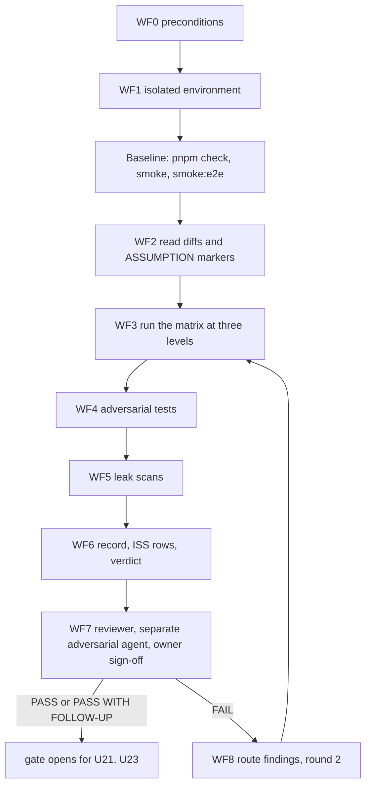
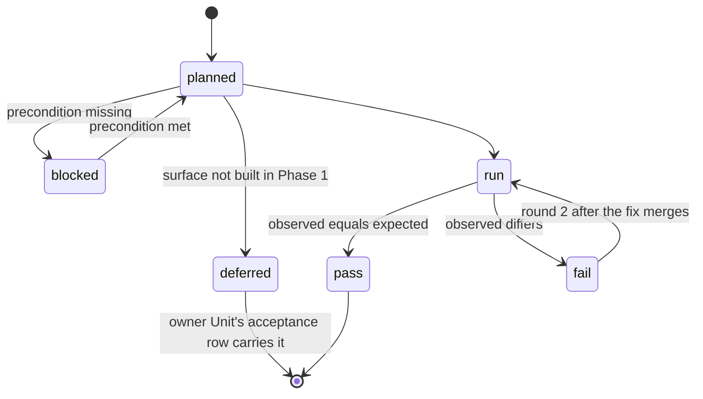
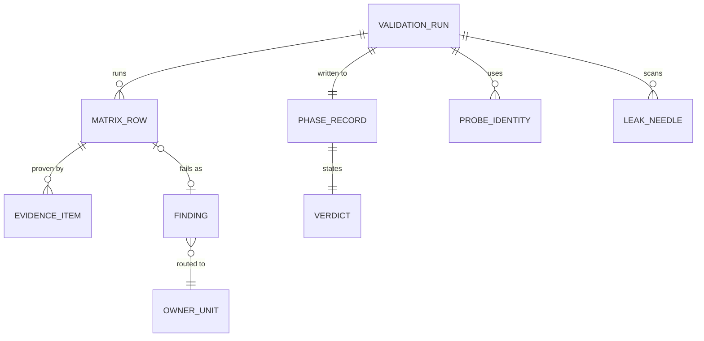

# Functional specification — U13 `t-106-auth-identity-validation`

Draft written ahead of the stage. The lead finalises it when the workflow reaches this Unit; then it moves to `<record>/construction/t-106-auth-identity-validation/functional-design/`.

Unit U13 (kind `spec`, size M, **high risk**: authentication, staff access, identity, configuration) delivers T-106 for US3.1, US3.2, US3.3 and US11.1. It writes no product code. It proves, on the real local stack, that the Phase 1 security and privacy claims of U8 T-101, U9 T-102, U10 T-103, U11 T-104 and U12 T-105 hold, and it records a verdict in `docs/validation/PHASE-1.md`. Lead perspective: architect. Support perspectives written into this file: quality engineer (evidence levels, test design, isolation: §§ 6, 9, 10) and security engineer (authorization and audit expectations, adversarial angles: §§ 7, 8), synthesised in § 13.

Inputs: listed in `functional-design-questions.md` (Context). This file is the source of truth for the workflows and state transitions. The data shape is in `entities.md`; the decision logic is in `rules.md`. Questions 1–12 were decided by the agent under the owner's no-questions instruction of 2026-10-29 (recommended option, A in every case); they await the owner's confirmation in `docs/aidlc-migration/OWNER-REVIEW-QUEUE.md`.

## Status 2026-10-29

First draft, written against `main` at `9cf860a` (T-010 merged as `14c21a9`, FD-094 in the decision log), the refreshed drafts of U8 T-101, U9 T-102, U10 T-103, U11 T-104 and U12 T-105, T-011's recorded Functional Design and code plan, and the owner's answers so far. None of the five Units this one validates is built yet, so their drafts are the interface this design checks against. Where a draft and T-106's task text disagree, this design follows the draft and says so (§ 10), because the validation must test what was decided, not what the task text guessed.

- **Swarm (FD-094).** T-106 is parallel-safe with the Units that touch other paths (T-201, T-202, T-203, T-207). It builds in its own worktree, with its own development database, test database and web port, so its matrix (which suspends accounts, revokes devices and applies configuration) never touches a sibling's data (Q5).
- **Hard rules.** No tool, model or vendor name in `PHASE-1.md` or anywhere else (Q1, proposed FD in § 11). Synthetic data only.
- **New findings** F1–F25 (§ 10). Every S1 and S2 is designed out here or turned into a cross-Unit change (§ 12), except F8 (the owner's FD-053 approval that U10, and so this Unit, waits for).

## 1. What changes, in one paragraph

T-106 adds evidence, not behaviour. In its own worktree it starts the full stack (compose PostgreSQL and Mailpit, the production build of the web app, the worker) on an isolated database, reads the diff of every owned path of T-101–T-105 and checks every `ASSUMPTION(T-10x)` marker, then runs a 35-row negative matrix at the cheapest level that can observe each claim: in the browser (Playwright, `apps/web/e2e/phase1/`), in integration tests against the real database (U8's `web-int` project and the `database` project), and in application unit tests with fakes (`__validation__/`). It adds 5–10 adversarial tests of its own, scans the captured logs and the database for private data, and writes `docs/validation/PHASE-1.md` with expected and observed results, findings as `ISS-` rows, a verdict (`PASS`, `PASS WITH FOLLOW-UP` or `FAIL`) and a blank owner-approval line. A test that exposes a defect is committed as an expected failure naming its `ISS-` row, so `pnpm check` stays green and the test turns red the day the defect is fixed. Four matrix rows cannot be observed in Phase 1 because their pages or data arrive later (search, public profile, the reveal button, the configuration view); they are proven at the data or command level now and handed to the owning Units' acceptance tables, which caps the verdict at `PASS WITH FOLLOW-UP` (Q2). Validation follows D12: the AI-DLC reviewer and a second separate agent check this Unit's evidence, the owner signs, and no second vendor and no model name appear (Q1).

## 2. As is (baseline 2026-10-29) and what this Unit can count on

- **Nothing to validate is built yet.** U8–U12 are drafts. U10 T-103 is not built until the owner approves the FD-053 staff-screen review (T-103 R1, F17), and U11 and U12 depend on U10, so this Unit waits too (F8).
- **What the drafts promise** (the interface this design tests):
  - U8 T-101: `account.*` commands behind `AuthGateway`; refusals before any read; limits 10 failures / 15 min per normalised email, 30 / 15 min per network, progressive delay from the 3rd failure (1 s doubling to 30 s), sign-up 5 / h per network, resend and reset 3 / h per email; 30-day absolute sessions; `revokeSessionsOnPasswordReset`; `Actor.refusal` for suspended sessions; verify is a POST and is idempotent for an active account (T-101 BR2.2); the in-memory limiter is per process and reads the client address from `x-forwarded-for` outside production (T-101 F14, F15); `web-int` and `worker-int` Vitest projects (`sequence.groupOrder` 3) and Mailpit in CI.
  - U9 T-102: the five auth screens; `sanitiseNext` in `apps/web/src/lib/next-path.ts`; the confirmation link opens a page with a Confirm button; the `rk.pending` cookie holds the typed address for 30 minutes; `smoke:e2e` (Playwright, Chromium only) separate from `pnpm smoke`.
  - U10 T-103: staff powers only with an approved `rk_staff_device` for the same account; the approval link works only in the browser holding that device cookie (`auth.device_mismatch`); three password strikes committed with `recorded: true`; `rk_stepup` signed by `Crypto.signClaims`, bound to account and session, 300 s, `SameSite=Strict`; staff and patient sign-in share one counter.
  - U11 T-104: `identity.reveal` with `requires {authenticated, capability: 'identity.reveal', stepUp}`, 20 / h, every authenticated attempt one `identity_reveals` row, one `identity`-stream audit row and one `identity.revealed` event; reason at least 10 graphemes; email only for a Super Admin; no `RevealTarget` implementation exists until U21, U30 and U32, so reveal is proven with a test resolver (T-104 Q9, F11).
  - U12 T-105: `config.apply` and `config.rollback` need `config.write` and a step-up and write nothing when either is missing; after that, an invalid candidate is refused (`config.invariant`, `config.out_of_range`, `validation`, `conflict`, `not_found`) and `onRefused` writes `config_rejected`.
- **Pages and data that do not exist in Phase 1.** `/authors/[username]` is a placeholder until U38 T-409; `search_documents` is empty until U18 T-205 (nothing writes it); `/admin/config` is a placeholder until U37 T-408; the reveal button is U35 T-406's. Matrix rows on them would pass on empty data (F5).
- **Seed after CR-012.** Staff `mod_rashid`, `admin_nadia`, `sa_founder`; patients such as `shirin_88`; the anonymous review r2 by the account `anon_author_r2` (its own anonymous persona carries r2 only, ISS-158); every password `demo-pass-2026!`; emails at `@demo.rogikotha.local`.
- **Tooling on `main`.** T-010's nine-step `pnpm check` (eleven after T-011), the 80% line floor per package with untested files counted (test files are excluded, so this Unit changes no coverage figure), the boundary matrix in `eslint.boundaries.mjs` (package test files may import `vitest`, Node built-ins and `test-support`; nothing in `apps/*` imports `test-support`), `check:identity`, CI before merge. T-011 adds Playwright, `apps/web/playwright.config.ts`, `apps/web/e2e/tsconfig.json` and `smoke:e2e`. The `database` project includes `src/**/*.test.ts` and already holds an adversarial file (`cr-006-adversarial.int.test.ts`) and expected-failure probes (`it.fails('ISS-139: …')`), the precedent this Unit follows.
- **Isolation precedent.** `docs/validation/T-009.md` ran in its own worktree with `rogikotha_t009` and `rogikotha_test_t009`.

## 3. Settled before this stage

D12 and `team.md` Way of Working (AI-DLC reviewer on every stage, collaborators on for high-risk Units, a separate agent's 3–5 adversarial tests, the owner's written sign-off, no second vendor), `project.md` Forbidden (no tool or model identity in any document; synthetic data only), FD-094 (swarm with one worktree and test database per Unit), FD-039 and CR-012 (r2 and `anon_author_r2`), FD-053, FD-057, FD-058, FD-059, FD-063, FD-071, FD-088 (no appeal route in release 1), FD-093, and the owner's answers (masked own email, "Former member", release 1 settings narrowed, threshold 2–50, mail-only worker key, text-only feedback). The task's scope cut stands: T-106 fixes no code; findings go to the owning Unit. See `functional-design-questions.md` § "Settled before this stage".

## 4. Workflows



Text fallback: after the preconditions, the Unit builds an isolated environment and records a green baseline. It reads every diff, runs the matrix at the browser, integration and unit levels, adds its adversarial tests and scans logs and data for private values. It writes the record and the verdict. The reviewer, a separate adversarial agent and the owner then check it. A pass or a pass with follow-up opens the gate for the identity and evidence Units; a fail routes the findings to their owners and repeats the failed rows in a second round.

### WF0 — Build order (Code Generation for a `spec` Unit)

1. **Preconditions.** U8, U9, U10, U11, U12 and U6 CR-012 are merged on `main`; U10's record holds the owner's FD-053 approval; T-011's Playwright setup exists. Read the open `ISSUES.md` rows in auth, identity and configuration and the five Units' Build and Test records and hand-offs (their threat notes, `ASSUMPTION` lists and test names).
2. **FD entry.** Append the entry of § 11 to `docs/status/decision-log.md` before the first test file (`project.md` Mandated).
3. **Dependencies.** No new dependency: Playwright comes from T-011, `pg` and Vitest are present. Read `docs/status/dependency-check-log.md`; reuse an entry under 3 days old, else re-check Playwright and append an entry.
4. **Environment** (WF1), then the **baseline**: `pnpm check`, `pnpm smoke` and `pnpm --filter @rogikotha/web smoke:e2e` green in the worktree; record `node -v`, `pnpm -v`, and the installed `better-auth`, `next`, `@playwright/test` versions and the commit range.
5. **Read** (WF2).
6. **Write the tests** of § 6 and § 7 in the owned paths of § 15; add the `phase1` Playwright project and the `e2e:phase1` script.
7. **Run** the matrix (WF3), the adversarial tests (WF4) and the scans (WF5).
8. **Record** (WF6): `PHASE-1.md`, `ISS-` rows, the `docs/status/validation-log.md` row and the document amendments the FD entry names.
9. **Check** (WF7): `pnpm check` and `pnpm smoke` green, CI green on the Bolt head, reviewer pass, the separate agent's tests, the owner's sign-off. Squash-merge locally and push (`team.md`).

### WF1 — Isolated environment (Q5, Q6, Q10)

1. Own worktree and Bolt branch (FD-094). Its `.env` points at `rogikotha_t106` (development), `rogikotha_test_t106` (test), `APP_URL=http://localhost:3106` and the web port 3106; the shared compose containers are used, never restarted (T-009 precedent).
2. `pnpm db:migrate` and `pnpm db:seed` on `rogikotha_t106`; `APP_MODE` stays `demo`, never `production` (AD-14).
3. Build once (`pnpm --filter @rogikotha/web build`) and run `next start` on 3106, with the worker beside it; their standard output and error go to two log files under the worktree's ignored `.validation/` folder, which is never committed.
4. Mailpit is shared. Every Mailpit read filters by recipient, by a received time after the spec started, and by the link's origin, which must equal `APP_URL` (3106). A message from a sibling worktree carries another port and is ignored (BR2.4).
5. Limiter isolation (the in-memory limiter is per process, T-101 F14): every spec sends its own `x-forwarded-for` value, uses addresses created for this run (`phase1-<run>-<n>@example.test`) wherever a seeded account is not required, and the rate-limit specs run last in their own Playwright project; the server restarts between the `phase1` and `phase1-limits` projects (F6).
6. Direct SQL setup steps (suspend an account, expire a reset token, read counts) go through a helper in `apps/web/e2e/phase1/` that runs `psql` inside the compose PostgreSQL container against `rogikotha_t106` only; it refuses any other database name and any `APP_MODE=production` environment (BR2.6).

### WF2 — Read the diffs

1. `git log --oneline` for the five squash commits, then `git show` of each owned path.
2. List every `ASSUMPTION(T-10x)` and `TODO(` marker with file and line; for each, state whether it matches the binding sources (decision log, contracts, `01-conventions.md`, the Unit's Functional Design) — `held`, `differs` (a finding) or `accepted risk` (with its owner Unit).
3. Check the reviewer list of `team.md` step 4 on the code itself: every command has `requires`; every state change writes an audit row in its transaction; strings exist in `en` and `bn`; imports follow FD-093; no private data in view models or logs; files outside owned paths are recorded.

### WF3 — Run the matrix

For each row of § 6: run it, record command or steps, expected, observed, `pass` / `fail` / `deferred` / `blocked`, and evidence (test name, response capture with the correlation id, Mailpit message id, SQL count). A failed row gets an `ISS-` row and its test is committed as an expected failure (`it.fails` or Playwright `test.fail`) whose title starts with the `ISS-` id (BR3.5).

### WF4 — Adversarial tests

The builder writes the A-tests of § 7.1 (at least five; all ten are planned). The separate agent writes 3–5 X-tests of § 7.2 that attack this Unit's own evidence.

### WF5 — Leak scans

After the full run, scan the two log files, `audit_events.details`, `outbox_events.payload`, `pgboss.job.data`, final `email_deliveries.params` and `auth_sessions` for the run's needles (§ 6, M27). The record carries counts and locations only, never a matched value (BR6.4).

### WF6 — Record and verdict

`docs/validation/PHASE-1.md` follows the README §4 structure without its model line (Q1): Unit, stories, commit range, date, environment and versions, commands with exit codes, the matrix table, the adversarial results, findings (`ISS-` ids with S1–S4), verdict, residual risk, deferred rows with their owner Unit and acceptance row, and the line `Approved by: <name>, <date>`, left blank for the owner. The verdict follows BR7.1.

### WF7 — Checks and sign-off

The AI-DLC reviewer reads the full diff (tests and records) for the `team.md` step 4 list and for tests that cannot fail. Collaborators are on (`/aidlc --collaborators on`). A separate agent writes and runs the X-tests. The owner fills the approval line in `PHASE-1.md` and adds a written sign-off in this Unit's record before the phase gate.

### WF8 — On FAIL

Each failing row's `ISS-` row names the owning Unit as `Owner`. The fix is a change request Unit (a merged Unit is not reopened); when it merges, T-106 runs a second round (`PHASE-1-round-2.md`, precedent `T-003-round-2.md`): the failed rows, the whole `phase1` suite and `pnpm smoke`. U21 T-301 and U23 T-303 stay blocked until the verdict is `PASS` or `PASS WITH FOLLOW-UP` (Q7, Q9).

## 5. State transitions

### 5.1 Matrix row



Text fallback: a row starts planned. It is blocked when a precondition is missing and deferred when its page or data arrives in a later Unit (it then leaves this record, named with the Unit that carries it). A run row passes or fails; a failed row runs again in round 2 after the fix merges.

### 5.2 Verdict

| From | Event | To |
|---|---|---|
| — | every row run; no failed row; no open S1 or S2; no deferred row; no S3/S4 follow-up | `PASS` |
| — | no failed row; no open S1 or S2; deferred rows or S3/S4 findings each with an owner Unit and a gate | `PASS WITH FOLLOW-UP` |
| — | a failed row, an open S1 or S2, a blocked row, or an unrepeatable result | `FAIL` |
| any | owner fills `Approved by` | the verdict stops being provisional |
| `FAIL` | round 2 closes every failed row | `PASS` or `PASS WITH FOLLOW-UP` |

With the Phase 1 surfaces as they are, the expected best result is `PASS WITH FOLLOW-UP` (rows M23, M24 at page level, the browser reveal and the configuration view).

## 6. The negative matrix as designed

Levels: **E** browser (Playwright `phase1` / `phase1-limits`), **W** integration through the web container on the real test database (`web-int`), **D** database (`database` project), **A** application unit tests with fakes (`__validation__/`), **R** reading. "Expected" is corrected against the drafts where the task text differs (finding in brackets).

| Id | Check | Level | Steps | Expected | Rules |
|---|---|---|---|---|---|
| M1 | Enumeration, response shape | E, W | register, resend and reset for an unknown, a pending, an active and a suspended address; no-JS form posts and command results | same status, same rendered state and same `Set-Cookie` names and attributes (`rk.pending` in every register case) apart from correlation id, nonce and expiry | BR4.1 |
| M2 | Enumeration, timing | E | 3 discarded warm-ups, then 20 runs each for unknown and existing, each run from its own network value; production build | medians differ by less than 15% for register, resend, reset and a wrong sign-in [F15] | BR4.1, BR2.5 |
| M3 | Token replay | E, W | open and confirm a verification link twice; use a reset link twice; replay a verification token after `status='suspended'` | reset: second use `auth.token_invalid`; verify: second confirm `ok`, no state change, one `email_verified` audit row; suspended: `auth.token_invalid`, no `auth_sessions` row [F3] | BR4.3 |
| M4 | Token expiry | E, W | reset: SQL `expires_at` in the past, open the link; verify: past the 24 h (SQL if the token is a row, fake `Date` in W if it is signed) | `auth.token_expired` and the expired copy with a resend form [F4] | BR4.3 |
| M5 | Sign out everywhere | E | two isolated Chromium contexts signed in to one account; Sign out everywhere in A | B's next request is anonymous; `/me` redirects to sign-in; list in A shows no B [F13] | BR4.4 |
| M6 | Reset ends sessions | E | B signed in; reset in A | B anonymous on its next request | BR4.4 |
| M7 | 30 days, absolute | W | fake `Date` 30 d + 1 s after creation, with a library refresh in between | `getActor` anonymous; session revoked | BR4.4 |
| M8 | Cookie flags | E, W | read `Set-Cookie` for the session, `rk_staff_device`, `rk.pending`; `rk_stepup` at W (no Phase 1 page sets it); https `APP_URL` through the cookie-option tests | `HttpOnly`; `SameSite=Lax`, `Strict` for `rk_stepup`; no `Secure` on http, `Secure` with https; `Path=/`; 30 d, 90 d, 30 min, 300 s [F14] | BR6.5 |
| M9 | CSRF and origin | E | post the sign-in and sign-out-everywhere actions (id read from the no-JS form) with `Origin: https://evil.example` | rejected; no session cookie, no audit row, no email, no session revoked | BR4.5 |
| M10 | Per-email limit and delay | E, W | 10 wrong passwords, waiting each `retryAfterSec`; then the right password; window reset with fake `Date` | refusals `1, 2, 4, 8, 16, 30, 30` s from the 3rd failure; the 11th refused with the right password, no password check (W spy); after 15 min allowed [F11] | BR4.2 |
| M11 | Per-network limit | E | 30 failures over 30 fresh addresses from one network value, then a 31st | the 31st refused `auth.rate_limited` | BR4.2 |
| M12 | Other limits | E, W | 6 sign-ups / h / network; 4 resends and 4 resets / h / address; 4 device-approval emails / h / account; 6 step-up failures / 15 min | the last of each refused `auth.rate_limited`; nothing written; window resets at W | BR4.2 |
| M13 | Shared counter | E | alternate wrong passwords for one address between `/sign-in` and `/admin/sign-in` | one delay sequence across both routes [F12] | BR4.2 |
| M14 | Suspended | E | SQL `status='suspended'`; old cookie; then sign in with the right password | anonymous Actor; `/sign-in` shows `errors.auth.accountSuspended` once; sign-in refused with no session; the copy names no appeal route (FD-088) | BR4.6 |
| M15 | Staff guard | E, W | `shirin_88` on `/en/admin/queue`; `mod_rashid` signed in on the patient route without an approved device | redirect to `/en/admin/sign-in?next=…`, body has no console chrome; Actor `staffRole` undefined, `capabilities []`, staff commands `forbidden` and write nothing | BR4.7 |
| M16 | Unknown device | E | fresh context, `mod_rashid` on `/admin/sign-in`; Mailpit; three wrong passwords on the link | no session cookie before approval; one approval mail with this run's origin; the 3rd strike gives `auth.token_invalid`; `failed_attempts` 3; device still pending | BR4.8 |
| M17 | Link on another browser | E | open the approval link in a context without, then with `admin_nadia`'s device cookie | `auth.device_mismatch`; no strike, no password check; device pending | BR4.8 |
| M18 | Device revoke | E | revoke the current device on `/admin/security` | signed out; `rk_staff_device` and `rk_stepup` cleared; next sign-in needs approval | BR4.8 |
| M19 | Device per account | E | browser approved for `mod_rashid`; sign in as `admin_nadia` | approval required | BR4.8 |
| M20 | Step-up | W | `config.apply` as `sa_founder`: without step-up; with a valid `rk_stepup` from a real `account.stepUp`; at 300 s + 1; with one byte flipped; with the value from another session; wrong password | missing → `auth.step_up_required`, nothing applied, refusal recorded [F25]; valid → `ok`; stale, tampered, foreign → `auth.step_up_required`; wrong password → `step_up_failed` audit row | BR4.9, BR5.1 |
| M21 | Capability toggles | W | test `RevealTarget` (T-104 Q9) on seeded r2; `admin_nadia` approved device, valid step-up, toggle off; `sa_founder` applies the toggle on; `admin_nadia` again; `mod_rashid`; `sa_founder` | toggle off: `forbidden`, row `no_capability`; toggle on: granted without email; `mod_rashid` refused; `sa_founder` granted with email; one `identity_reveals` row, one audit row and one `identity.revealed` event per attempt | BR4.10, BR5.2 |
| M22 | Reveal purpose | W | reason of 9 Bengali graphemes; signed-out call; malformed input | 9 graphemes: `validation`, recorded `reason_too_short`; signed out and malformed: refused, no row | BR4.10 |
| M23 | Alias leakage, profile | W, E | `identity.publicByUsername('anon_author_r2')`, `identity.bylinesFor` for r2's author persona; `/en/authors/anon_author_r2` (placeholder) | the username resolves to the pseudonymous persona only; r2's byline is the thread alias with no username; the page contains neither r2 nor the alias. Page listing deferred to U38 T-409 [F5] | BR6.1 |
| M24 | Alias leakage, search | D | `search_documents` columns from `information_schema`; row count | no username, account or persona column; table empty in Phase 1, so content check deferred to U18 T-205 and U44 T-505 [F5] | BR6.1 |
| M25 | Alias leakage, database | D | catalog query over `pg_constraint` from every public table | `personas` has no account column; the only path from content to `account_profiles` runs through `persona_links` | BR6.2 |
| M26 | Alias leakage, worker | D | connect with `DATABASE_URL_WORKER`; select `persona_links`, `identity_reveals`, `auth_users` | each denied (SQLSTATE 42501) | BR6.2 |
| M27 | Alias leakage, logs and payloads | E, D | WF5 over the run's needles: emails, passwords, tokens and links read from Mailpit, the r2 author's username and alias, persona ids, device secrets, step-up values | none found; counts recorded | BR6.3, BR6.4 |
| M28 | Config invariants | W | as `sa_founder` with step-up: unknown top-level key; extra key inside `emergency`; value out of range; an always-enabled report reason removed; a structural key (`auth.x`); as `admin_nadia`: any apply | `config.invariant`, `config.invariant`, `config.out_of_range`, `config.invariant`, `config.invariant`, each with `config_rejected`; `admin_nadia`: `forbidden`, nothing written; current version unchanged | BR4.11, BR5.3 |
| M29 | Rollback | W | roll back to version 1; to a version that does not exist | new version with `rolled_back_from`; `not_found` with `config_rejected` | BR4.11 |
| M30 | Audit completeness | W, E | `audit_events` grouped by stream and action, before and after each suite | the difference equals the expected list of § 8 exactly; every `details` object allowlisted | BR5.4 |
| M31 | Both locales | E | every auth screen and the three staff screens under `/bn/` | Bengali copy; no text node equal to its `en.json` value outside the allowlist; digits in Bengali; no uppercase transform | BR6.6 |
| M32 | Reading open | E | signed out: home, doctors, facilities, experiences, emergency in `en` and `bn` | 200, content visible, no sign-in wall | BR6.7 |
| M33 | Gate | R | `pnpm check`, `pnpm smoke`, `smoke:e2e`, `e2e:phase1`, CI on the Bolt head | exit 0 each | BR8.4 |
| M34 | No automatic deletion | R | worker registry and job list | no job deletes or cleans up inactive accounts (FD-056) | BR6.8 |
| M35 | Diffs and assumptions | R | WF2 | every marker classified; every `differs` is a finding | BR3.6 |

## 7. Adversarial tests

### 7.1 The builder's tests (task step 4; at least five, all planned)

| Id | Angle | Level | Expected |
|---|---|---|---|
| A1 | Username homoglyph `shırin_88` (dotless ı) | W | `auth.username_invalid`; no account |
| A2 | `x+1@…`, `x+2@…` as separate addresses | E | separate per-address counters by design; the network limit still stops the 31st failure; recorded as residual risk with U41 T-502 |
| A3 | `next=/\evil.example`, `%2F%2Fevil.example`, tab and newline variants | A (lib), E | `sanitiseNext` returns null; `Location` stays on the origin |
| A4 | Step-up cookie replayed after sign-out and sign-in (new session id) | W | `auth.step_up_required` |
| A5 | Device-approval token opened by a different staff account's browser | E | `auth.device_mismatch`, no strike |
| A6 | Anonymous alias and its account's username in `search_documents` | D | no column can hold them (M24); content check carried by U18 T-205 |
| A7 | Reveal reason with 9 characters | W | `validation`, recorded once |
| A8 | Config apply with an extra nested key inside `emergency` | W | `config.invariant`, `config_rejected` |
| A9 | Rollback to a version that does not exist | W | `not_found`, `config_rejected` |
| A10 | `Accept-Language: bn;q=1, ../../x` on `/en/...` and `/` | E | `/en` renders English; `/` redirects only to `/en` or `/bn` |

### 7.2 Candidates for the separate agent (team practice step 5: 3–5 tests that try to break this Unit)

This Unit's product is evidence, so "breaking it" means showing that a check can pass while the defence is gone.

1. **Mutation proof.** In a scratch worktree that is never committed, remove one defence per group — `sanitiseNext` accepts `/\`, the step-up session binding is skipped, `rk_worker` gets `SELECT` on `persona_links`, the reveal `onRefused` is dropped, the device-cookie match is skipped — and run the matching T-106 tests. Each must turn red; one that stays green is an S2 finding against U13.
2. **Vacuity hunt.** Plant a canary email in a log line and in an `outbox_events.payload`; the M27 scan must report both. Point M23 at a username that does own r2's persona in a scratch seed; the test must fail.
3. **Isolation attack.** Run `e2e:phase1` twice in a row and once beside a sibling worktree's `smoke:e2e`; results are identical, and a planted Mailpit message with another origin is never used.
4. **Exact audit match.** Add one extra sign-out to a spec in the scratch worktree; M30 must fail (exact equality, not "at least").
5. **Record leak scan.** Scan `PHASE-1.md`, the new `ISS-` rows and this Unit's record for emails, passwords, tokens, alias-to-account pairs and tool or model names; none found.

## 8. Authorization and audit expectations (spelled out)

The matrix checks each line below; "recorded" means the row commits even though the command refuses (U8 `recorded` or `onRefused`).

| Operation | Allowed for | Refusal and code | Audit on success | Audit on refusal |
|---|---|---|---|---|
| `account.register` | anonymous | `auth.rate_limited`, field codes | `account` `registered` (new) or `existing_email_register` (existing) | none |
| `account.verifyEmail` | anonymous or the holder | `auth.token_invalid`, `auth.token_expired` | `email_verified` once | none |
| `account.signIn` | anonymous | `auth.invalid_credentials`, `auth.account_suspended`, `auth.rate_limited` | none per attempt; `severe_sign_in_activity` once per window for a real account | none |
| `account.signOut`, `signOutEverywhere` | the holder | — | `signed_out`, `signed_out_everywhere` | — |
| `account.requestPasswordReset` | anonymous | `auth.rate_limited` | none | none |
| `account.resetPassword` | the link holder | token codes, password codes | `password_reset` | none |
| `account.changePassword` | the holder | `auth.invalid_credentials`, `auth.rate_limited` | `password_changed` | none |
| `staff.signIn` | a staff account | `staff.notStaff` (`forbidden`) after the right password, limits | `staff_signed_in` on an approved device | none |
| `staff.approveDevice` | the device's browser | `auth.device_mismatch`, `auth.token_invalid`, `auth.token_expired`, `auth.invalid_credentials` | `staff_device_approved` | `staff_device_approval_failed` (recorded) |
| `staff.revokeDevice` | the device's own account | `not_found` | `staff_device_revoked` | none |
| `account.stepUp` | any signed-in account | `auth.invalid_credentials`, `auth.rate_limited` | `step_up {purpose}` | `step_up_failed {purpose}` (recorded) |
| `identity.reveal` | `identity.reveal` capability + fresh step-up; Super Admin by default, Admin and Moderator only by toggle | `forbidden`, `auth.step_up_required`, `rate_limited`, `validation`, `not_found` | `identity` `reveal` + `identity_reveals` row + `identity.revealed` | the same three, `granted false` (recorded); none for signed out or malformed |
| `config.apply`, `config.rollback` | Super Admin with fresh step-up | `forbidden`, `auth.step_up_required`, `config.invariant`, `config.out_of_range`, `validation`, `conflict`, `not_found` | `config_applied` / `config_rolled_back` with `step_up: true` | `config_rejected` after `requires` passed; for a missing step-up see F25 |

The expected audit list for M30 is built from this table and the steps each spec runs; it is a fixture in the tests, reviewed by the reviewer.

## 9. Placement under the T-010 boundaries and the gate

| Files | Element / project | May import | Note |
|---|---|---|---|
| `apps/web/e2e/phase1/*.spec.ts`, `apps/web/e2e/phase1/*-test-support.ts` | Playwright `phase1` and `phase1-limits` projects, `apps/web/e2e/tsconfig.json` | `@playwright/test`, Node built-ins | no `test-support`, no app source; SQL through `psql` in the container (Q4) |
| `apps/web/src/server/__validation__/phase1-*.int.test.ts` | `web-int` (U8) | test tooling, web-server code, application, contracts | no `test-support` (FD-040); the test `RevealTarget` is defined in the file |
| `apps/web/src/lib/__validation__/next-path.test.ts` | `web` | `web-shared` | pure |
| `packages/database/src/__validation__/phase1.int.test.ts` | `database` | test tooling, `pg`, `test-support` | grants and catalog checks on the migrated schema |
| `packages/application/src/**/__validation__/*.test.ts` | `application` | domain, contracts, `test-support`, `vitest` | fakes only |
| `apps/web/playwright.config.ts`, `apps/web/package.json` | config | — | two projects and the `e2e:phase1` script; not in CI until T-503 |

`pnpm check` runs the W, D and A tests; `e2e:phase1` runs at Build and Test with its output in the record. No source file is added, so no coverage figure moves; no migration, so the migration-count pins stay; no repository, so `not-implemented.test.ts` is untouched; no user-facing string, so no i18n key.

## 10. Findings (proposed ISS rows, each `Found in U13 T-106 (Functional Design draft)`)

| Id | Sev | Finding | Designed out by / owner |
|---|---|---|---|
| F1 | S1 → designed out | README §4, `docs/validation/README.md`, the validation template and T-106's checklist ask for a "validator model id" line; a model name in a committed document breaks `project.md` Forbidden and AGENTS.md (ISS-057 was S1 for less) | Q1; § 11 FD |
| F2 | S2 → designed out | T-106's header asks for "other vendor" models; D12 and `team.md` use no second vendor | Q1; § 11 FD |
| F3 | S2 → designed out | "Verification link twice → `auth.token_invalid`" contradicts U8 BR2.2 (a second confirm on an active account returns `ok` and changes nothing) | Q3; M3 |
| F4 | S2 → designed out | "Set `auth_verifications.expires_at`" works only if verification tokens are rows; the library may sign them (U8 § 16) | M4 branches on U8's recorded answer |
| F5 | S2 → designed out | M23 profile page, M24 search, browser reveal and the configuration view do not exist in Phase 1; the rows would pass on empty data | Q2; deferred to U38, U18, U35, U37, U44 (§ 12) |
| F6 | S2 → designed out | The per-process limiter and the 30-per-network limit make the timing, limit and sign-in specs interfere, and lock seeded accounts | Q6; WF1 step 5 |
| F7 | S2 → cross-Unit | Master plan §8 gates identity and evidence work on "T-106 PASS"; the DAG has only U43 → U13, so under FD-094 U21 T-301 and U23 T-303 can start first | Q7; Units revision (§ 12) |
| F8 | S2 → open | U10 waits for the owner's FD-053 approval, and U11, U12 and U13 wait on U10 (T-103 F17) | founder |
| F9 | S2 → designed out | FD-094 isolates test databases only; the matrix changes the development database and reads Mailpit, which siblings share | Q5; WF1 |
| F10 | S2 → cross-Unit | U8's draft proposes FD-094–FD-097 and U11's FD-098, but FD-094 is now D13's change; every "FD-094 (mail-only key)" reference in the U8, U10, U11, U15, U21 drafts and the owner queue would cite the wrong decision | U8 renumbers on append (§ 12) |
| F11 | S3 | `auth-screens-spec.md` §6 ("6 wrong → minutes; 7th refused until the window passes") contradicts FD-063 | U9 T-102 (spec text); M10 follows FD-063 |
| F12 | S3 | The task lists staff sign-in as its own limit; U10 shares one counter | M13 |
| F13 | S3 | "Chromium and Firefox": only Chromium is installed (T-011) | Q12: two isolated contexts |
| F14 | S3 | The cookie row misses `rk.pending`, which holds the typed address | M8 |
| F15 | S3 | Timing on `next dev` measures compilation | Q10: production build |
| F16 | S4 | README §4 also updates `BUILD-LOG.md`, the tracker and `NEXT.md`, which the migration retires | Q11 |
| F17 | S4 | T-106's owned paths have no place for database or integration checks or the Playwright project | Q4; § 15 |
| F18 | S3 | "Count `audit_events`" needs the expected list; reveal and config refusals write to other streams | § 8; M30 |
| F19 | S4 | `x-forwarded-for` is trusted outside production (U8 F15), so one client can rotate network keys | residual risk, U41 T-502 |
| F20 | S4 | The locale comes from the path; `Accept-Language` must not change it | A10 |
| F21 | S4 | No suspend command exists before U33 T-404; M14 suspends by SQL on the isolated database | WF1 step 6 |
| F22 | S4 | "Usernames of anonymous authors" means the account username behind an anonymous persona (`anon_author_r2`) plus the thread alias | M27 needles |
| F23 | S3 | A failing validation test cannot be merged red; the task gives no rule | BR3.5: expected failure with the `ISS-` id |
| F24 | S4 | The window-reset and 30-day rows cannot wait in a browser | M7, M10, M12 at W with a fake `Date` |
| F25 | S2 → cross-Unit | AC11.1.2 wants a "missing password" attempt recorded; U12's `config.apply` writes nothing on `auth.step_up_required` | U12 records `config_rejected {code: auth.step_up_required}` through `onRefused` (§ 12); else M20 fails |

## 11. FD entry the build appends before its first test file

FD-094 is the last entry in the log; U8's draft has claimed the next numbers. The build takes the next free number at append time and keeps this text.

```
| FD-<next> | **Phase 1 validation inside AI-DLC, with no second vendor and no model names (U13 T-106 Functional Design Q1)**: T-106 is validated the way D12 and `team.md` set for every high-risk Unit. The build agent runs the negative matrix; the AI-DLC reviewer, a separate agent, reads the full diff of T-101–T-105 and the matrix evidence; a second separate agent writes 3–5 adversarial tests against the validation itself (mutation and vacuity checks); the owner signs `docs/validation/PHASE-1.md` in writing ("Approved by"). No second vendor's tool is used. `PHASE-1.md` and every later validation record name no tool, model or vendor and have no "validator model id" line; they name roles only (build agent, reviewer, adversarial agent, owner). Amends AD-16's "cross-vendor validation" (met by the separate reviewer and adversarial agents and the owner's approval), the M4 class in `00-master-plan.md` §7, T-106's "Phase / Lane" and "Class → model" rows and its hard-rule item on the validator model id, `docs/implementation/README.md` §4, `docs/validation/README.md` and the Validator row of `docs/implementation/templates/validation-template.md`. Existing records that name a model stay as history and are not rewritten. | `project.md` Forbidden (no tool or model identity in any document, affirmed 2026-10-15) and D12 (no second vendor) contradict the old validator prompt; ISS-057 treated a tool name in a document as S1. Decided by the agent under the owner's no-questions instruction of 2026-10-29; appended by U13 T-106 before its first test file |
```

## 12. Cross-Unit changes other drafts must pick up

1. **U8 T-101**: renumber the proposed FD-094–FD-097 to the next free numbers when appending (FD-094 is D13's change), and update every reference in the U10, U11, U15 and U21 drafts and the owner queue; U11's FD-098 moves the same way (F10). Record in the hand-off whether email-verification tokens are rows or signed tokens, and name the tests that prove the https cookie options and the limiter window reset (M4, M8, M10).
2. **U12 T-105**: record a `config.apply` or `config.rollback` refused for a missing step-up as `config_rejected {operation, code: 'auth.step_up_required', step_up: false}` through `onRefused` (AC11.1.2, F25).
3. **U11 T-104**: keep the reveal-target registration that its own web integration test uses reachable from a `web-int` test in `apps/web` without `test-support` (M21).
4. **Units revision** (next): add `t-106-auth-identity-validation` to the `depends_on` of U21 `t-301-review-module-core` and U23 `t-303-evidence-intake`; every later identity, evidence, moderation, retention and deletion Unit depends on one of them (F7).
5. **U9 T-102**: correct `auth-screens-spec.md` §6's rate-limit bullet to FD-063 (F11).
6. **Deferred rows**, added to the owners' acceptance tables when they finalise: U18 T-205 (no username, account id, persona id or anonymous alias in any `search_documents` row for an anonymous review); U38 T-409 (already asserts r2 absent from `/authors/anon_author_r2`); U35 T-406 (browser reveal: each attempt one `identity_reveals` row); U37 T-408 (config apply through the view with the step-up sheet; `rk_stepup` cookie flags in the browser); U44 T-505 (its search probe).
7. **Owner queue**: the 2026-10-29 settings row "D13 still holds" is superseded by FD-094.

## 13. Synthesis — decisions and why

- **Three evidence levels, cheapest first (Q4).** A browser test proves cookies, redirects and copy; it cannot freeze time or count rows cheaply. Integration tests on the real database prove counts, clocks and refusal recording; unit tests prove pure guards. Each row sits at the lowest level that can observe its claim, and several sit at two.
- **Rows that would pass on nothing are moved, not counted (Q2).** A search or profile check over empty data is a test that cannot fail, which `construction.md` forbids. The data-level part runs now; the page-level part becomes the owning Unit's acceptance row.
- **The drafts win over the task text (Q3, F11–F14).** The task was written before the designs; testing the old wording would report correct behaviour as defects.
- **Isolation over serialisation (Q5, Q6).** The owner wants Units built in parallel (FD-094); a separate database, port and Mailpit filter keep this Unit's destructive steps away from its siblings at no extra infrastructure.
- **Expected failures keep the gate honest (BR3.5).** A defect found here becomes a committed `it.fails` with its `ISS-` id: the gate stays green, the defect stays visible, and the fix has to convert the test.
- **The adversarial agent attacks the evidence (§ 7.2).** The builder already writes the attack tests on the product; the separate agent's job is to show whether the evidence could lie.

## 14. If the owner changes an answer

| Question → other option | What changes |
|---|---|
| Q1 → B (keep the model line) | No FD; `PHASE-1.md` names the model; conflicts with `project.md` Forbidden, which then needs its own amendment first |
| Q2 → B (wait for the pages) | U13 moves after U18, U35, U37 and U38; the Phase 1 gate opens in Phase 4 |
| Q3 → B (verify replay must fail) | U8 needs a used-token store for signed tokens; M3 expects `auth.token_invalid` |
| Q5 → B (shared databases) | U13 runs alone with no sibling worktree active; one shared demo database is reset after the run |
| Q7 → C (no gate edges) | U21 and U23 may build before the verdict; a FAIL may then need fixes in more Units |
| Q8 → B (deferred rows count as pass) | the best verdict becomes `PASS`; the deferred rows still go to the owners |

## 15. Owned paths and recorded additions

Task file: `docs/validation/PHASE-1.md`, `apps/web/e2e/phase1/*.spec.ts`, `packages/application/src/**/__validation__/*.test.ts`. Recorded additions (Q4, Q11, § 11):
- `apps/web/e2e/phase1/*-test-support.ts` (SQL, Mailpit and network helpers);
- `apps/web/playwright.config.ts` (the `phase1` and `phase1-limits` projects) and `apps/web/package.json` (`e2e:phase1`);
- `apps/web/src/server/__validation__/phase1-*.int.test.ts`, `apps/web/src/lib/__validation__/next-path.test.ts`;
- `packages/database/src/__validation__/phase1.int.test.ts`;
- `docs/implementation/ISSUES.md` (rows), `docs/status/validation-log.md` (one row), `docs/status/decision-log.md` (§ 11);
- the FD's document amendments: `docs/implementation/README.md` §4, `docs/validation/README.md`, `docs/implementation/templates/validation-template.md`, T-106's task file header and checklist, `00-master-plan.md` §7.

Never edited: any existing test, any product source file.

## 16. Risks to verify in Code Generation and Build and Test

- Next 16.3.4 rejects a server action whose `Origin` differs from the host, and the response carries no `Set-Cookie` (M9).
- `vi.useFakeTimers({ toFake: ['Date'] })` moves the library's token expiry and U8's limiter clock in `web-int` (M4, M7, M10); if U8's `Clock` port reads another source, the container is built with a test clock.
- `x-forwarded-for` set by Playwright reaches U8's client-address helper in `next start` (WF1 step 5).
- The `psql` helper reaches the compose container on Windows and in CI (CI does not run `e2e:phase1` until T-503).
- M10's full delay sequence takes about 95 s; the `phase1-limits` project's timeout allows it.
- Timing medians stay within 15% on this machine with siblings building; if not, re-run with the machine idle and record both (ISS-298 precedent).

## 17. Acceptance mapping (T-106 checks)

| T-106 check | Where it is met |
|---|---|
| Enumeration, shape and timing | M1, M2 |
| Token replay, expiry | M3, M4 (corrected, F3, F4) |
| Revoke-all, reset kills sessions | M5, M6, M7 |
| Cookie flags | M8 |
| CSRF / origin | M9 |
| Rate limits | M10–M13 |
| Suspended | M14 |
| Staff guard, unknown device, device revoke, cross-account | M15–M19 |
| Step-up | M20 |
| Capability toggles | M21, M22 |
| Alias leakage: profile, search, DB, worker, logs | M23–M27 (M23, M24 partly deferred) |
| Config invariants | M28, M29 |
| Audit completeness | M30 |
| Both locales | M31 |
| `pnpm check` | M33 |
| Step 4 adversarial tests | § 7.1 |
| Human approval line | WF6, WF7 |

## Entity-relationship view (derived from `entities.md`)



Text fallback: one validation run executes many matrix rows; each row has evidence items and may fail as one finding, which is routed to its owner Unit. The run writes one phase record with one verdict, uses probe identities and scans for leak needles.

## Rules summary (derived from `rules.md`)

BR1 who validates and what the record names; BR2 isolation of the run; BR3 evidence and failing tests; BR4 authorization expectations; BR5 audit expectations; BR6 privacy and leak expectations; BR7 verdict and routing; BR8 placement, tests and gate; BR9 records.

## Sources

`docs/implementation/tasks/T-106-auth-identity-validation.md`; `unit-of-work.md` (U13), `unit-of-work-dependency.md`, `unit-of-work-story-map.md`; `stories.md` (US3.1–US3.3, US11.1); `contract-summary.md` (C1, C4, C5); `docs/status/decision-log.md` (FD-039, FD-053, FD-056–FD-059, FD-063, FD-071, FD-088, FD-093, FD-094); `01-conventions.md` §2, §5, §10–§14; `docs/implementation/README.md` §4; `docs/planning/10-validation-strategy.md`; `docs/architecture/ARCHITECTURE-SPINE.md` AD-16; `00-master-plan.md` §7–§8; `docs/design/auth-screens-spec.md` §6; `docs/validation/README.md`, `T-009.md`; the drafts of U8, U9, U10, U11, U12 and U6; T-011's code plan; `eslint.boundaries.mjs`, `vitest.workspace.ts`, `packages/database/vitest.config.ts`, `scripts/check-identity.mjs`; `ISSUES.md` (ISS-057, ISS-139, ISS-158, ISS-298); `OWNER-REVIEW-QUEUE.md`; `team.md`, `project.md`, `org.md`.
