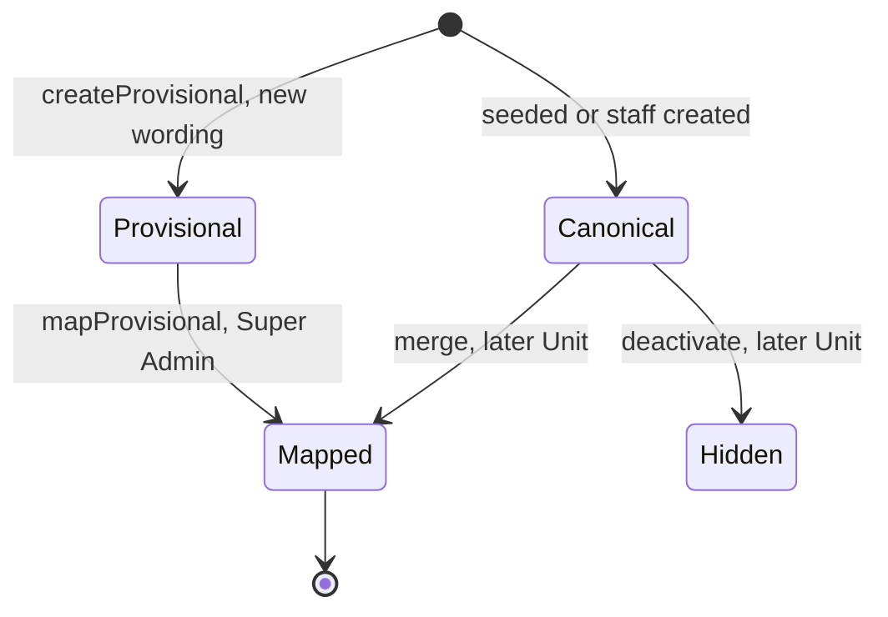
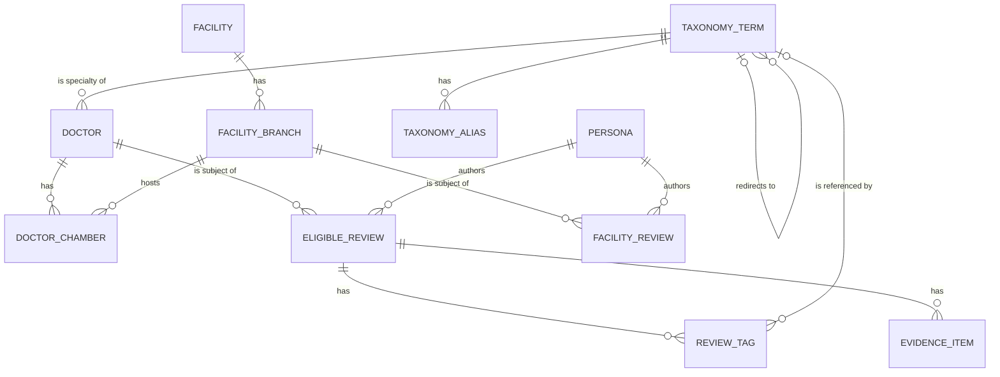

# Functional specification — U14 `t-201-directory-and-taxonomy-modules`

Unit U14 (kind `library`, size M, not high risk) delivers T-201 for US4.1, US4.3, US5.3 and US6.4. Lead perspective: architect. Support perspective: developer (repository reads, query mechanics, view-model mapping and the tests against the real database), written into §§ 8, 10 and 11 and synthesised in § 13. Draft written ahead of the stage on the owner's instruction to overlap work; the lead finalises it and the reviewer checks it when the workflow reaches this Unit.

Inputs: `unit-of-work.md` (U14 and the open points carried to it), `unit-of-work-story-map.md`, `requirements.md`, `stories.md`, `components.md` (Directory, Taxonomy, Review), `contract-summary.md` (C1, C6, C7, C9, C15 and the common rules), `docs/status/decision-log.md` (FD-024, FD-067, FD-088, FD-089), T-201 with its amendments and addendum, `01-conventions.md` §1–§5 and §10, `02-data-model.md` §0, §3–§7 and §17, `03-routes-and-contracts.md` §1–§4, the code on `main` listed in `functional-design-questions.md`, the prototype data file and renderers, and ISS-091, ISS-157, ISS-168, ISS-179 and ISS-222.

This file is the source of truth for the workflows and state transitions. The data shape is in `entities.md`; the decision logic is in `rules.md`. The design follows the answers in `functional-design-questions.md` (all A), decided on the owner's standing instruction of 2026-10-27 and awaiting the owner's confirmation.

## 1. What changes, in one paragraph

Doctors, facility branches and conditions become readable from PostgreSQL through typed queries that return the view models the prototype's renderers need. Directory serves `getDoctor`, `listDoctors`, `getFacility`, `listFacilities`, `doctorsAtBranch`, `facilitiesForDoctor` and `resolvePublicId`; Taxonomy serves `getCondition`, `listConditions`, `resolve`, `listSuggested` and `resolvePublicId`, plus the two commands C6 assigns here, `createProvisional` and `mapProvisional`. Every review-derived figure (accounts, distributions, document counts, condition counts) reaches Directory through its `ProviderExperience` port and Taxonomy through its `ConditionStats` port, which U14 implements inside a ports-only Review stub on top of new `ReviewRepository` read methods (FD-067); the ports are extended additively so Review returns display-ready data (Question 2). Pure policies land in `packages/domain`: `distribution` and `isLimitedData` for Review, `omitEmptyFields` and `registrationNotVerified` for Directory, `normalizeAliasKey` for Taxonomy. One forward-only migration adds `taxonomy_terms.suggested` and `suggested_order`, and the seed flags the prototype's composer suggestions (Question 4, closes ISS-157). The test fakes are aligned with the real eligibility rule (closes ISS-222). No hard rule and no data boundary changes, so no FD entry is needed.

## 2. As is (baseline on `main`, 2026-10-28) and what Bolt 13 can count on

- **Application and domain are empty.** `packages/application/src/index.ts` ("Filled by T-101") and `packages/domain/src/index.ts` export nothing. There is no `defineQuery`, no `ports/` folder and no module folder. U8 T-101 (Bolt 8) creates the first module, the `ConfigProvider` port interface and, implicitly, the command helper; no task file names `defineQuery`, `defineCommand`, `application/src/index.ts` or `ports/repositories/*` as owned (finding F5).
- **Repository stubs** in `packages/database/src/repositories/{directory,taxonomy,review}.ts` throw `NotImplemented('T-201', …)` for `getDoctor`, `listDoctors`, `getFacility`, `listFacilities`, `doctorsAtBranch`, `facilitiesForDoctor`, `getCondition`, `listConditions`, `resolve`, `listSuggested`, `createProvisional`, `mapProvisional`, `sentimentDistribution`, `outcomeDistribution`, `criteriaDistribution`. Their names were the T-004 implementer's guess (ISS-091). Stubs owned by T-204, T-301, T-302 and T-407 sit in the same files.
- **Fakes** in `packages/test-support/src/fakes/repositories.ts` mirror the stub names; `repositories-superset.test.ts` reads each stub's method names from its source text and fails when a fake is not a superset. `FakeReviewRepository`'s three distribution methods count every row regardless of `state` or `deletedAt` (ISS-222).
- **View-model stubs** in `packages/contracts/src/view-models/{doctor,facility,condition}.ts` carry `TODO(T-202)`/`TODO(T-203)` markers and are re-exported from `contracts/src/index.ts`; `discover.ts` and `search.ts` import `DoctorCardVM`, `FacilityCardVM`, `ConditionCardVM` and `ExperienceCardVM` by name only. `ExperienceCardVM` lives in `experience.ts` (T-307's file) with engagement counts; `experience-card.ts`, which T-201's owned paths name, does not exist. The existing `DistributionVM` is `{counts, total, limitedData}`.
- **Input schemas** in `contracts/src/schemas/directory.ts` (`GetDoctorInput` with `condition`, `outcome`, `relationship`, `docs`; `ListDoctorsInput` with an untyped `filters` and a `TODO(T-201)`), `taxonomy.ts` (all six inputs present) and `review.ts` (`SentimentDistributionInput {doctorId}`, `OutcomeDistributionInput {doctorId}`, `CriteriaDistributionInput {branchId}`).
- **Schema**: `taxonomy_terms` has no `suggested` column (ISS-157) and no order column; `tag_group` is a fixed enum of four groups; `facility_branches` has no `avatar_hue`; `reviews` has `doctor_id` and an optional `branch_id`; facility feedback is in its own table `facility_reviews`. The soft-delete state "deleted" in `02-data-model.md` §17 is not an enum value: a soft-deleted review keeps its state and gets `deleted_at` (hence BR1.3's two conditions).
- **Seed** (`test-support/src/seed/`): 8 conditions with 22 aliases, specialties derived from the doctors, 6 doctors with `field_provenance` (no `languages` entry) and `avatar_hue`, 4 organisations and 5 branches (branch name = the branch label when one exists; no hue), chambers linked to branches by name. Reviews carry their free-text tags only: **no review is linked to its condition term** although the corpus has `conditionSeedRef` (finding F1, Question 11). Keys use a local `keyify` that strips whitespace but not punctuation, so `name_key_en` of c2 is `thyroid(hypothyroidism)` (finding F2).
- **Configuration**: `DEFAULT_CONFIG_VALUES.limitedDataThreshold = 5`; `featureVisibility.facilityAccounts = true`. U12 T-105 (Bolt 12) serves it through `ConfigProvider.current()` with a 5-second cache.
- **Migrations** `0000`–`0008` are on `main`; the next free number is `0009` at the time of writing. `rk_worker` holds table-level SELECT on `taxonomy_terms` (`0001_grants_part1.sql`), which covers new columns.

## 3. Settled before this stage

FD-067 (ports and the Review stub), the 03 §4 ownership note (U14 creates the review read queries and policies), the configured limited-data threshold, D-003 (Registration not verified), FR50 with the U33 schema gaps for ineligibility and freeze, and no new dependency. See `functional-design-questions.md` § "Settled before this stage". The decisions this design makes without a question are listed there too and explained in § 13.

## 4. Workflows

Every query below follows the same frame: parse the input with its zod schema → read through repository ports and declared ports → map rows to the view model in `actor.locale` → return `ok(vm)`. A failed lookup returns `err('not_found')`; a schema failure returns `err('validation')`; a thrown database error is a programmer or infrastructure error and is converted to `internal` by the caller (01-conventions §3). Queries never write (BR6.5).

### WF1 — Code Generation order (the Unit end to end)

1. **Baseline.** `pnpm infra:up`; `pnpm check` and `pnpm smoke` green on the Bolt branch; read the open `ISSUES.md` rows in directory, taxonomy, review and test-support (ISS-091, ISS-157, ISS-168, ISS-179, ISS-222 and the rows proposed in § 9). Check that U6 CR-012 has added the condition tags to the seed (Question 11); if not, take the fallback in WF1 step 9.
2. **Prerequisites present.** Confirm `defineQuery` (or the shared helper T-101 created), the `ConfigProvider` port, the Actor shape and the `AuditWriter`/`Outbox` ports exist. If `defineQuery` is missing, add it beside `defineCommand` as a recorded owned-path addition (finding F5).
3. **Domain policies** (`packages/domain/src/{review,directory,taxonomy}/`): `distribution`, `isLimitedData`, `omitEmptyFields`, `registrationNotVerified`, `normalizeAliasKey`, with their tests. `stableHue` in `contracts/ids.ts` (Question 8).
4. **Migration 0009** `taxonomy_suggested` (custom drizzle-kit migration so the journal timestamp is later than 0008's) and the two columns in `schema/taxonomy.ts` (Question 4).
5. **Ports** (`packages/application/src/ports/repositories/{directory,taxonomy,review}.ts`; `modules/directory/ports.ts`, `modules/taxonomy/ports.ts`) as in § 6 and § 8.
6. **Repositories** (`packages/database/src/repositories/{directory,taxonomy,review}.ts`): replace the T-201 stubs with the read methods, add the two taxonomy writes; leave the other Units' stubs untouched.
7. **View models** (`contracts/src/view-models/{doctor,facility,condition,experience-card}.ts`; the re-export in `experience.ts`) and the additive input changes (§ 7).
8. **Review stub, then Directory and Taxonomy queries and the two commands**, with application tests on fakes.
9. **Seed and fakes.** `seed-directory.ts` uses `normalizeAliasKey` and seeds the suggestions; `fakes/repositories.ts` mirrors the renamed methods and applies BR1.3 (ISS-222); new fakes for `ProviderExperience` and `ConditionStats`. Fallback for Question 11 only if CR-012 did not do it: one `review_tags` row per seeded review (`group condition`, `term_id` from `conditionSeedRef`) in `seed-content.ts`.
10. **Integration and smoke tests** (§ 11).
11. **Documents**: correct 03 §4 (directory, taxonomy, review entries) and add a dated note to C6 and C7 in `contract-summary.md` for the additive port fields (BR6.4).
12. **Issue register**: ISS-222 and ISS-157 fixed in U14 T-201; add the § 9 rows.
13. **Gate**: `pnpm check`, `pnpm smoke`, `pnpm test:int` exit 0 (BR7.4); fill the T-201 hand-off, including every owned-path addition of § 12 and its reason.

### WF2 — `directory.getDoctor({publicId, condition?, outcome?, relationship?, docs?})`

1. `findDoctorByPublicId(publicId)` → the doctor with its specialty term name and chambers (each with its branch's public id when linked and visible), or nothing. Not visible under BR1.1 → `not_found`.
2. If `condition` is given, `taxonomy`'s term lookup by public id gives the term id (Directory may read Taxonomy); an unknown id gives no term (BR3.5: zero scoped accounts, not an error).
3. `providerExperience.forDoctor({doctorId, termId?, outcome?, relationship?, docs?, locale})` → cards, sentiment and outcome (scoped by condition), conditions with their per-condition sentiment, `documentCount`, `total`, `scopedTotal`, `showing`, `limitedData` (§ 6).
4. `branchesForDoctor(doctorId)` → the visible branches where the doctor has a chamber (BR1.2), each with its organisation name, type and hue.
5. Map: card fields, `facts` (bmdc, specialty, qualifications, languages, fee) through `omitEmptyFields` with provenance per BR2.11, chambers in `sort_order` with optional hours, `registrationNotVerified: true`, `claimed` boolean, `avatarHue` (BR3.8), the experience figures from step 3.

Unhappy paths: unknown or invisible public id → `not_found`; a merged id → the page calls `resolvePublicId` first (WF10) and answers 301; invalid filter values → `validation`.

### WF3 — `directory.listDoctors({page, pageSize?})`

1. `listDoctors({page, pageSize = 20, locale})` → visible doctors ordered by name in `actor.locale`, tie public id (BR2.8), plus `total` for the page metadata.
2. `providerExperience.summariesForDoctors(doctorIds, locale)` → per doctor: eligible total, sentiment distribution, document count, top three conditions (BR3.2, BR3.10).
3. Map to `DoctorCardVM` and return a `BoundedPage<DoctorCardVM>`.

### WF4 — `directory.getFacility({publicId})` (a branch page)

1. `findBranchByPublicId(publicId)` → branch with its organisation (name, type, provenance, hue, claimed). Not visible under BR1.2 → `not_found`.
2. If `featureVisibility.facilityAccounts` is true: `providerExperience.forBranch({branchId, locale})` → facility accounts, the nine criteria distributions in enum order, `total`, `limitedData` (BR2.7). If false: no accounts and no criteria, and `feedbackVisible: false`.
3. `doctorsAtBranch(branchId)` → visible doctors with a chamber at this branch; `branchesOfFacility(facilityId)` → the visible sibling branches.
4. Map to `FacilityProfileVM` with `notVerified: true` (BR2.5) and names per Question 9.

### WF5 — `directory.listFacilities({page})`, `doctorsAtBranch`, `facilitiesForDoctor`

`listBranches({page, pageSize = 20, locale})` → visible branches by name (organisation name, then branch name, tie public id); `providerExperience.summariesForBranches(branchIds)` → eligible total and the `overall` criterion distribution per branch; map to `FacilityCardVM`. `doctorsAtBranch({branchPublicId})` and `facilitiesForDoctor({doctorPublicId})` return the reference lists of WF2 step 4 and WF4 step 3.

### WF6 — `taxonomy.getCondition({publicId})`

1. `findTermByPublicId(publicId)` → the term; not a condition term, hidden or missing → `not_found`; has a `canonical_id` → the page has already redirected through WF10 (if called directly, `not_found`).
2. `aliasesOf(termId)` → the aliases as written, for "Also called".
3. `conditionStats.forCondition(termId, locale)` → `total`, `limitedData`, sentiment, outcome, `doctors`, `facilities`, `places`, `specialties`, `mentioned` (by group), `cards`, `doctorsTotal` (§ 6).
4. Map to `ConditionPageVM` with `provisional` from the term (BR4.6).

### WF7 — `taxonomy.listConditions()`

`listTerms('condition', {canonicalOnly: true, locale})` → every active canonical condition, by name; `conditionStats.totalsForConditions(termIds)` → eligible-account totals, with 0 for terms nobody wrote about (BR4.4). Map to `ConditionCardVM[]` (the topic index).

### WF8 — `taxonomy.resolve({text, kind?})`

`key = normalizeAliasKey(text)`; an empty key → `validation`. `findByKey(key, kind?)` → candidate terms whose alias key or name key matches, each mapped to its effective term and filtered to active ones. One distinct effective term → `{termId, publicId, name, matchedAlias, provisional}`; none → `{}`; several → `{ambiguous: true}` (BR4.3). Fuzzy and Banglish transliteration are T-205's.

### WF9 — `taxonomy.listSuggested({group})`

`listSuggested(kindOf(group), locale)` → active canonical terms with `suggested = true`, by `suggested_order` then name (BR4.5); map to `[{publicId, name}]`.

### WF10 — `directory.resolvePublicId({kind, publicId})` and `taxonomy.resolvePublicId({publicId})`

Directory: a visible doctor or branch with that id → `{publicId, redirected: false}`; else `findRedirect(publicId)` and follow `to_public_id`, at most five hops, until a visible profile → `{publicId: target, redirected: true}`; a cycle, a dead end or an invisible target → `not_found` (BR1.7). Taxonomy: an active term → itself; a term with `canonical_id` → its canonical root, `redirected: true`; a hidden term → `not_found`. The pages (U15, U16) answer 301 on `redirected`.

### WF11 — `taxonomy.createProvisional({kind, text, lang})` (command)

1. Authorize (BR5.1): account, verified email, not restricted; else `forbidden`, nothing written.
2. Parse; `key = normalizeAliasKey(text)`; empty key → `validation`.
3. In one transaction: look for an active term of `kind` with that name or alias key; found → return its effective term id, write nothing else (idempotent, BR5.2). Not found → insert the provisional term (original wording in both name columns, `created_by_account_id` from the Actor), insert its alias, write the audit row (stream `taxonomy`, action `term.provisional_created`, details `{termId, kind, lang}`), append `term.changed {id}` (BR5.5).
4. Return `{termId}`.

A race between two identical calls is settled by a re-read after a unique-key conflict on the alias insert, which returns the winner's term (idempotent outcome, no error to the user).

### WF12 — `taxonomy.mapProvisional({termId, canonicalId})` (command)

1. Authorize (BR5.3): `actor.staffRole = super_admin`; else `forbidden`, nothing written.
2. Load both terms; missing → `not_found`. Validate (BR5.4): the term is provisional, unmapped and active; the target is canonical, unmapped, active, of the same kind and not the same term; else `conflict`.
3. In one transaction: set `canonical_id`; copy the term's aliases to the target, skipping keys the target already has; audit (stream `taxonomy`, action `term.mapped`, details `{termId, canonicalId}`); append `term.changed {id}` for both terms.
4. Return `{}`. Reviews keep their tags and their wording; every read now counts them for the target (BR1.6).

### WF13 — Review read queries (`modules/review/queries/`)

- `review.sentimentDistribution({doctorId, termId?})` and `review.outcomeDistribution({doctorId, termId?})` → `DistributionVM` over the doctor's eligible reviews, scoped to the effective term when given.
- `review.criteriaDistribution({branchId, key?})` → one criterion's `DistributionVM`, or all nine in enum order when `key` is absent, over the branch's eligible facility reviews.
- `review.listExperienceCards({limit = 20, cursor?, doctorPublicId?, conditionPublicId?})` → newest first, keyset cursor on (`published_at`, `public_id`) encoded with `contracts/page.ts`; `CursorPage<ExperienceCardVM>`.

These four are internal queries for other modules and later Units (T-301 extends them); the pages use WF2–WF6.

## 5. State transitions

### What each publication state means to this Unit's reads

| Entity | `published` | any other state | extra condition |
|---|---|---|---|
| Doctor | visible | `not_found`, left out of lists | `merged_into_id` set → redirect (BR1.1, BR1.7) |
| Facility (organisation) | its branches may be visible | its branches are not visible | — |
| Facility branch | visible | `not_found` | organisation must be published (BR1.2) |
| Review | counts and shows | excluded | `deleted_at` set → excluded (BR1.3) |
| Facility review | counts and shows | excluded | `deleted_at` set → excluded (BR1.4) |
| Evidence item | counts as a document | not a document | its review must be eligible (BR1.5) |
| Taxonomy term | active | `hidden` = deactivated; others not used | `canonical_id` set → redirect (BR1.6) |

A review that is hidden, then restored, simply re-enters every figure on the next read: figures are queries, not stored totals (AC6.4.4 restore case).

### Taxonomy term lifecycle (this Unit's part)

| From | Event | To | Rule |
|---|---|---|---|
| (none) | `createProvisional` with a new wording | provisional, unmapped, published | BR5.2 |
| (none) | `createProvisional` with a known wording | (no change; existing term returned) | BR5.2 |
| provisional, unmapped | `mapProvisional` by a Super Admin | mapped (redirect to canonical) | BR5.3, BR5.4 |
| provisional, unmapped | `mapProvisional` by anyone else | (no change) | BR5.3 |
| canonical, published | deactivate (no command in this Unit, Question 5) | hidden | BR1.6, R1 |
| canonical | merge into another canonical (no command in this Unit) | mapped | BR1.6, R1 |



Text fallback: a provisional term starts when a reviewer tags a new wording and stays provisional until a Super Admin maps it to a canonical term; a mapped term is a permanent redirect. Canonical terms come from the seed or staff; merging or deactivating them is read here (redirect, hidden) but no command for it is built in this Unit.

### ISS-157 and ISS-222

ISS-157: `open (owner T-201)` → (migration 0009 merged, seed flags suggestions, `listSuggested` tested) `fixed in U14 T-201`. ISS-222: `open (owner T-201)` → (fakes apply BR1.3, a fake-level test proves a hidden and a soft-deleted review are not counted) `fixed in U14 T-201`.

## 6. Ports (FD-067, C6, C7, extended additively under Question 2)

Interface-level only; Code Generation writes the TypeScript. `Distribution` is the `DistributionVM` shape of § 7. `CardSummary` is `{total, limitedData, sentiment, documentCount, topConditions: [{publicId, name, count}]}`.

```text
ProviderExperience (declared in modules/directory/ports.ts, implemented in modules/review/provider-experience.ts)
  forDoctor({doctorId, termId?, outcome?, relationship?, docs?, locale})
    -> {cards, sentiment, outcome, documentCount, total, limitedData,
        scopedTotal, showing, conditions: [{publicId, name, count, sentiment}]}
  forBranch({branchId, locale}) -> {cards: FacilityAccountVM[], criteria: [{key, dist}], total, limitedData}
  summariesForDoctors(doctorIds, locale) -> Map<doctorId, CardSummary>
  summariesForBranches(branchIds) -> Map<branchId, {total, limitedData, overall: Distribution}>

ConditionStats (declared in modules/taxonomy/ports.ts, implemented in modules/review/condition-stats.ts)
  forCondition(termId, locale)
    -> {total, limitedData, doctorsTotal, sentiment, outcome, cards,
        mentioned: {medicine, treatment, symptom}: [{label, count}],
        doctors: [{publicId, name, specialty?, count, primaryChamber?, area?, city?, avatarHue}],
        facilities: [{publicId, name, branchName?, type, avatarHue}],
        places: [{hospital?, area?, city?, count}], specialties: [{name, count}]}
  totalsForConditions(termIds) -> Map<termId, number>
```

What changed against the pinned C6/C7 and why: `forDoctor` adds `limitedData`, `scopedTotal`, `showing` and `conditions` (the profile's condition pills and breakdown); the two `summaries*` methods serve the index cards without N+1 (BR3.10); `forCondition` takes the locale and returns names, because Taxonomy may not read Directory (Directory → Taxonomy already exists); `mentioned` carries labels so free-text tags count (BR3.4); `places` delivers the C6 `districts` at the level the prototype shows (hospital, area, city); `totalsForConditions` serves the topic index. Review's implementation reads Directory, Taxonomy, Identity and Evidence tables, which its position above them in the component graph allows; Directory and Taxonomy read none of Review's (BR6.1, BR6.2).

The implementations read `ConfigProvider.current().limitedDataThreshold` once per call and pass it to `distribution` (BR2.4). They are constructed in the web composition root (`apps/web/src/server/container.ts`), outside this Unit's owned paths; U15 T-202 wires them with the first page (finding F6). Tests construct them directly.

## 7. View models (`packages/contracts/src/view-models/`)

All fields are serialisable; strings are already in `actor.locale`; optional fields are absent when the data is missing (never 0 or ""); ids are public ids (BR2.9, BR2.10).

| View model | Fields |
|---|---|
| `DistributionVM` (`doctor.ts`) | `keys` (render order), `counts` (every key), `total`, `notProvided`, `empty`, `limitedData` |
| `ProvenanceVM` | `source` (`community`/`provider`/`admin`), `updatedAt` (ISO 8601) |
| `DoctorCardVM` | `publicId`, `name`, `specialty?`, `area?`, `city?`, `avatarHue`, `topConditions` [{`publicId`, `name`, `count`}] (≤ 3), `documentsCount`, `accountsTotal`, `accountsLimitedData`, `sentiment`, `claimed`, `registrationNotVerified: true` |
| `DoctorProfileVM` | card fields + `facts` [{`key`: `bmdc`/`specialty`/`qualifications`/`languages`/`fee`, `value`, `provenance`}] (populated only), `chambers` [{`name`, `hours?`, `provenance`, `branchPublicId?`}], `conditions` [{`publicId`, `name`, `count`}], `breakdown` [{`condition` {`publicId`, `name`}, `sentiment`}], `facilities` [{`publicId`, `name`, `branchName?`, `type`, `avatarHue`}], `accounts` (`ExperienceCardVM[]`), `scopedSentiment`, `scopedOutcome`, `scopedTotal`, `showing`, `selectedCondition?` |
| `FacilityCardVM` (`facility.ts`) | `publicId` (branch), `name` (organisation), `branchName?`, `type`, `area?`, `city`, `avatarHue`, `accountsTotal`, `accountsLimitedData`, `overall`, `claimed`, `notVerified: true` |
| `FacilityProfileVM` | card fields + `address?`, `provenance` {`name`, `branch?`, `address?`} as `ProvenanceVM`, `feedbackVisible`, `criteria` [{`key`, `dist`}] (nine, enum order), `accounts` (`FacilityAccountVM[]`), `doctorsHere` [{`publicId`, `name`, `specialty?`, `avatarHue`}], `siblings` [{`publicId`, `branchName`, `area?`, `avatarHue`}] |
| `FacilityAccountVM` | `publicId`, `author` (`BylineVM`), `period` {`year`, `month`}, `posted` (ISO date), `body`, `overall?`, `criteria` [{`key`, `value`}] (answered ones only) |
| `ConditionCardVM` (`condition.ts`, the topic index item) | `publicId`, `name`, `accountsTotal` |
| `ConditionPageVM` | `publicId`, `name`, `provisional`, `aliases` (as written), `accountsTotal`, `accountsLimitedData`, `doctorsTotal`, `specialties` [{`name`, `count`}] (≤ 3), `places` [{`hospital?`, `area?`, `city?`, `count`}], `sentiment`, `outcome`, `medicines`/`treatments`/`symptoms` [{`label`, `count`}], `accounts`, `doctors` [{`publicId`, `name`, `specialty?`, `count`, `primaryChamber?`, `area?`, `city?`, `avatarHue`}], `facilities` [{`publicId`, `name`, `branchName?`, `type`, `avatarHue`}] |
| `ExperienceCardVM` (`experience-card.ts`) | `publicId`, `title`, `excerpt`, `truncated`, `sentiment?`, `outcome?`, `condition?` {`publicId?`, `name`}, `documentsCount`, `author` (`BylineVM`), `relationship`, `period` {`year`, `month`}, `doctor` {`publicId`, `name`} |
| `BylineVM` | `personaKind`; `displayName` (named only); `username` (pseudonymous only); `initials` (named and pseudonymous only) |

Names follow the task where it is explicit (`accountsTotal`, `documentsCount`, `scopedTotal`, `showing`) and the contract where they differ (`limitedData`, § 13). Percentages are not in any VM: the page renders each percentage next to its count from `counts` and `total` (AC6.4.1), and the rounding is the page Unit's.

Input changes (additive, `contracts/src/schemas/`): `ListDoctorsInput` loses the untyped `filters` and its `TODO(T-201)` (search filters are T-205's); `ResolveInput` gains optional `kind`; new `DirectoryResolvePublicIdInput {kind: doctor|facility, publicId}` and `TaxonomyResolvePublicIdInput {publicId}`; `SentimentDistributionInput` and `OutcomeDistributionInput` gain optional `termId`; `CriteriaDistributionInput` gains optional `key`; new `ListExperienceCardsInput {limit?, cursor?, doctorPublicId?, conditionPublicId?}`.

## 8. Developer view — repository read methods

All live in `packages/database/src/repositories/` behind the port interfaces in `packages/application/src/ports/repositories/`. Every review read applies BR1.3 or BR1.4 in SQL; every directory and taxonomy read applies BR1.1, BR1.2 or BR1.6 in SQL. Locale columns are picked in the mapper.

| Port | Method | Returns |
|---|---|---|
| Directory | `findDoctorByPublicId(publicId)` | doctor row + specialty term names + chambers (with branch public id when the branch is visible) |
| Directory | `listDoctors({page, pageSize, locale})` | visible doctors ordered by locale name, and `total` |
| Directory | `findBranchByPublicId(publicId)` | branch + organisation |
| Directory | `listBranches({page, pageSize, locale})` | visible branches + organisation, ordered, and `total` |
| Directory | `branchesOfFacility(facilityId)`, `doctorsAtBranch(branchId)`, `branchesForDoctor(doctorId)` | visible reference rows (via `doctor_chambers.branch_id`) |
| Directory | `findRedirect(fromPublicId)` | the redirect row, read only (T-204 writes) |
| Taxonomy | `findTermByPublicId(publicId)`, `findTermsByIds(ids)` | term rows |
| Taxonomy | `listTerms(kind, {canonicalOnly, locale})` | active terms ordered by locale name |
| Taxonomy | `aliasesOf(termId)` | alias rows as written |
| Taxonomy | `findByKey(key, kind?)` | terms whose alias key or name key equals `key`, with their effective term |
| Taxonomy | `listSuggested(kind, locale)` | flagged active canonical terms in order |
| Taxonomy | `insertProvisional(tx, {...})`, `setCanonical(tx, termId, canonicalId)`, `copyAliases(tx, fromTermId, toTermId)` | the two commands' writes |
| Review | `publishedForDoctor(doctorId, {termId?})` | eligible reviews with persona byline fields, first condition tag, published document count |
| Review | `publishedForBranch(branchId)` | eligible facility reviews with persona byline fields |
| Review | `publishedForTerm(termId)` | eligible reviews carrying the effective term, with doctor and document fields |
| Review | `conditionCountsForDoctor(doctorId)`, `conditionCountsForDoctors(doctorIds)` | distinct reviews per effective condition term |
| Review | `doctorCountsForTerm(termId)` | distinct reviews per doctor for the term |
| Review | `tagFrequencyForTerm(termId, group, locale)` | distinct reviews per label |
| Review | `readyEvidenceCountForDoctor(doctorId)`, `summariesForDoctors(doctorIds)`, `summariesForBranches(branchIds)`, `totalsForTerms(termIds)` | grouped counts in one query each |
| Review | `listRecentCards({limit, cursor?, doctorId?, termId?})` | keyset page of eligible reviews |

Query mechanics, in outline (Code Generation writes the Drizzle):

- **Effective term** is computed in SQL as "the term's `canonical_id` when set, else the term's id", joined once from `review_tags` to `taxonomy_terms`; mapping is one level deep because `mapProvisional` refuses to map onto a mapped term (BR5.4).
- **Count once**: every count is `count(distinct review id)` grouped by the key, so a review tagged twice for one term counts once (BR3.2, BR3.3).
- **Document count**: a correlated count of `evidence_items` with `state = published` per review, or a grouped join; never per row in application code.
- **First condition tag**: the condition tag with the smallest `created_at` per review (a lateral or window selection), giving the term (public id, locale name, state) or the free text.
- **Ordering by name**: `order by` the locale name column with the ICU root collation where available, then `public_id`; Code Generation checks the compose PostgreSQL 18 image has `und-x-icu` and otherwise uses the default collation (risk § 16).
- **Bengali numerals and month names** are not formatted here; `period` is `{year, month}` and the UI formats it (01-conventions §6).
- **`exact_date_enc`**, `claimed_by_account_id`, `created_by_account_id`, `persona_links` and every account column are never selected into a view-model path (BR2.10).

## 9. Findings and proposed ISS rows

None blocks the design. Each is proposed with `Found in U14 T-201`; the caller adds them, the numbers are the next free ones.

- **F1 (S2, suggested owner U6 CR-012)** — The seed never links a review to its condition term: `seed-content.ts` writes only the free-text tags, so on the seed every doctor's condition list, every condition page and the topic index counts are 0 although each corpus review has `conditionSeedRef`. Blocks the T-201 seed acceptance rows and the storyboard's condition steps. Fix: one `review_tags` row per review (`group condition`, `term_id`). Fallback in U14 (Question 11).
- **F2 (S3, fixed in U14 T-201)** — The seed's `keyify` strips only whitespace while `normalizeAliasKey` also strips punctuation: c2's `name_key_en` is `thyroid(hypothyroidism)`, so an exact `resolve` of its English name misses. Fixed by making the seed use `normalizeAliasKey` (BR4.2).
- **F3 (S3, suggested owner U6 CR-012 and the founder)** — Branch display data is lost in the seed: a branch's name is its label ("Dhanmondi branch"), so the hospital name "Shefa General Hospital" of f1 is stored nowhere, and every branch's hue from the corpus is dropped (no column). The facility pages cannot match the prototype's titles or colours (Questions 8 and 9).
- **F4 (S3, founder; raise to S2 if the storyboard needs it)** — FR38 term management beyond `mapProvisional` (rename, merge of two canonical terms, deactivate, reorder values) has no command and no owning Unit; tag groups stay a fixed enum (Question 5). Suggested owner U37 T-408.
- **F5 (S4, U8 T-101 / founder)** — No task file owns `defineQuery`, `defineCommand`, `packages/application/src/index.ts` or `ports/repositories/*`. U14 assumes T-101 creates the helper and adds `defineQuery` itself if missing (WF1 step 2).
- **F6 (S4, U15 T-202)** — The Review implementations of `ProviderExperience` and `ConditionStats` must be constructed in `apps/web/src/server/container.ts`, outside U14's owned paths; the first page Unit wires them.
- **F7 (S4, U3 T-010 or U14)** — `unit-of-work.md` lists U14 as depending only on U3, but U14 also needs U8 T-101 (application skeleton, Actor, `ConfigProvider` port) and U10 T-103 (`staffRole` for `mapProvisional`); the Bolt order already respects this.
- **F8 (S4, U41 T-502)** — `taxonomy.createProvisional` has no rate limit in 03 or C6. Suggested: add it to `RATE_LIMITS` (for example 30 per hour per account).
- **F9 (S4, U14 T-201, this Unit)** — Task-text drift: `experience-card.ts` did not exist (the stub `ExperienceCardVM` was in `experience.ts`); `limited` versus the contract's `limitedData`; step 4 (`hash(publicId)`) versus the addendum (`avatar_hue` columns); "8 seed conditions, two with zero" depends on the corpus that FD-089 grows; C6 assigns `createProvisional` and `mapProvisional` to U14 while the task says no commands; `TODO(T-201)` markers in `contracts/schemas/directory.ts` sit outside the listed owned paths. Each is settled in this design and recorded in the hand-off.
- **Existing rows, no new row**: ISS-168 (`claimed` doctors have no `claimed_by_account_id`, so d1 and d4 show as unclaimed: `claimed` is derived from the column, which is the honest reading); ISS-179 (seed guards at term granularity: the suggestion seeding guards per term).

## 10. Developer view — mapping details

- **`omitEmptyFields(fields)`** drops `null`, `undefined`, strings that are empty after trimming, empty lists, and any field whose provenance entry has `hidden: true` (BR2.2). It returns the remaining facts in the prototype's order: bmdc, specialty, qualifications, languages, fee.
- **`registrationNotVerified()`** returns the literal `true`; the doctor mapper calls it so the reason is one named place (D-003). The facility mapper sets `notVerified: true` the same way.
- **Byline**: named → `displayName` and its initials; pseudonymous → `username` and its initials; anonymous → `{personaKind: 'anonymous'}` only (BR2.10). Initials take the first grapheme of up to two words, by `Intl.Segmenter`.
- **Excerpt**: `Intl.Segmenter(locale, {granularity: 'grapheme'})` over the text of BR3.7; `truncated` tells the UI to add its ellipsis.
- **`stableHue(seed)`**: FNV-1a 32-bit (offset 2166136261, prime 16777619, unsigned), modulo 360, matching the prototype's `hash()`; its test pins the prototype's values for three ids.
- **`normalizeAliasKey`**: NFC, `toLowerCase()`, then keep only `\p{L}`, `\p{M}`, `\p{N}`. Bengali vowel signs and the hasanta are marks and stay; the danda, spaces, brackets, hyphens, full stops and zero-width joiners go. U+09DF (য়) is a composition exclusion, so its precomposed and decomposed spellings both normalise to U+09AF U+09BC and give the same key; the domain test proves it for য়, ড় and ঢ়.
- **Facility criteria**: the nine keys of `CRITERIA` in enum order, each a `DistributionVM` with keys `good`, `mixed`, `poor`; `notProvided` counts the branch's eligible facility reviews that left the criterion empty (AC4.3.5). `reportTrust` is labelled patient-perceived by the page (FR27).

## 11. Developer view — tests

Test names read as sentences; builders, not hand-written fixtures; no assertion on internals (01-conventions §10). Database tests run as `*.int.test.ts` against `rogikotha_test`, which is reset once per run, so each test inserts its own doctor, branch, terms and reviews with builders and asserts only on them; seed-based tests seed through the seed module as `seed.int.test.ts` does and take expected counts from the corpus (BR7.3).

| Level | Test | Proves |
|---|---|---|
| domain | `distribution` table: all keys zero, unknown values ignored, absent values counted as not provided | BR3.1, BR2.3 |
| domain | limited boundary: total 4, threshold 5 → `limitedData` true; 5 → false; 0 → `empty` true and `limitedData` false (task row "limited") | BR2.4, BR3.1 |
| domain | `omitEmptyFields` drops null, blank, empty list and hidden; keeps the prototype's fact order | BR2.2 |
| domain | `normalizeAliasKey`: Bengali composed and decomposed give one key; Banglish lowercased; punctuation and spaces removed; vowel signs kept | BR4.1 |
| domain | `registrationNotVerified` is true for a doctor with and without a BMDC number | BR2.5 |
| contracts | `stableHue` matches the prototype `hash` for fixed ids | BR3.8 |
| application | each query's happy path in `en` and `bn` with fake ports | WF2–WF10, BR2.9 |
| application | "doctor profile": facts omit empty fields, provenance matches, `registrationNotVerified` true; with a fake `ProviderExperience` returning sentiment {2, 1, 1} the VM shows exactly 2, 1, 1 of 4 | BR2.2, BR2.11, BR6.1 |
| application | `getDoctor` filters applied cumulatively; `showing` and `scopedTotal` correct; an unknown condition gives zero | BR3.5 |
| application | `getCondition` shows a fake `ConditionStats`'s counts unchanged | BR6.1 |
| application | "locale": deep scan of every VM finds no key ending `En`, `Bn`, `_en`, `_bn` | BR2.9 |
| application | "projection": JSON of every VM has no `accountId`, `email`, `reporter`, `originalFilename`, `claimedByAccountId`, `createdByAccountId`, `personaId`, `seedRef`; anonymous byline has only `personaKind` | BR2.10 |
| application | static import scan: no file under `modules/directory` or `modules/taxonomy` imports `modules/review` or the review repository port | BR6.1 |
| application | `createProvisional`: happy path with audit and outbox assertions; refused for anonymous, unverified and restricted actors with nothing written; second identical call returns the same term | BR5.1, BR5.2, BR5.5 |
| application | `mapProvisional`: happy path with audit and two `term.changed`; refused for Admin and Moderator with nothing written; conflict for a canonical source, a mapped target, a kind mismatch | BR5.3, BR5.4, BR5.5 |
| application | fakes: a hidden and a soft-deleted review are not counted by the fake read methods (ISS-222) | BR1.3, BR7.5 |
| database | each repository read method on builder rows | BR7.1 |
| database | "never enters doctor": 20 published `facility_reviews` at a branch where the doctor practises leave `review.sentimentDistribution`, `forDoctor` and `summariesForDoctors` unchanged | BR2.6 |
| database | reverse isolation: a doctor review with `branch_id` set to the branch leaves `forBranch` and `criteriaDistribution` unchanged | BR2.7 |
| database | "hidden": a review set to `hidden_pending_review`, and one with `deleted_at`, disappear from `publishedForDoctor`, every count and `listRecentCards`; restored, they return | BR1.3 |
| database | `doctorCountsForTerm` counts a review tagged twice once; `tagFrequencyForTerm` groups by label across a term tag and a free-text tag | BR3.3, BR3.4 |
| database | a review tagged with a provisional term mapped to a canonical one counts on the canonical page | BR1.6 |
| database | `resolve` finds a seeded alias, a Bengali alias in decomposed form and a name with punctuation | BR4.2, BR4.3 |
| database | `resolvePublicId` follows a two-hop redirect and stops on a cycle | BR1.7 |
| database | migration 0009 applies from empty; `listSuggested` returns the seeded suggestions in order | BR4.5 |
| database | "topic index": `listConditions` returns every seeded condition, with the corpus's zero-count ones at 0 | BR4.4, BR7.3 |
| smoke | `facility-isolation.smoke.test.ts` (database) and `directory.smoke.test.ts` (application): every seeded doctor has `registrationNotVerified` true | BR7.2 |

Commands: `pnpm infra:up`, then `pnpm test:int`, `pnpm smoke`, `pnpm check`. The coverage floor of 80% applies to `domain`, `application` and `database` (BR7.4).

## 12. Owned paths and recorded additions

Owned by the task: the domain, application, contracts view-model, database repository and test files listed in T-201 "Owned paths", the Review stub files, and the port declarations. Additions this design needs, each to be named in the hand-off with its reason:

| Path | Why | Decision |
|---|---|---|
| `packages/database/src/schema/taxonomy.ts`, `migrations/0009_taxonomy_suggested.sql` and `meta/` | the `suggested` and `suggested_order` columns | Question 4, ISS-157 |
| `packages/test-support/src/seed/seed-directory.ts` | seed the suggestions; use `normalizeAliasKey` | Question 4, F2 |
| `packages/test-support/src/seed/seed-content.ts` | condition tags, only if CR-012 did not add them | Question 11 fallback |
| `packages/test-support/src/fakes/repositories.ts` (+ new port fakes) | mirror the renamed methods; eligibility filter | ISS-222, superset test |
| `packages/application/src/modules/taxonomy/commands/{create-provisional,map-provisional}.ts`, `authorization.ts` | the C6 commands | Question 1 |
| `packages/contracts/src/schemas/{directory,taxonomy,review}.ts` | additive input changes of § 7 | Question 2 |
| `packages/contracts/src/view-models/experience.ts` | drop the stub `ExperienceCardVM`, re-export from `experience-card.ts` | § 13 |
| `packages/contracts/src/ids.ts` | `stableHue` | Question 8 |
| `packages/application/src/define-query.ts` | only if T-101 did not create it | F5 |
| `docs/implementation/03-routes-and-contracts.md` §4, `contract-summary.md` C6 and C7 note | additive port and input changes | BR6.4 |

No file of `apps/web`, `apps/worker`, `packages/i18n` or any other module is touched. No new i18n key is needed: view models carry data, and the copy ("Registration not verified", "Not provided", "Limited data", "No documents") belongs to the page Units, already in both dictionaries from T-006.

## 13. Synthesis — decisions and why

- **Ports carry display-ready data (Question 2).** The cycle break forces it: Taxonomy cannot read Directory, so whatever the condition page shows about doctors must come back through `ConditionStats`, and Review is the one component allowed to read both sides. Additive fields keep C6/C7 valid; nothing consumes the ports yet. Alternative rejected: page-level composition, which spreads one view model across three Units.
- **Commands per C6 (Question 1).** The contract summary is the later, binding document and names U14; the consumers (U26 composer, U18 search through `term.changed`) need the commands before they start. `notRestricted` is added to `createProvisional` because a restricted account may sign in but not post content (01-conventions §5), and a term is content.
- **Distribution shape (Question 3).** `notProvided` lets the page show "Not provided" beside a partial distribution without arithmetic, and two `limitedData` levels satisfy the hard rule's "eligible accounts" wording while keeping the prototype's per-distribution mark. The name `limitedData` follows C6, C7, 03 and the existing stub over the task's `limited`.
- **Suggestions in U14 (Question 4).** The column is needed by U14's own query and nobody else can add it in time; the seed edit is the same file that must switch to `normalizeAliasKey`.
- **Taxonomy management stays narrow (Question 5).** Groups are a schema enum today; FD-018 would allow making them configuration, but that is a data-model change no Unit is planned to build. Reading redirects and deactivated terms makes later commands cheap to add without touching this Unit's queries. The missing commands are raised, not dropped.
- **Provenance default and hidden flag (Questions 6, 7).** Both are read-only conventions over existing JSON, reversible, and make AC4.1.3 and AC4.1.4 testable now; the writer (T-204) decides who sets them.
- **Hue, names, provisional pages (Questions 8, 9, 10).** Each keeps what the database actually holds and stays stable for the same profile; the seed's lost data is raised (F3) rather than invented.
- **Seed condition tags (Question 11).** The seed is CR-012's, CR-012 runs first and has not started, so the fix is routed there now with a small fallback.
- **Contract names over task names where they differ; task names elsewhere.** The contract is binding; the task's field names (`accountsTotal`, `documentsCount`, `showing`) are used wherever the contract is silent.
- **`ExperienceCardVM` in its own file.** The task's owned path names `experience-card.ts`; the stub in `experience.ts` would otherwise clash through the package index. T-307 keeps `experience.ts` for the page VM.
- **Neutral ordering.** Alphabetical indexes reproduce the prototype's `byName`; account lists default to newest (AC5.2.3); counted lists use "most accounts", which the hard rule names as neutral.
- **Developer view adopted.** One eligibility predicate in SQL; `count(distinct review)` everywhere; batched summaries for index pages; integration tests that build their own rows; seed counts from the corpus; the ICU collation verified before use.

## 14. If the owner changes an answer

- **Question 1 to B or C:** drop `mapProvisional` (B) or both commands (C) from the owned paths; AC5.3.3 and AC5.3.5 (B), and AC5.3.2 (C) become gaps with ISS rows; C6 is amended.
- **Question 2 to B:** the ports stay as pinned; `ConditionPageVM` is assembled by the page Units, and U16's task file gains the composition; this Unit returns only ids from `forCondition`.
- **Question 3 to B or C:** remove `notProvided` and the summary-level flag (B) or the distribution-level flag (C); AC6.4.2's "Not provided" rendering moves to the page.
- **Question 4 to B:** no migration and no seed edit; `listSuggested` returns `[]` and ISS-157 stays open; F2 moves to CR-012.
- **Question 5 to B:** add the five value-management commands with Super Admin checks and audit; the Unit grows to L. **To C:** a data-model change: `02-data-model.md` §0 and every `tag_group` column change first, and a Unit is assigned for the screens.
- **Question 6 to B:** fields without an entry are omitted; seeded profiles lose languages. **Question 7 to B:** `omitEmptyFields` ignores `hidden`; AC4.1.3 is partly a gap.
- **Question 8 to B or C:** change the hue mapper only. **Question 9 to B:** add `parentName` and swap `name` for chains. **Question 10 to B:** `getCondition` returns `not_found` for provisional terms.
- **Question 11 to B:** do the seed loop in U14 regardless; **to C:** rewrite the seed acceptance rows on builder data.

## 15. Acceptance mapping (T-201 acceptance checks)

| T-201 check | Where it is met |
|---|---|
| Seeded doctor d1 profile: facts omit empty fields, `registrationNotVerified === true`, provenance matches the seed | WF2, § 10, § 11; BR2.2, BR2.5, BR2.11 |
| Facility feedback isolation: 20 `facility_reviews` leave `review.sentimentDistribution(d1)` unchanged | WF13, § 11; BR2.6 |
| Limited data threshold: 4 of 5 limited, 5 not, 0 empty and not limited | § 11 domain; BR2.4, BR3.1 (read "limited" as `limitedData`) |
| Hidden content excluded from `publishedForDoctor`, counts and `listRecentCards` | § 8, § 11; BR1.3 |
| Zero-count topics listed: every seeded condition, the zero-count ones at 0 | WF7, § 11; BR4.4, BR7.3 (needs F1) |
| Locale mapping: `bn` names, no `_en` keys anywhere | § 11; BR2.9 |
| No private data in VMs | § 11; BR2.10 |
| FD-067: review figures only through ports; fake `ProviderExperience` and `ConditionStats` shown unchanged | § 6, § 11; BR6.1, BR6.2 |
| FD-067/C6/C7: Review stub is ports-only; `forCondition` and `forDoctor` return exact counts with a total for the seed | § 6, § 11; BR6.3 (needs F1) |
| Full check | WF1 step 13; BR7.4 |

## 16. Risks to verify in Code Generation and Build and Test

- U6 CR-012 lands the condition tags (F1); otherwise the fallback runs before any seed-based acceptance row.
- `defineQuery`, the `ConfigProvider` port and the Actor's `locale` exist as described after T-101, T-103 and T-105; adapt the frame, not the rules, if their shapes differ.
- The compose PostgreSQL 18 image has the `und-x-icu` collation; otherwise alphabetical order falls back to the default collation, and the hand-off records how Bengali names sort.
- Migration 0009's journal timestamp is later than 0008's, and 0009 is still free (CR-011 or another Unit may take it first; then use the next number).
- The superset test still matches after the stub renames (only T-201's stubs change).
- A doctor with many accounts: `forDoctor` returns every card (the demo has about ten per doctor after FD-089); paging is added by the page Unit if needed.
- The coverage floor is measured per package after T-010; the new `domain` and `application` code must carry their own tests to keep both packages at 80%.

## Entity-relationship view (derived from `entities.md`)



Text fallback: an organisation has branches; a doctor has chambers, each optionally at a branch; a doctor has one specialty term; terms have aliases and may redirect to a canonical term. Doctors are the subject of reviews, which have tags (each optionally pointing at a term) and evidence items; branches are the subject of facility reviews. Personas author both kinds. There is no edge between facility reviews and doctors.

## Rules summary (derived from `rules.md`)

- **Visibility and eligibility (BR1.1–BR1.7):** published, unmerged doctors; published branches of published organisations; one eligibility predicate for reviews and facility reviews; published documents only; effective canonical terms; redirects resolved.
- **Hard rules in the projection (BR2.1–BR2.11):** no quality number; missing or hidden fields omitted; distributions with every key, total, not provided and empty; limited data from the threshold; Registration not verified and Not verified always; facility and doctor feedback never mixed in either direction; neutral ordering; active-locale strings and original wording; public data only; provenance on every fact.
- **Calculations (BR3.1–BR3.10):** `distribution` and `isLimitedData`; counts of distinct reviews; profile filters; places and specialties; grapheme excerpts; stable hues; card conditions; batched reads.
- **Taxonomy keys and lookups (BR4.1–BR4.6):** one key function for reads and writes; exact `resolve`; every canonical condition in the index; suggestions from the new flag; provisional pages and redirects.
- **Taxonomy commands (BR5.1–BR5.5):** verified, not restricted, idempotent `createProvisional`; Super Admin `mapProvisional` with validations; change, audit and `term.changed` together.
- **Boundaries (BR6.1–BR6.5):** no Directory or Taxonomy read of Review; ports-only Review stub; additive changes; queries never write.
- **Verification and records (BR7.1–BR7.5):** tests per level on own rows; one more smoke assertion; seed counts from the corpus; all checks green; ISS-222 and ISS-157 closed.

## Sources

- `docs/implementation/tasks/T-201-directory-and-taxonomy-modules.md` (goal, steps 1–7, acceptance checks, hard-rule checklist, amendments FD-067 and C6/C7, addendum).
- `docs/status/decision-log.md` FD-018, FD-024, FD-067, FD-088, FD-089; `aidlc/spaces/default/memory/project.md` (hard rules).
- `aidlc/spaces/default/intents/261011-aidlc-adoption/inception/units-generation/unit-of-work.md` (U14, decision changes, open points), `unit-of-work-story-map.md`, `unit-of-work-dependency.md`; `inception/delivery-planning/bolt-plan.md` (Bolt 13).
- `inception/requirements-analysis/requirements.md` FR15–FR18, FR24–FR27, FR36–FR38, FR48–FR52 and Assumptions; `inception/user-stories/stories.md` US4.1, US4.3, US5.3, US6.4, AC5.2.2, AC5.2.3, AC5.2.6, AC11.1.5.
- `inception/domain-design/components.md` (Directory, Taxonomy, Review); `inception/contract-design/contract-summary.md` C1, C6, C7, C9, C15 and the common rules.
- `docs/implementation/01-conventions.md` §1–§6, §10; `02-data-model.md` §0, §3–§7, §16, §17; `03-routes-and-contracts.md` §1–§4.
- Code on `main`: `packages/database/src/schema/{directory,taxonomy,review,identity,evidence,enums}.ts`, `repositories/{directory,taxonomy,review,not-implemented}.ts`, `migrations/`; `packages/contracts/src/{view-models,schemas}/*`, `config-values.ts`, `ids.ts`, `page.ts`, `errors.ts`; `packages/application/src/index.ts`, `packages/domain/src/index.ts`; `packages/test-support/src/{fakes/repositories.ts,fakes/repositories-superset.test.ts,seed/seed-directory.ts,seed/seed-content.ts,corpus/*}`.
- `ui-design-prototype/shared/rogikotha-data.js` (selectors) and `ui-design-prototype/concepts/concept-04b-quiet-clinic-minimal/app.js` (renderers, `byName`, `byline`, `TAG_GROUPS`).
- `docs/implementation/ISSUES.md` ISS-091, ISS-157, ISS-168, ISS-179, ISS-222.
- Unicode Standard Annex #15 (normalisation; composition exclusions for U+09DC, U+09DD, U+09DF).
