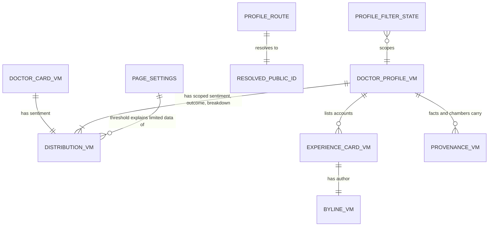

# Entities — U15 `t-202-doctor-index-and-profile`

Source of truth for the data shapes this Unit reads and the state it holds. The Unit stores nothing and adds no table, column, migration or contract. Its entities are the view models it receives from U14 T-201 (named here with the fields these pages use; T-201's `functional-spec.md` § 7 is their definition), the filter state that lives in the URL, the runtime settings the pages read, the shared-primitive contracts later Units build on, and the message keys it adds. Decision logic is in `rules.md`; workflows in `functional-spec.md`; component props in `frontend-components.md`.

Built from T-202 (with the FD-091 amendment), `contract-summary.md` C7, the T-201 and T-011 drafts, `01-conventions.md` §3–§9, `03-routes-and-contracts.md` §1 and §6, `packages/i18n/messages/{en,bn}.json` as they are on the working tree, and the answers in `functional-design-questions.md` (Question 1 awaits the owner; the others are answered A).

```yaml
entities:
  - id: ENT-001
    name: DoctorCardVM
    owner: Directory (U14 T-201; contracts/src/view-models/doctor.ts)
    description: "One doctor on the index (and, later, in search results). Read only."
    attributes:
      - { name: publicId, type: string, required: true, constraints: "10-char lowercase base32; the only id in URLs" }
      - { name: name, type: string, required: true, constraints: "active-locale name" }
      - { name: specialty, type: string, required: false }
      - { name: area, type: string, required: false }
      - { name: city, type: string, required: false }
      - { name: avatarHue, type: integer, required: true, min: 0, max: 359 }
      - { name: topConditions, type: "list<{publicId, name, count}>", required: true, constraints: "at most 3, by count; may be empty" }
      - { name: documentsCount, type: integer, required: true, min: 0, constraints: "0 renders 'No documents' (BR2.7)" }
      - { name: accountsTotal, type: integer, required: true, min: 0 }
      - { name: accountsLimitedData, type: boolean, required: true, constraints: "0 < accountsTotal < threshold" }
      - { name: sentiment, type: DistributionVM, required: true }
      - { name: claimed, type: boolean, required: true, constraints: "derived from claimed_by_account_id; false on the seed (ISS-168)" }
      - { name: registrationNotVerified, type: "literal true", required: true }
    relationships:
      - { to: DistributionVM, cardinality: "one-to-one", direction: "DoctorCardVM has a sentiment DistributionVM" }

  - id: ENT-002
    name: DoctorProfileVM
    owner: Directory (U14 T-201)
    description: "Everything the profile page renders, already scoped by the URL filters. Read only."
    attributes:
      - { name: "(card fields)", type: DoctorCardVM, required: true }
      - { name: facts, type: "list<{key: bmdc|specialty|qualifications|languages|fee, value, provenance: ProvenanceVM}>", required: true, constraints: "present, non-hidden facts only, in the prototype's order" }
      - { name: chambers, type: "list<{name, hours?, provenance: ProvenanceVM, branchPublicId?}>", required: true, constraints: "in sort_order" }
      - { name: conditions, type: "list<{publicId, name, count}>", required: true, constraints: "every condition with eligible accounts, by count" }
      - { name: breakdown, type: "list<{condition: {publicId, name}, sentiment: DistributionVM}>", required: true }
      - { name: facilities, type: "list<{publicId, name, branchName?, type, avatarHue}>", required: true, constraints: "visible branches only; may be empty" }
      - { name: accounts, type: "list<ExperienceCardVM>", required: true, constraints: "scoped and filtered, newest first" }
      - { name: scopedSentiment, type: DistributionVM, required: true }
      - { name: scopedOutcome, type: DistributionVM, required: true }
      - { name: scopedTotal, type: integer, required: true, constraints: "accounts in the selected condition, before outcome/relationship/docs filters" }
      - { name: showing, type: integer, required: true, constraints: "accounts after every filter; showing <= scopedTotal" }
      - { name: selectedCondition, type: "{publicId, name}", required: false, constraints: "absent when no condition filter or an unknown one (BR1.5)" }
    relationships:
      - { to: ExperienceCardVM, cardinality: "one-to-many", direction: "DoctorProfileVM has accounts" }
      - { to: ProvenanceVM, cardinality: "one-to-many", direction: "each fact and chamber has one ProvenanceVM" }

  - id: ENT-003
    name: DistributionVM
    owner: Review (U14 T-201, domain/review/policies.ts)
    description: "One distribution: sentiment (positive, mixed, negative) or outcome (helped, none, worse, uncertain)."
    attributes:
      - { name: keys, type: "list<string>", required: true, constraints: "render order" }
      - { name: counts, type: "map<key, integer>", required: true, constraints: "every key present, 0 included" }
      - { name: total, type: integer, required: true, constraints: "accounts with a recognised value: the denominator" }
      - { name: notProvided, type: integer, required: true, constraints: "eligible accounts with no value (Question 2)" }
      - { name: empty, type: boolean, required: true, constraints: "total = 0" }
      - { name: limitedData, type: boolean, required: true, constraints: "0 < total < threshold" }
    constraints:
      - "No percentage field: percentages, when shown (Question 1), are derived in the component from counts and total (BR3.3)"

  - id: ENT-004
    name: ExperienceCardVM
    owner: Review (U14 T-201; contracts/src/view-models/experience-card.ts)
    description: "One account row on the profile (and on later list pages)."
    attributes:
      - { name: publicId, type: string, required: true }
      - { name: title, type: string, required: true, constraints: "original wording" }
      - { name: excerpt, type: string, required: true, constraints: "grapheme-safe" }
      - { name: truncated, type: boolean, required: true }
      - { name: sentiment, type: enum, required: false, allowed_values: [positive, mixed, negative] }
      - { name: outcome, type: enum, required: false, allowed_values: [helped, none, worse, uncertain] }
      - { name: condition, type: "{publicId?, name}", required: false, constraints: "free-text tags have no publicId" }
      - { name: documentsCount, type: integer, required: true, min: 0 }
      - { name: author, type: BylineVM, required: true }
      - { name: relationship, type: enum, required: true, allowed_values: [self, parent, family, witness] }
      - { name: period, type: "{year, month}", required: true, constraints: "month and year only (01-conventions.md §6)" }
      - { name: doctor, type: "{publicId, name}", required: true }
    constraints:
      - "An absent sentiment or outcome omits that badge on the row; the summaries say Not provided (BR2.2, BR2.3)"

  - id: ENT-005
    name: BylineVM
    owner: Identity projection (U14 T-201 mapper over personas)
    description: "The public face of an author."
    attributes:
      - { name: personaKind, type: enum, required: true, allowed_values: [named, pseudonymous, anonymous] }
      - { name: displayName, type: string, required: false, constraints: "named only" }
      - { name: username, type: string, required: false, constraints: "pseudonymous only; the /authors/{username} key" }
      - { name: initials, type: string, required: false, constraints: "named and pseudonymous only; '@' + first letter for a username (prototype initials())" }
    constraints:
      - "anonymous carries personaKind only; the component renders byline.anonSentence and never a link (BR2.12)"
      - "named renders as text until a real-name profile route exists (Question 7)"

  - id: ENT-006
    name: ProvenanceVM
    owner: Directory (U14 T-201)
    attributes:
      - { name: source, type: enum, required: true, allowed_values: [community, provider, admin], constraints: "rendered as prov.{source}" }
      - { name: updatedAt, type: "ISO 8601", required: true, constraints: "rendered month and year in the active language (BR2.9)" }

  - id: ENT-007
    name: ProfileFilterState
    owner: U15 T-202 (URL only; no storage)
    description: "The profile's account filters, held in the query string so they work without script and can be shared."
    attributes:
      - { name: condition, type: string, required: false, constraints: "a condition public id; unknown -> 307 to the URL without it (BR1.5)" }
      - { name: outcome, type: enum, required: false, allowed_values: [helped, none, worse, uncertain] }
      - { name: relationship, type: enum, required: false, allowed_values: [self, parent, family, witness] }
      - { name: docs, type: "literal '1'", required: false }
    constraints:
      - "Serialised in the fixed order condition, outcome, relationship, docs; empty values are left out"
      - "The canonical URL carries none of them (BR1.8)"
    relationships:
      - { to: DoctorProfileVM, cardinality: "many-to-one", direction: "ProfileFilterState scopes one DoctorProfileVM" }

  - id: ENT-008
    name: ProfileRoute
    owner: U15 T-202
    description: "The dynamic segment of /{locale}/doctors/{segment}."
    attributes:
      - { name: locale, type: enum, required: true, allowed_values: [en, bn] }
      - { name: segment, type: string, required: true, constraints: "^([a-z2-7]{10})(?:-[^/]*)?$; the slug is ignored (BR1.2)" }
    constraints:
      - "Folder name [publicId] (renamed from T-008's [id])"

  - id: ENT-009
    name: ResolvedPublicId
    owner: Directory (U14 T-201, directory.resolvePublicId)
    attributes:
      - { name: publicId, type: string, required: true, constraints: "the current target" }
      - { name: redirected, type: boolean, required: true, constraints: "true -> 308 to the target (BR1.3)" }

  - id: ENT-010
    name: PageSettings
    owner: Administration (U12 T-105, ConfigProvider.current())
    description: "Runtime settings these pages read once per request through the web composition root."
    attributes:
      - { name: limitedDataThreshold, type: integer, required: true, default: 5, constraints: "placeholder value; shown in label.limitedDataWhy (Question 4)" }
      - { name: emergency, type: "{ambulance, healthLine, crisisLine, lastVerified}", required: true, constraints: "EmergencyPanel only; digits via formatDigits, date via formatDate" }

  - id: ENT-011
    name: PatientPrimitive
    owner: U15 T-202 (components/patient/shared/)
    description: "A shared server component that later patient pages (T-203, T-206, T-207, T-307) import. Its props are its contract."
    attributes:
      - { name: name, type: enum, required: true, allowed_values: [Avatar, Badge, NotVerified, DistBlock, SentimentBlock, OutcomeBlock, Byline, DoctorLink, FacilityLink, AccountRow, EmergencyPanel, MiniList, MiniRow, IndexHead] }
      - { name: client, type: boolean, required: true, default: false, constraints: "always false (BR8.1)" }
      - { name: props, type: "typed object", required: true, constraints: "view models, primitives and ReactNode slots; no callbacks" }
    constraints:
      - "Class names are the ones T-011 kept from the prototype"
      - "A prop change after T-203 starts is a breaking change for its consumers and is made in the same Bolt"

  - id: ENT-012
    name: MessageKey (added by this Unit)
    owner: packages/i18n (keys added by U15 T-202)
    description: "New keys, both dictionaries in one commit, Bengali flagged for review (FD-042). Values are proposals."
    attributes:
      - { name: "sentiment.ofTotal", type: message, required: true, constraints: "en 'of {total} patient {n, plural, one {experience} other {experiences}}'; bn '{total} জনের অভিজ্ঞতার মধ্যে'" }
      - { name: "sentiment.totalAccounts", type: message, required: true, constraints: "en '{count} patient {n, plural, one {experience} other {experiences}}'; bn '{count} জনের অভিজ্ঞতা'" }
      - { name: "profile.accountsCount", type: message, required: true, constraints: "en '{count} patient {n, plural, one {experience} other {experiences}}'; bn '{count} রোগীর অভিজ্ঞতা'" }
      - { name: "label.documentsCount", type: message, required: true, constraints: "en '{count} {n, plural, one {document} other {documents}}'; bn '{count} কাগজপত্র'" }
      - { name: "profile.showingCount", type: message, required: true, constraints: "en 'showing {count} / {total}'; bn 'দেখাচ্ছে {count} / {total}'" }
      - { name: "label.notProvidedCount", type: message, required: true, constraints: "en 'Not provided: {count}'; bn 'জানানো হয়নি: {count}' (Question 2)" }
      - { name: "prov.updatedOn", type: message, required: true, constraints: "en '{source} · {date}'; bn '{source} · {date}' (BR2.9)" }
      - { name: "label.limitedDataWhy", type: "message (changed)", required: true, constraints: "gains {threshold} (Question 4)" }
    constraints:
      - "No other key changes; existing keys stay for the Units that still use them"
      - "Percent text comes from formatPercent in packages/i18n/src/format.ts, not a key (BR3.3)"
```

## What the Unit does not hold

- No database row, migration, port, query or command. `directory.claimProfile` and its action are U17 T-204's; this Unit only opens the sheet.
- No cookie or local storage. The filters live in the URL; theme, language and motion stay the shell's cookies.
- No view-model field. If a component needs data T-201 does not supply, the gap is an `ISSUES.md` row for U14, not a new field here (Questions 7 and 8 are two such cases, both answered without a change).

## Relationships at a glance



Text fallback: a doctor card has one sentiment distribution; a profile has its scoped sentiment and outcome distributions and one per breakdown row, lists account cards (each with one byline), and carries provenance on every fact and chamber. The URL's filter state scopes one profile; the route segment resolves to a current public id. The configured threshold explains every limited-data mark.
