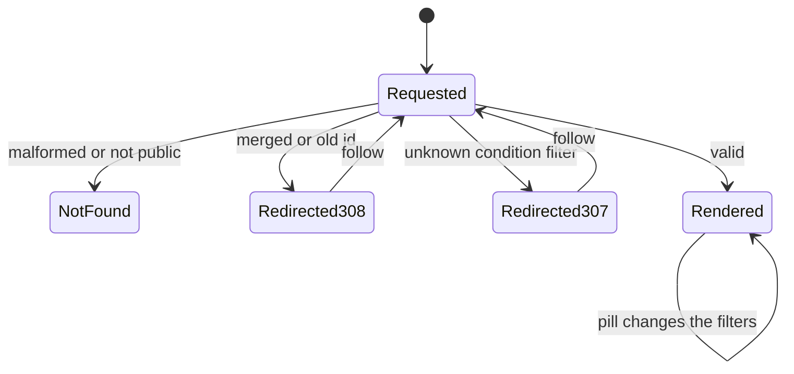
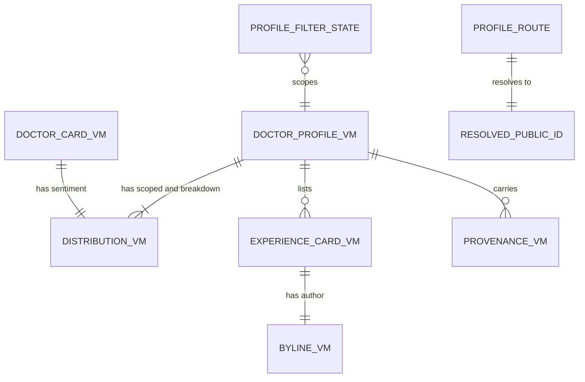

# Functional specification — U15 `t-202-doctor-index-and-profile`

**Refreshed 2026-10-29** against `main` at `14c21a9` (T-010 merged; CR-012 merged as `7cce9bd`), the refreshed T-011 and T-201 drafts and the owner's answers in `docs/aidlc-migration/OWNER-REVIEW-QUEUE.md`. What changed:
- **No percentages (Q1 B, the owner's answer).** Summaries show counts with their denominators only. `showPercent`, `formatPercent`, the `.pct` rules and the percentage tests are gone, and `packages/i18n/src/format.ts` is no longer touched. An FD entry narrows FR48 and AC6.4.1 before code (§ 17), and an `ISSUES.md` row records the gap.
- **T-201 data.** Each branch's `name` is now the hospital's own name, with `branchName` (the label) and its own hue. Facility rows read "{name} — {branchName}" through a shared `facilityLabel` (new Q15). Each review is linked to one condition term, so the pills, the breakdown and the cards have data on the seed. The seed has 11 doctors, 14 chambers and 25 reviews: d11 has no fee or languages, and r25 has no sentiment, outcome or documents. "Not provided" therefore shows on d11's profile and the old F1 is closed. The threshold is read with `await config.current()` and lies between 2 and 50, so "Limited data" can never be switched off.
- **T-010 checks** (`pages.test.tsx` and the boundaries). The route-table test asserts `robots` absent on indexable pages, so the pages set no `robots` field (BR1.8).
  - The `/doctors/[id]` row is updated to `[publicId]`, with a valid id, a container mock, `searchParams` and the profile's own title and heading; the claim button's gate needs T-102's `AuthGateProvider` (BR1.10).
  - Builders live in `*-test-support.ts` files, never in `@rogikotha/test-support`, and `apps/web` stays at 80% lines with untested files counted (BR9.5).
  - `pnpm check` has eleven steps, and CI must be green on the Bolt head.
- **Public ids are Crockford base32.** The draft's `[a-z2-7]` pattern would have sent most profiles to 404. The page uses `stripSlug` and `isPublicId` from `@rogikotha/contracts` (BR1.2, S1 designed out).
- **T-011 refresh.** No avatar morph (T-011 Q10 A decides Q12). `.pillrow a`, `.doc-entry` and `.mini-row` are in T-011's press list, which closes F7. Spacing comes from `--space-*`. T-202's CSS has no hover transform (`M9-hover`) and no dark token block (`M10-tokens`), and it is formatted by Prettier.
- **Shared primitives for T-203** (new Q14). `Badge` gains `good` and `poor`. `DistBlock` gains the `crit.` prefix, the title in the compact sentence and `limitedNote`. `FacilityLink` exports `facilityLabel`. `EmergencyPanel` `compact` stays T-203's.
- **Byline.** It renders "Former member" when the VM says so (the owner's T-104 Q15 B; BR2.12).
- **New findings** F16–F24 (§ 9).

| Field | Value |
|---|---|
| Unit | U15 `t-202-doctor-index-and-profile` (kind `ui`, size L, not high risk); Bolt 14; depends on U14 T-201, U3 T-010, U45 T-011; U16 T-203, U19 T-206, U20 T-207 and U27 T-307 import its shared primitives |
| Source | T-202 (`docs/implementation/tasks/T-202-doctor-index-and-profile.md`, with the FD-091 amendment) |
| Stories | US4.1 (AC4.1.1–AC4.1.5), US6.4 (AC6.4.1–AC6.4.5), US4.2 (AC4.2.1–AC4.2.5; claim entry point and redirect only) — `unit-of-work-story-map.md` |
| Requirements | FR15–FR19, FR20 (entry), FR23 (redirect), FR48–FR52, FR95, NFR4, NFR6, NFR7, NFR13 — `requirements.md` |
| Decisions | FD-024 (equal languages), FD-032 (plain CSS), FD-042 (Bengali copy review), FD-060 (claims staff-decided), FD-067 (review figures through ports), FD-089 (about 10 records per module), FD-091 (patient redesign and motion), FD-093 (import boundaries); D-003 (Registration not verified); the new FD entry of § 17 (counts only, Q1 B) |
| Upstream design | `contract-summary.md` C7 (directory queries, U14) and "edges between UI Units share components, not domain contracts"; drafts `t-201-directory-and-taxonomy-modules` (view models, queries; refreshed 2026-10-29), `t-011-patient-design-and-motion-system` (tokens, motion; refreshed 2026-10-29), `t-102-patient-auth-screens` (`useAuthGate`, `AuthGateProvider`; refreshed 2026-10-29) and `t-101-better-auth-adapter` (`getActor`) |
| Questions | Q1–Q15 in `functional-design-questions.md`. **Q1 is answered B by the owner** (2026-10-28: counts only, no percentages); Q2–Q13 are answered A on the owner's standing instruction of 2026-10-27 (Q12 is also decided by T-011's Q10 A); Q14 and Q15 are answered A, decided by the agent under the owner's no-questions instruction of 2026-10-29. Each is listed in `docs/aidlc-migration/OWNER-REVIEW-QUEUE.md` when this draft is finalised. § 14 lists the changes under each other option |
| Status | Draft written ahead of the stage on 2026-10-28, refreshed on 2026-10-29 against `main` at `14c21a9` (T-010 merged, CR-012 merged as `7cce9bd`); U14 T-201, U45 T-011, U8 T-101 and U9 T-102 are not built yet, so their refreshed drafts are the interface this design builds on |

This file is the source of truth for the Unit's workflows and state transitions. `entities.md` holds the data shapes, `rules.md` the numbered rules, and `frontend-components.md` the component props, files, styles and tests. The entity-relationship view and the rules summary at the end are derived from those files.

## 1. What changes, in one paragraph

The two placeholder pages from T-008 become the real doctor index (`/{locale}/doctors`) and doctor profile (`/{locale}/doctors/{publicId}`), ported from the prototype's `renderDoctorIndex` and `renderProfile` with the same content, fields, block order and behaviour, on T-011's "Warm Paper, Soft Depth" look. They read T-201's `DoctorCardVM` and `DoctorProfileVM` through the web composition root and render them in both languages. The profile's account filters live in the URL, so they work without script and can be shared; a merged or old id answers a permanent redirect; a hidden one is a 404. The Unit also builds the shared patient primitives that every later patient page reuses: `Avatar`, `Badge`, `NotVerified`, `DistBlock`, `SentimentBlock`, `OutcomeBlock`, `Byline`, `DoctorLink`, `FacilityLink` (with `facilityLabel`), `AccountRow`, `EmergencyPanel`, `MiniList` and `IndexHead`, including the additions T-203 asked for (Q14).

Hard rules show in every frame:
- exact counts with denominators, and no percentage anywhere (the owner's answer to Q1);
- "Not provided" and "No documents" instead of 0, which on the seed shows on d11;
- "Limited data" from the configured threshold of 2–50;
- "Registration not verified" on every doctor;
- the facility-separation note;
- neutral order;
- anonymous authors never linked.

Motion comes only from T-011: the page transition in the layout, the list reveal on the two lists, and press feedback; distributions are static. Seven message keys are added and one gains a parameter. One FD entry, appended before code, narrows FR48 and AC6.4.1 to counts with denominators, as the owner decided (§ 17); no other hard rule, data boundary or contract changes.

## 2. As is (`main` at `14c21a9`, 2026-10-29) and what Bolt 14 can count on

| Element | Today | By Bolt 14 |
|---|---|---|
| Routes | `doctors/page.tsx` and `doctors/[id]/page.tsx` render `ViewShell` with `shell.placeholder`; `generateMetadata()` takes no argument and sets no `robots` | unchanged until this Unit |
| Route-table test (T-010) | `app/pages.test.tsx` renders every page with `page.default({ params })` only and calls `generateMetadata()` with no argument; rows `/doctors` (one `h1` with `titleForView('doctors')`, title `documentTitle('doctors')`, `robots` absent) and `/doctors/[id]` with `params: { id: 'doc-synthetic-1' }` (the id shown as text, title `documentTitle('profile')`) | page Units update their rows and the harness when they replace a placeholder |
| Boundaries (T-010, FD-093) | `eslint.boundaries.mjs`: `app/` (`web`) may import `server/` (`web-server`, `container.ts` included) and actions; components (`web-components`) may import `contracts`, `i18n`, actions and `web-shared` (`src/lib`, `src/i18n`), never `server/` otherwise; `web-shared` imports `contracts` and `i18n` only; nothing in `apps/*` imports `test-support` | unchanged |
| Gate and coverage (T-010) | Nine-step `pnpm check`; 80% lines per package with untested files counted; `*-test-support.ts` excluded from coverage; CI on `bolt/**` must be green before merge | eleven steps after T-011 (`contrast:patient`, `check:motion`) |
| Public ids | `contracts/src/ids.ts`: 10-char lowercase **Crockford** base32 (`PUBLIC_ID_RE = /^[0-9a-hjkmnp-tv-z]{10}$/`), `isPublicId`, `stripSlug(param)` (id with an optional `-slug`); `GetDoctorInput {publicId, condition?, outcome?, relationship?, docs?: boolean}`; `pageSize` max 100 | unchanged |
| Data | No query; `apps/web/src/server/container.ts` does not exist | U8 T-101 creates the container (built lazily) with a defaults-only, asynchronous `ConfigProvider` and `getActor()` in `server/auth.ts`; U12 T-105 makes the configuration database-backed (5-second cache, threshold 2–50); U14 T-201 delivers `directory.listDoctors`, `getDoctor`, `resolvePublicId` and Review's `ProviderExperience`, which the container still has to wire (T-201 F6) |
| View models | Stubs in `contracts/src/view-models/doctor.ts` with `TODO(T-202)` | T-201's shapes (`entities.md` ENT-001–ENT-006): no percentage field; facility rows `{publicId, name, branchName?, type, avatarHue}` with `name` the hospital's own name |
| Look and motion | `patient.css` is the verbatim 04b port; `body[data-motion]` | U45 T-011's token block (spacing `--space-1…8` included), restyled classes (no class renamed), `motion.css` with a press list covering `.pillrow a`, `.doc-entry`, `.mini-row`, `.btn`, plus `data-press`; `RouteTransition` in the patient layout, `Reveal`, static groups, `check:motion` (M1–M11), `contrast:patient`; `patient.css` in Prettier's scope with double quotes; no shared-element morph |
| Auth gate | none | U9 T-102's `useAuthGate()` (throws outside its provider) and one `AuthGateProvider` with its `AuthGateSheet` in the patient layout |
| Keys | All the prototype's keys, plus T-202 step 2's keys (added by T-207a) | + this Unit's keys |
| Seed (CR-012 merged, `7cce9bd`) | 10 doctors d1–d10 with every rendered field filled; 24 reviews, every one with sentiment and outcome, none linked to its condition term; d1 has 5 accounts, d2–d10 have 1–3 | after U14 T-201: 11 doctors (d11 without fee and languages), 14 chambers, 25 reviews (r25 on d11 without sentiment, outcome or documents), one condition term tag per review, branch names, labels and hues stored (T-201 Questions 9 C, 11 B, 12, 13) |
| Shared components | `ViewShell`, `Sheet`, `LiveRegion`/`useAnnounce`, `Emergency` (the Emergency page's own component) | unchanged |

## 3. Settled before this stage

See `functional-design-questions.md` § "Settled before this stage":
- the look follows T-011, with page rules in T-202's own `patient.css` section;
- the data and the facility isolation are T-201's;
- every doctor shows "Registration not verified";
- public profiles are indexable;
- claims are T-204's, and the gate is T-102's;
- no new dependency;
- inline custom properties are allowed under T-502's CSP;
- the owner's answers apply: no percentages (Q1 B), each branch's own hospital name (T-203 F2), the threshold range 2–50 (T-105 R2) and "Former member" (T-104 Q15 B);
- T-010's boundaries, tests and gate, and T-011's no-morph decision (its Q10 A).

The design decisions taken without a question are listed in the same file and explained in § 13.

## 4. Workflows

### WF1 — Doctor index (`/{locale}/doctors`)

1. The patient layout renders the shell; the layout's `RouteTransition` wraps `<main>`'s content (BR5.1).
2. The page gets the locale and `await getActor()` (T-101, `server/auth.ts`, cached per request), and calls `container.directory.listDoctors({page: 1, pageSize: 50}, actor)`. A failed result is a programmer or infrastructure error and is thrown to Next's error boundary (01-conventions §3); there is no expected failure for a list.
3. It reads `(await container.config.current()).limitedDataThreshold` once (BR2.5; 2–50, default 5).
4. It renders `ViewShell(view="doctors", title="")` > `DoctorIndex`: `IndexHead` (kicker "Discover", `h1` "Doctors" from `nav.profile`, which equals `titleForView('doctors')`, the note "Listed alphabetically — never ranked, and never scored"), the count line "{n} · Doctors", and `Reveal` > one `DoctorEntry` per card, in the query's order (BR2.11). On the seed after T-201: 11 cards.
5. Each `DoctorEntry`: avatar; name as an `h2` link; specialty · area, city (present parts only); up to three conditions with counts; flags: "Registration not verified", documents ("{n} documents" or "No documents"), and "Limited data" when the doctor has fewer eligible accounts than the threshold (Q3; 10 of the 11 seeded cards at the default 5); a compact sentiment distribution with its denominator, or "Not provided" when it is empty (d11).
6. `generateMetadata()` needs no argument and gives `documentTitle('doctors')` ("Doctors — RogiKotha" in the active language), no `robots` field (indexable by default; `pages.test.tsx` asserts it is absent), canonical `/{locale}/doctors` with language alternates.
7. `ViewShell` announces the view (CR-004) and sets `data-view`, as today.

### WF2 — Profile request (`/{locale}/doctors/{segment}?…`)

1. Parse `segment` with `stripSlug` from `@rogikotha/contracts` (BR1.2): a 10-character Crockford base32 public id (`0-9`, `a-z` without `i`, `l`, `o`, `u`), optionally followed by `-slug`. Anything else → `notFound()`.
2. `container.directory.resolvePublicId({kind: 'doctor', publicId}, actor)` (BR1.3):
   - `not_found` → `notFound()` (BR1.4);
   - `redirected` → `permanentRedirect` (308) to `/{locale}/doctors/{target}` with the query string kept (Q10; T-201's text says 301, which reads 308 here, F20);
   - otherwise continue.
3. Clean the filters (`cleanFilters` in `lib/doctor-filters.ts`, BR1.5): keep `outcome` in the outcome enum, `relationship` in the relationship enum, `docs` only as `1` (passed to the query as `docs: true`, the schema's boolean), `condition` only when `isPublicId` accepts it; drop the rest; a repeated parameter keeps its first value.
4. `container.directory.getDoctor({publicId, ...filters}, actor)`. `not_found` → `notFound()`. A `validation` error cannot happen after step 3; if it does, it is a programmer error and is thrown.
5. If a `condition` was given and `vm.selectedCondition` is absent (the doctor has no accounts for it, or it is not a condition), `redirect()` (307) to the same URL without `condition`.
6. Read `(await container.config.current()).limitedDataThreshold`.
7. Steps 1–6 run inside one `cache()`-wrapped loader that `generateMetadata({params, searchParams})` also calls (BR1.9). The page body calls the loader itself at the top, so a redirect or 404 is thrown before the first byte, also when Next 16 streams the metadata (F21). The title is "{doctor name} — RogiKotha"; the canonical URL has no slug and no filters; the page sets no `robots` field (indexable, BR1.8).
8. Render `ViewShell(view="profile", title="")` > `DoctorProfile` (WF3).

```mermaid
sequenceDiagram
  actor Reader
  participant Page as Profile page (server)
  participant Dir as directory queries (U14)
  participant Cfg as ConfigProvider (U12)
  Reader->>Page: GET /bn/doctors/{segment}?outcome=helped
  Page->>Page: parse segment; malformed -> 404
  Page->>Dir: resolvePublicId(doctor, publicId)
  alt not found
    Dir-->>Page: not_found
    Page-->>Reader: 404 page
  else redirected
    Dir-->>Page: {publicId: target, redirected: true}
    Page-->>Reader: 308 to /bn/doctors/{target}?outcome=helped
  else current
    Page->>Page: clean filters
    Page->>Dir: getDoctor(publicId, filters)
    Dir-->>Page: DoctorProfileVM
    Page->>Cfg: await current(), limitedDataThreshold (2-50)
    Page-->>Reader: profile HTML (one query run, shared with metadata)
  end
```

Text fallback: parse the segment (malformed → 404) → resolve the id → not found: 404; redirected: 308 to the target with the same query; current: clean the filters, load the profile, read the threshold, render. An unknown condition filter answers 307 to the URL without it.

### WF3 — Profile rendering (prototype block order)

1. **Hero**: avatar; kicker "Doctor"; `h1` name; specialty · area, city; flags "Registration not verified" (with its explanation available to screen readers), "{n} patient experiences", "Limited data" when sparse (Q3), "Provider confirmed" when claimed; actions "Write about your treatment" (link to `/write?doctor={publicId}`) and "Is this you?" (WF5).
2. **Conditions**: heading, note, the pill row "All conditions ({total})" and one pill per condition with its count (selected pill `aria-current`, Q6); the sentiment distribution and the outcome rows for the selected condition (scoped), each with its counts and denominator, "Not provided" lines (Q2), and "Limited data" with the configured threshold (Q4). No percentage anywhere (Q1 B, the owner's answer).
3. **By condition**: a table of every condition with its positive, mixed, negative counts and total; a `⚠` and a hidden "Limited data" after a sparse total; the threshold note under it.
4. **Filter these experiences**: outcome pills, "Has documents", relationship pills; "showing {x} / {y}".
5. **Patient experiences**: the filtered accounts, newest first, each an `AccountRow` inside `Reveal`; or "Nothing here yet."
6. **Side panel**: where the information came from (each present fact with its label, value, source and month-year, BR2.9; on d11 there is no fee row and no languages row); practice locations (name, hours when present, source and month-year); where they practise (facility rows titled `facilityLabel(row)`, "{name} — {branchName}" when the branch has a label, Q15; no facility figures; with the separation note), only when the doctor has a visible facility (BR2.10, BR2.13).

### WF4 — Changing a filter

1. The reader activates a pill. Its `href` is the current URL with that one filter set, changed or removed (BR1.6).
2. With script: `ProfileFilters` flips the pill's `aria-current` at once, Next navigates without scrolling, the server renders the new scoped view, and `ProfileFilters` announces "showing {x} / {y}" once (BR4.5). The path does not change, so the layout's route transition does not run; the new account rows that enter are revealed by `Reveal` (T-011 WF3).
3. Without script: the link loads the page; the server renders the selected state.
4. An invalid value typed into the URL is dropped (WF2 step 3).

### WF5 — "Is this you?" (claim entry point)

1. The reader activates "Is this you?".
2. `useAuthGate().guard()` (T-102; the provider is in the patient layout, and the profile's route-table and component tests wrap the page in `AuthGateProvider`, BR1.10): signed out → the gate sheet ("Sign in to take part"); signed in but unverified → the gate's verify message. Stop.
3. Verified → `ClaimSheet` opens: title "Is this you?", the claim note ("Claiming does not verify BMDC registration and gives no control over what patients wrote"), close button. The `Sheet` traps focus, returns it, and announces as today (Q9).
4. U17 T-204 later replaces the sheet body with the claim form and `claimProfileAction`.

### WF6 — Shared primitives for later Units

`frontend-components.md` § 4 is their contract. T-203 (facility and condition pages) imports `DistBlock`, `OutcomeBlock`, `AccountRow`, `Byline`, `MiniList`, `IndexHead`, `NotVerified`, `Avatar`, `EmergencyPanel`, `Badge`, `FacilityLink` and `facilityLabel`; T-206 imports `DoctorEntry` with its `pinSlot`; T-207 imports `EmergencyPanel`, `AccountRow`, `IndexHead`; T-307 imports `Byline`, `AccountRow`. Each takes view models and plain values, renders on the server, and fetches nothing (BR8.1). `EmergencyPanel` is built and tested here but not shown on these two pages. The additive changes T-203 asked for (its Question 11 A) are built here, so T-203 does not edit these files (Q14 A, BR8.3): `Badge` classes `good` and `poor`; `DistBlock` with the `crit.` prefix, its `title` named in the compact image sentence and an optional `limitedNote: 'full' | 'tag'`; `facilityLabel` exported beside `FacilityLink`. `EmergencyPanel`'s `compact` prop stays T-203's (its task allows it). Segment parsing needs no shared helper: both Units use `stripSlug` and `isPublicId` from `@rogikotha/contracts`.

### WF7 — Code Generation order

1. **Baseline**: T-201, T-011, T-101 and T-102 merged on `main`; `pnpm infra:up` (and `pnpm demo:reset` once if the local demo database predates T-201, T-201 F17); `pnpm check` (eleven steps) and `pnpm smoke` green on the Bolt branch; record the counts and the `apps/web` coverage figure; read the open `ISSUES.md` rows in this area (§ 2 of the questions file) and the § 9 rows of this file.
2. **Decision log first**: append the FD entry of § 17 (counts only, the owner's Q1 B) to `docs/status/decision-log.md`, with the next free number, before any source change (project.md Mandated); add the `ISSUES.md` row for the narrowed AC6.4.1.
3. **Prerequisites present**: T-201's queries and view models (names, `facilities` rows, no percentage field); T-011's `Reveal`, `RouteTransition` placement (in the layout or per page, BR5.1), spacing tokens, press list and `check:motion`; T-102's `useAuthGate` and `AuthGateProvider`; T-101's container and `getActor`. Adapt the wiring, not the rules, if a shape differs; record each difference.
4. **Keys** (both files, one commit, formatted by Prettier).
5. **Shared helpers**: `lib/doctor-filters.ts` (`cleanFilters`, `filterHref`) and `lib/css-vars.ts` (`cssVars`) with their tests (element `web-shared`).
6. **Primitives** with their tests (§ 11), the T-203 additions included (Q14).
7. **`DoctorEntry`, `DoctorIndex`, the index page.**
8. **Move `doctors/[id]` to `doctors/[publicId]`**; the profile page, `DoctorProfile`, `ProfileFilters`, `ClaimSheet`.
9. **Container wiring** for the directory queries, with a test case for the new lines (owned-path addition, § 12).
10. **Route-table test**: the `/doctors` and `/doctors/[publicId]` rows and the harness of `app/pages.test.tsx` (BR1.10).
11. **Styles**: T-202's section of `patient.css` (`frontend-components.md` § 7).
12. **Smoke** test; gates (BR9.3); push the Bolt branch and wait for CI green on its head; the visual, reduced-motion, viewport and Lighthouse checks; ISS rows; hand-off.

## 5. State transitions

### Profile request outcome

| From | Event | To | Rule |
|---|---|---|---|
| Requested | Segment malformed | 404 | BR1.2 |
| Requested | Id unknown or not public | 404 | BR1.4 |
| Requested | Id merged or old | 308 to the target | BR1.3 |
| Requested | Unknown condition filter | 307 to the URL without it | BR1.5 |
| Requested | Valid | Rendered | WF3 |



Text fallback: a request either renders, answers 404 (malformed or not public), answers 308 to the current id, or answers 307 without an unknown condition filter; the redirects lead to a new request. On a rendered profile each pill produces a new rendered state.

### Filter state (per profile, in the URL)

| From | Event | To |
|---|---|---|
| any | condition pill c | condition = c, others kept |
| condition set | "All conditions" | condition removed, others kept |
| outcome unset or ≠ o | outcome pill o | outcome = o |
| outcome = o | outcome pill o | outcome removed |
| relationship unset or ≠ r | relationship pill r | relationship = r |
| relationship = r | relationship pill r | relationship removed |
| docs unset | "Has documents" | docs = 1 |
| docs = 1 | "Has documents" | docs removed |

### Claim entry (per click)

| From | Visitor | To |
|---|---|---|
| Closed | signed out | T-102 gate sheet (sign in) |
| Closed | unverified | T-102 gate sheet (verify) |
| Closed | verified | Claim sheet with the note |
| Claim sheet open | Escape, close button or overlay | Closed, focus back on "Is this you?" |

### What the view model's states mean on the page

| VM state | Page shows | Rule |
|---|---|---|
| `dist.empty` | "Not provided" alone (on the seed: d11's sentiment and outcome) | BR2.2 |
| `dist.notProvided > 0`, not empty | the distribution + "Not provided: n" | BR2.3 |
| `dist.limitedData` | "Limited data — Fewer than {threshold} …" | BR2.4 |
| `accountsLimitedData` | "Limited data" badge in the hero and on the card | BR2.4 |
| `documentsCount = 0` | "No documents" | BR2.7 |
| `facilities = []` | no facilities panel and no note | BR2.10 |
| `accounts = []` | "Nothing here yet." | WF3 |
| `claimed` | "Provider confirmed" beside "Registration not verified" | BR2.6 |

## 6. Ports and data access

This Unit declares no port. Only the two page files (element `web`) call the server; components get view models as props (FD-093 (1)). They call the directory queries of C7 through the web composition root:

```text
getActor()                                        -> Actor (anonymous or session; T-101, server/auth.ts, cached per request)
container.directory.listDoctors(input, actor)     -> Result<BoundedPage<DoctorCardVM>>     input {page, pageSize <= 100}
container.directory.getDoctor(input, actor)       -> Result<DoctorProfileVM>       errors: not_found, validation
container.directory.resolvePublicId(input, actor) -> Result<{publicId, redirected}>   errors: not_found
await container.config.current()                  -> ConfigValues (limitedDataThreshold 2-50, emergency)   T-105 Q2: a Promise
```

The container wiring of `directory` with Review's `ProviderExperience` is T-201's finding F6 and lands here (§ 12). It is built lazily, like the rest of T-101's container, and gets a test case so its lines count as covered. The exact names follow whatever T-101 and T-201 built; the page adapts.

## 7. View models

Read only; defined by T-201 (`entities.md` ENT-001–ENT-006). This Unit relies on:
- active-locale strings only; optional fields absent when missing; public ids only;
- `registrationNotVerified: true`;
- distributions with `keys`, `counts`, `total`, `notProvided`, `empty`, `limitedData`, and no percentage field (the owner's answer to Q1);
- `BylineVM.initials` prepared by T-201;
- facility rows `{publicId, name, branchName?, type, avatarHue}`, where `name` is the branch's own hospital name and `branchName` its label (T-201 Q9 C, BR3.11);
- each review linked to one condition term, so `conditions`, `breakdown` and the card condition are filled on the seed (T-201 Q11 B).

`DoctorProfileVM` carries no `parentName` and no facility figures, so `FacilityCardVM.feedbackVisible` does not apply to these pages; T-203's cards apply it. A field T-202 needs that T-201 does not supply is an `ISSUES.md` row for U14, not a page-side workaround (`formerMember`, F22, is such a case).

## 8. Developer view — mapping details

- **Count phrases** (Q5): `t(key, {n, ...countParams(n, total, locale)})` (`countParams` from `@rogikotha/i18n/format` gives the formatted `count` and `total`); English plural on `n`. No script lowercasing of copy.
- **Aria sentence** (BR4.3): `keys.map(k => count + ' ' + label.toLocaleLowerCase(locale)).join(', ') + ' — ' + t('sentiment.ofTotal')` + the "Not provided" phrase when present; in compact mode the sentence starts with the `title` when one is given (Q14). No percentage (Q1 B).
- **`--g` and `--w`**: `style={cssVars({'--g': count || 0.4})}`, `style={cssVars({'--w': count / total})}`, through `cssVars()` in `lib/css-vars.ts` so TypeScript accepts the custom properties.
- **Month and year**: `formatMonthYear({year, month}, locale)` for periods; `ProvenanceVM.updatedAt` is split into year and month before formatting.
- **Facility row title**: `facilityLabel(row)` = `name` + (`branchName` ? ' — ' + `branchName` : ''), exported beside `FacilityLink` (Q15, BR2.13). d1's row reads "Shefa General Hospital — Dhanmondi branch"; two branches of one hospital (the prototype lists d7 at f6 and f7) read "Kashful Community Hospital — {label}" each, so they can be told apart.
- **Segment parsing**: `stripSlug(decodeURIComponent(segment))` from `@rogikotha/contracts`, which checks the Crockford pattern `^[0-9a-hjkmnp-tv-z]{10}(-.*)?$` and returns the 10-character id or `null` (BR1.2). The condition filter uses `isPublicId`.
- **Filters**: `cleanFilters(searchParams)` returns `{condition?, outcome?, relationship?, docs?: true}`; `filterHref(current, change)` builds the pill hrefs and the redirect query in the fixed order (condition, outcome, relationship, docs), so a 308 never carries junk parameters. Both live in `lib/doctor-filters.ts` (`web-shared`), so the page and the client `ProfileFilters` share them.

## 9. Findings and proposed ISS rows

Each is proposed with `Found in U15 T-202 (Functional Design draft)`; the caller adds them with the next free numbers (the register on `main` ends at ISS-302).

- **F1 (was S2; resolved upstream, no row)** — The corrected seed could not show "Not provided" on a doctor page. CR-012 merged without a fix; U14 T-201 now adds doctor d11 (no fee, no languages) and review r25 (no sentiment, outcome or documents) through the prototype and the corpus port (T-201 Question 13 A, its FD entry (b)). On the seed, d11's profile omits the two facts and shows both distributions as "Not provided", and r25's row shows "No documents" and no sentiment or outcome badge. The partial "Not provided: n" line (BR2.3) is still proven on builder data only (d11 has one account), and on c6 by T-203.
- **F2 (S1 if built as the task says; designed out)** — The prototype's compact distribution drops "Limited data", and ten of the eleven seeded doctors are below the threshold after T-201. Cards would show sparse distributions without the mark (hard rule). Settled by Q3.
- **F3 (S2 if built as the task says; designed out)** — Step 5's pills are links with `aria-pressed`: an axe critical violation (`aria-allowed-attr`) that T-503's gate refuses. Settled by Q6.
- **F4 (S2 if built as the task says; designed out)** — Step 9 wraps both pages in `RouteTransition` while T-011 puts it in the layout; two `page` names make the browser skip every route transition. Settled by BR5.1; the task's step 9 wording should be corrected.
- **F5 (settled by the owner; no row of its own)** — FR48 and AC6.4.1 ask for percentages that the prototype and T-202 leave out. The owner answered B on 2026-10-28: counts with denominators only. The FD entry of § 17 narrows FR48 and AC6.4.1; F24 is the one row that records it.
- **F6 (S3, U15 T-202)** — `label.limitedDataWhy` names the threshold 5 as fixed text (Q4); `sentiment.of` + total + `sentiment.accounts` puts the Bengali postposition first and gives "1 documents" in English (Q5).
- **F7 (closed by T-011, no row)** — T-011's refreshed press list covers `.pillrow a`, `.doc-entry`, `.mini-row` and `.btn`, and gives `data-press` for anything else; T-202 adds no motion (BR5.4).
- **F8 (S4, U11 T-104 and U38 T-409)** — A real-name byline has no public-profile link because `BylineVM` has no identifier for it (Q7). Decide whether real-name personas get a profile route and which identifier.
- **F9 (closed by T-011, no row)** — The card-to-hero avatar morph (Q12) is not built: T-011's Q10 A and D15 allow no shared-element morph in this release.
- **F10 (S4, founder)** — Proposal: a "Practice locations" jump link on narrow screens (Q13).
- **F11 (S4, U15 T-202)** — Owned-path changes: `doctors/[id]` → `doctors/[publicId]` (move), `apps/web/src/server/container.ts` (directory wiring) and its test, `apps/web/src/app/pages.test.tsx` (the two rows and the harness), `apps/web/src/lib/{doctor-filters,css-vars}.ts`, `docs/status/decision-log.md` (§ 17), and the changed `label.limitedDataWhy`. `packages/i18n/src/format.ts` is no longer touched (Q1 B).
- **F12 (S4, U15 T-202)** — Task-text drift: the "Read first" line numbers predate FD-089; step 2's keys already exist; "6 entries" is now 11 (FD-089 plus T-201's d11); `limited` is `limitedData`; `onPin` becomes `pinSlot`; step 7's inline auth links are T-102's `useAuthGate`; step 9's "press fade" is T-011's press scale with an instant colour change; step 9's "wrap both pages in `RouteTransition`" is the layout's (F4); the 301 row reads 308 (Q10); the checklist's "no percentage text" now matches the owner's answer.
- **F13 (S4, U15 T-202)** — Index paging: `listDoctors` is called with `pageSize: 50` (the schema allows 100) and the page shows no paging control (the prototype has none); add paging when real volume passes it. The same holds for the profile's account list.
- **F14 (S3, existing ISS-168, suggested owner U6 CR-012 or U17 T-204)** — d1, d4 and d8 are claimed in the prototype but show no "Provider confirmed" badge because `claimed_by_account_id` is null; the visual check beside the prototype's `#doctors/d1` will show the difference. Raise ISS-168 to S3 or seed a claimant.
- **F15 (S4, existing ISS-120, U20 T-207)** — `notFound()` renders the root 404, which is English-only and hard-codes its copy; a Bengali visitor to a hidden profile sees it. No `[locale]/not-found.tsx` or `error.tsx` exists in the owned paths.
- **F16 (S1 if built as drafted; designed out)** — The draft parsed the segment with `[a-z2-7]{10}` (RFC 4648 base32). Public ids are Crockford base32 (`contracts/src/ids.ts`: digits 0–9 and letters without i, l, o, u). Any id with a 0, 1, 8 or 9 would have answered 404, which is about three in four random ids, so most seeded profiles would vanish from the demo. Designed out by `stripSlug` and `isPublicId` from `@rogikotha/contracts` (BR1.2, BR1.5).
- **F17 (S1 if built as drafted; designed out)** — BR1.8 set `robots: index`. `pages.test.tsx` expects `robots` to be undefined on every indexable route, so the route table would turn red. The pages set no `robots` field (indexable by default).
- **F18 (S1 if missed; designed out)** — `pages.test.tsx` pins the placeholder `/doctors/[id]` route. The pin covers its import path, the id `doc-synthetic-1`, the id shown as text, the title `documentTitle('profile')`, the call without `searchParams` and the missing container. The real profile also needs T-102's `AuthGateProvider` for its claim button (`useAuthGate()` throws outside it, T-102 F26). Updated in the same commit (BR1.10).
- **F19 (S2 if missed; designed out)** — `apps/web` must stay at 80% lines with every new file counted (thirteen primitives, three page components, two client components, two `lib` helpers, the container lines). Each arrives with tests; builders live in `doctor-test-support.ts` (excluded from coverage), never in `@rogikotha/test-support` (BR9.1, BR9.5).
- **F20 (S4, U14 T-201)** — T-201's WF2 and WF10 say the pages "answer 301" for a merged id; in a Server Component `permanentRedirect` sends 308 (Q10). T-201's text should read 308.
- **F21 (S3; designed out)** — Next 16 streams `generateMetadata` for browser user agents. A redirect or 404 thrown only inside streamed metadata would reach the browser after the response started. The page body calls the shared loader at its top, so the status is set before the first byte. Build and Test checks it with `curl -sI` using a browser user agent and a bot user agent.
- **F22 (S3, U14 T-201 and U11 T-104)** — The owner's answer to T-104 Q15 (B) shows a deleted account's named and pseudonymous personas as "Former member", with no username and no link. T-104's projection sets `formerMember: true`, but T-201's `BylineVM` does not carry it yet. `Byline` renders `byline.formerMember` when the field is present (BR2.12), and the row asks U14 to map it.
- **F23 (S4, U16 T-203; done here)** — T-203's Question 11 asks for additive primitive changes. They are built in this Unit (Q14 A), so T-203 needs no owned-path addition in these files except `EmergencyPanel`'s `compact`, which its task owns.
- **F24 (S4, owner; record only)** — The owner's answer to Q1 narrows FR48 and AC6.4.1 to counts and denominators (§ 17). One row records that the percentage clause is not built, so Build and Test can show it as a known, decided gap.
- **Existing rows, no new row**: ISS-271 (storing each branch's own name makes "Shefa General Hospital" the name of f1 and f4 and the title of d1's facility row; accepted by the owner, the risk noted for any public showing); ISS-266 (d3 has no facilities panel because its chamber has no branch link: correct behaviour for the data, closed as won't fix by T-201 Q14); ISS-161 (seeded review text is Bengali only, so `/en` rows show Bengali titles, which BR2.9 of T-201 treats as original wording); ISS-137 (the whole dictionary ships to the client; `ProfileFilters` receives resolved labels as props and adds no key to the client set); ISS-268 (its rendering check now runs on the seed's d11 as well as on builder data).

## 10. Developer view — accessibility and responsive details

- One `h1` per page; heading levels in order (BR4.1, BR4.2).
- The capsule group is one image with a sentence; the outcome rows are text; the breakdown table has a caption, scopes and a scroll region (BR4.3, BR4.6).
- Pills: links with `aria-current`, a CSS check mark and a heavier border; 44 px targets; focus ring from T-011 (BR4.4).
- "Showing x / y" is announced once per filter change, never on load (BR4.5).
- 360 px: the profile is one column (prototype breakpoint 1040 px); the hero avatar is 78 px below 720 px; pills and flags wrap; long Bengali names wrap; nothing scrolls sideways except the labelled breakdown region (BR4.9).
- Without script: every page, link and filter works; only "Is this you?" needs script, as in the prototype.

## 11. Developer view — tests

Listed in `frontend-components.md` § 8, with the rules each proves. In short:
- every primitive in `en` and `bn`, the T-203 additions included;
- the index order and Bengali digits;
- the profile's block order, omissions, filters, provenance dates, facility labels, facility note and claim gate;
- the anonymous and former-member bylines;
- the not-provided and limited-data behaviour, and that no percentage renders;
- segment parsing (Crockford, through `stripSlug`) and filter cleaning;
- the two route-table rows;
- one smoke file.

Test names read as sentences; builders from `doctor-test-support.ts`, not fixtures and never `@rogikotha/test-support`; `@/i18n/routing` mocked (ISS-053); no snapshot.

## 12. Owned paths and recorded additions

Owned by the task: the two pages, `DoctorIndex`, `DoctorProfile`, `DoctorEntry`, `ProfileFilters`, `ClaimSheet`, the thirteen shared primitives, new keys in `packages/i18n/messages/{en,bn}.json`, `lib/format.ts` or `packages/i18n/src/format.ts` additions (none needed now), and the component tests; by the FD-091 amendment, T-202's own section of `patient.css`. Additions this design needs, each named in the hand-off with its reason:

| Path | Why | Decision |
|---|---|---|
| `app/[locale]/(patient)/doctors/[id]/page.tsx` (moved) | Next.js forbids `[id]` beside `[publicId]` | settled (questions file) |
| `apps/web/src/server/container.ts` (+ its test case) | wire the directory queries and Review's `ProviderExperience` (T-201 F6) | settled |
| `apps/web/src/app/pages.test.tsx` | the `/doctors` and `/doctors/[publicId]` rows and the harness (container mock, `searchParams`, `AuthGateProvider`) | BR1.10 |
| `apps/web/src/lib/doctor-filters.ts`, `lib/css-vars.ts` (+ tests) | filters and hrefs shared by the page and the client `ProfileFilters`; typed custom properties | BR1.5, BR1.6, BR7.1 |
| `packages/i18n/messages/{en,bn}.json` `label.limitedDataWhy` (changed) | the threshold parameter | Q4 |
| `docs/status/decision-log.md` | the FD entry of § 17 (counts only) | Q1 B (owner) |

No file of `apps/worker`, `packages/{domain,application,database,contracts,test-support}`, `packages/i18n/src`, `tokens.css` or `motion.css` is touched.

## 13. Decisions and why

**D1 — Rename `[id]` to `[publicId]`.** The task, 03 §1, T-203 and T-307 all use `[publicId]`, and Next.js refuses two slug names at one level. Rejected: keeping `[id]` (diverges from every page Unit and the task's owned path).

**D2 — No page-level `RouteTransition`.** T-011 renders one keyed boundary in the layout; a second one gives two `page` names and the browser skips the transition. Reversible: if T-011 fell back to per-page wrappers, the pages wrap themselves once.

**D3 — One loader per request, no caching.** `cache()` dedupes metadata and page; no `revalidate` keeps AC6.4.4 true (a hidden account disappears on the next view).

**D4 — Filters in the URL, cleaned on the server.** Works without script, shareable, and invalid input never reaches the query; an unknown condition redirects rather than showing a confusing empty profile.

**D5 — Links with `aria-current` for pills (Q6).** Valid ARIA, works without script, keeps the filtered view addressable. Rejected: `aria-pressed` on links (invalid), client-only buttons (no-script break).

**D6 — Not-provided and limited-data marks wherever figures show (Q2, Q3, Q4).** The hard rules speak of eligible accounts, so the hero and the card carry the mark, partial distributions say how many accounts gave no value, and the explanation names the configured threshold.

**D7 — Parameter keys for count phrases (Q5).** 01-conventions §6 asks for them; they fix the Bengali word order and English plurals with the visible number formatted the project's way.

**D8 — Counts with denominators only, no percentages (Q1 B, the owner's answer of 2026-10-28).** This matches the prototype and the hard rule "Distributions always carry exact counts and denominators". FR48 and AC6.4.1 are narrowed by the FD entry of § 17, and one `ISSUES.md` row records the gap. Rejected by the owner: percentages after counts on full samples (A) and percentages everywhere (C).

**D9 — Real-name bylines as text (Q7).** The narrow choice until identity decides how a real-name profile is addressed; anonymous stays unlinked by construction.

**D10 — Primitives are server components with slots.** Later Units render them on the server; `pinSlot` replaces `onPin`; `EmergencyPanel` takes its config as a prop.

**D11 — Provenance with its month and year.** AC4.1.4 asks for the last-update date; month and year follow 01-conventions §6 for public content.

**D12 — Motion only from T-011.** `Reveal` on the two lists, press feedback from T-011's list (`.pillrow a`, `.doc-entry`, `.mini-row`, `.btn`), static distributions and badges that never move on their own (Q11); no morph, as T-011 decided (its Q10 A, D15), which settles Q12.

**D13 — Prototype structure kept on narrow screens (Q13).** The prototype is the source of truth for structure, and DOM order equals visual order.

**D14 — The claim sheet shows the prototype's note only (Q9).** No dead form and no invented copy; T-204 owns the form.

**D15 — Facility rows name the branch (Q15).** `facilityLabel(row)` gives "{name} — {branchName}" when the branch has a label. With T-201's branch data, `name` is the hospital's own name, as the prototype shows it. The label tells two branches of one hospital apart: the prototype lists d7 at two "Kashful Community Hospital" branches (f6, f7) and shows them as two identical rows. The difference is recorded for the visual check. Rejected: the name only (two identical rows) and the organisation (`parentName`, which profile rows do not carry).

**D16 — T-203's primitive additions built here (Q14).** They are additive: a wider class union, an optional prop, one export, and a sentence that names the compact title. Building them now keeps T-203 out of these files and saves a second review of the same components. Rejected: leaving them to T-203 (owned-path additions in another Unit's files).

**D17 — Public ids through the contracts helpers.** `stripSlug` and `isPublicId` are the single definition of the Crockford pattern. A page-local regex had already diverged from it (F16). Rejected: a new parser in `lib/` (a second definition).

**D18 — The T-010 route table moves with the pages (BR1.10).** The `/doctors/[id]` row pins the placeholder. Its replacement keeps the table's own checks: one view section, one `h1`, the document title, the `robots` rule. It feeds the profile a container mock and a valid id, and the `AuthGateProvider` the claim button needs.

## 14. If the owner changes an answer

| Question → option | What changes |
|---|---|
| Q1 → A (if the owner changes the answer) | Percentages after counts on the profile's full, non-empty, non-limited distributions only: `DistBlock` and `OutcomeBlock` gain `showPercent`, `packages/i18n/src/format.ts` gains `formatPercent` with its test, T-202's CSS gains `.pct`, the aria sentence names them; the § 17 FD entry and its ISS row are not written |
| Q1 → C | As A on every non-empty distribution, compact and limited ones included |
| Q2 → B | No `label.notProvidedCount`; BR2.3 removed; AC6.4.2 met only for fully empty distributions |
| Q3 → B | No limited-data badge on cards or in the hero; BR2.4 narrows to the full distributions |
| Q4 → B | `label.limitedDataWhy` unchanged; S3 row; BR2.5 removed |
| Q5 → B | The prototype's concatenation; six new keys dropped; S3 row |
| Q6 → B | `ProfileFilters` renders `<button aria-pressed>` and navigates with `router.replace`; the no-script path is lost; `.pillrow a` rules dropped |
| Q6 → C | Links with `role="button"`, `aria-pressed` and a Space-key handler in `ProfileFilters` |
| Q7 → B | T-201 adds `username` for named authors (needs the owner and an FD entry first); `Byline` links them |
| Q8 → B | T-201 adds `avatarSeed`; `Avatar` takes it |
| Q9 → B | `ClaimSheet` renders two labelled fields and a disabled submit; three or four new keys |
| Q10 → B | `proxy.ts` resolves doctor ids and answers 301 (T-502's file); the page keeps its own check as a fallback |
| Q11 → B | No `Reveal` on the index list |
| Q12 → B | Needs T-011's Q10 to change first (an FD note on the group's size animation); then `Avatar` on the card and the hero get a matching name hook |
| Q13 → B | `DoctorProfile` places the side panel before the conditions panel below 1040 px by DOM order |
| Q14 → B | T-203 makes its four additions in these files during its own Bolt, as recorded owned-path additions |
| Q15 → B | Facility rows show `name` only, as the prototype does; two branches of one hospital read the same |

## 15. Acceptance mapping (T-202 acceptance checks)

| T-202 check | Expected under this design | Rules |
|---|---|---|
| Index renders both locales | 11 entries (not 6: FD-089 plus T-201's d11), alphabetical by localized name, Bengali digits under `bn` | BR2.11, BR3.5 |
| Profile block order | headings in the order of WF3 | BR4.1, BR4.2 |
| Not provided semantics | no fee row for a builder without fee; zero accounts → "Not provided" in both blocks, never 0; on the seed, d11's profile has no fee and no languages row and both distributions read "Not provided" | BR2.2, BR2.8 |
| Filters via URL | `?condition=&outcome=helped&docs=1` → those pills `aria-current=true` and "showing x / y" | BR1.5, BR1.6, BR4.4 |
| Redirect | an old or merged id → 308 (permanent) to the new URL (row reworded, Q10) | BR1.3 |
| Anonymous byline | no `<a>` inside `.byline`; text `byline.anonSentence` | BR2.12 |
| Impeccable and contrast | zero findings; `contrast:patient` too | BR9.3 |
| Visual (FD-091) | same content, fields, order and states as the prototype at 1280 and 390 px; look per T-011; known differences recorded (avatar pattern Q8, "Provider confirmed" F14, limited badges Q3, provenance dates D11, facility labels Q15, the "Not provided: n" line Q2) | BR7.1 |
| Full check | `pnpm check` green (eleven steps), `apps/web` at 80% lines or more, CI green on the Bolt head | BR9.3, BR9.5 |
| Route table (T-010) | `pages.test.tsx` green with the `/doctors` and `/doctors/[publicId]` rows | BR1.10 |
| Counts only (owner, Q1 B) | no `%` and no percentage element in either page; the FD entry of § 17 on the log | BR3.3, BR2.1 |
| Motion check | `pnpm check:motion` passes; T-202 adds no motion declaration | BR5.4 |
| Reduced-motion journey | no movement; every step completes; disclaimer, emergency guidance and demo marker never animated | BR5.6, BR5.5 |
| Early performance check | Lighthouse (slow 4G, 4× CPU) on `/en` and `/bn` doctor profile: LCP ≤ 2.5 s, CLS ≤ 0.1 recorded; a miss is an ISS row | BR9.3 |
| ISS-268 rendering check | "Not provided" rendered on builder data and on the seed's d11 (T-201 Q13) | BR2.2, BR9.4 |

## 16. Risks to verify in Code Generation and Build and Test

- **T-201's shapes and names** (`limitedData`, `notProvided`, `selectedCondition`, `ProvenanceVM.updatedAt`, `BylineVM.initials`, the facility row fields) may differ from its draft; adapt the mapping, keep the rules.
- **T-011's `RouteTransition` placement and `Reveal` API** follow its spike; BR5.1 covers both outcomes.
- **Bengali alphabetical order** depends on the database collation (T-201 risk); the index test asserts against `Intl.Collator('bn')` and the hand-off records any mismatch.
- **next-intl ICU plurals with a pre-formatted `{count}`**: confirm the message syntax compiles in both dictionaries and that `i18n:check` accepts parameters that differ between languages (the Bengali messages use no `plural`).
- **`permanentRedirect` status inside a stream**: verify with `curl -sI` that the response is 308 and not a 200 with a meta refresh, with a browser user agent and a bot user agent (Next 16 streams metadata for browsers, F21); keep `loading.tsx` out of `doctors/`.
- **Route-table harness**: the container mock in `pages.test.tsx` must not hide a page error; the profile page also has its own tests for 404, 308 and 307 with `next/navigation` mocked.
- **Coverage**: `apps/web` stays at 80% lines or more with the new files counted; the container's directory lines get a test case; the figure before and after goes into the hand-off.
- **Seed after T-201**: d11 and r25 exist and every review has its condition term only after T-201 merges and the local database is reset (`pnpm demo:reset`, T-201 F17); re-read the merged seed before the visual check.
- **Typed routes** with next-intl's `Link` object form for `/doctors/[publicId]`.
- **The 360 px hero in Bengali**: avatar 78 px, long names, four flags; verify no overflow at 200% zoom.
- **LCP**: the hero `h1` or avatar SVG should be the LCP element; nothing animates on first paint (T-011 BR4.5).
- **ISS-168 and the claimed badge** (F14): re-read the seed before the visual check; "Provider confirmed" shows only where `claimed_by_account_id` is set.

## 17. FD entry appended before code (Q1 B, the owner's answer)

Appended to `docs/status/decision-log.md` with the next free number at build time. On 2026-10-29 the working tree's log already holds FD-094 (the owner's change to D13). U8 T-101 appends its four proposed rows after it, and other Units may append first. Text, with the decision-log columns:

```
| FD-<next> | **Doctor summaries show counts with denominators, no percentages (U15 T-202 Question 1 = B)**: FR48 and AC6.4.1 are narrowed for release 1: the doctor summary shows each sentiment and outcome value as an exact count with its denominator ("of {total} patient experiences", "{count}/{total}"), and no percentage appears anywhere on the doctor index, the profile or the shared distribution components later pages reuse. The prototype already shows counts only, and its data file calls a bare percentage "exactly the kind of number this product refuses to publish". `ISSUES.md` records the narrowed clause. A later release that adds percentages needs a new FD entry, and keeps every count and its denominator beside them. | The owner's answer, 2026-10-28 (`docs/aidlc-migration/OWNER-REVIEW-QUEUE.md`, T-202 draft Q1 = B). Appended by U15 T-202 before its code |
```

## Entity-relationship view (derived from `entities.md`)



Text fallback: cards and profiles carry distributions; a profile lists account cards with bylines and carries provenance on facts and chambers; the URL's filter state scopes the profile; the route segment resolves to the current public id.

## Rules summary (derived from `rules.md`)

| ID | Rule in one line |
|---|---|
| BR1.1 | Data only through the directory queries in the container; no data imports in components |
| BR1.2 | Segment = Crockford public id + ignored slug (`stripSlug`); malformed is 404 |
| BR1.3 | Merged or old id → 308 to the target, query kept |
| BR1.4 | Not public → 404 |
| BR1.5 | Invalid filters dropped; unknown condition → 307 |
| BR1.6 | Filters combine and toggle |
| BR1.7 | Rendered per request; no cached figures |
| BR1.8 | Titles, canonical, alternates, indexable (no `robots` field) |
| BR1.9 | One loader per request |
| BR1.10 | Route-table rows and harness updated with the pages |
| BR2.1 | No quality number; counts with denominators |
| BR2.2 | Empty distribution → Not provided |
| BR2.3 | Partial distribution → "Not provided: n" |
| BR2.4 | Limited data on distributions, cards and hero |
| BR2.5 | Limited-data copy names the configured threshold |
| BR2.6 | Registration not verified on every doctor |
| BR2.7 | No documents, never 0 documents |
| BR2.8 | Only present fields; no blank labels |
| BR2.9 | Provenance with month and year |
| BR2.10 | Facility separation note with the facility list |
| BR2.11 | Neutral order; no sort control |
| BR2.12 | Anonymous never linked; real name as text; username linked; former member as text |
| BR2.13 | Facility rows titled "{name} — {branchName}" |
| BR3.1 | Capsules carry their counts; weight `--g` |
| BR3.2 | Outcome rows "{count}/{total}" with a static track |
| BR3.3 | No percentage anywhere (Q1 B, owner) |
| BR3.4 | Ellipsis only when truncated |
| BR3.5 | Numerals and dates through the formatters |
| BR3.6 | Prototype avatar seeded by public id |
| BR3.7 | Up to three conditions with counts |
| BR3.8 | Hero counts all; distributions count scoped |
| BR4.1 | One h1 per page |
| BR4.2 | Heading levels in order |
| BR4.3 | Capsules are one image with a full sentence |
| BR4.4 | Pills: links with aria-current, non-colour cue, 44 px |
| BR4.5 | Filter change announced once; scroll kept |
| BR4.6 | Breakdown table captioned, scoped, scrollable |
| BR4.7 | Named landmarks and groups; hidden SVG |
| BR4.8 | Not-verified explanation reachable without a pointer |
| BR4.9 | 360 px, 200% zoom, both languages, no script needed to read |
| BR5.1 | No page-level RouteTransition while the layout has one |
| BR5.2 | Reveal on the two lists only |
| BR5.3 | No motion of its own for the not-verified badge |
| BR5.4 | No motion declarations in T-202's CSS |
| BR5.5 | EmergencyPanel is a static group |
| BR5.6 | Reduced motion: every step completes |
| BR6.1 | All copy from keys, both languages, Bengali flagged |
| BR6.2 | Count phrases with parameters and plurals |
| BR6.3 | No capital transform on Bengali |
| BR7.1 | T-011 tokens, spacing and classes; own CSS section; only --g / --w inline; Prettier |
| BR8.1 | Server primitives with slots; two client components |
| BR8.2 | Claim through the T-102 gate; note only until T-204 |
| BR8.3 | T-203's additive primitive changes built here |
| BR9.1 | Component tests in both languages; local builders |
| BR9.2 | One more smoke file |
| BR9.3 | Eleven-step gate, CI and the Lighthouse record |
| BR9.4 | Every finding an ISS row |
| BR9.5 | `apps/web` at 80% lines or more |

## Sources

- `docs/implementation/tasks/T-202-doctor-index-and-profile.md` (goal, FD-091 amendment, read-first list, owned paths, steps 1–9, acceptance checks, tests, hard-rule checklist); T-102 (step 9 gates), T-203, T-204 (ClaimSheet replacement), T-307 (route naming), T-502 (CSP style-src).
- `aidlc/spaces/default/intents/261011-aidlc-adoption/inception/units-generation/unit-of-work.md` (U15), `unit-of-work-dependency.md`, `unit-of-work-story-map.md`; `inception/delivery-planning/bolt-plan.md` (Bolts 13–16); `inception/requirements-analysis/requirements.md` FR15–FR23, FR48–FR52, FR95, FR100, NFR4, NFR6, NFR7, NFR13 and Assumptions; `inception/user-stories/stories.md` US4.1, US4.2, US6.4; `inception/contract-design/contract-summary.md` C7, common rules, revision 2026-10-27.
- `docs/status/decision-log.md` FD-024, FD-032, FD-042, FD-060, FD-067, FD-089, FD-091; `PRODUCT.md` hard rules; `aidlc/spaces/default/memory/project.md` Forbidden and Mandated; `team.md` Way of Working, Testing Posture, Code Style.
- `docs/implementation/01-conventions.md` §2–§10, §14, §15; `03-routes-and-contracts.md` §1, §4, §6; `05-demo-storyboard.md` Part 1 and step 23; `docs/implementation/ISSUES.md` ISS-053, ISS-120, ISS-137, ISS-161, ISS-168, ISS-266, ISS-268, ISS-271.
- `docs/aidlc-migration/design-drafts/t-201-directory-and-taxonomy-modules/` and `t-011-patient-design-and-motion-system/` (all files, refreshed 2026-10-29), `t-102-patient-auth-screens/` (refreshed 2026-10-29: `useAuthGate`, `AuthGateProvider`, F26), `t-101-better-auth-adapter/` (`getActor`, the container, the asynchronous `ConfigProvider`), `t-203-facility-and-condition-pages/` (Question 11), `t-104-identity-module/` (BR6.3, Question 15); `docs/aidlc-migration/OWNER-REVIEW-QUEUE.md` (T-202 Q1 B, T-203 F2, T-104 Q15, T-105 R2, the no-questions instruction of 2026-10-29).
- T-010 as merged (`14c21a9`): `eslint.boundaries.mjs`, `vitest.workspace.ts`, the root scripts, `apps/web/src/app/pages.test.tsx`; FD-093; `packages/contracts/src/ids.ts` (`PUBLIC_ID_RE`, `isPublicId`, `stripSlug`), `schemas/directory.ts`, `packages/i18n/src/format.ts` (`countParams`); `ui-design-prototype/shared/rogikotha-data.js` facilities f1–f10.
- Code on the working tree: `apps/web/src/app/[locale]/(patient)/{layout.tsx,doctors/**}`, `components/patient/{ViewShell,Tabs,Emergency}.tsx`, `components/shared/Sheet.tsx`, `lib/{titles,metadata}.ts`, `styles/patient.css`, `next.config.ts`; `packages/i18n/src/{format,index}.ts`, `messages/{en,bn}.json`; `packages/test-support/src/corpus/{doctors,reviews}.ts`.
- `ui-design-prototype/concepts/concept-04b-quiet-clinic-minimal/app.js` (`distBlock`, `outcomeBlock`, `emergencyPanel`, `byline`, `accountRow`, `doctorEntry`, `renderProfile`, `renderDoctorIndex`, handlers) and `ui-design-prototype/shared/rogikotha-data.js` (`distribution`, `avatar`).
- Next.js documentation, `permanentRedirect` (updated 2026-08-18): 308 outside Server Actions; a meta-tag redirect inside a streaming context.
