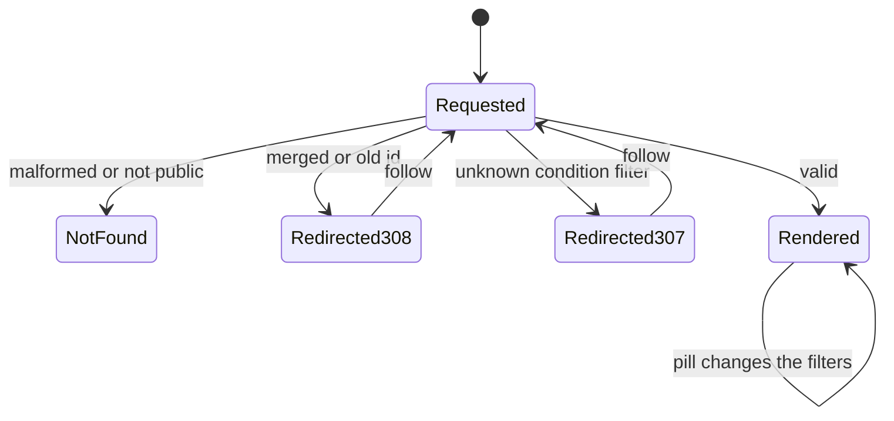
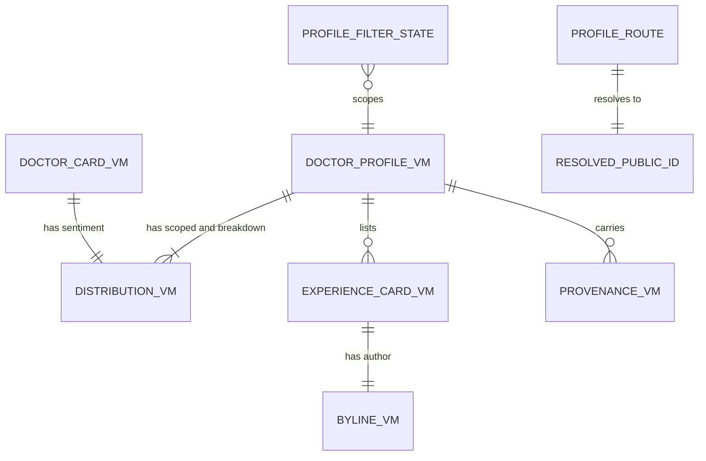

# Functional specification — U15 `t-202-doctor-index-and-profile`

| Field | Value |
|---|---|
| Unit | U15 `t-202-doctor-index-and-profile` (kind `ui`, size L, not high risk); Bolt 14; depends on U14 T-201, U3 T-010, U45 T-011; U16 T-203, U19 T-206, U20 T-207 and U27 T-307 import its shared primitives |
| Source | T-202 (`docs/implementation/tasks/T-202-doctor-index-and-profile.md`, with the FD-091 amendment) |
| Stories | US4.1 (AC4.1.1–AC4.1.5), US6.4 (AC6.4.1–AC6.4.5), US4.2 (AC4.2.1–AC4.2.5; claim entry point and redirect only) — `unit-of-work-story-map.md` |
| Requirements | FR15–FR19, FR20 (entry), FR23 (redirect), FR48–FR52, FR95, NFR4, NFR6, NFR7, NFR13 — `requirements.md` |
| Decisions | FD-024 (equal languages), FD-032 (plain CSS), FD-042 (Bengali copy review), FD-060 (claims staff-decided), FD-067 (review figures through ports), FD-089 (about 10 records per module), FD-091 (patient redesign and motion); D-003 (Registration not verified) |
| Upstream design | `contract-summary.md` C7 (directory queries, U14) and "edges between UI Units share components, not domain contracts"; drafts `t-201-directory-and-taxonomy-modules` (view models, queries) and `t-011-patient-design-and-motion-system` (tokens, motion) |
| Questions | Q1–Q13 in `functional-design-questions.md`. **Q1 (percentages) needs the owner**; Q2–Q13 are answered A on the owner's standing instruction of 2026-10-27 and are to be listed in `docs/aidlc-migration/OWNER-REVIEW-QUEUE.md`. This specification follows the recommended option throughout and marks Q1's parts; § 14 lists the changes under each other option |
| Status | Draft written ahead of the stage on the branch `bolt/cr-012-storyboard-seed-correction` (2026-10-28), while U6 CR-012 builds; `apps/web` and `packages/i18n` match `main` there |

This file is the source of truth for the Unit's workflows and state transitions. `entities.md` holds the data shapes, `rules.md` the numbered rules, and `frontend-components.md` the component props, files, styles and tests. The entity-relationship view and the rules summary at the end are derived from those files.

## 1. What changes, in one paragraph

The two placeholder pages from T-008 become the real doctor index (`/{locale}/doctors`) and doctor profile (`/{locale}/doctors/{publicId}`), ported from the prototype's `renderDoctorIndex` and `renderProfile` with the same content, fields, block order and behaviour, on T-011's "Warm Paper, Soft Depth" look. They read T-201's `DoctorCardVM` and `DoctorProfileVM` through the web composition root and render them in both languages. The profile's account filters live in the URL, so they work without script and can be shared; a merged or old id answers a permanent redirect; a hidden one is a 404. The Unit also builds the shared patient primitives that every later patient page reuses: `Avatar`, `Badge`, `NotVerified`, `DistBlock`, `SentimentBlock`, `OutcomeBlock`, `Byline`, `DoctorLink`, `FacilityLink`, `AccountRow`, `EmergencyPanel`, `MiniList` and `IndexHead`. Hard rules show in every frame: exact counts with denominators, "Not provided" and "No documents" instead of 0, "Limited data" from the configured threshold, "Registration not verified" on every doctor, the facility-separation note, neutral order, and anonymous authors never linked. Motion comes only from T-011: the page transition in the layout, the list reveal on the two lists, and press feedback; distributions are static. Seven message keys are added and one gains a parameter. No hard rule, data boundary or contract changes, so no FD entry is needed; Question 1 is the one point that waits for the owner.

## 2. As is (working tree, 2026-10-28) and what Bolt 14 can count on

| Element | Today | By Bolt 14 |
|---|---|---|
| Routes | `doctors/page.tsx` and `doctors/[id]/page.tsx` render `ViewShell` with `shell.placeholder` | unchanged until this Unit |
| Data | No query; `apps/web/src/server/container.ts` does not exist | U8 T-101 creates the container with a `ConfigProvider`; U12 T-105 makes it database-backed; U14 T-201 delivers `directory.listDoctors`, `getDoctor`, `resolvePublicId` and Review's `ProviderExperience`, which the container still has to wire (T-201 F6) |
| View models | Stubs in `contracts/src/view-models/doctor.ts` with `TODO(T-202)` | T-201's shapes (`entities.md` ENT-001–ENT-006) |
| Look and motion | `patient.css` is the verbatim 04b port; `body[data-motion]` | U45 T-011's token block, restyled classes (no class renamed), `motion.css`, `RouteTransition` in the patient layout, `Reveal`, static groups, `check:motion`, `contrast:patient` |
| Auth gate | none | U9 T-102's `useAuthGate()` and one `AuthGateSheet` in the patient layout |
| Keys | All the prototype's keys, plus T-202 step 2's keys (added by T-207a) | + this Unit's keys |
| Seed (CR-012, being built) | 10 doctors d1–d10 with every rendered field filled; 24 reviews, every one with sentiment and outcome; d1 has 5 accounts, the others 1–3 | the same unless finding F1 is taken up |
| Shared components | `ViewShell`, `Sheet`, `LiveRegion`/`useAnnounce`, `Emergency` (the Emergency page's own component) | unchanged |

## 3. Settled before this stage

See `functional-design-questions.md` § "Settled before this stage": the look follows T-011 with page rules in T-202's own `patient.css` section; the data and the facility isolation are T-201's; every doctor shows "Registration not verified"; public profiles are indexable; claims are T-204's and the gate is T-102's; no new dependency; inline custom properties are allowed under T-502's CSP. The design decisions taken without a question are listed in the same file and explained in § 13.

## 4. Workflows

### WF1 — Doctor index (`/{locale}/doctors`)

1. The patient layout renders the shell; the layout's `RouteTransition` wraps `<main>`'s content (BR5.1).
2. The page gets the locale, an anonymous-or-session `Actor` for it, and calls `directory.listDoctors({page: 1, pageSize: 50})`. A failed result is a programmer or infrastructure error and is thrown to Next's error boundary (01-conventions §3); there is no expected failure for a list.
3. It reads `limitedDataThreshold` once (BR2.5).
4. It renders `ViewShell(view="doctors", title="")` > `DoctorIndex`: `IndexHead` (kicker "Discover", `h1` "Doctors", the note "Listed alphabetically — never ranked, and never scored"), the count line "{n} · Doctors", and `Reveal` > one `DoctorEntry` per card, in the query's order (BR2.11).
5. Each `DoctorEntry`: avatar; name as an `h2` link; specialty · area, city (present parts only); up to three conditions with counts; flags: "Registration not verified", documents ("{n} documents" or "No documents"), and "Limited data" when the doctor has fewer accounts than the threshold (Q3); a compact sentiment distribution with its denominator.
6. `generateMetadata` gives "Doctors — RogiKotha" in the active language, indexable, canonical `/{locale}/doctors` with language alternates.
7. `ViewShell` announces the view (CR-004) and sets `data-view`, as today.

### WF2 — Profile request (`/{locale}/doctors/{segment}?…`)

1. Parse `segment` (BR1.2): ten base32 characters, optionally followed by `-slug`. Anything else → `notFound()`.
2. `directory.resolvePublicId({kind: 'doctor', publicId})` (BR1.3):
   - `not_found` → `notFound()` (BR1.4);
   - `redirected` → `permanentRedirect` (308) to `/{locale}/doctors/{target}` with the query string kept (Q10);
   - otherwise continue.
3. Clean the filters (BR1.5): keep `outcome` in the outcome enum, `relationship` in the relationship enum, `docs` only as `1`, `condition` only when it matches the public-id pattern; drop the rest; a repeated parameter keeps its first value.
4. `directory.getDoctor({publicId, ...filters})`. `not_found` → `notFound()`. A `validation` error cannot happen after step 3; if it does, it is a programmer error and is thrown.
5. If a `condition` was given and `vm.selectedCondition` is absent (the doctor has no accounts for it, or it is not a condition), `redirect()` (307) to the same URL without `condition`.
6. Read `limitedDataThreshold`.
7. Steps 1–6 run inside one `cache()`-wrapped loader that `generateMetadata` also calls (BR1.9). The title is "{doctor name} — RogiKotha"; the canonical URL has no slug and no filters; the page is indexable (BR1.8).
8. Render `ViewShell(view="profile", title="")` > `DoctorProfile` (WF3).

```mermaid
sequenceDiagram
  actor Reader
  participant Page as Profile page (server)
  participant Dir as directory queries (U14)
  participant Cfg as ConfigProvider (U12)
  Reader->>Page: GET /bn/doctors/{segment}?outcome=helped
  Page->>Page: parse segment; malformed -> 404
  Page->>Dir: resolvePublicId(doctor, publicId)
  alt not found
    Dir-->>Page: not_found
    Page-->>Reader: 404 page
  else redirected
    Dir-->>Page: {publicId: target, redirected: true}
    Page-->>Reader: 308 to /bn/doctors/{target}?outcome=helped
  else current
    Page->>Page: clean filters
    Page->>Dir: getDoctor(publicId, filters)
    Dir-->>Page: DoctorProfileVM
    Page->>Cfg: current().limitedDataThreshold
    Page-->>Reader: profile HTML (one query run, shared with metadata)
  end
```

Text fallback: parse the segment (malformed → 404) → resolve the id → not found: 404; redirected: 308 to the target with the same query; current: clean the filters, load the profile, read the threshold, render. An unknown condition filter answers 307 to the URL without it.

### WF3 — Profile rendering (prototype block order)

1. **Hero**: avatar; kicker "Doctor"; `h1` name; specialty · area, city; flags "Registration not verified" (with its explanation available to screen readers), "{n} patient experiences", "Limited data" when sparse (Q3), "Provider confirmed" when claimed; actions "Write about your treatment" (link to `/write?doctor={publicId}`) and "Is this you?" (WF5).
2. **Conditions**: heading, note, the pill row "All conditions ({total})" and one pill per condition with its count (selected pill `aria-current`, Q6); the sentiment distribution and the outcome rows for the selected condition (scoped), each with its denominator, "Not provided" lines (Q2), "Limited data" with the configured threshold (Q4), and percentages **[Q1]**.
3. **By condition**: a table of every condition with its positive, mixed, negative counts and total; a `⚠` and a hidden "Limited data" after a sparse total; the threshold note under it.
4. **Filter these experiences**: outcome pills, "Has documents", relationship pills; "showing {x} / {y}".
5. **Patient experiences**: the filtered accounts, newest first, each an `AccountRow` inside `Reveal`; or "Nothing here yet."
6. **Side panel**: where the information came from (each present fact with its label, value, source and month-year, BR2.9); practice locations (name, hours when present, source and month-year); where they practise (facility rows with the separation note), only when the doctor has a visible facility (BR2.10).

### WF4 — Changing a filter

1. The reader activates a pill. Its `href` is the current URL with that one filter set, changed or removed (BR1.6).
2. With script: `ProfileFilters` flips the pill's `aria-current` at once, Next navigates without scrolling, the server renders the new scoped view, and `ProfileFilters` announces "showing {x} / {y}" once (BR4.5). The path does not change, so the layout's route transition does not run; the new account rows that enter are revealed by `Reveal` (T-011 WF3).
3. Without script: the link loads the page; the server renders the selected state.
4. An invalid value typed into the URL is dropped (WF2 step 3).

### WF5 — "Is this you?" (claim entry point)

1. The reader activates "Is this you?".
2. `useAuthGate().guard()` (T-102): signed out → the gate sheet ("Sign in to take part"); signed in but unverified → the gate's verify message. Stop.
3. Verified → `ClaimSheet` opens: title "Is this you?", the claim note ("Claiming does not verify BMDC registration and gives no control over what patients wrote"), close button. The `Sheet` traps focus, returns it, and announces as today (Q9).
4. U17 T-204 later replaces the sheet body with the claim form and `claimProfileAction`.

### WF6 — Shared primitives for later Units

`frontend-components.md` § 4 is their contract. T-203 (facility and condition pages) imports `DistBlock`, `OutcomeBlock`, `AccountRow`, `Byline`, `MiniList`, `IndexHead`, `NotVerified`, `Avatar`, `EmergencyPanel`; T-206 imports `DoctorEntry` with its `pinSlot`; T-207 imports `EmergencyPanel`, `AccountRow`, `IndexHead`; T-307 imports `Byline`, `AccountRow`. Each takes view models and plain values, renders on the server, and fetches nothing (BR8.1). `EmergencyPanel` is built and tested here but not shown on these two pages.

### WF7 — Code Generation order

1. **Baseline**: `pnpm infra:up`; `pnpm check` and `pnpm smoke` green on the Bolt branch; read the open `ISSUES.md` rows in this area (§ 2 of the questions file) and the § 9 rows of this file.
2. **Prerequisites present**: T-201's queries and view models; T-011's `Reveal`, `RouteTransition` placement (in the layout or per page, BR5.1), tokens and `check:motion`; T-102's `useAuthGate`; the container. Adapt the wiring, not the rules, if a shape differs; record each difference.
3. **Keys** (both files, one commit) and `formatPercent` **[Q1]** in `packages/i18n/src/format.ts` with its test.
4. **Primitives** with their tests (§ 11).
5. **`DoctorEntry`, `DoctorIndex`, the index page.**
6. **Move `doctors/[id]` to `doctors/[publicId]`**; the profile page, `DoctorProfile`, `ProfileFilters`, `ClaimSheet`.
7. **Container wiring** for the directory queries (owned-path addition, § 12).
8. **Styles**: T-202's section of `patient.css` (`frontend-components.md` § 7).
9. **Smoke** test; gates (BR9.3); the visual, reduced-motion, viewport and Lighthouse checks; ISS rows; hand-off.

## 5. State transitions

### Profile request outcome

| From | Event | To | Rule |
|---|---|---|---|
| Requested | Segment malformed | 404 | BR1.2 |
| Requested | Id unknown or not public | 404 | BR1.4 |
| Requested | Id merged or old | 308 to the target | BR1.3 |
| Requested | Unknown condition filter | 307 to the URL without it | BR1.5 |
| Requested | Valid | Rendered | WF3 |



Text fallback: a request either renders, answers 404 (malformed or not public), answers 308 to the current id, or answers 307 without an unknown condition filter; the redirects lead to a new request. On a rendered profile each pill produces a new rendered state.

### Filter state (per profile, in the URL)

| From | Event | To |
|---|---|---|
| any | condition pill c | condition = c, others kept |
| condition set | "All conditions" | condition removed, others kept |
| outcome unset or ≠ o | outcome pill o | outcome = o |
| outcome = o | outcome pill o | outcome removed |
| relationship unset or ≠ r | relationship pill r | relationship = r |
| relationship = r | relationship pill r | relationship removed |
| docs unset | "Has documents" | docs = 1 |
| docs = 1 | "Has documents" | docs removed |

### Claim entry (per click)

| From | Visitor | To |
|---|---|---|
| Closed | signed out | T-102 gate sheet (sign in) |
| Closed | unverified | T-102 gate sheet (verify) |
| Closed | verified | Claim sheet with the note |
| Claim sheet open | Escape, close button or overlay | Closed, focus back on "Is this you?" |

### What the view model's states mean on the page

| VM state | Page shows | Rule |
|---|---|---|
| `dist.empty` | "Not provided" alone | BR2.2 |
| `dist.notProvided > 0`, not empty | the distribution + "Not provided: n" | BR2.3 |
| `dist.limitedData` | "Limited data — Fewer than {threshold} …"; no percentages | BR2.4, BR3.3 |
| `accountsLimitedData` | "Limited data" badge in the hero and on the card | BR2.4 |
| `documentsCount = 0` | "No documents" | BR2.7 |
| `facilities = []` | no facilities panel and no note | BR2.10 |
| `accounts = []` | "Nothing here yet." | WF3 |
| `claimed` | "Provider confirmed" beside "Registration not verified" | BR2.6 |

## 6. Ports and data access

This Unit declares no port. It calls the directory queries of C7 through the web composition root:

```text
container.actor(locale)                         -> Actor (anonymous or session; T-101)
container.directory.listDoctors(input, actor)   -> Result<BoundedPage<DoctorCardVM>>
container.directory.getDoctor(input, actor)     -> Result<DoctorProfileVM>       errors: not_found, validation
container.directory.resolvePublicId(input, actor) -> Result<{publicId, redirected}>   errors: not_found
container.config.current()                      -> ConfigValues (limitedDataThreshold, emergency)
```

The container wiring of `directory` with Review's `ProviderExperience` is T-201's finding F6 and lands here (§ 12). The exact names follow whatever T-101 and T-201 built; the page adapts.

## 7. View models

Read only; defined by T-201 (`entities.md` ENT-001–ENT-006). This Unit relies on: active-locale strings only; optional fields absent when missing; public ids only; `registrationNotVerified: true`; distributions with `keys`, `counts`, `total`, `notProvided`, `empty`, `limitedData`; `BylineVM.initials` prepared by T-201. A field T-202 needs that T-201 does not supply is an `ISSUES.md` row for U14, not a page-side workaround.

## 8. Developer view — mapping details

- **Count phrases** (Q5): `t(key, {n, count: formatNumber(n, locale), total: formatNumber(total, locale)})`; English plural on `n`. No script lowercasing of copy.
- **Aria sentence** (BR4.3): `keys.map(k => count + ' ' + label.toLocaleLowerCase(locale) [+ ' (' + pct + ')' **[Q1]**]).join(', ') + ' — ' + t('sentiment.ofTotal')` + the "Not provided" phrase when present.
- **Percent** **[Q1]**: `Math.round(count / total * 100)`, `formatPercent` gives "60%" / "৬০%". Shown only on full, non-empty, non-limited distributions (BR3.3). Rounded values may sum to 99 or 101; the counts beside them are exact.
- **`--g` and `--w`**: `style={{'--g': count || 0.4}}`, `style={{'--w': count / total}}`, typed through a small `cssVars()` helper so TypeScript accepts the custom properties.
- **Month and year**: `formatMonthYear({year, month}, locale)` for periods; `ProvenanceVM.updatedAt` is split into year and month before formatting.
- **Facility row title**: `name` + (`branchName` ? ' — ' + `branchName` : '').
- **Segment parsing**: `/^([a-z2-7]{10})(?:-[^/]*)?$/` on the decoded segment.
- **Query string for redirects**: rebuilt from the cleaned filters in the fixed order (condition, outcome, relationship, docs), so a 308 never carries junk parameters.

## 9. Findings and proposed ISS rows

Each is proposed with `Found in U15 T-202 (Functional Design draft)`; the caller adds them with the next free numbers (the register ends at ISS-271).

- **F1 (S2, suggested owner U6 CR-012, now)** — The corrected seed cannot show "Not provided" on a doctor page: all ten doctors have every rendered field, every doctor has at least one account, and all 24 reviews have sentiment and outcome. The fields left empty under FD-089 (`about` on d7–d10) are not on the profile. FD-089 wants "Not provided" demonstrable, and ISS-268 defers the rendering check to this Unit. Fix in CR-012: leave `fee` and `languages` empty on one new doctor (for example d9), and one new review without sentiment and outcome. Otherwise the check runs on builder data only.
- **F2 (S1 if built as the task says; designed out)** — The prototype's compact distribution drops "Limited data", and nine of ten seeded doctors are below the threshold. Cards would show sparse distributions without the mark (hard rule). Settled by Q3.
- **F3 (S2 if built as the task says; designed out)** — Step 5's pills are links with `aria-pressed`: an axe critical violation (`aria-allowed-attr`) that T-503's gate refuses. Settled by Q6.
- **F4 (S2 if built as the task says; designed out)** — Step 9 wraps both pages in `RouteTransition` while T-011 puts it in the layout; two `page` names make the browser skip every route transition. Settled by BR5.1; the task's step 9 wording should be corrected.
- **F5 (S2, the owner)** — FR48 and AC6.4.1 ask for percentages that the prototype and T-202 leave out (Q1).
- **F6 (S3, U15 T-202)** — `label.limitedDataWhy` names the threshold 5 as fixed text (Q4); `sentiment.of` + total + `sentiment.accounts` puts the Bengali postposition first and gives "1 documents" in English (Q5).
- **F7 (S4, U45 T-011)** — If T-011's press selectors do not cover `.pillrow a` and `.doc-entry` links, ask U45 to add them; T-202 may not add motion (BR5.4).
- **F8 (S4, U11 T-104 and U38 T-409)** — A real-name byline has no public-profile link because `BylineVM` has no identifier for it (Q7). Decide whether real-name personas get a profile route and which identifier.
- **F9 (S4, U45 T-011 or a polish Unit)** — Proposal: a card-to-hero avatar morph as a T-011 primitive (Q12).
- **F10 (S4, founder)** — Proposal: a "Practice locations" jump link on narrow screens (Q13).
- **F11 (S4, U15 T-202)** — Owned-path changes: `doctors/[id]` → `doctors/[publicId]` (move), `apps/web/src/server/container.ts` (directory wiring), `packages/i18n/src/format.ts` (`formatPercent`, Q1), and the changed `label.limitedDataWhy`.
- **F12 (S4, U15 T-202)** — Task-text drift: the "Read first" line numbers predate FD-089; step 2's keys already exist; "6 entries" is now 10; `limited` is `limitedData`; `onPin` becomes `pinSlot`; step 7's inline auth links are T-102's `useAuthGate`; step 9's "press fade" is T-011's press scale with an instant colour change; the 301 row reads 308 (Q10).
- **F13 (S4, U15 T-202)** — Index paging: `listDoctors` is called with `pageSize: 50` and the page shows no paging control (the prototype has none); add paging when real volume passes it. The same holds for the profile's account list.
- **F14 (S3, existing ISS-168, suggested owner U6 CR-012 or U17 T-204)** — d1, d4 and d8 are claimed in the prototype but show no "Provider confirmed" badge because `claimed_by_account_id` is null; the visual check beside the prototype's `#doctors/d1` will show the difference. Raise ISS-168 to S3 or seed a claimant.
- **F15 (S4, existing ISS-120, U20 T-207)** — `notFound()` renders the root 404, which is English-only and hard-codes its copy; a Bengali visitor to a hidden profile sees it. No `[locale]/not-found.tsx` or `error.tsx` exists in the owned paths.
- **Existing rows, no new row**: ISS-271 (d1's chamber "Shefa General Hospital" shows on the profile; accepted by the owner, the risk noted for any public showing); ISS-266 (d3 has no facilities panel because its chamber has no branch link: correct behaviour for the data); ISS-161 (seeded review text is Bengali only, so `/en` rows show Bengali titles, which BR2.9 of T-201 treats as original wording); ISS-137 (the whole dictionary ships to the client; `ProfileFilters` receives resolved labels as props and adds no key to the client set).

## 10. Developer view — accessibility and responsive details

- One `h1` per page; heading levels in order (BR4.1, BR4.2).
- The capsule group is one image with a sentence; the outcome rows are text; the breakdown table has a caption, scopes and a scroll region (BR4.3, BR4.6).
- Pills: links with `aria-current`, a CSS check mark and a heavier border; 44 px targets; focus ring from T-011 (BR4.4).
- "Showing x / y" is announced once per filter change, never on load (BR4.5).
- 360 px: the profile is one column (prototype breakpoint 1040 px); the hero avatar is 78 px below 720 px; pills and flags wrap; long Bengali names wrap; nothing scrolls sideways except the labelled breakdown region (BR4.9).
- Without script: every page, link and filter works; only "Is this you?" needs script, as in the prototype.

## 11. Developer view — tests

Listed in `frontend-components.md` § 8, with the rules each proves. In short: every primitive in `en` and `bn`; the index order and Bengali digits; the profile's block order, omissions, filters, provenance dates, facility note and claim gate; the anonymous byline; the not-provided, limited-data and percentage **[Q1]** behaviour; segment parsing and filter cleaning; one smoke file. Test names read as sentences; builders, not fixtures; `@/i18n/routing` mocked (ISS-053); no snapshot.

## 12. Owned paths and recorded additions

Owned by the task: the two pages, `DoctorIndex`, `DoctorProfile`, `DoctorEntry`, `ProfileFilters`, `ClaimSheet`, the thirteen shared primitives, new keys in `packages/i18n/messages/{en,bn}.json`, `lib/format.ts` or `packages/i18n/src/format.ts` additions, and the component tests; by the FD-091 amendment, T-202's own section of `patient.css`. Additions this design needs, each named in the hand-off with its reason:

| Path | Why | Decision |
|---|---|---|
| `app/[locale]/(patient)/doctors/[id]/page.tsx` (moved) | Next.js forbids `[id]` beside `[publicId]` | settled (questions file) |
| `apps/web/src/server/container.ts` | wire the directory queries and Review's `ProviderExperience` (T-201 F6) | settled |
| `packages/i18n/messages/{en,bn}.json` `label.limitedDataWhy` (changed) | the threshold parameter | Q4 |
| `packages/i18n/src/format.ts` | `formatPercent` | Q1 |

No file of `apps/worker`, `packages/{domain,application,database,contracts,test-support}`, `tokens.css` or `motion.css` is touched.

## 13. Decisions and why

**D1 — Rename `[id]` to `[publicId]`.** The task, 03 §1, T-203 and T-307 all use `[publicId]`, and Next.js refuses two slug names at one level. Rejected: keeping `[id]` (diverges from every page Unit and the task's owned path).

**D2 — No page-level `RouteTransition`.** T-011 renders one keyed boundary in the layout; a second one gives two `page` names and the browser skips the transition. Reversible: if T-011 fell back to per-page wrappers, the pages wrap themselves once.

**D3 — One loader per request, no caching.** `cache()` dedupes metadata and page; no `revalidate` keeps AC6.4.4 true (a hidden account disappears on the next view).

**D4 — Filters in the URL, cleaned on the server.** Works without script, shareable, and invalid input never reaches the query; an unknown condition redirects rather than showing a confusing empty profile.

**D5 — Links with `aria-current` for pills (Q6).** Valid ARIA, works without script, keeps the filtered view addressable. Rejected: `aria-pressed` on links (invalid), client-only buttons (no-script break).

**D6 — Not-provided and limited-data marks wherever figures show (Q2, Q3, Q4).** The hard rules speak of eligible accounts, so the hero and the card carry the mark, partial distributions say how many accounts gave no value, and the explanation names the configured threshold.

**D7 — Parameter keys for count phrases (Q5).** 01-conventions §6 asks for them; they fix the Bengali word order and English plurals with the visible number formatted the project's way.

**D8 — Percentages after counts, only on sufficient samples (Q1, owner).** Meets FR48 without letting a 100 % from one account stand for anything; cards and the breakdown stay counts-only.

**D9 — Real-name bylines as text (Q7).** The narrow choice until identity decides how a real-name profile is addressed; anonymous stays unlinked by construction.

**D10 — Primitives are server components with slots.** Later Units render them on the server; `pinSlot` replaces `onPin`; `EmergencyPanel` takes its config as a prop.

**D11 — Provenance with its month and year.** AC4.1.4 asks for the last-update date; month and year follow 01-conventions §6 for public content.

**D12 — Motion only from T-011.** `Reveal` on the two lists, press feedback, static distributions and badges that never move on their own (Q11); the morph is proposed, not built (Q12).

**D13 — Prototype structure kept on narrow screens (Q13).** The prototype is the source of truth for structure, and DOM order equals visual order.

**D14 — The claim sheet shows the prototype's note only (Q9).** No dead form and no invented copy; T-204 owns the form.

## 14. If the owner changes an answer

| Question → option | What changes |
|---|---|
| Q1 → B | No percentages anywhere: drop `showPercent`, `formatPercent`, the `.pct` rules and the percentage tests; AC6.4.1's percentage clause becomes a recorded gap with an ISS row, and FR48 needs an FD entry |
| Q1 → C | Percentages on every non-empty distribution, compact and limited ones included; BR3.3 loses its limited and compact conditions |
| Q2 → B | No `label.notProvidedCount`; BR2.3 removed; AC6.4.2 met only for fully empty distributions |
| Q3 → B | No limited-data badge on cards or in the hero; BR2.4 narrows to the full distributions |
| Q4 → B | `label.limitedDataWhy` unchanged; S3 row; BR2.5 removed |
| Q5 → B | The prototype's concatenation; six new keys dropped; S3 row |
| Q6 → B | `ProfileFilters` renders `<button aria-pressed>` and navigates with `router.replace`; the no-script path is lost; `.pillrow a` rules dropped |
| Q6 → C | Links with `role="button"`, `aria-pressed` and a Space-key handler in `ProfileFilters` |
| Q7 → B | T-201 adds `username` for named authors (needs the owner and an FD entry first); `Byline` links them |
| Q8 → B | T-201 adds `avatarSeed`; `Avatar` takes it |
| Q9 → B | `ClaimSheet` renders two labelled fields and a disabled submit; three or four new keys |
| Q10 → B | `proxy.ts` resolves doctor ids and answers 301 (T-502's file); the page keeps its own check as a fallback |
| Q11 → B | No `Reveal` on the index list |
| Q12 → B | T-011 adds an avatar-morph primitive; `Avatar` on the card and the hero get a matching name hook |
| Q13 → B | `DoctorProfile` places the side panel before the conditions panel below 1040 px by DOM order |

## 15. Acceptance mapping (T-202 acceptance checks)

| T-202 check | Expected under this design | Rules |
|---|---|---|
| Index renders both locales | 10 entries (not 6: FD-089), alphabetical by localized name, Bengali digits under `bn` | BR2.11, BR3.5 |
| Profile block order | headings in the order of WF3 | BR4.1, BR4.2 |
| Not provided semantics | no fee row for a builder without fee; zero accounts → "Not provided" in both blocks, never 0 | BR2.2, BR2.8 |
| Filters via URL | `?condition=&outcome=helped&docs=1` → those pills `aria-current=true` and "showing x / y" | BR1.5, BR1.6, BR4.4 |
| Redirect | an old or merged id → 308 (permanent) to the new URL (row reworded, Q10) | BR1.3 |
| Anonymous byline | no `<a>` inside `.byline`; text `byline.anonSentence` | BR2.12 |
| Impeccable and contrast | zero findings; `contrast:patient` too | BR9.3 |
| Visual (FD-091) | same content, fields, order and states as the prototype at 1280 and 390 px; look per T-011; known differences recorded (avatar pattern Q8, "Provider confirmed" F14, percentages Q1, limited badges Q3, provenance dates D11) | BR7.1 |
| Full check | `pnpm check` green | BR9.3 |
| Motion check | `pnpm check:motion` passes; T-202 adds no motion declaration | BR5.4 |
| Reduced-motion journey | no movement; every step completes; disclaimer, emergency guidance and demo marker never animated | BR5.6, BR5.5 |
| Early performance check | Lighthouse (slow 4G, 4× CPU) on `/en` and `/bn` doctor profile: LCP ≤ 2.5 s, CLS ≤ 0.1 recorded; a miss is an ISS row | BR9.3 |
| ISS-268 rendering check | "Not provided" rendered on builder data; on the seed only if F1 is taken | BR2.2, BR9.4 |

## 16. Risks to verify in Code Generation and Build and Test

- **T-201's shapes and names** (`limitedData`, `notProvided`, `selectedCondition`, `ProvenanceVM.updatedAt`, `BylineVM.initials`) may differ from its draft; adapt the mapping, keep the rules.
- **T-011's `RouteTransition` placement and `Reveal` API** follow its spike; BR5.1 covers both outcomes.
- **Bengali alphabetical order** depends on the database collation (T-201 risk); the index test asserts against `Intl.Collator('bn')` and the hand-off records any mismatch.
- **next-intl ICU plurals with a pre-formatted `{count}`**: confirm the message syntax compiles in both dictionaries and that `i18n:check` accepts parameters that differ between languages (the Bengali messages use no `plural`).
- **`permanentRedirect` status inside a stream**: verify with `curl -sI` that the response is 308 and not a 200 with a meta refresh; keep `loading.tsx` out of `doctors/`.
- **Typed routes** with next-intl's `Link` object form for `/doctors/[publicId]`.
- **The 360 px hero in Bengali**: avatar 78 px, long names, four flags; verify no overflow at 200% zoom.
- **LCP**: the hero `h1` or avatar SVG should be the LCP element; nothing animates on first paint (T-011 BR4.5).
- **CR-012 seed changes in flight** (F1, F14): re-read the merged seed before the visual check.

## Entity-relationship view (derived from `entities.md`)



Text fallback: cards and profiles carry distributions; a profile lists account cards with bylines and carries provenance on facts and chambers; the URL's filter state scopes the profile; the route segment resolves to the current public id.

## Rules summary (derived from `rules.md`)

| ID | Rule in one line |
|---|---|
| BR1.1 | Data only through the directory queries in the container; no data imports in components |
| BR1.2 | Segment = public id + ignored slug; malformed is 404 |
| BR1.3 | Merged or old id → 308 to the target, query kept |
| BR1.4 | Not public → 404 |
| BR1.5 | Invalid filters dropped; unknown condition → 307 |
| BR1.6 | Filters combine and toggle |
| BR1.7 | Rendered per request; no cached figures |
| BR1.8 | Titles, canonical, alternates, indexable |
| BR1.9 | One loader per request |
| BR2.1 | No quality number; counts with denominators |
| BR2.2 | Empty distribution → Not provided |
| BR2.3 | Partial distribution → "Not provided: n" |
| BR2.4 | Limited data on distributions, cards and hero |
| BR2.5 | Limited-data copy names the configured threshold |
| BR2.6 | Registration not verified on every doctor |
| BR2.7 | No documents, never 0 documents |
| BR2.8 | Only present fields; no blank labels |
| BR2.9 | Provenance with month and year |
| BR2.10 | Facility separation note with the facility list |
| BR2.11 | Neutral order; no sort control |
| BR2.12 | Anonymous never linked; real name as text; username linked |
| BR3.1 | Capsules carry their counts; weight `--g` |
| BR3.2 | Outcome rows "{count}/{total}" with a static track |
| BR3.3 | Percentages after counts on sufficient full samples only [Q1] |
| BR3.4 | Ellipsis only when truncated |
| BR3.5 | Numerals and dates through the formatters |
| BR3.6 | Prototype avatar seeded by public id |
| BR3.7 | Up to three conditions with counts |
| BR3.8 | Hero counts all; distributions count scoped |
| BR4.1 | One h1 per page |
| BR4.2 | Heading levels in order |
| BR4.3 | Capsules are one image with a full sentence |
| BR4.4 | Pills: links with aria-current, non-colour cue, 44 px |
| BR4.5 | Filter change announced once; scroll kept |
| BR4.6 | Breakdown table captioned, scoped, scrollable |
| BR4.7 | Named landmarks and groups; hidden SVG |
| BR4.8 | Not-verified explanation reachable without a pointer |
| BR4.9 | 360 px, 200% zoom, both languages, no script needed to read |
| BR5.1 | No page-level RouteTransition while the layout has one |
| BR5.2 | Reveal on the two lists only |
| BR5.3 | No motion of its own for the not-verified badge |
| BR5.4 | No motion declarations in T-202's CSS |
| BR5.5 | EmergencyPanel is a static group |
| BR5.6 | Reduced motion: every step completes |
| BR6.1 | All copy from keys, both languages, Bengali flagged |
| BR6.2 | Count phrases with parameters and plurals |
| BR6.3 | No capital transform on Bengali |
| BR7.1 | T-011 tokens and classes; own CSS section; only --g / --w inline |
| BR8.1 | Server primitives with slots; two client components |
| BR8.2 | Claim through the T-102 gate; note only until T-204 |
| BR9.1 | Component tests in both languages |
| BR9.2 | One more smoke file |
| BR9.3 | All gates and the Lighthouse record |
| BR9.4 | Every finding an ISS row |

## Sources

- `docs/implementation/tasks/T-202-doctor-index-and-profile.md` (goal, FD-091 amendment, read-first list, owned paths, steps 1–9, acceptance checks, tests, hard-rule checklist); T-102 (step 9 gates), T-203, T-204 (ClaimSheet replacement), T-307 (route naming), T-502 (CSP style-src).
- `aidlc/spaces/default/intents/261011-aidlc-adoption/inception/units-generation/unit-of-work.md` (U15), `unit-of-work-dependency.md`, `unit-of-work-story-map.md`; `inception/delivery-planning/bolt-plan.md` (Bolts 13–16); `inception/requirements-analysis/requirements.md` FR15–FR23, FR48–FR52, FR95, FR100, NFR4, NFR6, NFR7, NFR13 and Assumptions; `inception/user-stories/stories.md` US4.1, US4.2, US6.4; `inception/contract-design/contract-summary.md` C7, common rules, revision 2026-10-27.
- `docs/status/decision-log.md` FD-024, FD-032, FD-042, FD-060, FD-067, FD-089, FD-091; `PRODUCT.md` hard rules; `aidlc/spaces/default/memory/project.md` Forbidden and Mandated; `team.md` Way of Working, Testing Posture, Code Style.
- `docs/implementation/01-conventions.md` §2–§10, §14, §15; `03-routes-and-contracts.md` §1, §4, §6; `05-demo-storyboard.md` Part 1 and step 23; `docs/implementation/ISSUES.md` ISS-053, ISS-120, ISS-137, ISS-161, ISS-168, ISS-266, ISS-268, ISS-271.
- `docs/aidlc-migration/design-drafts/t-201-directory-and-taxonomy-modules/` and `t-011-patient-design-and-motion-system/` (all files).
- Code on the working tree: `apps/web/src/app/[locale]/(patient)/{layout.tsx,doctors/**}`, `components/patient/{ViewShell,Tabs,Emergency}.tsx`, `components/shared/Sheet.tsx`, `lib/{titles,metadata}.ts`, `styles/patient.css`, `next.config.ts`; `packages/i18n/src/{format,index}.ts`, `messages/{en,bn}.json`; `packages/test-support/src/corpus/{doctors,reviews}.ts`.
- `ui-design-prototype/concepts/concept-04b-quiet-clinic-minimal/app.js` (`distBlock`, `outcomeBlock`, `emergencyPanel`, `byline`, `accountRow`, `doctorEntry`, `renderProfile`, `renderDoctorIndex`, handlers) and `ui-design-prototype/shared/rogikotha-data.js` (`distribution`, `avatar`).
- Next.js documentation, `permanentRedirect` (updated 2026-08-18): 308 outside Server Actions; a meta-tag redirect inside a streaming context.
