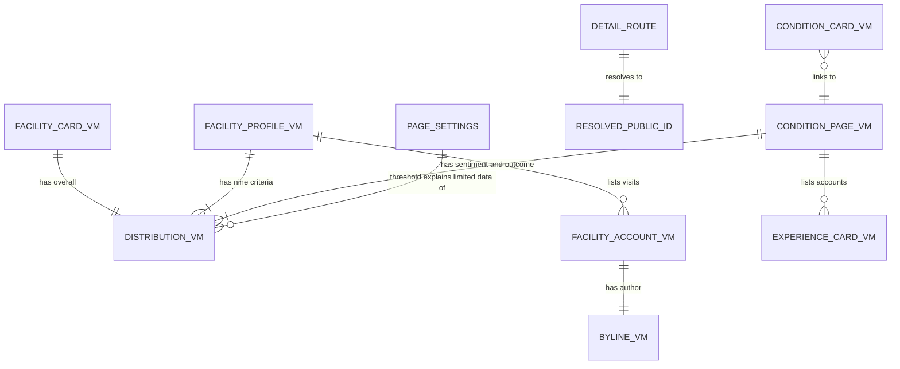

# Entities — U16 `t-203-facility-and-condition-pages`

Source of truth for the data shapes this Unit reads and the state it holds. The Unit stores nothing and adds no table, column, migration, port or contract. Its entities are the view models it receives from U14 T-201 (named here with the fields these pages use; T-201's `functional-spec.md` § 7 is their definition), the route segments, the runtime settings the pages read, the components it exports for later Units, the changes it needs in T-202's shared primitives, and the message keys it adds. Decision logic is in `rules.md`; workflows in `functional-spec.md`; component props in `frontend-components.md`.

Built from T-203 (with the FD-091 amendment), `contract-summary.md` C6 and C7, the T-201, T-202 and T-011 drafts, `03-routes-and-contracts.md` §1 and §4, `packages/contracts/src/view-models/{facility,condition}.ts` (stubs T-201 replaces), `packages/i18n/messages/{en,bn}.json` and the corpus on the working tree, and the answers in `functional-design-questions.md` (Question 1 awaits the owner; the others are answered A).

```yaml
entities:
  - id: ENT-001
    name: FacilityCardVM
    owner: Directory (U14 T-201; contracts/src/view-models/facility.ts)
    description: "One branch on the facility index (and, later, in T-206's facility results). Read only."
    attributes:
      - { name: publicId, type: string, required: true, constraints: "the branch's 10-char base32 id; the only id in URLs" }
      - { name: name, type: string, required: true, constraints: "the organisation's name in the active locale (T-201 Question 9 A)" }
      - { name: branchName, type: string, required: false, constraints: "absent when it equals the organisation name (single-branch facilities)" }
      - { name: type, type: enum, required: true, allowed_values: [hospital, clinic, diagnostic] }
      - { name: area, type: string, required: false }
      - { name: city, type: string, required: true }
      - { name: avatarHue, type: integer, required: true, min: 0, max: 359, constraints: "stableHue(publicId) for branches (T-201 Question 8 A)" }
      - { name: accountsTotal, type: integer, required: true, min: 0, constraints: "eligible facility accounts of this branch only" }
      - { name: accountsLimitedData, type: boolean, required: true, constraints: "0 < accountsTotal < threshold" }
      - { name: overall, type: DistributionVM, required: true, constraints: "the overall criterion; keys good, mixed, poor" }
      - { name: claimed, type: boolean, required: true }
      - { name: notVerified, type: "literal true", required: true, constraints: "BR2.5" }
    constraints:
      - "No sentiment or outcome field: facility cards never carry doctor figures (BR2.2)"
      - "No feedbackVisible field yet: requested from U14 (Question 8, finding F8)"
    relationships:
      - { to: DistributionVM, cardinality: "one-to-one", direction: "FacilityCardVM has an overall DistributionVM" }

  - id: ENT-002
    name: FacilityProfileVM
    owner: Directory (U14 T-201)
    description: "Everything the branch page renders. Read only."
    attributes:
      - { name: "(card fields)", type: FacilityCardVM, required: true }
      - { name: address, type: string, required: false, constraints: "not rendered (Question 9 A); no seeded branch has one" }
      - { name: provenance, type: "{name: ProvenanceVM, branch?: ProvenanceVM, address?: ProvenanceVM}", required: true, constraints: "the hero chip shows name's source and month-year" }
      - { name: feedbackVisible, type: boolean, required: true, constraints: "false -> no criteria, no accounts (BR3.11)" }
      - { name: criteria, type: "list<{key, dist: DistributionVM}>", required: true, constraints: "nine entries in enum order when feedbackVisible; empty list otherwise" }
      - { name: accounts, type: "list<FacilityAccountVM>", required: true, constraints: "this branch's eligible facility accounts only, newest first" }
      - { name: doctorsHere, type: "list<{publicId, name, specialty?, avatarHue}>", required: true, constraints: "visible doctors with a chamber linked to this branch; no figures; may be empty (f4, ISS-266)" }
      - { name: siblings, type: "list<{publicId, branchName, area?, avatarHue}>", required: true, constraints: "the organisation's other visible branches; never this branch" }
    constraints:
      - "No parentName (T-201 Question 9 A); no parent aggregate (Question 10 A)"
      - "No sentiment field (Question 1; option B would add one)"
    relationships:
      - { to: FacilityAccountVM, cardinality: "one-to-many", direction: "FacilityProfileVM has accounts" }
      - { to: DistributionVM, cardinality: "one-to-many", direction: "one per criterion" }

  - id: ENT-003
    name: FacilityAccountVM
    owner: Review (U14 T-201)
    description: "One visit row on the branch page."
    attributes:
      - { name: publicId, type: string, required: true }
      - { name: author, type: BylineVM, required: true, constraints: "T-202 ENT-005; anonymous carries personaKind only" }
      - { name: period, type: "{year, month}", required: true, constraints: "the visit's month and year" }
      - { name: posted, type: "ISO date", required: true, constraints: "rendered 'Posted {Month Year}' (facility.posted)" }
      - { name: body, type: string, required: true, constraints: "original wording, shown in full; Bengali on the seed (ISS-161)" }
      - { name: overall, type: enum, required: false, allowed_values: [good, mixed, poor], constraints: "absent -> 'Not provided' badge (BR2.9)" }
      - { name: criteria, type: "list<{key, value}>", required: true, constraints: "answered criteria only, enum order" }

  - id: ENT-004
    name: DistributionVM (criteria form)
    owner: Review (U14 T-201, domain/review/policies.ts)
    description: "The T-202 ENT-003 shape with keys good, mixed, poor."
    attributes:
      - { name: keys, type: "list<string>", required: true, constraints: "[good, mixed, poor]" }
      - { name: counts, type: "map<key, integer>", required: true }
      - { name: total, type: integer, required: true, constraints: "accounts that answered this criterion" }
      - { name: notProvided, type: integer, required: true, constraints: "eligible accounts that left it empty" }
      - { name: empty, type: boolean, required: true }
      - { name: limitedData, type: boolean, required: true, constraints: "0 < total < threshold" }
    constraints:
      - "No percentage field and no percentage is derived (owner's answer, T-202 Question 1 B)"

  - id: ENT-005
    name: ConditionCardVM
    owner: Taxonomy (U14 T-201; contracts/src/view-models/condition.ts)
    description: "One topic on the topic index."
    attributes:
      - { name: publicId, type: string, required: true }
      - { name: name, type: string, required: true, constraints: "active-locale name" }
      - { name: accountsTotal, type: integer, required: true, min: 0, constraints: "0 -> index.emptyTopic" }
    constraints:
      - "Every active canonical condition term, zero counts included; no provisional or hidden term (T-201 BR4.4)"

  - id: ENT-006
    name: ConditionPageVM
    owner: Taxonomy with Review's ConditionStats (U14 T-201)
    description: "Everything the condition page renders. Read only."
    attributes:
      - { name: publicId, type: string, required: true }
      - { name: name, type: string, required: true }
      - { name: provisional, type: boolean, required: true, constraints: "true -> 'Submitted wording, not yet mapped' badge (Question 7)" }
      - { name: aliases, type: "list<string>", required: true, constraints: "as written, any script; may be empty" }
      - { name: accountsTotal, type: integer, required: true, min: 0 }
      - { name: accountsLimitedData, type: boolean, required: true }
      - { name: doctorsTotal, type: integer, required: true, min: 0 }
      - { name: specialties, type: "list<{name, count}>", required: true, constraints: "at most 3, by count" }
      - { name: places, type: "list<{hospital?, area?, city?, count}>", required: true, constraints: "by count; hospital = the doctor's first chamber" }
      - { name: sentiment, type: DistributionVM, required: true, constraints: "eligible doctor reviews tagged with the effective term; never facility feedback" }
      - { name: outcome, type: DistributionVM, required: true }
      - { name: medicines, type: "list<{label, count}>", required: true, constraints: "by count; distinct reviews per label" }
      - { name: treatments, type: "list<{label, count}>", required: true }
      - { name: symptoms, type: "list<{label, count}>", required: true }
      - { name: accounts, type: "list<ExperienceCardVM>", required: true, constraints: "T-202 ENT-004; newest first" }
      - { name: doctors, type: "list<{publicId, name, specialty?, count, primaryChamber?, area?, city?, avatarHue}>", required: true, constraints: "by count" }
      - { name: facilities, type: "list<{publicId, name, branchName?, type, avatarHue}>", required: true, constraints: "branches where those doctors practise; reference only, no figures" }
    relationships:
      - { to: ExperienceCardVM, cardinality: "one-to-many", direction: "ConditionPageVM has accounts" }
      - { to: DistributionVM, cardinality: "one-to-two", direction: "sentiment and outcome" }

  - id: ENT-007
    name: DetailRoute
    owner: U16 T-203
    description: "The dynamic segments of /{locale}/facilities/{segment} and /{locale}/topics/{segment}."
    attributes:
      - { name: locale, type: enum, required: true, allowed_values: [en, bn] }
      - { name: segment, type: string, required: true, constraints: "^([a-z2-7]{10})(?:-[^/]*)?$; the slug is ignored (BR1.2)" }
    constraints:
      - "Folder names [publicId], renamed from T-008's [id]"
      - "No query parameters are read on these pages"

  - id: ENT-008
    name: ResolvedPublicId
    owner: Directory (directory.resolvePublicId, kind facility) and Taxonomy (taxonomy.resolvePublicId), U14 T-201
    attributes:
      - { name: publicId, type: string, required: true, constraints: "current branch, or the canonical term" }
      - { name: redirected, type: boolean, required: true, constraints: "true -> 308 to the target (BR1.3, BR1.4)" }

  - id: ENT-009
    name: PageSettings
    owner: Administration (U12 T-105, ConfigProvider.current())
    description: "Runtime settings read once per request through the web composition root."
    attributes:
      - { name: limitedDataThreshold, type: integer, required: true, default: 5, constraints: "shown in label.limitedDataWhy (BR2.8)" }
      - { name: featureVisibility.facilityAccounts, type: boolean, required: true, default: true, constraints: "read by T-201's query, reaches the page as feedbackVisible" }
    constraints:
      - "The compact emergency panel reads no setting (Question 13 A: title and body copy only)"

  - id: ENT-010
    name: ExportedComponent
    owner: U16 T-203 (components/patient/)
    description: "A T-203 server component that later Units import. Its props are its contract."
    attributes:
      - { name: FacilityEntry, type: "{card: FacilityCardVM, headingLevel?: 2 | 3, threshold: number, pinSlot?: ReactNode}", required: true, constraints: "consumer U19 T-206 (facility results)" }
      - { name: BrowseCard, type: "{href, title: string, sub: string}", required: true, constraints: "consumer U20 T-207 (Discover grid)" }
      - { name: ConditionLink, type: "{publicId?: string, name: string}", required: true, constraints: "consumer U27 T-307; plain text without publicId (Question 12)" }
    constraints:
      - "A prop change after a consumer starts is a breaking change made in the same Bolt as the consumer's update"

  - id: ENT-011
    name: PrimitiveChangeRequest
    owner: U15 T-202 (asked first, Question 11); U16 T-203 only as a fallback
    description: "Additive changes to T-202's shared primitives that these pages need."
    attributes:
      - { name: "Badge.cls", type: "union", required: true, constraints: "adds 'good' | 'poor' (CSS already has .badge.good and .badge.poor)" }
      - { name: "DistBlock.prefix", type: "union", required: true, constraints: "adds 'crit.' with keys good, mixed, poor; compact image sentence names the title when given; optional limitedNote 'full' (default) | 'tag' (Question 4)" }
      - { name: "EmergencyPanel.compact", type: "boolean", required: true, constraints: "title and body only, h2 at panel size, still data-static=emergency" }
      - { name: "parseSegment, facilityLabel", type: "exported functions", required: true, constraints: "shared from apps/web/src/lib/public-id.ts and components/patient/shared/FacilityLink.tsx" }

  - id: ENT-012
    name: MessageKey (added by this Unit)
    owner: packages/i18n (keys added by U16 T-203)
    description: "New keys, both dictionaries in one commit, Bengali flagged for review (FD-042). Values are proposals."
    attributes:
      - { name: "facility.notVerified", type: message, required: true, constraints: "en 'Not verified'; bn 'যাচাই করা হয়নি' (Question 2)" }
      - { name: "facility.notVerifiedWhy", type: message, required: true, constraints: "en 'RogiKotha does not verify hospitals, clinics or diagnostic centres. These details come from the community, staff or the facility itself.'; bn 'রোগীকথা হাসপাতাল, ক্লিনিক বা ডায়াগনস্টিক সেন্টার যাচাই করে না। এই তথ্য এসেছে সম্প্রদায়, কর্মী বা প্রতিষ্ঠানের কাছ থেকে।'" }
      - { name: "facility.posted", type: message, required: true, constraints: "en 'Posted {date}'; bn 'প্রকাশ {date}'" }
      - { name: "condition.countsLine", type: message, required: true, constraints: "en '{accounts} patient {a, plural, one {experience} other {experiences}} · {doctors} {d, plural, one {doctor} other {doctors}}'; bn '{accounts} জনের অভিজ্ঞতা · {doctors} জন ডাক্তার'" }
      - { name: "condition.countedFrom", type: message, required: true, constraints: "en 'Counted from {total} patient {n, plural, one {experience} other {experiences}}'; bn '{total} জনের অভিজ্ঞতা থেকে গোনা' (Question 5)" }
    constraints:
      - "Reused from T-202: sentiment.totalAccounts, sentiment.ofTotal, label.notProvidedCount, prov.updatedOn, label.limitedDataWhy {threshold}"
      - "Reused from the prototype set: every facility.*, crit.*, condition.*, index.*, nav.*, emergency.title, emergency.body, sort.whyBody, review.episodeDate, label.notProvided, label.limitedData"
      - "No key changes meaning; facility.parent stays in the dictionaries unused (Question 3 A)"
```

## Seed shapes the pages meet (corpus after U6 CR-012)

| Item | Seed | What the pages show |
|---|---|---|
| Branches | 10 branches of 7 organisations; Shefa Health Group (f1, f4), Kashful Health Group (f6, f7, f8), Jolrong (f9), Shobuj Chhaya (f10), and three single-branch facilities (f2, f3, f5) | 10 cards; titles "{organisation} — {branch}" where the branch differs (Question 3) |
| Facility accounts | 19: f1 3, f2 2, f3 1, f4 1, f5 1, f6 3, f7 2, f8 2, f9 2, f10 2; 4 anonymous | every card and page "Limited data"; one panel line plus short tags (Question 4) |
| Unanswered criteria | f1 reportTime, reportTrust; f2 admission; f3 and f4 reportTime, reportTrust, admission; f5 billing, reportTime, reportTrust, admission | "Not provided" in those criteria (BR2.6) |
| Other branches | f1 ↔ f4; f6 ↔ f7 ↔ f8 | siblings panel on five pages |
| Doctors here | d1 f1, d2 f2, d4 f3, d5 f5, d7 f6 and f7, d8 f8, d9 f9, d10 f10; none on f4 (ISS-266) | f4 has no doctors-here panel |
| Conditions | 10; per-condition accounts **only once condition tags are seeded** (finding F1): c1 5 (d1 3, d9 2), c2 2, c3 3, c4 1, c5 2, c6 1, c7 3, c8 0, c9 4, c10 3 | c1 is the one condition not limited; c8 is the empty topic |
| Mentions | free-text tags per review in Bengali only (ISS-161): 17 symptoms, 15 medicines, 17 treatments | Bengali labels under `/en` too |
| Addresses | none on any branch | no address row (Question 9) |

## What the Unit does not hold

- No database row, migration, port, query or command.
- No cookie, local storage or URL state; theme, language and motion stay the shell's cookies.
- No view-model field. A field these pages need that T-201 does not supply is an `ISSUES.md` row for U14, not a page-side workaround (`feedbackVisible` on cards is one, finding F8).

## Relationships at a glance



Text fallback: a facility card has one overall distribution; a branch page has nine criteria distributions and lists visit rows, each with one byline. A condition page has a sentiment and an outcome distribution and lists doctor accounts; each topic card links to one condition page. The route segment resolves to a current public id; the configured threshold explains every limited-data mark. There is no edge between facility and condition or doctor figures.
