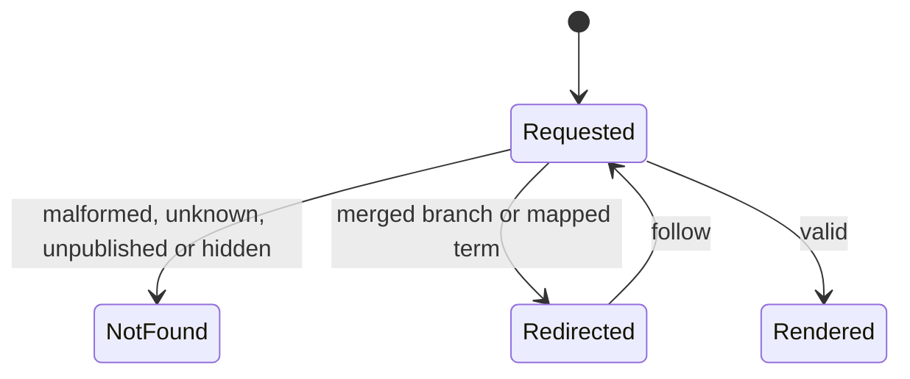
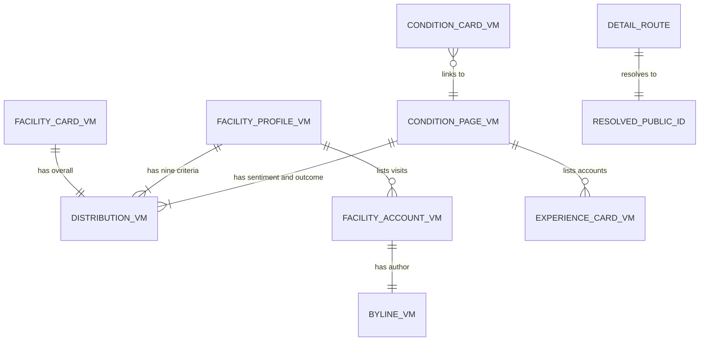

# Functional specification — U16 `t-203-facility-and-condition-pages`

| Field | Value |
|---|---|
| Unit | U16 `t-203-facility-and-condition-pages` (kind `ui`, size L, not high risk); Bolt 15; depends on U14 T-201, U15 T-202, U3 T-010, U45 T-011; U19 T-206 (`FacilityEntry`), U20 T-207 (`BrowseCard`) and U27 T-307 (`ConditionLink`) import its components |
| Source | T-203 (`docs/implementation/tasks/T-203-facility-and-condition-pages.md`, with the FD-091 amendment) |
| Stories | US4.3 (AC4.3.1–AC4.3.5), US5.3 (AC5.3.1–AC5.3.5; condition pages, provisional wording and redirects only), US6.4 (AC6.4.1–AC6.4.5; the condition summary and the facility side) — `unit-of-work-story-map.md` |
| Requirements | FR24–FR27, FR37, FR38 (redirects), FR48–FR52, FR95, FR100 (feature visibility), NFR4, NFR6, NFR7, NFR13 — `requirements.md` |
| Decisions | FD-024 (equal languages), FD-032 (plain CSS), FD-042 (Bengali copy review), FD-089 (about 10 records per module), FD-091 (patient redesign and motion), FD-093 (import boundaries); the owner's answer to T-202 Question 1 (no percentages, 2026-10-28); ISS-271 accepted by the owner (keep "Shefa General Hospital") |
| Upstream design | `contract-summary.md` C6 and C7; drafts `t-201-directory-and-taxonomy-modules` (view models, queries), `t-202-doctor-index-and-profile` (shared primitives) and `t-011-patient-design-and-motion-system` (tokens, motion) |
| Questions | Q1–Q15 in `functional-design-questions.md`. **Q1 (FR49's sentiment model for facilities) needs the owner**; Q2–Q15 are answered A on the owner's standing instruction of 2026-10-27 and are to be listed in `docs/aidlc-migration/OWNER-REVIEW-QUEUE.md`. This specification follows the recommended option throughout; § 14 lists the changes under each other option |
| Status | Draft written ahead of the stage on the branch `bolt/t-010-boundary-lint-and-ci` (2026-10-28), while U3 T-010 builds; `apps/web`, `packages/i18n` and the seed match `main` after U6 CR-012 |

This file is the source of truth for the Unit's workflows and state transitions. `entities.md` holds the data shapes, `rules.md` the numbered rules, and `frontend-components.md` the component props, files, styles and tests. The entity-relationship view and the rules summary at the end are derived from those files.

## 1. What changes, in one paragraph

The four placeholder pages from T-008 become the real facility index (`/{locale}/facilities`), branch page (`/{locale}/facilities/{publicId}`), topic index (`/{locale}/topics`) and condition page (`/{locale}/topics/{publicId}`), ported from the prototype's `renderFacilityIndex`, `renderFacility`, `renderTopicIndex` and `renderCondition` with the same content, fields, block order and behaviour, on T-011's "Warm Paper, Soft Depth" look. They read T-201's `FacilityCardVM`, `FacilityProfileVM`, `ConditionCardVM` and `ConditionPageVM` through the web composition root and render them in both languages with T-202's shared primitives. The hard rule this Unit carries is that **facility feedback never meets a doctor's figures**: the branch page shows only its own nine criteria and visits, under the separation sentence, and names its doctors without any figure; the condition page shows only doctor-account figures and names its facilities without any figure; the query-level proof is T-201's and is recorded as evidence here. The other hard rules show in every frame: exact counts with denominators (now also on the counted lists), no percentage, "Not provided" instead of 0, "Limited data" from the configured threshold, "Not verified" on every facility, neutral order, anonymous authors never linked, the emergency panel as a static group where the prototype has it. Motion comes only from T-011: the layout's page transition, the list reveal on five lists, and press feedback; distributions and bars are static. Five message keys are added. No hard rule, data boundary or contract changes under the recommended answers; Question 1 is the one point that waits for the owner.

## 2. As is (working tree, 2026-10-28) and what Bolt 15 can count on

| Element | Today | By Bolt 15 |
|---|---|---|
| Routes | `facilities/page.tsx`, `facilities/[id]/page.tsx`, `topics/page.tsx`, `topics/[id]/page.tsx` render `ViewShell` with `shell.placeholder` | unchanged until this Unit |
| Data | No query; `apps/web/src/server/container.ts` does not exist | U8 T-101 creates the container; U12 T-105 makes it database-backed; U14 T-201 delivers `directory.listFacilities`, `getFacility`, `resolvePublicId`, `taxonomy.listConditions`, `getCondition`, `resolvePublicId` and Review's `ProviderExperience` and `ConditionStats`; U15 T-202 wires `directory` |
| View models | Stubs in `contracts/src/view-models/{facility,condition}.ts` with `TODO(T-203)` (`parentName`, `criteria` as one distribution, `districts`) | T-201's shapes (`entities.md` ENT-001–ENT-006) |
| Shared primitives | none (`components/patient/shared/` does not exist) | U15 T-202's thirteen primitives, with Question 11's additions if U15 takes them |
| Look and motion | `patient.css` is the verbatim 04b port | U45 T-011's token block, restyled classes, `motion.css`, `RouteTransition` in the layout, `Reveal`, static groups, `check:motion`, `contrast:patient` |
| Keys | All the prototype's `facility.*`, `crit.*`, `condition.*`, `index.*` keys; no "Not verified" for facilities | + T-202's keys + this Unit's five |
| Seed | 10 branches of 7 organisations, 19 facility accounts, 10 conditions, 24 reviews with free-text tags only (no `term_id`) | the same, plus the condition tags only if U14 runs its Question 11 fallback (finding F1) |

## 3. Settled before this stage

See `functional-design-questions.md` § "Settled before this stage": the look follows T-011 with page rules in T-203's own `patient.css` section; no percentages (the owner's answer to T-202 Question 1); the data and the query-level isolation are T-201's; routing, redirects and per-request rendering follow T-202; the shared primitives and their answered behaviour are T-202's; the composer is T-306's; no new dependency; inline custom properties are allowed under T-502's CSP. The design decisions taken without a question are listed in the same file and explained in § 13.

## 4. Workflows

### WF1 — Facility index (`/{locale}/facilities`)

1. The patient layout renders the shell; the layout's `RouteTransition` wraps `<main>`'s content (BR5.1).
2. The page gets the locale and an anonymous-or-session `Actor`, calls `directory.listFacilities({page: 1, pageSize: 50})` and reads `limitedDataThreshold` once. A failed result is thrown to Next's error boundary (01-conventions §3).
3. It renders `ViewShell(view="facilities", title="")` > `FacilityIndex`: `IndexHead` (kicker "Discover", `h1` "Hospitals & clinics", the note), the count line "{n} · Hospitals & clinics", and `Reveal` > one `FacilityEntry` per card in the query's order (BR2.10).
4. Each `FacilityEntry`: avatar; the label "{name} — {branchName}" as an `h2` link (BR3.7); type · area, city; flags "Not verified" (BR2.5), the account count ("No one has written about this yet." when 0, BR3.10) and "Limited data" when sparse (BR2.7); the compact overall distribution with its denominator.
5. `generateMetadata` gives "Hospitals & clinics — RogiKotha", indexable, canonical `/{locale}/facilities`.

### WF2 — Branch request (`/{locale}/facilities/{segment}`)

1. Parse `segment` (BR1.2); malformed → `notFound()`.
2. `directory.resolvePublicId({kind: 'facility', publicId})`: `not_found` → `notFound()` (BR1.5); `redirected` → `permanentRedirect` (308) to the current branch (BR1.3).
3. `directory.getFacility({publicId})`; `not_found` → `notFound()`.
4. Read `limitedDataThreshold`. Steps 1–4 run inside one `cache()`-wrapped loader that `generateMetadata` also calls (BR1.8); the title is "{label} — RogiKotha" (BR1.7).
5. Render `ViewShell(view="facility", title="")` > `FacilityProfile` (WF3).

### WF3 — Branch rendering (prototype block order)

1. **Hero**: avatar; kicker (type); `h1` name; branch name · area, city; flags "Not verified" with its explanation, the account count and "Limited data" (when feedback is visible), the provenance chip "<source> · <Month Year>"; "Describe your visit" (when feedback is visible).
2. **Separation callout**: `facility.separation` in bold, on every branch page (BR2.4).
3. **What visitors described** (when feedback is visible): one limited-data line when the branch is sparse (Question 4); nine criteria in enum order, each with its heading, its good / mixed / poor capsules and denominator, "Not provided" or "Not provided: n" (BR2.6), a short "Limited data" tag when sparse, and the report-reliability note (BR2.12).
4. **Visits** (when feedback is visible): each visit's overall badge (or "Not provided"), its period, the byline with "Posted {Month Year}", the full text and the answered criteria as tags; or the empty state.
5. **Aside**: doctors who practise here (names and specialties, no figures, with the "listed for convenience" note); other branches of the same organisation (never itself).

When `feedbackVisible` is false, steps 3 and 4 and the feedback flags are left out (BR3.11).

```mermaid
sequenceDiagram
  actor Reader
  participant Page as Branch page (server)
  participant Dir as directory queries (U14)
  participant Cfg as ConfigProvider (U12)
  Reader->>Page: GET /bn/facilities/{segment}
  Page->>Page: parse segment; malformed -> 404
  Page->>Dir: resolvePublicId(facility, publicId)
  alt not found
    Dir-->>Page: not_found
    Page-->>Reader: 404 page
  else redirected
    Dir-->>Page: {publicId: target, redirected: true}
    Page-->>Reader: 308 to /bn/facilities/{target}
  else current
    Page->>Dir: getFacility(publicId)
    Dir-->>Page: FacilityProfileVM (own criteria and visits only)
    Page->>Cfg: current().limitedDataThreshold
    Page-->>Reader: branch page HTML (one query run, shared with metadata)
  end
```

Text fallback: parse the segment (malformed → 404) → resolve the id → not found: 404; redirected: 308 to the current branch; current: load the branch, read the threshold, render. The view model holds only this branch's facility feedback.

### WF4 — Topic index (`/{locale}/topics`)

1. The page calls `taxonomy.listConditions()`: every active canonical condition with its eligible-account total, zero included, in the active language's alphabetical order (T-201 BR4.4).
2. It renders `ViewShell(view="topics", title="")` > `TopicIndex`: `IndexHead` (kicker "Discover", `h1` "Health topics", the note), the count line, and `Reveal` > `ul.index-grid` > one `li > BrowseCard` per topic with "{n} patient experiences" or "No one has written about this yet." (BR3.10).
3. Metadata: "Health topics — RogiKotha", indexable.

### WF5 — Condition request (`/{locale}/topics/{segment}`)

1. Parse `segment` (BR1.2).
2. `taxonomy.resolvePublicId({publicId})`: `not_found` (missing or hidden) → `notFound()`; `redirected` (a provisional term mapped to a canonical one) → `permanentRedirect` (308) to the canonical page (BR1.4, AC5.3.3).
3. `taxonomy.getCondition({publicId})`; `not_found` → `notFound()`.
4. Read `limitedDataThreshold`; one cached loader shared with `generateMetadata`; title "{name} — RogiKotha".
5. Render `ViewShell(view="condition", title="")` > `ConditionPage` (WF6).

### WF6 — Condition rendering (prototype block order)

1. **Head**: kicker "Health topics"; the provisional badge when the term is a reviewer's unmapped wording (Question 7); `h1` name; "Also written as" with the aliases as written; the lede "{accounts} patient experiences · {doctors} doctors" from one key (or "No one has written about this yet."), with "Limited data" when sparse; "Usually seen by" with up to three specialties and their counts.
2. **Where this condition is treated** (when places exist): hospital or "Not provided", area · city, count; the prototype's note and "Counted from {total} patient experiences" (Question 5).
3. **Main column**: across every experience (sentiment and outcome distributions with their denominators, "Not provided", "Limited data" with the threshold); medicines, treatments and symptoms people mentioned (each with bars relative to the largest count, the mention note and the denominator line; left out when empty); the provisional-wording callout; the accounts, newest first, or the empty state.
4. **Aside**: doctors people wrote about (name, specialty and count, location from the first chamber, the "does not measure best" note); facilities mentioned (names and types, no figures); the compact emergency panel as a static group (BR5.4).

### WF7 — Components for later Units

`frontend-components.md` § 5 is their contract. T-206 imports `FacilityEntry` (with `headingLevel 3` under its results heading and its own `pinSlot` if facility pinning ever arrives); T-207 imports `BrowseCard` for the Discover grid; T-307 imports `ConditionLink` for the experience page's condition. Each takes view models and plain values, renders on the server, and fetches nothing (BR8.1).

### WF8 — Code Generation order

1. **Baseline**: `pnpm infra:up`; `pnpm check` and `pnpm smoke` green on the Bolt branch; read the open `ISSUES.md` rows of § 9.
2. **Prerequisites present**: T-201's queries and view models (and its Question 11 seed fallback, finding F1); T-202's primitives and whether it took Question 11's additions; T-011's `Reveal`, `RouteTransition` placement, tokens and `check:motion`; the container with `directory`. Adapt the wiring, not the rules, if a shape differs; record each difference.
3. **Keys** (both files, one commit, Bengali flagged).
4. **Primitive additions** of Question 11 that T-202 did not make, each recorded.
5. **`FacilityEntry`, `FacilityIndex`, the facility index page.**
6. **Move `facilities/[id]` to `facilities/[publicId]`**; the branch page, `FacilityProfile`, `FacilityAccountRow`.
7. **`BrowseCard`, `TopicIndex`, the topic index page.**
8. **Move `topics/[id]` to `topics/[publicId]`**; the condition page, `ConditionPage`, `PlacesPanel`, `FreqList`; `ConditionLink`.
9. **Container wiring** for the taxonomy queries with `ConditionStats`, if not present.
10. **Styles**: T-203's section of `patient.css` (`frontend-components.md` § 7).
11. **Smoke** test; gates (BR9.3); the visual, reduced-motion and viewport checks; ISS rows; hand-off with the hard-rule evidence.

## 5. State transitions

### Detail request outcome (branch and condition)

| From | Event | To | Rule |
|---|---|---|---|
| Requested | Segment malformed | 404 | BR1.2 |
| Requested | Id unknown, unpublished or hidden | 404 | BR1.5 |
| Requested | Branch merged or old id | 308 to the current branch | BR1.3 |
| Requested | Term mapped to a canonical term | 308 to the canonical page | BR1.4 |
| Requested | Valid | Rendered | WF3, WF6 |



Text fallback: a detail request either renders, answers 404, or answers 308 to the current branch or the canonical term; a redirect leads to a new request.

### What the view model's states mean on the page

| VM state | Page shows | Rule |
|---|---|---|
| `dist.empty` | "Not provided" alone | BR2.6 |
| `dist.notProvided > 0`, not empty | the distribution + "Not provided: n" | BR2.6 |
| `dist.limitedData` (criterion) | short "Limited data" tag; the why line too when the branch itself is not limited | BR2.7 |
| `accountsLimitedData` (branch) | badge in the hero and on the card; one line on the criteria panel | BR2.7 |
| `accountsLimitedData` (condition) | badge in the head; the full line under each distribution | BR2.7 |
| `accountsTotal = 0` | "No one has written about this yet."; no empty panels; empty state with "Be the first to write about it" | BR3.10 |
| `feedbackVisible = false` | no criteria, visits, feedback badges or write button | BR3.11 |
| `overall` absent on a visit | "Not provided" badge | BR2.9 |
| `place.hospital` absent | "Not provided" in the unknown style | BR2.9 |
| `doctorsHere = []`, `siblings = []`, `facilities = []`, `doctors = []`, `places = []`, a mention list `[]` | that panel left out | BR3.3, BR3.8, BR3.10 |
| `provisional` | "Submitted wording, not yet mapped" badge | BR2.13 |

## 6. Ports and data access

This Unit declares no port. It calls the directory and taxonomy queries of C7 and C6 through the web composition root:

```text
container.actor(locale)                                        -> Actor (anonymous or session; T-101)
container.directory.listFacilities(input, actor)               -> Result<BoundedPage<FacilityCardVM>>
container.directory.getFacility({publicId}, actor)             -> Result<FacilityProfileVM>     errors: not_found
container.directory.resolvePublicId({kind: 'facility', publicId}, actor) -> Result<{publicId, redirected}>   errors: not_found
container.taxonomy.listConditions({}, actor)                   -> Result<ConditionCardVM[]>
container.taxonomy.getCondition({publicId}, actor)             -> Result<ConditionPageVM>       errors: not_found
container.taxonomy.resolvePublicId({publicId}, actor)          -> Result<{publicId, redirected}>   errors: not_found
container.config.current()                                     -> ConfigValues (limitedDataThreshold)
```

T-202 wires `directory`; the `taxonomy` wiring with Review's `ConditionStats` lands here if T-202 did not add it (T-201 finding F6, § 12). The exact names follow whatever T-101 and T-201 built; the pages adapt.

## 7. View models

Read only; defined by T-201 (`entities.md` ENT-001–ENT-006). This Unit relies on: active-locale strings; optional fields absent when missing; public ids only; `notVerified: true` on both facility view models; `criteria` in enum order with good / mixed / poor distributions; `siblings` without the current branch; `doctorsHere`, `doctors` and `facilities` without figures beyond the condition doctors' own account counts; `ConditionPageVM` figures from eligible doctor reviews only. A field T-203 needs that T-201 does not supply is an `ISSUES.md` row for U14 (finding F8), not a page-side workaround.

## 8. Developer view — mapping details

- **Facility label**: `name` + (`branchName` ? ' — ' + `branchName` : ''); exported as `facilityLabel` beside `FacilityLink` (Question 11) so T-202's facility rows use the same function.
- **Hero sub-line**: `[branchName, [area, city].filter(Boolean).join(', ')].filter(Boolean).join(' · ')`.
- **Count phrases**: `t('sentiment.totalAccounts', {n, count: formatNumber(n, locale)})`; `t('condition.countsLine', {a: accounts, accounts: formatNumber(accounts), d: doctors, doctors: formatNumber(doctors)})`; `t('condition.countedFrom', {n: total, total: formatNumber(total)})`.
- **Posted and period**: `formatMonthYear({year, month}, locale)`; `posted` (ISO) is split into year and month first; `t('facility.posted', {date})`.
- **Provenance chip**: `t('prov.updatedOn', {source: t('prov.' + vm.provenance.name.source), date: formatMonthYear(...)})`.
- **Bars**: `style={cssVars({'--w': count / rows[0].count})}`; rows come sorted by count from T-201, so `rows[0]` is the maximum; the component asserts nothing about order.
- **Criteria lookup**: `CRITERIA.map(key => vm.criteria.find(c => c.key === key)?.dist ?? emptyDistribution(['good','mixed','poor']))`, using the `as const` criteria array from `contracts` (enum order).
- **Siblings guard**: `vm.siblings.filter(s => s.publicId !== vm.publicId)`, a cheap second check on T-201's exclusion.
- **Segment parsing**: T-202's `parseSegment` (`/^([a-z2-7]{10})(?:-[^/]*)?$/` on the decoded segment).
- **Hidden units**: `<span className="sr-only">{t('sentiment.totalAccounts', …)}</span>` after a bare count; the visible number stays.

## 9. Findings and proposed ISS rows

Each is proposed with `Found in U16 T-203 (Functional Design draft)`; the caller adds them with the next free numbers (the register ends at ISS-271).

- **F1 (S2, suggested owner U14 T-201, before Bolt 15)** — The seed links no review to its condition term: `seed-content.ts` inserts each tag with `free_text` only. T-201's Question 11 routed the fix to CR-012 with a U14 fallback; CR-012 merged (`7cce9bd`) without it and no row was opened. Without the fallback, every condition page has no accounts, every topic card reads "No one has written about this yet", d1's condition pills are empty, and storyboard step 2's resolved condition has nothing behind it. Fix: U14 runs its fallback (one `review_tags` row with `term_id` per seeded review, from `conditionSeedRef`) with a seed integration assertion.
- **F2 (S3, suggested owner U6 CR-012 and U14 T-201, owner decision)** — The prototype's hospital name is not stored (T-201 finding F3 in its draft, still without a row). Facility titles read "Shefa Health Group — Dhanmondi branch" and "Kashful Health Group — Shaheb Bazar branch", while d1's chamber and the condition page's places read "Shefa General Hospital" and "Kashful Community Hospital — Shaheb Bazar branch": one place under two names. Storing it is a data-model change (Question 3 C).
- **F3 (S1 if built as the task says; designed out)** — The compact facility card's distribution drops "Limited data", and all ten seeded branches are below the threshold. Settled by T-202's Question 3 A (badge on the card).
- **F4 (S2 if built as the task says; designed out)** — FR25 and AC4.3.2's "Not verified" is missing from the prototype and the task. Settled by Question 2.
- **F5 (S2 if built as the task says; designed out)** — Step 9 wraps the pages in `RouteTransition` while T-011 puts it in the layout. Settled by BR5.1; the task's step 9 wording should be corrected (as T-202 F4).
- **F6 (S2, the owner)** — FR49 and AC6.4.3 ask for "the same optional sentiment model" on facility profiles; facility feedback has criteria only (Question 1).
- **F7 (S3, designed out)** — The condition lede's concatenation and script lowercasing give "1 patient experiences" and an ungrammatical Bengali phrase. Settled by `condition.countsLine` (BR3.9).
- **F8 (S3, suggested owner U14 T-201)** — `FacilityCardVM` has no `feedbackVisible`; with facility feedback turned off, index cards would still show the overall distribution (Question 8).
- **F9 (S3, suggested owner U15 T-202 and U20 T-207)** — `emergency.body` names 999 and 16263 as fixed copy while the numbers are configuration (FR100); the condition page, Discover and the Emergency page all show it.
- **F10 (S4, U15 T-202)** — Primitive additions requested: `Badge` `good`/`poor`, `DistBlock` `'crit.'` with the compact title sentence and `limitedNote`, `EmergencyPanel` `compact`, shared `parseSegment` and `facilityLabel` (Question 11).
- **F11 (S4, U45 T-011)** — If T-011's press selectors do not cover `a.browse-card`, `.mini-row` and the entry links, ask U45 to add them; T-203 may not add motion (BR5.5). The shared-element morph is proposed again (Question 15 C).
- **F12 (S4, the owner)** — The optional parent-organisation aggregate (FR24, AC4.3.1, 03 §1) has no page and no Unit (Question 10).
- **F13 (S4, the owner)** — Proposal: a narrow-screen jump link to the condition page's doctors and emergency panels, decided together with T-202's similar proposal (Question 14).
- **F14 (S4, U16 T-203)** — Task-text drift: the "Read first" line numbers predate FD-089 (`facilityEntry` is at 733, `renderCondition` 1173, `renderFacility` 1324, `renderFacilityIndex` 1894, `renderTopicIndex` 1908; `criteriaDist` 2589, `branchesOf` 2611, `tagFrequency` 2663); the folders are `[id]`; `parentName` does not exist (T-201 Question 9 A); "8 cards" is now 10; step 9's `RouteTransition`; the prototype's `<h4>` criterion headings; "new keys: none expected" is five; the owned paths miss `ConditionLink` and the container's taxonomy wiring.
- **F15 (S4, ISS-268 update)** — No seeded branch has an address (the corpus has no address field), so ISS-268's "f6–f10 keep address null" understates it; the facility half of the rendering check is met by the unanswered criteria of f1–f5 (Question 9).
- **F16 (S4, U16 T-203)** — On the seed, a visit without an overall and a place without a hospital do not occur (every facility account has `overall`, every doctor has a chamber); those "Not provided" cases are proven on builder data only.
- **F17 (S4, U16 T-203)** — Paging: `listFacilities` is called with `pageSize: 50` and the pages show no paging control (the prototype has none); the condition and branch account lists show every card. Add paging when real volume passes it.
- **Existing rows, no new row**: ISS-271 (f1 and f4 "Shefa General Hospital"; accepted by the owner, the risk noted for any public showing; on these pages the name appears in d1's place row on c1, c2 and c3, and fr2 on f1 is a mixed account); ISS-266 (f4 has no doctors-here panel: correct for the data); ISS-161 (seeded text is Bengali only, so `/en` visit bodies and mention labels are Bengali); ISS-137 (the whole dictionary ships to the client; these pages add no client component); ISS-120 (a hidden branch or term renders the English-only root 404).

## 10. Developer view — accessibility and responsive details

- One `h1` per page; heading levels in order; criterion headings are `h3` (BR4.1).
- Entries are named groups; asides are labelled by their first heading; the topic grid and mini lists are lists (BR4.2).
- Capsule groups are one image with a sentence; bars are hidden; bare counts carry a hidden unit (BR4.3).
- Topic cards are links with a 44 px target and T-011's focus ring (BR4.4).
- "Not verified" has a reachable explanation on the branch page (BR4.6).
- 360 px: both detail pages are one column below 1040 px with the aside after the main column (prototype order, Question 14); the criteria grid is one column; flags, pills and place lines wrap; long Bengali names wrap; nothing scrolls sideways (BR4.5).
- Without script every page and link works; nothing on these pages needs script.

## 11. Developer view — tests

Listed in `frontend-components.md` § 8, with the rules each proves. In short: every T-203 component in `en` and `bn`; the nine criteria, the separation sentence, "Not verified", the limited-data line and tags, the other branches without self, no doctor figure on facility pages, hidden feedback; the topic index with its empty topic; the condition page's order, lede, provisional badge, zero case, places, mention bars and denominators; the static emergency panel and the unrevealed hard-rule blocks; one smoke file. Test names read as sentences; builders, not fixtures; `@/i18n/routing` mocked (ISS-053); no snapshot. The query-level isolation tests are T-201's; Build and Test names them as this Unit's hard-rule evidence (BR9.3).

## 12. Owned paths and recorded additions

Owned by the task: the four pages, `FacilityIndex`, `FacilityProfile`, `FacilityEntry`, `FacilityAccountRow`, `TopicIndex`, `ConditionPage`, `FreqList`, `PlacesPanel`, `BrowseCard`, the component tests, new keys in `packages/i18n/messages/{en,bn}.json`, the `EmergencyPanel` compact prop; by the FD-091 amendment, T-203's own section of `patient.css`. Additions this design needs, each named in the hand-off with its reason:

| Path | Why | Decision |
|---|---|---|
| `app/[locale]/(patient)/facilities/[id]/page.tsx` and `topics/[id]/page.tsx` (moved) | Next.js forbids `[id]` beside `[publicId]` | settled (questions file) |
| `components/patient/ConditionLink.tsx` (+ test) | T-307's dependency | Question 12 |
| `components/patient/shared/{Badge,DistBlock,FacilityLink}.tsx`, the segment parser | additive primitive changes, only if T-202 did not make them | Question 11 |
| `apps/web/src/server/container.ts` | wire the taxonomy queries with `ConditionStats` (T-201 F6), only if not present | settled |

No file of `apps/worker`, `packages/{domain,application,database,contracts,test-support}`, `tokens.css` or `motion.css` is touched.

## 13. Decisions and why

**D1 — Rename `[id]` to `[publicId]`** for both detail folders, as T-202 does: the task, 03 §1 and every page Unit use `[publicId]`, and Next.js refuses two slug names at one level.

**D2 — No page-level `RouteTransition`.** T-011 renders one keyed boundary in the layout; reversible if T-011 falls back to per-page wrappers.

**D3 — The page carries the separation, the data layer proves it.** The hard rule is enforced and tested at query level by T-201 (both directions). This Unit adds what a page can guarantee: facility components cannot render a sentiment or outcome block (a static import test), cross-references carry no figures, the separation sentence is on every branch page and never moves on its own. Rejected: a second, page-level copy of the query test (it would test fakes, not the data layer).

**D4 — "Not verified" on every facility (Q2).** FR25 and AC4.3.2 are Must; the badge mirrors the doctor's, so readers meet one pattern.

**D5 — Titles from the stored names (Q3).** The view model's two names are what the database holds; the parent badge would repeat the title. The lost hospital name is raised, not invented.

**D6 — Limited data marked everywhere, explained once (Q4).** Every sparse distribution keeps its mark, as the hard rule asks, without nine identical sentences.

**D7 — Denominators on counted lists (Q5).** The hard rule speaks of distributions; places and mentions are counts of accounts and now say of how many.

**D8 — Words, not zeros, for empty topics and facilities (Q6).** The topic index's own sentence already does this; the detail pages follow it and leave out empty panels.

**D9 — Provisional terms marked, wording untouched (Q7).** AC5.3.2 keeps the original wording; the badge stops one person's wording reading as a canonical topic.

**D10 — Hidden feedback is left out, not zeroed (Q8).** Nine "Not provided" criteria would say nobody wrote.

**D11 — Prototype structure where the data is empty (Q9, Q10, Q13, Q14).** No address row, no parent aggregate, the compact emergency panel and the prototype's order; each raised as a proposal where it might later help.

**D12 — Extend T-202's primitives, do not fork them (Q11).** Additive changes keep one distribution component for both feedback kinds.

**D13 — Motion only from T-011 (Q15).** `Reveal` on five lists; distributions, bars, the separation sentence, "Not verified" and the emergency panel never move on their own.

**D14 — Parameter keys for count phrases.** 01-conventions §6 and T-202 Question 5; fixes Bengali word order and English plurals without script lowercasing.

**D15 — One provenance chip.** The branch hero uses the same "<source> · <Month Year>" chip as the doctor profile.

## 14. If the owner changes an answer

| Question → option | What changes |
|---|---|
| Q1 → A | As designed; the FD entry rewording FR49 and AC6.4.3 is written at this Unit's Functional Design |
| Q1 → B | Before this Unit: migration for `facility_reviews.sentiment`, corpus and prototype values (U6), T-201 view-model field, T-306 composer field, all with an FD entry. Here: a `SentimentBlock` panel on the branch page beside the criteria, a sentiment badge on visit rows, a compact sentiment on cards; BR2.2 is reworded (facility sentiment from facility feedback only) |
| Q1 → C | As designed, plus an S2 gap row for FR49 |
| Q2 → B | No badge on cards; BR2.5 narrows to the hero |
| Q2 → C | No badge, no keys; AC4.3.2 a recorded gap (S2) |
| Q3 → B | `FacilityEntry` and the hero add `Badge plain` "Part of {name}" for multi-branch organisations (needs a sibling count) |
| Q3 → C | U6 and U14 first (column, seed, `hospitalName` field); titles become "{hospital} — {branch}" and the badge "Part of {organisation}" returns |
| Q4 → B | Each limited criterion shows T-202's full line; the panel line and the tag are dropped; `limitedNote` is not needed |
| Q5 → B | No `condition.countedFrom`; BR3.5 removed; the counted lists keep only their notes |
| Q6 → B | The prototype's zero counts and empty panels; BR3.10 removed |
| Q7 → B | No provisional badge; BR2.13 keeps the wording rule only |
| Q8 → B | Nine empty criteria when feedback is off; BR3.11 removed |
| Q9 → B | Hero address line with its provenance chip and "Not provided"; key `facility.address` |
| Q10 → B | T-201 adds a parent summary to `FacilityProfileVM`; a parent panel with its denominator on each branch page; new copy |
| Q11 → B | T-203 makes all four primitive changes in T-202's files during Bolt 15 |
| Q11 → C | A `CriteriaBlock` component in T-203's paths duplicating `DistBlock` (against the task's "do not re-implement") |
| Q12 → B | No `ConditionLink`; T-307's dependency line is corrected |
| Q13 → B or C | `EmergencyPanel` (full) or a new middle form in the aside; the panel reads `ConfigValues.emergency` |
| Q14 → B | The aside moves above the accounts in the DOM on narrow screens (owner's decision, since the emergency guidance moves) |
| Q15 → B | No `Reveal` on the two account lists |
| Q15 → C | T-011 adds a morph primitive; `BrowseCard` and the condition head get a matching name hook |
| T-201 Q9 → B | `parentName` returns; Q3 B's badge applies |
| T-201 Q10 → B | Provisional terms have no page (404); the badge is never shown |
| T-202 Q2, Q3, Q5 → B | The same narrowing here: no "Not provided: n"; no card and hero limited badges; the prototype's concatenation |
| T-011 Q4 → B | Each page wraps itself once in `RouteTransition` |

## 15. Acceptance mapping (T-203 acceptance checks)

| T-203 check | Expected under this design | Rules |
|---|---|---|
| Nine criteria always rendered | 9 `.crit` blocks in enum order, each "Not provided" when empty, whenever feedback is visible (hidden feedback is Question 8's case) | BR3.1, BR2.6 |
| Facility separation callout | `.callout.warn` with `facility.separation` on every branch page | BR2.4 |
| Siblings exclude self | f1 lists f4 only; f6 lists f7 and f8 | BR3.8 |
| Empty topics listed | **10** cards (not 8: FD-089); c8 shows `index.emptyTopic` | BR3.10 |
| Places sorted, unknown hospital | descending by count; a missing hospital renders `label.notProvided` with `pl-unk` (builder data, F16) | BR3.3, BR2.9 |
| Freq bars relative to max | first row `--w: 1`; panel absent when empty | BR3.2 |
| Locales | all four pages in `bn` with Bengali digits and no English copy (stored English-only text excepted; the seed stores Bengali, ISS-161) | BR3.6, BR6.1 |
| Impeccable and contrast | zero findings; `contrast:patient` too | BR7.2 |
| Visual (FD-091) | same content, order and states as `#facilities/f1` and `#topics/c1` at 1280 and 390 px; look per T-011; known differences recorded: titles and colours (Question 3, F2), "Not verified" (Question 2), limited-data line and tags (Question 4), denominator lines (Question 5), provenance date (D15), Bengali stored text (ISS-161) | BR7.1 |
| Full check | `pnpm check` green | BR9.3 |
| Motion check | `pnpm check:motion` passes; T-203 adds no motion declaration | BR5.5 |
| Reduced-motion journey | no movement; every step completes; disclaimer, emergency guidance and demo marker never animated | BR5.4, BR5.6 |
| Detector and contrast on the new styles | zero findings | BR7.2 |
| Hard-rule checklist: criteria from facility accounts only | facility components render no sentiment or outcome; T-201's isolation tests green and named | BR2.2, BR2.3, BR9.3 |
| ISS-268 rendering check (facility half) | "Not provided" on f1–f5's unanswered criteria on the seed | BR2.6 |

## 16. Risks to verify in Code Generation and Build and Test

- **The seed's condition tags** (F1): without U14's fallback, the condition pages, the c1 visual check and the topic counts cannot be verified on the seed.
- **T-201's shapes and names** (`criteria` as a keyed list, `siblings`, `doctorsHere`, `feedbackVisible`, `provenance.name.updatedAt`, `places[].hospital`) may differ from its draft; adapt the mapping, keep the rules.
- **T-202's primitives**: whether U15 took Question 11's additions; if not, the fallback edits stay additive and recorded.
- **T-011's `Reveal` on `ul` and `RouteTransition` placement** follow its spike; BR5.1 covers both outcomes.
- **Bengali alphabetical order** depends on the database collation (T-201 risk); the index tests assert against `Intl.Collator('bn')`.
- **next-intl ICU plurals with pre-formatted numbers** in `condition.countsLine` (two plural selectors in one message): confirm the syntax compiles in both dictionaries and `i18n:check` accepts parameter sets that differ between languages.
- **`permanentRedirect` inside a stream**: verify with `curl -sI` that a mapped term answers 308, and keep `loading.tsx` out of `facilities/` and `topics/`.
- **Typed routes** with next-intl's `Link` object form for `/facilities/[publicId]` and `/topics/[publicId]`.
- **360 px branch hero in Bengali**: avatar 78 px below 720 px, long organisation and branch names, four flags; no overflow at 200% zoom.
- **The criteria grid at 360 px**: `minmax(260px, 1fr)` inside the panel padding stays one column without overflow.

## Entity-relationship view (derived from `entities.md`)



Text fallback: facility cards carry one overall distribution and branch pages nine criteria distributions and their visits; condition pages carry a sentiment and an outcome distribution and doctor accounts; topic cards link to condition pages; the route segment resolves to a current public id. No edge joins facility figures to condition or doctor figures.

## Rules summary (derived from `rules.md`)

| ID | Rule in one line |
|---|---|
| BR1.1 | Data only through the directory and taxonomy queries in the container |
| BR1.2 | Segment = public id + ignored slug; malformed is 404 |
| BR1.3 | Merged or old branch id → 308 to the current branch |
| BR1.4 | Mapped term → 308 to its canonical page; hidden → 404 |
| BR1.5 | Not public → 404 |
| BR1.6 | Rendered per request; no cached figures |
| BR1.7 | Titles, canonical, alternates, indexable |
| BR1.8 | One loader per request |
| BR2.1 | No quality number, no percentage; counts with denominators |
| BR2.2 | Facility figures from facility feedback only; no doctor figure on facility pages |
| BR2.3 | Condition figures from doctor reviews only; facilities listed without figures |
| BR2.4 | Separation sentence on every branch page |
| BR2.5 | Not verified on every facility card and hero |
| BR2.6 | Empty → Not provided; partial → Not provided: n |
| BR2.7 | Limited data on cards, heroes, the condition head, the criteria panel and each sparse criterion |
| BR2.8 | Limited-data copy names the configured threshold |
| BR2.9 | Missing overall, hospital or parts: Not provided or skipped, never blank or 0 |
| BR2.10 | Neutral order from the queries; no sort control |
| BR2.11 | Anonymous authors never linked |
| BR2.12 | Report reliability is the visitor's impression |
| BR2.13 | Wording as written; provisional terms marked |
| BR2.14 | Mention, places and provisional framing copy kept |
| BR3.1 | Nine criteria in enum order |
| BR3.2 | Bars relative to the largest count, static; empty lists left out |
| BR3.3 | Places in order with Not provided for a missing hospital |
| BR3.4 | Up to three specialties with counts |
| BR3.5 | Counted lists state their denominator |
| BR3.6 | Numerals and dates through the formatters |
| BR3.7 | Facility label = name — branch; no parent badge |
| BR3.8 | Other branches without self |
| BR3.9 | Count phrases from parameter keys |
| BR3.10 | Zero accounts said in words; no empty panels |
| BR3.11 | Hidden feedback left out |
| BR3.12 | Avatars seeded by public id |
| BR4.1 | One h1; headings in order; criteria h3 |
| BR4.2 | Named groups and lists |
| BR4.3 | Capsules as one image; hidden units on counts |
| BR4.4 | Topic cards are links |
| BR4.5 | 360 px, 200% zoom, both languages, no script needed |
| BR4.6 | Not verified explanation reachable without a pointer |
| BR4.7 | Prototype placement of emergency panel and separation sentence |
| BR5.1 | No page-level RouteTransition while the layout has one |
| BR5.2 | Reveal on five lists only |
| BR5.3 | Separation sentence and Not verified never move on their own |
| BR5.4 | Emergency panel is a static group |
| BR5.5 | No motion declarations in T-203's CSS |
| BR5.6 | Reduced motion: every step completes |
| BR6.1 | All copy from keys, both languages, Bengali flagged |
| BR6.2 | No text transforms |
| BR6.3 | Stored wording in its original language |
| BR7.1 | T-011 tokens and classes; own CSS section; only --w / --g inline |
| BR7.2 | UI gates with zero findings |
| BR8.1 | Server components; FacilityEntry, BrowseCard, ConditionLink exported |
| BR8.2 | Extend T-202's primitives additively, asked of U15 first |
| BR8.3 | Only owned paths and recorded additions change |
| BR9.1 | Component tests in both languages |
| BR9.2 | One more smoke file |
| BR9.3 | All gates and the hard-rule evidence |
| BR9.4 | Every finding an ISS row |

## Sources

- `docs/implementation/tasks/T-203-facility-and-condition-pages.md` (goal, FD-091 amendment, read-first list, owned paths, steps 1–9, acceptance checks, tests, hard-rule checklist); T-202 (primitives), T-206, T-207 and T-307 (consumers).
- `aidlc/spaces/default/intents/261011-aidlc-adoption/inception/units-generation/unit-of-work.md` (U16), `unit-of-work-dependency.md`, `unit-of-work-story-map.md`; `inception/delivery-planning/bolt-plan.md` (Bolt 15); `inception/requirements-analysis/requirements.md` FR24–FR27, FR36–FR38, FR48–FR52, FR95, FR100, NFR4, NFR6, NFR7, NFR13; `inception/user-stories/stories.md` US4.3, US5.3, US6.4.
- `docs/status/decision-log.md` FD-024, FD-032, FD-042, FD-089, FD-091, FD-093; `docs/aidlc-migration/OWNER-REVIEW-QUEUE.md` (T-202 Q1 owner's answer, ISS-271 owner's answer); `aidlc/spaces/default/memory/project.md` Forbidden and Mandated; `team.md` Way of Working, Testing Posture, Code Style.
- `docs/implementation/01-conventions.md` §2, §6–§10, §14; `03-routes-and-contracts.md` §1, §4; `05-demo-storyboard.md` Part 1; `docs/implementation/ISSUES.md` ISS-053, ISS-120, ISS-137, ISS-161, ISS-266, ISS-268, ISS-271.
- `docs/aidlc-migration/design-drafts/t-201-directory-and-taxonomy-modules/`, `t-202-doctor-index-and-profile/` and `t-011-patient-design-and-motion-system/` (all files).
- Code on the working tree: `apps/web/src/app/[locale]/(patient)/{layout.tsx,facilities/**,topics/**}`, `components/patient/{ViewShell,Tabs,Masthead,Colophon}.tsx`, `lib/titles.ts`, `styles/patient.css`; `packages/i18n/src/format.ts`, `messages/{en,bn}.json`; `packages/contracts/src/view-models/{facility,condition}.ts`; `packages/database/src/schema/{directory,review,taxonomy}.ts`; `packages/test-support/src/corpus/{facilities,branches,facility-reviews,conditions,reviews,doctors}.ts`, `seed/{seed-directory,seed-content}.ts`.
- `ui-design-prototype/concepts/concept-04b-quiet-clinic-minimal/app.js` (`titleForView`, `distBlock`, `outcomeBlock`, `byline`, `facilityLink`, `facilityEntry`, `renderCondition`, `renderFacility`, `indexHead`, `byName`, `renderFacilityIndex`, `renderTopicIndex`, the `data-condition`/`data-facility` handlers) and `ui-design-prototype/shared/rogikotha-data.js` (`CRITERIA`, `CRIT_VALUES`, `distribution`, `criteriaDist`, `branchesOf`, `doctorsForCondition`, `tagFrequency`).
