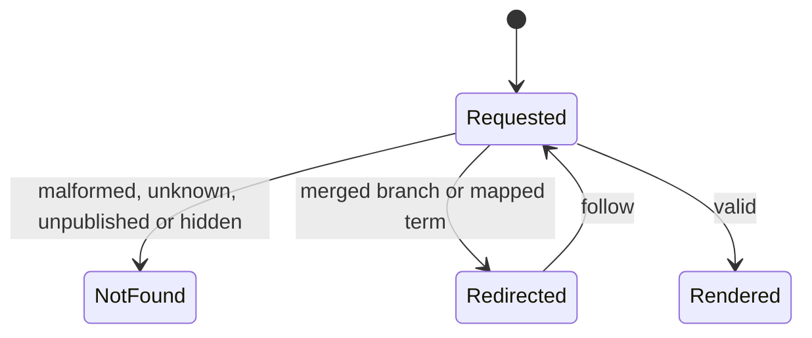
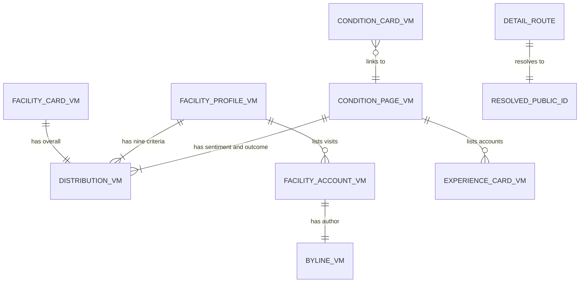

# Functional specification — U16 `t-203-facility-and-condition-pages`

**Refreshed 2026-10-29.** Re-checked against T-010 as merged on `main` (`14c21a9`), the refreshed T-201, T-011 and T-105 drafts and the owner's answers in `docs/aidlc-migration/OWNER-REVIEW-QUEUE.md`. What changed:
1. **Owner's answers applied.** Question 1 is the owner's A (the nine criteria; the FD entry rewording FR49 and AC6.4.3 is in § 17). Question 3 moves to C under the owner's answer to finding F2: titles read as the prototype's ("Shefa General Hospital — Dhanmondi branch") and the "Part of {parent}" badge returns on cards and in the hero; other-branch rows are titled by their label, else their own name (BR3.7, BR3.8). Counts only, no percentages (unchanged).
2. **T-201 refreshed.** View models carry `name` (the hospital), `branchName?` (the label), `parentName?` (the organisation) and stored hues; `FacilityCardVM.feedbackVisible` with its figures present only when it is true, so finding F8 is fixed upstream and BR3.11 now covers the index cards. The seed links every review to its condition term (finding F1 fixed upstream) and adds d11 and r25: 11 doctors, 14 chambers, 25 reviews; c6 has 2 accounts and shows "Not provided: 1".
3. **T-010 as merged.** Components import only `contracts`, `i18n`, `web-shared` (`@/lib`, `@/i18n`), server actions and other components (FD-093, BR1.1); tests in `apps/web` use web-local builders, never `@rogikotha/test-support` (BR9.1); every file under `apps/web/src`, `page.tsx` included, counts toward the 80% line floor, so the detail pages get page tests (BR9.6); `app/pages.test.tsx` is updated with the four routes (BR9.5, finding F18); indexable pages set no `robots` field (BR1.7); `format:check`, `check:identity` and a green CI run on the Bolt head before the squash merge (BR9.3).
4. **T-011 refreshed.** Spacing, grid and target tokens (`--space-*`, `--grid-min`, `--target`, `--focus-ring`) in T-011's token block at the top of `patient.css`, which T-203 does not edit; the press list covers `.browse-card`, `.mini-row`, `.doc-entry` and `.btn`, and `[data-press]` covers anything else (finding F11 closed); no shared-element morph (Question 15 C closed); `contrast:patient` and `check:motion` are steps of `pnpm check` (eleven steps).
5. **T-105.** Configuration is read with `await getConfig()`; the threshold range is 2–50 (owner, T-105 R2); `emergency.body` takes the configured numbers, so the condition page passes `emergency` to the compact panel (new BR3.13, finding F9 closed).
6. **Contracts and T-202's parallel refresh.** Public ids are lowercase Crockford base32, so the segment is parsed with `stripSlug` from `@rogikotha/contracts`, not the draft's `[a-z2-7]` pattern, which would have sent most ids to 404 (BR1.2, finding F23); the actor comes from T-101's `getActor()`; T-202's refresh takes this Unit's primitive additions (its Question 14 A), leaving `EmergencyPanel` `compact` here.
7. **Decided by the agent under the owner's no-questions instruction of 2026-10-29:** Question 16 (the "Part of" copy takes a `{parent}` parameter), findings F12 and F13 (no parent aggregate and no jump link in release 1), the web-local builders, the page tests and the empty `robots` field. New findings F18–F23 (§ 9); none is an open S1 or S2.

| Field | Value |
|---|---|
| Unit | U16 `t-203-facility-and-condition-pages` (kind `ui`, size L, not high risk); Bolt 15; depends on U14 T-201, U15 T-202, U3 T-010, U45 T-011, and reads U12 T-105's `getConfig()`; U19 T-206 (`FacilityEntry`), U20 T-207 (`BrowseCard`) and U27 T-307 (`ConditionLink`) import its components |
| Source | T-203 (`docs/implementation/tasks/T-203-facility-and-condition-pages.md`, with the FD-091 amendment) |
| Stories | US4.3 (AC4.3.1–AC4.3.5), US5.3 (AC5.3.1–AC5.3.5; condition pages, provisional wording and redirects only), US6.4 (AC6.4.1–AC6.4.5; the condition summary and the facility side) — `unit-of-work-story-map.md` |
| Requirements | FR24–FR27, FR37, FR38 (redirects), FR48–FR52, FR95, FR100 (feature visibility), NFR4, NFR6, NFR7, NFR13 — `requirements.md` |
| Decisions | FD-024 (equal languages), FD-032 (plain CSS), FD-040 (no `test-support` in apps), FD-042 (Bengali copy review), FD-089 (about 10 records per module), FD-091 (patient redesign and motion), FD-093 (import boundaries, merged with T-010); the owner's answers to T-202 Question 1 (no percentages, 2026-10-28), T-203 Question 1 (the nine criteria, 2026-10-28), T-203 finding F2 (each branch's own hospital name, 2026-10-28) and T-105 R2 (threshold 2–50, 2026-10-29); ISS-271 accepted by the owner (keep "Shefa General Hospital"); the owner's no-questions instruction of 2026-10-29 |
| Upstream design | `contract-summary.md` C6 and C7; drafts `t-201-directory-and-taxonomy-modules` (view models, queries, seed; refreshed 2026-10-29), `t-202-doctor-index-and-profile` (shared primitives), `t-011-patient-design-and-motion-system` (tokens, motion; refreshed 2026-10-29) and `t-105-runtime-configuration` (`getConfig()`, the parameterised `emergency.body`) |
| Questions | Q1–Q16 in `functional-design-questions.md`. Q1 is the owner's answer A; Q3 is C under the owner's answer to finding F2; Q2 and Q4–Q15 are answered A on the owner's standing instruction of 2026-10-27; Q16 is decided by the agent under the owner's no-questions instruction of 2026-10-29. All are to be listed in `docs/aidlc-migration/OWNER-REVIEW-QUEUE.md` when the stage finalises this draft. This specification follows those answers throughout; § 14 lists the changes under each other option |
| Status | Draft written ahead of the stage on the branch `bolt/t-010-boundary-lint-and-ci` (2026-10-28); refreshed on `main` after T-010's squash merge (`14c21a9`, 2026-10-29). `apps/web`, `packages/i18n` and the seed match `main` after U6 CR-012 and U3 T-010 |

This file is the source of truth for the Unit's workflows and state transitions. `entities.md` holds the data shapes, `rules.md` the numbered rules, and `frontend-components.md` the component props, files, styles and tests. The entity-relationship view and the rules summary at the end are derived from those files.

## 1. What changes, in one paragraph

The four placeholder pages from T-008 become the real facility index (`/{locale}/facilities`), branch page (`/{locale}/facilities/{publicId}`), topic index (`/{locale}/topics`) and condition page (`/{locale}/topics/{publicId}`), ported from the prototype's `renderFacilityIndex`, `renderFacility`, `renderTopicIndex` and `renderCondition` with the same content, fields, block order and behaviour, on T-011's "Warm Paper, Soft Depth" look. They read T-201's `FacilityCardVM`, `FacilityProfileVM`, `ConditionCardVM` and `ConditionPageVM` through the web composition root, and the configuration through T-105's `getConfig()`, and render them in both languages with T-202's shared primitives. Facility titles are the prototype's: the branch's own hospital name, its label, and "Part of {organisation}" where the organisation differs (the owner's answer to finding F2, stored by T-201). The hard rule this Unit carries is that **facility feedback never meets a doctor's figures**: the branch page shows only its own nine criteria and visits, under the separation sentence, and names its doctors without any figure; the condition page shows only doctor-account figures and names its facilities without any figure; the query-level proof is T-201's and is recorded as evidence here. The other hard rules show in every frame: exact counts with denominators (now also on the counted lists), no percentage, "Not provided" instead of 0, "Limited data" from the configured threshold, "Not verified" on every facility, neutral order, anonymous authors never linked, the emergency panel as a static group where the prototype has it, with the configured numbers in its sentence. Motion comes only from T-011: the layout's page transition, the list reveal on five lists, and press feedback; distributions and bars are static. Five message keys are added and one unused key (`facility.parent`) gains a parameter. No hard rule, data boundary or contract changes; the owner's answer to Question 1 (the nine criteria) needs one FD entry that rewords FR49 and AC6.4.3 before code (§ 17).

## 2. As is (`main` at `14c21a9`, 2026-10-29) and what Bolt 15 can count on

| Element | Today | By Bolt 15 |
|---|---|---|
| Routes | `facilities/page.tsx`, `facilities/[id]/page.tsx`, `topics/page.tsx`, `topics/[id]/page.tsx` render `ViewShell` with `shell.placeholder` (T-010 touched only their imports) | unchanged until this Unit |
| Data | No query; `apps/web/src/server/container.ts` and `server/config.ts` do not exist | U8 T-101 creates the container; U12 T-105 makes it database-backed and adds `getConfig()` in `server/config.ts`; U14 T-201 delivers `directory.listFacilities`, `getFacility`, `resolvePublicId`, `taxonomy.listConditions`, `getCondition`, `resolvePublicId` and Review's `ProviderExperience` and `ConditionStats`; U15 T-202 wires `directory` |
| View models | Stubs in `contracts/src/view-models/{facility,condition}.ts` with `TODO(T-203)` (`parentName`, `criteria` as one distribution, `districts`) | T-201's shapes (`entities.md` ENT-001–ENT-006): `name`, `branchName?`, `parentName?`, `feedbackVisible` with optional figures |
| Shared primitives | none (`components/patient/shared/` does not exist) | U15 T-202's thirteen primitives, with Question 11's additions if U15 takes them |
| Look and motion | `patient.css` is the verbatim 04b port, with hover lifts and on-load rises | U45 T-011's token block at the top of `patient.css` (spacing, grid, target and focus tokens), restyled classes, `motion.css` with the press list and `[data-press]`, `RouteTransition` in the layout, `Reveal`, static groups, no hover lift, no morph |
| Keys | All the prototype's `facility.*`, `crit.*`, `condition.*`, `index.*` keys; `facility.parent` "Part of" with no parameter and no user; no "Not verified" for facilities | + T-202's keys + T-105's parameterised `emergency.body` + this Unit's five and the `facility.parent` parameter |
| Seed | 10 branches of 7 organisations stored under the label (or the organisation's name), no hue; 19 facility accounts; 10 conditions; 10 doctors; 24 reviews with free-text tags only (no `term_id`) | U14 T-201: each branch's hospital name, label and hue; one condition term tag per review; d11 and r25 (11 doctors, 14 chambers, 25 reviews); a local demo database needs `pnpm demo:reset` once (T-201 F17) |
| Gate | `pnpm check` is T-010's nine steps (typecheck, lint, lint:boundaries, format:check, check:identity, test:coverage with an 80% line floor per package counting untested files, i18n:check, contrast, build); CI runs on every push to `main` and `bolt/**` | eleven steps once T-011 adds `contrast:patient` and `check:motion` before `build` |
| Route-table test | `app/pages.test.tsx` renders every page, including `/facilities/[id]` and `/topics/[id]` with a placeholder `id`, and checks the view section, the heading, the echoed id, `documentTitle(view)` and an absent `robots` field | updated by this Unit (BR9.5) |

## 3. Settled before this stage

See `functional-design-questions.md` § "Settled before this stage": the look follows T-011 with page rules in T-203's own `patient.css` section; no percentages (the owner's answer to T-202 Question 1); the nine-criteria facility model (the owner's answer to Question 1); each branch's own hospital name (the owner's answer to finding F2); the data and the query-level isolation are T-201's; the configuration is T-105's (`await getConfig()`, threshold 2–50, numbers in `emergency.body`); the import boundaries, coverage floor and gate are T-010's (FD-093); routing, redirects and per-request rendering follow T-202; the shared primitives and their answered behaviour are T-202's; the composer is T-306's; no new dependency; inline custom properties are allowed under T-502's CSP. The design decisions taken without a question are listed in the same file and explained in § 13.

## 4. Workflows

### WF1 — Facility index (`/{locale}/facilities`)

1. The patient layout renders the shell; the layout's `RouteTransition` wraps `<main>`'s content (BR5.1).
2. The page gets the locale and `await getActor()` (T-101, anonymous or session), calls `directory.listFacilities({page: 1, pageSize: 50})` and reads `(await getConfig()).limitedDataThreshold` once. A failed result is thrown to Next's error boundary (01-conventions §3).
3. It renders `ViewShell(view="facilities", title="")` > `FacilityIndex`: `IndexHead` (kicker "Discover", `h1` "Hospitals & clinics", the note), the count line "{n} · Hospitals & clinics", and `Reveal` > one `FacilityEntry` per card in the query's order (BR2.10).
4. Each `FacilityEntry`: avatar in the branch's stored hue; the label "{name} — {branchName}" as an `h2` link, for example "Shefa General Hospital — Dhanmondi branch" (BR3.7); type · area, city; flags "Not verified" (BR2.5), then, when `feedbackVisible`, the account count ("No one has written about this yet." when 0, BR3.10) and "Limited data" when sparse (BR2.7), then "Part of {parentName}" when present (BR3.7); the compact overall distribution with its denominator when `feedbackVisible` (BR3.11).
5. `generateMetadata` gives "Hospitals & clinics — RogiKotha", indexable (no `robots` field), canonical `/{locale}/facilities`.

### WF2 — Branch request (`/{locale}/facilities/{segment}`)

1. Parse `segment` with `stripSlug` from `@rogikotha/contracts` (BR1.2); malformed → `notFound()`.
2. `directory.resolvePublicId({kind: 'facility', publicId})`: `not_found` → `notFound()` (BR1.5); `redirected` → `permanentRedirect` (308) to the current branch (BR1.3).
3. `directory.getFacility({publicId})`; `not_found` → `notFound()`.
4. Read `(await getConfig()).limitedDataThreshold`. Steps 1–4 run inside one `cache()`-wrapped loader that `generateMetadata` also calls (BR1.8); the title is "{label} — RogiKotha" (BR1.7).
5. Render `ViewShell(view="facility", title="")` > `FacilityProfile` (WF3).

### WF3 — Branch rendering (prototype block order)

1. **Hero**: avatar in the stored hue; kicker (type); `h1` the branch's own name ("Shefa General Hospital"); branch label · area, city ("Dhanmondi branch · Dhanmondi, Dhaka"); flags "Not verified" with its explanation, the account count and "Limited data" (when feedback is visible), the provenance chip "<source> · <Month Year>", "Part of {parentName}" when present ("Part of Shefa Health Group", BR3.7); "Describe your visit" (when feedback is visible).
2. **Separation callout**: `facility.separation` in bold, on every branch page (BR2.4).
3. **What visitors described** (when feedback is visible): one limited-data line when the branch is sparse (Question 4); nine criteria in enum order, each with its heading, its good / mixed / poor capsules and denominator, "Not provided" or "Not provided: n" (BR2.6), a short "Limited data" tag when sparse, and the report-reliability note (BR2.12).
4. **Visits** (when feedback is visible): each visit's overall badge (or "Not provided"), its period, the byline with "Posted {Month Year}", the full text and the answered criteria as tags; or the empty state.
5. **Aside**: doctors who practise here (names and specialties, no figures, with the "listed for convenience" note); other branches of the same organisation (never itself), each titled by its label, else its own name, with its area (BR3.8).

When `feedbackVisible` is false, steps 3 and 4 and the feedback flags are left out (BR3.11).

```mermaid
sequenceDiagram
  actor Reader
  participant Page as Branch page (server)
  participant Dir as directory queries (U14)
  participant Cfg as getConfig (U12)
  Reader->>Page: GET /bn/facilities/{segment}
  Page->>Page: parse segment; malformed -> 404
  Page->>Dir: resolvePublicId(facility, publicId)
  alt not found
    Dir-->>Page: not_found
    Page-->>Reader: 404 page
  else redirected
    Dir-->>Page: {publicId: target, redirected: true}
    Page-->>Reader: 308 to /bn/facilities/{target}
  else current
    Page->>Dir: getFacility(publicId)
    Dir-->>Page: FacilityProfileVM (own criteria and visits only)
    Page->>Cfg: await getConfig()
    Cfg-->>Page: limitedDataThreshold
    Page-->>Reader: branch page HTML (one query run, shared with metadata)
  end
```

Text fallback: parse the segment (malformed → 404) → resolve the id → not found: 404; redirected: 308 to the current branch; current: load the branch, read the threshold with `await getConfig()`, render. The view model holds only this branch's facility feedback.

### WF4 — Topic index (`/{locale}/topics`)

1. The page calls `taxonomy.listConditions()`: every active canonical condition with its eligible-account total, zero included, in the active language's alphabetical order (T-201 BR4.4).
2. It renders `ViewShell(view="topics", title="")` > `TopicIndex`: `IndexHead` (kicker "Discover", `h1` "Health topics", the note), the count line, and `Reveal` > `ul.index-grid` > one `li > BrowseCard` per topic with "{n} patient experiences" or "No one has written about this yet." (BR3.10).
3. Metadata: "Health topics — RogiKotha", indexable.

### WF5 — Condition request (`/{locale}/topics/{segment}`)

1. Parse `segment` (BR1.2).
2. `taxonomy.resolvePublicId({publicId})`: `not_found` (missing or hidden) → `notFound()`; `redirected` (a provisional term mapped to a canonical one) → `permanentRedirect` (308) to the canonical page (BR1.4, AC5.3.3).
3. `taxonomy.getCondition({publicId})`; `not_found` → `notFound()`.
4. Read `await getConfig()` once: `limitedDataThreshold` and `emergency`; one cached loader shared with `generateMetadata`; title "{name} — RogiKotha".
5. Render `ViewShell(view="condition", title="")` > `ConditionPage` (WF6).

### WF6 — Condition rendering (prototype block order)

1. **Head**: kicker "Health topics"; the provisional badge when the term is a reviewer's unmapped wording (Question 7); `h1` name; "Also written as" with the aliases as written; the lede "{accounts} patient experiences · {doctors} doctors" from one key (or "No one has written about this yet."), with "Limited data" when sparse; "Usually seen by" with up to three specialties and their counts.
2. **Where this condition is treated** (when places exist): hospital or "Not provided", area · city, count; the prototype's note and "Counted from {total} patient experiences" (Question 5).
3. **Main column**: across every experience (sentiment and outcome distributions with their denominators, "Not provided" or "Not provided: n", "Limited data" with the threshold; on the seed c6 shows "Not provided: 1" under both, from r25); medicines, treatments and symptoms people mentioned (each with bars relative to the largest count, the mention note and the denominator line; left out when empty); the provisional-wording callout; the accounts, newest first, or the empty state.
4. **Aside**: doctors people wrote about (name, specialty and count, location from the first chamber, the "does not measure best" note); facilities mentioned (labels and types, no figures); the compact emergency panel as a static group whose sentence names the configured ambulance and health-line numbers (BR5.4, BR3.13).

### WF7 — Components for later Units

`frontend-components.md` § 5 is their contract. T-206 imports `FacilityEntry` (with `headingLevel 3` under its results heading and its own `pinSlot` if facility pinning ever arrives); T-207 imports `BrowseCard` for the Discover grid; T-307 imports `ConditionLink` for the experience page's condition. Each takes view models and plain values, renders on the server, and fetches nothing (BR8.1).

### WF8 — Code Generation order

1. **Baseline**: `pnpm infra:up`; `pnpm check` (eleven steps after T-011) and `pnpm smoke` green on the Bolt branch, cut from `main`; read the open `ISSUES.md` rows of § 9 (the register ends at ISS-302 on `main` after T-010).
2. **FD entry**: append § 17's entry to `docs/status/decision-log.md` before any code (`project.md` Mandated), and check that T-202's FD entry narrowing FR48 names the condition summary too.
3. **Prerequisites present**: T-201's queries, view models (`parentName?`, `feedbackVisible`, stored hues) and seeded condition links; T-202's primitives and whether it took Question 11's additions and passes `{ambulance, healthLine}` to `emergency.body`; T-011's `Reveal`, `RouteTransition` placement, token block, press list and `check:motion`; T-105's `getConfig()`; the container with `directory`. Adapt the wiring, not the rules, if a shape differs; record each difference.
4. **Keys** (both files, one commit, Bengali flagged): the five new keys and the `facility.parent` parameter (Question 16).
5. **Primitive additions** of Question 11 that T-202 did not make, each recorded; the compact panel's numbers (BR3.13) if T-202's panel does not pass them.
6. **Web-local builders** for the view models in one `*-test-support.ts` file under `components/patient/` (or T-202's, if it made one): test category for the lint, excluded from coverage, never `@rogikotha/test-support` (BR9.1).
7. **`FacilityEntry`, `FacilityIndex`, the facility index page.**
8. **Move `facilities/[id]` to `facilities/[publicId]`**; the branch page with its page test, `FacilityProfile`, `FacilityAccountRow`.
9. **`BrowseCard`, `TopicIndex`, the topic index page.**
10. **Move `topics/[id]` to `topics/[publicId]`**; the condition page with its page test, `ConditionPage`, `PlacesPanel`, `FreqList`; `ConditionLink`.
11. **`app/pages.test.tsx`**: the four rows, in the same commit as the moves (BR9.5).
12. **Container wiring** for the taxonomy queries with `ConditionStats`, if not present.
13. **Styles**: T-203's section of `patient.css` (`frontend-components.md` § 7), Prettier-formatted.
14. **Smoke** test; gates (BR9.3): `pnpm check` and `pnpm smoke` exit 0 locally, and CI is green on the pushed Bolt head before the squash merge; the visual, reduced-motion and viewport checks on the seed after `pnpm demo:reset`; ISS rows; hand-off with the hard-rule evidence.

## 5. State transitions

### Detail request outcome (branch and condition)

| From | Event | To | Rule |
|---|---|---|---|
| Requested | Segment malformed | 404 | BR1.2 |
| Requested | Id unknown, unpublished or hidden | 404 | BR1.5 |
| Requested | Branch merged or old id | 308 to the current branch | BR1.3 |
| Requested | Term mapped to a canonical term | 308 to the canonical page | BR1.4 |
| Requested | Valid | Rendered | WF3, WF6 |



Text fallback: a detail request either renders, answers 404, or answers 308 to the current branch or the canonical term; a redirect leads to a new request.

### What the view model's states mean on the page

| VM state | Page shows | Rule |
|---|---|---|
| `dist.empty` | "Not provided" alone | BR2.6 |
| `dist.notProvided > 0`, not empty | the distribution + "Not provided: n" | BR2.6 |
| `dist.limitedData` (criterion) | short "Limited data" tag; the why line too when the branch itself is not limited | BR2.7 |
| `accountsLimitedData` (branch) | badge in the hero and on the card; one line on the criteria panel | BR2.7 |
| `accountsLimitedData` (condition) | badge in the head; the full line under each distribution | BR2.7 |
| `accountsTotal = 0` | "No one has written about this yet."; no empty panels; empty state with "Be the first to write about it" | BR3.10 |
| `feedbackVisible = false` (profile) | no criteria, visits, feedback badges or write button | BR3.11 |
| `feedbackVisible = false` (card; `accountsTotal`, `accountsLimitedData` and `overall` absent) | no count, no "Limited data", no distribution; "Not verified" and "Part of" stay | BR3.11 |
| `parentName` present | "Part of {parentName}" badge on the card and in the hero | BR3.7 |
| `branchName` absent (single-branch facility) | the title is the name alone; the hero sub-line starts with the area | BR3.7 |
| `overall` absent on a visit | "Not provided" badge | BR2.9 |
| `place.hospital` absent | "Not provided" in the unknown style | BR2.9 |
| `doctorsHere = []`, `siblings = []`, `facilities = []`, `doctors = []`, `places = []`, a mention list `[]` | that panel left out | BR3.3, BR3.8, BR3.10 |
| `provisional` | "Submitted wording, not yet mapped" badge | BR2.13 |

## 6. Ports and data access

This Unit declares no port. It calls the directory and taxonomy queries of C7 and C6 through the web composition root:

```text
await getActor()   (T-101, server/auth.ts)                     -> Actor (anonymous or session; cached per request)
container.directory.listFacilities(input, actor)               -> Result<BoundedPage<FacilityCardVM>>
container.directory.getFacility({publicId}, actor)             -> Result<FacilityProfileVM>     errors: not_found
container.directory.resolvePublicId({kind: 'facility', publicId}, actor) -> Result<{publicId, redirected}>   errors: not_found
container.taxonomy.listConditions({}, actor)                   -> Result<ConditionCardVM[]>
container.taxonomy.getCondition({publicId}, actor)             -> Result<ConditionPageVM>       errors: not_found
container.taxonomy.resolvePublicId({publicId}, actor)          -> Result<{publicId, redirected}>   errors: not_found
await getConfig()   (T-105, server/config.ts)                  -> ConfigValues (limitedDataThreshold, emergency); never throws: last good values, then defaults
```

T-202 wires `directory`; the `taxonomy` wiring with Review's `ConditionStats` lands here if T-202 did not add it (T-201 finding F6, § 12). The exact names follow whatever T-101, T-105 and T-201 built; the pages adapt. Under FD-093 only the pages (element `web`) import `server/container.ts`, `server/auth.ts` and `server/config.ts` (element `web-server`); components receive what they read as props (BR1.1).

## 7. View models

Read only; defined by T-201 (`entities.md` ENT-001–ENT-006). This Unit relies on: active-locale strings; optional fields absent when missing; public ids only; `notVerified: true` on both facility view models; the branch names of T-201 BR3.11 (`name` the hospital, `branchName?` the label, `parentName?` the organisation only when it differs from `name`) and stored hues; `feedbackVisible` on cards and profiles, with `accountsTotal`, `accountsLimitedData` and `overall` present exactly when it is true (T-201 BR2.12); `criteria` in enum order with good / mixed / poor distributions; `siblings` without the current branch, as `{publicId, name, branchName?, area?, avatarHue}`; `doctorsHere`, `doctors` and `facilities` without figures beyond the condition doctors' own account counts; `ConditionPageVM` figures from eligible doctor reviews only. A field T-203 needs that T-201 does not supply is an `ISSUES.md` row for U14, not a page-side workaround.

## 8. Developer view — mapping details

- **Facility label**: `name` + (`branchName` ? ' — ' + `branchName` : ''); exported as `facilityLabel` beside `FacilityLink` (Question 11) so T-202's facility rows use the same function. f1 gives "Shefa General Hospital — Dhanmondi branch"; f2 gives "Bandar Diagnostic Centre".
- **Hero sub-line**: `[branchName, [area, city].filter(Boolean).join(', ')].filter(Boolean).join(' · ')`.
- **Parent badge**: `parentName ? <Badge cls="plain">{t('facility.parent', {parent: parentName})}</Badge> : null` on the card and in the hero (Question 16); f1 gives "Part of Shefa Health Group" / "শেফা হেলথ গ্রুপ-এর অংশ" (Bengali flagged for the owner's review, FD-042).
- **Other-branch rows**: `title = s.branchName ?? s.name`, `sub = s.area` when present (the prototype's `o.branch || o.name`).
- **Card figures**: render the count, the limited badge and `DistBlock(card.overall, …)` only when `card.feedbackVisible` (the fields are absent otherwise, so the component never reads `undefined` as 0).
- **Configuration**: `const config = await getConfig()` once in each page's loader; `config.limitedDataThreshold` to the components; on the condition page also `config.emergency` to `EmergencyPanel compact`, which renders `t('emergency.body', {ambulance: formatDigits(config.ambulance, locale), healthLine: formatDigits(config.healthLine, locale)})` (T-105 Question 5 A).
- **Count phrases**: `t('sentiment.totalAccounts', {n, count: formatNumber(n, locale)})`; `t('condition.countsLine', {a: accounts, accounts: formatNumber(accounts), d: doctors, doctors: formatNumber(doctors)})`; `t('condition.countedFrom', {n: total, total: formatNumber(total)})`.
- **Posted and period**: `formatMonthYear({year, month}, locale)`; `posted` (ISO) is split into year and month first; `t('facility.posted', {date})`.
- **Provenance chip**: `t('prov.updatedOn', {source: t('prov.' + vm.provenance.name.source), date: formatMonthYear(...)})`.
- **Bars**: `style={cssVars({'--w': count / rows[0].count})}`; rows come sorted by count from T-201, so `rows[0]` is the maximum; the component asserts nothing about order.
- **Criteria lookup**: `CRITERIA.map(key => vm.criteria.find(c => c.key === key)?.dist ?? emptyDistribution(['good','mixed','poor']))`, using the `as const` criteria array from `contracts` (enum order).
- **Siblings guard**: `vm.siblings.filter(s => s.publicId !== vm.publicId)`, a cheap second check on T-201's exclusion.
- **Segment parsing**: `stripSlug(decodeURIComponent(segment))` from `@rogikotha/contracts`, which checks the Crockford pattern `^[0-9a-hjkmnp-tv-z]{10}(-.*)?$` and returns the id or `null`; the same helper T-202's refresh uses (its D17), so no page holds its own pattern.
- **Hidden units**: `<span className="sr-only">{t('sentiment.totalAccounts', …)}</span>` after a bare count; the visible number stays.

## 9. Findings and proposed ISS rows

Each is proposed with `Found in U16 T-203 (Functional Design draft)`; the caller adds them with the next free numbers (the register ends at ISS-302 on `main` after T-010). Status after the 2026-10-29 refresh is given in each row.

- **F1 (S2; fixed upstream in U14 T-201, no row here)** — The seed links no review to its condition term: `seed-content.ts` inserts each tag with `free_text` only, so condition pages, topic counts, d1's condition pills and storyboard step 2's resolved condition would be empty. T-201's refreshed draft builds the links itself (its Question 11 B, BR7.7, its finding F1 with its own row); this Unit verifies them on the seed after `pnpm demo:reset`.
- **F2 (S3; resolved by the owner's answer, built in U14 T-201)** — The prototype's hospital name was not stored, so one place had two names. The owner's answer (2026-10-28) stores each branch's own hospital name; T-201 Question 9 C adds the label and hue columns and the `parentName?` field. Question 3 moves to C here.
- **F3 (S1 if built as the task says; designed out)** — The compact facility card's distribution drops "Limited data", and all ten seeded branches are below the threshold. Settled by T-202's Question 3 A (badge on the card).
- **F4 (S2 if built as the task says; designed out)** — FR25 and AC4.3.2's "Not verified" is missing from the prototype and the task. Settled by Question 2.
- **F5 (S2 if built as the task says; designed out)** — Step 9 wraps the pages in `RouteTransition` while T-011 puts it in the layout. Settled by BR5.1; the task's step 9 wording should be corrected (as T-202 F4).
- **F6 (S2; answered by the owner)** — FR49 and AC6.4.3 ask for "the same optional sentiment model" on facility profiles; facility feedback has criteria only. The owner chose the nine-criteria model (Question 1 A); § 17's FD entry rewords FR49 and AC6.4.3 before code.
- **F7 (S3, designed out)** — The condition lede's concatenation and script lowercasing give "1 patient experiences" and an ungrammatical Bengali phrase. Settled by `condition.countsLine` (BR3.9).
- **F8 (S3; fixed upstream in U14 T-201)** — `FacilityCardVM` had no `feedbackVisible`. T-201 BR2.12 adds it and leaves the card's figures out when feedback is off; BR3.11 here renders that.
- **F9 (S3; closed by U12 T-105 Question 5 A)** — `emergency.body` named 999 and 16263 as fixed copy. T-105 gives the key `{ambulance}` and `{healthLine}`; the condition page passes the configured numbers to the compact panel (BR3.13).
- **F10 (S4, U15 T-202; taken up by its refresh)** — Primitive additions requested: `Badge` `good`/`poor`, `DistBlock` `'crit.'` with the compact title sentence and `limitedNote`, and `facilityLabel` exported (Question 11). T-202's refresh of 2026-10-29 (on the working tree) builds these under its Question 14 A and leaves `EmergencyPanel` `compact`, taking the same `config` as the full panel, to this Unit; no shared segment parser is needed (F23).
- **F11 (S4; closed by U45 T-011's refresh)** — T-011's press list now covers `.browse-card`, `.mini-row`, `.doc-entry` and `.btn`, and `[data-press]` covers any other pressable (T-011 BR6.5, BR6.11); T-011 Question 10 A rules out the shared-element morph, so Question 15 C is closed. No row.
- **F12 (S4; decided by the agent under the owner's no-questions instruction of 2026-10-29)** — The optional parent-organisation aggregate (FR24, AC4.3.1 "may show", 03 §1) has no page and no Unit. Decided: not in release 1; the "Part of" badge names the parent (Question 3 C); an S4 row records it as a release-2 candidate. No FD entry: FR24 makes it optional.
- **F13 (S4; decided by the agent under the owner's no-questions instruction of 2026-10-29)** — A narrow-screen jump link to the condition page's doctors and emergency panels (Question 14). Decided: not built in release 1, the prototype's order stays; an S4 row records the idea beside T-202's.
- **F14 (S4, U16 T-203)** — Task-text drift: the "Read first" line numbers predate FD-089 (`facilityEntry` is at 733, `renderCondition` 1173, `renderFacility` 1324, `renderFacilityIndex` 1894, `renderTopicIndex` 1908; `criteriaDist` 2589, `branchesOf` 2611, `tagFrequency` 2663); the folders are `[id]`; `parentName` exists again, as the organisation (T-201 Question 9 C); "8 cards" is now 10; step 9's `RouteTransition`; the prototype's `<h4>` criterion headings; "new keys: none expected" is five plus one changed key; the owned paths miss `ConditionLink`, the container's taxonomy wiring, `app/pages.test.tsx` and the web-local builders.
- **F15 (S4, ISS-268 update)** — No seeded branch has an address (the corpus has no address field), so ISS-268's "f6–f10 keep address null" understates it; the facility half of the rendering check is met by the unanswered criteria of f1–f5 (Question 9).
- **F16 (S4, U16 T-203)** — On the seed, a visit without an overall and a place without a hospital do not occur (every facility account has `overall`, every doctor, d11 included, has a named chamber); those two "Not provided" cases are proven on builder data only. A partial condition distribution does occur: c6's sentiment and outcome read "Not provided: 1" from r25 (T-201 Question 13).
- **F17 (S4, U16 T-203)** — Paging: `listFacilities` is called with `pageSize: 50` (the schema allows up to 100) and the pages show no paging control (the prototype has none); the condition and branch account lists show every card. Add paging when real volume passes it.
- **F18 (S1 if missed; designed out)** — `app/pages.test.tsx` (T-010) imports `facilities/[id]/page` and `topics/[id]/page`, expects `ViewShell`'s generic heading, an echoed raw `id`, `documentTitle(view)` from a `generateMetadata()` called without params, and no `robots` field. After the moves and the real data, `pnpm check` goes red unless the four rows change in the same commit: new load paths, a valid public id, `ownsHeading: true`, the container and `getConfig()` mocked with web-local builders, and the record's name and data title checked instead of the raw id (BR9.5).
- **F19 (S1 if missed; designed out)** — Web tests may not import `@rogikotha/test-support` (FD-040, FD-093 (5)); the boundaries lint refuses it. The component and page tests take their view models from web-local builders in a `*-test-support.ts` file (BR9.1).
- **F20 (S2 if missed; designed out)** — T-010 counts every file under `apps/web/src`, `page.tsx` included, toward the 80% line floor. The detail pages' loader branches (malformed segment, not found, redirect) and `ConditionLink`, which no T-203 page renders, get their own tests, or `apps/web` can fall below the floor (BR9.6).
- **F21 (S4, suggested owner U14 T-201)** — T-201 WF10 says the pages "answer 301" on `redirected`; T-202 Question 10 A and this design use `permanentRedirect` (308, method and query kept). A wording fix at T-201's finalisation.
- **F22 (S4, suggested owner U15 T-202; being closed by its refresh)** — T-202's first draft predated T-010: "robots index" in its metadata sketch, builders without a home the lint allows, no `pages.test.tsx` rows. Its refresh of 2026-10-29 (on the working tree) sets no `robots` field, puts its builders in `doctor-test-support.ts` and updates its route-table rows and harness; T-203 follows BR1.7, BR9.1 and BR9.5 either way. No row unless T-202 merges without them.
- **F23 (S1 if built as drafted; designed out)** — The draft parsed the segment with `[a-z2-7]{10}` (RFC 4648 base32). Public ids are lowercase Crockford base32 (`packages/contracts/src/ids.ts`: digits 0–9 and letters without i, l, o, u), so any id with 0, 1, 8 or 9 would have answered 404, most seeded branches and conditions included. Designed out by `stripSlug` from `@rogikotha/contracts` (BR1.2), as T-202's refresh does for doctors (its F16).
- **Existing rows, no new row**: ISS-271 (f1 and f4 "Shefa General Hospital"; accepted by the owner, the risk noted for any public showing; with the stored hospital name it is now the title of f1 and f4 on the index and their pages, d1's place row on c1, c2 and c3, and fr2 on f1 is a mixed account); ISS-266 (f4 has no doctors-here panel; closed as designed by T-201 Question 14 A); ISS-161 (seeded text is Bengali only, so `/en` visit bodies and mention labels are Bengali); ISS-137 (the whole dictionary ships to the client; these pages add no client component); ISS-120 (a hidden branch or term renders the English-only root 404 until U20 T-207 adds the localized patient 404); ISS-296 (`pages.test.tsx`'s warm-up stays).

## 10. Developer view — accessibility and responsive details

- One `h1` per page; heading levels in order; criterion headings are `h3` (BR4.1).
- Entries are named groups; asides are labelled by their first heading; the topic grid and mini lists are lists (BR4.2).
- Capsule groups are one image with a sentence; bars are hidden; bare counts carry a hidden unit (BR4.3).
- Topic cards are links with a 44 px target and T-011's focus ring (BR4.4).
- "Not verified" has a reachable explanation on the branch page (BR4.6).
- 360 px: both detail pages are one column below 1040 px with the aside after the main column (prototype order, Question 14); the criteria grid is one column; flags, pills and place lines wrap; long Bengali names wrap; nothing scrolls sideways (BR4.5).
- Without script every page and link works; nothing on these pages needs script.

## 11. Developer view — tests

Listed in `frontend-components.md` § 8, with the rules each proves. In short: every T-203 component in `en` and `bn`; the nine criteria, the separation sentence, "Not verified", the "Part of" badge, the limited-data line and tags, the other branches without self and titled by label, no doctor figure on facility pages, hidden feedback on the profile and the cards; the topic index with its empty topic; the condition page's order, lede, provisional badge, zero case, partial distribution, places, mention bars and denominators; the static emergency panel with the configured numbers and the unrevealed hard-rule blocks; the detail pages' loader branches; the four `pages.test.tsx` rows; one smoke file. Test names read as sentences; web-local builders, not fixtures and never `@rogikotha/test-support`; `@/i18n/routing` mocked (ISS-053); no snapshot. The query-level isolation tests are T-201's; Build and Test names them as this Unit's hard-rule evidence (BR9.3).

## 12. Owned paths and recorded additions

Owned by the task: the four pages, `FacilityIndex`, `FacilityProfile`, `FacilityEntry`, `FacilityAccountRow`, `TopicIndex`, `ConditionPage`, `FreqList`, `PlacesPanel`, `BrowseCard`, the component tests, new keys in `packages/i18n/messages/{en,bn}.json`, the `EmergencyPanel` compact prop; by the FD-091 amendment, T-203's own section of `patient.css`. Additions this design needs, each named in the hand-off with its reason:

| Path | Why | Decision |
|---|---|---|
| `app/[locale]/(patient)/facilities/[id]/page.tsx` and `topics/[id]/page.tsx` (moved) | Next.js forbids `[id]` beside `[publicId]` | settled (questions file) |
| `app/[locale]/(patient)/{facilities,topics}/[publicId]/page.test.tsx` | the loader branches count toward the coverage floor (F20) | settled; decided by the agent under the owner's no-questions instruction of 2026-10-29 |
| `app/pages.test.tsx` | the four rows change with the moves and the real data (F18) | settled (BR9.5) |
| `components/patient/facilities-topics-test-support.ts` | web-local view-model builders (F19); not needed if T-202 left a shared web builders file, which this Unit then extends | settled; decided by the agent under the owner's no-questions instruction of 2026-10-29 |
| `components/patient/ConditionLink.tsx` (+ test) | T-307's dependency | Question 12 |
| `components/patient/shared/{Badge,DistBlock,FacilityLink}.tsx` | additive primitive changes, only if T-202 merged without them (its refresh makes them) | Question 11 |
| `components/patient/shared/EmergencyPanel.tsx` | `compact` (the task allows it) and the configured numbers in the sentence if T-202's panel does not pass them | Question 13, BR3.13 |
| `packages/i18n/messages/{en,bn}.json` `facility.parent` | the `{parent}` parameter on an existing, unused key | Question 16 |
| `apps/web/src/server/container.ts` | wire the taxonomy queries with `ConditionStats` (T-201 F6), only if not present | settled |
| `docs/status/decision-log.md` | § 17's FD entry | the owner's answer to Question 1 |

No file of `apps/worker`, `packages/{domain,application,database,adapters,contracts,test-support}`, `tokens.css`, `motion.css` or T-011's token block at the top of `patient.css` is touched.

## 13. Decisions and why

**D1 — Rename `[id]` to `[publicId]`** for both detail folders, as T-202 does: the task, 03 §1 and every page Unit use `[publicId]`, and Next.js refuses two slug names at one level.

**D2 — No page-level `RouteTransition`.** T-011 renders one keyed boundary in the layout; reversible if T-011 falls back to per-page wrappers.

**D3 — The page carries the separation, the data layer proves it.** The hard rule is enforced and tested at query level by T-201 (both directions). This Unit adds what a page can guarantee: facility components cannot render a sentiment or outcome block (a static import test), cross-references carry no figures, the separation sentence is on every branch page and never moves on its own. Rejected: a second, page-level copy of the query test (it would test fakes, not the data layer).

**D4 — "Not verified" on every facility (Q2).** FR25 and AC4.3.2 are Must; the badge mirrors the doctor's, so readers meet one pattern.

**D5 — Titles as the prototype's, from the stored names (Q3 C).** The owner chose to store each branch's own hospital name (finding F2); T-201 holds it with the label and the organisation, so the title, the "Part of" badge and the chamber and place names all say one name, as the prototype does. Rejected: the earlier answer A (the organisation as title), which the new data no longer needs.

**D6 — Limited data marked everywhere, explained once (Q4).** Every sparse distribution keeps its mark, as the hard rule asks, without nine identical sentences.

**D7 — Denominators on counted lists (Q5).** The hard rule speaks of distributions; places and mentions are counts of accounts and now say of how many.

**D8 — Words, not zeros, for empty topics and facilities (Q6).** The topic index's own sentence already does this; the detail pages follow it and leave out empty panels.

**D9 — Provisional terms marked, wording untouched (Q7).** AC5.3.2 keeps the original wording; the badge stops one person's wording reading as a canonical topic.

**D10 — Hidden feedback is left out, not zeroed (Q8).** Nine "Not provided" criteria would say nobody wrote.

**D11 — Prototype structure where the data is empty (Q9, Q10, Q13, Q14).** No address row, no parent aggregate, the compact emergency panel and the prototype's order; each raised as a proposal where it might later help.

**D12 — Extend T-202's primitives, do not fork them (Q11).** Additive changes keep one distribution component for both feedback kinds.

**D13 — Motion only from T-011 (Q15).** `Reveal` on five lists; distributions, bars, the separation sentence, "Not verified" and the emergency panel never move on their own.

**D14 — Parameter keys for count phrases.** 01-conventions §6 and T-202 Question 5; fixes Bengali word order and English plurals without script lowercasing.

**D15 — One provenance chip.** The branch hero uses the same "<source> · <Month Year>" chip as the doctor profile.

**D16 — A parameter for the parent badge (Q16).** The prototype joins "Part of" and the name, which reads backwards in Bengali; the existing, unused `facility.parent` gains `{parent}`, as T-105 does for `emergency.body`. Decided by the agent under the owner's no-questions instruction of 2026-10-29.

**D17 — Tests that the merged gate accepts (T-010).** Web-local builders instead of `test-support`, page tests for the loader branches, and the route-table rows changed in the same commit as the pages. Each follows from a rule T-010 enforces (the boundaries lint, the coverage floor counting untested files, `pnpm check`), so the Unit cannot merge without them. Decided by the agent under the owner's no-questions instruction of 2026-10-29.

**D18 — No `robots` field on indexable pages.** The route-table test treats an absent field as indexable and `noindex()` as the only other value; `robots: {index: true}` would turn it red for no gain. Decided by the agent under the owner's no-questions instruction of 2026-10-29.

**D19 — The configured numbers in the compact panel (T-105 Q5 A).** The condition page reads `emergency` with the threshold in the same `getConfig()` call, so the sentence cannot disagree with the call lines on Discover after a Super Admin changes a number.

## 14. If the owner changes an answer

| Question → option | What changes |
|---|---|
| Q1 → A | As designed (the owner's answer); § 17's FD entry rewords FR49 and AC6.4.3 before code |
| Q1 → B | Before this Unit: migration for `facility_reviews.sentiment`, corpus and prototype values (U6), T-201 view-model field, T-306 composer field, all with an FD entry. Here: a `SentimentBlock` panel on the branch page beside the criteria, a sentiment badge on visit rows, a compact sentiment on cards; BR2.2 is reworded (facility sentiment from facility feedback only) |
| Q1 → C | As designed without § 17's FD entry, plus an S2 gap row for FR49 |
| Q2 → B | No badge on cards; BR2.5 narrows to the hero |
| Q2 → C | No badge, no keys; AC4.3.2 a recorded gap (S2) |
| Q3 → A | No "Part of" badge; titles stay the stored names (T-201's data does not change); BR3.7 loses its badge clause |
| Q3 → B | The badge only for organisations with two or more branches (f1, f4, f6–f8; not f9 and f10), which needs a sibling count from T-201 |
| Q3 → C | As designed (the owner's answer to finding F2) |
| Q4 → B | Each limited criterion shows T-202's full line; the panel line and the tag are dropped; `limitedNote` is not needed |
| Q5 → B | No `condition.countedFrom`; BR3.5 removed; the counted lists keep only their notes |
| Q6 → B | The prototype's zero counts and empty panels; BR3.10 removed |
| Q7 → B | No provisional badge; BR2.13 keeps the wording rule only |
| Q8 → B | Nine empty criteria when feedback is off; BR3.11 removed |
| Q9 → B | Hero address line with its provenance chip and "Not provided"; key `facility.address` |
| Q10 → B | T-201 adds a parent summary to `FacilityProfileVM`; a parent panel with its denominator on each branch page; new copy |
| Q11 → B | T-203 makes all four primitive changes in T-202's files during Bolt 15 |
| Q11 → C | A `CriteriaBlock` component in T-203's paths duplicating `DistBlock` (against the task's "do not re-implement") |
| Q12 → B | No `ConditionLink`; T-307's dependency line is corrected |
| Q13 → B or C | `EmergencyPanel` (full) or a new middle form in the aside; the panel reads the same `config.emergency` |
| Q14 → B | The aside moves above the accounts in the DOM on narrow screens (the emergency guidance moves, so a recorded decision) |
| Q15 → B | No `Reveal` on the two account lists |
| Q15 → C | Closed by T-011 Question 10 A (no morph); only if that answer changes: T-011 adds a morph primitive and `BrowseCard` and the condition head get a matching name hook |
| Q16 → B | The prototype's concatenation `t('facility.parent') + ' ' + parentName`; no key change |
| Q16 → C | A new key `facility.partOf` with `{parent}`; `facility.parent` stays unused |
| T-201 Q9 → A or B | No hospital name stored: titles read "{organisation} — {label}" (A) or the label (B); the badge is dropped (A) or reads the organisation (B) |
| T-201 Q10 → B | Provisional terms have no page (404); the badge is never shown |
| T-201 Q11 → C | No condition links on the seed: condition pages, topic counts and the c1 visual check are verified on builder data only |
| T-201 Q12 → B | Branch avatars use `stableHue(publicId)`; their colours are a recorded visual difference |
| T-202 Q2, Q3, Q5 → B | The same narrowing here: no "Not provided: n"; no card and hero limited badges; the prototype's concatenation |
| T-105 Q5 → B or C | The compact panel's sentence keeps fixed digits; BR3.13 is removed (and under C an S2 row stays open) |
| T-011 Q4 → B | Each page wraps itself once in `RouteTransition` |

## 15. Acceptance mapping (T-203 acceptance checks)

| T-203 check | Expected under this design | Rules |
|---|---|---|
| Nine criteria always rendered | 9 `.crit` blocks in enum order, each "Not provided" when empty, whenever feedback is visible (hidden feedback is Question 8's case) | BR3.1, BR2.6 |
| Facility separation callout | `.callout.warn` with `facility.separation` on every branch page | BR2.4 |
| Siblings exclude self | f1 lists f4 only; f6 lists f7 and f8 | BR3.8 |
| Empty topics listed | **10** cards (not 8: FD-089); c8 shows `index.emptyTopic` | BR3.10 |
| Places sorted, unknown hospital | descending by count; a missing hospital renders `label.notProvided` with `pl-unk` (builder data, F16) | BR3.3, BR2.9 |
| Freq bars relative to max | first row `--w: 1`; panel absent when empty | BR3.2 |
| Locales | all four pages in `bn` with Bengali digits and no English copy (stored English-only text excepted; the seed stores Bengali, ISS-161) | BR3.6, BR6.1 |
| Impeccable and contrast | zero findings; `contrast:patient` too | BR7.2 |
| Visual (FD-091) | same content, order and states as `#facilities/f1` and `#topics/c1` at 1280 and 390 px, on the seed after `pnpm demo:reset`; look per T-011; titles, "Part of" badges and colours now match the prototype (stored names and hues); known differences recorded: the avatar pattern seeded by public id (T-202 Question 8), "Not verified" (Question 2), limited-data line and tags (Question 4), denominator lines (Question 5), provenance date (D15), the Bengali "Part of" wording (Question 16), Bengali stored text (ISS-161) | BR7.1 |
| Full check | `pnpm check` (eleven steps) and `pnpm smoke` green locally; CI green on the pushed Bolt head before the squash merge | BR9.3 |
| Route-table test | the four rows of `app/pages.test.tsx` load the `[publicId]` pages, find one heading of their own, the record's name and the data title | BR9.5 |
| Coverage | `apps/web` at or above 80% lines with every new file counted | BR9.6 |
| Motion check | `pnpm check:motion` passes; T-203 adds no motion declaration | BR5.5 |
| Reduced-motion journey | no movement; every step completes; disclaimer, emergency guidance and demo marker never animated | BR5.4, BR5.6 |
| Detector and contrast on the new styles | zero findings | BR7.2 |
| Hard-rule checklist: criteria from facility accounts only | facility components render no sentiment or outcome; T-201's isolation tests green and named | BR2.2, BR2.3, BR9.3 |
| ISS-268 rendering check (facility half) | "Not provided" on f1–f5's unanswered criteria on the seed; on c6, "Not provided: 1" under both distributions (r25) | BR2.6 |

## 16. Risks to verify in Code Generation and Build and Test

- **The seed after T-201** (F1, F2 fixed upstream): a local demo database seeded before T-201 keeps the old branch names and has no condition links until `pnpm demo:reset` (T-201 F17); the visual and storyboard checks run after it.
- **T-201's shapes and names** (`criteria` as a keyed list, `siblings` with `name` and `branchName?`, `doctorsHere`, `feedbackVisible` with optional card figures, `parentName?`, `provenance.name.updatedAt`, `places[].hospital`) may differ from its draft; adapt the mapping, keep the rules.
- **T-202's primitives**: whether U15 took Question 11's additions, passes the numbers to `emergency.body` and keeps `MiniRow` and `FacilityLink` as drafted; if not, the fallback edits stay additive and recorded. T-202's draft is not yet refreshed after T-010 (F22).
- **The route-table test** (F18): `generateMetadata` of a detail page takes `params`, so the table's call without arguments changes with the rows; ISS-296's warm-up `beforeAll` stays.
- **Coverage** (F20): T-202 and T-203 together add many `apps/web` files; check the package figure after each and add tests, never lower the floor (D10).
- **next-intl ICU parameters**: `facility.parent` with `{parent}` and `emergency.body` with two parameters compile in both dictionaries and pass `i18n:check`.
- **T-011's `Reveal` on `ul` and `RouteTransition` placement** follow its spike; BR5.1 covers both outcomes.
- **Bengali alphabetical order** depends on the database collation (T-201 risk); the index tests assert against `Intl.Collator('bn')`.
- **next-intl ICU plurals with pre-formatted numbers** in `condition.countsLine` (two plural selectors in one message): confirm the syntax compiles in both dictionaries and `i18n:check` accepts parameter sets that differ between languages.
- **`permanentRedirect` inside a stream**: verify with `curl -sI` that a mapped term answers 308, and keep `loading.tsx` out of `facilities/` and `topics/`.
- **Typed routes** with next-intl's `Link` object form for `/facilities/[publicId]` and `/topics/[publicId]`.
- **360 px branch hero in Bengali**: avatar 78 px below 720 px, long organisation and branch names, four flags; no overflow at 200% zoom.
- **The criteria grid at 360 px**: `minmax(260px, 1fr)` inside the panel padding stays one column without overflow.

## 17. FD entry the build appends before code

The next free FD number at build time (FD-093 is T-010's; T-101, T-201, T-202 and others may append theirs first). Text, with the decision-log columns:

- **Facility feedback is the nine optional criteria (T-203 Question 1)**: FR49 and AC6.4.3 read "the facility summary uses the nine optional structured criteria (staff, waiting, cleanliness, billing, report time, report reliability as the visitor's impression, admission, recommendation, overall), each a good / mixed / poor distribution with exact counts, its denominator and 'Not provided', kept apart from every doctor summary"; facility feedback has no sentiment field, and `overall` is the facility's own optional summary item. No data change: the schema, the prototype and the corpus already hold this model. | The owner's answer, 2026-10-28

The FD entry that narrows FR48 and AC6.4.1 to counts with denominators (no percentages) is T-202's; Code Generation checks that its text names the condition summary as well as the doctor summary.

## Entity-relationship view (derived from `entities.md`)



Text fallback: facility cards carry one overall distribution (when feedback is visible) and branch pages nine criteria distributions and their visits; condition pages carry a sentiment and an outcome distribution and doctor accounts; topic cards link to condition pages; the route segment resolves to a current public id. No edge joins facility figures to condition or doctor figures.

## Rules summary (derived from `rules.md`)

| ID | Rule in one line |
|---|---|
| BR1.1 | Data only through the container's queries and `getConfig()`; components import only what FD-093 allows |
| BR1.2 | Segment = Crockford public id + ignored slug (`stripSlug`); malformed is 404 |
| BR1.3 | Merged or old branch id → 308 to the current branch |
| BR1.4 | Mapped term → 308 to its canonical page; hidden → 404 |
| BR1.5 | Not public → 404 |
| BR1.6 | Rendered per request; no cached figures |
| BR1.7 | Titles, canonical, alternates, indexable without a `robots` field |
| BR1.8 | One loader per request |
| BR2.1 | No quality number, no percentage; counts with denominators |
| BR2.2 | Facility figures from facility feedback only; no doctor figure on facility pages |
| BR2.3 | Condition figures from doctor reviews only; facilities listed without figures |
| BR2.4 | Separation sentence on every branch page |
| BR2.5 | Not verified on every facility card and hero |
| BR2.6 | Empty → Not provided; partial → Not provided: n |
| BR2.7 | Limited data on cards, heroes, the condition head, the criteria panel and each sparse criterion |
| BR2.8 | Limited-data copy names the configured threshold |
| BR2.9 | Missing overall, hospital or parts: Not provided or skipped, never blank or 0 |
| BR2.10 | Neutral order from the queries; no sort control |
| BR2.11 | Anonymous authors never linked |
| BR2.12 | Report reliability is the visitor's impression |
| BR2.13 | Wording as written; provisional terms marked |
| BR2.14 | Mention, places and provisional framing copy kept |
| BR3.1 | Nine criteria in enum order |
| BR3.2 | Bars relative to the largest count, static; empty lists left out |
| BR3.3 | Places in order with Not provided for a missing hospital |
| BR3.4 | Up to three specialties with counts |
| BR3.5 | Counted lists state their denominator |
| BR3.6 | Numerals and dates through the formatters |
| BR3.7 | Facility label = hospital — label; "Part of {parent}" badge when the organisation differs |
| BR3.8 | Other branches without self, titled by label, else name |
| BR3.9 | Count phrases from parameter keys |
| BR3.10 | Zero accounts said in words; no empty panels |
| BR3.11 | Hidden feedback left out, on the profile and the cards |
| BR3.12 | Avatars seeded by public id, in the stored hue |
| BR3.13 | Compact emergency panel names the configured numbers |
| BR4.1 | One h1; headings in order; criteria h3 |
| BR4.2 | Named groups and lists |
| BR4.3 | Capsules as one image; hidden units on counts |
| BR4.4 | Topic cards are links |
| BR4.5 | 360 px, 200% zoom, both languages, no script needed |
| BR4.6 | Not verified explanation reachable without a pointer |
| BR4.7 | Prototype placement of emergency panel and separation sentence |
| BR5.1 | No page-level RouteTransition while the layout has one |
| BR5.2 | Reveal on five lists only |
| BR5.3 | Separation sentence and Not verified never move on their own |
| BR5.4 | Emergency panel is a static group |
| BR5.5 | No motion or press declarations in T-203's CSS; `data-press` for any other pressable |
| BR5.6 | Reduced motion: every step completes |
| BR6.1 | All copy from keys, both languages, Bengali flagged |
| BR6.2 | No text transforms |
| BR6.3 | Stored wording in its original language |
| BR7.1 | T-011 tokens and classes; own CSS section; only --w / --g inline |
| BR7.2 | UI gates with zero findings |
| BR8.1 | Server components; FacilityEntry, BrowseCard, ConditionLink exported |
| BR8.2 | Extend T-202's primitives additively, asked of U15 first |
| BR8.3 | Only owned paths and recorded additions change |
| BR9.1 | Component tests in both languages, web-local builders |
| BR9.2 | One more smoke file |
| BR9.3 | All gates, CI on the Bolt head and the hard-rule evidence |
| BR9.4 | Every finding an ISS row |
| BR9.5 | Route-table test updated with the pages |
| BR9.6 | apps/web line coverage at or above 80%, page loaders tested |

## Sources

- `docs/implementation/tasks/T-203-facility-and-condition-pages.md` (goal, FD-091 amendment, read-first list, owned paths, steps 1–9, acceptance checks, tests, hard-rule checklist); T-202 (primitives), T-206, T-207 and T-307 (consumers).
- `aidlc/spaces/default/intents/261011-aidlc-adoption/inception/units-generation/unit-of-work.md` (U16), `unit-of-work-dependency.md`, `unit-of-work-story-map.md`; `inception/delivery-planning/bolt-plan.md` (Bolt 15); `inception/requirements-analysis/requirements.md` FR24–FR27, FR36–FR38, FR48–FR52, FR95, FR100, NFR4, NFR6, NFR7, NFR13; `inception/user-stories/stories.md` US4.3, US5.3, US6.4.
- `docs/status/decision-log.md` FD-024, FD-032, FD-040, FD-042, FD-089, FD-091, FD-093; `docs/aidlc-migration/OWNER-REVIEW-QUEUE.md` (the owner's answers to T-202 Q1, T-203 Q1 and F2, T-105 R2 and ISS-271; the no-questions instruction of 2026-10-29; the T-201 and T-011 refresh rows); `aidlc/spaces/default/memory/project.md` Forbidden and Mandated; `team.md` Way of Working, Testing Posture, Code Style.
- `docs/implementation/01-conventions.md` §2, §6–§10, §14; `03-routes-and-contracts.md` §1, §4; `05-demo-storyboard.md` Part 1; `docs/implementation/ISSUES.md` ISS-053, ISS-120, ISS-137, ISS-161, ISS-266, ISS-268, ISS-271, ISS-296, and the end of the register (ISS-302).
- `docs/aidlc-migration/design-drafts/t-201-directory-and-taxonomy-modules/` and `t-011-patient-design-and-motion-system/` (all files, refreshed 2026-10-29), `t-202-doctor-index-and-profile/` (all files) and `t-105-runtime-configuration/` (questions and specification).
- T-010 as merged on `main` (`14c21a9`): `eslint.boundaries.mjs`, `vitest.workspace.ts` (coverage roots, exclusions, thresholds), `package.json` (`check`), `apps/web/src/app/pages.test.tsx`; `packages/contracts/src/schemas/directory.ts` (`pageSize` up to 100), `packages/contracts/src/ids.ts` (`PUBLIC_ID_RE`, `stripSlug`); the T-202 and T-101 drafts as on the working tree on 2026-10-29 (`getActor()`, the primitives of T-202's Question 14); the corpus `branches.ts`, `facilities.ts` and `doctors.ts` (hospital names, labels, organisations, hues, chamber names).
- Code on the working tree: `apps/web/src/app/[locale]/(patient)/{layout.tsx,facilities/**,topics/**}`, `components/patient/{ViewShell,Tabs,Masthead,Colophon}.tsx`, `lib/titles.ts`, `styles/patient.css`; `packages/i18n/src/format.ts`, `messages/{en,bn}.json`; `packages/contracts/src/view-models/{facility,condition}.ts`; `packages/database/src/schema/{directory,review,taxonomy}.ts`; `packages/test-support/src/corpus/{facilities,branches,facility-reviews,conditions,reviews,doctors}.ts`, `seed/{seed-directory,seed-content}.ts`.
- `ui-design-prototype/concepts/concept-04b-quiet-clinic-minimal/app.js` (`titleForView`, `distBlock`, `outcomeBlock`, `byline`, `facilityLink`, `facilityEntry`, `renderCondition`, `renderFacility`, `indexHead`, `byName`, `renderFacilityIndex`, `renderTopicIndex`, the `data-condition`/`data-facility` handlers) and `ui-design-prototype/shared/rogikotha-data.js` (`CRITERIA`, `CRIT_VALUES`, `distribution`, `criteriaDist`, `branchesOf`, `doctorsForCondition`, `tagFrequency`).
