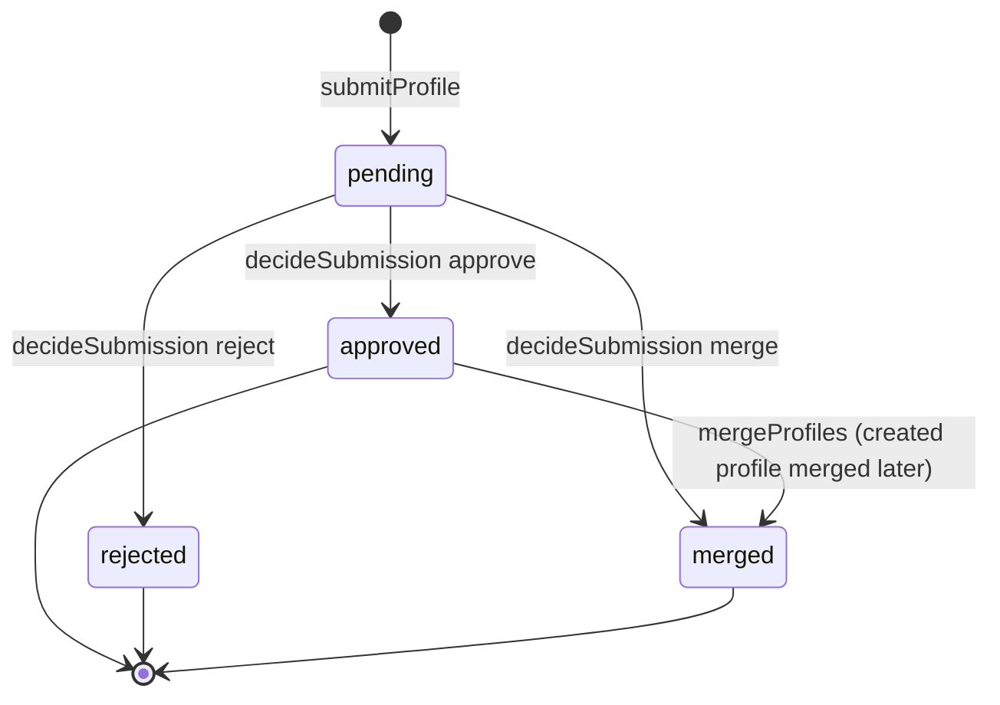
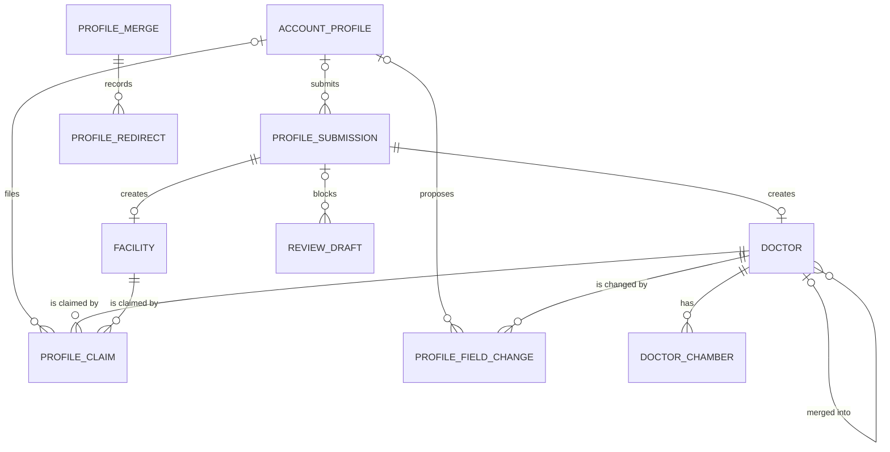

# Functional specification — U17 `t-204-provider-submission-claim-field-change`

Draft written ahead of the stage. The lead finalises it when the workflow reaches this Unit; then it moves to `<record>/construction/t-204-provider-submission-claim-field-change/functional-design/`.

Unit U17 (kind `library`, size M in `unit-of-work.md`, **L after this design** (§ 15), not in the high-risk class, although § 8 touches account deletion) delivers T-204 for US4.2, with the Directory step of AC10.3.3 (FD-069) and the write side of AC4.1.5 that U14 handed over. Lead perspective: architect. Support perspective: developer (transactions, repository writes, test design, written into §§ 8, 10 and 11). The design follows `functional-design-questions.md`: Questions 1–18, all answered A by the agent under the owner's no-questions instruction of 2026-10-29.

**Written 2026-10-29** against: `main` at `9cf860a` with T-010 merged (`14c21a9`); the drafts of U14 T-201, U8 T-101, U10 T-103, U12 T-105 (refreshed 2026-10-29), U15 T-202, U16 T-203 and U21 T-301; `docs/status/decision-log.md` up to FD-094; and the owner's answers in `docs/aidlc-migration/OWNER-REVIEW-QUEUE.md`. What this draft takes from them:

1. **From T-010 (FD-093):** `application` imports only `domain` and `contracts`, so every key is computed in `application` and handed to `database`, which may not import `domain`; adapters are built only in `apps/web/src/server/container.ts`; components import server actions only; the 80% line floor counts untested files; `not-implemented.test.ts` (ISS-294) and the two migration-count pins change in the same commit as the code they pin; `format:check`, `check:identity` and CI run before merge.
2. **From T-101/T-103/T-105:** `defineCommand({name, input, requires, handle})` with the order `authenticated → verifiedEmail → notRestricted → staffRole → capability → stepUp → owner`; the Actor carries `capabilities` only after T-103's device gate; `RateLimiter.hit(key, limit, windowSec)`; `AuditWriter.write` with one allowlisted details builder per action (closes ISS-108 in T-101); `await config.current()`.
3. **From T-201:** `directory.resolvePublicId` follows `profile_redirects` (at most five hops) and the pages answer **308** (T-202 Question 10, T-202 F20); `normalizeAliasKey` in `domain`; doctor `name_key`/`bmdc_key` are left to this Unit (T-201 F2); `omitEmptyFields` honours a `hidden` flag that this Unit writes (T-201 Question 7); provenance entries are `{source, updatedAt}`.
4. **From T-202:** `ClaimButton` + `ClaimSheet` in `components/patient/ClaimSheet.tsx`, gated by T-102's `useAuthGate().guard()`, with `// TODO(T-204)` in the sheet body.
5. **From T-301:** `review.saveDraft` blocks a draft on the author's own pending submission named by `doctorSubmissionPublicId`, through `ReviewRepository.pendingSubmissionOf({submissionPublicId, accountId})`.
6. **Owner answers that bind here:** counts only, no percentages; "Former member" for deleted personas (not used here: provider rows are not personas, staff read "Deleted account", FD-078); the no-questions instruction; FD-094 (independent Units build in parallel in a swarm).

This file is the source of truth for the workflows and state transitions. The data shape is in `entities.md`; the decision logic is in `rules.md`.

## 1. What changes, in one paragraph

A signed-in, confirmed member can add a doctor or facility that is missing from the directory. The submission creates the profile at once in state `pending_review`, invisible to the public, with its community-provenance fields and a submission row that has its own public id, so the composer can park a draft on it (Question 1, Question 16). Staff with `providers.decide` approve it (the profile becomes `published`), reject it, or merge it into the existing profile it duplicates; a merge appends its chambers, moves its reviews and drafts through Review's `ProfileMergeParticipant`, writes `profile_merges` and a `profile_redirects` row, and the pages answer 308 for the old id (Question 3). The same merge also joins two published duplicates through a new `directory.mergeProfiles` command (Question 2). A doctor claims a profile with a contact method and a private evidence note; staff decide it, and no code is sent anywhere (FD-060). The approved claimant corrects the facts in a sheet opened from the same "Is this you?" button (Question 6): schedule, fee, booking contact, languages and chamber details publish at once with history, while name, BMDC number, degrees and specialty wait for staff (FD-061). Rejections carry a reason code, never free text, into the notice (Question 7). Account deletion calls `deidentifyAccount`, which removes the account link from the rows, clears the claimant's own contact text and ends the claim (FD-069, FD-078, Question 11). One forward-only migration makes the needed columns nullable, adds the submission public id, decision reasons, field sources and the booking contact, and turns the three status columns into the `submission_status` enum (ISS-110). Every command writes one audit row and its outbox events in its transaction; the notices themselves are T-405's routes (C15).

## 2. As is (baseline 2026-10-29) and what Bolt 16 can count on

- **Schema** (`packages/database/src/schema/directory.ts`): `profile_submissions` (no `public_id`; `submitted_by_account_id NOT NULL`; `status` plain `text` — ISS-110; `duplicate_of_id` without FK; `reviewer_note`; `created_doctor_id`/`created_facility_id`), `profile_claims` (`claimant_account_id NOT NULL`, `method NOT NULL`, `evidence_note` nullable, **no reason column**), `profile_field_changes` (`proposed_by_account_id NOT NULL`, `provenance NOT NULL`, `protected`, `reason`; no source columns), `profile_merges` (`actor text`, `transferred jsonb`), `profile_redirects` (`from_public_id` primary key, `to_kind`, `to_public_id`, `merge_id`). `doctors` has no booking-contact column. `staff_notification_kind` already contains `newProfile` (02 §0, `contracts/enums.ts`), so the task's extra enum migration is not needed (finding F10).
- **Repository stub** `repositories/directory.ts`: after T-201, the stubs left are `submitProfile`, `decideSubmission`, `claimProfile`, `decideClaim`, `proposeFieldChange`, `decideFieldChange` (owner T-204) and `listSubmissions`, `listClaims`, `listFieldChanges` (owner T-407 in the stub, U17 in C7; Question 9). `repositories/review.ts` has no T-204 stub.
- **Contracts** `schemas/directory.ts`: inputs exist with `z.unknown()` payloads and `TODO(T-201/T-204)` markers; `targetId`, `mergeIntoId` and `reason: z.string().min(1)`.
- **Seed** (`seed-directory.ts`, after CR-012 and T-201): 8 pending submissions (P-140…P-151) as submission rows only, 6 pending claims and 8 pending field changes, all attributed to `shirin_88` (ISS-162, ISS-265). Field changes store the English label as `field` ("Specialty", "Chamber hours") and bilingual text as values, so none can be applied as stored; F-77 and F-84 name specialties that are not terms (finding F3). Doctor keys use `keyify` (lowercase, whitespace removed, hyphens kept) (finding F9). The composer corpus has one draft blocked on P-143.
- **Web**: `apps/web/src/proxy.ts` (locale and `x-pathname` only; no redirect branch needed, Question 3); `ClaimSheet.tsx` from T-202 with the prototype's note; no `AddDoctorPanel`.
- **Gate**: `pnpm check` (typecheck, lint, lint:boundaries, format:check, check:identity, test:coverage, i18n:check, contrast, build; T-011 adds `contrast:patient` and `check:motion`), `pnpm smoke`, CI before merge. Migrations: `0000`–`0008` on `main`; U8, U10, U11, U12 and U14 add theirs first, so this Unit takes the next free number.
- **Construction mode**: FD-094 lets independent Units build in parallel worktrees. This Unit is not independent of U15 T-202 (it rewrites `ClaimSheet.tsx`) or U21 T-301 (both write `repositories/review.ts`, the review fakes, a migration and the migration pins); Question 17 adds the two edges so the swarm never batches them together.

## 3. Settled before this stage

FD-060 (staff decide every claim; no code step), FD-061 (the protected list), FD-067 (cycle break: Directory declares `ProfileMergeParticipant`, Review implements it, built here), FD-069 and FD-078 (de-identify, nullable columns, claim ends), FD-079 (no per-row holds on submissions, claims and field changes; an account hold pauses the whole deletion before this step runs), FD-076 (Result, one transaction, audit and outbox in it), FD-065 (audit port, outbox in the same transaction), FD-070 (worker notices are in-app only; nothing here sends email), FD-088 (the staff triage view is deferred; staff notifications are still created by T-405's routes), FD-093 (boundaries), FD-094 (parallel swarm; identity rule unchanged), D-003 ("Registration not verified" always), the owner's counts-only answer. See `functional-design-questions.md` § "Settled before this stage".

## 4. Workflows

Every command is `defineCommand({name, input, requires, handle})`: parse with the contracts schema → authorize (`requires`) → load → decide with the pure domain functions → persist, audit and outbox in the one transaction of `UnitOfWork.run` (C-rules). An expected failure returns `err(code)`; nothing throws across the boundary. Keys (`doctorNameKey`, `bmdcKey`) are computed in `application` with the domain functions and passed to the repository (BR10.1).

### WF1 — Code Generation order (the Unit end to end)

1. **Baseline.** `pnpm infra:up`; `pnpm check` and `pnpm smoke` green on the Bolt branch; read the open `ISSUES.md` rows: ISS-110, ISS-162, ISS-168, ISS-265, ISS-294 and the rows proposed in § 9.
2. **FD entries.** Append the three entries of § 14 to `docs/status/decision-log.md` with the next free numbers before any code (`project.md` Mandated).
3. **Prerequisites present.** `defineCommand`, `UnitOfWork`, `RateLimiter`, `AuditWriter`, `Outbox`, `IdGenerator`, `Clock`, the Actor with `capabilities` (T-103), `normalizeAliasKey` and T-201's `resolvePublicId`, `findRedirect`, `ProviderExperience` wiring in the container. Adapt the frame, not the rules, if a shape differs.
4. **Domain** (`packages/domain/src/directory/`): `submission-state.ts`, `profile-state.ts` (the profile part this Unit drives), `claim.ts`, `field-change.ts` (`isProtectedField`, `fieldSpec`, `applyFieldChange`), `merge.ts` (`planMerge`, `chaseTarget`), `keys.ts` (`doctorNameKey`, `bmdcKey`), `duplicates.ts` (`duplicateCandidates`), with tests. Plain values only (BR10.1).
5. **Migration** `<n>_directory_provider_writes.sql` (§ 7 of `entities.md`), the schema file, and both migration-count pins raised by one (BR11.4).
6. **Contracts**: inputs, the staff and claimant view models (§ 6), the two new enums `PROFILE_REJECT_REASONS` and `PROFILE_FIELDS`, `bookingContact` in the doctor facts key list.
7. **Ports and repositories**: the write methods of `DirectoryRepository` (§ 8), `ReviewRepository` additions for the merge participant, `TaxonomyRepository.findSpecialtyByKey` / `insertSpecialty` through Taxonomy's `ensureSpecialtyTerm` operation (Question 4); `not-implemented.test.ts`: `PgDirectoryRepository` leaves `STUB_REPOSITORIES` (every method now real) and the trace test keeps a class that stays a stub (BR11.4).
8. **Application**: `modules/directory/{authorization.ts, commands/*.ts, queries/*.ts, internal/deidentify-account.ts, ports.ts (ProfileMergeParticipant)}`, `modules/review/profile-merge-participant.ts`, `modules/taxonomy/ensure-specialty-term.ts`; application tests on the `test-support` fakes (the fakes gain the new methods; the superset test stays green).
9. **Seed** (`seed-directory.ts`, recorded addition): doctor keys through `doctorNameKey`/`bmdcKey`; each pending submission gets its pending profile and a public id; the field changes get canonical field keys and typed values (BR11.6).
10. **Web**: `server/actions/directory.ts`; container wiring for the merge participant and `ensureSpecialtyTerm`; `components/patient/AddDoctorPanel.tsx`; `ClaimSheet.tsx` (claim form, pending state, facts editor); the `patient.css` section for the two forms in the FD-091 look (T-011 tokens; no animation library).
11. **i18n**: the keys of § 12 in `en.json` and `bn.json` in the same commit; Bengali flagged for the owner's review (FD-042).
12. **Integration, component and smoke tests** (§ 11).
13. **Documents**: `02-data-model.md` §4 (new columns, enum statuses, pending profiles), §17 (the claim and field-change tables); `03-routes-and-contracts.md` §4 (directory entries, `mergeProfiles`, rates, the reason codes); a dated note in `contract-summary.md` on C7 (`mergeProfiles`, `approvedClaimOf`, `getMyClaimState`, the internal operation's signature) and C15 (`reasonCode?`, `fieldKey`, `draftsUnblocked`, optional `recipientAccountId`); `05-demo-storyboard.md` step 23 ("308").
14. **Issue register**: ISS-110 fixed in U17 T-204; ISS-265 updated (approving C-58 makes `shirin_88` the claimant of d5; deleting `shirin_88` in step 26 ends that claim and clears the six methods); the § 9 rows.

### WF2 — `directory.submitProfile({kind, payload})` → `{submissionPublicId}`

`requires: {authenticated, verifiedEmail, notRestricted}`; rate `directory.submit:account:<id>` 5 per 86 400 s (BR2.3).

1. Parse: `kind` doctor → `payload {nameEn?, nameBn?, bmdc?, specialty?, chamber?, city?, area?}`; facility → `{nameEn?, nameBn?, type, city, area?, address?}`; at least one name, each text trimmed and NFC-normalised, lengths per `entities.md` (BR3.1).
2. Names: the missing language column takes the other's text as written (a proper name in its own wording, BR3.2).
3. Keys: `doctorNameKey(nameEn ?? nameBn)` and `bmdcKey(bmdc)` (BR3.3).
4. Duplicates: `findDuplicateCandidates({kind, bmdcKey, nameKey})` over profiles in `published` or `pending_review` and not merged; `duplicateCandidates` picks the BMDC match first, then the name match, published before pending (BR3.4). The result fills `duplicate_of_id` (a hint for staff, never a block).
5. Specialty: `taxonomy.findSpecialtyByKey(normalizeAliasKey(specialty))` → `specialty_id` when one canonical specialty matches exactly; otherwise null and the text stays in the payload (Question 4).
6. Persist in one transaction: the profile row (`doctors` or `facilities` + one primary `facility_branches` row) in `pending_review` with `field_provenance[field] = {source: community, updatedAt: now}` for each supplied field and a new `public_id`; for a doctor with `chamber`, one `doctor_chambers` row (name in both columns, `provenance community`, `branch_id` null); the submission row (`public_id`, `kind`, `payload`, `submitted_by_account_id`, `status pending`, `duplicate_of_id`, `created_doctor_id` or `created_facility_id`).
7. Audit `directory` / `profile_submitted` `{kind, submissionId, duplicate: boolean}`; outbox `directory.submissionFiled {submissionId}`.
8. Return `ok({submissionPublicId})`. Unhappy paths: anonymous → `forbidden` (the gate opens client-side first); unconfirmed → `auth.email_unverified`; restricted → `forbidden`; 6th in a day → `rate_limited` with `retryAfterSec`, nothing written; bad payload → `validation` with field keys.

### WF3 — `directory.decideSubmission({submissionId, decision, mergeIntoId?, reasonCode?, note?})`

`requires: {authenticated, capability: 'providers.decide'}`. `submissionId` is the submission's public id; `mergeIntoId` is the target profile's public id (contract names kept, values are public ids, BR10.4).

1. Load the submission `for update`; not found → `not_found`; status other than `pending` → `conflict` (a second decision never overwrites the first, BR1.2).
2. **approve**: the profile → `published` (BR1.3). An unmatched specialty text runs `ensureSpecialtyTerm(tx, {text})` and sets `specialty_id` (Question 4; provenance of `specialty` becomes `admin`, staff checked it). `profileMergeParticipant.unblockDrafts(tx, {submissionId, resolvedDoctorId})` (doctor only) → `{unblocked}`. Submission → `approved`, `decided_by`, `decided_at`. Outbox `doctor.changed {id}` or `facility.changed {id}`; `directory.submissionDecided {submissionId, decision: approved, recipientAccountId?, draftsUnblocked}`.
3. **reject**: `reasonCode` required (BR7.3). The profile → `rejected`; submission → `rejected` with `decision_reason = reasonCode` and the private `note`; drafts stay blocked (the author can pick another doctor, T-301 BR2.4). Event with `reasonCode`.
4. **merge**: `mergeIntoId` required; runs WF7's merge with the pending profile as source and the resolved target; submission → `merged`; the drafts move onto the target (`unblockDrafts` with the target's id). Event `decision: merged`.
5. Audit `submission_decided` `{decision, submissionId, profileId, mergedInto?: profileId, reasonCode?, draftsUnblocked}`.

`recipientAccountId` is the submitter, absent when the account was de-identified (BR7.2). Every created or approved doctor keeps `registrationNotVerified` (BR9.1).

### WF4 — `directory.claimProfile({targetKind, targetId, method, evidenceNote?})` → `{claimId}`

`requires: {authenticated, verifiedEmail, notRestricted}`; rate `directory.claim:account:<id>` 5 per day (Question 14).

1. `targetId` is the page's public id: a doctor, or for `facility` a branch, whose organisation is the claim target (Question 8, BR4.5). Not visible (BR1.1/BR1.2 of T-201) → `not_found`.
2. The actor already holds the claim → `conflict`; the actor already has a pending claim on it → `conflict` (also the partial unique index, BR4.2). A profile claimed by another account may still be claimed; staff decide (BR4.3).
3. Insert `pending` with `method` (1–200) and `evidence_note` (0–2000) as written. No job, no email, no code, no SMS (FD-060, BR4.1). The profile is unchanged.
4. Audit `claim_filed` `{claimId, targetKind}`; outbox `directory.claimFiled {claimId}`.

### WF5 — `directory.decideClaim({claimId, decision, reasonCode?, note?})`

`requires: {authenticated, capability: 'providers.decide'}`. Load `for update`; not pending → `conflict`.

- **approve**: claimant de-identified (null) → `conflict`; the target claimed by another account → `conflict` (staff reject one first, BR4.3). Set `claimed_by_account_id`; claim → `approved`. The profile still shows "Registration not verified" (D-003). No capability or review right is added to the claimant's Actor (BR4.4).
- **reject**: `reasonCode` required; claim → `rejected` with the code in `decision_reason` and the private note in `decision_note`; the profile stays as it was.
- Outbox `directory.claimDecided {claimId, decision, recipientAccountId?, reasonCode?}`; `doctor.changed`/`facility.changed` on approve (the `claimed` flag changes). Audit `claim_decided` `{claimId, decision, reasonCode?}`.

### WF6 — `directory.proposeFieldChange({targetKind, targetId, field, newValue, source?})` and `directory.decideFieldChange({changeId, decision, reasonCode?, note?})`

Propose: `requires: {authenticated, verifiedEmail, notRestricted}` plus the owner check in the handler (`authorization.ts`): the actor holds the approved claim on the target (claimant) **or** has any staff role, Moderator included (staff, FR18 and AC4.1.5 name Moderator-created sourced data, Question 18); anyone else → `forbidden` (BR2.4). A staff proposal always pends; only `providers.decide` decides it, so a Moderator never publishes a fact alone. Rate for claimants `directory.change:account:<id>` 30 per day.

1. `field` is one of `PROFILE_FIELDS` for the kind; `newValue` is parsed by `fieldSpec(kind, field)` (BR5.1). Staff proposals need `source` with a URL or a description and a retrieval date, else `validation` with `fieldErrors.source = errors.directory.sourceRequired` (AC4.1.5, BR5.6).
2. Snapshot the current value as `old_value`.
3. **Claimant + unprotected field** (`languages`, `fee`, `bookingContact`, `chamber`, `address`, or a `visibility` change of one of them): apply at once with `applyFieldChange`; `field_provenance[field] = {source: provider, updatedAt}` (chambers: the chamber row's `provenance = provider`); row stored `approved`, `protected false`, `provenance provider`, `decided_at = now`, `decided_by` null (BR5.2). Outbox `doctor.changed`/`facility.changed`.
4. **Protected field** (`name`, `bmdc`, `qualifications`, `specialty`, facility `name`, `organisationName`; or a visibility change of one of them), or **any staff proposal**: row `pending`, `protected` as `isProtectedField` says, `provenance` = `provider` (claimant) or `admin` (staff); public value unchanged (BR5.3). Outbox `directory.fieldChangeProposed {changeId, protected}`.
5. Audit `field_change_proposed` `{changeId, field, protected, applied: boolean}`.

Decide: `requires: {authenticated, capability: 'providers.decide'}`; not pending → `conflict`. **approve** applies `new_value` with provenance `provider` when the proposer held the claim, `admin` otherwise (a seeded community row included, BR5.4); a `specialty` text runs `ensureSpecialtyTerm`; a `name` or `bmdc` change recomputes `name_key`/`bmdc_key`. **reject** keeps the value; `reasonCode` required. Outbox `directory.fieldChangeDecided {changeId, decision, recipientAccountId?, fieldKey, reasonCode?}` (recipient = the proposer when they held the claim; staff proposers get no notice) and `*.changed` on approve. Audit `field_change_decided` `{changeId, field, decision, reasonCode?}`. A staff member may decide a change they proposed; the audit shows both rows (Question 15).

### WF7 — Merge: `directory.mergeProfiles({kind, sourceId, targetId, reason})` and the merge branch of WF3

`mergeProfiles` `requires: {authenticated, capability: 'providers.decide'}`; `sourceId`/`targetId` are public ids (doctor, or branch for `facility`); `reason` is a staff note (1–500), stored in `profile_merges.reason`, never in an event (Question 2).

1. Load both `for update`. `chaseTarget`: follow `merged_into_id` (doctors) or redirects (branches) at most five hops to the final target; a cycle or a non-`published` final target → `conflict` (BR6.2).
2. `planMerge(source, target)` (pure, BR6.1): refuses self-merge and a kind mismatch (`validation`); a source already merged into the same final target → an empty plan, and the command returns `ok({merged: false})` with nothing written (idempotent re-run); a source merged elsewhere, hidden by moderation, or `rejected` → `conflict`; both profiles claimed by different accounts → `conflict` (BR6.4). Otherwise the plan lists: chambers to append (source chambers whose `doctorNameKey` of the name is not already on the target, `sort_order` after the target's last), the claim to carry over (`claimed_by_account_id` when the target has none), pending claims to re-point or close as `merged` (when the claimant already has one pending on the target), pending field changes to close as `merged`, target `field_provenance` kept, source → `rejected` with `merged_into_id` = target (doctors).
3. Execute in the one transaction: the plan's row changes; `profileMergeParticipant.transfer(tx, {kind, sourceId, targetId})` → `{reviews, drafts}` (Review re-points `reviews.doctor_id` or `reviews.branch_id` and `facility_reviews.branch_id`, and `review_drafts.doctor_id`); `profile_merges` with `transferred {reviews, drafts, chambers, claims, fieldChangesClosed}` from the returned and planned counts; `profile_redirects (source.public_id → target.public_id, merge_id)`; existing redirects whose `to_public_id` is the source re-pointed to the target, so no chain is longer than one hop (BR6.3); a submission whose created profile is the source → `merged`.
4. Outbox `doctor.changed`/`facility.changed` for both ids. Audit `profiles_merged` `{kind, mergeId, sourceId, targetId, transferred}` (counts only).
5. Any failure rolls back everything (the "merge transaction atomicity" test).

Redirects never point at a rejected profile: the target is checked `published` in the same transaction, and a later merge of the target re-points every redirect onto the new target (BR6.3). Directory imports nothing from `modules/review`; the container hands in the participant (BR10.3).

### WF8 — `deidentifyAccount(tx, {accountId})` (internal, deletion step; C7 `directory.deidentify`)

Called by U39 T-410's `modules/directory/deletion-participant.ts` inside its web-tier deletion transaction, after T-410 has checked holds with Retention (FD-077, FD-079). Not a server action; no `requires` (the caller is the deletion orchestration).

1. `profile_submissions.submitted_by_account_id`, `profile_claims.claimant_account_id`, `profile_field_changes.proposed_by_account_id` = `NULL` where they equal `accountId`.
2. On that account's claims: `method` and `evidence_note` = `NULL` (they are the claimant's own contact details and notes, Question 11).
3. `doctors.claimed_by_account_id` and `facilities.claimed_by_account_id` = `NULL` where they equal `accountId`; outbox `*.changed` for each profile whose claim ended.
4. Every row keeps its status, decision, reasons, values and the profiles' `field_provenance` (BR8.1).
5. Audit `directory` / `account_deidentified` `{submissions, claims, fieldChanges, claimsEnded}` (counts only), actor as passed by the caller.
6. Return `ok({submissions, claims, fieldChanges, claimsEnded})`. A second run finds nothing and returns zeros; it still writes its one audit row (task row "each run writes one audit row").

### WF9 — Queries

- `directory.listSubmissions | listClaims | listFieldChanges({status?, page, pageSize?})` (`requires: capability providers.decide` for decisions; moderators read: `staffRole` any, Question 9) → `SubmissionRowVM[]`, `ClaimRowVM[]`, `FieldChangeRowVM[]` with `total`. The claim's `method` and `evidenceNote` are in `ClaimRowVM` only, a staff-only VM (BR9.3). The submitter, claimant and proposer read as `member`, `claimant`, `staff` or `deletedAccount`, never an id or username (BR9.4).
- `directory.getMyClaimState({targetKind, targetId})` (authenticated) → `{state: none | pending | approved | rejected, editor?: ClaimantEditorVM}`; the editor VM (current values of every field the claimant may change, pending changes, the chamber list with opaque `chamberKey`s) only for `approved` (Question 6).
- `directory.approvedClaimOf({accountId})` (internal, for U30 T-401's provider label) → `{kind, publicId} | null`.
- `directory.pendingCounts()` (internal, for U35 T-406's nav and U37 T-408) → `{submissions, claims, protectedChanges}`.

### WF10 — Patient entry points

- **`AddDoctorPanel`** (client, standalone; U26 T-306 mounts it): the `link-btn` `compose.addDoctor` toggles a `.callout` with four fields (`compose.addName`, `compose.addBmdc`, `compose.addSpecialty`, `compose.addChamber`), `.btn.small` `compose.addSubmit` and, after success, the note `compose.addPending`. The name is sent as `nameBn` on `/bn` and `nameEn` on `/en`. Signed out or unconfirmed → T-102's `useAuthGate().guard()`. On success it calls `onSubmitted(submissionPublicId)`. Field errors render under each field from `fieldErrors` keys; `rate_limited` shows `errors.common.rateLimited`. T-011 tokens; the callout opens with the `@starting-style` entry inside `prefers-reduced-motion: no-preference`.
- **`ClaimButton` / `ClaimSheet`** (client, replaces T-202's body; props gain `targetKind` and `targetPublicId`): the guard as T-202 has it; on open, `getMyClaimStateAction` decides the body: `none` or `rejected` → the claim form (`profileClaim.method`, `profileClaim.evidenceNote`, `profileClaim.submit`, the prototype's `profile.claimNote` above it); after success `profileClaim.sent`; `pending` → `profileClaim.pendingState`; `approved` → the facts editor (`profileEdit.*`): one row per field with its current value, a save per row, the protected-field note, add / edit / remove chamber, hide / show for hideable fields; after a save the row reads `profileEdit.saved` or `profileEdit.pending`. The sheet traps and returns focus (T-011 `Sheet`), and announces results once through `useAnnounce()`.
- No facility entry point in release 1 (Question 8; the prototype has none).

## 5. State transitions



Text fallback: a submission starts `pending`; staff move it once to `approved`, `rejected` or `merged`; an approved submission becomes `merged` only when its created profile is later merged into another; nothing returns to `pending`.

| Entity | From | Event | To | Rule |
|---|---|---|---|---|
| Profile (doctor, facility, branch) | — | submitProfile | `pending_review` | BR1.3 |
| Profile | `pending_review` | approve | `published` | BR1.3 |
| Profile | `pending_review` | reject | `rejected` | BR1.3 |
| Profile | `pending_review` or `published` | merged as source | `rejected` + `merged_into_id` (doctor) + redirect | BR6.1 |
| Claim | — | claimProfile | `pending` | BR4.1 |
| Claim | `pending` | decideClaim | `approved` / `rejected` | BR4.3 |
| Claim | `pending` | source merged, claimant already pending on target | `merged` | BR6.1 |
| Field change | — | claimant, unprotected | `approved` (applied) | BR5.2 |
| Field change | — | protected or staff | `pending` | BR5.3 |
| Field change | `pending` | decideFieldChange | `approved` (applied) / `rejected` | BR5.4 |
| Field change | `pending` | target merged as source | `merged` | BR6.1 |
| Profile claim link | set | `deidentifyAccount` or claim replaced by staff | `NULL` | BR8.1 |

Moderation's `hidden` state of a profile (U33 `setProfileState`) is outside these tables; a hidden profile cannot be merged or claimed until restored (BR6.4, BR4.5).

## 6. View models and inputs (`packages/contracts`)

Inputs (`schemas/directory.ts`, all `.strict()`; field details in `entities.md` § 3): `SubmitProfileInput` (discriminated by `kind`), `DecideSubmissionInput {submissionId, decision, mergeIntoId?, reasonCode?, note?}`, `ClaimProfileInput {targetKind, targetId, method, evidenceNote?}`, `DecideClaimInput {claimId, decision, reasonCode?, note?}`, `ProposeFieldChangeInput {targetKind, targetId, field, newValue, source?}`, `DecideFieldChangeInput {changeId, decision, reasonCode?, note?}`, `MergeProfilesInput {kind, sourceId, targetId, reason}`, `GetMyClaimStateInput {targetKind, targetId}`, the three list inputs unchanged. The existing `reason: z.string().min(1)` becomes `reasonCode` (enum, required on reject) plus an optional private `note` (≤ 500) (Question 7).

| View model | Fields | Audience |
|---|---|---|
| `SubmissionRowVM` | `submissionId` (public id), `kind`, `name`, `specialty?`, `city?`, `bmdc?`, `chamber?`, `submittedBy` (`member`/`deletedAccount`), `duplicateOf?` {`publicId`, `name`}, `profilePublicId`, `note?` (seeded triage note), `status`, `createdAt` | staff |
| `ClaimRowVM` | `claimId`, `target` {`kind`, `publicId`, `name`}, `claimant` (`member`/`deletedAccount`), `method?`, `evidenceNote?`, `targetClaimedByOther` (boolean), `status`, `createdAt` | staff only (private evidence) |
| `FieldChangeRowVM` | `changeId`, `target` {`kind`, `publicId`, `name`}, `field` (`PROFILE_FIELDS`), `from`, `to` (display values in `actor.locale`), `protected`, `proposer` (`claimant`/`staff`/`member`/`deletedAccount`), `source?` {`url?`, `description?`, `retrievedOn`}, `status`, `createdAt` | staff |
| `MyClaimStateVM` | `state`, `editor?` (`ClaimantEditorVM`: `fields` [{`field`, `value?`, `hidden`, `protected`, `pending`}], `chambers` [{`chamberKey`, `name`, `hours?`, `hidden`}]) | the account itself, on a per-request `noindex` render |
| `DoctorProfileVM.facts` (T-201's) | key list gains `bookingContact` | public |

`chamberKey` is the chamber's opaque internal id, carried only in the claimant's own VM and accepted back only from that claimant (BR5.5). No VM carries an account id, email, username of a claimant or the evidence note outside `ClaimRowVM` (BR9.3, BR9.4). No percentage in any VM.

## 7. Ports

```text
ProfileMergeParticipant (declared in modules/directory/ports.ts; implemented in modules/review/profile-merge-participant.ts, C7)
  transfer(tx, {kind: doctor | facility, sourceId, targetId}) -> {reviews, drafts}
  unblockDrafts(tx, {submissionId, resolvedDoctorId?}) -> {unblocked}

Taxonomy operation used by Directory (Directory -> Taxonomy is an allowed edge)
  ensureSpecialtyTerm(tx, {nameEn, nameBn}) -> {termId, created}
    exact name-key match on an active canonical specialty, else insert a canonical (not provisional) specialty term
    with both name keys; staff-checked; outbox term.changed when created; no account recorded (T-201 F12)
```

The Review implementation reads and writes only Review tables through new `ReviewRepository` methods: `repointDoctor(tx, from, to)`, `repointBranch(tx, from, to)` (reviews and facility reviews), `repointDraftDoctor(tx, from, to)`, `unblockDraftsFor(tx, submissionId, doctorId?)`. When `resolvedDoctorId` is absent (a rejected submission) it unblocks nothing. It is wired in `container.ts`; Directory tests use a fake participant (acceptance "merge through the port").

## 8. Developer view — repository writes (`packages/database/src/repositories/directory.ts`)

All take the transaction; reads that guard a decision use `for update`. Keys arrive computed.

| Method | Does |
|---|---|
| `insertPendingDoctor(tx, row)`, `insertPendingFacility(tx, org, branch)`, `insertChamber(tx, row)` | WF2 step 6 |
| `insertSubmission(tx, row)`, `findSubmissionForUpdate(tx, publicId)`, `setSubmissionDecision(tx, id, {status, decidedBy, decidedAt, decisionReason?, reviewerNote?})` | WF2, WF3 |
| `findDuplicateCandidates({kind, bmdcKey?, nameKey})` | WF2 step 4, two indexed lookups |
| `setProfileState(tx, {kind, id, state})` | approve, reject, merge source (the publication part this Unit owns) |
| `insertClaim(tx, row)`, `findClaimForUpdate(tx, id)`, `setClaimDecision(tx, …)`, `pendingClaimOf(tx, {target, accountId})` | WF4, WF5 |
| `setClaimedBy(tx, {kind, id, accountId | null})` | WF5, WF7, WF8 |
| `insertFieldChange(tx, row)`, `findFieldChangeForUpdate(tx, id)`, `setFieldChangeDecision(tx, …)` | WF6 |
| `applyDoctorFields(tx, id, columns, provenancePatch)`, `applyBranchFields`, `applyFacilityFields`, `updateChamber`, `deleteChamber`, `appendChambers(tx, targetId, rows)` | WF6, WF7 |
| `findProfileForUpdate(tx, {kind, publicId})`, `insertMerge(tx, row)`, `insertRedirect(tx, row)`, `repointRedirects(tx, fromTo, newTo)`, `closePendingFor(tx, {kind, id}, status)` | WF7 |
| `deidentifyAccount(tx, accountId)` → counts | WF8, four `UPDATE … RETURNING id` statements |
| `listSubmissions`, `listClaims`, `listFieldChanges`, `myClaimState`, `approvedClaimOf`, `pendingCounts` | WF9 |

`field_provenance` is patched with `jsonb_set` per key, never replaced whole, so one change cannot erase another field's provenance (BR5.7). The `pg` error for the open-claim index (`23505`) maps to `conflict`.

## 9. Findings and proposed ISS rows

Each is proposed `Found in U17 T-204 (Functional Design draft)`; the caller adds them with the next free numbers (the register ends at ISS-302).

- **F1 (S2, designed out by Question 1)** — The task creates a profile only on approval, so a merged submission has no URL, no chamber row and nothing to transfer, while its own acceptance row ("source chambers appended… `GET /en/doctors/{oldId}` → 301") and storyboard step 23 ("merge P-140 into d2, redirect works") expect both. A submission now creates its `pending_review` profile (components.md, 02 §17).
- **F2 (S2, designed out by Question 2)** — FR23 and AC4.2.5 merge two confirmed duplicate profiles with their reviews, but C7 has only the submission merge. `directory.mergeProfiles` is added (C7 note).
- **F3 (S2, fixed here)** — The seeded field changes store the English label as `field` and bilingual text as values, and F-77/F-84 name specialties that are not terms, so storyboard step 23's "decide a protected field change" could not apply any of them. The seed gets canonical keys and typed values; specialty text goes through `ensureSpecialtyTerm` (Question 4).
- **F4 (S2, designed out by Question 5)** — FR21 and AC4.2.3 name a booking contact; `doctors` has no such column and no Unit adds one.
- **F5 (S2, designed out by Question 6)** — No screen lets an approved claimant change anything, while `notif.claim.approved` says "You can now correct the facts". The facts editor lives in the claim sheet.
- **F6 (S2, designed out by Question 7)** — The task's notices `notif.claim.rejected` and `notif.draft.profileRejected` put the staff's free-text `{reason}` into notification params, which `02-data-model.md` §12 and C15 forbid (ids, enums and counts only). Reason codes replace them.
- **F7 (S2, fixed here)** — `profile_claims` has no reason column, so AC4.2.2 ("the claimant sees the reason") had nowhere to store it.
- **F8 (S2, designed out by Question 16)** — U21 T-301 blocks drafts on `doctorSubmissionPublicId`, but `profile_submissions` has no public id.
- **F9 (S2, fixed here)** — Seeded `bmdc_key` keeps the hyphen (`a-38054`) and `name_key` the honorific; keys computed by a new normaliser would miss P-140's duplicate of d2. The seed computes both keys with the domain functions.
- **F10 (S3, designed out)** — Task step 3 adds `newProfile` to `staff_notification_kind`; it already exists. No enum migration.
- **F11 (S3, designed out)** — Task step 3 stores "which provenance" in `reason`; the row's `provenance` column holds it.
- **F12 (S2, designed out by Question 11)** — The claim form asks "How can we reach you to confirm?", so `method` holds the claimant's contact details, which FD-069's "keep the rows" would keep after deletion.
- **F13 (S2, designed out by Question 17)** — Under FD-094 the swarm builds Units without a dependency edge at once. U17 does not depend on U15 although it rewrites U15's `ClaimSheet.tsx`, and U17 and U21 both write `repositories/review.ts`, the review fakes, a migration and the two migration pins with no edge between them.
- **F14 (S3, designed out)** — The acceptance row expects 301; a Server Component's `permanentRedirect` sends 308 (T-202 Question 10). The row reads "308 (permanent)"; no `proxy.ts` branch.
- **F15 (S2, decided by Question 13)** — FR19 and AC4.2.4 (photo suggestions) are "In" with no builder; T-204 says Phase 1 omits photos. Moved to release 2 by FD entry (c).
- **F16 (S4, U8 T-101 and every draft)** — T-101's draft writes its four rows as FD-094…FD-097, but FD-094 is now the owner's parallel-build decision. Each draft renumbers at append time, as T-101 already says; this draft uses `FD-<next>`.
- **F17 (S3, designed out by Question 10)** — The task's new keys `claim.method`, `claim.evidenceNote`, `claim.submit`, `claim.sent` land in the `claim.*` namespace of the reviewer labels (`claim.wrongDx`…), which the composer reads by code.
- **F18 (S4, designed out)** — A facility page is a branch, but `claimed_by_account_id` sits on the organisation; a facility claim targets the organisation of the page's branch (Question 8).
- **F19 (S4, accepted)** — The in-memory `RateLimiter` (T-101) forgets the daily counts on restart; accepted for the local demo.
- **F20 (S4, U21 T-301)** — The task's "claim never controls reviews" row calls `review.*` commands, which land in Bolt 17. This Unit proves the Actor gains nothing; T-301 adds the row against its commands.
- **F21 (S4, recorded)** — Seeded claims C-60 and C-63 describe "a one-time code sent to the chamber phone"; they are the claimant's own words in a staff-only view and stay, though FD-060 deferred any code step.
- **F22 (S2, designed out by Question 18)** — FR18, AC4.1.5 and 03 §4 ("claimant or staff") let a Moderator create sourced profile data, but a proposal gated on `providers.decide` would refuse every Moderator (T-103 gives Moderators `reports.read` and `content.act` only). Any staff role proposes; the proposal pends for `providers.decide`.
- **Existing rows**: ISS-110 (fixed here by the enum cast); ISS-162 and ISS-265 (generic submitter; § 4 WF1 step 14); ISS-168 (seeded `claimed` doctors have no claimant: not changed here, there is no basis for one); ISS-294 (stub list updated).

## 10. Developer view — mechanics

- **Transactions**: every command is one `UnitOfWork.run`; the merge and the de-identify run the participant and every write on the same `tx`. Rows that a decision depends on are loaded `for update`; the second of two concurrent decisions sees a non-pending status and returns `conflict`.
- **Names and keys**: `doctorNameKey(s)` = `normalizeAliasKey` after removing a leading honorific (`dr`, `prof`, `ডা`, `ডাঃ`, `অধ্যাপক`) and its dot; `bmdcKey(s)` = NFKC, lowercase, every character outside `[a-z0-9]` removed (`A-38054` → `a38054`). Both live in `domain/directory/keys.ts`; T-205 may reuse them.
- **Specialty term**: `ensureSpecialtyTerm` runs in Taxonomy on the caller's `tx` and uses an `on conflict do nothing` + re-read on the existing name-key lookup, so two approvals racing on the same text create one term.
- **Chamber edits**: `chamberKey` must belong to the target doctor (`updateChamber … where id = $1 and doctor_id = $2`); a foreign key returns `validation`, never `not_found`, so ids cannot be probed (BR5.5).
- **Seed**: pending profiles are written only when their submission is new (seed idempotency, ISS-179); an existing local demo database needs `pnpm demo:reset` once.
- **Container**: `apps/web/src/server/container.ts` builds `PgDirectoryRepository`, the Review participant over `PgReviewRepository`, and passes `ensureSpecialtyTerm`; `apps/web/src/server/actions/directory.ts` is `parse → getActor → command → Result` per export, nothing else.

## 11. Developer view — tests

| Level | Test | Rule |
|---|---|---|
| domain | state tables for submission, claim, field change; `isProtectedField` for each of the 13 fields; `fieldSpec` parses and refuses; `planMerge` (self-merge, kind mismatch, already merged → empty plan, merged elsewhere → conflict, both claimed → conflict, chamber dedupe); `chaseTarget` (two hops, cycle, five-hop cap); keys (`A-38054`, `Dr. Imtiaz Kabir`, Bengali honorific); `duplicateCandidates` order | BR1, BR3, BR5, BR6 |
| application (fakes) | each command × allowed actor and refused actor (`forbidden`: moderator decides, non-claimant proposes; `auth.email_unverified`; restricted); 6th submission → `rate_limited`; duplicate fills `duplicate_of_id = d2` for `A-38054`; approve unblocks drafts and emits `draftsUnblocked`; reject without `reasonCode` → `validation`; claim stores no job and no email; decide claim approve/reject with the Actor's capabilities unchanged; protected pends, unprotected applies with `provider`; staff proposal without source → `validation`; a Moderator's sourced proposal pends and the Moderator's `decideFieldChange` → `forbidden`; merge calls the fake participant once and uses its counts; every command writes one audit row with allowlisted details and its named events (`events` row of the task); Directory imports nothing from `modules/review` (static import test) | BR2, BR4–BR8, BR10.3 |
| database (`*.int.test.ts`) | merge transfers chambers, reviews (`doctor_id = target`), drafts, writes `profile_merges.transferred` and the redirect, flattens an older redirect; atomicity (a failure injected after the chamber copy commits nothing); `resolvePublicId(old)` → `{redirected: true, publicId: target}`; reject after a merge attempt leaves no redirect to a rejected profile; de-identify for account A (2 submissions, 1 claim, 3 field changes, an approved claim on a doctor): rows kept with status, decision and provenance, account link and claim text `NULL`, claim ended, B untouched, second run changes 0; migration: the three columns accept `NULL`, the status columns refuse `'bogus'` (ISS-110) | BR6, BR8, BR11.3 |
| seed (`seed.int.test.ts`) | P-140's pending profile has `duplicate_of_id` = d2; each seeded field change parses with `fieldSpec`; the blocked draft still names P-143's submission | BR11.6 |
| component | `AddDoctorPanel`: toggle, four labelled fields, submit, pending note, gate when signed out, field errors, `en` and `bn`; `ClaimSheet`: gate, claim form → sent, pending state, approved → editor with the protected note, save states, Bengali numerals in the editor's values | BR9.5 |
| smoke | `directory.smoke.test.ts`: submit → approve → the doctor is published with "Registration not verified"; `AddDoctorPanel` renders in both locales | BR11.2 |

## 12. i18n keys (new; `en` and `bn` in the same commit)

Bengali drafts below are flagged for the owner's bilingual review (FD-042).

| Key | en | bn |
|---|---|---|
| `profileClaim.method` | How can we reach you to confirm? | নিশ্চিত করতে আপনার সঙ্গে কীভাবে যোগাযোগ করব? |
| `profileClaim.evidenceNote` | Anything that helps us check (kept private) | যাচাইয়ে সাহায্য করে এমন কিছু (গোপন থাকবে) |
| `profileClaim.submit` | Send claim | দাবি পাঠান |
| `profileClaim.sent` | Claim received. We will check it and let you know. | দাবি পাওয়া গেছে। আমরা যাচাই করে জানাব। |
| `profileClaim.pendingState` | Your claim is being checked. We will let you know. | আপনার দাবি যাচাই করা হচ্ছে। আমরা জানাব। |
| `profileEdit.title` | Correct the facts | তথ্য সংশোধন করুন |
| `profileEdit.protectedNote` | Changes to the name, BMDC number, degrees and specialty are checked by an administrator before they show. | নাম, বিএমডিসি নম্বর, ডিগ্রি ও বিশেষত্বের পরিবর্তন দেখানোর আগে একজন অ্যাডমিন যাচাই করেন। |
| `profileEdit.save` | Save | সংরক্ষণ করুন |
| `profileEdit.saved` | Saved. It shows on the profile now. | সংরক্ষিত হয়েছে। এখন প্রোফাইলে দেখাচ্ছে। |
| `profileEdit.pending` | Sent for checking. The current value stays until it is approved. | যাচাইয়ের জন্য পাঠানো হয়েছে। অনুমোদন না হওয়া পর্যন্ত বর্তমান তথ্যই থাকবে। |
| `profileEdit.addChamber` | Add a practice location | চেম্বার যোগ করুন |
| `profileEdit.removeChamber` | Remove this location | এই চেম্বার সরান |
| `profileEdit.hide` / `profileEdit.show` | Hide from the profile / Show on the profile | প্রোফাইল থেকে লুকান / প্রোফাইলে দেখান |
| `profile.bookingContact` | Booking contact | সিরিয়ালের যোগাযোগ |
| `directory.field.{name,bmdc,qualifications,specialty,languages,fee,bookingContact,chamber,address,organisationName,visibility}` | Name; BMDC number; Degrees; Specialty; Languages; Consultation fee; Booking contact; Practice location; Address; Organisation name; Shown on profile | নাম; বিএমডিসি নম্বর; ডিগ্রি; বিশেষত্ব; ভাষা; পরামর্শ ফি; সিরিয়ালের যোগাযোগ; চেম্বার; ঠিকানা; প্রতিষ্ঠানের নাম; প্রোফাইলে দেখানো |
| `directory.rejectReason.{duplicate,notEnoughEvidence,couldNotConfirm,incorrectDetails,notAllowed,other}` | It is already in the directory; There was not enough to check it; We could not confirm it with you; The details did not match; It breaks the content rules; Another reason — contact us if you have questions | এটি আগে থেকেই ডিরেক্টরিতে আছে; যাচাই করার মতো যথেষ্ট তথ্য ছিল না; আপনার সঙ্গে নিশ্চিত করা যায়নি; তথ্য মেলেনি; এটি কনটেন্টের নিয়ম ভাঙে; অন্য কারণ — প্রশ্ন থাকলে যোগাযোগ করুন |
| `notif.draft.profileReady` | The doctor you wrote about is now in the directory. Your draft is ready to finish. | আপনি যে ডাক্তারকে নিয়ে লিখেছেন তিনি এখন ডিরেক্টরিতে আছেন। আপনার খসড়া শেষ করার জন্য প্রস্তুত। |
| `notif.submission.approved` | The profile you added is now in the directory. | আপনার যোগ করা প্রোফাইল এখন ডিরেক্টরিতে আছে। |
| `notif.submission.merged` | The profile you added was already listed. Your draft now uses that profile. | আপনার যোগ করা প্রোফাইল আগে থেকেই তালিকায় ছিল। আপনার খসড়া এখন সেই প্রোফাইল ব্যবহার করছে। |
| `notif.draft.profileRejected` | The profile you submitted was not added: {reason} | আপনার জমা দেওয়া প্রোফাইল যোগ করা হয়নি: {reason} |
| `notif.claim.approved` | Your profile claim was approved. You can now correct the facts. | আপনার প্রোফাইল দাবি অনুমোদিত হয়েছে। এখন তথ্য সংশোধন করতে পারবেন। |
| `notif.claim.rejected` | Your profile claim was not approved: {reason} | আপনার প্রোফাইল দাবি অনুমোদিত হয়নি: {reason} |
| `notif.fieldChange.approved` | Your change to {field} was approved and now shows. | {field}-এর পরিবর্তন অনুমোদিত হয়েছে এবং এখন দেখাচ্ছে। |
| `notif.fieldChange.rejected` | Your change to {field} was not approved: {reason} | {field}-এর পরিবর্তন অনুমোদিত হয়নি: {reason} |
| `admin.notif.kind.newProfile` | New profile submission | নতুন প্রোফাইল জমা |
| `errors.directory.{nameRequired,sourceRequired,methodRequired,valueInvalid,typeRequired,cityRequired}` | Name: enter the name as it is written.; Source: add a link or a description and the date you checked it.; How to reach you: tell us how we can confirm.; This value can't be used here.; Type: choose hospital, clinic or diagnostic centre.; City: enter the city. | নাম: যেভাবে লেখা হয় সেভাবে নাম দিন।; উৎস: একটি লিংক বা বিবরণ এবং যাচাইয়ের তারিখ দিন।; যোগাযোগ: কীভাবে নিশ্চিত করব তা জানান।; এই তথ্য এখানে ব্যবহার করা যাবে না।; ধরন: হাসপাতাল, ক্লিনিক বা ডায়াগনস্টিক সেন্টার বেছে নিন।; শহর: শহরের নাম দিন। |

In the notices, `{reason}` and `{field}` are filled by T-405 from the enum codes in the event (`directory.rejectReason.<code>`, `directory.field.<key>`), never from staff text (BR7.3). The staff copy ("Deleted account", "Member", the reason picker labels) is U36 T-407's; it reuses `directory.rejectReason.*`.

## 13. Synthesis — decisions and why

- **The profile exists from the submission (Question 1).** The data model's state table, `components.md` and the task's own merge row all assume a pending profile; creating it at once gives the merge a real source (chambers, a public id, a redirect) and makes approve a state change. Public reads already filter on `published` (T-201 BR1.1). Alternative rejected: create on approval, which leaves the submission merge without content and the storyboard's redirect with no old URL.
- **One merge, two entries (Question 2).** `planMerge` and the participant serve the submission merge and `mergeProfiles`; FR23's published duplicates get a command now and a staff control when a screen exists.
- **308 from the page (Question 3).** T-201 and T-202 already resolve ids on the page; a proxy lookup would read the database on every profile request.
- **Codes, not text, cross into notices (Question 7).** The rule that outbox and notification params carry no content is older and broader than the task's copy; staff keep a private note for the record.
- **The claimant edits inside the claim sheet (Question 6).** It reuses the entry point the prototype has, needs no new route, and keeps every claimant-only value out of the public, cacheable profile view model.
- **De-identification clears contact text (Question 11).** FD-069 keeps rows for history; the method is the claimant's own contact detail, not history about the doctor.
- **Keys in `application`, writes in `database`.** T-010's matrix forbids `database → domain`, so the commands compute keys and plans and the repository executes them; the merge participant keeps Review tables inside Review.
- **Parallel safety (Question 17).** Two dependency edges cost nothing in the serial Bolt order (U15 is Bolt 14, U21 Bolt 17) and stop the swarm from putting colliding Units in one batch.

## 14. FD entries the build appends before code

Next free numbers at build time (FD-094 is the owner's parallel-build decision; U8 T-101, U11 T-104, U12 T-105, U14 T-201, U15 T-202, U16 T-203 and U20 T-207 append theirs first). Text, with the decision-log columns:

- **(a) FD-<next> — Provider submissions, merges and the directory write schema (U17 T-204 Questions 1–5, 7, 16)**: a community submission creates its doctor (or facility with one primary branch) at once in state `pending_review`, invisible to every public view, with community provenance, its chamber and a `profile_submissions` row that has its own `public_id`; approve publishes it, reject sets it `rejected`, merge merges it into the duplicate. `directory.mergeProfiles {kind, sourceId, targetId, reason}` (`providers.decide`) merges two published duplicates with the same rules (reviews, drafts, chambers and claims transfer; target provenance kept; source `rejected` with `merged_into_id`; one `profile_merges` row; a `profile_redirects` row and older redirects re-pointed, so no chain is longer than one hop); release 1 has no staff screen for it. Old ids answer 308 from the page through `directory.resolvePublicId`; `proxy.ts` gains no redirect branch. An unmatched specialty text becomes a canonical specialty term when staff approve (`ensureSpecialtyTerm`). Staff rejections carry a reason code from `PROFILE_REJECT_REASONS`, which the notice shows; the staff's free-text note stays private on the row. Data-model changes in one forward-only migration: `profile_submissions.public_id` (unique) and `decision_reason`; `profile_claims.decision_reason` and `decision_note`; `profile_field_changes.decision_note`, `source_url`, `source_description`, `retrieved_on`; `doctors.booking_contact_en/bn` (an unprotected, publicly shown fact); the three `status` columns become `submission_status` (ISS-110); a partial unique index allows one pending claim per account and profile. C7 and C15 gain `mergeProfiles`, `getMyClaimState`, `approvedClaimOf`, `pendingCounts`, the events' optional `recipientAccountId`, `reasonCode`, `fieldKey` and `draftsUnblocked`. | The task's create-on-approval model left the merge without content and the storyboard's redirect without an old URL; FR23 needs published duplicates merged; notification params may carry no content. Decided by the agent under the owner's no-questions instruction of 2026-10-29
- **(b) FD-<next+1> — De-identification clears a claimant's own words (U17 T-204 Question 11; applies FD-069 and FD-078)**: when an account is deleted, `directory.deidentify` also sets `profile_claims.method` and `evidence_note` to `NULL` on that account's claims (`method` becomes nullable in the same migration), because they hold the claimant's own contact details and notes; every row still keeps its status, decision, reason code, values and the profiles' provenance, and staff views read "Deleted account". Data-boundary change to `02-data-model.md` §4. | The claim form asks how to reach the claimant, so the text is personal data, not history about the doctor. Decided by the agent under the owner's no-questions instruction of 2026-10-29
- **(c) FD-<next+2> — Release 1 narrowing of the provider side (U17 T-204 Questions 8 and 13)**: profile photos (FR19, AC4.2.4: community suggestions with an approved source, and a claimed doctor's own photo) move to release 2, because they need a new public upload path; every profile keeps its generated initials avatar. Facility claims and facility field changes exist as commands (a claim on a facility page targets its organisation) but release 1 shows no facility claim button, as the prototype shows none; FR25's claim path and AC4.3.2's claim half are served by staff through the commands until a facility screen exists. | No Unit builds photos and the prototype has no facility claim entry point. Decided by the agent under the owner's no-questions instruction of 2026-10-29

## 15. Owned paths and recorded additions

Owned by the task (as amended): the domain files under `packages/domain/src/directory/`, `modules/directory/{commands,authorization.ts}`, `ports/repositories/directory.ts` (write methods added), `repositories/directory.ts`, `repositories/review.ts` (the participant's methods only), `modules/review/profile-merge-participant.ts`, the migration, `contracts/schemas/directory.ts`, `server/actions/directory.ts`, `AddDoctorPanel.tsx`, `ClaimSheet.tsx`, the i18n keys. Removed from the owned paths: `apps/web/src/proxy.ts` (Question 3). Additions, each named in the hand-off with its reason:

| Path | Why |
|---|---|
| `packages/database/src/schema/directory.ts`, `migrations/meta/` | the migration's columns, enum, index |
| `validator-probes.int.test.ts` (P8), `migrations.int.test.ts` | migration-count pins (BR11.4) |
| `repositories/not-implemented.test.ts` | ISS-294 (BR11.4) |
| `modules/directory/{queries/*.ts, internal/deidentify-account.ts, ports.ts}` | WF8, WF9, the port declaration |
| `modules/taxonomy/ensure-specialty-term.ts`, `ports/repositories/taxonomy.ts`, `repositories/taxonomy.ts` (two methods) | Question 4 |
| `ports/repositories/review.ts` (four methods) | § 7 |
| `domain/directory/keys.ts`, `duplicates.ts`, `profile-state.ts` | § 10 |
| `contracts/src/enums.ts` (`PROFILE_REJECT_REASONS`, `PROFILE_FIELDS`), `contracts/src/view-models/providers.ts`, `view-models/doctor.ts` (`bookingContact` fact key) | § 6 |
| the T-201 doctor mapper in `repositories/directory.ts` / `modules/directory/queries/get-doctor.ts` (`bookingContact` fact) | Question 5 |
| `test-support/src/fakes/repositories.ts` (+ tests), a fake `ProfileMergeParticipant` | superset test, application tests |
| `test-support/src/seed/seed-directory.ts`, `seed.int.test.ts`, `corpus/types.ts` and `scripts/port-corpus.mjs` if the field keys come from the port | F3, F9, Question 1 |
| `apps/web/src/server/container.ts` | wiring (§ 10) |
| `apps/web/src/styles/patient.css` (this Unit's section) | the two forms in the FD-091 look |
| `docs/status/decision-log.md`; `02-data-model.md` §4, §17; `03-routes-and-contracts.md` §4; `contract-summary.md` C7/C15 note; `05-demo-storyboard.md` step 23 | § 14, WF1 step 13 |
| `aidlc/.../units-generation/unit-of-work-dependency.md` (two edges) — or the next Units revision if that file is frozen | Question 17 |

## 16. Risks to verify in Code Generation and Build and Test

- U14 T-201 renames the directory stubs and adds its migration first; the doctor mapper and `resolvePublicId` exist as drafted. If T-201 kept `keyify` for doctors, this Unit's seed change covers both.
- T-202's `ClaimSheet.tsx` and `useAuthGate` exist as drafted; if the sheet's props differ, adapt the props, not the rules.
- U21 T-301 has not built `review.saveDraft` yet (Bolt 17): `unblockDrafts` is tested on rows inserted directly; T-301's `pendingSubmissionOf` reads the new `public_id`.
- U34 T-405 builds the routes later (Bolt 19): until then the six events relay to no job. The acceptance rows "owner receives a draft notification" and "claimant notified" are proved here at the event (recipient, code, counts) and end to end in T-405's Build and Test (cross-Unit pickup).
- The enum cast on the three status columns fails if a local database holds a value outside the enum; the migration checks first and stops with a clear message (none on the seed).
- Size: the pending-profile model, `mergeProfiles`, the editor sheet, the seed changes and the test pins take the Unit from M to L (about 5 h agent); `unit-of-work.md` is corrected at the next Units revision.

## Entity-relationship view (derived from `entities.md`)



Text fallback: an account (or, after deletion, nobody) submits submissions, files claims and proposes field changes; a submission creates one pending doctor or facility and may block the submitter's drafts; claims and field changes point at a doctor or a facility; a doctor has chambers and may be merged into another doctor; each merge records its redirects.

## Rules summary (derived from `rules.md`)

BR1 lifecycles; BR2 authorization and limits; BR3 submissions, names, keys and duplicates; BR4 claims; BR5 field changes and provenance; BR6 merges and redirects; BR7 events, notices and audit; BR8 de-identification; BR9 hard rules and privacy in projections; BR10 boundaries and ports; BR11 verification and records. The one-line table is at the end of `rules.md`.

## Sources

- `docs/implementation/tasks/T-204-provider-submission-claim-field-change.md` (amendments FD-045..FD-090, steps 1–9, acceptance checks, hard-rule checklist).
- `aidlc/spaces/default/intents/261011-aidlc-adoption/inception/`: `units-generation/unit-of-work.md` (U17 and its open points), `unit-of-work-dependency.md`, `unit-of-work-story-map.md`; `user-stories/stories.md` US4.2, AC4.1.5, AC4.3.2, AC10.3.3; `requirements-analysis/requirements.md` FR13, FR15–FR21, FR23, FR25, NFR8; `domain-design/components.md` (Directory); `contract-design/contract-summary.md` C1, C5, C7, C9, C15 and the common rules; `delivery-planning/bolt-plan.md` (Bolts 13–22).
- `docs/status/decision-log.md` FD-021, FD-024, FD-039, FD-042, FD-060, FD-061, FD-065, FD-067, FD-069, FD-070, FD-076..FD-079, FD-088, FD-089, FD-091, FD-093, FD-094; `aidlc/spaces/default/memory/project.md` and `team.md`.
- `docs/implementation/01-conventions.md` §2–§5, §10, §13; `02-data-model.md` §0, §4, §6, §12, §17; `03-routes-and-contracts.md` §2, §4; `05-demo-storyboard.md` steps 23 and 26.
- Code on `main` at `9cf860a`: `packages/database/src/schema/{directory,review,notification,enums}.ts`, `repositories/{directory,not-implemented.test}.ts`, `packages/contracts/src/{schemas/directory.ts,enums.ts,errors.ts,ids.ts}`, `packages/i18n/messages/en.json`, `packages/test-support/src/{seed/seed-directory.ts,corpus/moderation.ts,corpus/doctors.ts}`, `apps/web/src/proxy.ts`.
- Prototype: `ui-design-prototype/shared/rogikotha-data.js` (`moderation.providers`, keys `compose.add*`, `profile.claim*`), `concepts/concept-04b-quiet-clinic-minimal/app.js` (`#claim`, add-a-doctor panel), `admin/app.js` (`renderProviders`).
- Drafts: `t-201-directory-and-taxonomy-modules` (F2, Questions 7, 9, 11; WF10), `t-101-better-auth-adapter` (§ 6, § 9.1, § 10.1), `t-103-staff-access-and-devices` (capabilities), `t-202-doctor-index-and-profile` (Questions 9, 10; F14, F20), `t-301-review-module-core` (BR2.4, § 6).
- `docs/implementation/ISSUES.md` ISS-110, ISS-162, ISS-168, ISS-179, ISS-265, ISS-294; `docs/aidlc-migration/OWNER-REVIEW-QUEUE.md`.
