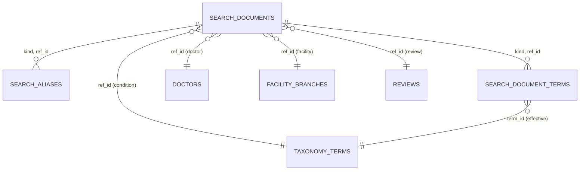

# Entities — U18 `t-205-search-module`

Source of truth for the data shape this Unit owns and reads. Built from T-205 (with FD-084 and the C12 amendments), `02-data-model.md` §0, §4–§7, §13 and §16, `components.md` (Search), `contract-summary.md` (C12, C15), the schema on `main` (`packages/database/src/schema/search.ts`, `0002_content.sql`, the grants migrations `0001`, `0005`, `0008`), the U14 T-201 draft (branch names and labels, term keys, eligibility) and the answers in `functional-design-questions.md`.

Search owns three tables: `search_documents` and `search_aliases` exist on `main`; `search_document_terms` is new (Question 2). One forward-only migration (next free number at build time, named `00NN_search_projection.sql`) adds the FD-084 columns, the facet columns, the new table, the indexes the task names that do not exist yet, the `lang` CHECK (ISS-146) and the worker grants of FD entry (a). Search writes nothing outside its own tables. Every source table below is read only, by the `search.refresh` job as `rk_worker` and by `reindexAll`.

```yaml
entities:
  - name: SearchDocument
    owner: Search
    description: "One row per public doctor, facility branch, condition term or review (table search_documents). Only eligible sources have a row (BR1.1–BR1.5)."
    attributes:
      - { name: id, type: uuid, required: true, unique: true }
      - { name: kind, type: enum, required: true, allowed_values: [doctor, facility, condition, review] }
      - { name: ref_id, type: uuid, required: true, constraints: "doctors.id, facility_branches.id, taxonomy_terms.id or reviews.id; unique with kind" }
      - { name: public_id, type: string, required: true, constraints: "the source's public id (the branch's for facility)" }
      - { name: title_en, type: text, required: false, constraints: "normalizeStoredText (BR2.2); a review stores its title in both title columns" }
      - { name: title_bn, type: text, required: false }
      - { name: body_en, type: text, required: false, constraints: "per kind, functional-spec.md § 7" }
      - { name: body_bn, type: text, required: false }
      - { name: key_nfc, type: text, required: true, constraints: "normalizeAliasKey of the names and aliases joined, de-spaced; computed in application (BR2.1)" }
      - { name: tsv, type: tsvector, required: true, constraints: "generated always, to_tsvector('simple', titles and bodies); exists" }
      - { name: published, type: boolean, required: true, default: false, constraints: "always true on stored rows (BR1.5); kept as the WHERE guard (BR1.6)" }
      - { name: accounts_count, type: integer, required: true, default: 0, constraints: "BR1.7" }
      - { name: recent_at, type: timestamp, required: false, constraints: "BR1.8; public published_at only" }
      - { name: city_key, type: text, required: false, constraints: "normalizeAliasKey(city_en); doctor and facility" }
      - { name: specialty_id, type: uuid, required: false, references: TaxonomyTerm.id, constraints: "exists; doctor only" }
      - { name: specialty_public_id, type: string, required: false, constraints: "new; doctor only; the specialty filter value (BR7.4)" }
      - { name: evidence_groups, type: "list<enum>", required: true, default: "{}", allowed_values: [reviewed, later, outcome], constraints: "new (FD-084); review only; from EvidencePresence" }
      - { name: has_documents, type: boolean, required: true, default: false, constraints: "new (FD-084); doctor only; BR10.5" }
      - { name: sentiments, type: "list<enum>", required: true, default: "{}", allowed_values: [positive, mixed, negative], constraints: "new; doctor: values present among eligible accounts; review: its own value; filter only, never ordered by (BR5.5)" }
      - { name: outcomes, type: "list<enum>", required: true, default: "{}", allowed_values: [helped, none, worse, uncertain], constraints: "new; as sentiments" }
      - { name: gender, type: text, required: false, constraints: "new; doctor only; copied from doctors.gender (ISS-074)" }
      - { name: language_keys, type: "list<string>", required: true, default: "{}", constraints: "new; doctor only; consultation languages split on , ; / and keyed (Question 13)" }
      - { name: facility_type, type: enum, required: false, allowed_values: [hospital, clinic, diagnostic], constraints: "new; facility only" }
      - { name: claimed, type: boolean, required: true, default: false, constraints: "new; doctor and facility; claimed_by_account_id is not null, the id itself never copied" }
      - { name: provenance, type: enum, required: false, allowed_values: [community, provider, admin], constraints: "new; doctor and facility; field_provenance.name.source (ASSUMPTION, Question 14)" }
      - { name: doctor_ref_id, type: uuid, required: false, constraints: "new; review only; the review's doctor, used for has_documents and fan-out" }
      - { name: provisional, type: boolean, required: true, default: false, constraints: "new; condition only" }
      - { name: created_at, type: timestamp, required: true }
      - { name: updated_at, type: timestamp, required: false }
    constraints:
      - "unique (kind, ref_id) — exists; the upsert target (BR10.3)"
      - "GIN on tsv and GIN gin_trgm_ops on key_nfc — exist"
      - "btree (kind, published, accounts_count DESC) and (kind, published, recent_at DESC) — new (task step 4 migration)"
      - "btree (kind, doctor_ref_id) where kind = 'review' — new (BR10.5)"
      - "No column holds an account id, persona id, exact date or evidence content (BR11.1)"
    relationships:
      - { to: SearchAlias, cardinality: "one-to-many", direction: "SearchDocument has SearchAlias (by kind, ref_id)" }
      - { to: SearchDocumentTerm, cardinality: "one-to-many", direction: "SearchDocument has SearchDocumentTerm (doctor and review)" }

  - name: SearchAlias
    owner: Search
    description: "A curated name variant of a doctor, branch or condition (table search_aliases)."
    attributes:
      - { name: id, type: uuid, required: true, unique: true }
      - { name: kind, type: enum, required: true, allowed_values: [doctor, facility, condition] }
      - { name: ref_id, type: uuid, required: true }
      - { name: alias, type: text, required: true, constraints: "as written; shown as matchedAlias" }
      - { name: alias_key, type: text, required: true, constraints: "normalizeAliasKey(alias); unique per document by dedupe (BR3.5)" }
      - { name: lang, type: enum, required: true, allowed_values: [en, bn, banglish], constraints: "CHECK added (ISS-146)" }
      - { name: provenance, type: enum, required: true, allowed_values: [community, provider, admin] }
      - { name: created_at, type: timestamp, required: true }
    constraints:
      - "GIN gin_trgm_ops on alias_key — exists"
      - "btree (alias_key text_pattern_ops) — new, for equality and LIKE prefix (tier 0, tier 1)"
      - "btree (kind, ref_id) — new, for replace and delete (BR10.3)"
      - "No rows with kind review (BR3.4)"

  - name: SearchDocumentTerm
    owner: Search
    description: "New table search_document_terms: the effective taxonomy terms of a doctor's or a review's eligible accounts, with the distinct-account count (BR1.9). Serves the term filters, the condition constraint and the relevant count."
    attributes:
      - { name: kind, type: enum, required: true, allowed_values: [doctor, review] }
      - { name: ref_id, type: uuid, required: true }
      - { name: term_id, type: uuid, required: true, constraints: "effective term id (canonical when mapped)" }
      - { name: term_public_id, type: string, required: true, constraints: "the filter value; avoids a join to taxonomy_terms at query time (BR7.2)" }
      - { name: term_kind, type: enum, required: true, allowed_values: [condition, symptom, treatment, medicine] }
      - { name: accounts_count, type: integer, required: true, constraints: "count(distinct review) for doctor; 1 for review" }
    constraints:
      - "primary key (kind, ref_id, term_id)"
      - "btree (term_public_id, kind)"
      - "rk_app: full DML (its table-level grants); rk_worker: SELECT, INSERT, UPDATE, DELETE by explicit grant (FD-037 default-deny), FD entry (a)"

  # Sources, read only (owners in brackets)
  - name: Doctor
    owner: Directory
    description: "doctors: name_en/bn, specialty_id, qualifications_en/bn, bmdc_number, gender, languages_en/bn, city_en/bn, area_en/bn, field_provenance, claimed_by_account_id (projected as a boolean), state, merged_into_id. rk_worker: table SELECT (live, 0001)."
  - name: DoctorChamber
    owner: Directory
    description: "doctor_chambers: doctor_id, name_en, name_bn are read for the doctor body. rk_worker: none today; column SELECT by FD entry (a)."
  - name: Facility
    owner: Directory
    description: "facilities: name_en/bn (organisation), type, field_provenance, claimed_by_account_id, state. rk_worker: table SELECT (live)."
  - name: FacilityBranch
    owner: Directory
    description: "facility_branches: public_id, facility_id, name_en/bn (the branch's own hospital name after T-201), branch_label_en/bn (T-201), city_en/bn, area_en/bn, state. rk_worker: table SELECT (live), which covers T-201's new columns."
  - name: TaxonomyTerm
    owner: Taxonomy
    description: "taxonomy_terms: public_id, kind, name_en/bn, provisional, canonical_id, state. created_by_account_id is never read. rk_worker: table SELECT (live)."
  - name: TaxonomyAlias
    owner: Taxonomy
    description: "taxonomy_aliases: term_id, alias, lang, provenance (alias_key is recomputed in application, BR2.1). rk_worker: table SELECT (live)."
  - name: Review
    owner: Review
    description: "reviews: public_id, doctor_id, kind, title, body, sections (detailed text), sentiment, outcome, state, published_at, deleted_at. exact_date_enc, author_persona_id, claims and attestation are never selected (BR11.1). rk_worker: table SELECT (live; ISS-240 open separately)."
  - name: ReviewTag
    owner: Review
    description: "review_tags: review_id, group, term_id, free_text, not_sure. rk_worker: none today; column SELECT by FD entry (a)."
  - name: FacilityReview
    owner: Review
    description: "facility_reviews: branch_id, state, deleted_at, published_at for the branch count and recency; body, criteria and author are never read (facility accounts are not searched in release 1). rk_worker: none today; column SELECT by FD entry (a)."
  - name: EvidencePresence
    owner: Evidence
    description: "Not a table for this Unit: the port's forReview(reviewId) → {groups}. The no-evidence default ships here; U25 T-305 implements it over published evidence items. Search never reads evidence_items."
```

## Value objects (contracts and domain)

| Value | Shape | Where |
|---|---|---|
| `SearchTab` | `doctors` \| `facilities` \| `conditions` \| `reviews` \| `all` | `contracts/schemas/search.ts` (Question 5) |
| `SearchSort` | `relevance` \| `volume` \| `recent` \| `alphabetical` | same (Question 6) |
| `ResolvedNoteKind` | `exactCondition` \| `alias` \| `banglish` \| `typo` | `contracts/view-models/search.ts` |
| `EvidenceGroupFilter` | `reviewed` \| `later` \| `outcome` \| `both` | `contracts/schemas/search.ts` (BR7.5) |
| `SearchTuning` | the six constants of BR4.4 | `domain/search/ranking.ts` |
| `SearchSource` | per kind, the raw source rows a rebuild reads | `application/ports/search.ts` (structural types) |
| `SearchDocumentInput` | the row, its aliases and its term rows, keys computed | `application/ports/search.ts` |
| `RefreshTarget` | `{kind, refId}` | `modules/search/jobs/refresh.ts` |

## State

The projection has no state machine of its own: a document is present (its source is eligible) or absent. Source transitions that change presence (`02-data-model.md` §17): a review or profile entering `published` adds a document; entering `hidden_pending_review`, `hidden`, `deleted_tombstone`, `rejected`, a soft delete, or a merge removes it; `restore` adds it back on the next refresh. Evidence state changes alter only `evidence_groups` and `has_documents`.

## Entity-relationship view



Text fallback: a search document has many aliases and many term rows, matched by kind and ref_id; each document points at one source row of the kind it names; each term row points at one effective taxonomy term. The links to source tables are logical (no foreign keys), because the projection is deleted and rebuilt independently of its sources.
