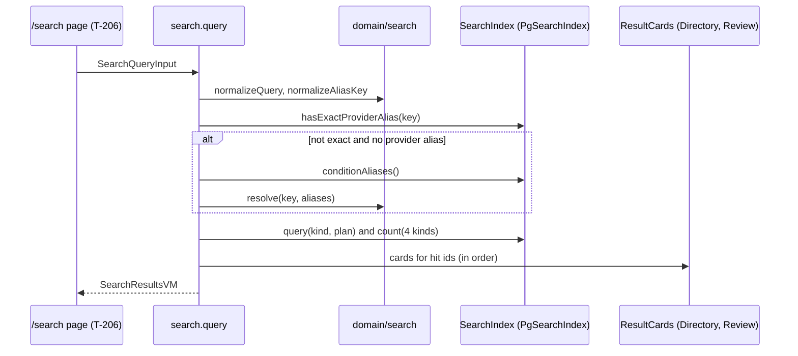
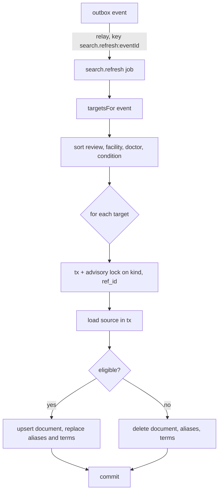

# Functional specification — U18 `t-205-search-module`

Unit U18 (kind `library`, size XL, not high risk) delivers T-205 for US5.1, US5.2 and US5.3. Lead perspective: architect. Support perspective: developer (SQL shape, transactions, the worker handler and the tests against the real database), written into §§ 9 and 11 and synthesised in § 13. Draft written ahead of the stage on the owner's instruction to overlap work; the lead finalises it and the reviewer checks it when the workflow reaches this Unit.

**Drafted 2026-10-29.** Checked against T-010 as merged on `main` (`14c21a9`; `9cf860a` at the time of writing), CR-011 as merged, the U14 T-201 draft refreshed on 2026-10-29, the U8 T-101 and U21 T-301 drafts and the owner's answers in `docs/aidlc-migration/OWNER-REVIEW-QUEUE.md`. What this draft settles:
1. **The worker can now build complete documents** (Question 1): column-level reads on `review_tags`, `doctor_chambers` and `facility_reviews`, with FD entry (a). Closes ISS-233 and FD-092 R3.
2. **Search reads only its own tables at query time** (Question 2): facet columns and a new `search_document_terms` table carry every filter and the condition constraint (FD entry (b)).
3. **T-010 applied.** Keys are computed in application code, so the document builders and the reindex live in `modules/search`; the database adapter loads sources, takes the lock and writes (F3). The worker reaches the job through `@rogikotha/application/worker`. The pins this Unit moves are updated in the same commit (BR12.2).
4. **The requirements the prototype does not show are served by the module**: the All tab, the alphabetical sort, Did you mean, symptom/treatment/medicine search and the FR31 filters (Questions 5–8, 14). T-206 renders the prototype's subset; the rest is a recorded UI follow-up.
5. **Decided under the owner's no-questions instruction of 2026-10-29:** Questions 1–15. § 17 lists the two FD entries the build appends before code.

Inputs: `unit-of-work.md` (U18), `unit-of-work-dependency.md`, `requirements.md` (FR28–FR38, FR58, NFR8), `stories.md` (US5.1–US5.3), `components.md` (Search), `contract-summary.md` (C12, C14, C15, common rules), `docs/status/decision-log.md` (FD-035, FD-037, FD-038, FD-067, FD-076, FD-084, FD-092, FD-093, FD-094), T-205 with its amendments, `01-conventions.md` §2–§4, §10, §11, `02-data-model.md` §0, §4–§7, §13, §16, §17, `03-routes-and-contracts.md` §3–§5, the code listed in `functional-design-questions.md`, the prototype data file and renderers, the drafts of U14 T-201, U8 T-101, U21 T-301 and U20 T-207, the task files of T-204 and T-206, and ISS-074, ISS-146, ISS-233, ISS-240, ISS-253 and ISS-294.

This file is the source of truth for the workflows. The data shape is in `entities.md`; the decision logic is in `rules.md`. The design follows the answers in `functional-design-questions.md` (Questions 1–15, all A).

## 1. What changes, in one paragraph

Search becomes real on PostgreSQL. `search.query` answers one box for doctors, facility branches, conditions and published accounts in Bengali, English and Banglish: an exact alias match ranks above a prefix, a full-text match and a fuzzy match, and inside a tier the order is relevance, most accounts, most recent or alphabetical, never sentiment, outcome, documents or reactions. A query that names a condition, one of its aliases, a Banglish spelling or a close misspelling gets a note that says what matched and, except for an exact name, a "keep original" link; an ambiguous query gets up to three Did you mean conditions and is never replaced. `search.suggest` serves at most eight suggestions through `/api/search/suggest`, rate-limited and never logged. The `search.refresh` job rebuilds the documents an outbox event touches, each in its own locked transaction, from the owners' public rows; a source that stops being public loses its document. One migration adds the FD-084 evidence columns, the facet columns, a term table for the filters and the condition constraint, the indexes the task names, the `lang` CHECK and the worker's reads. Cards come from Directory and Review through a port, so search results look like every other list. A labelled corpus of more than 40 queries, a metamorphic neutrality test, a hidden-record probe and an SQL guard prove the hard rules.

## 2. As is (baseline 2026-10-29) and what this Unit can count on

- **Search tables exist** (`0002_content.sql`): `search_documents` with the generated `tsv`, `published`, `accounts_count`, `recent_at`, `city_key`, `specialty_id`, unique `(kind, ref_id)`, GIN on `tsv` and GIN `gin_trgm_ops` on `key_nfc`; `search_aliases` with GIN `gin_trgm_ops` on `alias_key`, no CHECK on `lang` (ISS-146), no index on `(kind, ref_id)`. `pg_trgm` is installed by the compose init script. No row is written today.
- **Stubs**: `packages/database/src/search/index.ts` `PgSearchIndex` (`upsert`, `remove`, `search`, `suggest`) throws `NotImplemented('T-205')` and is in `not-implemented.test.ts`'s list. `contracts/schemas/search.ts` has `SearchQueryInput` (`q` min 1, four tabs, three sorts, nine filters with `language` as review language) and `SearchRefreshJobInput {kind, refId}`; `view-models/search.ts` has a placeholder `SearchResultsVM` with `keepOriginalUrl`. `test-support/fakes/search-index.ts` `NaiveSearchIndex` (substring match) is tested by `fakes.test.ts`.
- **Worker**: `registry.ts` names `search.refresh` with no handler; `RELAY` routes `review.*`, `doctor.changed`, `facility.changed`, `term.changed` to `search.refresh` but not `evidence.stateChanged`; `QUEUE_DECLARATION['search.refresh']` is `exclusive` with 5 retries; `jobKey` is `<job>:<eventId>`; the envelope is `{eventId, name, payload}`.
- **Grants**: `rk_worker` has DML on `search_documents` and `search_aliases`, SELECT on `doctors`, `facilities`, `facility_branches`, `taxonomy_terms`, `taxonomy_aliases` and the whole of `reviews`; nothing on `review_tags`, `doctor_chambers`, `facility_reviews` (FD-037, FD-092). `grants.smoke.test.ts` asserts `select * from review_tags` is denied to `rk_worker`.
- **Before this Unit** (dependency order): U14 T-201 delivers `normalizeAliasKey` in `domain/taxonomy`, the card view models and mappers, the branch name and label columns, one condition term tag per seeded review, and the seed with 10 conditions (c8 without accounts), 11 doctors, 10 branches and 25 reviews. U17 T-204 appends `doctor.changed {id}` and `facility.changed {id}`. U8 T-101 creates the application skeleton, the `./worker` subpath, `RateLimiter.hit(key, limit, windowSec)` and the client-address helper. U12 T-105 serves `await config.current()`. U21 T-301 (after this Unit in the Bolt plan unless the swarm reorders it) appends the `review.*` events; the seed writes reviews directly, so the corpus does not need T-301.
- **T-010 (FD-093)**: `domain` imports nothing; `application` only `domain` and `contracts`, no external package or Node built-in; `database` only `application` and `contracts`; the worker only `@rogikotha/application/worker` for application code and never `drizzle-orm` or `pg`; adapters are built in `apps/web/src/server/container.ts` and the worker's container; nothing in `apps/*` imports `test-support`. `pnpm check` runs nine steps (eleven after T-011); coverage counts every source file, 80% lines per package; `format:check` and `check:identity` gate; CI must be green before the merge.

## 3. Settled before this stage

Neutral ranking (FR32 and the hard rules), FD-035 (real PostgreSQL search), FD-084 (evidence columns and the no-evidence default), FD-038 and CR-011 (relay and queue rules), FD-037 and FD-092 (worker default-deny), FD-093 (boundaries), T-201's eligibility predicates, and the owner's answers on counts, thresholds, branch names and facility feedback. See `functional-design-questions.md` § "Settled before this stage" and § "Settled in this design without a question".

## 4. Workflows

Every query follows the frame of 01-conventions §3: parse the input with its contracts schema → normalise in domain code → read through the `SearchIndex` port → map to the view model in `actor.locale` → `ok(vm)`. Expected failures return `err('validation')` or `err('rate_limited')`; a thrown database error is converted to `internal` by the caller. Queries never write.

### WF1 — Code Generation order (the Unit end to end)

1. Baseline `pnpm check` green on the Bolt branch; read the open rows of § 2. Check `docs/status/dependency-check-log.md` (no new dependency is planned; `pg_trgm` and `Intl.Segmenter` are already available).
2. Append FD entries (a) and (b) of § 17 to the decision log; update C12, C15 (`facilityReview.changed`), `02-data-model.md` §13 and §16 and 03 §4–§5 in the same commit.
3. **Contracts first, committed in the first hour** (T-206 starts against the fake): `schemas/search.ts` and `view-models/search.ts` per § 8.
4. **Domain**: `domain/search/normalize.ts` (re-export `normalizeAliasKey`, add `normalizeQuery`, `normalizeStoredText`, `tokenize`), `ranking.ts` (`SEARCH_TUNING`, the closed sort list, `kindOrder`), `resolve.ts` (pure resolution with its own trigram function), with tests.
5. **Migration** `00NN_search_projection.sql` (next free number) per `entities.md`; Drizzle schema updated; the migration-count pins move by one.
6. **Ports**: `application/ports/search.ts` (`SearchIndex`, `SearchSourceReader` types), `modules/search/ports.ts` (`EvidencePresence` with `noEvidencePresence`, `ResultCards`).
7. **Builders**: `modules/search/build-documents.ts` (one pure function per kind, § 7).
8. **Adapter**: `database/src/search/{index.ts,sql.ts,sources.ts,aliases.ts}` (`PgSearchIndex` implements the port; `sources.ts` loads the raw rows of a rebuild).
9. **Queries**: `modules/search/queries/{query.ts,suggest.ts}`.
10. **Jobs**: `modules/search/jobs/{refresh.ts,reindex.ts}`; export both from `application/src/worker.ts`.
11. **Card implementations**: `modules/directory/result-cards.ts`, `modules/review/result-cards.ts` over T-201's mappers.
12. **Wiring**: web container (`search` deps), `/api/search/suggest/route.ts`, worker container, `handlers/search-refresh.ts`, `registry.ts`, `RELAY` additions, `apps/worker/src/scripts/search-reindex.ts`, root script `search:reindex`, the `reindexAll` call at the end of `seed.ts`.
13. **Fake**: `NaiveSearchIndex` implements the new port with the same tier and order semantics at small scale.
14. **Corpus and tests** (§ 11), `EXPLAIN` evidence, `pnpm check`, `pnpm smoke`.

### WF2 — `search.query(input)`

1. Parse `SearchQueryInput` (§ 8). `q` is kept as received for the VM (BR6.7); `text = normalizeQuery(q)`, `key = normalizeAliasKey(q)`.
2. Read `(await config.current()).featureVisibility.facilityAccounts` once (BR5.8).
3. If `q` is empty: browse (BR4.3), go to step 6.
4. If `exact` is false and no doctor or facility alias has `alias_key = key` (BR6.6): load `SearchIndex.conditionAliases()` and call `resolve(key, aliases, SEARCH_TUNING)` → `{kind: 'exactCondition'|'alias'|'banglish'|'typo', term, matchedAlias}` or `{didYouMean: [...]}` or nothing (BR6.1–BR6.5).
5. Build the per-kind plan: tab filters (BR7.1), the condition constraint for doctors and reviews when resolved (BR6.9), `exact` (tiers 0–2), the sort (with the BR5.8 fallback for facilities).
6. `SearchIndex.query({kind, text, key, plan, sort, locale, page, pageSize})` for the requested kind (or the four kinds with `limit 3` for `all`, BR8.2), and `SearchIndex.count(...)` for each of the four kinds (BR8.1). The adapter runs them in one read-only transaction with `SET LOCAL pg_trgm.similarity_threshold` and `word_similarity_threshold` from `SEARCH_TUNING`.
7. Hydrate cards: doctor, facility and review hits through `ResultCards` in hit order; condition hits from the document (BR8.3).
8. Return `SearchResultsVM` (§ 8). `keepOriginalUrl` only for `alias`, `banglish` and `typo` (BR6.8).



Text fallback: the page sends the input; the query normalises it, checks for an exact doctor or facility alias, otherwise loads the condition aliases and resolves in domain code; it runs the tab's statement and the four counts, fetches cards for the hits in order, and returns the view model.

### WF3 — `search.suggest({q, locale})` and `/api/search/suggest`

1. The route handler reads `q` and `locale` from the URL (`locale` `en|bn`, default `en`), hits `RateLimiter.hit('search.suggest:net:' + hmac(clientAddress), 60, 60)`; refused → 429 `rate_limited` with `Retry-After`.
2. `search.suggest` parses `SearchSuggestInput`, computes the key; a key shorter than 2 characters returns `[]`.
3. `SearchIndex.suggest(key, locale)` → at most 8 `{kind, publicId, title}` (BR9.1).
4. The route returns JSON with `Cache-Control: no-store`; it logs nothing about `q` (BR9.2).

### WF4 — `search.refresh` (worker)

1. `handlers/search-refresh.ts` parses the envelope (`SearchRefreshJobInput = {eventId, name, payload}`) and calls `refreshForEvent(envelope, deps)` from `@rogikotha/application/worker`.
2. `targetsFor(name, payload, reader)` lists the documents to rebuild (BR10.2); the fan-out lists (a doctor's reviews, a term's reviews and their doctors, a facility's branches) are read through `SearchSourceReader`.
3. Targets are sorted review, facility, doctor, condition (BR10.6) and deduplicated.
4. For each target: `SearchIndex.rebuild({kind, refId}, build)`: the adapter opens a transaction, takes `pg_advisory_xact_lock(hashtext(kind || ':' || ref_id))`, loads the source inside it, calls `build(source)` (the application builder, which may call `EvidencePresence.forReview`), then upserts the row, replaces its aliases and term rows, or deletes all three (BR10.3, BR1.5). For a doctor, the builder receives `hasDocuments` read from the stored review documents in the same transaction.
5. One log line `search.refreshed {eventId, eventName, documents, deleted, ms}` (BR10.8). Any thrown error fails the job and pg-boss retries it (BR10.7).



Text fallback: the relay queues one job per event; the job lists its target documents, sorts them, and rebuilds each in its own locked transaction, upserting an eligible source and deleting an ineligible one.

### WF5 — `reindexAll` (seed, demo reset, `pnpm search:reindex`)

For each kind in the BR10.6 order, list every source id through `SearchSourceReader.allIds(kind)` and rebuild it; then delete documents whose `ref_id` has no source row (`SearchIndex.sweepOrphans(kind, liveIds)`); return per-kind counts. The seed calls it last, with its own database handle; the script runs it as `rk_worker` (Question 12).

### WF6 — Resolution in detail (`domain/search/resolve.ts`)

Input: the query key and the condition aliases `[{alias, aliasKey, lang, termPublicId, nameEn, nameBn}]`. Name keys are `normalizeAliasKey(nameEn | nameBn)`.

| Step | Candidates | Result |
|---|---|---|
| 1 | name key = key | one condition → `exactCondition`; several → Did you mean |
| 2 | alias key = key | one → `banglish` if lang is `banglish`, else `alias`; several → Did you mean |
| 3 | key length ≥ 3: alias key starts with key, or key starts with an alias key of length ≥ 3 | as step 2 |
| 4 | key length ≥ 4: trigram similarity ≥ 0.6 | best one, if no other condition within 0.05 → `typo`; else Did you mean |
| 5 | none | no note |

The first step with a candidate decides. Did you mean lists at most three conditions of that step, by similarity then name (BR6.5).

## 5. State transitions

A document mirrors its source's public state; it has no state of its own (`entities.md` § State). The events that move a source in or out of public view are the triggers of BR10.2.

| Source change | Event | Effect on Search |
|---|---|---|
| Review published, restored | `review.published`, `review.restored` | review document added; doctor and condition counts and facets rebuilt |
| Review hidden, deleted, tombstoned | `review.hidden`, `review.deleted` | review document deleted; doctor and condition rebuilt (counts drop) |
| Review corrected | `review.changed` | review document rebuilt; doctor and conditions rebuilt |
| Evidence published or removed | `evidence.stateChanged` | review `evidence_groups` and doctor `has_documents` rebuilt |
| Doctor edited, hidden, merged | `doctor.changed` | doctor document rebuilt or deleted; its review documents rebuilt (BR1.4) |
| Branch or facility edited or hidden | `facility.changed` | branch document(s) rebuilt or deleted |
| Term edited, mapped, hidden | `term.changed` | the term's document deleted or rebuilt; its canonical rebuilt; tagged reviews and their doctors rebuilt |
| Facility feedback published, hidden, deleted, restored | `facilityReview.changed` (new) | branch count and recency rebuilt |

## 6. Ports

Interface level only; Code Generation writes the TypeScript. Types are structural, so `domain` and `application` import no external package.

```text
SearchIndex (packages/application/src/ports/search.ts; implemented by PgSearchIndex, faked by NaiveSearchIndex)
  query({kind, text, key, exact, constraintTermPublicId?, filters, sort, locale, offset, limit, facilityFeedbackVisible})
    -> {hits: [{kind, refId, publicId, titleEn?, titleBn?, accountsCount, provisional?}]}
  count({kind, text, key, exact, constraintTermPublicId?, filters}) -> number
  conditionAliases() -> [{alias, aliasKey, lang, termPublicId, nameEn, nameBn}]
  hasExactProviderAlias(key) -> boolean
  suggest(key, locale) -> [{kind, publicId, title}]            (<= 8)
  rebuild({kind, refId}, build: (source: SearchSource | null, ctx) => Promise<SearchDocumentInput | null>)
    -> {written: boolean}
  sweepOrphans(kind, liveRefIds) -> number
  removeDocuments(kind, refIds) -> number                     (for U39 T-410's removeAccountContent)

SearchSourceReader (same file; implemented in packages/database/src/search/sources.ts)
  allIds(kind) -> refId[]
  reviewsOfDoctor(doctorId) -> reviewId[]
  reviewsWithTerm(termId) -> {reviewId, doctorId}[]
  branchesOf(facilityOrBranchId) -> branchId[]
  termsOfReview(reviewId) -> termId[]                         (effective, for fan-out)

EvidencePresence (packages/application/src/modules/search/ports.ts; FD-084, C12)
  forReview(reviewId) -> Promise<{groups: EvidenceGroup[]}>
  noEvidencePresence: forReview -> {groups: []}               (wired until U25 T-305)

ResultCards (same file; implemented in modules/directory/result-cards.ts and modules/review/result-cards.ts)
  doctors(publicIds, locale) -> Map<publicId, DoctorCardVM>
  branches(publicIds, locale) -> Map<publicId, FacilityCardVM>
  reviews(publicIds, locale) -> Map<publicId, ExperienceCardVM>
```

`SearchSource` per kind carries exactly the columns listed under the sources in `entities.md`, already filtered to what may be projected (no account ids, no exact dates). `SearchDocumentInput` is `{row, aliases: [{alias, aliasKey, lang, provenance}], terms: [{termId, termPublicId, termKind, accountsCount}]}` with every key computed by the builder. `rebuild` passes a `ctx` with `hasDocuments` for doctor rebuilds (read from stored review documents inside the lock, BR10.5).

`PgSearchIndex` is constructed in `apps/web/src/server/container.ts` (with `rk_app`) and in the worker container (with `rk_worker`); `ResultCards` and the configuration provider are wired only in the web container. The worker gets `noEvidencePresence` until U25 replaces it.

## 7. Documents per kind (`modules/search/build-documents.ts`)

| Kind | Title | Body | key_nfc | Facets | Aliases (BR3) | Terms |
|---|---|---|---|---|---|---|
| doctor | name_en / name_bn | specialty names, qualifications, city, area, chamber names, distinct names of the effective terms of eligible accounts (once each, BR5.7) | names, BMDC, specialty, area, city | specialty_id, specialty_public_id, city_key, gender, language_keys, claimed, provenance, sentiments, outcomes, has_documents | names, names without title, BMDC with and without prefix | effective terms of eligible accounts with distinct counts |
| facility (branch) | branch name + label (en / bn) | organisation name, type words, city, area | branch name, label, organisation, area, city | city_key, facility_type, claimed, provenance | own name, label, name with label, organisation | none |
| condition | name_en / name_bn | every alias as written | names and aliases | provisional | names, taxonomy aliases | none |
| review | title (in both columns) | body or the detailed sections, 2 000 graphemes (BR2.5), then tag labels (terms in both languages, free text as written) | title | sentiments, outcomes (its own), evidence_groups, doctor_ref_id | none | its effective terms, count 1 |

Every text field goes through `normalizeStoredText`; every key through `normalizeAliasKey`. The facility type words are a fixed search vocabulary in `domain/search/ranking.ts` (`hospital`/`হাসপাতাল`, `clinic`/`ক্লিনিক`, `diagnostic`/`ডায়াগনস্টিক`), not display copy. `accounts_count` and `recent_at` per BR1.7 and BR1.8.

## 8. Contracts and view models

`packages/contracts/src/schemas/search.ts` (zod; the provider side `.strict()`):

| Schema | Fields |
|---|---|
| `SearchQueryInput` | `q` string, trimmed 0..200 (BR2.4); `tab` `doctors|facilities|conditions|reviews|all` default `doctors`; `sort` `relevance|volume|recent|alphabetical` default `relevance`; `exact` boolean default false; `page` int ≥ 1 default 1; `pageSize` int 1..50 default 20; `filters` (all optional): `specialty` public id, `term` public id, `termKind` `condition|symptom|treatment|medicine` (default `condition`), `city` key, `sentiment`, `outcome`, `hasEvidence` boolean, `evidenceGroup` `reviewed|later|outcome|both`, `gender` (ISS-074 enum kept), `language` key, `facilityType`, `claimed` boolean, `provenance` |
| `SearchSuggestInput` | `q` string 0..200, `locale` `en|bn` |
| `SearchRefreshJobInput` | `{eventId: uuid, name: string, payload: record}` (the C15 envelope; replaces `{kind, refId}`) |

The existing `condition` filter key is kept as an alias of `term` with `termKind: condition`, so 03's filter list and T-206's links keep working.

`packages/contracts/src/view-models/search.ts`:

| View model | Fields |
|---|---|
| `SearchResultsVM` | `q` (as received), `tab`, `sort`, `exact`, `counts` {`doctors`, `facilities`, `conditions`, `reviews`}, `results` (`SearchResultVM[]`), `resolvedNote?`, `didYouMean?` [{`publicId`, `name`}] (≤ 3), `keepOriginalUrl?`, `meta` (`PageMeta`: `page`, `pageSize`, `total`) |
| `SearchResultVM` | `{kind: 'doctor', card: DoctorCardVM}` \| `{kind: 'facility', card: FacilityCardVM}` \| `{kind: 'condition', publicId, name, accountsTotal, provisional}` \| `{kind: 'review', card: ExperienceCardVM}` |
| `ResolvedNoteVM` | `kind` (`exactCondition|alias|banglish|typo`), `original`, `resolvedTo` {`publicId`, `name`}, `matchedAlias?` (absent for `exactCondition`) |
| `SuggestionVM` | `kind` (`doctor|facility|condition`), `publicId`, `title` |

No number in these view models is a score: `counts`, `accountsTotal` and `meta.total` are exact counts. Card fields are T-201's (counts with denominators, "Registration not verified", no percentage).

## 9. Developer view — SQL shape (`packages/database/src/search/sql.ts`)

Parameterised statements built from fixed fragments; no string from the input is concatenated into SQL. Shape of the doctor-tab page statement (the other kinds drop the facets they lack):

```sql
-- inside BEGIN READ ONLY; SET LOCAL pg_trgm.similarity_threshold = $simAlias;
--                        SET LOCAL pg_trgm.word_similarity_threshold = $simWord;
WITH q AS (SELECT $1::text AS key, websearch_to_tsquery('simple', $2) AS tsq),
cand AS (
  SELECT d.*,
    CASE
      WHEN $empty THEN 0
      WHEN $constrained THEN 0
      WHEN EXISTS (SELECT 1 FROM search_aliases a WHERE a.kind = d.kind AND a.ref_id = d.ref_id AND a.alias_key = q.key) THEN 0
      WHEN length(q.key) >= $prefixMin AND EXISTS (SELECT 1 FROM search_aliases a
             WHERE a.kind = d.kind AND a.ref_id = d.ref_id
               AND (a.alias_key LIKE q.key || '%' OR (length(a.alias_key) >= $prefixMin AND q.key LIKE a.alias_key || '%'))) THEN 1
      WHEN d.tsv @@ q.tsq THEN 2
      WHEN NOT $exact AND (q.key <% d.key_nfc OR EXISTS (SELECT 1 FROM search_aliases a
             WHERE a.kind = d.kind AND a.ref_id = d.ref_id AND a.alias_key % q.key)) THEN 3
    END AS tier,
    CASE WHEN $empty OR $constrained THEN 0 ELSE ts_rank(d.tsv, q.tsq) END AS rank,
    coalesce(t.accounts_count, d.accounts_count) AS relevant_count
  FROM search_documents d CROSS JOIN q
  LEFT JOIN search_document_terms t
    ON $constrained AND t.kind = d.kind AND t.ref_id = d.ref_id AND t.term_public_id = $term
  WHERE d.kind = 'doctor' AND d.published = true                 -- BR1.6: before ranking
    AND (NOT $constrained OR t.term_id IS NOT NULL)              -- BR6.9
    AND (<filters of BR7.4, each "param IS NULL OR predicate">)
)
SELECT kind, ref_id, public_id, title_en, title_bn, accounts_count
FROM cand WHERE tier IS NOT NULL
ORDER BY <one fragment from the closed list of BR5.1-BR5.4>
LIMIT $limit OFFSET $offset;
```

Notes:
- Tier 3 uses the operators `<%` and `%`, which the existing GIN `gin_trgm_ops` indexes serve; the task's `similarity(...) > 0.3` cannot use them and, on a de-spaced concatenated key, scores a surname query near zero (F2).
- `LIKE key || '%'` is safe: keys contain letters, marks and digits only, never `%` or `_`. The new `text_pattern_ops` index serves it.
- The `$constrained` doctor and review statements ignore the text tiers (BR6.9); a term filter without resolution keeps the text tiers and also selects `relevant_count` from the term row (BR5.6).
- Counts reuse the candidate CTE with `SELECT count(*) FROM cand WHERE tier IS NOT NULL`.
- The order fragments: relevance `tier, rank DESC, relevant_count DESC, recent_at DESC NULLS LAST, public_id`; volume `relevant_count DESC, tier, rank DESC, public_id`; recent `recent_at DESC NULLS LAST, tier, rank DESC, public_id`; alphabetical `coalesce(title_<locale>, title_en) COLLATE <icu or default>, public_id` (the locale picks one of two literal fragments, never interpolated text).
- `rebuild` uses `INSERT ... ON CONFLICT (kind, ref_id) DO UPDATE` for the row and delete-then-insert for aliases and term rows, all after the advisory lock (BR10.3).
- `sources.ts` selects only granted columns (FD entry (a)); the review source never selects `exact_date_enc`, `author_persona_id`, `claims` or `attestation_at`.
- Query-plan evidence: the seed's tables are tiny, so the planner prefers sequential scans; the hand-off shows the doctor-tab plan once as is (with timings) and once under `SET LOCAL enable_seqscan = off` to prove the GIN and btree indexes serve the predicates, plus the P95 of 100 runs (F14).

## 10. Findings and proposed ISS rows

Each is proposed with `Found in U18 T-205 (Functional Design draft)`; the caller adds them with the next free numbers.

- **F1 (S1 if built as written; designed out by FD entry (a))** — `rk_worker` cannot read `review_tags`, `doctor_chambers` or `facility_reviews`, so the first `search.refresh` fails with `permission denied` (ISS-233, FD-092 R3). Question 1 A. Also, `grants.smoke.test.ts` uses `review_tags` as its closed-table probe; with column grants `select *` is still refused (unlisted `id`, `created_at`), but the probe is moved to a table that stays closed (`persona_links`) and a column probe is added, so the test keeps meaning what it says.
- **F2 (S2, designed out)** — The task's tier-3 predicate `similarity(d.key_nfc, q.key) > 0.3` cannot use the GIN trigram index and, on a long de-spaced key, almost never passes for a name fragment. Replaced by `<%` and `%` with `SET LOCAL` thresholds (BR4.1).
- **F3 (S1 if built as written; designed out)** — The task puts the document building (which needs `normalizeAliasKey`) and `pnpm search:reindex` in `packages/database`, which may not import `domain` (FD-093); the boundary lint turns red. Builders and `reindexAll` move to `modules/search`; the adapter receives keys and a build callback (BR2.1, BR12.1, Question 12).
- **F4 (S2, designed in; cross-Unit)** — No C15 event refreshes a branch when facility feedback is published, hidden or deleted, so the branch's count and recency go stale. New event `facilityReview.changed` (Question 9); producers in U21, U22, U33 and U39.
- **F5 (S2, designed out)** — Delete-then-insert rebuilds race: two jobs for one doctor fail on the unique key or the older wins. Advisory lock, read inside the lock, upsert (BR10.3).
- **F6 (S2, designed out)** — The task's `singletonKey = kind:refId` does not fit C15: events carry `{reviewId, doctorId, branchId?}` or `{id}`, not `{kind, refId}`, and one event touches several documents. The job keeps the C15 key per event and fans out (BR10.1, BR10.2); `SearchRefreshJobInput` becomes the envelope.
- **F7 (S2, fixed here)** — `RELAY` does not route `evidence.stateChanged` to `search.refresh`, so FD-084's refresh never runs. This Unit adds that route and `facilityReview.changed → search.refresh` (the relay's rule: each Unit adds the entries for the jobs it builds). The `notification.deliver` routes on `review.*` are U34 T-405's to remove (C15), not touched here.
- **F8 (S3, fixed here)** — Contract stub drift: `q` min length 1 forbids the empty browse query; `language` is typed as review language; three sorts and four tabs; `keepOriginalUrl` in C12 versus `keepOriginalHref` in the task and T-206. Settled in § 8 (contract names win).
- **F9 (S2, designed in; UI follow-up)** — Requirements that the prototype and T-206 do not show: the All, Conditions/Tags and Reviews tabs (FR30), the alphabetical sort (AC5.2.2), Did you mean (AC5.1.3), search by symptom, treatment and medicine (FR28), claimed, provenance and evidence-path filters (FR31, AC5.2.4). The module serves them (Questions 5–8, 14); one S3 row records the UI half for T-206 and T-505.
- **F10 (S4, fixed here)** — ISS-146: `search_aliases.lang` gets its CHECK in this Unit's migration.
- **F11 (S1 if missed; designed out)** — T-010's pins: `not-implemented.test.ts` lists `PgSearchIndex`; P8 and `migrations.int.test.ts` pin the migration count; `fakes.test.ts` tests `NaiveSearchIndex`'s old shape; the relay tests pin `RELAY`. Updated in the same commit (BR12.2, ISS-294).
- **F12 (S2 risk, mitigated)** — Under the image's libc locale, `pg_trgm` and the `simple` parser may treat Bengali vowel signs as separators, which would fragment Bengali words. Condition resolution runs in domain code (Question 4); Code Generation probes `show_trgm('ডায়াবেটিস')` and `ts_debug('simple', 'ডায়াবেটিস')` and records the result; Bengali corpus rows that still fail are marked `relaxed` with that reason.
- **F13 (S3, settled)** — The task contradicts itself: step 5 calls an exact alias match `exactCondition`, while the acceptance row expects `dayabetis` (an exact Banglish alias on the seed) to give `banglish`. Settled: only a name match is `exactCondition`; an exact alias match is `alias` or `banglish` (BR6.2, BR6.3). This differs from the prototype, which shows the condition link for any exact alias; the difference is recorded for the visual check.
- **F14 (S3, settled)** — The acceptance row "doctor-tab plan shows the GIN indexes used" cannot hold on the seed's row counts, where PostgreSQL rightly scans sequentially. Evidence is the plan under `enable_seqscan = off` plus the measured P95 (§ 9).
- **F15 (S4, cross-Unit)** — `facility.changed {id}` does not say whether `id` is a facility or a branch (T-204 has no design yet). The job accepts both (BR10.2); T-204 is asked to document it and to emit `doctor.changed` for both profiles of a merge.
- **F16 (S4, cross-Unit)** — T-206 expects `directory.listCities()` for the location filter, which T-201's draft does not provide; the search `city` filter takes `normalizeAliasKey(city_en)`. T-206 derives the options or T-201 adds the query; recorded for T-206.
- **Existing rows, no new row**: ISS-074 (the closed `gender` enum is kept; the filter compares the stored text), ISS-240 (the worker's whole-table `reviews` read; this Unit's source reader selects only public columns, which does not close it), ISS-253 (answered: `search.refresh` stays `exclusive` with per-event keys, Question 11).

## 11. Developer view — tests

| Level | File | What it proves |
|---|---|---|
| domain | `domain/search/normalize.test.ts` | NFC (decomposed য় equals the composed form), ZWJ kept between Bengali letters and dropped elsewhere, BMDC hyphen kept, whitespace collapse, `tokenize`, `normalizeStoredText` and `normalizeQuery` agree on the same text |
| domain | `resolve.test.ts` | each note kind; no note when nothing matches; Did you mean on two prefix matches; minimum lengths; exact name beats alias; trigram function equal to pg_trgm on Latin samples |
| domain | `ranking.test.ts` | the closed sort list; `kindOrder`; tuning constants are frozen |
| application | `modules/search/queries/query.test.ts` (fake index, fake cards) | filters ignored for the wrong tab; `exact` bypasses resolution and tier 3; counts for all four kinds; `all` gives ≤ 3 per kind in order; cards in hit order, missing card dropped; facility sort fallback when feedback is off; `keepOriginalUrl` only for alias, banglish, typo; `q` echoed unchanged |
| application | `jobs/refresh.test.ts`, `build-documents.test.ts` | `targetsFor` for every event; order review → facility → doctor → condition; doctor body labels once; aliases (Dr. stripped, BMDC both forms, branch with organisation); no private field in any built row; `noEvidencePresence` gives empty groups |
| database | `search/sql.test.ts` (no database) | the SQL guard: every statement for every kind and sort has `published = true` in the candidate WHERE, names only the three search tables, and its ORDER BY contains none of sentiment, outcome, reaction, comment, evidence, document, has_documents |
| database | `search/search.int.test.ts` | corpus (≥ 40 rows, ≥ 95% pass, relaxed rows listed); `dayabetis` banglish with the doctors constrained; `exact=1`; typo; hidden probe (results, counts, suggestions; doctor count drops); refresh idempotency (two runs, one row); concurrent rebuilds of one doctor; FD-084 rows; `evidence.stateChanged` → one job per event, document rebuilt once; suggest ≤ 8 with the condition first |
| database | `search/metamorphic.int.test.ts` | ordering of five queries identical for relevance and volume after flipping three sentiments, adding 50 reactions and dislikes, publishing two evidence items, then `reindexAll` |
| database | `grants.smoke.test.ts` (updated) | `rk_worker` reads the granted columns and is refused `review_tags.id` and `persona_links` |
| worker | `handlers/search-refresh.test.ts` | the handler parses the envelope, registers in `JOBS`, and the relay routes `evidence.stateChanged` and `facilityReview.changed` |
| web | `app/api/search/suggest/route.test.ts` | JSON shape, `no-store`, 429 after 60 calls, the logger never receives `q` |
| smoke | `search.smoke.test.ts` (database) | a seeded query returns a doctor and its count |

The corpus (`test-support/src/corpus/search-corpus.ts`) is derived from the seed: for each of the 10 conditions its English name, Bengali name, one Banglish alias (where the seed has one), one typo and one prefix; for six doctors the English name, Bengali name, surname with given name and BMDC; for four branches the hospital name, the label and the organisation; four no-result queries (`xyzzy`, a random Bengali string, punctuation only, a 200-character string). c8, which has no accounts, still resolves and lists no doctors.

## 12. Owned paths and recorded additions

Owned (task): `packages/domain/src/search/{normalize,ranking,resolve}.ts`; `packages/contracts/src/schemas/search.ts`, `view-models/search.ts`; `packages/application/src/modules/search/{queries/query.ts,queries/suggest.ts,jobs/refresh.ts,index.ts,ports.ts}`, `packages/application/src/ports/search.ts`; `packages/database/src/search/{index,sql,documents,aliases}.ts` and the migration; `packages/test-support/src/fakes/search-index.ts`, `corpus/search-corpus.ts`; `apps/worker/src/handlers/search-refresh.ts`; `apps/web/src/app/api/search/suggest/route.ts`; tests beside them.

Recorded additions, each with its reason:

| Path | Change | Reason |
|---|---|---|
| `modules/search/{build-documents.ts,jobs/reindex.ts}` | new | keys in application (F3) |
| `packages/database/src/search/sources.ts` (instead of `documents.ts`) | new | the adapter loads sources; builders are in application |
| `packages/application/src/worker.ts` | export `refreshForEvent`, `reindexAll` | FD-093 subpath |
| `modules/directory/result-cards.ts`, `modules/review/result-cards.ts` | new, thin wrappers over T-201's mappers | Question 10 |
| `apps/web/src/server/container.ts` | `search` deps | composition root |
| `apps/worker/src/{container.ts,registry.ts,handlers/outbox-relay.ts,scripts/search-reindex.ts}`, root `package.json` script | handler, routes, script | WF4, WF5 |
| `packages/test-support/src/seed/seed.ts` | `reindexAll` at the end | Question 12 (no T-007 hook) |
| `not-implemented.test.ts`, `migrations.int.test.ts`, `validator-probes.int.test.ts`, `grants.smoke.test.ts`, `fakes/fakes.test.ts`, `outbox-relay.test.ts` | pins | BR12.2 |
| `docs/status/decision-log.md`, `contract-summary.md` (C12, C15), `02-data-model.md` §13 and §16, `03-routes-and-contracts.md` §4–§5, `docs/implementation/ISSUES.md` | records | § 17, § 10 |

## 13. Synthesis — decisions and why

- **D1 — A search-local projection** (Questions 2, 3). The search tables hold everything a query needs and nothing that is not public. Queries never read another module's table, the eligibility predicate lives in one place (the refresh), and hidden content leaves the projection. The cost is a richer refresh, which is a background job.
- **D2 — Keys and builders in application, transactions in the adapter** (F3, Question 11). This is the only placement T-010's matrix allows, and the build callback keeps the lock-read-write sequence in one transaction without the adapter knowing any key rule.
- **D3 — Resolution in domain code** (Question 4). Conditions are few, resolution is the behaviour the demo shows, and the database locale must not decide whether Bengali typos resolve.
- **D4 — Neutrality by construction and by test** (BR5.5). The ORDER BY clause comes from a closed list, the facet columns cannot be named in it, and the guard plus the metamorphic test fail on any regression.
- **D5 — Requirements over the prototype's subset where they add, never where they change behaviour** (Questions 5–8, 14). The module meets FR28–FR32; the page keeps the prototype's content and two tabs, and the rest waits for a UI Unit.
- **D6 — Narrow, recorded grants** (Question 1). Column grants give the worker exactly what the documents need, with the FD entry the project rule requires.

## 14. If the owner changes an answer

| Question | If reversed | Effect |
|---|---|---|
| 1 | B or C | B moves building into each producing command (large, touches five modules); C drops chamber names, tag labels and counts and fails AC5.1.1 |
| 2 | B | facet columns and the term table go; filters become `EXISTS` on owner tables; the guard's table check is dropped |
| 3 | B | rebuild writes `published = false` instead of deleting; text of hidden accounts stays stored |
| 4 | B | `resolve` moves into SQL; Bengali typo rows may be relaxed |
| 5, 6 | B | `all` or `alphabetical` removed from the enums |
| 7 | B | first match wins; AC5.1.3 recorded as unmet |
| 8 | B | enum change and a new kind; needs a target page |
| 9 | B or C | branch counts refresh only partly, or facilities lose the volume sort |
| 10 | B or C | VM carries hits; T-206 hydrates, or documents carry card data |
| 11 | B | `stately` queue and a relay change in CR-011's code |
| 12 | B | script in `packages/database` |
| 13 | B | `language` becomes review language |
| 14 | B | `claimed`, `provenance`, term kinds and evidence paths removed from the input |
| 15 | B | facility sorts unchanged when feedback is off |

## 15. Acceptance mapping (T-205 acceptance checks)

| Check | How it passes | Rules |
|---|---|---|
| Corpus ≥ 38 of 40+ | ≥ 95% of the rows pass, relaxed rows listed | BR4.1, BR6.1–BR6.5 |
| Banglish `dayabetis` | `banglish` → Type 2 diabetes; doctors constrained; `keepOriginalUrl` present | BR6.3, BR6.8, BR6.9 |
| Keep original `exact=1` | no note, tiers 0–2 | BR4.2 |
| Typo `diabetis` | `typo` or `alias` | BR6.3, BR6.4 |
| Neutrality (metamorphic) | identical relevance and volume order | BR5.1–BR5.7 |
| SQL never orders by engagement | guard test over every statement | BR5.5 |
| Publication filter precedes ranking | hidden review absent from results, counts and suggestions | BR1.4–BR1.6, BR9.1 |
| Suggest endpoint | ≤ 8 rows, condition first, 429 after 60/min | BR9.1, BR9.2 |
| Query plan | plan with `enable_seqscan = off`, P95 < 30 ms over 100 runs | § 9, F14 |
| FD-084 evidence columns and filters | review with a document group found; doctor `has_documents`; SQL reads search tables only | BR7.2, BR7.5, BR10.5 |
| FD-084 no-evidence default | empty groups, no error | BR10.5 |
| FD-084 `evidence.stateChanged` refreshes | one job per event, rebuilt once | BR10.1, BR10.2, F7 |
| Full check | `pnpm check` and `pnpm smoke` green | BR12.2 |

## 16. Risks to verify in Code Generation and Build and Test

- **Bengali under the database locale** (F12): probe and record; adjust nothing in SQL to hide it.
- **Tuning on the corpus** (BR4.4): record every constant change with the corpus result before and after.
- **ICU collation** for the alphabetical sort: the same `und-x-icu` check as T-201; default collation otherwise.
- **`websearch_to_tsquery` on operator words**: `or` and a leading `-` are operators; the corpus includes a query with each to show nothing breaks.
- **Fan-out size of `term.changed`**: bounded on the seed; each document is its own transaction, so a long job is safe to retry.
- **Swarm build (FD-094)**: this Unit's migration number, the shared pins and `RELAY` are touched by other Units; in a parallel batch it takes the next free number at merge time and rebases the pins.

## 17. FD entries the build appends before code

The next free FD numbers at build time (FD-094 is the last on `main`; U8 T-101 and other drafts reserve the next ones). Text, with the decision-log columns:

- **(a) FD-<next> — Worker reads for `search.refresh` (T-205 Question 1; settles FD-092 R3 and ISS-233)**: `rk_worker` gets column-level SELECT on `review_tags` (`review_id`, `group`, `term_id`, `free_text`, `not_sure`), `doctor_chambers` (`doctor_id`, `name_en`, `name_bn`) and `facility_reviews` (`branch_id`, `state`, `deleted_at`, `published_at`), and SELECT, INSERT, UPDATE, DELETE on the new `search_document_terms`, in T-205's migration. Nothing else changes: no content, author or criteria column of `facility_reviews` and no `id` of `review_tags` becomes readable, and the whole-table `reviews` read stays open as FD-092 R1 (ISS-240). Data-boundary change to `02-data-model.md` §16 ((a) gains the new table, (e) gains the three column grants with `search.refresh` as their job, (f) loses the three tables); `grants.smoke.test.ts` moves its closed-table probe to `persona_links`. | `search.refresh` cannot build doctor, review, condition or branch documents without these reads; column grants are the narrowest form. Decided by the agent under the owner's no-questions instruction of 2026-10-29
- **(b) FD-<next+1> — Search holds a public-only projection with its own filter data (T-205 Questions 2, 3 and 9; extends FD-084)**: `search.refresh` deletes a document, its aliases and its term rows when the source stops being public, instead of keeping a row with `published = false`, so hidden and deleted accounts leave the search tables; every filter and the condition constraint read Search's own data: new `search_documents` columns `specialty_public_id`, `sentiments`, `outcomes`, `gender`, `language_keys`, `facility_type`, `claimed`, `provenance`, `doctor_ref_id`, `provisional` (beside FD-084's `evidence_groups` and `has_documents`) and the new table `search_document_terms` (effective terms with distinct-account counts). Sentiment and outcome values are stored for filtering only and may never appear in an ORDER BY (enforced by a test). C15 gains `facilityReview.changed {facilityReviewId, branchId}`, appended by every facility-review state change and routed to `search.refresh`. C12 gains the `all` tab, the `alphabetical` sort, `didYouMean` and the `claimed`, `provenance`, term-kind and evidence-path filters. Changes `02-data-model.md` §13. | Keeps FD-084's "queries stay inside Search" for every filter, keeps non-public text out of a derived table, and keeps branch counts current. Decided by the agent under the owner's no-questions instruction of 2026-10-29

## Cross-Unit changes other drafts must pick up

| Unit | Change |
|---|---|
| U14 T-201 | Expose its card mappers for reuse by id lists (`DoctorCardVM`, `FacilityCardVM`, `ExperienceCardVM`); this Unit adds `modules/directory/result-cards.ts` and `modules/review/result-cards.ts` over them. Its finding F16 (branch aliases) is done here (BR3.2). The seed's last step becomes `reindexAll`. |
| U17 T-204 | State whether `facility.changed {id}` carries a facility or a branch id; on a merge emit `doctor.changed` (or `facility.changed`) for both profiles. |
| U19 T-206 | Name `keepOriginalUrl` (not `keepOriginalHref`); render `didYouMean` as a fourth note shape; filter values are the specialty public id and the city key; the suggest call adds `locale`; `directory.listCities` does not exist (F16); the All, Conditions/Tags and Reviews tabs and the alphabetical sort are a UI follow-up row. |
| U21 T-301 | Append `facilityReview.changed` on facility-review publish; `reviews.language` (its Question 13) is not used by search. |
| U22 T-302, U33 T-404, U39 T-410 | Append `facilityReview.changed` on facility-review delete, restore and hide. U39 builds `search.removeAccountContent` on `SearchIndex.removeDocuments` plus a refresh of the parents. |
| U25 T-305 | Implement `EvidencePresence.forReview` (published items only) and replace `noEvidencePresence` in the worker container; the `evidence.stateChanged → search.refresh` route is added here. |
| U34 T-405 | Unchanged: it removes the `notification.deliver` routes on `review.*`; this Unit leaves them. |
| U41 T-502 | The suggest limit uses the client-address helper and `search.suggest:net:<hmac>`; include it in the rate-limit review. |
| CR-006 record / `02-data-model.md` §16 | FD entry (a) updates the live grant list. |

## Rules summary (derived from `rules.md`)

| Group | Rules |
|---|---|
| Projection holds only public sources | BR1.1–BR1.9 |
| Normalisation | BR2.1–BR2.5 |
| Aliases | BR3.1–BR3.5 |
| Matching tiers | BR4.1–BR4.4 |
| Neutral ordering | BR5.1–BR5.8 |
| Resolution | BR6.1–BR6.9 |
| Filters | BR7.1–BR7.8 |
| Results | BR8.1–BR8.5 |
| Suggestions | BR9.1–BR9.2 |
| Refresh job | BR10.1–BR10.9 |
| Privacy | BR11.1–BR11.2 |
| Placement and pins | BR12.1–BR12.2 |

## Sources

- `docs/implementation/tasks/T-205-search-module.md` (goal, amendments, steps 1–11, acceptance checks, tests, hard-rule checklist); `T-204-*.md`, `T-206-search-page.md` (consumer expectations).
- `aidlc/spaces/default/intents/261011-aidlc-adoption/inception/`: `units-generation/unit-of-work.md` (U18), `unit-of-work-dependency.md`, `requirements-analysis/requirements.md` (FR28–FR38, FR58, NFR8), `user-stories/stories.md` (US5.1–US5.3), `domain-design/components.md` (Search), `contract-design/contract-summary.md` (C12, C14, C15).
- `docs/status/decision-log.md` (FD-035, FD-037, FD-038, FD-067, FD-076, FD-084, FD-092, FD-093, FD-094); `docs/implementation/01-conventions.md`, `02-data-model.md`, `03-routes-and-contracts.md`; `docs/implementation/ISSUES.md` (ISS-074, ISS-146, ISS-233, ISS-240, ISS-253, ISS-294).
- Code on `main` at `9cf860a` (files listed in `functional-design-questions.md`); prototype `ui-design-prototype/shared/rogikotha-data.js` and `concepts/concept-04b-quiet-clinic-minimal/app.js`.
- Drafts under `docs/aidlc-migration/design-drafts/`: `t-201-directory-and-taxonomy-modules`, `t-101-better-auth-adapter`, `t-301-review-module-core`, `t-207-discover-emergency-about`; `docs/aidlc-migration/OWNER-REVIEW-QUEUE.md`.
