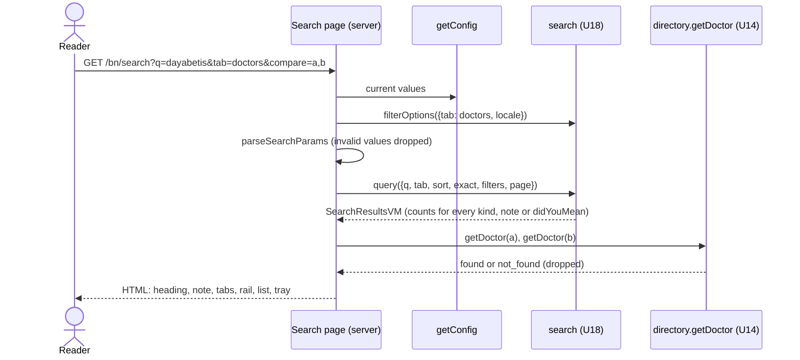
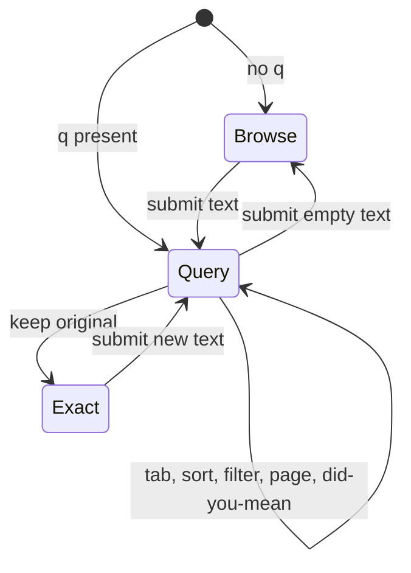
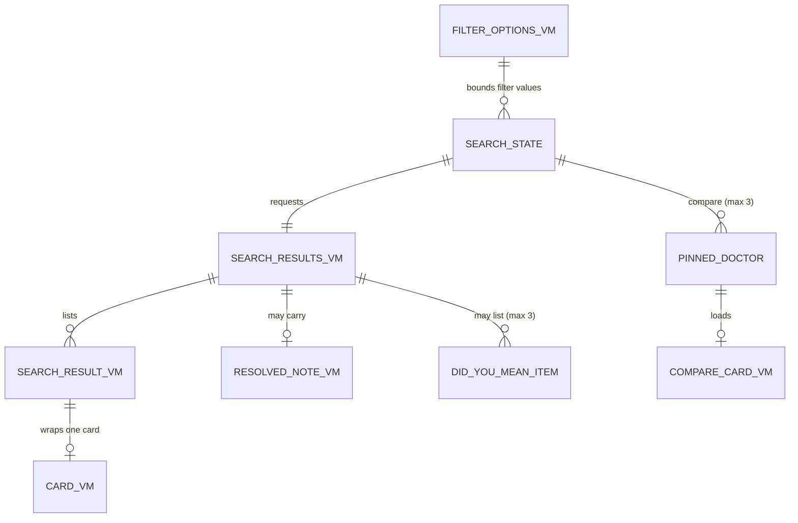

# Functional specification — U19 `t-206-search-page`

**Refreshed 2026-10-29** against `main` at `9cf860a` (T-010 merged as `14c21a9`; U45 T-011 building on `bolt/t-011-patient-design-and-motion-system`), the **U18 T-205 draft** (now written), the drafts of U15 T-202, U16 T-203, U14 T-201, U12 T-105 and U20 T-207, T-011's record, and the owner's answers in `docs/aidlc-migration/OWNER-REVIEW-QUEUE.md`. What changed since the first version of this draft (written before T-205's draft existed):
- **T-205's contract names win.** Tabs are `all|doctors|facilities|conditions|reviews` and the All tab is one call (T-205 BR8.2), the sort is `alphabetical` (not `name`), the keep-original signal is `keepOriginalUrl`, and Did you mean is the VM's own `didYouMean` list (shown when nothing resolved), not a field on the note. The empty `q`, `exact`, `pageSize` 1–50, the consultation-language key and the suggest `locale` are already in T-205's design, so the S1 of an empty browse query (F2) is designed out in U18.
- **Claimed status and provenance are now built, not deferred.** T-205 stores both on the documents (its Question 14), so the doctor and facility rails offer them (Q3 A changes) and FR31 needs no narrowing. FR58's five document values map onto T-205's `hasEvidence` and `evidenceGroup`; symptoms, treatments and medicines are one grouped "topic" select over T-205's `term` filter.
- **The UI for FR30–FR32 stays here.** T-205's draft calls the extra tabs and sort "a UI follow-up for T-206 and T-505", but T-505 is a validation Unit and builds no UI; this Unit builds them (F17) and T-205 drops that row.
- **`search.filterOptions` is still asked of U18** (T-205's F16 left the option source to this Unit): Search already holds every value a filter can match.
- **The FD entry is smaller** (§ 17): T-205's FD entry (b) carries the C12 tab, sort, Did you mean and filter additions; this Unit's entry records only the page going beyond the prototype's structure and the `search.filterOptions` query.
- The threshold and the facility-feedback flag are read with `(await getConfig())` (T-105's page helper).
- **Two new questions** from the T-105 draft: **Q14** — `featureVisibility.compareTray` (on `main` in `config-values.ts`; T-105 says U19 reads it) switches the whole compare feature off (BR5.10, F22); **Q15** — FR30's "dynamically configurable" card fields stay fixed in release 1, recorded in § 17 (BR2.12, F23).
- `rules.md`, `entities.md`, `functional-design-questions.md`, `frontend-components.md` and `traceability.json` are brought to the same names in this refresh. Q1–Q13 keep their numbers; Q1–Q15 are all answered A by the agent under the owner's no-questions instruction of 2026-10-29.

| Field | Value |
|---|---|
| Unit | U19 `t-206-search-page` (kind `ui`, size L, not high risk); Bolt 25; depends on U18 T-205, U15 T-202, U16 T-203, U3 T-010, U45 T-011; U20 T-207 imports `SearchBox`; U42 T-503 runs its journeys |
| Source | `docs/implementation/tasks/T-206-search-page.md`, with its FD-091 amendment |
| Stories | US5.1 (AC5.1.1–AC5.1.6), US5.2 (AC5.2.1, AC5.2.2, AC5.2.4, AC5.2.5; AC5.2.3 is the profile's, AC5.2.6 the redirect's) |
| Requirements | FR28–FR32, FR34, FR35, FR58, NFR4, NFR6, NFR7, NFR8, NFR13 |
| Decisions | FD-018, FD-024, FD-032, FD-035, FD-040, FD-042, FD-076, FD-084, FD-091, FD-093, FD-094; T-205's FD entries (a) and (b); this Unit's entry (§ 17) |
| Upstream design | C12 and C14 as extended by the T-205 draft (§ 8 there); T-202 (`DoctorEntry` with `pinSlot`, `NotVerified`, `SentimentBlock`, `OutcomeBlock`, `AccountRow`); T-203 (`FacilityEntry`, `BrowseCard`); T-201 (cards, `DoctorProfileVM`, `getDoctor`); T-105 (`getConfig()`); T-011 (tokens, `Reveal`, tray and sheet entry, press list) |
| Status | Draft ahead of the stage; finalised into `<record>/construction/t-206-search-page/functional-design/` when the workflow reaches this Unit |

This file holds the workflows and state transitions. `entities.md` holds the data shapes, `rules.md` the rules, `frontend-components.md` the component props, files, styles and tests.

## 1. What changes, in one paragraph

The T-008 placeholder at `/{locale}/search` becomes the search page, ported from the prototype's `renderResults`, `filterFields`, `renderTray` and `openCompare` with the same copy, block order and states for everything the prototype has, on T-011's look, and extended to what FR30–FR32 and FR58 require. It reads `search.query` and `search.filterOptions` through the web container and renders on the server, so tabs, sort, filters, paging and "Clear all" are links and one GET form that work without script. The query is echoed exactly as typed in the heading and in an inline search box; a resolved note names what else matched and offers "Search the exact words instead"; an ambiguous query shows "Did you mean" links and replaces nothing. The Unit ships `SearchBox` (one search form with keyboard-accessible suggestions from `/api/search/suggest`) for T-207's Discover hero, and compare: up to three doctors pinned from the results, kept in `?compare=`, a tray fixed at the bottom of the screen and a side-by-side sheet that opens with "This is not a ranking". The hard rules show in every frame: neutral order with no highest-rated option and the "Why can't I sort by best?" answer; filters that narrow and never reorder; document filters labelled as document presence only; claiming never presented as verification; "Registration not verified" on every doctor and every compare column; counts with denominators, "Not provided", "Limited data"; location chosen by hand. Motion comes only from T-011: the layout's route transition, `Reveal` on each new result list, the tray and sheet entry, press feedback.

## 2. As is (`main` at `9cf860a`) and what Bolt 25 can count on

| Element | Today | By Bolt 25 |
|---|---|---|
| Route | `search/page.tsx` renders `ViewShell(view="results")` with `shell.placeholder`; `generateMetadata()` with no argument, no `robots` | this Unit |
| Route table (T-010) | `app/pages.test.tsx` row `/search`: no `searchParams`, one `h1` "Results", title `documentTitle('results')`, `robots` undefined | this Unit updates the row's harness (BR1.7) |
| Contracts | `SearchQueryInput` with `q` `min(1)`, four tabs, three sorts, `language` as review language; stub VMs with `TODO(T-206)` | U18 T-205 § 8: empty `q`, five tabs, four sorts, `exact`, `pageSize`, `term`/`termKind`, `hasEvidence`, `evidenceGroup`, `claimed`, `provenance`, `language` key; `SearchResultsVM` with `counts`, union `results`, `resolvedNote`, `didYouMean`, `keepOriginalUrl`, `meta`; `SearchSuggestInput {q, locale}` |
| Search | none | U18: `search.query`, `search.suggest`, `/api/search/suggest` (60/min, `no-store`, query never logged), refresh job, seeded index; plus `search.filterOptions` (§ 12) |
| Directory, config | none | U14 `directory.getDoctor`; U12 `getConfig()` (`limitedDataThreshold` 2–50, `featureVisibility.facilityAccounts`) |
| Shared components | `ViewShell`, `Sheet` (controlled, focus trap and return), `useAnnounce` | + T-202's primitives and `DoctorEntry` (`pinSlot`), T-203's `FacilityEntry` and `BrowseCard` |
| Look and motion | T-011 building: tokens, `motion.css` with `:is(.sheet, .tray)` entry and `.seg button` press, `Reveal` (first 6 children), `RouteTransition` in the patient layout, `check:motion` | merged |
| Keys | every prototype `search.*`, `results.*`, `filter.*`, `sort.*`, `compare.*` key; `prov.*`, `evidence.group.*`, `facility.type.*`, `compose.tagGroup.*`, `profile.claimNote` | + ENT-012 |

## 3. Settled before this stage

See `functional-design-questions.md` § "Settled before this stage".

## 4. Workflows

### WF1 — Search request (`/{locale}/search?…`)

1. The layout's `RouteTransition` runs on arrival from another path, never for an in-page change (BR6.1).
2. The page awaits `searchParams` (absent in the route-table harness: empty) and loads, in one `cache()`-wrapped loader shared with `generateMetadata` (BR1.6):
   - `getActor()` and `(await getConfig())` (threshold, `featureVisibility.facilityAccounts`, `featureVisibility.compareTray`);
   - `container.search.filterOptions({tab, locale})` when the requested tab has a rail (BR3.4);
   - `parseSearchParams(raw, options, flags)` (BR1.2): every value checked against its enum, pattern or option list, invalid values dropped (never a 400), first of a repeated parameter kept, `q` as typed cut at 200 code points, empty `q` = browse;
   - one `container.search.query(input)` call (the All tab included: T-205 returns up to three per kind);
   - when `compare` is present and `compareTray` is on, `validatePinned` (BR5.1): at most three `directory.getDoctor` reads, not-found ids dropped.
   A failed `Result` is thrown to Next's error boundary (BR1.8).
3. Render `ViewShell(view="results", title="")` > `CompareProvider(initialPinned, initialCards)` > `SearchResults` (WF2) + `CompareTray` + `CompareSheet` (WF6). No `loading.tsx` under `search/`.
4. `generateMetadata`: title `{q} — Results — RogiKotha` with `q`, else `documentTitle('results')`; no `robots` and canonical `/{locale}/search` only for the canonical browse state, `{index: false}` otherwise (BR1.5).



Text fallback: read the settings and the tab's filter options, clean the URL against them, run one search, validate pinned ids with at most three doctor reads, render; any thrown error goes to the error boundary.

### WF2 — Rendering the results (prototype block order, extended)

1. **`section.panel.results-head`**: kicker `nav.results`; `h1.query-line` = `search.didYouMean <em>{q}</em>` ("Showing results for …", `q` exactly as typed) or `nav.results` when `q` is empty; `ResolvedNote` (WF4); the inline `SearchBox` prefilled with `q` (Q5); `.seg` tab links (WF3); `.meta-row` = the tab's count phrase + `SortMenu`; `details.why` (`sort.why`, `sort.whyBody`).
2. **`div.results-body`** on Doctors, Facilities and Experiences: `FilterRail` (WF5), then `div.entry-list` with an `h2.sr-only` naming the tab, `Reveal` > one entry per result in VM order (`DoctorEntry` with its pin, `FacilityEntry`, `AccountRow`, heading level 3), or `EmptyResults`; then `SearchPager` when `meta.total` exceeds one page (Q10).
3. **Health topics** (`conditions`): no rail; `Reveal as="ul" className="index-grid"` > `li > BrowseCard` (title the name; sub `sentiment.totalAccounts {accountsTotal}` or `index.emptyTopic`; `condition.provisional` appended when `provisional`).
4. **All**: no rail and no pager; the VM's results grouped by `kind` in the fixed order doctors, facilities, conditions, reviews (T-205 BR8.2); one `section.result-group` per kind with results, `h2` "{tab label} ({count})", its entries and `SearchLink` `results.showAll {count}` to that tab; every kind empty → `EmptyResults` alone.
5. `ResultsAnnouncer` speaks the tab's count phrase once when the results key changes after load (BR7.2).

### WF3 — Changing tab, sort, filter or page

1. Tabs are links (`aria-current="true"`, `data-press`), sort and filters are `select`s, pages are links; every href is built by `searchHref(state, change)` in one parameter order; a change of `q`, tab, sort, `exact` or a filter resets `page` (BR1.3, BR1.4).
2. With script: links are `SearchLink`s, which add the live `compare` list (BR5.9); `SortMenu` and `FilterRail` call `router.push(searchHref(…), {scroll: false})`. The path is unchanged, so no route transition runs; the new list has a new `Reveal` key and its first six items enter once (BR6.2).
3. Without script: the selects belong to the GET form `#search-state` (through the `form` attribute) whose hidden fields carry `q`, `tab`, `exact` and `compare`; visually hidden "Apply filters" buttons submit it (BR3.5).
4. "Clear all" keeps `q`, tab, sort, `exact` and `compare` and drops the filters and the page (Q12).

### WF4 — Resolved note and Did you mean

| VM | Renders | Rule |
|---|---|---|
| `resolvedNote.kind` in `alias`, `banglish`, `typo` and `matchedAlias` ≠ `q` (case-insensitive) | `p.resolved`: `{resolvedTo.name} — search.alsoSearched “{matchedAlias}”.` + `SearchLink.link-btn` `search.keepOriginal` to `searchHref(state, {exact: true})`, shown only when `keepOriginalUrl` is present | BR2.3 |
| `resolvedNote.kind = exactCondition` | `p.resolved`: `{resolvedTo.name} — ` + `Link.link-btn` `condition.accounts` to `/topics/{resolvedTo.publicId}` | BR2.3 |
| `didYouMean` (1–3, no note) | `p.resolved`: `search.didYouMeanPrompt` + one `SearchLink.link-btn` per item to `searchHref(state, {q: item.name})`; a name search resolves as `exactCondition` | BR2.3, Q8 |
| neither | nothing | — |

The keep-original href is built from the page's state, not copied from `keepOriginalUrl`, because T-205's URL carries only `q`, tab, sort and `exact` and would drop the filters and the pins (F18). With `exact=1` the VM has no note. The query in the heading and the box is never replaced.

### WF5 — Filter rail (per tab, Q3)

| Tab | Fields, in order (each `div.fset > label + select`, `filter.any` first) |
|---|---|
| Doctors | the prototype's five: `filter.specialty`, `filter.location`, `filter.sentiment`, `filter.outcome`, `filter.gender.label`; then `filter.term` (grouped: Health topics, Symptoms, Treatments, Medicines), `filter.language`, `filter.evidence` (has documents / no documents), `filter.claimed`, `filter.provenance` |
| Facilities | `filter.location`, `filter.facilityType`, `filter.claimed`, `filter.provenance` |
| Experiences | `filter.term`, `filter.sentiment`, `filter.outcome`, `filter.evidence` (no documents, reviewed treatment, later treatment, both treatment paths, outcome / follow-up) |
| Health topics, All | no rail |

Under the fields: `p.note` `filter.note`; on a rail with a documents field `p.note` `evidence.status`; on a rail with the claimed field `p.note` `filter.claimedNote` ("Claiming a profile does not verify registration."); `filter.clear` as a link. Options come from `search.filterOptions` (specialties, cities, consultation languages, terms by kind) or the enums (sentiment, outcome, gender, facility type, provenance, documents, claimed). The URL maps onto T-205's input: `term` → `filters.term` + `termKind` of the chosen group (a legacy `condition` parameter is read as `term`); doctors `documents=has|none` → `hasEvidence`; experiences `documents=none` → `hasEvidence: false`, `reviewed|later|outcome|both` → `evidenceGroup`; `claimed=yes|no` → `claimed`. No field offers device location, "near me", a fee or a schedule (BR2.7; T-205 BR7.6).

### WF6 — Compare

1. **Pin.** Each doctor entry (Doctors tab, All tab's doctor group) gets `PinButton` in `DoctorEntry`'s `pinSlot`: `button.btn.small.ghost[aria-pressed]`, `compare.add` or `compare.remove` plus the doctor's name as hidden text.
2. **Toggle** (`CompareProvider`): not pinned and fewer than three → append; pinned → remove; a fourth → the `Sheet` titled `compare.title` with `p.note` `compare.max`. The URL's `compare` is updated with `window.history.replaceState` (Next keeps `useSearchParams` in step): no server request, no repeated search, no re-entry (Q6, BR5.2).
3. **Tray.** `CompareTray` renders into `document.body` through a portal, only with at least one pin, with the prototype's `#tray` markup (BR5.4); a spacer reserves its height at the end of the page so the colophon's disclaimer is never covered (BR5.5, Q13). It enters with T-011's `.tray` rise.
4. **Sheet.** "Compare" opens `CompareSheet`: with no pins `p.note` `compare.empty`; otherwise `div.callout.warn > b compare.notRanking` first, then one `div.compare-col` per pin in pin order (`h3` name, `p.doc-sub` specialty · city, `NotVerified`, `SentimentBlock`, `OutcomeBlock`, "Limited data" badge when set, `table.breakdown` of conditions with counts, `nav.viewDoctor` link). Cards come from `getCompareCards(publicIds)` (≤ 3 `getDoctor` reads) for ids not yet cached; the server's validated pins seed the cache. Loading shows `p.note[aria-busy]` and no figures; failure shows `errors.common.internal` and keeps the callout (BR5.6, BR5.7).
5. **Without script** (Q7): pin buttons are rendered with `data-pin-pending`, invisible but holding their space; tray and sheet need script, as in the prototype.
6. **Switched off** (Q14): with `featureVisibility.compareTray` false there are no pin buttons, no tray and no sheet; the parser empties `compare`, so no link carries it, and `getCompareCards` refuses. A Super Admin's change applies on the next request (BR5.10).

### WF7 — Search box and suggestions (`SearchBox`)

1. `form.search[role=search][method=get][action=/{locale}/search]` > `label.sr-only` `search.label` > `div.search-shell` > icon SVG (hidden), `input[type=search][name=q][autocomplete=off]` (placeholder `search.placeholder`, value `initialQuery`), `button.btn[type=submit]` `search.submit`; `p.note` `search.banglish`. On `/search` the inline variant also carries hidden `tab` (when not default) and `compare`.
2. With script the input is a combobox (`role=combobox`, `aria-autocomplete=list`, `aria-controls`, `aria-expanded`, `aria-activedescendant`). After 150 ms idle and at least two trimmed code points it fetches `/api/search/suggest?q=…&locale=…`, aborting the previous request; up to eight rows render in `ul.suggest[role=listbox]` > `li[role=option]` with the title and a kind label (`results.tabDoctors`, `results.tabFacilities`, `nav.condition`).
3. Keys: ArrowDown/ArrowUp move the active option with wrap; Enter on an active option opens `/doctors/{id}`, `/facilities/{id}` or `/topics/{id}`; Enter with none submits; Escape closes and keeps the text; Tab and blur close; a click or tap navigates.
4. A failed fetch (network, offline, non-200, 429, malformed body) renders and logs nothing (BR4.3). The list opens without movement (BR6.3).
5. Discover (T-207) mounts `variant="hero"` with an empty `initialQuery`; the results page mounts `variant="inline"`.

### WF8 — Code Generation order

1. **Baseline**: T-205, T-202, T-203, T-201, T-105 and T-011 merged; `pnpm infra:up`; `pnpm check` (eleven steps) and `pnpm smoke` green on the Bolt branch; record the counts and the `apps/web` coverage figure.
2. **Decision log first**: § 17's entry (unless U18 already appended the same content; then cite it); the § 9 ISS rows.
3. **Prerequisites present**: T-205's § 8 contracts and `search.filterOptions` (§ 12); T-202's `DoctorEntry` with `pinSlot`; T-203's `FacilityEntry` and `BrowseCard`; T-011's `Reveal`, `.tray` entry and press list; the container with `search` and `directory`; `getConfig()`. Adapt the wiring, not the rules; a missing data item is an `ISSUES.md` row for its Unit and its UI part is left out with an `ASSUMPTION(T-206)` marker, never faked.
4. **Keys** (both files, one commit, Bengali flagged, FD-042).
5. **`SearchBox` first**, with tests (T-207 builds on it).
6. **`lib/search-params.ts`** (`parseSearchParams`, `toQueryInput`, `searchHref`, `resultsKey`, `isCanonicalBrowse`) with tests.
7. **Compare**: `CompareProvider`, `SearchLink`, `PinButton`, `CompareTray`, `CompareSheet`, `server/actions/compare.ts`, with tests.
8. **Results**: `SearchResults`, `ResolvedNote`, `FilterRail`, `SortMenu`, `EmptyResults`, `SearchPager`, `ResultsAnnouncer`, the page and `generateMetadata`.
9. **Route table**: the `/search` row's harness (BR1.7).
10. **Styles**: T-206's section of `patient.css` (`frontend-components.md` § 7).
11. **Smoke**, gates (BR8.3), CI green on the Bolt head; visual, reduced-motion, 360 px and Lighthouse checks on the seed; ISS rows; hand-off.

## 5. State transitions

### Search state (in the URL)

| From | Event | To |
|---|---|---|
| any | submit the box with text t | `q=t`, tab and sort kept, filters, page and `exact` dropped, `compare` kept |
| any | tab link k | tab = k; filters the new tab applies kept, others dropped; page 1 |
| any | sort s | sort = s, page 1 |
| any | filter f = v (or "Any") | f set (or removed), page 1 |
| note shown | "Search the exact words instead" | `exact=1`, page 1, no note |
| Did you mean shown | an item | `q` = its name, filters, page and `exact` dropped |
| any | "Clear all" | filters and page removed |
| any | pager link n | page = n |



Text fallback: without `q` the page browses every published record of the tab; submitted text makes it a query; tab, sort, filter, page and Did you mean changes stay in the query state; "keep original" moves to the exact state and a new submission leaves it.

### Compare state (client, mirrored in `?compare=`)

| From | Event | To | Rule |
|---|---|---|---|
| n < 3 pinned, d not pinned | pin d | d appended | BR5.2 |
| 3 pinned, d not pinned | pin d | unchanged; max sheet opens | BR5.2 |
| d pinned | pin d or ✕ on its chip | d removed | BR5.2 |
| ≥ 1 pinned | Clear | 0 pinned; `compare` removed | BR5.4 |
| any | Compare | sheet open (empty text with 0) | BR5.6 |
| sheet open | Escape, close, overlay, "View doctor" | closed; focus back on the trigger (the link navigates) | BR5.6 |

### Suggestion list

| From | Event | To |
|---|---|---|
| Closed | ≥ 2 characters, 150 ms idle, ≥ 1 row | Open, no active option |
| Open | ArrowDown / ArrowUp | active option moves (wraps) |
| Open, active option | Enter or click | entity page |
| Open, no active option | Enter | form submits |
| Open | Escape, Tab, blur, < 2 characters | Closed, text kept |
| any | fetch fails or 0 rows | Closed, nothing said |

## 6. Ports and data access

The Unit declares no port. Only the page (element `web`) and the server action (element `web-actions`) call the server:

```text
getActor()                                             -> Actor
await getConfig()                                      -> {limitedDataThreshold (2-50), featureVisibility.facilityAccounts, ...}   (U12)
container.search.filterOptions({tab, locale}, actor)   -> Result<SearchFilterOptionsVM>   (C12 addition, § 12)
container.search.query(input, actor)                   -> Result<SearchResultsVM>         (C12 per T-205 § 8)
container.directory.getDoctor({publicId}, actor)       -> Result<DoctorProfileVM>         (C7; not_found dropped)
GET /api/search/suggest?q=&locale=                     -> 200 [{kind, publicId, title}] (<= 8) | 429 | 400   (C14; browser)
```

`getCompareCards(publicIds)` (`server/actions/compare.ts`) accepts an array of at most three strings that `isPublicId` accepts (deduplicated; anything else → `err('validation')`), reads each doctor, drops `not_found`, maps to `CompareCardVM` and returns `ok({cards, threshold})`; a throw becomes `err('internal')` with a correlation id, logged by action name only.

## 7. View models

Read only. `SearchResultsVM`, `SearchResultVM`, `ResolvedNoteVM`, `SuggestionVM` are T-205's (its § 8); the cards inside are T-201's; `SearchFilterOptionsVM` is the § 12 addition. `CompareCardVM` and `PinnedDoctor` are web-local (`entities.md`). The page relies on: `counts` for all four kinds in every VM (the All count is their sum); results already publication-filtered and in ranking order (never re-sorted, BR2.1); active-locale strings; public ids only; `registrationNotVerified: true` on every doctor card and profile.

## 8. Developer view — mapping details

- **Count phrases**: `t('results.countDoctors', {n, count: formatNumber(n, locale)})` and siblings; tabs read "{label} ({count})"; no percentage.
- **Results key** (`resultsKey(state)`): the canonical query string without `compare`; it keys `Reveal` and `ResultsAnnouncer`, so pins never re-run either.
- **Hrefs**: `searchHref(state, change)` writes `q, tab, sort, exact, page`, then filters in rail order, then `compare`; defaults (`tab=doctors`, `sort=relevance`, `page=1`) omitted; links use next-intl's `Link`.
- **Sort**: `relevance|volume|recent|alphabetical` → `sort.relevance`, `sort.volume`, `sort.recent`, `sort.alphabetical`. On the facilities tab with facility feedback hidden, T-205 orders volume and recent as relevance (its BR5.8), so the menu there offers relevance and alphabetical only and the parser drops the other two (BR2.1).
- **Compare cards**: from `DoctorProfileVM`: `publicId`, `name`, `specialty?`, `city?`, the unscoped `scopedSentiment` / `scopedOutcome`, `conditions` (`{name, count}`), `accountsLimitedData`.

## 9. Findings and proposed ISS rows

Proposed with `Found in U19 T-206 (Functional Design draft)`; the caller numbers them (the register on `main` ends at ISS-302).

- **F1 (S2; designed out)** — FR30 (five tabs), FR32/AC5.2.2 (alphabetical) and FR31/FR58/AC5.2.4 (more filters) are Must and "In", but T-206's task and `03-routes-and-contracts.md` § 1 build the prototype's two tabs, three sorts and five filters. Built here (Q1–Q3); no requirement is narrowed.
- **F2 (S1 as `main` stands; designed out in U18)** — `SearchQueryInput.q` is `min(1)`, so `/search` with no query would fail validation and throw. T-205 § 8 makes `q` 0..200.
- **F3 (S2; designed out)** — Task step 6's `router.replace` per pin is a server navigation that re-runs the search; `history.replaceState` updates the URL with no request (Q6).
- **F4 (S2; designed out)** — Server-built hrefs carry a stale `compare` after client pins; `SearchLink` adds the live list (BR5.9).
- **F5 (S2 as the task says; designed out, needs U18)** — Task step 3 builds options from `taxonomy.listTerms` and `directory.listCities()`; neither is a query (T-201) and T-205 F16 confirms no city list. `search.filterOptions` (Q4, § 12).
- **F6 (S3; designed out)** — `results.count` reads "doctors match" on every tab and "1 doctors match"; per-tab plural keys (Q9).
- **F7 (S3; designed out)** — The prototype's rail is identical on the facility tab, where four of five fields do nothing; the rail is per tab (Q3).
- **F11 (S3; designed out)** — Task step 3's "Clear all" (`/search?q=&tab=`) drops the sort, which the prototype keeps (Q12).
- **F12 (S3; designed out)** — T-011's press list has `.seg button`, but the tabs are links; they take `data-press`.
- **F13 (S3; verify in Build and Test)** — A fixed tray inside `.page-frame` (`view-transition-name: page`) may be captured or misplaced during a route transition; portalled to `document.body` (Q13).
- **F15 (S4)** — Owned-path additions (`frontend-components.md` § 9).
- **F16 (S4, U42 T-503)** — The All tab is one T-205 call with five statements (four `limit 3` lists and four counts in one transaction); T-503 records the `/search` Lighthouse figures.
- **F17 (S2, cross-Unit; designed out)** — T-205's draft (D5, F9) leaves the All, Health topics and Experiences tabs, the alphabetical sort and the added filters to "a UI follow-up for T-206 and T-505", but T-505 is a validation Unit of kind `spec`; nobody would build them. This Unit builds them; T-205 drops its follow-up row.
- **F18 (S3; designed out)** — T-205's `keepOriginalUrl` carries only `q`, tab, sort and `exact` (its BR6.8); used as the link it would drop the filters and the pins. The page uses its presence as the signal and builds the href from its own state.
- **F19 (S3; designed out)** — With facility feedback hidden, "Most experiences" and "Most recent" do nothing on the facilities tab (T-205 BR5.8); the menu offers relevance and alphabetical there.
- **F20 (S4, cross-Unit)** — The T-202 draft reads the threshold with `config.current()`, T-105's draft gives pages `getConfig()`; this Unit uses `getConfig()` and T-202 should align.
- **F21 (S3; designed out)** — FR31's symptom, treatment and medicine filters map onto T-205's single `term` filter: one select with option groups, so a reader can filter by one topic of any kind; combining two topics is not offered (an S4 row records it).
- **F22 (S2; designed out)** — `featureVisibility.compareTray` is on `main` (`packages/contracts/src/config-values.ts`) and the T-105 draft (BR1.6) says U19 reads it, but the task never does: a Super Admin's switch would have no effect (FR100, FD-018). The page honours it for the whole compare feature (Q14, BR5.10).
- **F23 (S2; narrowed by FD)** — FR30 asks for "dynamically configurable" result-card fields; no setting exists and the owner narrowed release 1 to the settings `ConfigValues` holds (T-105 R1), whose release-2 list does not name card fields. The cards stay fixed to FR30's default fields; § 17 clause (6) records it (Q15, BR2.12).
- **F24 (S4, cross-Unit)** — The T-105 draft's `rules.md` BR1.3 still reads `limitedDataThreshold` 1–50 ("becomes 2–50 if the owner answers R2 with A"), while its spec applies the owner's R2 (2–50); T-105 should align its rule. This Unit assumes 2–50.
- **Existing rows, no new row**: ISS-074 (closed two-value gender enum; the filter offers the prototype's two values), ISS-137 (dictionary shipped to the client; the client components add no key to that set), ISS-053 (`@/i18n/routing` mocked in tests), ISS-161 (seeded review text is Bengali only), ISS-168 (seeded `claimed` doctors have no claimant: the claimed filter still reads the stored flag).

(F8–F10 and F14 of the first version are closed by T-205's draft: consultation-language key, suggest `locale`, document filters, container addition.)

## 10. Developer view — accessibility and responsive details

BR7.1–BR7.3 (headings, one count announcement, 360 px and 200% zoom), BR3.1 (tab links with `aria-current` and a non-colour cue), BR4.2 (WAI-ARIA combobox), BR5.3 (pin buttons name their doctor), BR5.8 (compare needs script; everything else works without it). At 360 px the rail stacks above the list, the tab row wraps, the tray wraps its chips and keeps both buttons visible, compare columns stack. Option groups in the topic select use `optgroup` labels, which screen readers announce.

## 11. Developer view — tests

`frontend-components.md` § 8, with the rules each proves; builders from `search-test-support.ts`, `@/i18n/routing` and `next/navigation` mocked, names as sentences, no snapshot.

## 12. Changes other Units must pick up

| Unit | Change | Why |
|---|---|---|
| U18 T-205 | New query `search.filterOptions({tab, locale})` → `{specialties: [{publicId, label}], cities: [{key, label}], languages: [{key, label}], terms: [{publicId, label, kind: condition\|symptom\|treatment\|medicine}]}` from published documents only (specialty_public_id, city_key, language_keys, `search_document_terms` of the tab's kind), alphabetical in the active language; city labels from the documents' city text | Q4, F5, T-205 F16 |
| U18 T-205 | Drop the "UI follow-up for T-206 and T-505" row and D5's "the page keeps two tabs"; the page renders the five tabs, four sorts and the BR7.1 filters | F17 |
| U18 T-205 | No change asked to `keepOriginalUrl`; the page builds its own href (record only) | F18 |
| U15 T-202 | `DoctorEntry`'s `pinSlot` stays a `ReactNode` inside `span.doc-side` (confirmation); read the threshold with `getConfig()` | WF6, F20 |
| U16 T-203 | `BrowseCard`'s `sub` takes a string (the provisional suffix is appended as text); `condition.provisional` stays T-203's key | WF2 |
| U20 T-207 | `SearchBox` props `{initialQuery: string, variant: 'hero' \| 'inline'}`; outside `/search` it carries no hidden fields (T-207's draft already matches) | WF7 |
| U12 T-105 | Record that U19 reads `featureVisibility.compareTray` as "the whole compare feature" (pins, tray, sheet, `compare` parameter); align BR1.3 to 2–50 (F24); optionally name "search result-card fields (FR30)" in the release-2 list of its R1 FD entry (this Unit's § 17 clause (6) records it either way) | Q14, Q15, F22–F24 |
| U37 T-408 | The configuration screen's help text for `compareTray` says it hides comparing on the search page, not only the tray | Q14 |
| U42 T-503 | Journeys: search in both languages, keep original, Did you mean, a filter change, compare two doctors with the max sheet, reduced motion; Lighthouse on `/en/search?q=diabetes` and `/bn/search?q=ডায়াবেটিস` | NFR13 |

## 13. Decisions and why

- **D1 — Five tabs, Doctors the default (Q1).** FR30 is Must and In, the VM counts every kind and the cards exist; Doctors keeps the prototype's first screen and T-205's default.
- **D2 — Four neutral sorts (Q2)**, matching T-205's closed list.
- **D3 — A rail per tab with what Search applies (Q3).** A field that changes nothing misleads; T-205 ignores filters for the wrong tab (its BR7.1). Claimed status sits beside a note that claiming verifies nothing.
- **D4 — Filter options from Search (Q4).** Only Search knows which values match published documents.
- **D5 — Inline search box (Q5)**, for AC5.1.3's "exactly as typed in the search box".
- **D6 — `history.replaceState` for pins (Q6).** No request, no re-entry.
- **D7 — Compare is a script feature (Q7)**, as in the prototype, with reserved space.
- **D8 — Did you mean as links that search each name (Q8).** A name search resolves to the condition with its note, so nothing is replaced silently and the reader lands on the constrained list.
- **D9 — Per-tab count phrases (Q9), a pager (Q10), noindex outside the browse page (Q11), "Clear all" keeps the sort (Q12), the tray in a portal (Q13).**
- **D10 — No page-level `RouteTransition`**; in-page changes keep the path (T-011 BR6.1).
- **D11 — One loader per request, no caching**, so a hidden record disappears on the next request (AC5.1.6).
- **D12 — `compareTray` off removes compare entirely (Q14).** Pins with no tray would do nothing; ignoring the switch breaks FD-018.
- **D13 — Fixed default cards in release 1 (Q15)**, matching the owner's narrow release-1 settings; nothing half-built.

## 14. If an answer changes

| Question → option | What changes |
|---|---|
| Q1 → B | Two tabs; an FD narrowing FR30; `results.tabAll`, `results.tabReviews`, `results.showAll` and the conditions and reviews rendering dropped |
| Q1 → C | All is the default; the route-table row expects the All layout |
| Q2 → B | Three sorts; FR32 and AC5.2.2 narrowed by FD |
| Q3 → B | The prototype's five fields on every rail; FR31 and FR58 narrowed by FD |
| Q4 → B | Options derived in the page from `directory.listDoctors({pageSize: 100})`; facility cities and terms missing; an S3 row |
| Q5 → B | No inline box |
| Q6 → B | `router.replace` per pin; each pin re-runs the search |
| Q7 → B | Pins, ✕ and Clear as GET-form buttons; the server renders the tray |
| Q8 → B | Did you mean links search the name with `exact=1` (no condition note) |
| Q9 → B | `results.count` on every tab |
| Q10 → B | `pageSize` 50 and no pager |
| Q11 → B | Every `/search` URL without `q` indexable |
| Q12 → B | "Clear all" also resets the sort |
| Q13 → B | Tray inside `main`; fixed positioning verified during transitions |
| Q14 → B / C | B: pins stay, only the tray hides; C: BR5.10 dropped and an S2 row for an unread setting |
| Q15 → B | A `searchCards` block in `ConfigValues` (U12 schema, U37 screen) read by the page; clause (6) of § 17 dropped |

## 15. Acceptance mapping (T-206 checks)

| T-206 check | Expected under this design | Rules |
|---|---|---|
| No-JS baseline | tabs, sort, filters, Clear all, pager, keep-original and Did you mean are links or the GET form; pins reserve space and show nothing | BR1.3, BR3.5, BR5.8 |
| Resolved note shapes | three shapes with the exact copy; keep-original carries `exact=1`; Did you mean links | BR2.3 |
| Compare max 3 | a fourth pin opens the sheet with `compare.max`; URL keeps three ids | BR5.2 |
| Tray | absent with 0, present with 1; Clear empties the parameter | BR5.4 |
| Compare sheet | callout first; columns in pin order; `NotVerified` in each | BR5.6, BR2.4 |
| Suggestions a11y | listbox roles; arrows move `aria-activedescendant`; Escape closes; failure renders nothing; no fetch under 2 characters | BR4.2, BR4.3 |
| Empty state | `results.none` + `results.noneBody` | BR3.9 |
| Locales | Bengali counts in the five tabs and the meta row | BR2.5, BR7.4 |
| Impeccable and contrast | zero findings, no new ignore | BR8.3 |
| Visual (FD-091) | `/en/search?q=diabetes` beside the prototype at 1280 and 390 px: same content, order and states for the prototype's parts; the added tabs, sort and fields recorded as decided differences; tray with two pins | BR7.5 |
| Full check | `pnpm check` green, `apps/web` ≥ 80% lines, CI green | BR8.3, BR8.4 |
| Motion check | `pnpm check:motion` passes; T-206 adds no motion declaration | BR6.4 |
| Reduced-motion journey | no slide, stagger or route movement; every step completes; disclaimer, emergency guidance, demo marker static | BR6.4, BR6.5 |
| Route table (T-010) | the `/search` row green | BR1.7 |

## 16. Risks to verify

- **T-205 shapes and `search.filterOptions`** may differ or be missing: adapt the mapping, keep the rules, leave out (with an ISS row) any UI part without data.
- **`history.replaceState` and `useSearchParams`** on the pinned Next 16: no RSC request (network panel), and a later `router.push` keeps the replaced URL.
- **Portalled tray during a view transition**: not captured in the `page` snapshot.
- **Combobox on `type=search`**: VoiceOver and NVDA read the options; the browser's clear button does not break `aria-expanded`.
- **`form` attribute** on the selects and hidden submits in Chromium, Firefox and WebKit.
- **Seed** (11 doctors, 10 branches, 10 conditions, 25 reviews): the Experiences tab shows the pager at 20.
- **Parallel Construction (FD-094)**: shared files (`messages/{en,bn}.json`, `patient.css`, `app/pages.test.tsx`, `decision-log.md`) must not be batched with a Unit editing the same rows; each merge re-runs `pnpm check` on `main`.

## 17. FD entry appended before code

Appended to `docs/status/decision-log.md` with the next free number at build time (FD-094 is the last on `main`; T-205's two entries and other drafts' entries may land first). Text, with the decision-log columns:

```
| FD-<next> | **Search page scope beyond the prototype (U19 T-206 Questions 1–5, 8 and 15)**: the search page keeps the prototype's copy, block order and states for its two tabs, three sorts and five filters, and adds what FR30–FR32 and FR58 require on the T-011 look: (1) five tabs — All, Doctors (the default), Facilities, Health topics and Experiences — with the All tab showing up to three results per kind under a heading and a "Show all" link, kinds never ranked against each other; (2) the sort control offers exactly relevance (default), most experiences, most recent and alphabetical, and on the facilities tab only relevance and alphabetical while facility feedback is hidden; never a highest-rated option; (3) a filter rail per tab showing only the filters Search applies to that tab (doctors: specialty, location, sentiment, outcome, gender, one condition/symptom/treatment/medicine topic, consultation language, documents has/none, claimed status, information source; facilities: location, type, claimed status, information source; experiences: topic, sentiment, outcome and the five FR58 document-presence values; Health topics and All: none), with the claimed field beside "Claiming a profile does not verify registration" and the document fields beside "Documents attached — not medically validated"; (4) an inline search box on the results page prefilled with the query exactly as typed, and "Did you mean" links for an ambiguous query that search each suggested name; (5) contract C12 gains, additively and built by U18 T-205, the query `search.filterOptions({tab, locale})` returning the specialties, cities, consultation languages and topics that occur on published search documents; (6) FR30 is narrowed for release 1: result cards show the fixed default fields (identity, type or specialty, location, verification and provenance mark, condition match, review summary), and runtime-configurable card fields move to release 2 with the other settings of the release-1 settings entry (owner, T-105 R1). Filters narrow and never reorder; no fee, schedule or device-location filter is offered; with `featureVisibility.compareTray` off the page offers no comparing at all. | FR30–FR32 and FR58 are Must and in the demo, but the prototype and the task file built a subset and no other Unit builds the rest (T-205's draft deferred the UI to T-505, a validation Unit); no setting holds card fields and the owner chose to build only the settings the demo uses. Decided by the agent under the owner's no-questions instruction of 2026-10-29 (`docs/aidlc-migration/design-drafts/t-206-search-page/`); appended by U19 T-206 before its code, or by U18 T-205 together with its own entries if it builds `search.filterOptions` first |
```

## Entity-relationship view (derived from `entities.md`)



Text fallback: the URL's search state requests one results view model, which lists results (each wrapping a card, or a condition row) and may carry a resolved note or up to three Did you mean items; the state also holds up to three pinned doctors, each loading a compare card; the filter options bound the values a filter may take.

## Rules summary

The rules BR1.1–BR8.5 with their one-line statements are in `rules.md`; this file cites them by id.

## Sources

- `docs/implementation/tasks/T-206-search-page.md` (FD-091 amendment, steps 1–9, acceptance checks, tests, hard-rule checklist); `T-205`, `T-202`, `T-203`, `T-207` task files.
- `aidlc/spaces/default/intents/261011-aidlc-adoption/inception/`: `units-generation/unit-of-work.md` (U19, U44 T-505 kind `spec`), `unit-of-work-dependency.md`, `unit-of-work-story-map.md`; `requirements-analysis/requirements.md` FR28–FR35, FR58, NFR4, NFR6–NFR8, NFR13; `user-stories/stories.md` US5.1, US5.2; `contract-design/contract-summary.md` C12, C14.
- Drafts: `t-205-search-module` (§ 8 contracts, BR5.8, BR6.5, BR6.8, BR7.1, BR7.4, BR7.5, BR8.2, F16, D5), `t-202-doctor-index-and-profile`, `t-203-facility-and-condition-pages`, `t-201-directory-and-taxonomy-modules`, `t-105-runtime-configuration` (`getConfig()`), `t-204-provider-submission-claim-field-change` (claims, ISS-168), `t-207-discover-emergency-about`; T-011's record.
- `docs/status/decision-log.md` (to FD-094); `PRODUCT.md`; `aidlc/spaces/default/memory/{team,project}.md`; `01-conventions.md` §3, §6–§9, §11, §14; `03-routes-and-contracts.md` §1, §4; `ISSUES.md` ISS-053, ISS-074, ISS-137, ISS-161, ISS-168; `OWNER-REVIEW-QUEUE.md`.
- Code: `apps/web/src/app/[locale]/(patient)/search/page.tsx`, `app/pages.test.tsx`, `components/shared/Sheet.tsx`, `styles/motion.css` (in progress), `eslint.boundaries.mjs`; `packages/contracts/src/{schemas,view-models}/search.ts`, `enums.ts` (`PROVENANCES`); `packages/i18n/messages/{en,bn}.json`.
- Prototype `ui-design-prototype/concepts/concept-04b-quiet-clinic-minimal/app.js` (`filterFields`, `renderDiscover` search form, `renderResults`, `doctorEntry`, `facilityEntry`, `renderTray`, `openCompare`, handlers), `index.html` (`#tray`), `shared/rogikotha-data.js`.
