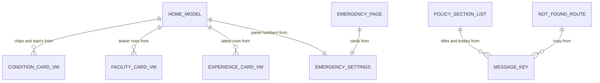

# Entities — U20 `t-207-discover-emergency-about`

Source of truth for the data shapes this Unit reads and the state it holds. The Unit stores nothing and adds no table, column, migration, port, query or command; it removes one unused contract stub (Question 6). Its entities are the view models it receives from U14 T-201 (named here with the fields these pages use; T-201's `functional-spec.md` § 7 is their definition), the emergency settings it reads from U12 T-105, the page-local model Discover builds from them, the content lists of the Half A pages, the components it imports, the change it needs in T-202's `EmergencyPanel`, and the message keys it adds. Decision logic is in `rules.md`; workflows in `functional-spec.md`; component props in `frontend-components.md`.

Built from T-207 (with the FD-091 amendment and the T-207a hand-off), `contract-summary.md` C6 and C7, the T-201 (commit `c572927`), T-202, T-203 and T-011 drafts, `03-routes-and-contracts.md` §1 and §4, `packages/contracts/src/{config-values.ts,view-models/discover.ts}`, `packages/i18n/messages/{en,bn}.json` and the corpus on the working tree, and the answers in `functional-design-questions.md` (Question 1 awaits the owner; the others are answered A).

```yaml
entities:
  - id: ENT-001
    name: ConditionCardVM
    owner: Taxonomy (U14 T-201; contracts/src/view-models/condition.ts)
    description: "One condition with its eligible doctor-account total. The page derives the chips and the browse grid from the list. Read only."
    attributes:
      - { name: publicId, type: string, required: true, constraints: "10-char base32 id; the only id in URLs" }
      - { name: name, type: string, required: true, constraints: "canonical name in the active locale" }
      - { name: accountsTotal, type: integer, required: true, min: 0, constraints: "eligible doctor reviews tagged with this term; 0 for terms nobody wrote about" }
    constraints:
      - "listConditions() returns every active canonical condition by name in the active language (T-201 WF7); no array-order field exists (fact 4)"
      - "No limited-data flag; the condition page carries the mark (Question 3 A)"
      - "Counts are doctor-account counts only (T-201 BR2.6 isolation)"

  - id: ENT-002
    name: FacilityCardVM
    owner: Directory (U14 T-201; contracts/src/view-models/facility.ts)
    description: "One branch in the facilities teaser (the first three of the facility index). Read only; T-203 ENT-001 lists every field."
    attributes:
      - { name: publicId, type: string, required: true }
      - { name: name, type: string, required: true, constraints: "the branch's display name per the owner's answer to T-203 F2; Discover calls facilityLabel(card), never builds the label itself" }
      - { name: branchName, type: string, required: false }
      - { name: type, type: enum, required: true, allowed_values: [hospital, clinic, diagnostic] }
      - { name: area, type: string, required: false }
      - { name: city, type: string, required: true }
      - { name: avatarHue, type: integer, required: true, min: 0, max: 359 }
      - { name: accountsTotal, type: integer, required: true, min: 0, constraints: "eligible facility accounts of this branch only" }
      - { name: accountsLimitedData, type: boolean, required: true, constraints: "0 < accountsTotal < threshold; drives the teaser tag (BR2.4)" }
    constraints:
      - "Discover ignores overall, claimed and notVerified: the teaser shows no distribution and no badge beyond Limited data (Question 3 A)"
      - "listFacilities({page: 1, pageSize: 3}) returns the index's first three (T-201 WF5)"

  - id: ENT-003
    name: ExperienceCardVM
    owner: Review (U14 T-201, extended by U21 T-301; contracts/src/view-models/experience-card.ts)
    description: "One published account in the latest block, rendered by T-202's AccountRow. Read only; T-202 ENT-004 lists every field."
    attributes:
      - { name: publicId, type: string, required: true, constraints: "links to /experiences/{publicId} (U27 T-307)" }
      - { name: title, type: string, required: true, constraints: "as stored (ISS-161: Bengali on the seed)" }
      - { name: excerpt, type: string, required: true }
      - { name: author, type: BylineVM, required: true, constraints: "anonymous carries no link target (BR2.8)" }
      - { name: "(other card fields)", type: "see T-202 ENT-004", required: true }
    constraints:
      - "listExperienceCards({limit: 4}) returns published, eligible accounts newest first (T-201 WF13); hidden, deleted and unpublished ones never appear"

  - id: ENT-004
    name: EmergencySettings
    owner: Administration (U12 T-105, ConfigProvider.current().emergency)
    description: "The emergency numbers and their last-verified date, read once per request through the web composition root."
    attributes:
      - { name: ambulance, type: string, required: true, default: "999", constraints: "min length 1; shown and dialled as configured" }
      - { name: healthLine, type: string, required: true, default: "16263" }
      - { name: crisisLine, type: string, required: true, default: "09612-119911", constraints: "the hyphen is kept in display and in the tel: href" }
      - { name: lastVerified, type: string, required: true, default: "2026-08-21", constraints: "calendar date YYYY-MM-DD; shown with formatDate" }
    constraints:
      - "Same shape as T-207a's EmergencyConfig props and T-202's EmergencyPanel config prop"
      - "The page adds no fallback of its own: T-105's provider returns the last good values, then the defaults, when the database read fails (T-105 BR4.5); an exception from it is a programming error and throws (BR1.3, BR1.5)"

  - id: ENT-005
    name: HomeModel
    owner: U20 T-207 (page-local; built in (patient)/page.tsx, passed to Discover as props)
    description: "What the Discover page hands its component after loading. Not a contract: it never leaves apps/web."
    attributes:
      - { name: chips, type: "list<ConditionCardVM>", required: true, constraints: "0–5 items; accountsTotal > 0; by accountsTotal desc, then Intl.Collator(locale) name (BR2.2)" }
      - { name: topics, type: "list<ConditionCardVM>", required: true, constraints: "accountsTotal > 0 only, in the query's order; [] when none or when the query failed" }
      - { name: facilities, type: "list<FacilityCardVM>", required: true, constraints: "0–3 items; [] when none or failed" }
      - { name: latest, type: "list<ExperienceCardVM>", required: true, constraints: "0–4 items; [] when none or failed" }
      - { name: emergency, type: EmergencySettings, required: true }
      - { name: locale, type: enum, required: true, allowed_values: [en, bn] }
    constraints:
      - "A failed list is logged by the page and reaches Discover as [] (BR1.3); Discover cannot tell an empty list from a failed one and leaves the section out either way (BR2.3)"
      - "Holds nothing personal (BR1.4)"
      - "pickChips and browseTopics are pure functions exported beside Discover so they are tested without rendering"

  - id: ENT-006
    name: PolicySectionList
    owner: U20 T-207 (constants in About.tsx and Policy.tsx, built by T-207a)
    description: "The ordered section lists of the About, Terms and Privacy pages: {key, titleKey, bodyKey} per section."
    attributes:
      - { name: ABOUT_SECTIONS, type: "list<section>", required: true, constraints: "moderation, reviewer, privacy, limits, contact (aboutview.contactBodyProduct)" }
      - { name: TERMS_SECTIONS, type: "list<section>", required: true, constraints: "limits, reviewer, moderation, eligibility, enforcement; + lawful (Question 1 A) or + a pointer section (Question 1 C)" }
      - { name: PRIVACY_SECTIONS, type: "list<section>", required: true, constraints: "identity, data, lawful" }
    constraints:
      - "The lawful-access keys appear only in Policy.tsx (BR2.9; source-level scan)"

  - id: ENT-007
    name: NotFoundRoute
    owner: U20 T-207 (app/[locale]/(patient)/[...rest]/page.tsx, (patient)/not-found.tsx, app/not-found.tsx)
    description: "The paths that end in a 404 and the page that answers them (Question 7)."
    attributes:
      - { name: locale, type: enum, required: true, allowed_values: [en, bn], constraints: "from the [locale] segment; absent for the root fallback" }
      - { name: rest, type: "list<string>", required: true, constraints: "any unmatched path below /{locale}/; never read, only rejected" }
      - { name: view, type: "literal 'not-found'", required: true, constraints: "a new ViewName in lib/titles.ts; titleForView returns errors.common.notFound" }
    constraints:
      - "Status 404 and Next's automatic noindex"
      - "Unknown /{locale}/admin/* paths also land here until U35 adds a staff catch-all (finding F12)"

  - id: ENT-008
    name: ImportedComponent
    owner: "U15 T-202, U16 T-203, U19 T-206, U45 T-011"
    description: "Components this Unit renders but does not own. Their props are their owners' contracts."
    attributes:
      - { name: EmergencyPanel, type: "{config: EmergencySettings, locale}", required: true, constraints: "T-202; full form; data-static=emergency; body from emergency.body with {ambulance} and {healthLine} (T-105 Question 5 A)" }
      - { name: AccountRow, type: "{card: ExperienceCardVM, headingLevel?: 3 | 2}", required: true, constraints: "T-202; default h3" }
      - { name: "MiniList / MiniRow", type: "{children} / {href, avatar, title, sub, loc?}", required: true, constraints: "T-202; no className prop, so the facilities panel reveals as one block (Question 4 A)" }
      - { name: Avatar, type: "{seed, hue, size}", required: true, constraints: "T-202; seed = publicId, size 38" }
      - { name: BrowseCard, type: "{href, title, sub}", required: true, constraints: "T-203; a link" }
      - { name: facilityLabel, type: "(card) => string", required: true, constraints: "T-203; exported beside FacilityLink" }
      - { name: SearchBox, type: "{initialQuery, variant: 'hero' | 'inline'}", required: true, constraints: "T-206; client; GET /search; its own search.banglish note" }
      - { name: ViewShell, type: "{view, title, children}", required: true, constraints: "T-008; title '' on every page of this Unit" }
    constraints:
      - "A prop that differs at Bolt 26 changes the wiring here, not the rules; the difference is recorded"

  - id: ENT-009
    name: PrimitiveChangeRequest
    owner: U15 T-202 (asked first); U20 T-207 only as a fallback
    description: "The additive change to T-202's EmergencyPanel these pages need (T-105 Question 5 A parameterises emergency.body)."
    attributes:
      - { name: "EmergencyPanel body", type: message, required: true, constraints: "t('emergency.body', {ambulance, healthLine}) with formatDigits values, in the full and the compact form (T-105 changes the key's copy; T-202's panel passes the values)" }
    constraints:
      - "No prop change: the panel already receives the configuration"

  - id: ENT-010
    name: RemovedContractStub
    owner: U20 T-207 (packages/contracts, recorded owned-path change)
    description: "The unused Discover view-model stub (Question 6)."
    attributes:
      - { name: DiscoverVM, type: interface, required: true, constraints: "featuredConditions, featuredDoctors, featuredFacilities, emergency; nothing imports it" }
      - { name: EmergencyPanelVM, type: interface, required: true, constraints: "duplicates ConfigValues.emergency" }
    constraints:
      - "Removed with its export in contracts/src/index.ts; 03-routes-and-contracts.md §4 drops DiscoverVM"

  - id: ENT-011
    name: MessageKey (added by this Unit)
    owner: packages/i18n (keys added by U20 T-207)
    description: "New keys, both dictionaries in one commit, Bengali flagged for review (FD-042). Values are proposals."
    attributes:
      - { name: "emergview.bmdcShort", type: message, required: true, constraints: "en 'BMDC'; bn 'BMDC' (Question 8)" }
      - { name: "notFound.body", type: message, required: true, constraints: "en 'The page may have moved, or the link may be wrong.'; bn 'পাতাটি হয়তো সরানো হয়েছে, অথবা লিংকটি ভুল।' (Question 7)" }
      - { name: "notFound.home", type: message, required: true, constraints: "en 'Go to the home page'; bn 'হোম পাতায় যান' (Question 7)" }
    constraints:
      - "Reused, already in both dictionaries: discover.kicker, discover.editorialNote, discover.browse, discover.browseNote, discover.facilities, discover.latest, hero.title, hero.body, how.title, how.{1,2,3}.{t,b}, disclaimer.short, facility.separation, facility.type.*, index.emptyTopic, label.limitedData, emergency.*, emergview.*, aboutview.*, policy.*, a11y.call, nav.emergency, errors.common.notFound"
      - "Reused from T-202: sentiment.totalAccounts; changed by U12 T-105: emergency.body gains {ambulance} and {healthLine} (T-105 Question 5 A)"
      - "Left unused: hero.cta, hero.browse (Question 9), emergview.poison (the prototype renders no poison card), emergview.title"
      - "Question 1 C would add two keys (a Terms pointer title and body); A and B add none"
```

## Seed shapes the pages meet (corpus after U6 CR-012)

| Item | Seed | What Discover shows |
|---|---|---|
| Conditions | 10; eligible doctor accounts per condition **only once condition tags are seeded** (T-203 finding F1): c1 Type 2 diabetes 5, c2 Thyroid 2, c3 High blood pressure 3, c4 Eczema 1, c5 Frozen shoulder 2, c6 IBS 1, c7 Typhoid fever 3, c8 Gastric ulcer 0, c9 Asthma 4, c10 Migraine 3 | 9 browse cards (c8 left out), alphabetical; chips c1, c9, then the three 3-account topics c3, c7, c10 ordered by name in the active language (English: High blood pressure, Migraine, Typhoid fever): the same five in both languages (Question 2 A) |
| Facilities | 10 branches; 1–3 facility accounts each (19 in all); none at or above the threshold of 5 | 3 teaser rows from the index's start, each with the count phrase and "Limited data" (Question 3 A); the three differ from the prototype's f1, f2, f3 (finding F17) |
| Reviews | 24, seeded text in Bengali only (ISS-161) | the four newest as account rows; Bengali titles and excerpts under `/en` too |
| Emergency settings | 999, 16263, 09612-119911, last verified 2026-08-21 | "Last verified 21 August 2026" / "সর্বশেষ যাচাই ২১ আগস্ট ২০২৬" |

## What the Unit does not hold

- No database row, migration, port, query, command or contract type (it removes one unused stub).
- No cookie, local storage or URL state; theme, language and motion stay the shell's cookies. The only query parameter it writes is `q` on the chip links.
- No view-model field. A field these pages need that T-201 does not supply is an `ISSUES.md` row for U14, not a page-side workaround.

## Relationships at a glance



Text fallback: the home model takes its chips and topics from the condition cards, its teaser rows from the facility cards, its latest rows from the experience cards and its panel numbers from the emergency settings; the Emergency page takes its cards from the same settings; the About, Terms and Privacy section lists and the 404 page take their copy from message keys. No edge joins facility figures to condition or doctor figures.
