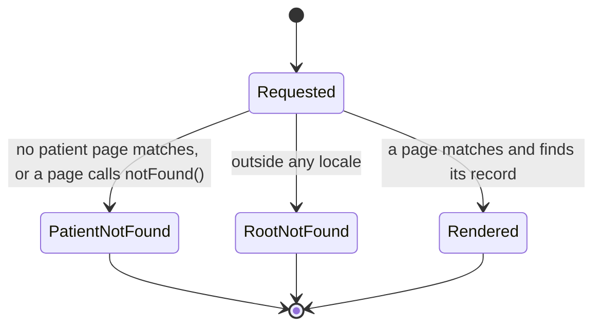
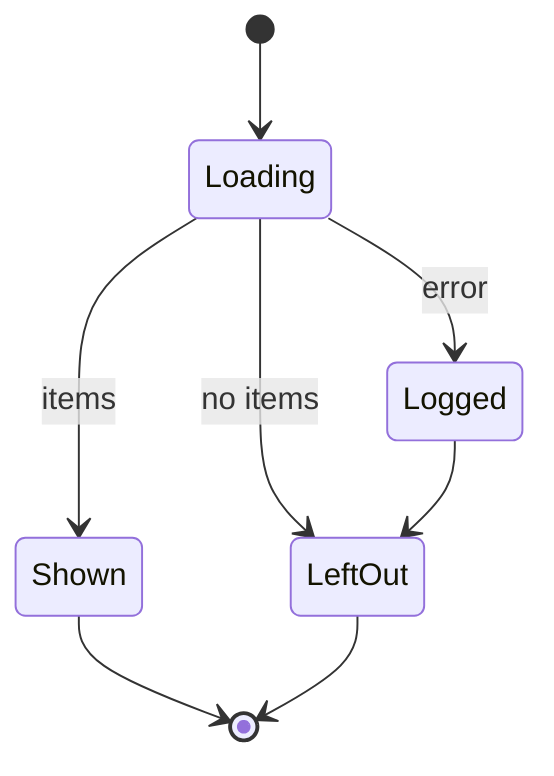
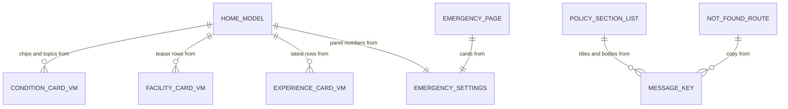

# Functional specification — U20 `t-207-discover-emergency-about`

| Field | Value |
|---|---|
| Unit | U20 `t-207-discover-emergency-about` (kind `ui`, size M, not high risk); Bolt 26; depends on U15 T-202, U16 T-203, U19 T-206, U14 T-201, U3 T-010, U45 T-011; U40 T-501 (shell cache of `/`, `/emergency`, `/about`) and U42 T-503 build on it |
| Source | T-207 (`docs/implementation/tasks/T-207-discover-emergency-about.md`, with the FD-091 amendment); Half A merged as T-207a (`docs/implementation/handoffs/T-207a.md`); carries ISS-120, ISS-151, ISS-152 (`unit-of-work.md`) |
| Stories | US12.1 (AC12.1.1–AC12.1.6; the emergency and policy pages), US5.1 (AC5.1.1–AC5.1.6; the search entry point only), US4.3 (AC4.3.1–AC4.3.5; the facility teaser only) — `unit-of-work-story-map.md`; the task's motion rows also name AC2.4.3, AC2.4.4 and AC2.4.6 |
| Requirements | FR24, FR25, FR28, FR34, FR76 (retired; the static `/emergency` page replaces it, FD-046), FR91, FR92, FR95, FR100, NFR1, NFR4, NFR6, NFR7, NFR13 — `requirements.md` |
| Decisions | FD-008 and FD-022 (lawful-access disclosure), FD-024 (equal languages), FD-032 (plain CSS), FD-042 (Bengali copy review), FD-044 (Terms/Privacy kicker), FD-046 (emergency banner retired), FD-089 (about 10 records per module), FD-091 (patient redesign and motion), FD-093 (import boundaries); the owner's answers to T-202 Question 1 (no percentages) and T-203 Question 1 and F2 (nine criteria; each branch's own hospital name) |
| Upstream design | `contract-summary.md` C6 and C7; drafts `t-201-directory-and-taxonomy-modules` (commit `c572927`: queries and view models), `t-202-doctor-index-and-profile` (shared primitives), `t-203-facility-and-condition-pages` (`BrowseCard`, `facilityLabel`), `t-011-patient-design-and-motion-system` (tokens, motion), `t-105-runtime-configuration` (live emergency numbers, the parameterised `emergency.body`, the configuration fallback); T-206's task file (`SearchBox`) |
| Questions | Q1–Q9 in `functional-design-questions.md`. **Q1 (where the lawful-access explanation sits, FD-008 against FD-022) needs the owner**; Q2–Q9 are answered A on the owner's standing instruction of 2026-10-27 and are to be listed in `docs/aidlc-migration/OWNER-REVIEW-QUEUE.md`. This specification follows the recommended option throughout and keeps Terms as built until Q1 is answered; § 14 lists the changes under each other option |
| Status | Draft written ahead of the stage on the branch `bolt/t-010-boundary-lint-and-ci` (2026-10-28), while U3 T-010 builds; `apps/web`, `packages/i18n` and the seed match `main` after U6 CR-012 |

This file is the source of truth for the Unit's workflows and state transitions. `entities.md` holds the data shapes, `rules.md` the numbered rules, and `frontend-components.md` the component props, files, styles and tests. The entity-relationship view and the rules summary at the end are derived from those files.

## 1. What changes, in one paragraph

The T-008 placeholder at `/{locale}` becomes the real Discover home, ported from the prototype's `renderDiscover` with the same content, fields and block order on T-011's "Warm Paper, Soft Depth" look: an opener with the hero title as the page's one `<h1>`, an empty hero search box (T-206), five topic chips that are plain links to search, and the editorial note with the short disclaimer; T-202's full emergency panel with the configured numbers; the topics people wrote about as T-203 browse cards; three branches from the facility index under the separation sentence; the three how-it-works steps; and the four newest accounts as T-202 account rows. The page reads T-201's `ConditionCardVM`, `FacilityCardVM` and `ExperienceCardVM` and T-105's emergency settings in parallel, once per request, and a failed list leaves out only its own section while the opener and emergency panel stay. The four Half A pages keep their T-207a markup; they gain T-011's look and the layout's route transition, the Emergency page reads the live configuration (ISS-171), and one inline style and one literal go. Every unknown or missing patient URL gets a localized 404 inside the patient chrome (ISS-120). Motion comes only from T-011: the layout's page transition, scroll reveals on the blocks below the emergency panel, and press feedback; the opener, the disclaimer, the emergency panel, the whole Emergency page and the demo marker never move. Three message keys are added and one unused contract stub is removed. No hard rule, data boundary or contract changes under the recommended answers; Question 1 is the one point that waits for the owner.

## 2. As is (working tree, 2026-10-28) and what Bolt 26 can count on

| Element | Today | By Bolt 26 |
|---|---|---|
| `/` | `page.tsx` renders `ViewShell` with `shell.placeholder` and no `<h1>` (ISS-152) | unchanged until this Unit |
| Half A | `Emergency`, `About`, `Policy` and their pages on `main` (T-207a, CR-005); Emergency reads `DEFAULT_CONFIG_VALUES.emergency` (ISS-171); one inline style; `BMDC` literal | the same, restyled by U45 T-011 |
| Data | No container; no query | U8 T-101 creates the container; U12 T-105 makes `config.current()` live; U14 T-201 delivers `taxonomy.listConditions`, `directory.listFacilities`, `review.listExperienceCards`; U15, U16 and U27 wire them |
| Shared components | none | T-202's `EmergencyPanel`, `AccountRow`, `MiniList`, `Avatar`, `Badge`; T-203's `BrowseCard`, `facilityLabel`; T-206's `SearchBox` |
| Look and motion | `patient.css` is the verbatim 04b port (with `.reveal`, hover lifts and on-load rises) | U45 T-011's token block, restyled classes, `motion.css`, `RouteTransition` in the layout, the `.reveal` home hook, static groups, `check:motion`, `contrast:patient` |
| Keys | every prototype `hero.*`, `how.*`, `discover.*`, `emergency.*`, `emergview.*`, `aboutview.*` key, T-207a's `policy.*` and `emergency.lastVerifiedLine` | + T-202's `sentiment.totalAccounts` + T-105's parameterised `emergency.body` + this Unit's three |
| Seed | 10 conditions, 10 branches (1–3 accounts each), 24 reviews with free-text tags only | the same, plus the condition tags if U14 runs its fallback (T-203 finding F1; finding F2 here) |
| 404 | root `app/not-found.tsx`, English, hard-coded, inline styles (ISS-120) | unchanged until this Unit |

## 3. Settled before this stage

See `functional-design-questions.md` § "Settled before this stage": the look follows T-011 with page rules in T-207's own `patient.css` section; no percentages; facilities follow the nine-criteria model and each branch's own hospital name; the data and its isolation are T-201's; the primitives are T-202's and T-203's with their answered behaviour; the search box is T-206's; the FD-022 sentence never leaves the legal pages; no new dependency. The design decisions taken without a question are listed in the same file and explained in § 13.

## 4. Workflows

### WF1 — Discover request (`/{locale}`)

1. The patient layout renders the shell; the layout's `RouteTransition` wraps `<main>`'s content (BR5.1).
2. The page gets the locale and an anonymous-or-session `Actor` and starts four reads together (BR1.2): `taxonomy.listConditions()`, `directory.listFacilities({page: 1, pageSize: 3})`, `review.listExperienceCards({limit: 4})` and `config.current()`.
3. For each list: an `ok` result gives its items; a failed or rejected one is logged (`discover.section_unavailable`, section, correlation id) and becomes `[]` (BR1.3). The configuration read does not fail on a database error (T-105 falls back to the last good values, then the defaults); an exception from it throws to the error boundary.
4. From the conditions it derives `topics` (accounts > 0, the query's order) and `chips` (accounts > 0, most accounts then name, at most five) (BR2.2, BR2.3).
5. It renders `ViewShell(view="discover", title="")` > `Discover` (WF2).
6. `generateMetadata` gives "RogiKotha — Patient-reported treatment experiences", indexable, canonical `/{locale}` with `en` and `bn` alternates (BR1.6).

```mermaid
sequenceDiagram
  actor Reader
  participant Page as Discover page (server)
  participant Tax as taxonomy (U14)
  participant Dir as directory (U14)
  participant Rev as review (U14/U21)
  participant Cfg as ConfigProvider (U12)
  Reader->>Page: GET /bn
  par in parallel
    Page->>Tax: listConditions()
    Page->>Dir: listFacilities(page 1, size 3)
    Page->>Rev: listExperienceCards(limit 4)
    Page->>Cfg: current()
  end
  alt configuration helper throws
    Cfg-->>Page: error
    Page-->>Reader: error page
  else configuration read
    Tax-->>Page: ConditionCardVM[] or error
    Dir-->>Page: FacilityCardVM page or error
    Rev-->>Page: ExperienceCardVM page or error
    Page->>Page: log each failed list; use [] for it
    Page->>Page: topics = accounts > 0; chips = top 5 by accounts, then name
    Page-->>Reader: home page HTML (failed sections left out)
  end
```

Text fallback: the page starts the three list reads and the configuration read together; an exception from the configuration helper ends in the error page; otherwise each failed list is logged and left out, the topics and chips are derived from the conditions, and the page renders.

### WF2 — Discover rendering (prototype block order)

1. **Opener**: kicker `discover.kicker`; `h1.display` `hero.title`; the lede `hero.body`; the hero `SearchBox` with an empty query (BR2.10); the chips as links to `/search?q={name}` (BR3.3); the margin note with `discover.editorialNote` and `disclaimer.short`, a static group (BR2.6). Never animated (BR5.3).
2. **Emergency panel**: T-202's full `EmergencyPanel` with the configured numbers, the sentence `emergency.body` with the configured numbers (T-105 Question 5 A), and the last-verified line; a static group, once (BR2.7).
3. **Browse by topic** (when any topic has accounts): `discover.browse`, `discover.browseNote`, one `BrowseCard` per topic with its count phrase (BR3.4, BR3.11); each card reveals on scroll (BR5.2).
4. **Facilities teaser** (when any facility): `discover.facilities`, `facility.separation`, up to three `MiniRow`s with avatar, `facilityLabel`, type · place · count (or `index.emptyTopic`), and "Limited data" when sparse (BR3.5, BR2.4, BR2.5); the panel reveals as one block.
5. **How it works**: `how.title` and three steps with figures 01–03 in the active digits (BR3.6); each step reveals.
6. **Latest accounts** (when any): `discover.latest` and up to four `AccountRow`s, newest first (BR3.7, BR2.8); each row reveals.

A section whose list is empty is left out with its heading; the others keep their order (BR2.3, BR3.1).

### WF3 — Emergency page (`/{locale}/emergency`)

1. The page reads `(await getConfig()).emergency` (T-105's helper; T-105 makes this switch and closes ISS-171, this Unit checks it); T-105's fallback covers a database error and an exception throws (BR1.5).
2. It renders `ViewShell(view="emergency", title="")` > `Emergency`: the head panel with its own `h1`; three `tel:` cards with the configured numbers in the active digits, hyphen kept; the BMDC register card (`emergview.bmdcShort`, new tab); the last-verified note with the `.emerg-note` class (BR3.8, BR7.1).
3. `#view-emergency` is in T-011's static set: on a route change the page appears at once and nothing on it moves (BR2.7, BR5.3).

### WF4 — About, Terms and Privacy (FD-091 pass)

1. The markup stays as T-207a built it: About's five sections and foot note; Terms' five sections; Privacy's three sections with the lawful-access section last (BR3.9, BR3.10).
2. The look comes from T-011's restyle of `.panel`, `.about-head`, `.about-sections`, `.about-section` and `.about-foot`; the pages get the layout's route transition and no reveal.
3. `generateMetadata` adds the canonical URL and alternates (BR1.6).
4. Question 1's answer may add a Terms section (§ 14).

### WF5 — Missing pages (Question 7)

1. A path under `/{locale}/` that matches no page reaches `(patient)/[...rest]/page.tsx`, which calls `notFound()`.
2. `notFound()` from that catch-all or from any patient page (a hidden doctor, an unknown topic) renders `(patient)/not-found.tsx` inside the patient layout: masthead, demo marker, `ViewShell(view="not-found")` > `NotFoundView` (`errors.common.notFound`, `notFound.body`, links to the home page and to emergency help), colophon. Status 404, `noindex` (BR1.7).
3. A path outside any locale that the proxy does not redirect reaches the root `app/not-found.tsx`, which shows the message and the home link in both languages from the dictionaries, without inline styles.



Text fallback: a request either renders its page, ends on the localized patient 404 (unmatched path or `notFound()`), or, outside any locale, ends on the bilingual root fallback.

### WF6 — Motion on these pages

1. Route change into any of the five pages: T-011's page transition (old content fades out, new fades in and rises); the masthead, demo marker, colophon, the margin note (`disclaimer`) and the emergency panel (`emergency`) stay still as their own static groups; the Emergency page is static as a whole.
2. Scrolling the home page with motion allowed and `animation-timeline` supported: each topic card, the facilities panel, each step and each account fades and rises once as it enters the viewport (BR5.2). Without support they are simply visible.
3. Press feedback on chips, cards and rows comes from T-011's press primitive, if its selectors cover them (finding F15).
4. Reduced motion: none of the above; every block visible at once (BR5.5).

### WF7 — Code Generation order

1. **Baseline**: `pnpm infra:up`; `pnpm check` and `pnpm smoke` green on the Bolt branch; read the open `ISSUES.md` rows of § 9.
2. **Prerequisites present**: T-201's queries and the seeded condition tags (finding F2); T-202's primitives and whether its panel passes the numbers to `emergency.body` (T-105 Question 5 A); T-203's `BrowseCard` and `facilityLabel`; T-206's `SearchBox`; T-011's `RouteTransition` placement, `.reveal`, static groups and `check:motion`; the container with `taxonomy`, `directory`, `review`, `config` and `logger`. Adapt the wiring, not the rules, if a shape differs; record each difference.
3. **Keys** (both files, one commit, Bengali flagged) and `keys.ts` regenerated.
4. **Emergency**: live configuration, `.emerg-note`, `emergview.bmdcShort`; tests re-structured under `describe.each` (ISS-151).
5. **EmergencyPanel sentence** (T-105 Question 5 A), only if T-202 did not pass the numbers, recorded.
6. **`Discover`, `pickChips`, `browseTopics`, the Discover page**; `pages.test.tsx` updated (finding F10).
7. **Remove the `DiscoverVM` stub** and its export; update 03 §4 (Question 6).
8. **404**: `NotFoundView`, `(patient)/not-found.tsx`, `[...rest]/page.tsx`, `lib/titles.ts`, the root fallback (Question 7).
9. **Metadata alternates** on the five pages.
10. **Styles**: T-207's section of `patient.css` (`frontend-components.md` § 7).
11. **FD-022 test** gains Discover; smoke file; gates (BR9.3); the visual, reduced-motion, viewport and Lighthouse checks; ISS rows; hand-off with the hard-rule evidence.

## 5. State transitions

### A Discover section's outcome

| From | Event | To | Rule |
|---|---|---|---|
| Loading | `ok` with items | Shown | WF2 |
| Loading | `ok` with no items (after the accounts > 0 filter for topics) | Left out | BR2.3 |
| Loading | `err` or rejected | Left out, logged | BR1.3 |
| Loading (configuration) | error | Page fails to the error boundary | BR1.3 |



Text fallback: each list section loads; with items it is shown; with none it is left out; on an error it is logged and then left out. The opener and the emergency panel have no such states: they always render once the configuration is read.

### What the view model's values mean on the page

| Value | Page shows | Rule |
|---|---|---|
| `ConditionCardVM.accountsTotal = 0` | not among the chips or the cards | BR2.3 |
| `FacilityCardVM.accountsTotal = 0` | "No one has written about this yet." in the row, no tag | BR2.3 |
| `FacilityCardVM.accountsLimitedData` | the short "Limited data" tag in the row | BR2.4 |
| `area` absent | type · city · count | BR3.5 |
| anonymous `author` | the anonymous byline sentence, no link | BR2.8 |
| fewer than five conditions with accounts | that many chips; none when there are none | BR3.3 |

## 6. Ports and data access

This Unit declares no port. It calls the queries of C6 and C7 and the review card query through the web composition root:

```text
container.actor(locale)                                          -> Actor (anonymous or session; T-101)
container.taxonomy.listConditions({}, actor)                     -> Result<ConditionCardVM[]>
container.directory.listFacilities({page: 1, pageSize: 3}, actor) -> Result<BoundedPage<FacilityCardVM>>
container.review.listExperienceCards({limit: 4}, actor)          -> Result<CursorPage<ExperienceCardVM>>
getConfig()  (T-105 helper over container.config.current()) -> ConfigValues (emergency); falls back, never fails on a database error
container.logger.error({event, section, correlationId})          -> void (allowlisted fields only)
```

U16 wires `taxonomy`, U15 `directory`, and U27 T-307 the review card query for its experience index; if any is missing at Bolt 26, this Unit wires it as a recorded addition. The exact names follow whatever T-101 and T-201 built; the page adapts.

## 7. View models

Read only; defined by T-201 (`entities.md` ENT-001–ENT-003 here; T-201 § 7, T-202 ENT-004, T-203 ENT-001). This Unit relies on: active-locale strings; optional fields absent when missing; public ids only; `accountsTotal` counting eligible accounts of the right kind only (doctor reviews for conditions, facility feedback for branches); `accountsLimitedData` on facility cards; experience cards newest first and published only. A field Discover needs that T-201 does not supply is an `ISSUES.md` row for U14, not a page-side workaround.

## 8. Developer view — mapping details

- **Chips**: `conditions.filter(c => c.accountsTotal > 0).sort((a, b) => b.accountsTotal - a.accountsTotal || collator.compare(a.name, b.name)).slice(0, 5)`, with `collator = new Intl.Collator(locale)`.
- **Topics**: `conditions.filter(c => c.accountsTotal > 0)`, no re-sort.
- **Count phrase**: `t('sentiment.totalAccounts', {n, count: formatNumber(n, locale)})`.
- **Teaser row sub**: `[t('facility.type.' + type), [area, city].filter(Boolean).join(', '), n > 0 ? countPhrase : t('index.emptyTopic')].join(' · ')`, followed by `<Badge cls="plain">{t('label.limitedData')}</Badge>` when `accountsLimitedData`.
- **Teaser row avatar**: `Avatar({seed: publicId, hue: avatarHue, size: 38})`.
- **Chip link**: next-intl `Link` with `{pathname: '/search', query: {q: name}}`, so the locale prefix and the encoding are the router's.
- **How figures**: `formatDigits('0' + i, locale)`.
- **Emergency sentence** (T-105 Question 5 A): `t('emergency.body', {ambulance: formatDigits(c.ambulance, locale), healthLine: formatDigits(c.healthLine, locale)})`.
- **Margin note name**: `aside[aria-labelledby="discover-note-k"]` with `span.k#discover-note-k`; one Discover per page, so the fixed id is unique.
- **Section logging**: one `logger.error` per failed list with `{event: 'discover.section_unavailable', section, correlationId}`; never the error message, a query or a name (01-conventions §11).

## 9. Findings and proposed ISS rows

Each is proposed with `Found in U20 T-207 (Functional Design draft)`; the caller adds them with the next free numbers (the register ends at ISS-271 on this tree; other drafts have rows waiting too).

- **F1 (S2 if built as the task says; designed out)** — Step 7 wraps all five pages in `RouteTransition` while T-011 puts one boundary in the layout; a second boundary gives two elements named `page` and the browser skips every route transition. Settled by BR5.1; the task's step 7 wording should be corrected, as T-202 F4 and T-203 F5 propose for their tasks.
- **F2 (S2, suggested owner U14 T-201, before Bolt 26; no new row if T-203's F1 row exists)** — The browse grid and the chips need the seed's condition tags (T-203 finding F1). Without U14's fallback every condition reads 0: the grid and chips are empty and storyboard step 1 ("browse by condition") fails on `/bn`.
- **F3 (S3, designed out)** — With no `error.tsx`, one failed list query would replace the whole front door, emergency panel included, with Next's default error page. Settled by Question 5 A (BR1.3).
- **F4 (S3, the owner)** — FD-008 places the lawful-disclosure explanation in Terms; T-207a placed it in Privacy only and tests its absence from Terms (Question 1).
- **F5 (S3, suggested owner U15 T-202; T-203 F9 restated)** — `emergency.body` names 999 and 16263 as fixed copy beside configurable call links; U12 T-105's draft (its Question 5 A, finding F2 there) gives the key number parameters, and this Unit checks that the panel passes them. No new row if T-105's exists.
- **F6 (S3, suggested owner U45 T-011)** — `.emerg-card:hover { transform: translateY(-2px) }` (`patient.css` 1553) moves emergency guidance on hover; T-011's removal table names `.emergency-lines a:hover` but not this rule. T-207 may not add a motion override (BR5.4), so U45 removes it.
- **F7 (S3, U20 T-207, this Unit)** — `Emergency.tsx` keeps an inline `style` from the prototype; under FD-091 the carve-out no longer applies (BR7.1).
- **F8 (S4, U20 T-207, this Unit)** — The BMDC card's `span.num` is a hard-coded `BMDC` (Question 8).
- **F9 (S4, U20 T-207, this Unit)** — `contracts/src/view-models/discover.ts` is an unused stub with `TODO(T-207)`; its `featuredDoctors` has no prototype counterpart (Question 6).
- **F10 (S1 if missed; designed out)** — `app/pages.test.tsx` renders `/` and expects `ViewShell`'s generic title behaviour; once Discover loads data through the container and owns its `<h1>`, `pnpm check` goes red unless the test mocks the container and marks `/` as `ownsHeading`. A recorded owned-path addition.
- **F11 (S4, U20 T-207)** — Task-text drift: the "Read first" line numbers predate FD-089 (`emergencyPanel` 435, `renderDiscover` 472, `accountRow` 624, `renderEmergency` 2021, `renderAbout` 2067); step 5's keys already exist; "first 5 by seed order" is not readable from the database; step 7's `RouteTransition`; Half A is done; the owned paths miss the 404 files, `pages.test.tsx`, `keys.ts`, `lib/titles.ts` and the contract stub; the three carried rows (ISS-120, ISS-151, ISS-152) are not in the task file.
- **F12 (S4, suggested owner U35 T-406)** — With the patient catch-all (Question 7 A), an unknown `/{locale}/admin/...` path renders the patient 404 with patient chrome; a staff catch-all and staff `not-found.tsx` belong to the staff shell.
- **F13 (S4, U20 T-207)** — DESIGN.md's "Hero rise on view mount" (the 04b motion) is superseded by FD-091 and T-011 BR4.5 (the LCP element never animates in); not ported.
- **F14 (S4, informational)** — The prototype pre-fills the hero box with `diabetes` (`state.query`); dropped as the task says (BR2.10).
- **F15 (S4, suggested owner U45 T-011; no new row if T-203's F11 row exists)** — T-011's press selectors must cover `a.chip`, `a.browse-card` and `a.mini-row`; T-207 may not add them.
- **F16 (S4, U20 T-207)** — The chips, the grid and the teaser cannot follow the prototype's array order (no such column); the differences (chips c1, c9, c3, c10, c7 instead of c1–c5; the teaser's first three of the index instead of f1–f3; latest accounts newest first instead of r1–r4) are recorded for the visual check.
- **F17 (S4, informational)** — On the seed every teaser row says "Limited data" (all branches have 1–3 accounts) and the latest rows show Bengali text under `/en` (ISS-161).
- **Existing rows closed by this Unit**: ISS-120 (Question 7 A), ISS-151 (`describe.each` naming, BR9.1), ISS-152 (the hero `<h1>`, BR4.1), ISS-171 if T-105 left it open (BR1.5). **Existing rows, no new row**: ISS-137 (the whole dictionary ships to the client; Discover adds one client component, T-206's), ISS-161, ISS-053, ISS-135 (closed by FD-044; `Policy.tsx`'s comment is updated to cite it).

## 10. Developer view — accessibility and responsive details

- One `h1` per page; headings in order; how-it-works steps and account titles are `h3` (BR4.1).
- Chips, cards and teaser rows are list items; the steps are an ordered list; the margin note is an `aside` named by its label; the search form keeps `role="search"` (BR4.2).
- Every link is at least 44 px tall with T-011's focus ring (BR4.3).
- Call links read label, number and hint; nothing hides the visible text behind an `aria-label` (BR4.5).
- 360 px: the opener grid is one column below T-011's breakpoint with the margin note after the search box (prototype order); chips and teaser sub-lines wrap; the emergency cards stack; long Bengali names wrap; nothing scrolls sideways, also at 200% zoom (BR4.4).
- Without script every page works: the search form submits by GET, the chips and cards are links, every block is server-rendered (BR4.4).

## 11. Developer view — tests

Listed in `frontend-components.md` § 8, with the rules each proves. In short: `Discover` in `en` and `bn` (order, one `h1`, empty box, chips from `pickChips`, grid filter, teaser marks and separation, how figures, empty sections, static blocks, reveal hooks, anonymous bylines); the Discover page's failure handling with a mocked container; `Emergency` with the configured numbers and no `style` attribute; `About` and `Policy` as built; the FD-022 placement across the legal pages, Discover and the rest; `NotFoundView` and the catch-all; one smoke file. Test names read as sentences and carry their locale; builders, not fixtures; `@/i18n/routing` mocked (ISS-053); no snapshot.

## 12. Owned paths and recorded additions

Owned by the task: `(patient)/page.tsx`, `emergency/page.tsx`, `about/page.tsx`, `terms/page.tsx`, `privacy/page.tsx`, `components/patient/{Discover,Emergency,About,Policy}.tsx` and their tests, the new keys in `packages/i18n/messages/{en,bn}.json`; by the FD-091 amendment, T-207's own section of `patient.css`. Additions this design needs, each named in the hand-off with its reason:

| Path | Why | Decision |
|---|---|---|
| `app/[locale]/(patient)/not-found.tsx`, `app/[locale]/(patient)/[...rest]/page.tsx`, `components/patient/NotFoundView.tsx` (+ test), `app/not-found.tsx` | ISS-120, carried by U20 | Question 7 |
| `lib/titles.ts` | the `'not-found'` view name | Question 7 |
| `packages/i18n/package.json` | a `./messages/*` export for the root fallback, only if no existing path reaches the JSON | Question 7 |
| `packages/i18n/src/keys.ts` | regenerated from the dictionaries | settled |
| `app/pages.test.tsx` | `/` owns its heading and loads data (finding F10) | settled |
| `components/patient/shared/EmergencyPanel.tsx` (+ test) | the configured numbers in the sentence, only if T-202 did not pass them | T-105 Question 5 A |
| `packages/contracts/src/view-models/discover.ts`, `packages/contracts/src/index.ts`, `docs/implementation/03-routes-and-contracts.md` §4 | remove the unused stub | Question 6 |
| `apps/web/src/server/container.ts` | wire a query Discover needs, only if no earlier Unit did | settled |

No file of `apps/worker`, `packages/{domain,application,database,adapters,test-support}`, `tokens.css` or `motion.css` is touched.

## 13. Decisions and why

**D1 — No page-level `RouteTransition`.** T-011 renders one keyed boundary in the layout; reversible if T-011 falls back to per-page wrappers.

**D2 — Discover owns its `<h1>`.** The prototype's hero title is the heading; `ViewShell` stays headless, as on every page since T-207a. Closes ISS-152.

**D3 — A failed list is left out; the configuration relies on T-105's fallback (Q5).** The front door must keep search and emergency help; the emergency numbers come only from the configuration or its defaults, never from page code.

**D4 — Neutral orders that the data can hold (Q2).** Chips by most accounts (a neutral order the hard rule names), the same five in both languages; the grid and the teaser keep their indexes' order, so Discover and `/topics` and `/facilities` agree.

**D5 — The sparse-sample mark next to every facility figure (Q3).** The teaser shows a facility count, so it carries the tag; browse cards behave exactly like the topic index's.

**D6 — Item-level scroll reveals where Discover owns the markup (Q4).** Rich motion without touching another Unit's primitive; nothing above the emergency panel moves.

**D7 — Live emergency numbers in the sentence too (T-105 Q5 A).** One source for the numbers, so a configuration change cannot leave the panel contradicting itself.

**D8 — Compose, do not add a query (Q6).** Every value the page needs already has a query and a view model; removing the stub keeps the contracts package honest.

**D9 — A localized 404 inside the chrome (Q7).** A Bengali reader who mistypes a link stays in Bengali, keeps the demo marker and has a way home and to emergency help.

**D10 — Keys even for acronyms (Q8).** The no-literal rule has no exception to manage, and the Bengali reviewer keeps the choice.

**D11 — Prototype structure on the home page (Q9).** The source of truth for structure is the prototype; the masthead already carries the write action.

**D12 — Half A stays as built.** Only FD-091's look, the live configuration and two clean-ups change it; its tests and the FD-022 guards stay.

**D13 — Test names carry the locale.** `describe.each` closes ISS-151 without editing the task's acceptance command.

## 14. If the owner changes an answer

| Question → option | What changes |
|---|---|
| Q1 → A | `TERMS_SECTIONS` gains the lawful-access section last; the placement test expects it on `/terms` and `/privacy` and nowhere else; the key scan still allows `Policy.tsx` only; a new FD entry records the reading of FD-008 and FD-022 |
| Q1 → B | No code change; a new FD entry narrows FD-008 to the Privacy policy |
| Q1 → C | `TERMS_SECTIONS` gains a pointer section with a link to `/privacy`; two new keys (Bengali flagged); the placement test unchanged |
| Q2 → B | `pickChips` takes the first five of the alphabetical list (zero-account topics possible); BR2.2 reworded |
| Q2 → C | Chips from `taxonomy.listSuggested({group: 'condition'})`, first five; a fifth read in WF1 |
| Q3 → B | Teaser rows also carry T-203's "Not verified" badge |
| Q3 → C | No tag; BR2.4 removed |
| Q4 → B | `.reveal` moves to four section wrappers; items carry none |
| Q4 → C | B plus `Reveal` (`data-reveal-list`) on the grid and the latest list |
| Q5 → B | A failed list throws; BR1.3 removed |
| Q5 → C | B plus a patient `error.tsx` with the chrome and an emergency link (a new owned-path addition) |
| T-105 Q5 → B or C | B: the numbers become fixed copy and only the date is configurable; C: the sentence keeps fixed digits and an S2 row stays open; BR3.13 removed in both |
| Q6 → B | A `discover.getHome` application query and a filled `DiscoverVM`; the page makes one call |
| Q6 → C | The stub stays with a rewritten TODO |
| Q7 → B | No catch-all; unmatched URLs keep the root page |
| Q7 → C | No 404 work here; ISS-120 moves to U42 |
| Q8 → B | The literal stays with a recorded exception |
| Q9 → B | Two buttons under the lede (`hero.cta` to `/write`, `hero.browse` to `/experiences`); BR3.14 removed |
| T-011 Q4 → B | Each page wraps itself once in `RouteTransition` |
| T-202 or T-203 primitives differ | The wiring adapts; the rules stay; differences recorded |

## 15. Acceptance mapping (T-207 acceptance checks)

| T-207 check | Expected under this design | Rules |
|---|---|---|
| Discover block order | opener → emergency → browse → facilities → how → latest | BR3.1 |
| Chips and grid | 5 chips link to `/search?q=`; the grid shows only conditions with accounts; counts in Bengali under `bn` (chips chosen by most accounts, Question 2) | BR3.3, BR3.4, BR2.2 |
| Emergency numbers from config | three `tel:` cards + BMDC card; `href="tel:09612-119911"`; last-verified line formatted; values from the live configuration | BR3.8, BR1.5 |
| About sections | five sections in order; foot note present | BR3.9 |
| FD-022 placement | `policy.privacy.lawfulBody` rendered on `/privacy` only (and `/terms` under Question 1 A); absent from `/`, `/about`, `/emergency` | BR2.9, BR9.4 |
| Terms/Privacy reachable from register | links resolve in both locales (already true since T-102) | BR1.6 |
| Locales | all five pages render `bn` with no English fallback; `-t "bn"` now selects every Bengali test | BR6.1, BR9.1 |
| Impeccable + contrast | zero findings; `contrast:patient` too | BR7.2 |
| Visual (FD-091) | same content, order and states as `#discover`, `#emergency`, `#about` at 1280 and 390 px; look per T-011; known differences recorded: hero box empty, chip and teaser order (F16), the teaser's "Limited data" (Question 3), the emergency sentence's live numbers (T-105 Question 5 A), Bengali stored text (ISS-161) | BR7.1, BR2.10 |
| Full check | `pnpm check` green, including the updated `pages.test.tsx` | BR9.3 |
| Motion check | `pnpm check:motion` passes; T-207 adds no motion declaration | BR5.4 |
| Reduced-motion journey | no slide, scale, stagger, route movement or scroll reveal; every step completes; disclaimer, emergency guidance and demo marker never animated | BR5.5, BR5.3 |
| Detector and contrast on the new styles | zero findings | BR7.2 |
| Early performance check | LCP ≤ 2.5 s and CLS ≤ 0.1 for `/en` and `/bn` home recorded in the hand-off; a miss becomes an ISS row before the next UI Unit | BR5.6, BR9.3 |
| Hard-rule checklist | no number for quality (counts only); facility separation in the teaser; persistent disclaimer and static emergency guidance; lawful-access placement; zero counts in words; both locales with formatter digits; no attribution | BR2.1–BR2.9, BR3.12 |
| Carried rows | ISS-120, ISS-151, ISS-152 closed with their tests; ISS-171 closed if still open | BR1.7, BR9.1, BR4.1, BR1.5 |

## 16. Risks to verify in Code Generation and Build and Test

- **The seed's condition tags** (F2): without U14's fallback the grid and chips cannot be verified on the seed, and the storyboard's first step fails.
- **T-201's names and shapes** (`listExperienceCards` input and page type, `BoundedPage.items`, `accountsLimitedData`) may differ from its draft; adapt the mapping, keep the rules.
- **The container's `review` and `logger` members** may be named differently or wired by a later Unit; wire what is missing as a recorded addition.
- **`Promise.allSettled` with `Result`-returning queries**: both an `err` result and a rejected promise must lead to BR1.3's behaviour; test both.
- **The `[...rest]` catch-all at the route-group level**: confirm on Next 16.3.4 that `/en/doctors/x/y` (no such page) and `/en/admin/unknown` reach it, that static routes still win, that typed routes accept it, and that the response is 404 (`curl -sI`).
- **`not-found.tsx` metadata** on the pinned Next: whether `generateMetadata` is honoured there; if not, the tab keeps the layout title and Next's automatic `noindex` stays.
- **The root fallback's dictionary import**: whether `@rogikotha/i18n` can expose the JSON without breaking `transpilePackages` or the boundaries lint (FD-093); otherwise keep the two lines in a generated constant and record it.
- **Scroll reveals and the first screen**: on tall desktop screens the first topic cards may sit at the bottom of the first viewport, partly faded until scrolled; confirm with T-011's `animation-range` that this does not affect LCP (the LCP element is the hero) or read as a defect in the visual check.
- **LCP with a dynamic home**: four parallel reads per request on the seed; record server timing beside Lighthouse, so a miss can be split between the server and the page.
- **next-intl plural with a pre-formatted `{count}`** in `sentiment.totalAccounts` (T-202's key): confirm the syntax in both dictionaries.
- **360 px opener in Bengali**: Hind Siliguri headings at T-011's `:lang(bn)` size, five Bengali chips and the margin note below the search box, with no overflow at 200% zoom.

## Entity-relationship view (derived from `entities.md`)



Text fallback: the home model takes its chips and topics from condition cards, its teaser rows from facility cards, its latest rows from experience cards and its panel numbers from the emergency settings; the Emergency page takes its cards from the same settings; the policy section lists and the 404 page take their copy from message keys. No edge joins facility figures to condition or doctor figures.

## Rules summary (derived from `rules.md`)

| ID | Rule in one line |
|---|---|
| BR1.1 | Data only through the container's queries |
| BR1.2 | Four reads in parallel, per request, nothing cached |
| BR1.3 | A failed list is logged and left out; the configuration relies on T-105's fallback |
| BR1.4 | The home page is the same for every visitor |
| BR1.5 | Emergency numbers and date from the live configuration |
| BR1.6 | Titles, canonical, alternates, indexable |
| BR1.7 | Localized 404 inside the chrome; root fallback from the dictionaries |
| BR2.1 | No quality number; counts as count phrases |
| BR2.2 | Neutral orders; chips by most accounts |
| BR2.3 | No zeros, no empty panels |
| BR2.4 | Limited data on teaser rows |
| BR2.5 | Facility and doctor figures apart |
| BR2.6 | Static short disclaimer in the margin note |
| BR2.7 | Static, non-blocking emergency guidance |
| BR2.8 | Anonymous authors never linked |
| BR2.9 | Lawful-access section on the legal pages only |
| BR2.10 | Hero search box starts empty |
| BR2.11 | Demo marker visible |
| BR3.1 | Discover block order |
| BR3.2 | Opener contents |
| BR3.3 | Chips are links to search |
| BR3.4 | Browse grid of topics with accounts |
| BR3.5 | Facilities teaser rows |
| BR3.6 | How it works with language digits |
| BR3.7 | Four newest accounts |
| BR3.8 | Emergency page structure |
| BR3.9 | About sections |
| BR3.10 | Terms and Privacy sections |
| BR3.11 | Count phrases from parameter keys |
| BR3.12 | Formatters for numbers, phones, dates |
| BR3.13 | Live numbers in the emergency sentence |
| BR3.14 | Nothing beyond the prototype's structure |
| BR4.1 | One h1; headings in order |
| BR4.2 | Lists and named regions |
| BR4.3 | 44 px targets and focus ring |
| BR4.4 | 360 px, zoom, both languages, no script |
| BR4.5 | Call links name label and number |
| BR5.1 | No page-level RouteTransition |
| BR5.2 | Scroll reveals below the emergency panel |
| BR5.3 | Opener, disclaimer, emergency guidance never move |
| BR5.4 | No motion in T-207 CSS |
| BR5.5 | Reduced motion: everything at once |
| BR5.6 | LCP never animated; no layout shift |
| BR6.1 | Keys in both languages; keys.ts regenerated |
| BR6.2 | No text transforms in Bengali |
| BR6.3 | Stored text as written |
| BR7.1 | T-011 tokens and classes; no inline style |
| BR7.2 | UI gates with zero findings |
| BR8.1 | Server components; SearchBox the only client part |
| BR8.2 | Additive primitive changes, asked first |
| BR8.3 | Owned paths and recorded additions only |
| BR8.4 | The DiscoverVM stub removed |
| BR9.1 | Tests in both languages, locale in the name |
| BR9.2 | One more smoke file |
| BR9.3 | Gates, Lighthouse and hard-rule evidence |
| BR9.4 | FD-022 test includes Discover |
| BR9.5 | Every finding an ISS row; carried rows closed |

## Sources

- `docs/implementation/tasks/T-207-discover-emergency-about.md` (goal, FD-091 amendment, read-first list, owned paths, steps 1–7, acceptance checks, tests, hard-rule checklist, T-207a hand-off); `docs/implementation/handoffs/T-207a.md`; T-202, T-203, T-206, T-105 and T-501 task files (primitives, `SearchBox`, configuration, shell cache).
- `aidlc/spaces/default/intents/261011-aidlc-adoption/inception/units-generation/unit-of-work.md` (U20), `unit-of-work-dependency.md`, `unit-of-work-story-map.md`; `inception/delivery-planning/bolt-plan.md` (Bolt 26) and `risk-and-sequencing-rationale.md` (R-03); `inception/requirements-analysis/requirements.md` FR24, FR25, FR28, FR34, FR76, FR91, FR92, FR95, FR100, NFR1, NFR4, NFR6, NFR7, NFR13; `inception/user-stories/stories.md` US12.1, US5.1, US4.3, US2.4; `inception/contract-design/contract-summary.md` C6, C7.
- `docs/status/decision-log.md` FD-008, FD-022, FD-024, FD-032, FD-042, FD-044, FD-046, FD-089, FD-091, FD-093; `docs/aidlc-migration/OWNER-REVIEW-QUEUE.md` (the owner's answers to T-202 Q1 and T-203 Q1 and F2); `aidlc/spaces/default/memory/project.md` Forbidden, Mandated and Code Style; `team.md` Way of Working, Testing Posture, Code Style; `aidlc/spaces/default/knowledge/documents/PRODUCT.md` and `DESIGN.md`.
- `docs/implementation/01-conventions.md` §2, §3, §6–§14; `03-routes-and-contracts.md` §1, §4; `05-demo-storyboard.md` Part 1 step 1; `docs/implementation/ISSUES.md` ISS-053, ISS-120, ISS-135, ISS-137, ISS-151, ISS-152, ISS-161, ISS-171.
- `docs/aidlc-migration/design-drafts/t-202-doctor-index-and-profile/`, `t-203-facility-and-condition-pages/`, `t-011-patient-design-and-motion-system/` (all files) and `t-105-runtime-configuration/` (questions and specification); `docs/aidlc-migration/design-drafts/t-201-directory-and-taxonomy-modules/` as committed in `c572927`.
- Code on the working tree: `apps/web/src/app/{layout.tsx,page.tsx,not-found.tsx,pages.test.tsx}`, `app/[locale]/layout.tsx`, `app/[locale]/(patient)/{layout.tsx,page.tsx,emergency/page.tsx,about/page.tsx,terms/page.tsx,privacy/page.tsx}`, `components/patient/{Emergency,About,Policy,ViewShell,Colophon}.tsx` and their tests, `components/patient/fd-022-lawful-{placement,key-usage}.test.*`, `lib/{titles,metadata}.ts`, `styles/patient.css`; `packages/i18n/src/{format,keys}.ts`, `package.json`, `messages/{en,bn}.json`; `packages/contracts/src/{config-values.ts,index.ts,view-models/discover.ts}`; `packages/test-support/src/corpus/{conditions,facilities,branches,reviews,facility-reviews}.ts`.
- `ui-design-prototype/concepts/concept-04b-quiet-clinic-minimal/app.js` (`titleForView`, `emergencyPanel`, `renderDiscover`, `accountRow`, `byline` comment, `renderEmergency` with the BMDC comment, `renderAbout`, the `data-q` handler, `state.query`) and `index.html` (`#view-discover`, `#view-emergency`, `#view-about`).
