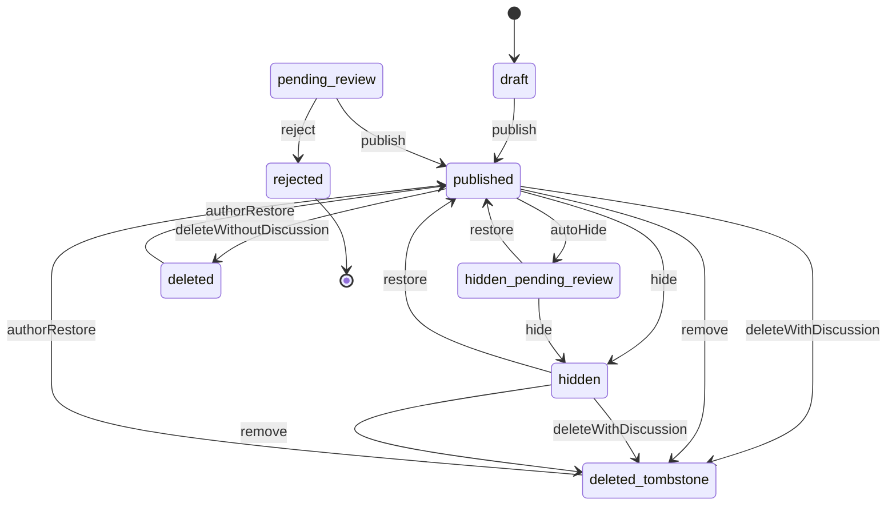
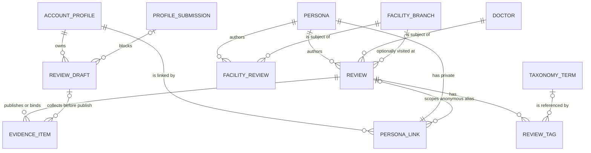

# Functional specification — U21 `t-301-review-module-core`

Unit U21 (kind `library`, size XL, not marked high risk) delivers T-301 for US6.1, US6.2, US6.4, US3.3 and US4.3. Lead perspective: architect. Support perspective: developer (repository reads and writes, transaction order, query mechanics, view-model mapping and the tests against the real database), written into §§ 8, 10 and 11 and synthesised in § 13. Draft written ahead of the stage on the owner's instruction to overlap work; the lead finalises it and the reviewer checks it when the workflow reaches this Unit.

Inputs: `unit-of-work.md` (U21 and the evidence-to-draft open point), `unit-of-work-story-map.md`, `requirements.md`, `stories.md`, `components.md` (Review, Identity), `contract-summary.md` (C4, C6, C7, C8, C9, C15 and the common rules), `docs/status/decision-log.md` (FD-008, FD-009, FD-014, FD-015, FD-016, FD-022, FD-023, FD-049, FD-067, FD-080, FD-090, FD-092), T-301 with its FD-080 and FD-090 amendments, `01-conventions.md` §2–§5 and §10, `02-data-model.md` §0, §3, §6, §7, §16 and §17, `03-routes-and-contracts.md` §2–§5, the U14 T-201 design draft (whose review read side this Unit extends), the U8 T-101 draft (Actor, `defineCommand`), the code on `main` listed in `functional-design-questions.md`, the prototype data file and renderers, and ISS-147, ISS-161, ISS-240 and ISS-269.

This file is the source of truth for the workflows and state transitions. The data shape is in `entities.md`; the decision logic is in `rules.md`. The design follows the answers in `functional-design-questions.md`: Questions 1–14 answered A on the owner's standing instruction of 2026-10-27 and awaiting the owner's confirmation; Questions 15 and 16 left for the owner, with the interim reading of BR3.13 and BR6.13.

## 1. What changes, in one paragraph

A signed-in author can save an encrypted draft, preview exactly what the public will see, and publish a quick or detailed review, or facility feedback, in one transaction that picks the persona for the chosen identity mode, resolves or creates the tags, links privacy-confirmed files and binds the ones still in processing, writes one audit row whose actor is the persona, and appends `review.published` with the `repeatEpisode` flag. One pure function, `toExperiencePage`, builds both the preview and the public experience page: flags with Not provided, claims under the Reviewer's label, sections in order, a doctor with "Registration not verified", other accounts by the same persona only (none for anonymous reviews), related and same-doctor cards, and nothing private. Lists reuse U14's eligibility predicate and keyset read; distributions are U14's, unchanged. The review state machine of `02-data-model.md` §17 lands in `packages/domain` with the domain-only `deleted` state (FD-049). Review implements Identity's `RevealTarget`. Two forward-only migrations: the FD-090 worker grant on `review_drafts`, and a deferrable foreign key from `persona_links` to `reviews` so the anonymous alias can be written before its review (Question 5). The seed's drafts, claims and detailed-review openings are corrected (Question 14). No hard rule, data boundary or founder decision changes in the pre-filled answers; Questions 15 and 16 would, which is why they wait for the owner.

## 2. As is (baseline on `main`, 2026-10-28) and what Bolt 17 can count on

- **Application and domain are empty today.** `packages/application/src/index.ts` and `packages/domain/src/index.ts` export nothing. By Bolt 17, U8 T-101 has created `defineCommand`, the command context and the shared ports; U10 T-103 the staff role and capabilities; U11 T-104 the identity module (`personaFor`, `publicProjection`, the private repository, `RevealTarget` declared); U12 T-105 `ConfigProvider.current()`; U14 T-201 the review read side (§ 3); U17 T-204 `ProfileMergeParticipant` in `modules/review`. Where their shapes differ from this design, the frame adapts and the rules stay (§ 16).
- **Repository stub** `packages/database/src/repositories/review.ts`: T-301 stubs `saveDraft`, `getDraft`, `deleteDraft`, `insertReview`, `getByPublicId`, `getById`, `updateState`, `listForDoctor`, `listForBranch`, `listForCondition`, `listExperiences`, `insertFacilityReview`; T-302 stubs for follow-ups, corrections and deletion; U14 replaces its three distribution stubs. `repositories-superset.test.ts` reads the stub method names and fails when `FakeReviewRepository` is not a superset.
- **Schema** (`schema/review.ts`): `reviews` (with `title NOT NULL`, `language NOT NULL` in `en|bn|mixed`, `exact_date_enc bytea`, `claims jsonb [{label, note?}]`, `period_year`/`period_month NOT NULL`, `attestation_at`), `review_tags` (one of term, free text, not sure), `review_drafts` (`payload_enc bytea NOT NULL`, `expires_at` default now + 30 days, `blocked_on_submission_id`), `facility_reviews` (`criteria jsonb`, no `doctor_id`). `review_kind` is `quick|detailed` only. `persona_links.review_id` has an immediately checked foreign key to `reviews` (`0004_deferred_fks.sql`), and `reviews.author_persona_id` references `personas`, so as written a review-scoped anonymous link cannot be inserted before its review (finding F1).
- **Grants**: `rk_worker` has nothing on `review_drafts` (§16 (f), planned PA3), SELECT on the whole of `reviews` (including `exact_date_enc`, ISS-240) and UPDATE on `state`, `deleted_at`.
- **Contracts**: `view-models/experience.ts` is a T-003 stub marked `TODO(T-307)` with `likes`, `dislikes`, `identityLabel`, `tombstone` (Question 1); U14 moves `ExperienceCardVM` to `experience-card.ts`. `view-models/composer.ts` has `ComposerDraftVM` with `payload: unknown`. `schemas/review.ts` has `SaveDraftInput.payload: unknown` (`TODO(T-301/T-306)`), `PublishReviewInput.attestation: z.literal(true)`, `ListExperiencesInput.filters: unknown` (`TODO(T-301)`), page-number inputs for `forDoctor`, `forBranch`, `forCondition`, and `FacilityReviewPublishInput` with `criteria` in the input.
- **i18n**: `errors.review.minFields`, `attestationRequired`, `notEditable`, `restoreExpired`, `errors.common.rateLimited`, `label.notProvided`, `label.limitedData`, `label.reviewerLabel`, `label.reviewerLabelWhy`, `label.notVerified`, `claim.wrongDx|wrongRx|secondOpinion`, `byline.anonSentence`, `experience.episode`, `compose.identity.anonNote` exist in both dictionaries. `label.limitedDataWhy` hard-codes "Fewer than 5" (R5).
- **Seed** (`test-support/src/seed/seed-content.ts`): 24 reviews (r1–r24) and 19 facility reviews, all Bengali text (`language: 'bn'`, ISS-161), tags as free text only, claims as Bengali display text (finding F4), detailed reviews with `body` null (F5), anonymous personas created with no review id and back-filled after the review insert; the three drafts of `shirin_88` stored as plaintext `{title, excerpt}` and matched by stored bytes (ISS-269, F3). No two corpus reviews form a repeat episode, so the FD-080 rows run on builder data. Every corpus review has a sentiment and an outcome; the "Not provided" rows also run on builders.
- **Configuration**: `limitedDataThreshold = 5`, `featureVisibility.facilityAccounts = true`; no rate-limit block (rate limits are code constants until U41 T-502).
- **Migrations** `0000`–`0008` are on `main`; U14 plans `0009`. `validator-probes.int.test.ts` (P8) and `migrations.int.test.ts` pin the migration count, so each new migration updates both.

## 3. Settled before this stage

FD-080 (`repeatEpisode`), FD-090 (the drafts grant), FD-049 (soft delete is domain-only), U14's ownership of the review read queries and policies and their shape, the owner's answers on counts without percentages and on the nine facility criteria, FD-015, FD-022, FD-014, FD-009, FD-023, FD-036, and no new dependency. See `functional-design-questions.md` § "Settled before this stage". The decisions this design makes without a question are listed there too and explained in § 13.

## 4. Workflows

Every command follows `parse → authorize → load → decide (domain) → persist in one transaction with audit and outbox → Result` (01-conventions §3). Every query follows `parse → authorize → read → map to the view model in actor.locale → ok(vm)`. Expected failures return `err` with an `ErrorCode`; a thrown database error becomes `internal` at the caller. Queries never write (BR6.12).

### WF1 — Code Generation order (the Unit end to end)

1. **Baseline.** `pnpm infra:up`; `pnpm check` and `pnpm smoke` green on the Bolt branch; read the open `ISSUES.md` rows of § 2 and the rows proposed in § 9.
2. **Prerequisites present.** `defineCommand`, `defineQuery`, the Actor, `Crypto`, `Clock`, `IdGenerator`, `RateLimiter`, `ConfigProvider`, `AuditWriter`, `Outbox`; Identity's `personaFor`, `publicProjection`, `RevealTarget` declaration; U14's review read side and `normalizeAliasKey`; Taxonomy's `resolve` and provisional-term operation; Directory's `resolvePublicId`. Check whether U11 T-104 already made the persona-link foreign key deferrable (Question 5), added `ownsAnyPersona` (Question 8) and the no-review anonymous branch of `personaFor` (Question 6); add whichever is missing as a recorded owned-path addition.
3. **Domain** (`packages/domain/src/review/`): `review.ts` (types, `PeriodMonth`, `parsePeriod`, `IdentityMode`, `Claim`, `ConditionKey`), `review-state.ts` (BR5.1, BR5.2), `policies.ts` additions (`minimumFieldsSatisfied`, `publicPeriod`, `latestStatusOf`, `deriveTitle`, `detectLanguage`, `graphemeLength`, `conditionKeysOf`, `isRepeatEpisode`), `facility-review.ts` (criteria validation), with tests including `no-score.test.ts`. U14's `distribution` and `isLimitedData` stay as they are.
4. **Contracts**: `DraftPayload` and the input changes of § 7 in `schemas/review.ts`; `ExperiencePageVM` in `view-models/experience.ts` (Question 1); `DraftSummaryVM` and the typed `ComposerDraftVM` in `view-models/composer.ts`.
5. **Migrations** (next free numbers at the time, after U14's `0009`): `<n>_persona_links_review_fk_deferrable.sql` (only if T-104 has not done it) and `<n>_review_drafts_worker_grant.sql` (FD-090); update the migration-count pins in `validator-probes.int.test.ts` and `migrations.int.test.ts`; `02-data-model.md` §16 moves PA3 into the live list with its reason.
6. **Ports** (§ 6): `ports/repositories/review.ts` gains the write and read methods; `modules/review/ports.ts` declares `EvidenceForPublish`.
7. **Repository** (`packages/database/src/repositories/review.ts`): replace this Unit's stubs with the § 6 methods; relabel `updateState` to `T-302`; leave U14's and T-302's methods untouched.
8. **Commands and queries** (`modules/review/`): `commands/save-draft.ts`, `publish.ts`, `facility-review-publish.ts`; `queries/get-draft.ts`, `list-drafts.ts`, `preview.ts`, `get-experience.ts`, `list-experiences.ts`, `for-doctor.ts`, `for-branch.ts`, `for-condition.ts`; `projection.ts`; `authorization.ts`; `reveal-target.ts`; `index.ts` exports. Application tests on fakes.
9. **Test support**: `builders/review.ts` (`aReview()` defaults to a published pseudonymous quick review on the seeded `d1`; `aDraftPayload()`), `fakes/review-repository.ts` (the full fake, re-exported from `fakes/repositories.ts` so the superset test keeps its import), a fake `EvidenceForPublish`.
10. **Seed** (Question 14): drafts encrypted as valid payloads with `seedRef`, claims by code, detailed `body` kept; one seed integration assertion each.
11. **i18n**: `errors.review.missingDoctor`, `doctorPending`, `missingStory`, `missingSection`, `missingRelationship`, `missingTag`, `periodInvalid`, `missingBranch` in both dictionaries in the same commit; Bengali drafted and flagged for the owner's bilingual review (FD-042).
12. **Integration and smoke tests** (§ 11).
13. **Documents**: 03 §4 review entries (saveDraft authorization, attestation, forBranch, inputs), 01-conventions §5 (the `persona:<id>` actor), C4 (`ownsAnyPersona`, `personaFor` without `reviewId`), C8 (`itemsOfDraft`, `bindToReview`), C9 note (repeat rule, `kind: 'experience'`), each with a dated note; the T-301 task file gains the C4 `RevealTarget` amendment row.
14. **Issue register**: ISS-269 (draft part) fixed in U21 T-301; add the § 9 rows.
15. **Gate**: `pnpm check`, `pnpm smoke`, `pnpm test:int` exit 0 (BR10.3); fill the T-301 hand-off with every owned-path addition of § 12 and its reason.

### WF2 — `review.saveDraft({draftId?, payload})`

1. Authorize (BR1.1): an account Actor; else `forbidden`.
2. Parse `payload` with `DraftPayload` (BR2.2); bound failures → `validation` with `fieldErrors`.
3. Derive the mirror columns: `kind` from `mode` (`quick` for a facility draft); `doctor_id` from `doctorPublicId` when it names a visible doctor (an unknown id is kept in the payload but leaves `doctor_id` null, so a draft never fails for a stale id); `blocked_on_submission_id` from `doctorSubmissionPublicId` per BR2.4 (another account's or unknown submission → `validation`, `fieldErrors.doctor`).
4. In one transaction: `draftId` absent → insert `{id: newId, account_id: actor.accountId, kind, payload_enc: encrypt(payload), doctor_id, blocked_on_submission_id, expires_at: now + 30 d}`; present → update the row with that id and `account_id = actor.accountId` and `expires_at > now` (none → `not_found`, BR1.2), setting `payload_enc`, the mirrors, `updated_at` and `expires_at = now + 30 d` (BR2.3).
5. Return `{draftId, expiresAt}`. No audit row and no outbox event: a draft is private work in progress, not a state change of public content, and its autosave would flood the audit stream every 1.5 s (§ 13).

### WF3 — `review.getDraft({draftId})` and `review.listDrafts()`

- `getDraft`: authorize (BR1.1); load per BR1.2; decrypt; parse leniently with `DraftPayload` (a stored payload that no longer parses gives the parsed subset and logs `review.draft_payload_drift` with the draft id only); return `ComposerDraftVM {draftId, expiresAt, expiresInDays, startedAt, blocked, doctorPublicId?, payload}`.
- `listDrafts`: authorize; the owner's live drafts ordered `updated_at desc`; decrypt each and map to `DraftSummaryVM` per BR2.5. The workspace (U38 T-409) consumes it.

### WF4 — `review.preview({draftId})`

1. Authorize and load as `getDraft`.
2. Build a transient `Review` from the payload without enforcing the minimum (BR6.12): kind, relationship, sentiment, outcome, title (BR4.3), body, sections, claims, period when it parses, the doctor when visible.
3. Read the dependencies read-only: the doctor's card fields; the tags through `taxonomy.resolve` (an unresolved free text shows its wording with `provisional: true`); the byline for the draft's identity mode (named and pseudonymous from the account's existing persona projection, anonymous from the mode alone; nothing is created); related and same-doctor cards; other accounts by the persona that would publish (none for anonymous).
4. `toExperiencePage(review, deps)` with `publicId`, `postedMonthYear` and `discussion` absent.

### WF5 — `review.publish({draftId, identityMode, attestation})`

1. **Authorize** (BR1.3): account, verified email, not restricted; else `forbidden`.
2. **Rate limit** (BR1.4): `rateLimiter.hit('review.publish:account:<accountId>', 5, 86400)`; refused → `rate_limited` with `retryAfterSec`.
3. **Load** the draft (BR1.2) and decrypt; `payload.target = facility` → `validation` (use `facilityReview.publish`).
4. **Decide** (domain, no writes yet):
   - attestation (BR3.6) → `review.attestation_required`;
   - identity mode against the payload (BR3.7) → `conflict`;
   - doctor (BR3.4), story or sections (BR3.1, BR3.2), relationship, tags or Not sure, period (BR3.5): collect every failure into one `review.min_fields` with `fieldErrors` in the fixed order (BR3.3);
   - branch (BR3.11), claims (BR3.9), sentiment and outcome (BR3.12) → `validation`;
   - evidence ownership (BR3.10): `evidenceForPublish.itemsOfDraft(tx, {draftId, accountId, itemIds})`; any id missing → `validation`.
5. **Persist in one transaction** (BR4.1):
   1. `reviewId = ids.newId()`, `publicId = ids.newPublicId()`.
   2. `personaId = identity.personaFor({accountId, reviewId, mode})` (BR4.2; the deferred key is checked at commit).
   3. Resolve the tags (BR3.8), creating provisional terms through Taxonomy's operation on the same `tx` (their audit rows and `term.changed` events are Taxonomy's).
   4. Compute `repeatEpisode` (BR4.9): `repeatCandidates(tx, {doctorId, year, month, conditionKeys})` → distinct author persona ids; empty → false; else `identity.ownsAnyPersona({accountId, personaIds})`.
   5. Insert the review `{id, public_id, author_persona_id, doctor_id, branch_id, kind, relationship, identity_mode, sentiment, outcome, period_year, period_month, exact_date_enc, title, body, sections, claims, language (BR4.4), state: published, published_at, attestation_at, version: 1}` and its tags.
   6. Evidence (BR4.6): `evidenceForPublish.publish(tx, {reviewId, itemIds: confirmed})`, `evidenceForPublish.bindToReview(tx, {reviewId, itemIds: pending})`.
   7. Audit (BR4.7): stream `review:<reviewId>`, action `publish`, actor `persona:<personaId>`, target `review`, details `{kind, identityMode, tagCount, evidenceLinked, evidencePending}`.
   8. Outbox (BR4.8): `review.published {reviewId, doctorId, branchId: branchId ?? null, repeatEpisode}`.
   9. Delete the draft.
6. Return `{publicId}`.

Unhappy paths: every refusal in steps 1–4 writes nothing and keeps the draft; a failure inside step 5 rolls everything back (including any provisional term and the persona), keeps the draft and returns `internal`; a unique-key race on a provisional term is settled by Taxonomy's re-read (U14 WF11).

### WF6 — `facilityReview.publish({draftId, identityMode, attestation})`

Steps 1–3 as WF5 with the key `facilityReview.publish:account:<id>` and `payload.target = facility` required. Decide per BR8.1 (branch visible, story ≥ 20 graphemes, period, attestation, criteria keys and values; `fieldErrors.branch = errors.review.missingBranch`). Persist in one transaction: persona per BR8.2 (anonymous: a fresh alias with no review id), insert `facility_reviews {public_id, author_persona_id, branch_id, identity_mode, period, body, criteria (every answered key; others null), state: published, published_at, version: 1}`, audit (stream `facility_review:<id>`, actor `persona:<id>`, details `{identityMode, criteriaAnswered}`), delete the draft. No outbox event (BR8.3). Return `{publicId}`.

### WF7 — `review.getExperience({publicId})`

1. `findEligibleByPublicId(publicId)` → the review with its tags (term name in locale, state, effective term) or nothing; nothing → `not_found` (BR6.2).
2. Read the dependencies: doctor `{publicId, name}`; persona projection; related by the first condition tag's effective term (6) and same doctor (6) as `ExperienceCardVM` through U14's card mapper; other accounts by the same persona (10, none for anonymous, BR6.9).
3. `toExperiencePage(review, deps)` and return `{kind: 'experience', ...vm}`. U22 T-302 adds the tombstone branch before step 1's `not_found`.

### WF8 — Lists

- `review.listExperiences({cursor?, limit?})`, `review.forDoctor({doctorPublicId, cursor?, limit?})`, `review.forCondition({conditionPublicId, cursor?, limit?})`: resolve the public id (Directory or Taxonomy, redirects followed), then U14's `listRecentCards` (keyset on `published_at`, `public_id`; newest first; limit default 20, max 50) → `CursorPage<ExperienceCardVM>` (BR7.2).
- `review.forBranch({branchPublicId, cursor?, limit?})`: the branch's eligible facility accounts → `CursorPage<FacilityAccountVM>`; never a doctor review (BR7.3).
- `review.sentimentDistribution`, `outcomeDistribution`, `criteriaDistribution`: U14's, unchanged (BR7.4).

### WF9 — `RevealTarget.resolve(tx, {targetKind, targetId})` (implemented for Identity)

`review` → `reviews.author_persona_id` of that id in any state; `facility_review` → `facility_reviews.author_persona_id`; missing → `not_found`. Returns `{subject: 'persona', personaId, targetCode}` (`targetCode` = the review's or facility review's public id, the shape the U11 T-104 draft declares). Registered in Identity's `RevealTarget` registry (BR9.2).

### WF10 — The two migrations

- `<n>_review_drafts_worker_grant.sql`: `GRANT SELECT (id, account_id, expires_at), DELETE ON review_drafts TO rk_worker;` with a header naming FD-090 and U29 T-309 as the consumer. Probes in `validator-probes.int.test.ts` as a real `rk_worker` session: the three columns readable, `delete … where expires_at < now()` allowed, `select payload_enc` and `update review_drafts` denied (BR2.6).
- `<n>_persona_links_review_fk_deferrable.sql` (only if U11 T-104 has not done it): `ALTER TABLE persona_links ALTER CONSTRAINT persona_links_review_id_reviews_id_fk DEFERRABLE INITIALLY DEFERRED;`. A test inserts a link naming a review id, then the review, in one transaction and commits; a second test proves the commit fails when the review never arrives.

## 5. State transitions

### Publication state machine (`domain/review/review-state.ts`, BR5.1, BR5.2)

States: the stored enum plus the domain-only `deleted` (stored as `published` with `deleted_at`, FD-049). Events: `publish`, `autoHide` (C9's `hideThreshold` and `hideCritical`), `hide`, `restore`, `deleteWithDiscussion`, `deleteWithoutDiscussion`, `authorRestore`, `remove`, `reject`. Every pair not in the table returns `err('conflict')`.

| From | Event | To | Triggered by (Unit) |
|---|---|---|---|
| `draft` | `publish` | `published` | author publish (this Unit) |
| `pending_review` | `publish` | `published` | staff decision (profiles; not used for reviews in release 1) |
| `pending_review` | `reject` | `rejected` | staff decision |
| `published` | `autoHide` | `hidden_pending_review` | five distinct reporters or a critical reason (U32 T-403) |
| `published` | `hide` | `hidden` | moderator (U33 T-404) |
| `published` | `deleteWithDiscussion` | `deleted_tombstone` | author (U22 T-302) |
| `published` | `deleteWithoutDiscussion` | `deleted` | author (U22 T-302) |
| `published` | `remove` | `deleted_tombstone` | moderator (U33 T-404) |
| `hidden_pending_review` | `restore` | `published` | moderator, reason-coded |
| `hidden_pending_review` | `hide` | `hidden` | moderator |
| `hidden` | `restore` | `published` | moderator, or an appeal that changed the decision |
| `hidden` | `deleteWithDiscussion` | `deleted_tombstone` | author |
| `hidden` | `remove` | `deleted_tombstone` | moderator |
| `deleted_tombstone` | `authorRestore` | `published` | author within `restore_until` (U22 T-302 checks the window, BR5.3) |
| `deleted` | `authorRestore` | `published` | author within `restore_until` |
| `rejected` | (none) | — | terminal |



Text fallback: a draft becomes published when its author publishes it; reports or a critical reason hide it pending review, and a moderator hides or restores it; the author deletes it (a tombstone when it has discussion, otherwise a soft delete kept only in the domain) and may restore it within the window; a moderator's removal leaves a tombstone the author cannot restore. Rejection is terminal. Two cells §17 does not have are raised, not added (R4).

### What each state means to this Unit's reads

| Stored state | `deleted_at` | Domain state | `getExperience` | Lists, counts, related, other accounts |
|---|---|---|---|---|
| `published` | null | `published` | the page | included |
| `published` | set | `deleted` | `not_found` | excluded |
| `hidden_pending_review`, `hidden` | any | same | `not_found` | excluded |
| `deleted_tombstone` | set | `deleted_tombstone` | `not_found` here; the tombstone answer is U22 T-302's | excluded |
| `draft`, `pending_review`, `rejected` | any | same | `not_found` | excluded |

### Draft lifecycle

| From | Event | To | Rule |
|---|---|---|---|
| (none) | first autosave | live, expires in 30 days | BR2.3 |
| live | autosave | live, expiry moved to now + 30 days | BR2.3 (Question 4) |
| live | payload names the author's pending submission | live and blocked | BR2.4 |
| blocked | payload names a visible doctor, or U17's `unblockDrafts` | live | BR2.4, C7 |
| live | publish | deleted (the review exists) | BR4.1 |
| live | 30 days without a save | expired: not found at once; purged by the hourly worker job | BR2.3, BR2.6 (U29 T-309) |

### ISS-269

`assumption, narrower option taken — T-301 keeps an idempotency key when it encrypts draft payloads` → (seed drafts encrypted, `seedRef` in the payload, decrypt-and-compare idempotency, seed integration assertion) → draft part `fixed in U21 T-301`; the other two markers of the row stay with their owners.

## 6. Ports

Interface level only; Code Generation writes the TypeScript.

```text
ReviewRepository (packages/application/src/ports/repositories/review.ts; U14's read methods unchanged)
  insertDraft(tx, {id, accountId, kind, payloadEnc, doctorId?, blockedOnSubmissionId?, expiresAt}) -> void
  updateDraft(tx, {id, accountId, now, kind, payloadEnc, doctorId?, blockedOnSubmissionId?, expiresAt}) -> boolean
  getDraft({id, accountId, now}) -> DraftRow | null           (payloadEnc as bytes; no plaintext)
  listDrafts({accountId, now}) -> DraftRow[]                  (updated_at desc)
  deleteDraft(tx, id) -> void
  insertReview(tx, ReviewInsert) -> void
  insertTags(tx, ReviewTagInsert[]) -> void
  findEligibleByPublicId(publicId) -> ReviewRow & {tags} | null
  getById(id) -> ReviewRow | null                              (any state; internal)
  relatedByCondition({termId, excludeId, limit}) -> CardRow[]
  sameDoctor({doctorId, excludeId, limit}) -> CardRow[]
  byAuthorPersonas({personaIds, excludeId, limit}) -> {publicId, title}[]   (identity_mode <> anonymous in SQL)
  repeatCandidates(tx, {doctorId, year, month, termIds, textKeys}) -> personaId[]
  insertFacilityReview(tx, FacilityReviewInsert) -> void
  authorPersonaOf({targetKind: review | facility_review, targetId}) -> personaId | null
  pendingSubmissionOf({submissionPublicId, accountId}) -> submissionId | null   (reads profile_submissions; Review sits above Directory)
  branchHostsDoctor({branchId, doctorId}) -> boolean                          (doctor_chambers)

EvidenceForPublish (declared in modules/review/ports.ts; implemented by Evidence in U23 T-303 and U25 T-305; a fake until then)
  itemsOfDraft(tx, {draftId, accountId, itemIds}) -> {itemId, state}[]      (only the draft's own items)
  publish(tx, {reviewId, itemIds}) -> void                                  (C8 evidence.publish)
  bindToReview(tx, {reviewId, itemIds}) -> void                             (new, Question 9; private, not public)

Called on other modules (their public application API)
  identity.personaFor({accountId, reviewId?, mode}) -> {personaId}          (C4; no reviewId + anonymous = a fresh persona, Question 6)
  identity.publicProjection({personaId}) -> {displayName, username?, kind, avatarHue}
  identity.ownsAnyPersona({accountId, personaIds}) -> boolean               (new, Question 8; web tier only)
  taxonomy.resolve({text, kind}); taxonomy provisional-term operation on tx (U14 WF11); term lookup by public id
  directory.resolvePublicId({kind, publicId}); visible doctor and branch lookups

Implemented by Review
  Identity.RevealTarget.resolve(tx, {targetKind, targetId}) -> {subject: 'persona', personaId, targetCode}   (C4, Question 11)

Shared ports used: Crypto (encrypt, decrypt), Clock, IdGenerator, RateLimiter, ConfigProvider, AuditWriter, Outbox, Logger
```

The evidence port is declared by the consumer because Evidence is built after this Unit (Bolt 18 and 28); Review sits above Evidence, so this is build order, not a cycle break. The web composition root (`apps/web/src/server/container.ts`) is outside this Unit's owned paths: the first Unit that serves these commands on a page (U26 T-306) wires them, with an `EvidenceForPublish` that knows no items until U23 exists (finding F21).

## 7. View models and input schemas (`packages/contracts`)

All fields serialisable; strings in `actor.locale` except user text, which is kept as written; ids are public ids; no percentage anywhere.

| Type | Fields |
|---|---|
| `ExperiencePageVM` (`experience.ts`, Question 1) | `kind: 'experience'`, `publicId?` (absent in preview), `reviewKind` (`quick`/`detailed`), `title`, `condition?` {`publicId?`, `name`, `provisional?`}, `byline` (`BylineVM` + `relationship` + `postedMonthYear?` {`year`, `month`}), `flags` (`FlagVM[]`, BR6.5), `sentiment` (`Sentiment` or `null`), `outcome` (`Outcome` or `null`), `claims` [{`labelKey`}], `reviewerLabelKey`, `reviewerLabelNoteKey`, `body?`, `sections` [{`key`, `body`}], `contentLanguage` (`en`/`bn`/`mixed`), `followUps: []` (U22), `laterCare: null` (U22), `evidenceGroups: []`, `hasDocuments: false` (U25), `discussion?` {`threadSlot`: review `publicId`}, `relatedByCondition` (`ExperienceCardVM[]`), `sameDoctor` (`ExperienceCardVM[]`), `margin` {`anonymous`, `period` {`year`, `month`}, `posted?` {`year`, `month`}, `doctor` {`publicId`, `name`, `registrationNotVerified: true`}, `condition?`, `tags` (`TagVM[]`), `otherAccounts` [{`publicId`, `title`}]} |
| `FlagVM` | `kind` (`sentiment`/`outcome`/`condition`/`period`), `key?` (i18n key: `sentiment.<v>`, `outcome.<v>`, `label.notProvided`, `review.episodeDate`), `label?` (condition name), `period?` {`year`, `month`} |
| `TagVM` | `group`, `label?` (term name in locale or the author's wording), `publicId?` (active term), `notSure?`, `provisional?` |
| `PreviewVM` | `= ExperiencePageVM` |
| `ComposerDraftVM` (`composer.ts`) | `draftId`, `expiresAt`, `expiresInDays`, `startedAt`, `blocked`, `doctorPublicId?`, `payload: DraftPayload` |
| `DraftSummaryVM` (`composer.ts`) | `draftId`, `title?`, `excerpt?`, `truncated`, `startedAt`, `expiresInDays`, `blocked`, `doctor?` {`publicId`, `name`} |
| `ExperienceCardVM`, `BylineVM`, `FacilityAccountVM`, `DistributionVM` | U14's, unchanged |

Input changes (`schemas/review.ts`, no consumer exists yet):

- New `DraftPayload` (`entities.md`), lenient and bounded (BR2.2); `SaveDraftInput.payload` becomes `DraftPayload` and loses its `TODO`.
- `PublishReviewInput` and `FacilityReviewPublishInput`: `attestation: z.boolean()` (BR3.6); `FacilityReviewPublishInput` loses `criteria`, which now travels in the saved payload so the preview and the published row agree.
- `ListExperiencesInput {cursor?, limit?}` (loses `filters` and its `TODO(T-301)`); `ForDoctorInput`, `ForBranchInput`, `ForConditionInput` take `cursor?`, `limit?` instead of page numbers, matching U14's keyset read.
- New `ListDraftsInput {}` (the actor's own).

## 8. Developer view — repository and transaction mechanics

- **Eligibility** is U14's predicate (`state = 'published' and deleted_at is null`) in every WHERE clause of this Unit's reads (BR7.1); the "hidden" integration test inserts a `hidden` and a soft-deleted review and asserts each is absent from every read of § 6.
- **Effective condition term**: the first condition tag per review (smallest `created_at`) joined to `taxonomy_terms`, `coalesce(canonical_id, id)`; related-by-condition matches on it.
- **Repeat candidates** (one query, inside the publish transaction):
  `select distinct r.author_persona_id from reviews r join review_tags t on t.review_id = r.id and t.group = 'condition' left join taxonomy_terms tt on tt.id = t.term_id where r.doctor_id = $doctor and r.period_year = $y and r.period_month = $m and r.state = 'published' and r.deleted_at is null and (coalesce(tt.canonical_id, tt.id) = any($termIds) or (t.free_text is not null and <normalised key of t.free_text> = any($textKeys)))`. The free-text key is computed in the application from `normalizeAliasKey` for the new review; for stored free text, Code Generation either computes it in SQL with an equivalent expression or loads the candidate free-text tags of that doctor and month (a handful) and compares in the domain; whichever it picks, a test proves both spellings of a Bengali word match (U14 BR4.1).
- **No account in the query**: the candidates are persona ids; the only account-aware step is Identity's boolean (BR9.1).
- **Other accounts**: `where author_persona_id = any($personaIds) and identity_mode <> 'anonymous' and id <> $exclude` plus eligibility, newest first, limit 10 (BR6.9, BR9.3).
- **Draft reads** filter `account_id = $actor and expires_at > $now`; `payload_enc` is returned as bytes and decrypted in the application. The row-bytes test writes a draft whose story contains a marker string and asserts the raw `payload_enc` bytes do not contain it in UTF-8 (BR2.1).
- **Facility isolation**: every doctor-side builder is a named function whose generated SQL text (`toSQL()`) a test asserts does not contain `facility_reviews`; with 3 doctor reviews and 8 facility reviews on the doctor's branch, the doctor's distribution `total` is 3 (BR7.5).
- **Transaction order** (WF5 step 5): the persona and its link first (the deferred key), then the review, tags, evidence, audit, outbox, draft deletion. A test injects a failure at the persona step and asserts no review, tag, term, audit or outbox row exists and the draft is unchanged.
- **Exact date**: `exact_date_enc` is never in a select list of a projection read; `rg exact_date packages/application/src/modules/review/projection.ts` finds nothing (acceptance row).
- **Bengali numerals and month names** are not formatted in the backend: periods are `{year, month}`; the UI formats them.

## 9. Findings and proposed ISS rows

Each is proposed with `Found in U21 T-301`; the caller adds them with the next free numbers.

| # | Sev | Area | Finding | Suggested owner |
|---|---|---|---|---|
| F1 | S2 | database/identity | `persona_links.review_id`'s foreign key is checked immediately, so the anonymous alias cannot be written before its review as step 5 describes; the seed back-fills it. Fixed by a deferrable key (Question 5) | U21 T-301 (or U11 T-104 if it lands there) |
| F2 | S2 | review/contracts | `reviews.title` is NOT NULL and nothing supplies a title: no composer field, no rule (Question 2) | U21 T-301 |
| F3 | S2 | test-support/seed | Seed drafts are plaintext JSON in `payload_enc`; this Unit's decrypt fails on them and encryption breaks the bytes-based idempotency (ISS-269, Question 14) | U21 T-301 |
| F4 | S2 | test-support/seed | Seeded claims store the Bengali display text instead of the code, so the English page shows Bengali claim labels and the projection cannot attach `claim.<code>` (Question 14) | U21 T-301 |
| F5 | S3 | test-support/seed | Seeded detailed reviews drop the prototype's opening paragraph (`body` null) (Question 14) | U21 T-301 |
| F6 | S2 | review/evidence | Deleting the draft at publish orphans files still in processing, so AC6.1.6's "until the pipeline approves it" has no review to land in (Question 9) | U21 T-301 (call), U23 T-303 / U25 T-305 (`bindToReview`) |
| F7 | S2 | review/identity | The convention's audit actor `account:<id>` on an anonymous or pseudonymous publish writes an account-to-review link outside `persona_links` and the accepted exceptions (Question 10) | U21 T-301; 01-conventions §5 |
| F8 | S2 | process/task-file | C4 assigns Identity's `RevealTarget` for reviews and facility reviews to U21, but T-301's task file has no amendment row for it (T-401 and T-403 have theirs) (Question 11) | U21 T-301 |
| F9 | S2 | requirements | FR46's "What went well / What could improve" checkboxes have no column, prototype, copy or owning task; AC6.2.3 cannot be met in full (Question 15) | founder |
| F10 | S2 | identity/copy | The prototype's `compose.identity.anonNote` on the experience page and in the composer mentions legal disclosure, against FD-008, FD-022 and AC3.3.6 (Question 16) | founder; U26 T-306, U27 T-307 |
| F11 | S2 (S1 if built) | web/identity | T-307 step 2 links a named byline to `/authors/{username}`, and the parallel U11 T-104 draft adds `profileUsername` for named personas, which would put a real name next to the same account's pseudonymous username (R2) | U11 T-104, U27 T-307, U38 T-409 |
| F12 | S3 | web/composer | No Unit builds the screen to write facility feedback; `facilityReview.publish` has no caller (R1) | founder; U26 T-306 |
| F13 | S3 | database/identity | `persona_links.review_id` references `reviews` only, so an anonymous facility review's alias cannot be thread-scoped; designed as a fresh persona each time (Question 6) | U21 T-301 |
| F14 | S3 | docs/contracts | 03 §4 says `review.saveDraft · verified`, against the prototype and T-306, which save drafts for unverified accounts (Question 3) | U21 T-301 (03 §4 corrected) |
| F15 | S3 | review/search | `reviews.language` is NOT NULL and filtered by search, with no rule for setting it (Question 13) | U21 T-301 |
| F16 | S3 | domain/review | §17 has no `remove` from `hidden_pending_review` and no author delete of a `hidden` review without discussion (R4) | U22 T-302, U33 T-404 |
| F17 | S3 | i18n/copy | `label.limitedDataWhy` hard-codes "Fewer than 5" while the threshold is configurable (R5) | U15 T-202 |
| F18 | S4 | database/identity | `review_versions.actor_id` holds the author's account id, the same kind of link as F7 (R6) | U22 T-302 |
| F19 | S4 | review/claims | Custom Reviewer's labels and the label-approval workflow of FR47 have no owner; release 1 accepts the three suggested labels (R3) | founder |
| F20 | S4 | web/composer | The composer has no exact-date input, so FR42's private exact date can be stored (this Unit) but not entered | U26 T-306 |
| F21 | S4 | web/composition | The review commands, `RevealTarget` registration and the interim `EvidenceForPublish` are wired in `apps/web/src/server/container.ts`, outside this Unit's owned paths | U26 T-306 (first caller) |
| F22 | S4 | process/task-file | Task-text drift settled in this design: step 3 defines the distribution `total` two contradictory ways and differs from U14's shape; `errors.review.rateLimited` is unnecessary; `threadSlot: reviewId` would expose an internal id; `countPublishedToday(accountId)` needs an account column reviews do not have; `experience.ts` carries `TODO(T-307)`, not T-301; step 7's distribution queries are already U14's; the prototype line numbers moved (`renderAccount` is at 901); `attestation: z.literal(true)` hides `review.attestation_required`; `review.forBranch` would list doctor reviews | U21 T-301 (hand-off) |
| F23 | S4 | database/test | Each new migration must update the count pins in `validator-probes.int.test.ts` (P8) and `migrations.int.test.ts` | U21 T-301 |

Existing rows, no new row: ISS-240 (`rk_worker` reads `exact_date_enc`; this Unit stores the date there encrypted, which keeps the read harmless, but the owner's ruling stays open), ISS-161 (seed text Bengali only; `language: 'bn'` stays correct for those rows), ISS-262 (anonymous comments on non-anonymous threads; U30 T-401), ISS-145 (the event-name list).

## 10. Developer view — mapping details

- **`graphemeLength(text)`** counts `Intl.Segmenter(undefined, {granularity: 'grapheme'})` segments; every minimum and bound in graphemes uses it, so a Bengali conjunct counts once.
- **`parsePeriod(text)`**: NFC; Bengali digits (U+09E6–U+09EF) to ASCII; lowercase; month names from both lists, English full and three-letter, Bengali with the `ি`/`ী` variants of জানুয়ারি and ফেব্রুয়ারি; forms `<month> <year>`, `<mm>/<yyyy>`, `<m>/<yyyy>`, `<yyyy>-<mm>`; bounds per BR3.5; returns `ok({year, month})` or `err('validation')`. The test table covers `March 2026`, `মার্চ ২০২৬`, `03/2026`, `৩/২০২৬`, a future month and garbage.
- **`deriveTitle(story)`**: per BR4.3; the sentence end set includes the Bengali dari `।`; a title shorter than three graphemes after trimming falls back to the first 80 graphemes of the text.
- **`detectLanguage(texts, fallbackLocale)`**: per BR4.4; marks and digits are not letters for the ratio.
- **`conditionKeysOf(tags)`**: effective term ids of condition tags and `normalizeAliasKey` of free-text condition tags (U14's function, imported); Not sure gives none.
- **Byline**: U14's `BylineVM` mapper; the projection adds `relationship` and `postedMonthYear` from `published_at` (`{year, month}`, UTC).
- **Claims**: stored `{label: code}` → `{labelKey: 'claim.' + code}`; an unknown stored label (none should exist after Question 14) is dropped and logged `review.claim_unknown` with the review id.
- **Tags for the margin**: in tag order; term → `{group, label: name in locale, publicId}` (a hidden term gives the label only); free text → `{group, label: as written}`; Not sure → `{group, notSure: true}`.
- **Flags**: per BR6.5; the condition flag repeats the page's condition name, as the prototype does.
- **`expiresInDays`**: `ceil((expires_at − now) / 86 400 000)`, never below 0 (an expired draft is not returned at all).
- **Excerpt** (draft summaries): U14's 190-grapheme rule over `story` or the first non-empty section.

## 11. Developer view — tests

Test names read as sentences; builders, not hand-written fixtures; no assertion on internals (01-conventions §10). Database tests insert their own rows (the test database is reset once per run).

| Level | Test | Proves |
|---|---|---|
| domain | `review-state.test.ts`: every (state, event) cell of the 8 × 9 table; legal ones give the target, illegal ones `err('conflict')`; `domainStateOf` for a soft-deleted row | BR5.1, BR5.2 |
| domain | `policies.test.ts`: `minimumFieldsSatisfied` quick and detailed × each missing field, all missing fields reported in order; `parsePeriod` table; `isLimitedData` at threshold − 1, threshold, threshold + 1 (U14's function, regression); `latestStatusOf` with unordered input; `deriveTitle` with a Bengali story ending in `।`; `detectLanguage` en, bn, mixed, majority, none | BR3.1–BR3.5, BR4.3, BR4.4 |
| domain | `repeat-episode.test.ts`: same term → true; mapped provisional vs canonical → true; free text in composed and decomposed Bengali → true; Not sure → false; other month → false | BR4.9 |
| domain | `no-score.test.ts`: no exported function of `domain/review` returns a number for a `Review[]`; no export named `/score|rating|stars?/i` | BR7.6 |
| application | `save-draft.test.ts`: create, update, sliding expiry with `FakeClock`; pending and restricted accounts allowed, anonymous refused; another account's draft `not_found`; blocked on the author's own submission, `validation` for someone else's; oversized payload refused | BR1.1, BR1.2, BR2.2–BR2.4 |
| application | `publish.test.ts`: happy path (review, tags, audit row with persona actor and allowlisted details, one outbox row with exactly four keys, draft deleted); refusals (anonymous, unverified, restricted, foreign draft, sixth publish → `rate_limited`, missing attestation → `review.attestation_required`, mode mismatch → `conflict`); quick without tag and without Not sure → `review.min_fields` naming `tags`, with Not sure → ok; a blocked draft → `doctorPending`; evidence: confirmed published, `preview_ready` bound and private, `failed` ignored, a foreign item → `validation` with nothing written; free text → provisional term created in the same transaction; rollback when persona creation fails | BR1.3, BR1.4, BR3.1–BR3.12, BR4.1–BR4.8 |
| application | `publish.repeat.test.ts` (FD-080 rows): account A, d1, diabetes, March 2026 twice → first `false`, second `true` and published; a different period and d2 with the same tag and period → `false`; the payload names no earlier review | BR4.8, BR4.9 |
| application | `projection.test.ts`: named, pseudonymous and anonymous bylines (named without username); two anonymous reviews of one account get different personas and `otherAccounts: []`; sections in order with empty ones omitted; claims carry `label.reviewerLabel`; `sentiment: null` → `vm.sentiment === null` and `flags[0].key === 'label.notProvided'`; doctor `registrationNotVerified: true`; deep JSON scan finds no private key; `review.preview(draft)` deep-equals `review.getExperience(publicId)` after publish, ignoring `publicId`, `postedMonthYear` and `discussion` | BR6.1–BR6.12 |
| application | `preview.test.ts`: an anonymous preview creates no persona; an unresolved tag creates no term; the fakes record zero writes | BR6.12 |
| application | `facility-review-publish.test.ts`: happy path; unknown criterion and a numeric value refused; two anonymous facility reviews of one account get different personas; no outbox row | BR8.1–BR8.3 |
| application | `reveal-target.test.ts`: a hidden review and a facility review resolve to their persona; an unknown id → `not_found` | BR9.2 |
| application | `list-drafts.test.ts`: only the owner's live drafts, newest first, title absent when none, `expiresInDays` | BR2.5 |
| database | `review.int.test.ts`: each repository method on builder rows; a `hidden` and a soft-deleted review absent from every read; "row bytes do not contain the story text"; 3 doctor reviews + 8 facility reviews → doctor total 3; the SQL text of every doctor builder has no `facility_reviews`; `byAuthorPersonas` never returns an anonymous review | BR2.1, BR7.1, BR7.5, BR9.3 |
| database | `persona-link-deferred.int.test.ts` (if this Unit adds the migration): link before review commits; a missing review fails the commit | BR4.2 |
| database | `validator-probes.int.test.ts` FD-090 probes as a real `rk_worker` session | BR2.6 |
| database | `seed.int.test.ts` additions: seeded drafts decrypt and carry their `seedRef`; a second seed run adds no draft; seeded claims are codes; seeded detailed reviews keep `body` | BR2.1, BR3.9, Question 14 |
| smoke | `review.smoke.test.ts`: publish a builder draft with fakes, read the projection: `registrationNotVerified` true, no private key, preview equals public | BR10.2 |

Commands: `pnpm infra:up`, then `pnpm test:int`, `pnpm smoke`, `pnpm check`. The 80% floor applies to `domain`, `application`, `contracts`, `database` and `test-support` (BR10.3).

## 12. Owned paths and recorded additions

Owned by the task: the files listed in T-301 "Owned paths". Additions this design needs, each named in the hand-off with its reason:

| Path | Why | Decision |
|---|---|---|
| `packages/contracts/src/view-models/experience.ts` (page type replaced, not only TODOs filled) | the projection's shape | Question 1 |
| `packages/contracts/src/view-models/composer.ts` (`DraftSummaryVM`) | `listDrafts` | BR2.5 |
| `packages/database/src/migrations/<n>_persona_links_review_fk_deferrable.sql` (+ `meta/`), only if U11 T-104 has not | anonymous alias before its review | Question 5 |
| `packages/application/src/modules/identity/**` (`ownsAnyPersona`; `personaFor` without `reviewId` for anonymous), only what U11 T-104 has not built | repeat check; anonymous facility reviews | Questions 6, 8 |
| `packages/test-support/src/seed/seed-content.ts` | drafts, claims, detailed body | Question 14 |
| `packages/test-support/src/fakes/repositories.ts` (re-export) | the superset test keeps its import while the fake moves to `review-repository.ts` | § 2 |
| `packages/test-support/src/fakes/evidence-for-publish.ts` | the evidence port's fake | § 6 |
| `packages/database/src/validator-probes.int.test.ts`, `migrations.int.test.ts` | FD-090 probes; migration-count pins | BR2.6, F23 |
| `packages/database/src/repositories/review.ts` beyond T-301's stubs (`updateState` relabelled) | ownership label | § 3 |
| `docs/implementation/02-data-model.md` §16 (named in the task) and §6 note (title, language, claims as codes) | documents follow the code | BR2.6, Questions 2, 13, 14 |
| `docs/implementation/01-conventions.md` §5, `packages/database/src/schema/audit.ts` comment | the `persona:<id>` actor | Question 10 |
| `docs/implementation/03-routes-and-contracts.md` §4; `contract-summary.md` C4, C8, C9 dated notes; T-301 task file amendment row | additive contract changes | Questions 3, 8, 9, 11 |

No file of `apps/web`, `apps/worker`, `modules/directory` or `modules/taxonomy` is touched. U14's `provider-experience.ts`, `condition-stats.ts` and its four queries, and U17's `profile-merge-participant.ts`, stay as they are (BR9.4).

## 13. Synthesis — decisions and why

- **One projection, built from loaded data (BR6.1, Question 1).** "Preview equals public" is only checkable when one pure function builds both; the queries do the reading, the function does the shaping. The page type has to change shape now because the projection is this Unit's and the stub carried fields the task forbids.
- **Persona as the audit actor (Question 10).** AD-3's guarantee is that one table, guarded by an audited reveal, links a persona to an account. An account id in every publish row would quietly become a second, unguarded copy of that link. Accountability is not lost: the persona leads to the account through `identity.reveal`.
- **Repeat check that keeps the link inside Identity (Questions 7, 8).** FD-080 already decided to publish one boolean about the author's own history; the design gets exactly that boolean and nothing more. Exact month matching keeps false flags low, because a flag opens a moderation case the author never sees.
- **Deferrable key over a two-step write (Question 5).** It is the smallest change that keeps the alias unique per review at every moment, follows a precedent in the same migration file, and changes no access rule.
- **Evidence bound, not dropped (Question 9).** AC6.1.6 describes a file that finishes processing after the text is public; binding it privately is the only order in which FD-023's author confirmation still has a review to publish into.
- **Drafts for every signed-in account, sliding expiry (Questions 3, 4).** Autosave is worth most before an author has confirmed their email, and a draft under active editing must not vanish; publish keeps the full gate.
- **Title, period and language get explicit rules (Questions 2, 12, 13).** Three NOT NULL columns had no source; each rule is deterministic, shown in the preview where it matters, and testable.
- **Seed corrected here (Question 14).** The code cannot be correct and also read plaintext drafts or Bengali claim text; fixing the seed in the Unit that defines the shapes avoids a fallback in the security-sensitive decrypt path.
- **U14's read side reused, not restated (BR7.4).** One eligibility predicate, one distribution shape, one card mapper: the hard rules are enforced in one place and tested there.
- **Facility feedback kept apart (BR7.3, BR8.x).** A branch page lists facility accounts only; facility drafts reuse the draft table with a `target` in the encrypted payload, which needs no migration.
- **No audit row for autosave.** A draft is private and changes every few seconds; the audit stream records state changes of content and decisions, which the publish row does.
- **Developer view adopted.** Persona first under a deferred key; one repeat-candidate query; SQL-text proof of facility isolation; row-bytes proof of encryption; tests that insert their own rows; migration-count pins updated with each migration.

## 14. If the owner changes an answer

- **Question 1 to B or C:** B maps the projection into the stub and drops byline, flags and margin detail (step 6 is then partly a gap); C adds `experience-page.ts` and leaves T-307 to choose.
- **Question 2 to B:** add `title` to the minimum fields and `errors.review.missingTitle`; **to C:** a migration makes `title` nullable and every card handles its absence.
- **Question 3 to B or C:** `saveDraft` requires verified (and not restricted); T-306's unverified composer saves nothing.
- **Question 4 to B:** `expires_at` is set on insert only.
- **Question 5 to B:** Identity gains a bind operation; publish writes the link with no review id and updates it after the insert.
- **Question 6 to B:** a migration adds `facility_review_id` to `persona_links`; **to C:** `facilityReview.publish` refuses `anonymous`.
- **Question 7 to B:** the candidate query matches months within one; **to C:** the period condition goes and the "different period" acceptance row is rewritten.
- **Question 8 to B:** an FD entry first; then Review reads `identity.personasOf`; **to C:** candidates are filtered to the same persona and no Identity call is made.
- **Question 9 to B:** no `bindToReview`; pending items stay with the deleted draft; **to C:** the draft is kept and marked published.
- **Question 10 to B:** an FD entry first; the actor is `account:<id>`; **to C:** the actor depends on the mode.
- **Question 11 to B or C:** `reveal-target.ts` leaves this Unit; C4 is amended.
- **Question 12 to B:** a missing period becomes the publish month; **to C:** a migration makes the period nullable and the repeat rule skips reviews without one.
- **Question 13 to B:** `language` = `actor.locale`; **to C:** the payload gains `language` and the composer a field.
- **Question 14 to B or C:** seeded drafts stay unreadable and claims stay Bengali until the fix lands elsewhere; the seed assertions move with it.
- **Question 15 to B:** a migration adds `went_well` and `could_improve` (seven aspect codes each), the payload and projection carry them, new keys in both dictionaries; **to C:** they are written into `sections` as text.
- **Question 16 to B or C:** an FD entry amends FD-008 and AC3.3.6; the margin gains `anonNote: true` (B) or only the composer keeps the note (C).

## 15. Acceptance mapping (T-301 acceptance checks)

| T-301 check | Where it is met |
|---|---|
| Transition table complete | § 5, § 11 domain; BR5.1, BR5.2 |
| Publish minimum fields | WF5 step 4, § 11; BR3.1, BR3.3 |
| Rate limit: sixth publish → `rate_limited` | WF5 step 2; BR1.4 |
| Anonymous alias scoped; `otherAccounts` `[]` | WF5 step 5.2, WF7; BR4.2, BR6.9 (needs Question 5's key) |
| Preview equals public (ignoring `publicId`, `postedMonthYear`) | WF4, WF7, § 11; BR6.1, BR6.12 (`discussion` also absent in preview) |
| Not provided: `sentiment: null`, `flags[0].key === 'label.notProvided'`, distribution `notProvided` | § 7, § 11; BR6.5, BR7.4 (U14's `notProvided`) |
| Limited data: threshold 5, 4 → true, 5 → false | U14's `isLimitedData`, regression test here; BR7.4 |
| Facility isolation: 3 doctor + 8 facility reviews → doctor total 3 | § 8, § 11 database; BR7.5 |
| No scalar score | § 11 domain; BR7.6 |
| Exact date private (grep) | § 8; BR4.5, BR6.3 |
| Migrations + repo green | WF10, § 11; BR10.3 |
| FD-080: repeat episode flagged; no flag for another period or doctor; payload hygiene | WF5 step 5.4 and 5.8, § 11; BR4.8, BR4.9 |
| FD-090: worker grant is narrow | WF10; BR2.6 |
| Whole tree `pnpm check` | WF1 step 15; BR10.3 |

## 16. Risks to verify in Code Generation and Build and Test

- The shapes of `defineCommand`, the Actor, `identity.personaFor` and Taxonomy's provisional-term operation after U8, U11 and U14: in particular whether Taxonomy's operation can run on the caller's transaction. If it cannot, the publish calls a transaction-taking internal function of Taxonomy (a recorded addition), never a second transaction.
- Whether U11 T-104 already made the persona-link key deferrable, built `ownsAnyPersona` and the no-review anonymous branch; add only what is missing.
- Migration numbers: U14 plans `0009`; other Units may take numbers first; each migration updates the two count pins.
- The free-text condition key in SQL must equal `normalizeAliasKey`; if no equivalent SQL expression is exact for Bengali marks, compare in the domain over the (small) candidate set.
- `Intl.Segmenter` in the Node version used by the web and test runtimes segments Bengali conjuncts as single graphemes; the projection test with a Bengali string proves it.
- `preview` must stay write-free when `identity.publicProjection` is called for named and pseudonymous personas; a fake that records writes proves it.
- The seed correction runs after U6 CR-012's code and must keep CR-012's counts (3 drafts, 24 reviews) and idempotency.
- The coverage floor is measured per package after T-010; the new domain, application and contracts code must carry their own tests.
- Two drafts define a `BylineVM`: U14 T-201 (`personaKind`, `displayName` for named, `username` for pseudonymous, `initials`; nothing for anonymous) and the parallel U11 T-104 draft (`identity.bylinesFor`: `name` that is the alias for anonymous personas, `chipKey`, `profileUsername`). This design uses U14's, which matches the prototype (an anonymous review shows "Written anonymously" and no alias) and BR6.4. The two must be reconciled when T-104 and T-201 are finalised; whichever wins, a named byline carries no username (R2).

## Entity-relationship view (derived from `entities.md`)



Text fallback: an account owns its drafts and is linked privately to each of its personas; a persona authors reviews and facility reviews; an anonymous persona's link names the one review it belongs to. A review is about one doctor, may name the branch where the doctor was seen, has tags (each optionally a taxonomy term) and evidence items (published or privately bound at publish). A draft collects evidence before publish and may be blocked by a pending profile submission. A facility review is about one branch and never touches a doctor.

## Rules summary (derived from `rules.md`)

- **Authorization (BR1.1–BR1.4):** drafts for any signed-in account; own drafts only, `not_found` otherwise; publish verified and not restricted; 5 per day per command.
- **Drafts (BR2.1–BR2.6):** encrypted always; partial and bounded; sliding 30-day expiry; blocked on the author's own pending submission; list shape; the narrow FD-090 worker grant.
- **Publish checks (BR3.1–BR3.13):** quick and detailed minimums; every missing field named; visible doctor; period required; attestation; previewed mode; tag resolution; three suggested labels; evidence ownership; optional branch; no rating; FR46 interim.
- **Publish effects (BR4.1–BR4.10):** one transaction; persona per mode; title, language, private exact date; evidence never blocks; persona as audit actor; four-key event; the repeat rule; initial state.
- **State machine (BR5.1–BR5.3):** §17 exactly, `deleted` in the domain, author restore only of the author's deletion.
- **Projection (BR6.1–BR6.13):** one pure function; eligible only; public data only; byline per mode; Not provided flags; Reviewer's label; original wording; Registration not verified; same-persona other accounts; related cards; no evidence yet; preview writes nothing; no anonymity caveat (interim).
- **Queries (BR7.1–BR7.6):** eligibility in SQL; U14's keyset lists; facility accounts on branches; U14's distributions; no `facility_reviews` in doctor SQL; no score.
- **Facility feedback (BR8.1–BR8.3):** minimum and criteria; fresh anonymous persona; one transaction, no event.
- **Boundaries (BR9.1–BR9.4):** no account-to-review link outside `persona_links`; `RevealTarget`; no anonymous persona in `byAuthorPersonas`; module boundaries.
- **Verification (BR10.1–BR10.4):** tests per level; one smoke assertion; all checks green; findings recorded.

## Sources

- `docs/implementation/tasks/T-301-review-module-core.md` (goal, steps 1–11, acceptance checks, tests, threat notes, hard-rule checklist, amendments FD-080 and FD-090).
- `docs/status/decision-log.md` FD-008, FD-009, FD-014, FD-015, FD-016, FD-022, FD-023, FD-036, FD-042, FD-049, FD-065, FD-067, FD-080, FD-086, FD-089, FD-090, FD-092; `aidlc/spaces/default/memory/project.md` (hard rules); `docs/aidlc-migration/OWNER-REVIEW-QUEUE.md` (owner answers of 2026-10-28 on percentages and facility criteria).
- `aidlc/spaces/default/intents/261011-aidlc-adoption/inception/units-generation/unit-of-work.md` (U21, open points), `unit-of-work-dependency.md`, `unit-of-work-story-map.md`; `inception/delivery-planning/bolt-plan.md` (Bolt 17), `delivery-planning-questions.md` Q6.
- `inception/requirements-analysis/requirements.md` FR10, FR24–FR27, FR39–FR52, FR55, FR78; `inception/user-stories/stories.md` US3.3, US4.3, US6.1, US6.2, US6.3, US6.4.
- `inception/domain-design/components.md` (Review, Identity and its accepted exceptions); `inception/contract-design/contract-summary.md` C4, C6, C7, C8, C9, C15, the common rules, the task-file amendments and the open questions.
- `docs/implementation/01-conventions.md` §2–§5, §10; `02-data-model.md` §0, §3, §6, §7, §16, §17; `03-routes-and-contracts.md` §2–§6.
- `docs/aidlc-migration/design-drafts/t-201-directory-and-taxonomy-modules/` (U14: review read side, `BylineVM`, `ExperienceCardVM`, `DistributionVM`, `normalizeAliasKey`, provisional terms) and `t-101-better-auth-adapter/` (Actor, `defineCommand`); `cr-012-storyboard-seed-correction/functional-spec.md` (draft idempotency).
- Code on `main` and the T-010 branch: `packages/database/src/schema/{review,identity,evidence,enums,audit}.ts`, `migrations/0002_content.sql`, `0004_deferred_fks.sql`, `0005_grants_part2.sql`, `0008_worker_grant_review.sql`, `repositories/{review,evidence,identity}.ts`, `validator-probes.int.test.ts`, `migrations.int.test.ts`; `packages/contracts/src/{view-models/experience.ts, view-models/composer.ts, schemas/review.ts, actor.ts, errors.ts, config-values.ts, enums.ts}`; `packages/i18n/messages/{en,bn}.json`; `packages/test-support/src/{corpus/reviews.ts, corpus/facility-reviews.ts, corpus/notifications.ts, seed/seed-content.ts, fakes/repositories.ts, fakes/repositories-superset.test.ts, builders/review.ts}`.
- `ui-design-prototype/shared/rogikotha-data.js` (`distribution`, `sentimentOf`, `outcomeOf`, `criteriaDist`, `relatedByCondition`, `accountsByAuthor`, `followUpsFor`, `laterCareFor`, `config.limitedDataThreshold`) and `ui-design-prototype/concepts/concept-04b-quiet-clinic-minimal/app.js` (`byline`, `accountRow`, `renderAccount`, `relatedCard`, `renderCompose`, `renderPreview`, `renderExperienceIndex`, `CHAPTER_KEYS`).
- `docs/implementation/tasks/T-104-identity-module.md`, `T-302-review-changes-and-tombstones.md`, `T-303-evidence-intake.md`, `T-305-privacy-preview-redaction-publish.md`, `T-306-composer-wizard.md`, `T-307-experience-page-and-index.md`, `T-401-community-module.md`, `T-403-reports-and-thresholds.md`, `T-409-personal-workspace.md` (consumers and neighbours).
- `docs/implementation/ISSUES.md` ISS-145, ISS-147, ISS-161, ISS-240, ISS-262, ISS-269.
