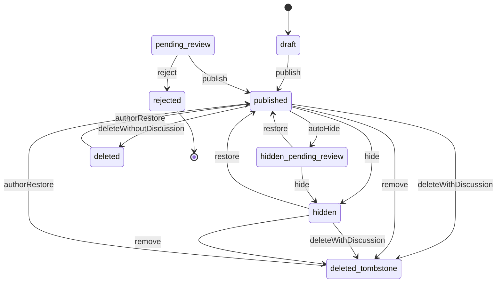
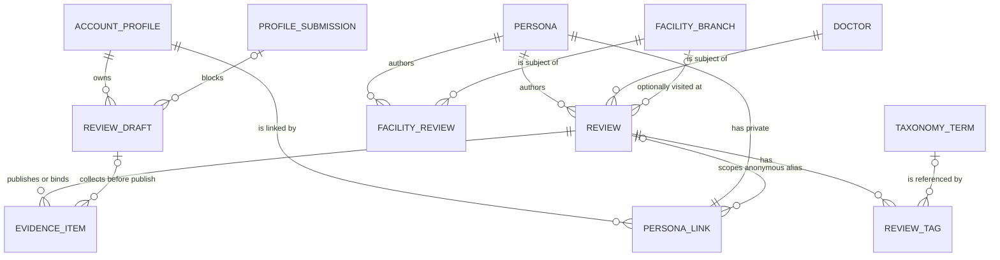

# Functional specification — U21 `t-301-review-module-core`

Unit U21 (kind `library`, size XL, not marked high risk) delivers T-301 for US6.1, US6.2, US6.4, US3.3 and US4.3. Lead perspective: architect. Support perspective: developer (repository reads and writes, transaction order, query mechanics, view-model mapping and the tests against the real database), written into §§ 8, 10 and 11 and synthesised in § 13. Draft written ahead of the stage on the owner's instruction to overlap work; the lead finalises it and the reviewer checks it when the workflow reaches this Unit.

**Refreshed 2026-10-29.** Re-checked against U3 T-010 as merged on `main` (`14c21a9`), the refreshed U8 T-101 and U14 T-201 drafts, the U11 T-104 and U12 T-105 drafts and the owner's answers in `docs/aidlc-migration/OWNER-REVIEW-QUEUE.md`. What changed:
1. **Questions 15 and 16 answered A** under the owner's no-questions instruction of 2026-10-29: the FR46 checkboxes are deferred from release 1 and AC6.2.3 narrows to its sentiment half (BR3.13, F9); the experience page carries no anonymity caveat and the composer's note is reworded without the legal or staff-access sentence (BR6.13, F10). § 17 gives the exact FD texts, the reworded note included in both languages.
2. **T-010 applied.** Placement under the boundary matrix (FD-093): `domain` imports nothing, so its results are structural and its unions are its own; `application` imports no external package or Node built-in; `database` never imports `domain`, so the repeat-episode comparison runs in the application (Question 20). The pins move in the same commit as the change (`not-implemented.test.ts`, both migration-count pins, `foreign-keys.int.test.ts`, the fake tests; BR10.5). The gate is the full `pnpm check` (nine steps after T-010, eleven after U45 T-011), the 80% line floor now binds `domain` and `application`, and CI must be green on the Bolt branch before the merge (BR10.3).
3. **T-101 applied.** `requires` in its order, the owner check as a `not_found` load, no `onRefused` and no `recorded` error, an Actor without persona or staff powers, `await config.current()`, the `RateLimiter.hit` shape (BR1.1, BR1.3, BR1.4).
4. **T-201 applied.** The page condition and related cards use the linked condition tag first (BR6.8, BR6.10); publish calls `ensureProvisionalTerm` on its transaction with the persona as actor (BR3.8); the seed has 11 doctors and 25 reviews, each with a condition term tag, and r25 has no sentiment, outcome or documents (§ 2); facility feedback turned off empties `review.forBranch` and refuses `facilityReview.publish` (BR7.3, new BR8.4).
5. **T-104 applied.** The deferrable link key and the no-review anonymous persona are T-104's (its Question 7 A, BR2.4), so this Unit's migration for the key is a fallback only. The page byline shows the thread alias (Question 17), carries the profile username for named and pseudonymous personas (Question 18, which closes R2 and F11) and shows "Former member" with no other accounts for a de-identified persona (Question 19, the owner's answer to T-104 Question 15). `ownsAnyPersona` and the pseudonymous id from `currentPersonaOf` are asked of T-104's finalisation (Question 8 refresh).
6. **New findings F24–F30** (§ 9). Two are S2: the seed cannot reach the real `Crypto` adapter under the matrix (F24; Question 21, FD entry (e)), and the byline shapes of the T-104 and T-201 drafts disagree (F25). Three more were S1 or S2 if built as written and are designed out here: the preview could never equal an anonymous page once it shows an alias (F26), domain code returning `contracts` types would turn the boundary lint red (F27), and facility accounts would be listed with facility feedback off (F28).
7. **Decided under the no-questions instruction:** Questions 17–21 and the raised points R1–R6 (`functional-design-questions.md`). § 17 lists the five FD entries the build appends before code; their numbers are the next free FD ids at build time.

Inputs: `unit-of-work.md` (U21 and the evidence-to-draft open point), `unit-of-work-story-map.md`, `requirements.md`, `stories.md`, `components.md` (Review, Identity), `contract-summary.md` (C4, C6, C7, C8, C9, C15 and the common rules), `docs/status/decision-log.md` (FD-008, FD-009, FD-014, FD-015, FD-016, FD-022, FD-023, FD-049, FD-067, FD-080, FD-090, FD-092), T-301 with its FD-080 and FD-090 amendments, `01-conventions.md` §2–§5 and §10, `02-data-model.md` §0, §3, §6, §7, §16 and §17, `03-routes-and-contracts.md` §2–§5, the U14 T-201 design draft (whose review read side this Unit extends), the U8 T-101 draft (Actor, `defineCommand`), the code on `main` listed in `functional-design-questions.md`, the prototype data file and renderers, and ISS-147, ISS-161, ISS-240 and ISS-269.

This file is the source of truth for the workflows and state transitions. The data shape is in `entities.md`; the decision logic is in `rules.md`. The design follows the answers in `functional-design-questions.md`: Questions 1–14 answered A on the owner's standing instruction of 2026-10-27; Questions 15 and 16 (owner-class) and Questions 17–21 answered A, and R1–R6 decided, by the agent under the owner's no-questions instruction of 2026-10-29. All await the owner's confirmation in `OWNER-REVIEW-QUEUE.md`.

## 1. What changes, in one paragraph

A signed-in author can save an encrypted draft, preview exactly what the public will see, and publish a quick or detailed review, or facility feedback, in one transaction that picks the persona for the chosen identity mode, resolves or creates the tags, links privacy-confirmed files and binds the ones still in processing, writes one audit row whose actor is the persona, and appends `review.published` with the `repeatEpisode` flag. One pure function, `toExperiencePage`, builds both the preview and the public experience page: flags with Not provided, claims under the Reviewer's label, sections in order, a doctor with "Registration not verified", a byline that shows only the chosen identity (the thread alias for an anonymous review, "Former member" for a de-identified persona), other accounts by the same persona only (none for anonymous or de-identified authors), related and same-doctor cards, no anonymity caveat, and nothing private. Lists reuse U14's eligibility predicate and keyset read; distributions are U14's, unchanged. The review state machine of `02-data-model.md` §17 lands in `packages/domain` with the domain-only `deleted` state (FD-049). Review implements Identity's `RevealTarget`. One forward-only migration, the FD-090 worker grant on `review_drafts`; the deferrable foreign key from `persona_links` to `reviews` that lets the anonymous alias be written before its review (Question 5) is U11 T-104's, and this Unit adds it only if T-104 merged without it. The seed's drafts (encrypted with the real `Crypto` adapter, Question 21), claims and detailed-review openings are corrected (Question 14). Five FD entries are appended before code (§ 17): the FR46 deferral, the page and composer anonymity copy, release 1's three Reviewer's labels, the persona as audit actor, and the seed's access to the `Crypto` adapter.

## 2. As is (baseline on `main` at `9cf860a` with T-010 merged as `14c21a9`, read 2026-10-29) and what Bolt 17 can count on

- **Application and domain are empty today.** `packages/application/src/index.ts` and `packages/domain/src/index.ts` export nothing, so both pass the coverage floor at 0 of 0 lines. By Bolt 17, U8 T-101 has created `defineCommand({name, input, requires, sendsMail?, onRefused?, handle})` with the `UnitOfWork` port (the handler gets `{input, actor, ports, tx}`; `requires` runs `authenticated → verifiedEmail → notRestricted → staffRole → capability → stepUp → owner`; an `err` rolls back unless marked `recorded`), the shared ports (`ConfigProvider.current(): Promise<ConfigValues>`, `RateLimiter.hit(key, limit, windowSec) → {allowed, retryAfter?}`, `Crypto`, the audit allowlist builders that close ISS-108) and the `Crypto` adapter in `packages/adapters/src/crypto/`; the Actor carries no persona and no staff powers until U10 and U11 fill them. U10 T-103 adds the staff role and capabilities; U11 T-104 the identity module (`personaFor` on the caller's transaction, `bylinesFor`, `publicProjection`, `currentPersonaOf`, the private repository, `RevealTarget` declared with an empty registry, the deferrable link key, thread aliases, "Former member"); U12 T-105 the database `ConfigProvider` (threshold range 2–50); U14 T-201 the review read side (§ 3), `defineQuery` if T-101 did not add it, and `ensureProvisionalTerm`; U17 T-204 `ProfileMergeParticipant` in `modules/review`. Where their shapes differ from this design, the frame adapts and the rules stay (§ 16).
- **Boundaries and gate (T-010, FD-093).** `eslint.boundaries.mjs`: `domain` imports nothing; `contracts` only `zod` and `uuid`; `application` only `domain` and `contracts`, no external package and no Node built-in; `database` and `adapters` only `application` and `contracts`; seed code also `domain`, `test-support` and `database`, not `adapters`; package tests may also import `test-support`, the test tooling and Node built-ins. `pnpm check` runs nine steps (`typecheck`, `lint`, `lint:boundaries`, `format:check`, `check:identity`, `test:coverage`, `i18n:check`, `contrast`, `build`; U45 T-011 adds two before `build`); `test:coverage` holds every package at 80% of lines with untested files counted; CI (`.github/workflows/check.yml`) runs on every push to `main` and to a Bolt branch, and a Bolt merges only when its branch is green. Markdown and `docs/**` are outside Prettier.
- **Pins that move with this Unit's changes.** `repositories/not-implemented.test.ts` constructs every stub repository without arguments, calls every method and expects `NotImplemented` naming its owner; its trace test calls `new PgReviewRepository().getDraft('draft-42')` and expects `owned by T-301` (ISS-294). U14 T-201 replaces `PgReviewRepository`'s entry with a list of remaining stub methods (its BR7.6). `migrations.int.test.ts` and P8 of `validator-probes.int.test.ts` pin 9 applied migrations today; T-104, T-105 and T-201 each add one before Bolt 17. `schema/foreign-keys.int.test.ts` compares the Drizzle schema's keys with the database's and expects the only undeclared ones to be the raw-SQL names of `0004_deferred_fks.sql`, where `persona_links_review_id_reviews_id_fk` lives; it asserts deferrability for `evidence_items.published_artifact_id` only. `fakes/repositories.test.ts` exercises the review fake by its method names.
- **Repository stub** `packages/database/src/repositories/review.ts`: T-301 stubs `saveDraft`, `getDraft`, `deleteDraft`, `insertReview`, `getByPublicId`, `getById`, `updateState`, `listForDoctor`, `listForBranch`, `listForCondition`, `listExperiences`, `insertFacilityReview`; T-302 stubs for follow-ups, corrections and deletion; U14 replaces its three distribution stubs. `repositories-superset.test.ts` reads the stub method names and fails when `FakeReviewRepository` is not a superset.
- **Schema** (`schema/review.ts`): `reviews` (with `title NOT NULL`, `language NOT NULL` in `en|bn|mixed`, `exact_date_enc bytea`, `claims jsonb [{label, note?}]`, `period_year`/`period_month NOT NULL`, `attestation_at`), `review_tags` (one of term, free text, not sure), `review_drafts` (`payload_enc bytea NOT NULL`, `expires_at` default now + 30 days, `blocked_on_submission_id`), `facility_reviews` (`criteria jsonb`, no `doctor_id`). `review_kind` is `quick|detailed` only. `persona_links.review_id` has an immediately checked foreign key to `reviews` (`0004_deferred_fks.sql`), and `reviews.author_persona_id` references `personas`, so as written a review-scoped anonymous link cannot be inserted before its review (finding F1).
- **Grants**: `rk_worker` has nothing on `review_drafts` (§16 (f), planned PA3), SELECT on the whole of `reviews` (including `exact_date_enc`, ISS-240) and UPDATE on `state`, `deleted_at`.
- **Contracts**: `view-models/experience.ts` is a T-003 stub marked `TODO(T-307)` with `likes`, `dislikes`, `identityLabel`, `tombstone` (Question 1); U14 moves `ExperienceCardVM` to `experience-card.ts`. `view-models/composer.ts` has `ComposerDraftVM` with `payload: unknown`. `schemas/review.ts` has `SaveDraftInput.payload: unknown` (`TODO(T-301/T-306)`), `PublishReviewInput.attestation: z.literal(true)`, `ListExperiencesInput.filters: unknown` (`TODO(T-301)`), page-number inputs for `forDoctor`, `forBranch`, `forCondition`, and `FacilityReviewPublishInput` with `criteria` in the input.
- **i18n**: `errors.review.minFields`, `attestationRequired`, `notEditable`, `restoreExpired`, `errors.common.rateLimited`, `label.notProvided`, `label.limitedData`, `label.reviewerLabel`, `label.reviewerLabelWhy`, `label.notVerified`, `claim.wrongDx|wrongRx|secondOpinion`, `byline.anonSentence`, `experience.episode`, `compose.identity.anonNote` exist in both dictionaries. `label.limitedDataWhy` hard-codes "Fewer than 5" (R5).
- **Seed** (`test-support/src/seed/seed-content.ts`, unchanged in substance by T-010): 24 reviews (r1–r24) and 19 facility reviews, all Bengali text (`language: 'bn'`, ISS-161), tags as free text only, claims as Bengali display text (finding F4), detailed reviews with `body` null (F5), anonymous personas created with no review id and back-filled after the review insert; the three drafts of `shirin_88` stored as plaintext `{title, excerpt}` and matched by stored bytes (ISS-269, F3), with `TODO(T-101/T-301): encrypt with the real Crypto port`. By Bolt 17, U14 T-201 has added doctor d11 and review r25 (on d11, published without sentiment, outcome or documents) through the prototype and the corpus port, one condition term tag per review before its free-text tags, and the branch names: 11 doctors and 25 reviews. No two corpus reviews form a repeat episode (checked on the 24 corpus reviews: no author, doctor and period repeats; r25 is the only review of d11), so the FD-080 rows run on builder data. r25 lets the seed show "Not provided" on a page; the projection rows still run on builders.
- **Configuration**: `limitedDataThreshold = 5` (range 2–50 after T-105), `featureVisibility.facilityAccounts = true`; no rate-limit block (rate limits are code constants until U41 T-502). Settings no Unit builds, among them whether sentiment is optional and the label-approval workflow, move to release 2 (the owner's T-105 answer of 2026-10-29).
- **Migrations** `0000`–`0008` are on `main`; U11 T-104, U12 T-105 and U14 T-201 each add one before Bolt 17, so this Unit's migration takes the next free number at build time. The two count pins rise with each.

## 3. Settled before this stage

FD-080 (`repeatEpisode`), FD-090 (the drafts grant), FD-049 (soft delete is domain-only), U14's ownership of the review read queries and policies and their shape, the owner's answers on counts without percentages and on the nine facility criteria, FD-015, FD-022, FD-014, FD-009, FD-023, FD-036, no new dependency, the T-010 boundaries (FD-093), U8 T-101's command frame, U14 T-201's linked-condition-first rule and provisional-term operation, U11 T-104's link key, aliases and "Former member" (owner), and the owner's T-105 answer moving unbuilt settings to release 2. See `functional-design-questions.md` § "Settled before this stage". The decisions this design makes without a question are listed there too ("Settled in this design" and "Settled in the 2026-10-29 refresh") and explained in § 13.

## 4. Workflows

Every command follows `parse → authorize → load → decide (domain) → persist in one transaction with audit and outbox → Result` (01-conventions §3), through U8 T-101's `defineCommand`: the contracts schema parses the input (application never imports `zod`), `requires` authorizes in T-101's order, and the handler runs inside `UnitOfWork.run`, where any `err` rolls back (no command of this Unit declares `onRefused` or returns a `recorded` error). Every query follows `parse → authorize → read → map to the view model in actor.locale → ok(vm)`. Expected failures return `err` with an `ErrorCode`; a thrown database error becomes `internal` at the caller. Domain functions return structural results that the application maps to `Result` (domain imports nothing, FD-093). Configuration is read with `await config.current()`, once per call. Queries never write (BR6.12).

### WF1 — Code Generation order (the Unit end to end)

1. **Baseline.** `pnpm infra:up`; `pnpm check` and `pnpm smoke` green on the Bolt branch; read the open `ISSUES.md` rows of § 2 and the rows proposed in § 9.
2. **FD entries.** Append the five entries of § 17 to `docs/status/decision-log.md` with the next free FD numbers, before any code (`project.md` Mandated).
3. **Prerequisites present.** `defineCommand`, `defineQuery`, the Actor, `Crypto` (port and adapter), `Clock`, `IdGenerator`, `RateLimiter`, `ConfigProvider`, `AuditWriter` with the allowlist builders, `Outbox`; Identity's `personaFor`, `bylinesFor`, `publicProjection`, `currentPersonaOf`, `RevealTarget` declaration and registry; U14's review read side, `normalizeAliasKey` and `listRecentCards`; Taxonomy's `resolve` and `ensureProvisionalTerm`; Directory's `resolvePublicId`. Check what U11 T-104 merged: the deferrable persona-link key (Question 5, T-104 Question 7 A), the no-review anonymous branch of `personaFor` (Question 6, T-104 BR2.4), `ownsAnyPersona` and the pseudonymous id from `currentPersonaOf` (Question 8 refresh), the alias and `formerMember` in the byline data (Questions 17–19). Add whichever is missing as a recorded owned-path addition; an addition under `modules/identity` runs the high-risk steps for that part (Question 8 refresh).
4. **Domain** (`packages/domain/src/review/`, importing nothing outside `domain`): `review.ts` (its own string unions `IdentityMode`, `Relationship`, `ClaimCode`, `SectionKey`; `PeriodMonth`, `parsePeriod`, `ConditionKey`), `review-state.ts` (BR5.1, BR5.2), `policies.ts` additions (`minimumFieldsSatisfied`, `publicPeriod`, `latestStatusOf`, `deriveTitle`, `detectLanguage`, `graphemeLength`, `conditionKeysOf`, `isRepeatEpisode`), `facility-review.ts` (criteria validation), with tests including `no-score.test.ts`. Results are structural (`{ok: true, value} | {ok: false, reason}`, lists of missing-field codes). U14's `distribution` and `isLimitedData` stay as they are. A type-level test in `application` keeps the domain unions equal to the `contracts` enum arrays.
5. **Contracts**: `DraftPayload` and the input changes of § 7 in `schemas/review.ts`; `ExperiencePageVM` and `PageBylineVM` in `view-models/experience.ts` (Questions 1, 17–19); `DraftSummaryVM` and the typed `ComposerDraftVM` in `view-models/composer.ts`.
6. **Migrations** (next free numbers at build time, after T-104's, T-105's and T-201's): `<n>_review_drafts_worker_grant.sql` (FD-090), and `<n>_persona_links_review_fk_deferrable.sql` only if T-104 merged without the key; each a drizzle custom migration whose journal timestamp is later than the previous one; raise both migration-count pins by one each, with a comment; `02-data-model.md` §16 moves PA3 into the live list with its reason.
7. **Ports** (§ 6): `ports/repositories/review.ts` gains the write and read methods; `modules/review/ports.ts` declares `EvidenceForPublish`.
8. **Repository** (`packages/database/src/repositories/review.ts`, importing application ports and contracts only): replace this Unit's stubs with the § 6 methods; relabel `updateState` to `T-302`; leave U14's and T-302's methods untouched. In the same commit (BR10.5): `not-implemented.test.ts` lists only T-302's remaining stub methods for `PgReviewRepository` and its trace test calls no method this Unit implements; `fakes/repositories.test.ts` uses the renamed methods.
9. **Commands and queries** (`modules/review/`): `commands/save-draft.ts`, `publish.ts`, `facility-review-publish.ts`; `queries/get-draft.ts`, `list-drafts.ts`, `preview.ts`, `get-experience.ts`, `list-experiences.ts`, `for-doctor.ts`, `for-branch.ts`, `for-condition.ts`; `projection.ts`; `authorization.ts`; `reveal-target.ts`; `index.ts` exports. Application tests on fakes.
10. **Test support**: `builders/review.ts` (`aReview()` defaults to a published pseudonymous quick review on the seeded `d1`; `aDraftPayload()`), `fakes/review-repository.ts` (the full fake, re-exported from `fakes/repositories.ts` so the superset test keeps its import), a fake `EvidenceForPublish`. Both fakes count toward test-support's 80% floor, so the application tests and `repositories.test.ts` exercise every method.
11. **Seed** (Questions 14, 21): add the seed-to-`Crypto`-adapter edge of FD entry (e) (`eslint.boundaries.mjs`, a lint fixture, `@rogikotha/adapters` as a `test-support` dependency with a `./crypto` subpath export); drafts encrypted with the adapter built from `APP_ENCRYPTION_KEY`, written as valid payloads with `seedRef`, found again by decrypt-and-compare; claims by code; detailed `body` kept; U14's condition term tags and r25 untouched; one seed integration assertion each; counts stay 3 drafts and 25 reviews.
12. **i18n**: `errors.review.missingDoctor`, `doctorPending`, `missingStory`, `missingSection`, `missingRelationship`, `missingTag`, `periodInvalid`, `missingBranch` in both dictionaries in the same commit; Bengali drafted and flagged for the owner's bilingual review (FD-042). `compose.identity.anonNote` is U26 T-306's to reword (FD entry (b)); `byline.formerMember` is U11 T-104's.
13. **Integration and smoke tests** (§ 11).
14. **Documents**: 03 §4 review entries (saveDraft authorization, attestation, forBranch, inputs), 01-conventions §5 (the `persona:<id>` actor, FD entry (d)), C4 (`ownsAnyPersona`, `currentPersonaOf` with the pseudonymous id, `personaFor` without `reviewId`), C8 (`itemsOfDraft`, `bindToReview`), C9 note (repeat rule, `kind: 'experience'`), each with a dated note; the T-301 task file gains the C4 `RevealTarget` amendment row and a note that its "Preview equals public" row also ignores an anonymous byline's alias (F26).
15. **Issue register**: ISS-269 (draft part) fixed in U21 T-301; add the § 9 rows.
16. **Gate**: `pnpm check` (the full gate of the day), `pnpm smoke`, `pnpm test:int` exit 0, the 80% floor holds in every package, CI is green on the branch head (BR10.3); fill the T-301 hand-off with every owned-path addition of § 12 and its reason.

### WF2 — `review.saveDraft({draftId?, payload})`

1. Authorize (BR1.1): `requires: ['authenticated']`, an account Actor; else `forbidden`.
2. Parse `payload` with `DraftPayload` (BR2.2); bound failures → `validation` with `fieldErrors`. FR46 keys, like any unknown key, are dropped (BR3.13).
3. Derive the mirror columns: `kind` from `mode` (`quick` for a facility draft); `doctor_id` from `doctorPublicId` when it names a visible doctor (an unknown id is kept in the payload but leaves `doctor_id` null, so a draft never fails for a stale id); `blocked_on_submission_id` from `doctorSubmissionPublicId` per BR2.4 (another account's or unknown submission → `validation`, `fieldErrors.doctor`).
4. In one transaction: `draftId` absent → insert `{id: newId, account_id: actor.accountId, kind, payload_enc: encrypt(payload), doctor_id, blocked_on_submission_id, expires_at: now + 30 d}`; present → update the row with that id and `account_id = actor.accountId` and `expires_at > now` (none → `not_found`, BR1.2), setting `payload_enc`, the mirrors, `updated_at` and `expires_at = now + 30 d` (BR2.3).
5. Return `{draftId, expiresAt}`. No audit row and no outbox event: a draft is private work in progress, not a state change of public content, and its autosave would flood the audit stream every 1.5 s (§ 13).

### WF3 — `review.getDraft({draftId})` and `review.listDrafts()`

- `getDraft`: authorize (BR1.1); load per BR1.2; decrypt; parse leniently with `DraftPayload` (a stored payload that no longer parses gives the parsed subset and logs `review.draft_payload_drift` with the draft id only); return `ComposerDraftVM {draftId, expiresAt, expiresInDays, startedAt, blocked, doctorPublicId?, payload}`.
- `listDrafts`: authorize; the owner's live drafts ordered `updated_at desc`; decrypt each and map to `DraftSummaryVM` per BR2.5. The workspace (U38 T-409) consumes it.

### WF4 — `review.preview({draftId})`

1. Authorize and load as `getDraft`.
2. Build a transient `Review` from the payload without enforcing the minimum (BR6.12): kind, relationship, sentiment, outcome, title (BR4.3), body, sections, claims, period when it parses, the doctor when visible.
3. Read the dependencies read-only: the doctor's card fields; the tags through `taxonomy.resolve` (an unresolved free text shows its wording with `provisional: true`); the byline for the draft's identity mode (named and pseudonymous from the account's existing personas through `identity.currentPersonaOf` and `identity.bylinesFor`; anonymous from the mode alone, with no alias, because the thread alias is created at publish; nothing is created); related and same-doctor cards by the page's condition (BR6.8, BR6.10); other accounts by the persona that would publish (none for anonymous or a de-identified persona).
4. `toExperiencePage(review, deps)` with `publicId`, `postedMonthYear` and `discussion` absent.

### WF5 — `review.publish({draftId, identityMode, attestation})`

1. **Authorize** (BR1.3): `requires: ['authenticated', 'verifiedEmail', 'notRestricted']`; else `forbidden`.
2. **Rate limit** (BR1.4): `rateLimiter.hit('review.publish:account:<accountId>', 5, 86400)` at the start of the handler; refused → `rate_limited` with `retryAfterSec`. Every authorized attempt counts.
3. **Load** the draft (BR1.2) and decrypt; `payload.target = facility` → `validation` (use `facilityReview.publish`).
4. **Decide** (domain, no writes yet):
   - attestation (BR3.6) → `review.attestation_required`;
   - identity mode against the payload (BR3.7) → `conflict`;
   - doctor (BR3.4), story or sections (BR3.1, BR3.2), relationship, tags or Not sure, period (BR3.5): collect every failure into one `review.min_fields` with `fieldErrors` in the fixed order (BR3.3);
   - branch (BR3.11), claims (BR3.9), sentiment and outcome (BR3.12) → `validation`;
   - evidence ownership (BR3.10): `evidenceForPublish.itemsOfDraft(tx, {draftId, accountId, itemIds})`; any id missing → `validation`.
5. **Persist in one transaction** (BR4.1):
   1. `reviewId = ids.newId()`, `publicId = ids.newPublicId()`.
   2. `personaId = identity.personaFor(tx, {accountId, reviewId, mode})` (BR4.2; the deferred key is checked at commit; an anonymous persona's display name is its new thread alias).
   3. Resolve the tags (BR3.8), creating provisional terms through `ensureProvisionalTerm(tx, {kind, text, lang}, persona actor)` on the same `tx` (their audit rows, with the actor `persona:<personaId>`, and their `term.changed` events are Taxonomy's; a lost race returns the winner and never aborts the transaction).
   4. Compute `repeatEpisode` (BR4.9, Question 20): `repeatCandidates(tx, {doctorId, year, month})` (the new review is inserted after this step) → per eligible review its author persona, effective condition term ids and free-text condition tags; the application keeps those sharing a term id or a `normalizeAliasKey` with the new review; none kept → false; else `identity.ownsAnyPersona({accountId, personaIds})`.
   5. Insert the review `{id, public_id, author_persona_id, doctor_id, branch_id, kind, relationship, identity_mode, sentiment, outcome, period_year, period_month, exact_date_enc, title, body, sections, claims, language (BR4.4), state: published, published_at, attestation_at, version: 1}` and its tags.
   6. Evidence (BR4.6): `evidenceForPublish.publish(tx, {reviewId, itemIds: confirmed})`, `evidenceForPublish.bindToReview(tx, {reviewId, itemIds: pending})`.
   7. Audit (BR4.7, FD entry (d)): stream `review:<reviewId>`, action `publish`, actor `persona:<personaId>`, target `review`, details `{kind, identityMode, tagCount, evidenceLinked, evidencePending}` built with T-101's allowlist builders.
   8. Outbox (BR4.8): `review.published {reviewId, doctorId, branchId: branchId ?? null, repeatEpisode}`.
   9. Delete the draft.
6. Return `{publicId}`.

Unhappy paths: every refusal in steps 1–4 writes nothing and keeps the draft; a failure inside step 5 rolls everything back (including any provisional term and the persona), keeps the draft and returns `internal`; a unique-key race on a provisional term is settled by Taxonomy's re-read (U14 WF11).

### WF6 — `facilityReview.publish({draftId, identityMode, attestation})`

Steps 1–3 as WF5 with the key `facilityReview.publish:account:<id>` and `payload.target = facility` required. If `(await config.current()).featureVisibility.facilityAccounts` is false, refuse with `forbidden`, write nothing and keep the draft (BR8.4). Decide per BR8.1 (branch visible, story ≥ 20 graphemes, period, attestation, criteria keys and values; `fieldErrors.branch = errors.review.missingBranch`). Persist in one transaction: persona per BR8.2 (anonymous: a fresh alias with no review id), insert `facility_reviews {public_id, author_persona_id, branch_id, identity_mode, period, body, criteria (every answered key; others null), state: published, published_at, version: 1}`, audit (stream `facility_review:<id>`, actor `persona:<id>`, details `{identityMode, criteriaAnswered}`), delete the draft. No outbox event (BR8.3). Return `{publicId}`.

### WF7 — `review.getExperience({publicId})`

1. `findEligibleByPublicId(publicId)` → the review with its tags (term name in locale, state, effective term) or nothing; nothing → `not_found` (BR6.2).
2. Read the dependencies: doctor `{publicId, name}`; the author's byline data through `identity.bylinesFor` (alias for anonymous, `profileUsername` for named and pseudonymous, `formerMember`; BR6.4); related by the effective term of the page's condition, the first condition tag that has a term (6, U14 BR3.9), and same doctor (6) as `ExperienceCardVM` through U14's card mapper; other accounts by the same persona (10; none for anonymous or "Former member", BR6.9).
3. `toExperiencePage(review, deps)` and return `{kind: 'experience', ...vm}`. U22 T-302 adds the tombstone branch before step 1's `not_found`.

### WF8 — Lists

- `review.listExperiences({cursor?, limit?})`, `review.forDoctor({doctorPublicId, cursor?, limit?})`, `review.forCondition({conditionPublicId, cursor?, limit?})`: resolve the public id (Directory or Taxonomy, redirects followed), then U14's `listRecentCards` (keyset on `published_at`, `public_id`; newest first; limit default 20, max 50) → `CursorPage<ExperienceCardVM>` (BR7.2).
- `review.forBranch({branchPublicId, cursor?, limit?})`: the branch's eligible facility accounts → `CursorPage<FacilityAccountVM>`; never a doctor review; an empty page without a read while facility feedback is turned off (BR7.3, U14 BR2.12).
- `review.sentimentDistribution`, `outcomeDistribution`, `criteriaDistribution`: U14's, unchanged (BR7.4).

### WF9 — `RevealTarget.resolve(tx, {targetKind, targetId})` (implemented for Identity)

`review` → `reviews.author_persona_id` of that id in any state; `facility_review` → `facility_reviews.author_persona_id`; missing → `not_found`. Returns `{subject: 'persona', personaId, targetCode}` (`targetCode` = the review's or facility review's public id, the shape the U11 T-104 draft declares). Registered in Identity's `RevealTarget` registry (BR9.2).

### WF10 — The migration, and the fallback one

- `<n>_review_drafts_worker_grant.sql`: `GRANT SELECT (id, account_id, expires_at), DELETE ON review_drafts TO rk_worker;` with a header naming FD-090 and U29 T-309 as the consumer. Probes in `validator-probes.int.test.ts` as a real `rk_worker` session: the three columns readable, `delete … where expires_at < now()` allowed, `select payload_enc` and `update review_drafts` denied (BR2.6).
- `<n>_persona_links_review_fk_deferrable.sql`, only if U11 T-104 merged without the change its Question 7 A puts in its own migration: `ALTER TABLE persona_links ALTER CONSTRAINT persona_links_review_id_reviews_id_fk DEFERRABLE INITIALLY DEFERRED;` (the constraint keeps its name and its `ON DELETE SET NULL`, so `foreign-keys.int.test.ts`'s raw-SQL name list still matches `0004`). `foreign-keys.int.test.ts` gains the assertion the evidence key has (deferrable, initially deferred). A test inserts a link naming a review id, then the review, in one transaction and commits; a second test proves the commit fails when the review never arrives.
- Each is a drizzle custom migration with a journal timestamp later than the previous one; both migration-count pins rise by one per migration, with a comment (BR10.5).

## 5. State transitions

### Publication state machine (`domain/review/review-state.ts`, BR5.1, BR5.2)

States: the stored enum plus the domain-only `deleted` (stored as `published` with `deleted_at`, FD-049). Events: `publish`, `autoHide` (C9's `hideThreshold` and `hideCritical`), `hide`, `restore`, `deleteWithDiscussion`, `deleteWithoutDiscussion`, `authorRestore`, `remove`, `reject`. Every pair not in the table returns `err('conflict')`.

| From | Event | To | Triggered by (Unit) |
|---|---|---|---|
| `draft` | `publish` | `published` | author publish (this Unit) |
| `pending_review` | `publish` | `published` | staff decision (profiles; not used for reviews in release 1) |
| `pending_review` | `reject` | `rejected` | staff decision |
| `published` | `autoHide` | `hidden_pending_review` | five distinct reporters or a critical reason (U32 T-403) |
| `published` | `hide` | `hidden` | moderator (U33 T-404) |
| `published` | `deleteWithDiscussion` | `deleted_tombstone` | author (U22 T-302) |
| `published` | `deleteWithoutDiscussion` | `deleted` | author (U22 T-302) |
| `published` | `remove` | `deleted_tombstone` | moderator (U33 T-404) |
| `hidden_pending_review` | `restore` | `published` | moderator, reason-coded |
| `hidden_pending_review` | `hide` | `hidden` | moderator |
| `hidden` | `restore` | `published` | moderator, or an appeal that changed the decision |
| `hidden` | `deleteWithDiscussion` | `deleted_tombstone` | author |
| `hidden` | `remove` | `deleted_tombstone` | moderator |
| `deleted_tombstone` | `authorRestore` | `published` | author within `restore_until` (U22 T-302 checks the window, BR5.3) |
| `deleted` | `authorRestore` | `published` | author within `restore_until` |
| `rejected` | (none) | — | terminal |



Text fallback: a draft becomes published when its author publishes it; reports or a critical reason hide it pending review, and a moderator hides or restores it; the author deletes it (a tombstone when it has discussion, otherwise a soft delete kept only in the domain) and may restore it within the window; a moderator's removal leaves a tombstone the author cannot restore. Rejection is terminal. Two cells §17 does not have are added later, each by the Unit that builds its command (R4 decided: U33 T-404 the removal of a review hidden pending review, U22 T-302 the author's deletion of a hidden review without discussion), not here.

### What each state means to this Unit's reads

| Stored state | `deleted_at` | Domain state | `getExperience` | Lists, counts, related, other accounts |
|---|---|---|---|---|
| `published` | null | `published` | the page | included |
| `published` | set | `deleted` | `not_found` | excluded |
| `hidden_pending_review`, `hidden` | any | same | `not_found` | excluded |
| `deleted_tombstone` | set | `deleted_tombstone` | `not_found` here; the tombstone answer is U22 T-302's | excluded |
| `draft`, `pending_review`, `rejected` | any | same | `not_found` | excluded |

### Draft lifecycle

| From | Event | To | Rule |
|---|---|---|---|
| (none) | first autosave | live, expires in 30 days | BR2.3 |
| live | autosave | live, expiry moved to now + 30 days | BR2.3 (Question 4) |
| live | payload names the author's pending submission | live and blocked | BR2.4 |
| blocked | payload names a visible doctor, or U17's `unblockDrafts` | live | BR2.4, C7 |
| live | publish | deleted (the review exists) | BR4.1 |
| live | 30 days without a save | expired: not found at once; purged by the hourly worker job | BR2.3, BR2.6 (U29 T-309) |

### ISS-269

`assumption, narrower option taken — T-301 keeps an idempotency key when it encrypts draft payloads` → (seed drafts encrypted, `seedRef` in the payload, decrypt-and-compare idempotency, seed integration assertion) → draft part `fixed in U21 T-301`; the other two markers of the row stay with their owners.

## 6. Ports

Interface level only; Code Generation writes the TypeScript.

```text
ReviewRepository (packages/application/src/ports/repositories/review.ts; U14's read methods unchanged)
  insertDraft(tx, {id, accountId, kind, payloadEnc, doctorId?, blockedOnSubmissionId?, expiresAt}) -> void
  updateDraft(tx, {id, accountId, now, kind, payloadEnc, doctorId?, blockedOnSubmissionId?, expiresAt}) -> boolean
  getDraft({id, accountId, now}) -> DraftRow | null           (payloadEnc as bytes; no plaintext)
  listDrafts({accountId, now}) -> DraftRow[]                  (updated_at desc)
  deleteDraft(tx, id) -> void
  insertReview(tx, ReviewInsert) -> void
  insertTags(tx, ReviewTagInsert[]) -> void
  findEligibleByPublicId(publicId) -> ReviewRow & {tags} | null
  getById(id) -> ReviewRow | null                              (any state; internal)
  relatedByCondition({termId, excludeId, limit}) -> CardRow[]
  sameDoctor({doctorId, excludeId, limit}) -> CardRow[]
  byAuthorPersonas({personaIds, excludeId, limit}) -> {publicId, title}[]   (identity_mode <> anonymous in SQL)
  repeatCandidates(tx, {doctorId, year, month}) -> {personaId, conditionTermIds, conditionFreeTexts}[]   (eligible only; keys compared in the application, Question 20)
  insertFacilityReview(tx, FacilityReviewInsert) -> void
  authorPersonaOf({targetKind: review | facility_review, targetId}) -> personaId | null
  pendingSubmissionOf({submissionPublicId, accountId}) -> submissionId | null   (reads profile_submissions; Review sits above Directory)
  branchHostsDoctor({branchId, doctorId}) -> boolean                          (doctor_chambers)

EvidenceForPublish (declared in modules/review/ports.ts; implemented by Evidence in U23 T-303 and U25 T-305; a fake until then)
  itemsOfDraft(tx, {draftId, accountId, itemIds}) -> {itemId, state}[]      (only the draft's own items)
  publish(tx, {reviewId, itemIds}) -> void                                  (C8 evidence.publish)
  bindToReview(tx, {reviewId, itemIds}) -> void                             (new, Question 9; private, not public)

Called on other modules (their public application API)
  identity.personaFor(tx, {accountId, reviewId?, mode}) -> {personaId}      (C4, internal on the caller's tx; no reviewId + anonymous = a fresh persona, Question 6, T-104 BR2.4)
  identity.bylinesFor({personaIds}) -> byline data                          (T-104: kind, name or alias, initials, chipKey, profileUsername?, formerMember?)
  identity.publicProjection({personaId}) -> {displayName?, username?, kind, avatarHue, formerMember?}
  identity.currentPersonaOf({accountId}) -> {namedPersonaId, pseudonymousPersonaId}   (internal query; the pseudonymous id asked of T-104, Question 8 refresh)
  identity.ownsAnyPersona({accountId, personaIds}) -> boolean               (new internal query, Question 8; asked of T-104; never a server action)
  taxonomy.resolve({text, kind}); ensureProvisionalTerm(tx, {kind, text, lang}, actor) (U14 WF11, actor persona:<id>); term lookup by public id
  directory.resolvePublicId({kind, publicId}); visible doctor and branch lookups

Implemented by Review
  Identity.RevealTarget.resolve(tx, {targetKind, targetId}) -> {subject: 'persona', personaId, targetCode}   (C4, Question 11)

Shared ports used: Crypto (encrypt, decrypt), Clock, IdGenerator, RateLimiter (hit), ConfigProvider (current(): Promise), AuditWriter (with the T-101 allowlist builders), Outbox, Logger, UnitOfWork (through defineCommand)
```

The evidence port is declared by the consumer because Evidence is built after this Unit (Bolt 18 and 28); Review sits above Evidence, so this is build order, not a cycle break. The web composition root (`apps/web/src/server/container.ts`) is outside this Unit's owned paths: the first Unit that serves these commands on a page (U26 T-306) wires them, with an `EvidenceForPublish` that knows no items until U23 exists (finding F21).

## 7. View models and input schemas (`packages/contracts`)

All fields serialisable; strings in `actor.locale` except user text, which is kept as written; ids are public ids; no percentage anywhere; no field for an anonymity caveat (BR6.13) or for the FR46 checkboxes (BR3.13).

| Type | Fields |
|---|---|
| `ExperiencePageVM` (`experience.ts`, Question 1) | `kind: 'experience'`, `publicId?` (absent in preview), `reviewKind` (`quick`/`detailed`), `title`, `condition?` {`publicId?`, `name`, `provisional?`}, `byline` (`PageBylineVM`), `flags` (`FlagVM[]`, BR6.5), `sentiment` (`Sentiment` or `null`), `outcome` (`Outcome` or `null`), `claims` [{`labelKey`}], `reviewerLabelKey`, `reviewerLabelNoteKey`, `body?`, `sections` [{`key`, `body`}], `contentLanguage` (`en`/`bn`/`mixed`), `followUps: []` (U22), `laterCare: null` (U22), `evidenceGroups: []`, `hasDocuments: false` (U25), `discussion?` {`threadSlot`: review `publicId`}, `relatedByCondition` (`ExperienceCardVM[]`), `sameDoctor` (`ExperienceCardVM[]`), `margin` {`anonymous`, `period` {`year`, `month`}, `posted?` {`year`, `month`}, `doctor` {`publicId`, `name`, `registrationNotVerified: true`}, `condition?`, `tags` (`TagVM[]`), `otherAccounts` [{`publicId`, `title`}]} |
| `PageBylineVM` (`experience.ts`, Questions 17–19) | `personaKind` (`named`/`pseudonymous`/`anonymous`), `displayName?` (named), `username?` (pseudonymous), `alias?` (anonymous, page only, absent in preview), `initials?` (named and pseudonymous), `profileUsername?` (named and pseudonymous, for the profile link), `formerMember?` (`true` for a de-identified persona, which then carries no name, username, initials or profile username), `relationship`, `postedMonthYear?` {`year`, `month`}; never a persona id, avatar seed or account field; built from Identity's byline data |
| `FlagVM` | `kind` (`sentiment`/`outcome`/`condition`/`period`), `key?` (i18n key: `sentiment.<v>`, `outcome.<v>`, `label.notProvided`, `review.episodeDate`), `label?` (condition name), `period?` {`year`, `month`} |
| `TagVM` | `group`, `label?` (term name in locale or the author's wording), `publicId?` (active term), `notSure?`, `provisional?` |
| `PreviewVM` | `= ExperiencePageVM` |
| `ComposerDraftVM` (`composer.ts`) | `draftId`, `expiresAt`, `expiresInDays`, `startedAt`, `blocked`, `doctorPublicId?`, `payload: DraftPayload` |
| `DraftSummaryVM` (`composer.ts`) | `draftId`, `title?`, `excerpt?`, `truncated`, `startedAt`, `expiresInDays`, `blocked`, `doctor?` {`publicId`, `name`} |
| `ExperienceCardVM`, `BylineVM`, `FacilityAccountVM`, `DistributionVM` | U14's, unchanged (cards carry no alias, so the alias stays inside its thread) |

Input changes (`schemas/review.ts`, no consumer exists yet):

- New `DraftPayload` (`entities.md`), lenient and bounded (BR2.2); `SaveDraftInput.payload` becomes `DraftPayload` and loses its `TODO`.
- `PublishReviewInput` and `FacilityReviewPublishInput`: `attestation: z.boolean()` (BR3.6); `FacilityReviewPublishInput` loses `criteria`, which now travels in the saved payload so the preview and the published row agree.
- `ListExperiencesInput {cursor?, limit?}` (loses `filters` and its `TODO(T-301)`); `ForDoctorInput`, `ForBranchInput`, `ForConditionInput` take `cursor?`, `limit?` instead of page numbers, matching U14's keyset read.
- New `ListDraftsInput {}` (the actor's own).

## 8. Developer view — repository and transaction mechanics

- **Eligibility** is U14's predicate (`state = 'published' and deleted_at is null`) in every WHERE clause of this Unit's reads (BR7.1); the "hidden" integration test inserts a `hidden` and a soft-deleted review and asserts each is absent from every read of § 6.
- **Page condition and related cards** (U14 BR3.9, refreshed): the first condition tag that has a term per review by (`created_at`, `id`), joined to `taxonomy_terms`, `coalesce(canonical_id, id)`; only when a review has no such tag does its first free-text condition tag name the condition, without a link. Related-by-condition matches the page's effective term against each other review's condition chosen the same way (a lateral or window selection, as U14's card query does); a page whose condition is free text only has no related cards.
- **Repeat candidates** (one query, inside the publish transaction, Question 20):
  `select r.author_persona_id, array_agg(distinct coalesce(tt.canonical_id, tt.id)) filter (where tt.id is not null) as condition_term_ids, array_agg(t.free_text) filter (where t.free_text is not null) as condition_free_texts from reviews r join review_tags t on t.review_id = r.id and t.group = 'condition' left join taxonomy_terms tt on tt.id = t.term_id where r.doctor_id = $doctor and r.period_year = $y and r.period_month = $m and r.state = 'published' and r.deleted_at is null group by r.id, r.author_persona_id`. The application keeps the rows that share an effective term id with the new review or whose free texts give a `normalizeAliasKey` the new review has (the domain function; `database` may not import `domain`, and no SQL expression matches it exactly on Bengali marks). The set is the doctor's reviews of one month, usually none or a handful. A test proves both spellings of a Bengali word match (U14 BR4.1) and that a mapped provisional term matches its canonical term.
- **No account in the query**: the candidates are persona ids; the only account-aware step is Identity's boolean (BR9.1).
- **Other accounts**: `where author_persona_id = any($personaIds) and identity_mode <> 'anonymous' and id <> $exclude` plus eligibility, newest first, limit 10 (BR6.9, BR9.3).
- **Draft reads** filter `account_id = $actor and expires_at > $now`; `payload_enc` is returned as bytes and decrypted in the application (bytes through `TextEncoder`/`TextDecoder`; `application` imports no Node built-in). The row-bytes test writes a draft whose story contains a marker string and asserts the raw `payload_enc` bytes do not contain it in UTF-8 (BR2.1).
- **Facility isolation**: every doctor-side builder is a named function whose generated SQL text (`toSQL()`) a test asserts does not contain `facility_reviews`; with 3 doctor reviews and 8 facility reviews on the doctor's branch, the doctor's distribution `total` is 3 (BR7.5).
- **Transaction order** (WF5 step 5): the persona and its link first (the deferred key), then the provisional terms (with their audit rows and events, actor the persona), the review, tags, evidence, audit, outbox, draft deletion. A test injects a failure at the persona step and asserts no review, tag, term, audit or outbox row exists and the draft is unchanged.
- **Exact date**: `exact_date_enc` is never in a select list of a projection read; `rg exact_date packages/application/src/modules/review/projection.ts` finds nothing (acceptance row).
- **Bengali numerals and month names** are not formatted in the backend: periods are `{year, month}`; the UI formats them.

## 9. Findings and proposed ISS rows

Each is proposed with `Found in U21 T-301`; the caller adds them with the next free numbers (the register on `main` ends at ISS-302). Rows marked "Decided" carry the decision taken under the owner's no-questions instruction of 2026-10-29.

| # | Sev | Area | Finding | Suggested owner |
|---|---|---|---|---|
| F1 | S2 | database/identity | `persona_links.review_id`'s foreign key is checked immediately, so the anonymous alias cannot be written before its review as step 5 describes; the seed back-fills it. Fixed by a deferrable key (Question 5), which the U11 T-104 draft puts in its own migration (its Question 7 A) | U11 T-104; U21 T-301 only as fallback |
| F2 | S2 | review/contracts | `reviews.title` is NOT NULL and nothing supplies a title: no composer field, no rule (Question 2) | U21 T-301 |
| F3 | S2 | test-support/seed | Seed drafts are plaintext JSON in `payload_enc`; this Unit's decrypt fails on them and encryption breaks the bytes-based idempotency (ISS-269, Question 14) | U21 T-301 |
| F4 | S2 | test-support/seed | Seeded claims store the Bengali display text instead of the code, so the English page shows Bengali claim labels and the projection cannot attach `claim.<code>` (Question 14) | U21 T-301 |
| F5 | S3 | test-support/seed | Seeded detailed reviews drop the prototype's opening paragraph (`body` null) (Question 14) | U21 T-301 |
| F6 | S2 | review/evidence | Deleting the draft at publish orphans files still in processing, so AC6.1.6's "until the pipeline approves it" has no review to land in (Question 9) | U21 T-301 (call), U23 T-303 / U25 T-305 (`bindToReview`) |
| F7 | S2 | review/identity | The convention's audit actor `account:<id>` on an anonymous or pseudonymous publish writes an account-to-review link outside `persona_links` and the accepted exceptions (Question 10) | U21 T-301; 01-conventions §5 |
| F8 | S2 | process/task-file | C4 assigns Identity's `RevealTarget` for reviews and facility reviews to U21, but T-301's task file has no amendment row for it (T-401 and T-403 have theirs) (Question 11) | U21 T-301 |
| F9 | S2 | requirements | FR46's "What went well / What could improve" checkboxes have no column, prototype, copy or owning task; AC6.2.3 cannot be met in full (Question 15). Decided A under the no-questions instruction: deferred from release 1, AC6.2.3 narrowed to its sentiment half (FD entry (a), BR3.13) | U21 T-301 (FD entry); a follow-up task for release 2 |
| F10 | S2 | identity/copy | The prototype's `compose.identity.anonNote` on the experience page and in the composer mentions legal disclosure, against FD-008, FD-022 and AC3.3.6 (Question 16). Decided A: no caveat on the page (BR6.13); the composer note is reworded (FD entry (b)) | U21 T-301 (FD entry); U26 T-306 (copy), U27 T-307 (no margin note) |
| F11 | S3 (was S2, S1 if built) | web/identity/copy | T-307 step 2 links a named byline to `/authors/{username}`. Closed by Question 18: FR11 and AC10.2.1 make the profile show the username and display name with every non-anonymous contribution, so the link reveals nothing the profile does not. What remains: U26 T-306's identity choice must not tell an author that a username hides their real name from their public profile | U26 T-306 |
| F12 | S3 | web/composer | No Unit builds the screen to write facility feedback; `facilityReview.publish` has no caller (R1). Decided: U26 T-306 adds the facility section (target switch, branch, nine criteria, story, attestation) as a recorded owned-path addition | U26 T-306 |
| F13 | S3 | database/identity | `persona_links.review_id` references `reviews` only, so an anonymous facility review's alias cannot be thread-scoped; designed as a fresh persona each time (Question 6) | U21 T-301 |
| F14 | S3 | docs/contracts | 03 §4 says `review.saveDraft · verified`, against the prototype and T-306, which save drafts for unverified accounts (Question 3) | U21 T-301 (03 §4 corrected) |
| F15 | S3 | review/search | `reviews.language` is NOT NULL and filtered by search, with no rule for setting it (Question 13) | U21 T-301 |
| F16 | S3 | domain/review | §17 has no `remove` from `hidden_pending_review` and no author delete of a `hidden` review without discussion (R4). Decided: this Unit builds §17 exactly; U33 T-404 and U22 T-302 add the two cells with their commands and a dated §17 note | U33 T-404, U22 T-302 |
| F17 | S3 | i18n/copy | `label.limitedDataWhy` hard-codes "Fewer than 5" while the threshold is configurable (2–50 after T-105) (R5). Decided: the key takes `{threshold}` in the active language's numerals | U15 T-202 |
| F18 | S4 | database/identity | `review_versions.actor_id` holds the author's account id, the same kind of link as F7 (R6). Decided: U22 T-302 applies FD entry (d) to the version rows it writes first | U22 T-302 |
| F19 | S4 | review/claims | Custom Reviewer's labels of FR47 have no owner (R3). Decided: release 1 accepts the three suggested labels; custom labels move to release 2 with the label configuration and approval workflow (FD entry (c), the owner's T-105 answer) | U21 T-301 (FD entry) |
| F20 | S4 | web/composer | The composer has no exact-date input, so FR42's private exact date can be stored (this Unit) but not entered | U26 T-306 |
| F21 | S4 | web/composition | The review commands, `RevealTarget` registration and the interim `EvidenceForPublish` are wired in `apps/web/src/server/container.ts`, outside this Unit's owned paths | U26 T-306 (first caller) |
| F22 | S4 | process/task-file | Task-text drift settled in this design: step 3 defines the distribution `total` two contradictory ways and differs from U14's shape; `errors.review.rateLimited` is unnecessary; `threadSlot: reviewId` would expose an internal id; `countPublishedToday(accountId)` needs an account column reviews do not have; `experience.ts` carries `TODO(T-307)`, not T-301; step 7's distribution queries are already U14's; the prototype line numbers moved (`renderAccount` is at 901); `attestation: z.literal(true)` hides `review.attestation_required`; `review.forBranch` would list doctor reviews | U21 T-301 (hand-off) |
| F23 | S4 | database/test | The pins move with this Unit's changes: both migration-count pins per migration, `not-implemented.test.ts` (T-302's stub list only, a trace test on a method that stays a stub, ISS-294), `foreign-keys.int.test.ts` if this Unit adds the deferrable key, `fakes/repositories.test.ts` for the renamed fake methods (BR10.5) | U21 T-301 |
| F24 | S2 | test-support/seed | Question 14 A cannot be built as written: the real `Crypto` adapter is `packages/adapters/src/crypto/` (T-101), T-010's matrix forbids `seed → adapters`, and `FakeCrypto's` fixed all-zero key gives drafts the running demo cannot decrypt with `APP_ENCRYPTION_KEY`. The seed's `original_filename_enc` (`TODO(T-304)`) has the same gap. Designed: FD entry (e) amends FD-093 with one dev-only edge, `@rogikotha/adapters/crypto` (Question 21) | U21 T-301; U24 T-304 reuses it |
| F25 | S2 | identity/contracts | The two drafts that build before this Unit define different bylines: U11 T-104's byline data has the thread alias as the name, `chipKey`, `profileUsername` and `formerMember`; the refreshed U14 T-201 `BylineVM` gives an anonymous byline only `personaKind` and has neither `profileUsername` nor `formerMember`. Built as drafted, U14's cards and U31 T-402's discussion disagree, and a page on U14's shape fails AC3.3.2 and the owner's "Former member" answer. This Unit defines `PageBylineVM` from Identity's data (Questions 17–19); T-104 and T-201 must agree on one card byline (no alias on cards, `formerMember` respected) when they are finalised | U11 T-104, U14 T-201 (finalisation) |
| F26 | S2 (designed out) | review/projection | Once the page shows the thread alias, "preview equals public" cannot hold for an anonymous review: the preview may not create the persona (01-conventions §3). The alias joins the allowed differences (BR6.12); the T-301 acceptance row "Preview equals public (ignoring `publicId`, `postedMonthYear`)" gains "and an anonymous byline's alias" in the hand-off | U21 T-301 |
| F27 | S1 if built as written (designed out) | domain/boundaries | The first draft had domain functions return `ok`/`err` and take the `contracts` enums (`parsePeriod`, the state machine); under FD-093 `domain` imports nothing, so `pnpm lint` would fail. Designed out: structural results and domain-owned unions, mapped in the application, with a type-level equality test against `contracts` | U21 T-301 |
| F28 | S2 (designed out) | review/facility | `review.forBranch` and `facilityReview.publish` ignored `featureVisibility.facilityAccounts`; with facility feedback turned off a branch would still list accounts and accept new feedback, against U14 BR2.12 (T-203 F8, owner's answer). Designed out: an empty page, and a refused publish that keeps the draft (BR7.3, BR8.4) | U21 T-301 |
| F29 | S3 | identity | The U11 T-104 draft has no `ownsAnyPersona`, and its `currentPersonaOf` returns only the named persona, while the preview needs the pseudonymous one without writing. Asked of T-104's finalisation; if it merges without them, this Unit adds them and that part runs the high-risk steps (Question 8 refresh) | U11 T-104 (or U21 T-301 as fallback) |
| F30 | S3 (designed out) | review/database | The first draft let Code Generation compute `normalizeAliasKey` in SQL for stored free-text conditions; no SQL expression is exact for Bengali marks and `database` may not import `domain`. Designed out: the repository returns the raw tags and the application compares (Question 20) | U21 T-301 |

Existing rows, no new row: ISS-290 (the identity fake stores no mode, so `findPersonaFor` never finds a link it made; U11 T-104 replaces that fake, and this Unit's application tests use T-104's), ISS-294 (the stub pins, BR10.5), ISS-240 (`rk_worker` reads `exact_date_enc`; this Unit stores the date there encrypted, which keeps the read harmless, but the owner's ruling stays open), ISS-161 (seed text Bengali only; `language: 'bn'` stays correct for those rows), ISS-262 (anonymous comments on non-anonymous threads; U30 T-401), ISS-145 (the event-name list).

## 10. Developer view — mapping details

- **`graphemeLength(text)`** counts `Intl.Segmenter(undefined, {granularity: 'grapheme'})` segments; every minimum and bound in graphemes uses it, so a Bengali conjunct counts once.
- **`parsePeriod(text)`**: NFC; Bengali digits (U+09E6–U+09EF) to ASCII; lowercase; month names from both lists, English full and three-letter, Bengali with the `ি`/`ী` variants of জানুয়ারি and ফেব্রুয়ারি; forms `<month> <year>`, `<mm>/<yyyy>`, `<m>/<yyyy>`, `<yyyy>-<mm>`; bounds per BR3.5; returns `{ok: true, value: {year, month}}` or `{ok: false, reason: 'invalid' | 'future'}`, which the application maps to `fieldErrors.period = errors.review.periodInvalid` (domain imports nothing, F27). The test table covers `March 2026`, `মার্চ ২০২৬`, `03/2026`, `৩/২০২৬`, a future month and garbage.
- **`deriveTitle(story)`**: per BR4.3; the sentence end set includes the Bengali dari `।`; a title shorter than three graphemes after trimming falls back to the first 80 graphemes of the text.
- **`detectLanguage(texts, fallbackLocale)`**: per BR4.4; marks and digits are not letters for the ratio.
- **`conditionKeysOf(tags)`**: effective term ids of condition tags and `normalizeAliasKey` of every condition wording the author typed, whether it stayed free text or became a term at publish (U14's domain function, imported inside `domain`); Not sure gives none. The same function turns a candidate's stored free texts into keys for the comparison of Question 20.
- **Byline** (Questions 17–19): `PageBylineVM` from Identity's byline data (`identity.bylinesFor`, U11 T-104): named → `displayName`, `initials`, `profileUsername`; pseudonymous → `username`, `initials`, `profileUsername`; anonymous → `alias` only (no initials, no profile username); `formerMember` → that flag only. The projection adds `relationship` and `postedMonthYear` from `published_at` (`{year, month}`, UTC). The lede and chip keys (`experience.writtenBy`, `byline.anonSentence`, `byline.identity.*`, `compose.identity.anon`, `byline.formerMember`) are chosen by the component from `personaKind` and `formerMember`, as the prototype's `byline()` does. Cards keep U14's `BylineVM`.
- **Claims**: stored `{label: code}` → `{labelKey: 'claim.' + code}`; an unknown stored label (none should exist after Question 14) is dropped and logged `review.claim_unknown` with the review id.
- **Tags for the margin**: in tag order; term → `{group, label: name in locale, publicId}` (a hidden term gives the label only); free text → `{group, label: as written}`; Not sure → `{group, notSure: true}`.
- **Flags**: per BR6.5; the condition flag repeats the page's condition name, as the prototype does.
- **`expiresInDays`**: `ceil((expires_at − now) / 86 400 000)`, never below 0 (an expired draft is not returned at all).
- **Excerpt** (draft summaries): U14's 190-grapheme rule over `story` or the first non-empty section.
- **Provisional-term `lang`** (BR3.8): Bengali letters (U+0980–U+09FF) the majority of the tag's letters → `bn`; Latin the majority → `en`; no letters or a tie → `actor.locale`; `banglish` is never assigned automatically.
- **Domain unions** (F27): `IdentityMode`, `Relationship`, `ClaimCode`, `SectionKey`, `Sentiment`, `Outcome` are string unions in `domain/review/review.ts`; `application` holds a type-level test that each equals its `contracts` enum array's element type, so a new value in one breaks the build until the other follows.

## 11. Developer view — tests

Test names read as sentences; builders, not hand-written fixtures; no assertion on internals (01-conventions §10). Database tests insert their own rows (the test database is reset once per run).

| Level | Test | Proves |
|---|---|---|
| domain | `review-state.test.ts`: every (state, event) cell of the 8 × 9 table; legal ones give the target, illegal ones the structural `conflict` refusal; `domainStateOf` for a soft-deleted row | BR5.1, BR5.2 |
| domain | `policies.test.ts`: `minimumFieldsSatisfied` quick and detailed × each missing field, all missing fields reported in order; `parsePeriod` table; `isLimitedData` at threshold − 1, threshold, threshold + 1 (U14's function, regression); `latestStatusOf` with unordered input; `deriveTitle` with a Bengali story ending in `।`; `detectLanguage` en, bn, mixed, majority, none | BR3.1–BR3.5, BR4.3, BR4.4 |
| domain | `repeat-episode.test.ts`: same term → true; mapped provisional vs canonical → true; free text in composed and decomposed Bengali → true; a wording that became a term at publish matches an earlier free-text tag of the same wording → true; Not sure → false; other month → false | BR4.9 |
| domain | `no-score.test.ts`: no exported function of `domain/review` returns a number for a `Review[]`; no export named `/score|rating|stars?/i` | BR7.6 |
| application | `save-draft.test.ts`: create, update, sliding expiry with `FakeClock`; pending and restricted accounts allowed, anonymous refused; another account's draft `not_found`; blocked on the author's own submission, `validation` for someone else's; oversized payload refused | BR1.1, BR1.2, BR2.2–BR2.4 |
| application | `publish.test.ts`: happy path (review, tags, audit row with persona actor and allowlisted details, one outbox row with exactly four keys, draft deleted); refusals (anonymous, unverified, restricted, foreign draft, sixth attempt → `rate_limited` even when earlier attempts were refused, missing attestation → `review.attestation_required`, mode mismatch → `conflict`); quick without tag and without Not sure → `review.min_fields` naming `tags`, with Not sure → ok; a blocked draft → `doctorPending`; evidence: confirmed published, `preview_ready` bound and private, `failed` ignored, a foreign item → `validation` with nothing written; free text → provisional term created in the same transaction, its audit row naming `persona:<id>` and no account id anywhere; rollback when persona creation fails | BR1.3, BR1.4, BR3.1–BR3.12, BR4.1–BR4.8 |
| application | `publish.repeat.test.ts` (FD-080 rows): account A, d1, diabetes, March 2026 twice → first `false`, second `true` and published; a different period and d2 with the same tag and period → `false`; the payload names no earlier review | BR4.8, BR4.9 |
| application | `projection.test.ts`: named (display name and `profileUsername`), pseudonymous (username and `profileUsername`) and anonymous bylines (the thread alias, no `profileUsername`, no initials); a "Former member" persona has no name, username or `profileUsername` and `otherAccounts: []`; two anonymous reviews of one account get different personas, different aliases and `otherAccounts: []`; the page condition and related cards use the first condition tag that has a term, ahead of an earlier free-text one; sections in order with empty ones omitted; claims carry `label.reviewerLabel`; `sentiment: null` → `vm.sentiment === null` and `flags[0].key === 'label.notProvided'`; doctor `registrationNotVerified: true`; deep JSON scan finds no private key; `review.preview(draft)` deep-equals `review.getExperience(publicId)` after publish, ignoring `publicId`, `postedMonthYear`, `discussion` and an anonymous byline's `alias`; no key of the page names an anonymity caveat | BR6.1–BR6.12 |
| application | `preview.test.ts`: an anonymous preview creates no persona; an unresolved tag creates no term; the fakes record zero writes | BR6.12 |
| application | `facility-review-publish.test.ts`: happy path; unknown criterion and a numeric value refused; two anonymous facility reviews of one account get different personas; no outbox row; with `featureVisibility.facilityAccounts` false → `forbidden`, nothing written, draft kept | BR8.1–BR8.4 |
| application | `for-branch.test.ts`: facility accounts only, newest first; with facility feedback off an empty page and no repository call | BR7.3 |
| application | `reveal-target.test.ts`: a hidden review and a facility review resolve to their persona; an unknown id → `not_found` | BR9.2 |
| application | `list-drafts.test.ts`: only the owner's live drafts, newest first, title absent when none, `expiresInDays` | BR2.5 |
| database | `review.int.test.ts`: each repository method on builder rows; a `hidden` and a soft-deleted review absent from every read; "row bytes do not contain the story text"; 3 doctor reviews + 8 facility reviews → doctor total 3; the SQL text of every doctor builder has no `facility_reviews`; `byAuthorPersonas` never returns an anonymous review | BR2.1, BR7.1, BR7.5, BR9.3 |
| database | `persona-link-deferred.int.test.ts` and the `foreign-keys.int.test.ts` assertion (only if this Unit adds the fallback migration): link before review commits; a missing review fails the commit; the key is deferrable and initially deferred | BR4.2, BR10.5 |
| database | `not-implemented.test.ts`, both migration-count pins, `fakes/repositories.test.ts`: updated in the same commit (T-302's stubs only; count + 1 per migration; renamed fake methods) | BR10.5 |
| database | `validator-probes.int.test.ts` FD-090 probes as a real `rk_worker` session | BR2.6 |
| database | `seed.int.test.ts` additions: seeded drafts decrypt with the `Crypto` adapter and carry their `seedRef`; a second seed run adds no draft; seeded claims are codes; seeded detailed reviews keep `body`; counts stay 3 drafts and 25 reviews | BR2.1, BR3.9, Questions 14, 21 |
| lint | `lint-fixtures/boundary-violation`: a seed file importing `@rogikotha/adapters/crypto` passes; one importing another `adapters` path is refused (manifest entry) | BR9.4, FD entry (e) |
| smoke | `review.smoke.test.ts`: publish a builder draft with fakes, read the projection: `registrationNotVerified` true, no private key, preview equals public | BR10.2 |

Commands: `pnpm infra:up`, then `pnpm test:int`, `pnpm smoke`, `pnpm check` (the full gate, `lint:boundaries` and `test:coverage` included), then CI on the Bolt branch. The 80% floor applies to every package; it binds `domain` and `application` now that they hold code, and the new fakes, builders and seed code count toward `test-support` (BR10.3).

## 12. Owned paths and recorded additions

Owned by the task: the files listed in T-301 "Owned paths". Additions this design needs, each named in the hand-off with its reason:

| Path | Why | Decision |
|---|---|---|
| `packages/contracts/src/view-models/experience.ts` (page type replaced, not only TODOs filled) | the projection's shape | Question 1 |
| `packages/contracts/src/view-models/composer.ts` (`DraftSummaryVM`) | `listDrafts` | BR2.5 |
| `packages/database/src/migrations/<n>_persona_links_review_fk_deferrable.sql` (+ `meta/`), only if U11 T-104 has not | anonymous alias before its review | Question 5 |
| `packages/application/src/modules/identity/**` (`ownsAnyPersona`; `currentPersonaOf` with the pseudonymous id; `personaFor` without `reviewId` for anonymous), only what U11 T-104 has not built; that part runs the high-risk steps | repeat check; write-free preview; anonymous facility reviews | Questions 6, 8 |
| `packages/test-support/src/seed/seed-content.ts` | drafts (encrypted with the adapter), claims, detailed body; U14's condition term tags and r25 kept | Questions 14, 21 |
| `eslint.boundaries.mjs`, `lint-fixtures/boundary-violation/**` (two fixture files and their manifest entries), `docs/implementation/01-conventions.md` §2 | the seed-to-`Crypto`-adapter edge and its proof | Question 21, FD entry (e) |
| `packages/test-support/package.json` (`@rogikotha/adapters` dependency), `packages/adapters/package.json` (`./crypto` subpath export) | the same edge | Question 21 |
| `packages/test-support/src/fakes/repositories.ts` (re-export) | the superset test keeps its import while the fake moves to `review-repository.ts` | § 2 |
| `packages/test-support/src/fakes/evidence-for-publish.ts` | the evidence port's fake | § 6 |
| `packages/database/src/validator-probes.int.test.ts`, `migrations.int.test.ts` | FD-090 probes; migration-count pins | BR2.6, BR10.5 |
| `packages/database/src/repositories/not-implemented.test.ts`, `packages/test-support/src/fakes/repositories.test.ts`, and `packages/database/src/schema/foreign-keys.int.test.ts` only with the fallback migration | the T-010 pins (ISS-294) | BR10.5 |
| `docs/status/decision-log.md` | the five FD entries of § 17 | § 17 |
| `packages/database/src/repositories/review.ts` beyond T-301's stubs (`updateState` relabelled) | ownership label | § 3 |
| `docs/implementation/02-data-model.md` §16 (named in the task) and §6 note (title, language, claims as codes) | documents follow the code | BR2.6, Questions 2, 13, 14 |
| `docs/implementation/01-conventions.md` §5, `packages/database/src/schema/audit.ts` comment | the `persona:<id>` actor | Question 10, FD entry (d) |
| `docs/implementation/03-routes-and-contracts.md` §4; `contract-summary.md` C4, C8, C9 dated notes; T-301 task file amendment row | additive contract changes | Questions 3, 8, 9, 11 |

No file of `apps/web`, `apps/worker`, `modules/directory` or `modules/taxonomy` is touched. U14's `provider-experience.ts`, `condition-stats.ts` and its four queries, and U17's `profile-merge-participant.ts`, stay as they are (BR9.4).

## 13. Synthesis — decisions and why

- **One projection, built from loaded data (BR6.1, Question 1).** "Preview equals public" is only checkable when one pure function builds both; the queries do the reading, the function does the shaping. The page type has to change shape now because the projection is this Unit's and the stub carried fields the task forbids.
- **Persona as the audit actor (Question 10).** AD-3's guarantee is that one table, guarded by an audited reveal, links a persona to an account. An account id in every publish row would quietly become a second, unguarded copy of that link. Accountability is not lost: the persona leads to the account through `identity.reveal`.
- **Repeat check that keeps the link inside Identity (Questions 7, 8).** FD-080 already decided to publish one boolean about the author's own history; the design gets exactly that boolean and nothing more. Exact month matching keeps false flags low, because a flag opens a moderation case the author never sees.
- **Deferrable key over a two-step write (Question 5).** It is the smallest change that keeps the alias unique per review at every moment, follows a precedent in the same migration file, and changes no access rule.
- **Evidence bound, not dropped (Question 9).** AC6.1.6 describes a file that finishes processing after the text is public; binding it privately is the only order in which FD-023's author confirmation still has a review to publish into.
- **Drafts for every signed-in account, sliding expiry (Questions 3, 4).** Autosave is worth most before an author has confirmed their email, and a draft under active editing must not vanish; publish keeps the full gate.
- **Title, period and language get explicit rules (Questions 2, 12, 13).** Three NOT NULL columns had no source; each rule is deterministic, shown in the preview where it matters, and testable.
- **Seed corrected here (Question 14).** The code cannot be correct and also read plaintext drafts or Bengali claim text; fixing the seed in the Unit that defines the shapes avoids a fallback in the security-sensitive decrypt path.
- **U14's read side reused, not restated (BR7.4).** One eligibility predicate, one distribution shape, one card mapper: the hard rules are enforced in one place and tested there.
- **Facility feedback kept apart (BR7.3, BR8.x).** A branch page lists facility accounts only; facility drafts reuse the draft table with a `target` in the encrypted payload, which needs no migration.
- **No audit row for autosave.** A draft is private and changes every few seconds; the audit stream records state changes of content and decisions, which the publish row does.
- **Bylines follow Identity and the stories (Questions 17–19).** AC3.3.2 needs a visible alias per thread and T-104 builds it; keeping it off cards keeps it inside its thread, as FD-015 asks. FR11 and AC10.2.1 already put the username and display name side by side on the profile, so withholding the profile link from a named byline protected nothing (R2 closed). The owner's "Former member" answer is about de-identification, so the page also stops grouping that person's retained reviews.
- **One definition of the condition key (Question 20).** The comparison runs where the domain function is allowed, over a candidate set that is small by construction (one doctor, one month), instead of a second, approximate key in SQL.
- **The seed uses the real adapter through one narrow edge (Question 21).** A second implementation of the ciphertext format in the seed would work until the adapter changes; a dev-only edge, limited to one subpath and proven by a lint fixture, is the smaller risk and serves T-304 too.
- **Facility feedback off means off (BR7.3, BR8.4).** U14 stops reading it on facility pages; this Unit stops listing and collecting it, and keeps the author's draft.
- **Owner-class answers written down as FD entries (§ 17).** The FR46 deferral, the anonymity copy, release 1's labels, the persona actor and the seed edge each change a requirement, a founder decision's wording, a convention or a boundary rule, so each gets its entry before code.
- **Developer view adopted.** Persona first under a deferred key; one repeat-candidate query; SQL-text proof of facility isolation; row-bytes proof of encryption; tests that insert their own rows; migration-count pins updated with each migration.

## 14. If the owner changes an answer

- **Question 1 to B or C:** B maps the projection into the stub and drops byline, flags and margin detail (step 6 is then partly a gap); C adds `experience-page.ts` and leaves T-307 to choose.
- **Question 2 to B:** add `title` to the minimum fields and `errors.review.missingTitle`; **to C:** a migration makes `title` nullable and every card handles its absence.
- **Question 3 to B or C:** `saveDraft` requires verified (and not restricted); T-306's unverified composer saves nothing.
- **Question 4 to B:** `expires_at` is set on insert only.
- **Question 5 to B:** Identity gains a bind operation; publish writes the link with no review id and updates it after the insert.
- **Question 6 to B:** a migration adds `facility_review_id` to `persona_links`; **to C:** `facilityReview.publish` refuses `anonymous`.
- **Question 7 to B:** the candidate query matches months within one; **to C:** the period condition goes and the "different period" acceptance row is rewritten.
- **Question 8 to B:** an FD entry first; then Review reads `identity.personasOf`; **to C:** candidates are filtered to the same persona and no Identity call is made.
- **Question 9 to B:** no `bindToReview`; pending items stay with the deleted draft; **to C:** the draft is kept and marked published.
- **Question 10 to B:** an FD entry first; the actor is `account:<id>`; **to C:** the actor depends on the mode.
- **Question 11 to B or C:** `reveal-target.ts` leaves this Unit; C4 is amended.
- **Question 12 to B:** a missing period becomes the publish month; **to C:** a migration makes the period nullable and the repeat rule skips reviews without one.
- **Question 13 to B:** `language` = `actor.locale`; **to C:** the payload gains `language` and the composer a field.
- **Question 14 to B or C:** seeded drafts stay unreadable and claims stay Bengali until the fix lands elsewhere; the seed assertions move with it.
- **Question 15 to B:** FD entry (a) is dropped; a migration adds `went_well` and `could_improve` (seven aspect codes each), the payload and projection carry them, new keys in both dictionaries, and U26 T-306 adds the chips after a design pass; **to C:** they are written into `sections` as text.
- **Question 16 to B or C:** FD entry (b) is replaced by one that amends FD-008 and AC3.3.6; the margin gains `anonNote: true` (B) or only the composer keeps the prototype's note (C).
- **Question 17 to B:** the page byline has no `alias`; AC3.3.2 and storyboard step 14 are reworded through a requirements change, and FD entry (b)'s composer note drops its second sentence; **to C:** U14's card byline gains the alias as well.
- **Question 18 to B:** `profileUsername` is dropped from named bylines and T-307 step 2 changes; **to C:** an FD entry narrows FR11 and AC10.2.1 and U38 T-409's profile lists pseudonymous content only.
- **Question 19 to B:** `otherAccounts` is listed for a "Former member" persona as for any named one.
- **Question 20 to B:** `repeatCandidates` takes the keys and compares in SQL, with a test table proving the expression equals `normalizeAliasKey` on the Bengali cases of U14 BR4.1.
- **Question 21 to B:** no boundary change and no FD entry (e); the seed holds its own AES-256-GCM and an adapters test proves the adapter decrypts it; **to C:** not allowed (threat note).
- **R1–R6 reversed:** each returns to the owner as an open `ISS-` row with the first draft's wording; R3 reversed also drops FD entry (c) and needs an owning Unit for the label-approval workflow.

## 15. Acceptance mapping (T-301 acceptance checks)

| T-301 check | Where it is met |
|---|---|
| Transition table complete | § 5, § 11 domain; BR5.1, BR5.2 |
| Publish minimum fields | WF5 step 4, § 11; BR3.1, BR3.3 |
| Rate limit: sixth publish → `rate_limited` | WF5 step 2; BR1.4 |
| Anonymous alias scoped; `otherAccounts` `[]` | WF5 step 5.2, WF7; BR4.2, BR6.4, BR6.9 (needs Question 5's key, from U11 T-104's migration) |
| Preview equals public (ignoring `publicId`, `postedMonthYear`) | WF4, WF7, § 11; BR6.1, BR6.12 (`discussion` and an anonymous byline's `alias` also absent in preview; the row's wording is corrected in the hand-off, F26) |
| Not provided: `sentiment: null`, `flags[0].key === 'label.notProvided'`, distribution `notProvided` | § 7, § 11; BR6.5, BR7.4 (U14's `notProvided`) |
| Limited data: threshold 5, 4 → true, 5 → false | U14's `isLimitedData`, regression test here; BR7.4 |
| Facility isolation: 3 doctor + 8 facility reviews → doctor total 3 | § 8, § 11 database; BR7.5 |
| No scalar score | § 11 domain; BR7.6 |
| Exact date private (grep) | § 8; BR4.5, BR6.3 |
| Migrations + repo green | WF10, § 11; BR10.3 |
| FD-080: repeat episode flagged; no flag for another period or doctor; payload hygiene | WF5 step 5.4 and 5.8, § 11; BR4.8, BR4.9 |
| FD-090: worker grant is narrow | WF10; BR2.6 |
| Whole tree `pnpm check` | WF1 step 16; BR10.3, BR10.5 (the full gate, the 80% floor and CI on the branch) |

## 16. Risks to verify in Code Generation and Build and Test

- The shapes of `defineCommand`, `defineQuery`, the Actor, `identity.personaFor`, `identity.bylinesFor` and `ensureProvisionalTerm` after U8, U11 and U14. In particular, U14 declares the operation's last argument as `actor`: if it is the request `Actor` type, which has no persona kind, the publish passes an audit-actor value `persona:<id>` through whatever U14 exposes for it (a recorded addition if nothing is), never the account. Taxonomy's operation runs on the caller's transaction by design; if it did not, the publish would call a transaction-taking internal function of Taxonomy, never a second transaction.
- What U11 T-104 merged: the deferrable link key, the no-review anonymous branch, `ownsAnyPersona`, the pseudonymous id from `currentPersonaOf`, the alias and `formerMember` in the byline data; add only what is missing, and run the high-risk steps for any addition under `modules/identity`.
- The card byline that T-104 and T-201 agree on when they are finalised (F25). This Unit's page byline needs exactly the `PageBylineVM` fields; whichever card shape wins must carry no alias and must respect `formerMember`.
- Migration numbers: T-104, T-105 and T-201 each take one before this Unit; this Unit's migration takes the next free number, its journal timestamp is later than the previous one, and both pins rise by one.
- `not-implemented.test.ts` as U14 left it: if its trace test still calls `PgReviewRepository.getDraft`, move it to a method that stays a stub (BR10.5).
- The `Crypto` adapter's subpath export, its constructor (the key from `APP_ENCRYPTION_KEY`) and that the seed and the web app read the same key from the repo-root `.env`; the lint fixture proves another `adapters` path is refused.
- `Intl.Segmenter` in the Node version used by the web and test runtimes segments Bengali conjuncts as single graphemes; the projection test with a Bengali string proves it.
- `preview` must stay write-free when Identity is called for named and pseudonymous personas; a fake that records writes proves it.
- The seed correction runs after U6 CR-012's and U14 T-201's code and must keep their counts (3 drafts, 25 reviews, one condition term tag per review) and idempotency; an existing local demo database needs `pnpm demo:reset` once.
- The coverage floor is measured per package with untested files counted; the new domain, application, contracts and test-support code must carry its own tests, and the floor is never lowered (D10).
- `pnpm check` takes several minutes (ISS-298) and CI about five per run; plan the gate runs, and run them with the machine idle (ISS-295 to ISS-297, ISS-302).

## 17. FD entries the build appends before code

Appended to `docs/status/decision-log.md` in WF1 step 2, in this order, each with the next free FD id at build time in place of `FD-<next>` (FD-093 is T-010's; FD-094 to FD-097 are proposed by U8 T-101; U11 T-104, U12 T-105, U14 T-201 and others may append theirs first, so no number is fixed here). The rows use the decision log's three columns (id, decision, why and who) and are appended exactly as written:

```text
| FD-<next> | **FR46 checkboxes deferred from release 1 (T-301 Question 15)**: the optional "What went well" and "What could improve" checkboxes of FR46 (listening, explanation, medicines/tests/risks, respect/empathy, consultation time, cost/value, recommendation) are not built in release 1. No column, migration, draft-payload field, view-model field or copy exists for them, and a draft that carries such a field has it dropped like any unknown key. AC6.2.3 is narrowed for release 1 to its sentiment half: an author who skips Positive/Mixed/Negative still publishes, the experience shows "Not provided" rather than a value or 0, and no numeric score is computed or shown. The checkboxes return as a follow-up task with its own design pass (a composer screen, the seven aspect codes per list, bilingual copy reviewed under FD-042). No hard rule changes: no checkbox ever produced a score. | The prototype, the source of truth for content (FD-039), has no such screen, copy or data, and no task builds them; the owner asked for a fast release (2026-10-27). Narrows a PRD Must for release 1. Record in `docs/aidlc-migration/design-drafts/t-301-review-module-core/` (Question 15). Decided by the agent under the owner's no-questions instruction of 2026-10-29 |
| FD-<next> | **No anonymity caveat on the experience page, and a reworded composer note (T-301 Question 16)**: the public experience page of an anonymous review carries no note about the limits of anonymity, lawful disclosure or staff identity access; it shows the anonymous byline only ("Written anonymously", the Anonymous chip and the thread's alias). The composer keeps one line under the Anonymous choice, without the legal or staff-access sentence: U26 T-306 changes `compose.identity.anonNote` in both message files in one commit to en "Anonymous hides your name and profile from readers. This review and its discussion show a random alias instead." and bn "নাম প্রকাশ না করে লিখলে পাঠকেরা আপনার নাম ও প্রোফাইল দেখতে পান না। এই অভিজ্ঞতা ও এর আলোচনায় তার বদলে একটি এলোমেলো নাম দেখানো হয়।" (Bengali flagged for the owner's review, FD-042). The limits of anonymity and staff identity access are explained only in the Terms and the Privacy Policy, in the lawful-access section both carry. This confirms FD-008, FD-022 and AC3.3.6 and sets the prototype's note (FD-026, FD-027) aside on these two screens. | The prototype and two founder decisions disagreed; AC3.3.6 forbids any banner or warning about staff identity access on the review page and in the writing flow, and the owner's T-207 answer of 2026-10-29 puts the lawful-access text on Terms and Privacy. Record in `docs/aidlc-migration/design-drafts/t-301-review-module-core/` (Question 16). Decided by the agent under the owner's no-questions instruction of 2026-10-29 |
| FD-<next> | **Release 1 accepts the three suggested Reviewer's labels only (T-301 R3)**: an author may add Wrong diagnosis, Wrong treatment and Second opinion differed, stored by their code and always shown under "Reviewer's label" as the author's claim. Custom labels move to release 2, together with the label configuration and the label-approval workflow, which the owner's T-105 answer of 2026-10-29 already moves (FR100, AC11.1.1). Narrows FR47 for release 1; AC6.2.4, which names a suggested label, is met in full. | A custom label without the approval workflow FR47 pairs it with would publish unreviewed free-text claims, and no Unit builds that workflow in release 1. Decided by the agent under the owner's no-questions instruction of 2026-10-29 |
| FD-<next> | **The audit actor of authored review content is the author's persona (T-301 Question 10)**: an audit row written when an author publishes a review or facility review, and the rows of the provisional terms that publish creates, name the actor `persona:<authorPersonaId>` in every identity mode, never `account:<id>`. U22 T-302 applies the same rule to correct, delete and restore and to the `review_versions` rows it writes (T-301 R6). `01-conventions.md` §5 and the `audit_events.actor` comment gain the `persona:<id>` form. Accountability is kept: a Super Admin reaches the account through `identity.reveal`, which is capability-gated and audited (FD-016). Commands about the account itself (registration, sign-in, preferences, de-identification) keep `account:<id>`; other modules that write authored content (U30 T-401 comments) decide at their own design. | An account id in the publish row of an anonymous or pseudonymous review would be a second, unguarded link between the account and its content, outside `persona_links` (AD-3, FD-015). Decided by the agent on the owner's standing instruction of 2026-10-27 (T-301 Question 10) and recorded under the no-questions instruction of 2026-10-29 |
| FD-<next> | **Seed code may use the `Crypto` adapter (amends FD-093; T-301 Question 21)**: files under `packages/test-support/src/seed/` may import `@rogikotha/adapters/crypto`, a subpath export of the `Crypto` adapter alone, and nothing else from `packages/adapters`. The seed builds the adapter from `APP_ENCRYPTION_KEY`, read from the repo-root `.env` it already loads, and encrypts seeded draft payloads with it, so the running demo decrypts them; U24 T-304 uses the same edge for the seed's `evidence_items.original_filename_enc`. Dev-only, like FD-040's seed-to-database exception; nothing in `apps/*` imports `test-support`. `eslint.boundaries.mjs` gains the edge and a `no-restricted-imports` rule limiting the seed to that subpath, a lint fixture proves another `adapters` path is refused, and `01-conventions.md` §2 says so. | T-010's matrix lets seed code import `application`, `contracts`, `domain`, `test-support` and `database` only, and the test fake's fixed key gives ciphertext the app cannot read; one implementation of the ciphertext format is safer than a second copy in the seed. Decided by the agent under the owner's no-questions instruction of 2026-10-29 |
```

Rows 1 to 5 are entries (a) to (e) of this design. Each is then listed in `OWNER-REVIEW-QUEUE.md` with its FD number. Entries (a), (b) and (c) narrow or confirm requirements and founder decisions; (d) and (e) change a convention and a boundary rule. None changes a hard rule of `project.md`.

## Entity-relationship view (derived from `entities.md`)



Text fallback: an account owns its drafts and is linked privately to each of its personas; a persona authors reviews and facility reviews; an anonymous persona's link names the one review it belongs to. A review is about one doctor, may name the branch where the doctor was seen, has tags (each optionally a taxonomy term) and evidence items (published or privately bound at publish). A draft collects evidence before publish and may be blocked by a pending profile submission. A facility review is about one branch and never touches a doctor.

## Rules summary (derived from `rules.md`)

- **Authorization (BR1.1–BR1.4):** drafts for any signed-in account; own drafts only, `not_found` otherwise; publish verified and not restricted, in U8 T-101's `requires` order; 5 attempts per day per command.
- **Drafts (BR2.1–BR2.6):** encrypted always (seed drafts with the real adapter); partial and bounded; sliding 30-day expiry; blocked on the author's own pending submission; list shape; the narrow FD-090 worker grant.
- **Publish checks (BR3.1–BR3.13):** quick and detailed minimums; every missing field named; visible doctor; period required; attestation; previewed mode; tag resolution with provisional terms under the persona actor; three suggested labels (FD entry (c)); evidence ownership; optional branch; no rating; FR46 deferred (FD entry (a)).
- **Publish effects (BR4.1–BR4.10):** one transaction; persona per mode; title, language, private exact date; evidence never blocks; persona as audit actor (FD entry (d)); four-key event; the repeat rule, compared in the application; initial state.
- **State machine (BR5.1–BR5.3):** §17 exactly with structural refusals, `deleted` in the domain, author restore only of the author's deletion.
- **Projection (BR6.1–BR6.13):** one pure function; eligible only; public data only; byline per mode (thread alias, profile username, Former member); Not provided flags; Reviewer's label; original wording; Registration not verified and the linked condition tag first; same-persona other accounts, none for anonymous or Former member; related cards by the page's condition; no evidence yet; preview writes nothing, alias among the allowed differences; no anonymity caveat (FD entry (b)).
- **Queries (BR7.1–BR7.6):** eligibility in SQL; U14's keyset lists; facility accounts on branches, none while facility feedback is off; U14's distributions; no `facility_reviews` in doctor SQL; no score.
- **Facility feedback (BR8.1–BR8.4):** minimum and criteria; fresh anonymous persona; one transaction, no event; refused while facility feedback is off.
- **Boundaries (BR9.1–BR9.4):** no account-to-review link outside `persona_links`; `RevealTarget`; no anonymous persona in `byAuthorPersonas`; module boundaries under the T-010 matrix.
- **Verification (BR10.1–BR10.5):** tests per level; one smoke assertion; all checks and CI green with the 80% floor; findings recorded; the T-010 pins updated with each change.

## Sources

- `docs/implementation/tasks/T-301-review-module-core.md` (goal, steps 1–11, acceptance checks, tests, threat notes, hard-rule checklist, amendments FD-080 and FD-090).
- `docs/status/decision-log.md` FD-008, FD-009, FD-014, FD-015, FD-016, FD-022, FD-023, FD-036, FD-042, FD-049, FD-065, FD-067, FD-080, FD-086, FD-089, FD-090, FD-092, FD-093; `aidlc/spaces/default/memory/project.md` (hard rules); `docs/aidlc-migration/OWNER-REVIEW-QUEUE.md` (owner answers of 2026-10-28 on percentages and facility criteria; of 2026-10-29 on T-104 Q15, T-105 R1 and R2, T-207 Q1; the no-questions instruction of 2026-10-29 and the Q15 and Q16 decision rows).
- `aidlc/spaces/default/intents/261011-aidlc-adoption/inception/units-generation/unit-of-work.md` (U21, open points), `unit-of-work-dependency.md`, `unit-of-work-story-map.md`; `inception/delivery-planning/bolt-plan.md` (Bolt 17), `delivery-planning-questions.md` Q6.
- `inception/requirements-analysis/requirements.md` FR10, FR24–FR27, FR39–FR52, FR55, FR78; `inception/user-stories/stories.md` US3.3, US4.3, US6.1, US6.2, US6.3, US6.4.
- `inception/domain-design/components.md` (Review, Identity and its accepted exceptions); `inception/contract-design/contract-summary.md` C4, C6, C7, C8, C9, C15, the common rules, the task-file amendments and the open questions.
- `docs/implementation/01-conventions.md` §2–§5, §10; `02-data-model.md` §0, §3, §6, §7, §16, §17; `03-routes-and-contracts.md` §2–§6.
- `docs/aidlc-migration/design-drafts/t-201-directory-and-taxonomy-modules/` (U14, refreshed 2026-10-29: review read side, `BylineVM`, `ExperienceCardVM`, `DistributionVM`, `normalizeAliasKey`, BR3.9 linked condition first, WF11 `ensureProvisionalTerm`, BR2.12, BR6.6, BR7.6, d11 and r25), `t-101-better-auth-adapter/` (U8, refreshed 2026-10-29: Actor, `defineCommand` with `requires`, `onRefused` and `recorded`, the asynchronous `ConfigProvider`, `RateLimiter`, the `Crypto` adapter, FD-094 to FD-097), `t-104-identity-module/` (U11: Questions 6, 7, 9 and 15, `bylinesFor`, `currentPersonaOf`, BR2.4), `t-105-runtime-configuration/` (U12: R1, R2); `cr-012-storyboard-seed-correction/functional-spec.md` (draft idempotency).
- T-010 as merged (`14c21a9`): `eslint.boundaries.mjs`, `vitest.workspace.ts` (coverage roots and thresholds), `package.json` (`check`, `format:check`, `check:identity`), `.prettierignore`, `.github/workflows/check.yml`, `packages/database/src/repositories/not-implemented.test.ts`, `schema/foreign-keys.int.test.ts`; `docs/implementation/ISSUES.md` ISS-272 to ISS-302.
- Code on `main`: `packages/database/src/schema/{review,identity,evidence,enums,audit,taxonomy}.ts`, `migrations/0002_content.sql`, `0004_deferred_fks.sql`, `0005_grants_part2.sql`, `0008_worker_grant_review.sql`, `repositories/{review,evidence,identity}.ts`, `validator-probes.int.test.ts`, `migrations.int.test.ts`; `packages/contracts/src/{view-models/experience.ts, view-models/composer.ts, schemas/review.ts, actor.ts, errors.ts, config-values.ts, enums.ts}`; `packages/i18n/messages/{en,bn}.json`; `packages/test-support/src/{corpus/reviews.ts, corpus/facility-reviews.ts, corpus/notifications.ts, seed/seed.ts, seed/seed-content.ts, seed/seed-evidence.ts, fakes/crypto.ts, fakes/rate-limiter.ts, fakes/repositories.ts, fakes/repositories-superset.test.ts, builders/review.ts}`, `packages/test-support/package.json`.
- `ui-design-prototype/shared/rogikotha-data.js` (`distribution`, `sentimentOf`, `outcomeOf`, `criteriaDist`, `relatedByCondition`, `accountsByAuthor`, `followUpsFor`, `laterCareFor`, `config.limitedDataThreshold`) and `ui-design-prototype/concepts/concept-04b-quiet-clinic-minimal/app.js` (`byline`, `accountRow`, `renderAccount`, `relatedCard`, `renderCompose`, `renderPreview`, `renderExperienceIndex`, `CHAPTER_KEYS`).
- `docs/implementation/tasks/T-104-identity-module.md`, `T-302-review-changes-and-tombstones.md`, `T-303-evidence-intake.md`, `T-305-privacy-preview-redaction-publish.md`, `T-306-composer-wizard.md`, `T-307-experience-page-and-index.md`, `T-401-community-module.md`, `T-403-reports-and-thresholds.md`, `T-409-personal-workspace.md` (consumers and neighbours).
- `docs/implementation/ISSUES.md` ISS-145, ISS-147, ISS-161, ISS-240, ISS-262, ISS-269, ISS-290, ISS-294.
- `inception/requirements-analysis/requirements.md` FR11, FR13, FR45, FR46, FR47, FR100 and `inception/user-stories/stories.md` AC3.3.1, AC3.3.2, AC3.3.6, AC6.2.3, AC6.2.4, AC10.2.1, AC10.3.3 (re-read for the 2026-10-29 refresh).
