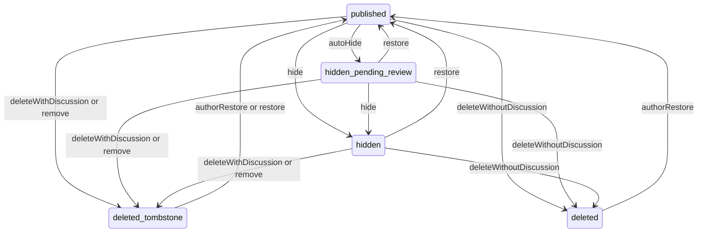
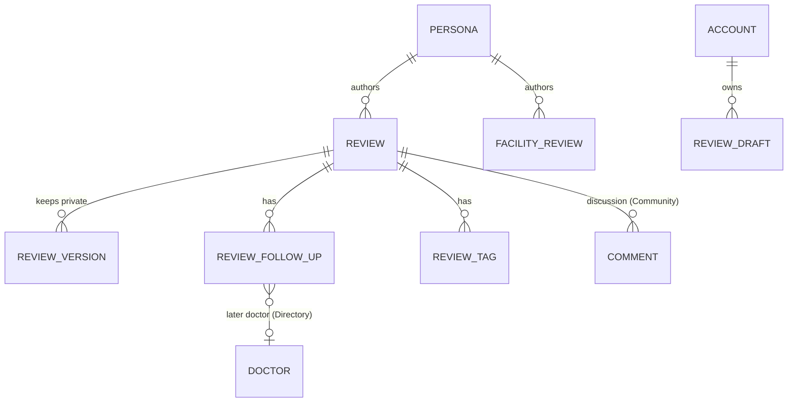

# Functional specification — U22 `t-302-review-changes-and-tombstones`

Unit U22 (kind `library`, size L in `unit-of-work.md`, not marked high risk) delivers T-302 for US6.2 (the later-care half, AC6.2.5) and US6.3. Lead perspective: architect. Support perspective: developer (row locks, version rows, grapheme-safe redaction, repository writes and the tests against the real database), written into §§ 8, 10 and 11 and synthesised in § 13. Draft written ahead of the stage on the owner's instruction to overlap work; the lead finalises it and the reviewer checks it when the workflow reaches this Unit. Then it moves to `<record>/construction/t-302-review-changes-and-tombstones/functional-design/`.

**Written 2026-10-29** against U3 T-010 as merged on `main` (`14c21a9`), the refreshed U21 T-301, U14 T-201, U11 T-104, U10 T-103 and U8 T-101 drafts, and the owner's answers in `docs/aidlc-migration/OWNER-REVIEW-QUEUE.md`. What this draft settles:
1. **Owner answers applied.** Counts only, no percentage anywhere; "Former member" for de-identified named and pseudonymous personas (which this design makes visible on retained reviews, Question 9); release 1 settings narrowed (no new setting here: the restore window and the rate limit are code constants); FR46 checkboxes deferred (a correction carries no checkbox field).
2. **T-010 applied.** `domain` imports nothing (the redaction uses the `Intl.Segmenter` global, not an import); `application` imports no external package and no Node built-in; `database` never imports `domain`, so every decision (material diff, state transition, redaction) runs before the repository and the repository writes what it is given; the worker gets nothing from this Unit (Question 9). The pins move in the same commit as the change: `not-implemented.test.ts` (the last `PgReviewRepository` stubs go, ISS-294), the fake superset test, no migration-count change (this Unit adds no migration). Coverage is held at 80% of lines in `domain`, `application` and `database` with untested files counted; CI must be green on the Bolt branch before the merge.
3. **T-301 applied.** The publication state machine, `domainStateOf`, the `toExperiencePage` projection, the `kind: 'experience'` result tag, the eligibility predicate, the author persona as audit actor (T-301 FD entry (d)), `identity.ownsAnyPersona`, and R4 and R6, which T-301 handed to this Unit.
4. **Decided under the owner's no-questions instruction of 2026-10-29:** Questions 1–14 (`functional-design-questions.md`), all answered A. § 17 lists the five FD entries the build appends before code.

Inputs: `unit-of-work.md` (U22, its decision changes and the open points carried to it), `unit-of-work-dependency.md` (U21, U34, U3), `stories.md` (US6.2, US6.3, US10.3 for account deletion), `requirements.md` (FR13, FR69–FR71, FR55), `contract-summary.md` (C3, C4, C9, C10, C11, C13, C15 and the common rules), `docs/status/decision-log.md` (FD-004, FD-020, FD-049, FD-064, FD-073, FD-077, FD-079, FD-086, FD-087, FD-089, FD-092, FD-093, FD-094), T-302 with its two amendment sections, T-410 step 3 (deletion participants), `01-conventions.md` §2–§5 and §10, `02-data-model.md` §0, §6, §8, §10, §16 and §17, `03-routes-and-contracts.md` §4 and §5, the schema on `main` (`schema/review.ts`, `schema/community.ts`), the repository stub and the fakes, the seed (`seed-content.ts`), the prototype (`renderAccount` spine and later-care callout, `renderMine` deleted row, the follow-up and later-care fixtures, the comment tombstone copy), the U21 T-301, U14 T-201, U11 T-104 and U10 T-103 drafts, and ISS-237 and ISS-294. U34 T-405, a declared dependency, has no draft yet; FD-087 removed every call this Unit made to it, so the edge is build order only.

This file is the source of truth for the workflows and state transitions. The data shape is in `entities.md`; the decision logic is in `rules.md`.

## 1. What changes, in one paragraph

An author can change a published review without erasing its history. `review.addFollowUp` adds a dated follow-up, correction-free update or later-care entry; the page shows the follow-ups in date order below the story, the newest reported status summarised at the top and marked current, and the newest later care in its own callout, with the later doctor linked when the author named one with a profile and an offer to submit a profile otherwise; the author can never pin an older entry (Question 1). `review.correct` changes the text, sections, claims, sentiment, outcome or tags with an optimistic version check: every accepted edit writes the previous content as a private `review_versions` row and shows "Edited" with its month; a material edit (story, sections, claims, sentiment, outcome, or condition, treatment and medicine tags) also needs a short reason, which is published as a dated correction entry (Questions 2–4). `review.delete` leaves a tombstone when the discussion has comments and otherwise soft-deletes the review (stored state unchanged, FD-049); either way it leaves every list and figure at once and can be restored for 30 days by the Clock port, unless the review was under moderation when it was deleted (Question 8). Facility feedback mirrors delete and restore. The moderator's `review.redact` replaces grapheme-aligned ranges of the title, story, sections or follow-ups with a redaction token and refuses anything that carries replacement text (Questions 5 and 6). `review.setState` is the one transaction-taking entry for the moderation outcomes and queues no email (FD-087). `review.getHistory` shows the private versions to the author and to staff with `content.act`. The deletion step of account deletion removes the account's drafts only, because published reviews are retained and de-identified (FR13, Question 9). No migration, no new dependency, no worker code; five FD entries (§ 17).

## 2. As is (baseline on `main` at `9cf860a`, read 2026-10-29) and what Bolt 22 can count on

- **Application and domain are empty today.** By Bolt 22, U8 T-101 has built `defineCommand` (handler gets `{input, actor, ports, tx}`; `requires` order `authenticated → verifiedEmail → notRestricted → staffRole → capability → stepUp → owner`; an `err` rolls back), the shared ports (`Clock`, `IdGenerator`, `RateLimiter.hit`, `ConfigProvider.current(): Promise`, `AuditWriter` with the allowlist builders, `Outbox`, `Logger`, `UnitOfWork`); U10 T-103 the staff role and `content.act` on the Actor; U11 T-104 the identity module (`ownsAnyPersona`, `bylinesFor`, "Former member"); U21 T-301 the review module (§ 6 of its draft): `review-state.ts` with the domain-only `deleted` state, `domainStateOf`, `toExperiencePage`, `getExperience` returning `{kind: 'experience', ...}`, the read methods and the eligibility predicate `state = 'published' and deleted_at is null`. Where a shape differs at build time, this design adapts its frame and keeps its rules (§ 16).
- **Schema** (`schema/review.ts`): `reviews` has `hidden_at`, `hidden_reason_code`, `deleted_at`, `restore_until` (all `timestamptz` or text, nullable), `version int not null default 1`, `latest_status text`. `review_versions` has `version`, `snapshot jsonb`, `change_kind` checked against `publish | correction | moderation_redaction | restore`, `reason`, `actor_kind` checked against `author | moderator | system`, `actor_id uuid` (no foreign key; its comment says "an account id for author/moderator", finding F7), `created_at`, and `ON DELETE CASCADE` from `reviews`; `0003_triggers.sql` blocks UPDATE and DELETE on it (`append_only_violation`). `review_follow_ups` has `kind` (`follow_up | correction | later_care`), `dated_year`, `dated_month`, `body not null`, `later_provider_text`, `later_doctor_id` (FK to doctors), `state` (publication state, default `published`), `created_at`, and an index on (`review_id`, `dated_year desc`, `dated_month desc`). `facility_reviews` has `deleted_at`, `restore_until`, `version`, no `hidden_at`. `comments.review_id` references `reviews` only: facility feedback has no discussion (finding F10).
- **Grants**: `rk_app` full DML. `rk_worker` holds UPDATE (`state`, `deleted_at`) on `reviews`, SELECT on `reviews` and `comments`, nothing on `review_versions`, `review_follow_ups`, `facility_reviews` or `persona_links` (FD-092, ISS-237).
- **Repository stub** `repositories/review.ts`: T-302 stubs `addFollowUp`, `correctReview`, `softDeleteReview`, `restoreReview`; U21 T-301 relabels `updateState` to T-302. U14 and U21 replace their own stubs, so after U21 the T-302 methods are the last stubs of `PgReviewRepository`. `FakeReviewRepository` mirrors the names (`addFollowUp`, `correctReview`, `softDeleteReview` setting `deletedAt`, `restoreReview` clearing it); `repositories-superset.test.ts` requires the fake to be a superset of the stub's method names.
- **Contracts**: `errors.ts` has `review.not_editable`, `review.restore_expired`, `moderation.narrative_locked`; `view-models/experience.ts` after U21 has `followUps: []`, `laterCare: null` and no tombstone variant (U21 replaces the T-003 stub with `tombstone: boolean`); a `FollowUpVM {kind, date, body, laterProviderText?}` exists in the T-003 stub and is replaced here.
- **i18n**: `errors.review.notEditable`, `errors.review.restoreExpired`, `errors.moderation.narrativeLocked`, `label.edited`, `label.followUp`, `experience.edited`, `experience.currentStatus`, `experience.currentNote`, `experience.laterCare`, `experience.laterCareNote`, `mine.delete`, `mine.deleted`, `mine.deleteNote`, `mine.restore` exist in both files. `experience.tombstone`, `experience.tombstoneWhy`, `experience.editedOn` and `label.redacted` do not.
- **Seed** (CR-012): follow-up chains and later care from the prototype on about 15 reviews, `latest_status` set from the newest follow-up by date, and one `review_versions` row per review (`version 1`, `change_kind publish`, `actor_id null`; finding F14). Comments exist on several reviews (r1 has a comment thread), so a seeded review can show a tombstone.
- **Gate (T-010, FD-093)**: nine-step `pnpm check` (eleven after U45 T-011), 80% lines per package with untested files counted, `format:check`, `check:identity`, CI before merge, `eslint.boundaries.mjs` matrix as summarised in the U21 draft § 2.
- **Construction**: FD-094 allows parallel Units that do not collide. U22 shares `modules/review/`, `projection.ts`, `experience.ts`, `schemas/review.ts`, `repositories/review.ts` and the review fake with U21, so it builds after U21 merges and never beside U21, U32 or U33 (which extend `set-state.ts`).

## 3. Settled before this stage

C15 (review events carry `{reviewId, doctorId, branchId?}` and no recipients, so the open point "recipients in outbox payloads, filled in U22" has nothing to fill here), FD-069 (retained contributions are kept and de-identified, "as retained reviews are"), FD-049 (soft delete is domain-only), FD-073 (no hold check here; T-309 adds it), FD-077 (the two-part account deletion), FD-079 (a held delete looks normal to the author), FD-086 (no reporter link anywhere), FD-087 (no email or notice from `setState`, `delete` or `restore`), FD-092 (no worker version rows), FD-093 (boundaries), U21's state machine, projection and audit-actor rule, U14's eligibility predicate, the owner's answers listed above, and no new dependency. See `functional-design-questions.md` § "Settled before this stage".

## 4. Workflows

Every command follows the C9 frame: parse with its contracts schema → authorize (`requires`) → load and lock the review row (`SELECT … FOR UPDATE`) → decide in `domain` → persist rows, one audit row and the outbox rows in the same transaction → `ok(result)`. Author commands take the review's **public id** (they come from pages); internal operations take the **internal id** (they come from moderation and deletion code that already holds it) (Question 12). The owner check is a load: `identity.ownsAnyPersona({accountId, personaIds: [review.authorPersonaId]})` false → `not_found`, never `forbidden`, so the answer is no oracle (BR1.2). Time comes only from the `Clock` port; month and year are taken in Bangladesh time (UTC+6, no daylight saving) by `domain/review/period.ts` `monthOf(instant)`.

### WF1 — Code Generation order (the Unit end to end)

1. **Baseline**: `pnpm check` green on the Bolt branch; open `ISSUES.md` rows for `review` read; dependency-check log consulted (no new dependency).
2. **FD entries**: append § 17's five rows to `docs/status/decision-log.md` with the next free FD ids, and list them in `OWNER-REVIEW-QUEUE.md`.
3. **Domain** (`packages/domain/src/review/`): `follow-up.ts` (Question 1 ordering, `currentOf`, `laterCareOf`), `versioning.ts` (`snapshotOf`, `materialFieldsChanged`, Question 2), `redaction.ts` (Questions 5, 6), `period.ts` (`monthOf`, `isFutureMonth`), and the `review-state.ts` additions (§ 5) with its header comment citing FD-049 and the dated §17 note; `policies.ts` gains `canAuthorEdit(state)`, `canAuthorRestore(row, now)`. Pure, structural results, no `contracts` import.
4. **Contracts**: input schemas (§ 7), the view-model changes (`ExperiencePageVM` follow-up fields, `TombstoneVM`, `ReviewHistoryVM`), the error code `review.not_restorable` (owned-path addition), and the i18n keys (§ 7.3) in both files in the same commit.
5. **Ports**: extend `ports/repositories/review.ts` (§ 6); declare `DiscussionPresence` in `modules/review/ports.ts` (C9; Community implements it in U30 T-401).
6. **Application** (`modules/review/`): commands `add-follow-up.ts`, `correct.ts`, `delete.ts`, `restore.ts`, `facility-review-delete.ts`, `facility-review-restore.ts`, `redact.ts`, `set-state.ts`, `deletion-step.ts`; queries `get-history.ts` and the tombstone branch of `get-experience.ts`; `projection.ts` extended (§ 4 WF9).
7. **Repository** (`repositories/review.ts`): replace the four T-302 stubs and `updateState` with the § 6 methods. In the same commit: `not-implemented.test.ts` drops `PgReviewRepository` from `STUB_REPOSITORIES` and its trace test moves to a stub that still exists (a T-204 or T-407 method of `PgDirectoryRepository`; ISS-294), the review fake is renamed to the port names and `fakes/repositories.test.ts` follows.
8. **Fakes and builders** (`test-support`): `FakeReviewRepository` methods with the real predicates, `FakeDiscussionPresence` (default `false`, settable per review), `FakeClock` if U8 did not add it, builders for follow-ups, versions and redaction ranges.
9. **Tests** (§ 11) and one smoke assertion (`modules/review/review-changes.smoke.test.ts`: a review with one comment, deleted by its author, answers the tombstone page and is absent from `listRecentCards`).
10. **Gate**: `pnpm check`, `pnpm smoke`, every acceptance row (§ 15) recorded as expected against observed; CI green on the branch.

### WF2 — `review.addFollowUp({publicId, kind, datedYear, datedMonth, body, laterProvider?, laterDoctorPublicId?})`

1. `requires: ['authenticated', 'verifiedEmail', 'notRestricted']`; rate limit `review.change:account:<id>` 30 per day, shared with `correct` (Question 13, BR1.4).
2. Lock the review; not the author's → `not_found`; `canAuthorEdit(domainState)` false (anything but `published` or `hidden_pending_review`) → `review.not_editable` (BR2.1).
3. Validate: `kind` ∈ {`follow_up`, `later_care`} (an author never adds a `correction` entry directly; corrections come only from `correct`, BR3.3); body 10–2000 graphemes after trimming, with U+2063 removed (BR7.5); dated month not after the current Bangladesh month (`errors.review.followUpFuture`) and not before 1950; `laterProvider` (≤ 120 graphemes) and `laterDoctorPublicId` only for `later_care`; a doctor public id resolves through `directory.resolvePublicId` to a visible doctor (redirects followed), otherwise `validation` with `fieldErrors.laterDoctor = errors.common.notFound` (BR3.4).
4. Persist: insert `review_follow_ups {id, review_id, kind, dated_year, dated_month, body, later_provider_text, later_doctor_id, state: published}`; recompute `reviews.latest_status` = body of the newest `follow_up` entry by (`dated_year`, `dated_month`, `created_at`, `id`) desc, or null (BR3.2); `version` unchanged (follow-ups are additive); audit `review:<id>` `follow_up_added {kind, linkedDoctor: boolean}` with actor `persona:<authorPersonaId>`; outbox `review.changed {reviewId, doctorId, branchId?}`.
5. Return `{followUpId}`. A later doctor named here gains no review and no count (BR3.5): no doctor read counts follow-ups.

### WF3 — `review.correct({publicId, expectedVersion, title?, body?, sections?, claims?, sentiment?, outcome?, tags?, reason?})`

1. `requires` as WF2; the same shared rate limit.
2. Lock; owner check; `canAuthorEdit` false → `review.not_editable`; `expectedVersion ≠ reviews.version` → `conflict` (BR4.6).
3. Build the proposed content: the current content with each given field replaced (absent = unchanged; `sentiment: null` and `outcome: null` clear to "Not provided"; `sections` replaces the whole map, empty sections dropped; `tags` replaces the whole tag set through U21's tag resolution, provisional terms included, on this transaction with the persona as actor). The kind (`quick`/`detailed`), doctor, branch, period, exact date, relationship and identity mode are not editable (BR4.2). Strip U+2063 from every text. Re-run U21's publish minimum on the result (`review.min_fields` with its field errors) and U21's language detection.
4. Decide with `materialFieldsChanged(before, after)` (Question 2): nothing changed → `ok({version, material: false, changed: false})`, nothing written; a material change without `reason` (10–500 graphemes) → `validation` with `fieldErrors.reason = errors.review.correctionReasonRequired` (BR4.4).
5. Persist: insert `review_versions {review_id, version: current, snapshot: snapshotOf(before), change_kind: correction, reason: (material ? reason : null), actor_kind: author, actor_id: authorPersonaId}` (Question 7); update the content columns, `language`, `version = version + 1`, `updated_at`; replace the tags; when material, insert a `correction` follow-up dated the current Bangladesh month with `body = reason` (BR4.5). Audit `review:<id>` `review_corrected {fromVersion, toVersion, material, fields: [field names]}` (names only, never text), actor the persona; outbox `review.changed`.
6. Return `{version, material, changed: true}`. The page shows `editedAt` for every accepted edit (Question 3).

### WF4 — `review.delete({publicId})`

1. `requires: ['authenticated']` (a restricted or unverified author may still withdraw their own account of events, BR5.1); no rate limit.
2. Lock; owner check; domain state ∉ {`published`, `hidden_pending_review`, `hidden`} → `conflict` (already deleted, removed, or not published) (Question 8).
3. `hasDiscussion = await discussion.hasDiscussion(tx, reviewId)` (C9 `DiscussionPresence`, Community's answer: at least one comment the thread still renders, BR5.3).
4. Decide: `deleteWithDiscussion` → stored state `deleted_tombstone`; `deleteWithoutDiscussion` → stored state unchanged (FD-049). Both set `deleted_at = now`, `restore_until = now + 30 days` and keep `hidden_at` and `hidden_reason_code` as they are (BR5.2).
5. Persist that row update; audit `review:<id>` `review_deleted {mode: tombstone | soft}`, actor the persona; outbox `review.deleted`. No email, no notice (FD-087). No hold lookup and no hold branch (FD-073, FD-079): T-309 later adds its check inside this command without changing the result.
6. Return `{mode, restoreUntil}`; the result is identical for a held review (FD-079). Evidence items are not touched; their public artifacts become unreachable because `evidence.getPublic` must answer only for an eligible review (C8 note for U25 T-305, BR5.6).

### WF5 — `review.restore({publicId})`

1. `requires: ['authenticated']`.
2. Lock; owner check; domain state ∉ {`deleted`, `deleted_tombstone`} → `conflict`.
3. `canAuthorRestore(row, now)` (BR6.1): `restore_until` null (a moderator removal) → `conflict`; `hidden_at` set (deleted while under moderation) → `review.not_restorable`; `now > restore_until` → `review.restore_expired`.
4. Persist: `state = published` (a tombstone) or unchanged (a soft delete), `deleted_at = null`, `restore_until = null`, with `where deleted_at is not null and restore_until >= $now` so a late second request changes nothing; audit `review_restored {}`, actor the persona; outbox `review.restored`. No email, no notice (FD-087).
5. Return `{state: 'published'}`; the summaries include the review again on the next read (AC6.3.5).

### WF6 — `facilityReview.delete({publicId})` and `facilityReview.restore({publicId})`

As WF4 and WF5 on `facility_reviews`, with two differences: facility feedback has no discussion (comments reference reviews only, F10), so delete is always the soft delete (stored state unchanged, `deleted_at`, `restore_until`); and, as U21's facility publish (its BR8.3), no outbox event is written (Question 14). Audit stream `facility_review:<id>`. Facility feedback has no `hidden_at`, so the moderation guard of BR6.1 reads `state ∈ {hidden_pending_review, hidden}` instead; `facilityReview.setState` stays U32's (C9).

### WF7 — `review.redact` (`redactOn(tx, input, actor)` for `moderation.decide`, and a thin command for staff)

Input `{reviewId, ranges: [{field, start, end}], reasonCode, caseCode?}`; `field` ∈ `title`, `body`, `sections.symptoms|diagnosis|treatment|after`, `followUp.<followUpId>.body`, `followUp.<followUpId>.laterProvider` (Question 6).

1. Command form: `requires: ['authenticated', {capability: 'content.act'}]`; `moderation.decide` calls `redactOn` on its own transaction with its staff actor.
2. Parse strictly: any key outside the schema (`replacement`, `text`, `to`, `from`, `value`, …) or a field outside the list → `moderation.narrative_locked` (not `validation`), so a narrative edit is refused by name (BR7.1). `ranges` 1–50; `start < end`; `reasonCode` a code (`^[a-z][a-zA-Z0-9_.-]{1,40}$`), never prose; `caseCode` optional.
3. Lock the review (any state except `draft`, `rejected`); load the named follow-ups of this review (a follow-up of another review → `narrative_locked`).
4. `applyRedaction(text, ranges)` per field (BR7.2): ranges are UTF-16 offsets into the stored text; each is widened to the enclosing grapheme boundaries with `Intl.Segmenter('und', {granularity: 'grapheme'})`, overlapping or touching ranges merge, a range outside the text → `validation`; each merged range becomes the token `U+2063 [redacted] U+2063`. Anything else is not a redaction.
5. Persist: insert `review_versions {version: current, snapshot: snapshotOf(before) plus the touched follow-ups' texts, change_kind: moderation_redaction, reason: reasonCode, actor_kind: moderator, actor_id: staff account id}`; update the fields and the follow-up rows; `version += 1`; recompute `latest_status`; audit rows on `review:<id>` and, when `caseCode` is given, `case:<code>`, each `review_redacted {fields: [names], rangeCount, reasonCode}` with actor `account:<staffId>`; outbox `review.changed`.
6. Return `{version}`. `editedAt` is not set by a redaction (Question 3); the page shows `label.redacted` for each token.

### WF8 — `review.setState` (`setStateOn(tx, {reviewId, event, reasonCode?}, actor)`)

Callers (C9): `report.file` (U32: `hideThreshold`, `hideCritical`), `moderation.decide`, `moderation.restore`, `appeal.decide` (U33: `hide`, `restore`, `remove`). Never a server action.

1. Lock the review; derive the domain state; map the event (`hideThreshold`, `hideCritical` → `autoHide`); `transition(state, event)` (§ 5).
2. Same state as the target (`autoHide` on `hidden_pending_review`, `hide` on `hidden`) → `ok({from, to, changed: false})`, nothing written (BR8.2). A refused pair → `conflict`, nothing written; callers treat it as "no effect" (for example a review its author deleted during the case).
3. Persist per event (BR8.3): `autoHide` and `hide` set `hidden_at = now` (kept if already set) and `hidden_reason_code`; `restore` from a hide clears both; `remove` sets `deleted_tombstone`, `deleted_at = now`, `restore_until = null`, `hidden_reason_code = reasonCode`; `restore` from a moderator removal clears `deleted_at` and `hidden_*` and publishes.
4. Audit `review:<id>` `review_state_changed {event, from, to, reasonCode?}`. The actor is `system` for `hideThreshold` and `hideCritical`, whoever called, so a reporter's account never appears on a review's stream (FD-086, BR8.4); the staff actor otherwise.
5. Outbox: `autoHide`, `hide` → `review.hidden`; `restore` → `review.restored`; `remove` → `review.deleted` (C15 routes it to `search.refresh`; additive). No email and no notice (FD-087).
6. Return `{from, to, changed: true}`.

### WF9 — Projection and `review.getExperience({publicId})`

1. **Tombstone branch first** (U21 WF7 step 1, before its `not_found`): `findTombstoneByPublicId` returns rows with stored state `deleted_tombstone` (any `deleted_at`). Answer `{kind: 'tombstone', publicId, removedBy: 'author' | 'moderation', messageKey, whyKey: 'experience.tombstoneWhy', threadSlot: publicId, noindex: true}`; `removedBy = author` when `restore_until` is set, else `moderation`; `messageKey` = `experience.tombstone` or `experience.tombstoneRemoved` (Question 10). The VM carries no title, story, author, doctor, tags, period, related cards or follow-ups (BR9.1). U30 T-401 renders the thread in `threadSlot`.
2. A soft-deleted review (published with `deleted_at`) or any other non-eligible row → `not_found` (unchanged U21 rule).
3. **Eligible page** — U21's `toExperiencePage` gains (BR9.2–BR9.5):
   - `followUps`: every follow-up except the newest `later_care` entry, in date order (`dated_year`, `dated_month`, `created_at`, `id` ascending), each `{kind, dated {year, month}, body, laterProvider?, isCurrent}`; `isCurrent` is true on exactly one entry, the newest `follow_up` by (`dated` desc, `created_at` desc, `id` desc), whatever the insertion order; there is no input, column or command that sets it (Question 1).
   - `currentStatus`: `{dated, body}` of that entry, or `null`, for the summary at the top (FR70).
   - `laterCare`: the newest `later_care` entry `{dated, body, providerText?, doctor? {publicId, name, registrationNotVerified: true}, offerProfileSubmission}`; `offerProfileSubmission` is true when no doctor is linked (AC6.2.5); `null` when there is none. A linked doctor that is no longer visible is shown as its stored provider text without a link.
   - `editedAt`: `{year, month}` of the newest author `correction` version row, or `null` (Question 3); a redaction never sets it.
   - Text fields keep the redaction token; the UI renders `label.redacted` in its place (BR7.3).
   - No `history`, no version number, no reason codes in the public VM.
4. The preview (U21) shows `followUps: []`, `currentStatus: null`, `laterCare: null`, `editedAt: null`: a draft has none.

### WF10 — `review.getHistory({publicId})`

`requires: ['authenticated']`; allowed for the author (owner load) or an actor with `content.act`; otherwise `not_found`. Returns `ReviewHistoryVM {current: {version, content}, versions: [{version, changeKind, actorKind, reason?, at, content}]}` newest first, where `content` is the snapshot (title, body, sections, claims, sentiment, outcome, tag labels in `actor.locale`, touched follow-up texts). `publish` rows (seed only, F14) are left out. Never an actor id, persona id or account field. `current` gives the edit form its `expectedVersion`. Reading it writes an audit row only for staff (`review_history_read {}` on `review:<id>`, actor `account:<staffId>`), so staff reading private versions is traceable (BR10.2).

### WF11 — `review.deletionStep` (FD-077 participant command, wired by U39 T-410)

Under Question 9 A (FR13), account deletion keeps the account's published reviews and facility feedback and Identity de-identifies their personas ("Former member"; anonymous aliases unchanged). The review step is therefore one web-tier command on the deletion transaction: `deletionStepOn(tx, {accountId})` deletes the account's `review_drafts` rows (drafts are private and not holdable) and returns `{draftsDeleted}`. It is idempotent (a second run deletes nothing). It writes no outbox row; T-410 writes the plan's audit. There is no worker entry: no review row changes in the worker, so ISS-237's column limit is never reached. Under Question 9 B the step would need the account's review ids resolved in the web tier before Identity's step removes the links, because the worker cannot read `persona_links` (§ 14).

## 5. State transitions

### Publication state machine (U21's table plus five cells, BR11.1)

Stored states plus the domain-only `deleted` (stored as the previous visible state with `deleted_at`, FD-049). `domainStateOf(row)` = `deleted` when `deleted_at` is set and the stored state is `published`, `hidden_pending_review` or `hidden`; otherwise the stored state.

| From | Event | To | Triggered by | New here |
|---|---|---|---|---|
| `published` | `deleteWithDiscussion` | `deleted_tombstone` | author | — (U21 table) |
| `published` | `deleteWithoutDiscussion` | `deleted` | author | — |
| `hidden_pending_review` | `deleteWithDiscussion` | `deleted_tombstone` | author | yes (Question 8) |
| `hidden_pending_review` | `deleteWithoutDiscussion` | `deleted` | author | yes (Question 8) |
| `hidden` | `deleteWithDiscussion` | `deleted_tombstone` | author | — |
| `hidden` | `deleteWithoutDiscussion` | `deleted` | author | yes (U21 R4) |
| `hidden_pending_review` | `remove` | `deleted_tombstone` | moderator | yes (U21 R4, built here because `setState` is here, Question 11) |
| `deleted_tombstone` | `restore` | `published` | moderator or appeal, only when `restore_until` is null (a moderator removal) | yes (FR71, Question 11) |
| `deleted_tombstone` | `authorRestore` | `published` | author, guarded by BR6.1 | — |
| `deleted` | `authorRestore` | `published` | author, guarded by BR6.1 | — |

The other cells of U21's table are unchanged. `authorRestore` is refused, before the table, when `restore_until` is null, when `hidden_at` is set, or when the window has passed (BR6.1): a review deleted while hidden can never be restored by its author, which closes the "delete to dodge a case, restore after it closes" abuse.



Text fallback: reports or a critical reason hide a published review pending review, and a moderator hides, restores or removes it; the author may delete it from published, pending review or hidden, leaving a tombstone when the discussion has comments and a soft delete otherwise; the author may restore within 30 days only what they deleted while it was not hidden; a moderator's removal leaves a tombstone only moderation can restore.

`review-state.ts` header comment: "Stored mapping (FD-049): `deleted` is never written to `publication_state`; a soft delete keeps the stored state and sets `deleted_at` and `restore_until`. Cells added by U22 T-302 on 2026-10-29: see `02-data-model.md` §17 note." The build adds that dated note under §17 (Question 8, 11).

### What each state means to the reads

| Stored state | `deleted_at` | `restore_until` | Domain state | `getExperience` | Lists, figures, related | Author can restore |
|---|---|---|---|---|---|---|
| `published` | null | null | `published` | page | included | — |
| `published` | set | set | `deleted` | `not_found` | excluded | within window |
| `hidden_pending_review`, `hidden` | null | null | same | `not_found` | excluded | — |
| `hidden_pending_review`, `hidden` | set | set | `deleted` | `not_found` | excluded | never (`not_restorable`) |
| `deleted_tombstone` | set | set | `deleted_tombstone` | tombstone, `removedBy: author` | excluded | within window, unless `hidden_at` set |
| `deleted_tombstone` | set | null | `deleted_tombstone` | tombstone, `removedBy: moderation` | excluded | never |

### Follow-up order (Question 1)

| Insertion order (dated) | Spine order | `isCurrent` | `currentStatus` |
|---|---|---|---|
| May, Aug, Jun (all `follow_up`) | May, Jun, Aug | Aug | Aug |
| May (`follow_up`), Aug (`correction`) | May, Aug | May | May |
| Jun (`later_care`), Aug (`later_care`), May (`follow_up`) | May, Jun (labelled later care) | May | May; `laterCare` = Aug |
| two `follow_up` in Aug, created 10:00 and 11:00 | Aug 10:00, Aug 11:00 | Aug 11:00 | Aug 11:00 |

## 6. Ports

Interface level only; Code Generation writes the TypeScript.

```text
ReviewRepository (ports/repositories/review.ts; U14 and U21 methods unchanged)
  lockForChange(tx, {id? | publicId?}) -> ReviewChangeRow | null     (SELECT … FOR UPDATE; any state; content, state, deleted_at,
                                                                      restore_until, hidden_at, hidden_reason_code, version,
                                                                      author_persona_id, doctor_id, branch_id, public_id)
  tagsOf(tx, reviewId) -> ReviewTagRow[]
  updateContent(tx, {id, title, body, sections, claims, sentiment, outcome, language, version, now}) -> void
  replaceTags(tx, reviewId, ReviewTagInsert[]) -> void
  insertVersion(tx, {reviewId, version, snapshot, changeKind, reason, actorKind, actorId}) -> void
  listVersions(reviewId) -> VersionRow[]                              (created_at desc; change_kind <> 'publish')
  latestAuthorCorrectionAt(reviewId) -> instant | null                (part of the page read in practice)
  insertFollowUp(tx, FollowUpInsert) -> void
  followUpsOf(reviewId | tx, reviewId) -> FollowUpRow[]                (with the linked doctor's public id and name when visible)
  updateFollowUpText(tx, {id, reviewId, body, laterProviderText}) -> void
  setLatestStatus(tx, reviewId, text | null) -> void
  markDeleted(tx, {id, state, deletedAt, restoreUntil}) -> void
  markRestored(tx, {id, state, now}) -> boolean                        (conditional on deleted_at set and restore_until >= now)
  setState(tx, {id, state, hiddenAt, hiddenReasonCode, deletedAt, restoreUntil}) -> void
  findTombstoneByPublicId(publicId) -> {publicId, restoreUntil} | null
  lockFacilityForChange(tx, publicId) -> FacilityChangeRow | null
  markFacilityDeleted(tx, {id, deletedAt, restoreUntil}) -> void
  markFacilityRestored(tx, {id, now}) -> boolean
  deleteDraftsOfAccount(tx, accountId) -> number

DiscussionPresence (declared in modules/review/ports.ts, C9; implemented by Community in U30 T-401)
  hasDiscussion(tx, reviewId) -> boolean        (a comment the thread still renders: published, or a comment tombstone)

Called on other modules (their public application API)
  identity.ownsAnyPersona({accountId, personaIds}) -> boolean      (U11 T-104, asked by U21)
  directory.resolvePublicId({kind: doctor, publicId}) and the visible-doctor lookup (U14)
  U21's tag resolution and publish-minimum and language functions (same module)

Exported for other Units (internal, transaction-taking)
  setStateOn(tx, {reviewId, event, reasonCode?}, actor) -> {from, to, changed}      (U32, U33)
  redactOn(tx, {reviewId, ranges, reasonCode, caseCode?}, actor) -> {version}       (U33)
  deletionStepOn(tx, {accountId}) -> {draftsDeleted}                               (U39 deletion-participant.ts)

Shared ports used: Clock, IdGenerator, RateLimiter (hit), AuditWriter, Outbox, Logger, UnitOfWork (through defineCommand)
```

Until U30 builds `DiscussionPresence`, the composition root has no real implementation; no page calls `review.delete` before U38 T-409, which comes after U30, so the web wiring is U38's (or the first serving Unit's) and the tests use the fake (finding F11).

## 7. View models, input schemas and copy (`packages/contracts`, `packages/i18n`)

### 7.1 View models

| Type | Fields |
|---|---|
| `ExperienceResult` (`experience.ts`) | `ExperiencePageVM` (`kind: 'experience'`) or `TombstoneVM` (`kind: 'tombstone'`) |
| `ExperiencePageVM` additions | `followUps: FollowUpVM[]`, `currentStatus: {dated: MonthYear, body} \| null`, `laterCare: LaterCareVM \| null`, `editedAt: MonthYear \| null` (replace U21's `[]`/`null` placeholders) |
| `FollowUpVM` | `kind` (`follow_up`/`correction`/`later_care`), `dated` {`year`, `month`}, `body`, `laterProvider?` {`text?`, `doctor?` {`publicId`, `name`}}, `isCurrent: boolean`; replaces the T-003 stub |
| `LaterCareVM` | `dated`, `body`, `providerText?`, `doctor?` {`publicId`, `name`, `registrationNotVerified: true`}, `offerProfileSubmission: boolean` |
| `TombstoneVM` | `kind: 'tombstone'`, `publicId`, `removedBy` (`author`/`moderation`), `messageKey`, `whyKey`, `threadSlot` (the public id), `noindex: true` |
| `ReviewHistoryVM` (`review-history.ts`, new) | `current` {`version`, `content`}, `versions` [{`version`, `changeKind` (`correction`/`moderation_redaction`), `actorKind`, `reason?`, `at` (ISO instant, private view), `content`}] |

Periods are `{year, month}`; the UI formats months and numerals in the active language. No percentage, no score, no account or persona id in any of them.

### 7.2 Input schemas (`schemas/review.ts`)

`AddFollowUpInput`, `CorrectReviewInput` (with `expectedVersion`, nullable `sentiment` and `outcome`, `tags` as U21's tag input, optional `reason`), `DeleteReviewInput {publicId}`, `RestoreReviewInput {publicId}`, `FacilityReviewDeleteInput`, `FacilityReviewRestoreInput`, `GetReviewHistoryInput {publicId}`, `RedactReviewInput` (strict; ranges as § 4 WF7), `SetReviewStateInput {reviewId, event: hideThreshold | hideCritical | hide | restore | remove, reasonCode?}`. `errors.ts` gains `review.not_restorable`.

### 7.3 Copy (both files in one commit; Bengali flagged for the owner's review, FD-042)

| Key | en | bn |
|---|---|---|
| `experience.tombstone` | This experience was deleted by its author. | এই অভিজ্ঞতাটি লেখক মুছে ফেলেছেন। |
| `experience.tombstoneRemoved` | This experience was removed by moderators. | এই অভিজ্ঞতাটি মডারেটররা সরিয়ে দিয়েছেন। |
| `experience.tombstoneWhy` | The discussion below is kept, so the replies still make sense. | নিচের আলোচনাটি রাখা হয়েছে, যাতে উত্তরগুলো বোধগম্য থাকে। |
| `experience.editedOn` | Edited {date} | সম্পাদিত {date} |
| `label.correction` | Correction | সংশোধন |
| `label.redacted` | [private detail removed] | [ব্যক্তিগত তথ্য সরানো হয়েছে] |
| `experience.laterCareSubmit` | This provider has no profile yet. You can submit one. | এই চিকিৎসাদাতার এখনো কোনো প্রোফাইল নেই। আপনি একটি জমা দিতে পারেন। |
| `errors.review.followUpFuture` | The date of an update cannot be in the future. | আপডেটের তারিখ ভবিষ্যতের হতে পারে না। |
| `errors.review.correctionReasonRequired` | Say briefly what you corrected and why. | সংক্ষেপে লিখুন কী সংশোধন করেছেন এবং কেন। |
| `errors.review.notRestorable` | This experience cannot be restored, because it was under moderation review when it was deleted. | মুছে ফেলার সময় এটি মডারেশন পর্যালোচনায় ছিল, তাই এটি ফিরিয়ে আনা যাবে না। |

This Unit owns `label.redacted` and `experience.tombstoneRemoved`; U27 T-307 renders them and does not add them again. The tombstone and "why" copy follow the prototype's comment tombstone (`experience.commentGone`, `experience.commentGoneWhy`). `{date}` is filled by the UI with the month and year in the active language's numerals.

## 8. Developer view — repository and transaction mechanics

- **Locks.** Every author and moderation command takes `SELECT … FOR UPDATE` on the review row first, so `delete` and a concurrent `correct`, `setState` or `redact` serialise. U30's `comment.post` must take `FOR SHARE` on the review row and require it eligible, so a comment cannot land on a review whose delete is committing without discussion (finding F12, cross-Unit).
- **Version row before update.** `insertVersion` runs before `updateContent` in the same transaction; a test injects a failure in `updateContent` and asserts no version row and no follow-up remain. The append-only trigger means a version row is never rewritten; the integration test's UPDATE attempt expects `append_only_violation`.
- **Snapshot** (`snapshotOf`): `{title, body, sections, claims, sentiment, outcome, tags: [{group, termId?, freeText?, notSure}], followUps?: [{id, body, laterProviderText}]}`; term names are not copied, so a later term rename shows in the history in the current name (the history is about what the author wrote, not the taxonomy).
- **Eligibility.** Every published-only read of U14 and U21 already carries `deleted_at is null`; this Unit's integration test proves it for `publishedForDoctor`, `sentimentDistribution`, `outcomeDistribution`, `listRecentCards`, `criteriaDistribution` (facility soft delete) and the related and same-doctor reads, before and after a restore (AC6.3.4, AC6.3.5). If a facility read misses the predicate, this Unit fixes it as a recorded addition.
- **Tombstone read.** `findTombstoneByPublicId` selects `public_id`, `restore_until` only; no content column is in its select list (`rg` assertion in the test on the generated SQL).
- **Restore race.** `markRestored` is a conditional UPDATE returning a row count; zero → the command answers `review.restore_expired` (the window closed between the check and the write).
- **No worker path.** Nothing in this Unit is exported through `@rogikotha/application/worker`.
- **Time zone.** `monthOf(instant)` adds six hours to UTC and reads year and month; Bangladesh has had no daylight saving since 2009. A test pins 2026-08-31T18:30Z → September 2026.

## 9. Findings and proposed ISS rows

Each becomes an `ISS-` row (next free id at build time) with `Found in` U22 T-302.

| # | Sev | Area | Finding and decision | Owner |
|---|---|---|---|---|
| F1 | S2 | contracts/moderation | C9 gives `review.redact` the input `{reviewId, replacements: [{from, to}], reason}`, which would let moderation write text, against the task, the threat notes and the hard rule that moderation cannot rewrite narrative. Designed out: ranges only, any replacement field is `narrative_locked` (Question 5, FD entry (a)); `contract-summary.md` C9 corrected by the FD entry | U22; U33 T-404 consumes |
| F2 | S2 | data-requests/review | C9, T-410 step 3 and FD-077's "review tombstones" tombstone or delete every review of a deleted account, which contradicts FR13 and AC10.3.3 (retained contributions are de-identified, not deleted), the prototype's `user2.dataDeleteNote` and the owner's "Former member" answer. Designed out: the review step deletes drafts only (Question 9, FD entry (b)) | U22; U39 T-410, U30 T-401 align |
| F3 | S2 | data-requests/worker | As written, the worker entry of `review.deletionStep {accountId}` cannot find an account's reviews: the worker has no privilege on `persona_links`, and the web transaction's identity step deletes the links before the worker runs. Designed out by F2 (no worker entry); under the alternative the web tier must pass review ids | U22, U39 T-410 |
| F4 | S2 | review/edits | The task's acceptance row sets "Edited" only for material edits, but AC6.3.1 shows it for non-substantive edits. Designed out: every accepted author edit shows `editedAt` (Question 3) | U22 |
| F5 | S2 | review/edits | The task's `correct` cannot change sentiment or outcome and calls tags non-material, while AC6.3.2 requires a changed diagnosis, treatment or outcome to become a dated correction. Designed out: sentiment, outcome and condition, treatment and medicine tags are editable and material (Question 2, FD entry (c)) | U22 |
| F6 | S2 | moderation/privacy | `report.file` runs as the reporter; a threshold hide audited with the caller's actor would link the reporter's account to the review's audit stream (FD-086). Designed out: threshold and critical hides are audited as `system` (BR8.4) | U22; U32 T-403 |
| F7 | S4 | database/identity | `review_versions.actor_id` holds an account id by its comment (U21 R6). Decided: persona id for authors, staff account id for moderators, null for system; comment corrected, no migration (Question 7, FD entry (d)) | U22 |
| F8 | S2 | review/moderation | Follow-ups and later-care text are public user text, but the task lets moderation redact only title, body and sections, so a phone number in a follow-up could only be handled by hiding the whole review. Designed out: follow-up texts are redactable fields (Question 6) | U22 |
| F9 | S2 | retention/review (open) | Nothing purges a soft-deleted or tombstoned review's content after its restore window; `review_versions` are never expired after the audit period (FR69: "retained for the configured audit period"); and the append-only trigger with `ON DELETE CASCADE` makes a review that has version rows impossible to delete at all. Open for U29 T-309: a retention step that scrubs content after `restore_until` and expires version rows through a `SECURITY DEFINER` function, like `fn_expire_audit` | U29 T-309 |
| F10 | S4 | review/facility | Comments reference reviews only, so facility feedback never has discussion; "tombstone when discussion exists" never applies to it (C9). Facility delete is always the soft delete | U22 |
| F11 | S3 | composition | `DiscussionPresence` has no implementation until U30; the first Unit that serves `review.delete` on a page (U38 T-409) wires Community's adapter. No fallback that answers `false` may be wired in production code | U30 T-401, U38 T-409 |
| F12 | S2 | community/review | Race: a comment posted while a delete without discussion commits would sit under a soft-deleted review. Designed out with the review row lock here and a `FOR SHARE` lock plus eligibility check in `comment.post` (cross-Unit) | U22; U30 T-401 |
| F13 | S3 | review/redaction | An author could type the redaction token to fake a moderator redaction. Designed out here by stripping U+2063 from every author text in `correct` and `addFollowUp`; U21 strips it in `saveDraft` and `publish`, and U18 T-205 strips the token from indexed text | U22; U21 T-301, U18 T-205 |
| F14 | S4 | seed | The seed writes a `publish` version row per review with `actor_id` null, which no application code writes. `getHistory` ignores `publish` rows; the seed may drop them at its next change | CR-012 owners |
| F15 | S3 | review/follow-ups | The task orders follow-ups newest first with `isCurrent` on the first; the prototype and FR70 put them in date order below the story with the newest marked current and summarised at the top. Decided: the prototype's order (Question 1); the task's acceptance row is rewritten to match | U22 |
| F16 | S3 | search/facility | Facility delete and restore write no outbox event (as U21's facility publish), so a branch's `accounts_count` in search stays stale until the next refresh of that branch (Question 14) | U18 T-205 |
| F17 | S3 | composer | AC6.2.5 names later providers "when the review is published", but U21's publish creates no follow-ups; the composer adds later-care entries through `review.addFollowUp` right after publish | U26 T-306 |
| F18 | S3 | moderation/review (open) | The open point "AC6.4.4 ineligible marking and AC6.4.5 summary freeze" (`unit-of-work.md`, U33 with U22) has no column or event yet. This Unit adds none: an ineligible mark is a moderation decision that U33 designs, and when it changes a review's visibility it goes through `setStateOn` (one state entry) or adds a predicate to U14's eligibility read, never a second write path. AC6.4.5's "no administrator action rewrites sentiment" holds here: `redact` refuses `sentiment` and `outcome` by name (BR7.1), and only the author's `correct` can change them | U33 T-404 |
| F19 | S3 | workspace/review | `review_drafts.review_id` (U21 entities: "editing a published review") and T-409's Edit link through a `saveDraft {reviewId}` (U26 draft F15) assume edits go through a draft. This Unit's `correct` is direct: the edit form reads `review.getHistory` `current {version, content}` and calls `correct` with `expectedVersion`. The column stays unused; no draft is created for an edit | U38 T-409, U26 T-306 |
| F20 | S3 | cards/search | The redaction token must never be cut in half when a card or search excerpt is truncated (U27 draft asks for this), or the UI cannot replace it and readers see `[redac…`. The card excerpt (U14 `listRecentCards`) and the search document (U18 T-205) truncate before or after a whole token | U14 T-201, U18 T-205 |

## 10. Developer view — mapping details

- **Material diff** compares normalised values: text trimmed and NFC-normalised, `sections` by key with empty sections dropped, `claims` by sorted codes, tags by (`group`, effective `termId` or normalised free text, `notSure`) as sets per group. A title-only or symptom-tag-only change is non-material (Question 2).
- **Language** is recomputed with U21's detector after every accepted edit and every redaction (the token is ignored by the detector).
- **Tag replacement** reuses U21's resolution on this transaction; provisional terms are created with the persona as actor (U14 WF11).
- **Later doctor** is stored as `later_doctor_id`; the page shows it only while the doctor is visible; `later_provider_text` is kept as the fallback label.
- **Projection months**: `dated` from the follow-up columns; `editedAt` = `monthOf(latest correction row created_at)`; `currentStatus.body` is the follow-up body, not `latest_status` (the column is a cache for later card use).
- **History content** maps tag term ids to names in `actor.locale` (missing term → the stored free text or "Not provided").

## 11. Developer view — tests

| Level | File | What it proves |
|---|---|---|
| domain | `follow-up.test.ts` | May, Aug, Jun inserted → spine May, Jun, Aug, `isCurrent` Aug, `currentStatus` Aug; a correction never becomes current; newest later care leaves the spine; ties by `created_at` then `id`; no function takes a "current" argument |
| domain | `versioning.test.ts` | every material field and every non-material field, set-equality of tags, empty sections, NFC |
| domain | `redaction.test.ts` | ranges replaced by the token; overlapping and touching ranges merged; out-of-bounds → validation; a range inside a Bengali conjunct (for example inside `ক্ষ` of `পরীক্ষা`) widens to the whole grapheme, asserted with `Intl.Segmenter`; emoji with skin tone; empty text |
| domain | `review-state.test.ts` | every cell of § 5 including the five new ones; every other pair refused; `domainStateOf` for the hidden-and-deleted rows |
| domain | `period.test.ts` | `monthOf` across the Dhaka month boundary; future-month check |
| application | `add-follow-up.test.ts` | owner refusal (`not_found`), future date, later care with and without a doctor, a hidden review refused, `latest_status` recomputed, outbox `review.changed`, audit actor the persona |
| application | `correct.test.ts` | body change → one version row, one correction follow-up, `version 2`, `editedAt` set; title-only → version row, no follow-up, `editedAt` set; material without reason → field error; outcome change is material; stale `expectedVersion` → `conflict`; `hidden` → `not_editable`; no change → nothing written; failure in `updateContent` rolls back the version row |
| application | `delete.test.ts` | one comment → tombstone and tombstone VM without title, body, author or doctor; zero comments → `not_found` page; deleting a `hidden_pending_review` review works; the result carries no hold field (FD-079); zero email rows, mail jobs and notices (FD-087) |
| application | `restore.test.ts` | `FakeClock` at +29 days → restored and counted again; +31 days → `review.restore_expired`; deleted while hidden → `review.not_restorable`; moderator removal → `conflict`; no email, job or notice |
| application | `facility-review-delete.test.ts`, `facility-review-restore.test.ts` | soft delete only, no outbox row, restore window |
| application | `redact.test.ts` | ranges replaced; `replacement: 'x'`, `to`, `text` and `field: 'sentiment'` → `narrative_locked`; a follow-up of another review → `narrative_locked`; version row `moderation_redaction` with the moderator; two audit rows with `caseCode`; `editedAt` not set; staff without `content.act` → `forbidden` |
| application | `set-state.test.ts` | `hideThreshold`, `hide`, `restore`, `remove` for an author with moderation email on: states and `review.hidden`/`review.restored`/`review.deleted` written, zero email rows, mail jobs and notices; threshold audit actor `system`; repeated `autoHide` → `changed: false`, no second outbox row; restore from removal |
| application | `deletion-step.test.ts` | the account's drafts deleted, another account's kept, published reviews and facility feedback untouched; second run deletes nothing |
| application | `get-experience.test.ts`, `get-history.test.ts` | tombstone branch for author and moderation removals; soft delete `not_found`; history for owner and `content.act`, `not_found` for others, no ids, staff read audited |
| database | `review.int.test.ts` additions | append-only trigger on UPDATE (`append_only_violation`); `restore_until` is `timestamptz` and equals `deleted_at + 30 days`; soft delete keeps `state = 'published'`; tombstone returned by `findTombstoneByPublicId`; every published-only read excludes the soft-deleted review and includes it after restore; no `deleted` value in `publication_state` and no new migration; facility soft delete leaves `criteriaDistribution` |
| smoke | `review-changes.smoke.test.ts` | the § 4 WF1 step 9 assertion |

Builders, not literal fixtures; test names read as sentences; every test can fail (the mutation check of Build and Test removes the `isCurrent` ordering and the strict redaction parse and expects red).

## 12. Owned paths and recorded additions

Owned (task file): the domain, command, projection, query, port, repository, contracts, fakes and i18n paths of T-302. Recorded additions, each named in the code plan:

- `packages/application/src/modules/review/commands/facility-review-delete.ts`, `facility-review-restore.ts` (the task's "mirror delete/restore").
- `packages/application/src/modules/review/ports.ts` (the `DiscussionPresence` declaration; U21 may have created the file for `EvidenceForPublish`).
- `packages/domain/src/review/period.ts`.
- `packages/contracts/src/errors.ts` (`review.not_restorable`), `view-models/review-history.ts`.
- `packages/database/src/schema/review.ts` (the `actor_id` comment only, Question 7).
- `packages/database/src/repositories/not-implemented.test.ts`, `packages/test-support/src/fakes/repositories.test.ts` (the pins).
- `docs/implementation/02-data-model.md` §17 (the dated note), §6 (`review_versions.actor_id` meaning), `contract-summary.md` C9 (redact input, deletion step) through the FD entries.
- The task file's acceptance rows for follow-up order, `editedAt` and the deletion step, rewritten to the decided behaviour (Questions 1, 3, 9).

## 13. Synthesis — decisions and why

- **History is private, change is visible.** Every edit keeps the old content in an append-only row; the public sees the current text, "Edited" with its month, and for a material change the author's dated reason. That meets FR69's "understandable" without publishing text an author may have removed for their own privacy (Question 4).
- **Order by the story, current by date.** The prototype's spine reads in order and marks the newest status; nothing the author sends can change which entry is current (Question 1).
- **Redaction cannot write.** The only output of `applyRedaction` is the token; the schema refuses any field that could carry text, by name (Questions 5, 6).
- **Under moderation, an author may withdraw but not undo.** Deleting stays possible (an author's right to withdraw their account of events), restoring a review that was hidden is not, so a delete cannot launder a moderation decision (Question 8).
- **One state entry for moderation.** `setStateOn` runs on the caller's transaction, is idempotent for repeated hides, audits threshold hides as `system`, and owns every cell its callers need, so U32 and U33 add no cell (Question 11).
- **Account deletion keeps public accounts, de-identified.** FR13, AC10.3.3, the prototype and the owner's "Former member" answer agree; the contract text that tombstoned them is corrected (Question 9).
- **The developer's concerns** — locks, version-before-update, a conditional restore, SQL that never selects content into the tombstone, and the Dhaka month — are in § 8.

## 14. If the owner changes an answer

- **Question 1 B** (newest first): `follow-up.ts` sorts descending, `isCurrent` on the first; the prototype's spine and `experience.currentNote` copy must change too.
- **Question 2 B** (task literal): sentiment, outcome and tags leave the material set; AC6.3.2 is then not met for outcome changes.
- **Question 3 B**: `editedAt` only for material edits; AC6.3.1 fails as written.
- **Question 4 C** (FR69 literal): `correct` refuses material fields after publication; outcome changes only through follow-ups; summaries never change after publication.
- **Question 8 B**: delete refused under moderation with `review.not_editable`; the three new author cells are dropped.
- **Question 9 B** (tombstone or delete at account deletion): a web-tier `reviewIdsOfAccount` step runs before Identity's, its ids go into the `data.delete` payload, and a worker entry applies tombstone or soft delete with only `state` and `deleted_at` (ISS-237); "Former member" then shows on held rows only.
- **Question 14 B**: facility delete and restore emit `facility.changed {id: branchId}`; U18 confirms the id kind.

## 15. Acceptance mapping (T-302 acceptance checks)

| Task row | Covered by | Note |
|---|---|---|
| Latest on top, no pinning | `follow-up.test.ts` | rewritten: spine May, Jun, Aug; `isCurrent` and `currentStatus` Aug (Question 1) |
| Material edit creates version + dated correction | `correct.test.ts` | `editedAt` is set for every accepted edit (Question 3); a tags-only edit of condition, treatment or medicine is material (Question 2) |
| Tombstone vs delete | `delete.test.ts`, `get-experience.test.ts` | |
| Restore window | `restore.test.ts` | |
| Redaction only | `redact.test.ts` | |
| Grapheme safety | `redaction.test.ts` | |
| Events | `add-follow-up`, `correct`, `delete`, `restore`, `set-state` tests | `autoHide` is `hideThreshold`/`hideCritical` in C9 |
| Hidden not editable | `correct.test.ts` | |
| DB append-only | `review.int.test.ts` | |
| FD-049 rows (AC6.3.4, AC6.3.5) | `review.int.test.ts` | |
| FD-075 row | moved to T-403 and T-404 (FD-087) | not run here |
| FD-087 rows | `set-state.test.ts`, `delete.test.ts`, `restore.test.ts` | |
| FD-077 deletion step | `deletion-step.test.ts` | rewritten under Question 9 A: drafts deleted, reviews and facility feedback retained; held rows are untouched because nothing is deleted |
| FD-079 held delete | `delete.test.ts` (no hold field); the held case runs after U29 T-309 lands | |
| Tree | `pnpm check`, `pnpm smoke`, CI | |

## 16. Risks to verify in Code Generation and Build and Test

- U21's shapes (`transition`, `domainStateOf`, the page builder, the tag resolution) may differ from its draft; keep the rules, adapt the calls.
- `identity.ownsAnyPersona` may not exist if U11 merged without it; then add it to Identity as U21 planned, as a recorded addition.
- ICU on Node 24 implements the Indic conjunct rule (GB9c, Unicode 15.1); the grapheme test pins it, so a runtime downgrade turns it red.
- `not-implemented.test.ts` loses its last review stubs; check its trace test still targets an existing stub.
- U32 and U33 extend `set-state.ts`; with FD-094 parallel building they must not build beside this Unit.

## 17. FD entries the build appends before code

Appended to `docs/status/decision-log.md` in WF1 step 2, in this order, each with the next free FD id at build time in place of `FD-<next>`. Rows use the log's three columns.

```text
| FD-<next> | **`review.redact` takes ranges only (T-302 Question 5)**: the moderator's redaction input is `{reviewId, ranges: [{field, start, end}], reasonCode, caseCode?}` with `field` one of title, body, a detailed section, or a follow-up's body or later-provider text; each range is widened to grapheme boundaries and replaced by a fixed token that the page shows as "[private detail removed]". Any input that carries replacement text, or names any other field, is refused with `moderation.narrative_locked`. `contract-summary.md` C9's `replacements: [{from, to}]` is corrected to this shape. The text before the redaction is kept in a private `review_versions` row (author and `content.act` only), so an appeal can reverse it. | A replacement pair would let moderation write words into an author's account, against the hard rule that moderation cannot rewrite narrative (T-302 threat notes, 03 §4). Decided by the agent under the owner's no-questions instruction of 2026-10-29 |
| FD-<next> | **Account deletion keeps published reviews and facility feedback, de-identified (T-302 Question 9)**: when an account is deleted, its published, hidden and tombstoned reviews and its facility feedback stay as they are; Identity's step removes the persona links, so named and pseudonymous bylines read "Former member" and anonymous aliases stay as they were. The review module's deletion step deletes the account's drafts only, in the web transaction; it has no worker entry. This supersedes C9's `review.deletionStep` behaviour ("tombstone if discussion else soft delete"), the review rule of T-410 step 3, and the review part of FD-077's worker tombstones; evidence, comments and holds keep their own rules (U30 T-401 and U39 T-410 decide comments the same way at their design). An author who wants an account gone deletes it before deleting the account. | FR13 and AC10.3.3 require retained public contributions to be de-identified, not deleted, and FD-069 already keeps submissions, claims, reports and appeals "as retained reviews are"; the prototype's account-deletion note says the same; the owner's T-104 answer ("Former member") assumes these contributions stay visible; and the worker could not find an account's reviews once the links are gone. Decided by the agent under the owner's no-questions instruction of 2026-10-29 |
| FD-<next> | **How an author's edit shows (T-302 Questions 2–4)**: every accepted edit of a published review keeps the previous content in a private `review_versions` row and shows "Edited" with the month of the latest edit; an edit of the story, sections, Reviewer's labels, sentiment, outcome, or condition, treatment or medicine tags is material and needs a short reason, published as a dated "Correction" entry; a change of the title or symptom tags alone is not material. The public page shows the current text; earlier versions are visible only to the author and to staff with `content.act`, and are kept for the configured audit period (FD-004). AC6.3.1 and AC6.3.2 are read this way: "the original account stays readable" means the account stays up and each material change is dated and explained, not that the replaced wording is republished. | Republishing replaced wording would undo an author's own privacy fix; locking material fields would stop honest corrections of an outcome, which feeds the doctor's summary. Decided by the agent under the owner's no-questions instruction of 2026-10-29 |
| FD-<next> | **Who a review version row names (T-302 Question 7, T-301 R6)**: `review_versions.actor_id` holds the author's persona id when `actor_kind = author`, the staff member's account id when `actor_kind = moderator`, and null for `system`; never an author's account id. No migration: the column has no foreign key; its schema comment and `02-data-model.md` §6 say so. This applies FD entry (d) of the T-301 design (the persona as audit actor) to version rows. | An author's account id in a version row would be a second, unguarded link between an anonymous or pseudonymous review and its account, outside `persona_links` (AD-3, FD-015). Decided by the agent under the owner's no-questions instruction of 2026-10-29 |
| FD-<next> | **Deleting and restoring a review under moderation (T-302 Questions 8 and 11)**: an author may delete their review while it is hidden pending review or hidden (tombstone when the discussion has comments, otherwise the soft delete of FD-049), but may not restore a review that was hidden when it was deleted (`review.not_restorable`); a moderator may remove a review that is hidden pending review, and may restore a review that moderation removed (FR71). `02-data-model.md` §17 gains these five cells with a dated note; `review.setState` owns them for U32 T-403 and U33 T-404. | Lets an author always withdraw their account of events, while a delete can never be used to escape a moderation decision and restore the review afterwards (T-302 threat notes). Decided by the agent under the owner's no-questions instruction of 2026-10-29 |
```

Rows 1 to 5 are entries (a) to (e). (a), (b) and (e) touch a hard rule's enforcement, a data boundary and a documented state machine; (c) reads two acceptance criteria; (d) changes a convention. None changes a hard rule of `project.md`.

## Entity-relationship view (derived from `entities.md`)



Text fallback: a review keeps private version rows, follow-ups and tags; its discussion belongs to Community; a later-care follow-up may link a doctor; personas author reviews and facility feedback; drafts belong to an account.

## Rules summary (derived from `rules.md`)

BR1 authorization and limits; BR2 editable states; BR3 follow-ups; BR4 corrections; BR5 delete; BR6 restore; BR7 redaction; BR8 moderation state entry; BR9 projection; BR10 history; BR11 state machine; BR12 deletion step; BR13 build and pins.

## Sources

- `docs/implementation/tasks/T-302-review-changes-and-tombstones.md`, `T-301-review-module-core.md`, `T-410-…md` (step 3), `T-403`, `T-404`, `T-409` (consumers)
- `aidlc/spaces/default/intents/261011-aidlc-adoption/inception/units-generation/unit-of-work.md` (U22, open points), `unit-of-work-dependency.md`; `user-stories/stories.md` (US6.2, US6.3, US10.3); `requirements-analysis/requirements.md` (FR13, FR55, FR69–FR71); `contract-design/contract-summary.md` (C3, C9, C15)
- `docs/status/decision-log.md` (FD-004, FD-020, FD-049, FD-064, FD-073, FD-077, FD-079, FD-086, FD-087, FD-089, FD-092, FD-093, FD-094)
- `docs/implementation/01-conventions.md` §2–§5, §10; `02-data-model.md` §0, §6, §8, §10, §16, §17; `03-routes-and-contracts.md` §4, §5
- `packages/database/src/schema/review.ts`, `schema/community.ts`, `repositories/review.ts`; `packages/test-support/src/fakes/repositories.ts`, `seed/seed-content.ts`; `packages/i18n/messages/{en,bn}.json`; `packages/contracts/src/errors.ts`, `view-models/experience.ts`
- `ui-design-prototype/concepts/concept-04b-quiet-clinic-minimal/app.js` (`renderAccount`, `renderMine`, comment tombstone), `ui-design-prototype/shared/rogikotha-data.js` (follow-ups, later care, copy)
- Design drafts: `t-301-review-module-core/`, `t-201-directory-and-taxonomy-modules/`, `t-104-identity-module/`, `t-103-staff-access-and-devices/`, `t-101-better-auth-adapter/`
- `docs/implementation/ISSUES.md` (ISS-237, ISS-294); `docs/aidlc-migration/OWNER-REVIEW-QUEUE.md`
